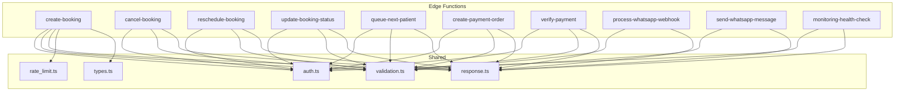
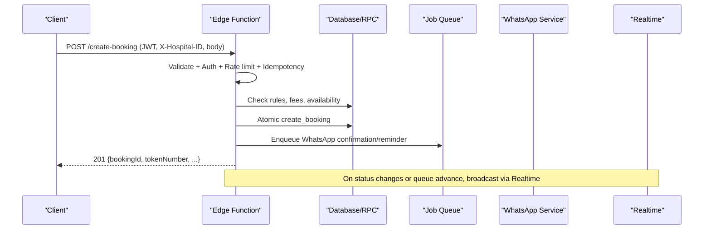
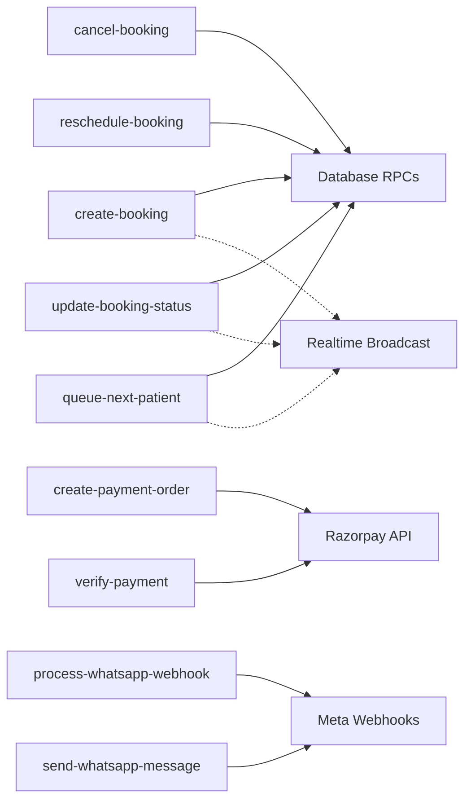

# API Reference

<cite>
**Referenced Files in This Document**
- [create-booking/index.ts](file://supabase/functions/create-booking/index.ts)
- [cancel-booking/index.ts](file://supabase/functions/cancel-booking/index.ts)
- [reschedule-booking/index.ts](file://supabase/functions/reschedule-booking/index.ts)
- [update-booking-status/index.ts](file://supabase/functions/update-booking-status/index.ts)
- [queue-next-patient/index.ts](file://supabase/functions/queue-next-patient/index.ts)
- [create-payment-order/index.ts](file://supabase/functions/create-payment-order/index.ts)
- [verify-payment/index.ts](file://supabase/functions/verify-payment/index.ts)
- [process-whatsapp-webhook/index.ts](file://supabase/functions/process-whatsapp-webhook/index.ts)
- [send-whatsapp-message/index.ts](file://supabase/functions/send-whatsapp-message/index.ts)
- [monitoring-health-check/index.ts](file://supabase/functions/monitoring-health-check/index.ts)
- [_shared/auth.ts](file://supabase/functions/_shared/auth.ts)
- [_shared/validation.ts](file://supabase/functions/_shared/validation.ts)
- [_shared/response.ts](file://supabase/functions/_shared/response.ts)
- [_shared/rate_limit.ts](file://supabase/functions/_shared/rate_limit.ts)
- [_shared/types.ts](file://supabase/functions/_shared/types.ts)
</cite>

## Table of Contents

1. Introduction
2. Project Structure
3. Core Components
4. Architecture Overview
5. Detailed Component Analysis
6. Dependency Analysis
7. Performance Considerations
8. Troubleshooting Guide
9. Conclusion
10. Appendices

## Introduction

This document provides a comprehensive API reference for the Setura Hospital OS
edge functions. It covers REST endpoints, webhook endpoints, authentication and
authorization, request/response schemas, error handling, rate limiting,
idempotency, real-time updates via Supabase Realtime, and practical integration
guidance with examples.

All endpoints are implemented as Deno Edge Functions under supabase/functions.
Shared utilities handle authentication, validation, responses, rate limiting,
tracing, metrics, and audit logging.

## Project Structure

The API surface is organized by feature:

- Booking lifecycle: create, cancel, reschedule, status transitions, queue
  management
- Payments: order creation and verification (Razorpay)
- Messaging: WhatsApp webhooks and outbound message sending
- Operations: health monitoring

**Diagram sources**

- [create-booking/index.ts:1-666](file://supabase/functions/create-booking/index.ts#L1-L666)
- [cancel-booking/index.ts:1-482](file://supabase/functions/cancel-booking/index.ts#L1-L482)
- [reschedule-booking/index.ts:1-612](file://supabase/functions/reschedule-booking/index.ts#L1-L612)
- [update-booking-status/index.ts:1-642](file://supabase/functions/update-booking-status/index.ts#L1-L642)
- [queue-next-patient/index.ts:1-409](file://supabase/functions/queue-next-patient/index.ts#L1-L409)
- [create-payment-order/index.ts:1-407](file://supabase/functions/create-payment-order/index.ts#L1-L407)
- [verify-payment/index.ts:1-480](file://supabase/functions/verify-payment/index.ts#L1-L480)
- [process-whatsapp-webhook/index.ts:1-657](file://supabase/functions/process-whatsapp-webhook/index.ts#L1-L657)
- [send-whatsapp-message/index.ts:1-583](file://supabase/functions/send-whatsapp-message/index.ts#L1-L583)
- [monitoring-health-check/index.ts:1-231](file://supabase/functions/monitoring-health-check/index.ts#L1-L231)
- [_shared/auth.ts:1-237](file://supabase/functions/_shared/auth.ts#L1-L237)
- [_shared/validation.ts:1-157](file://supabase/functions/_shared/validation.ts#L1-L157)
- [_shared/response.ts:1-206](file://supabase/functions/_shared/response.ts#L1-L206)
- [_shared/rate_limit.ts:1-124](file://supabase/functions/_shared/rate_limit.ts#L1-L124)
- [_shared/types.ts:1-329](file://supabase/functions/_shared/types.ts#L1-L329)

**Section sources**

- [create-booking/index.ts:1-666](file://supabase/functions/create-booking/index.ts#L1-L666)
- [_shared/auth.ts:1-237](file://supabase/functions/_shared/auth.ts#L1-L237)
- [_shared/validation.ts:1-157](file://supabase/functions/_shared/validation.ts#L1-L157)
- [_shared/response.ts:1-206](file://supabase/functions/_shared/response.ts#L1-L206)
- [_shared/rate_limit.ts:1-124](file://supabase/functions/_shared/rate_limit.ts#L1-L124)
- [_shared/types.ts:1-329](file://supabase/functions/_shared/types.ts#L1-L329)

## Core Components

- Authentication and Authorization
  - JWT extraction and validation via Supabase Auth client
  - Role resolution from database (authoritative), hospital-scoped access
    control
  - Role hierarchy and helper checks
  - Middleware wrapper to enforce auth and roles
- Request Validation
  - Zod-based schemas for all inbound bodies
  - Phone normalization and date constraints
- Response Standardization
  - Consistent success/error envelopes with correlationId and timestamp
  - Typed helpers for common statuses (401, 403, 409, 422, 429, 500)
- Rate Limiting
  - Distributed sliding window using booking_attempt_logs
  - Blocked numbers support
  - IP extraction from headers
- Idempotency
  - Idempotency-Key header enforcement for write endpoints
  - Deduplication at function level and DB constraint where applicable
- Realtime Updates
  - Broadcasts on queue advances and certain booking status changes
- Audit and Metrics
  - Structured logging, metrics collection, and audit events

**Section sources**

- [_shared/auth.ts:1-237](file://supabase/functions/_shared/auth.ts#L1-L237)
- [_shared/validation.ts:1-157](file://supabase/functions/_shared/validation.ts#L1-L157)
- [_shared/response.ts:1-206](file://supabase/functions/_shared/response.ts#L1-L206)
- [_shared/rate_limit.ts:1-124](file://supabase/functions/_shared/rate_limit.ts#L1-L124)
- [_shared/types.ts:1-329](file://supabase/functions/_shared/types.ts#L1-L329)

## Architecture Overview

High-level flow across endpoints:

- Clients authenticate with Bearer JWT and include X-Hospital-ID
- Endpoints validate inputs, enforce roles/hospital access, apply idempotency
  and rate limits
- Business logic executes atomic DB operations (often via RPCs)
- Side effects (WhatsApp notifications, reminders, feedback requests) are
  enqueued as jobs
- Realtime broadcasts push live updates for queue and status changes
- Webhooks receive external events (Meta WhatsApp, Razorpay) and process them
  idempotently

**Diagram sources**

- [create-booking/index.ts:67-666](file://supabase/functions/create-booking/index.ts#L67-L666)
- [update-booking-status/index.ts:130-642](file://supabase/functions/update-booking-status/index.ts#L130-L642)
- [queue-next-patient/index.ts:46-409](file://supabase/functions/queue-next-patient/index.ts#L46-L409)

## Detailed Component Analysis

### Authentication and Authorization

- Method: Bearer JWT required on most endpoints
- Required Headers:
  - Authorization: Bearer <jwt>
  - X-Hospital-ID: <hospital_uuid>
- Roles:
  - global_admin, hospital_admin, doctor, receptionist
- Enforcement:
  - resolveAuth validates JWT and loads profile and role
  - requireRole restricts endpoints to specific roles
  - Hospital-scoped access enforced per request

Example request headers:

- Authorization: Bearer eyJhbGciOi...
- X-Hospital-ID: 00000000-0000-0000-0000-000000000001

Error responses:

- 401 UNAUTHORIZED when missing/invalid/expired token
- 403 FORBIDDEN when role insufficient or wrong hospital

**Section sources**

- [_shared/auth.ts:22-170](file://supabase/functions/_shared/auth.ts#L22-L170)
- [_shared/response.ts:114-132](file://supabase/functions/_shared/response.ts#L114-L132)

### Create Booking

- Endpoint: POST /create-booking
- Auth: JWT + X-Hospital-ID; roles: receptionist, hospital_admin, doctor,
  global_admin
- Idempotency: Idempotency-Key header supported
- Rate Limiting: Per phone/IP within configurable window
- Body Schema:
  - hospitalId: string (UUID)
  - queueSessionId: string (UUID, optional)
  - patientName: string (min 2, max 100)
  - patientPhone: string (normalized Indian mobile)
  - patientAge: number (optional)
  - patientGender: "M" | "F" | "Other" (optional)
  - village: string (optional)
  - bloodGroup: enum (optional)
  - hasDiabetes: boolean
  - hasBp: boolean
  - bookingSource: "online" | "manual_free" | "manual_whatsapp" | "walkin"
  - doctorId: string (UUID, optional)
  - appointmentDate: string (YYYY-MM-DD, future, within hospital’s
    max_advance_booking_days)
- Success Response (201):
  - bookingId: string
  - tokenNumber: number
  - bookingReference: string
  - estimatedWaitMinutes: number | null
  - patientId: string
  - appointmentDate: string
  - queueSessionId: string | null
  - fees: { platformFee, receptionistFee, hospitalFee, totalAmount }
- Errors:
  - 400/422 validation errors
  - 409 duplicate idempotency key returns existing booking
  - 429 rate limit exceeded
  - 500 internal errors

Example call:

- POST /create-booking
- Headers: Authorization, X-Hospital-ID, Idempotency-Key
- Body: { hospitalId, patientName, patientPhone, hasDiabetes, hasBp,
  bookingSource, appointmentDate, ... }

**Section sources**

- [create-booking/index.ts:67-666](file://supabase/functions/create-booking/index.ts#L67-L666)
- [_shared/validation.ts:71-90](file://supabase/functions/_shared/validation.ts#L71-L90)
- [_shared/rate_limit.ts:22-111](file://supabase/functions/_shared/rate_limit.ts#L22-L111)
- [_shared/response.ts:44-67](file://supabase/functions/_shared/response.ts#L44-L67)

### Cancel Booking

- Endpoint: POST /cancel-booking
- Auth: JWT + X-Hospital-ID; roles: receptionist, hospital_admin, global_admin
- Body Schema:
  - bookingId: string (UUID)
  - cancellationReason: string (3–500 chars)
  - initiateRefund: boolean (default false)
- Behavior:
  - Marks booking as cancelled if allowed
  - Optionally initiates refund for paid bookings
  - Sends WhatsApp cancellation notification
  - Recalculates queue position if applicable
- Success Response (200):
  - bookingId: string
  - cancelled: boolean
  - alreadyCancelled: boolean
  - refundInitiated: boolean
- Errors:
  - 400/422 invalid state or not found
  - 409 concurrency conflict
  - 500 internal errors

Example call:

- POST /cancel-booking
- Headers: Authorization, X-Hospital-ID
- Body: { bookingId, cancellationReason, initiateRefund }

**Section sources**

- [cancel-booking/index.ts:67-482](file://supabase/functions/cancel-booking/index.ts#L67-L482)

### Reschedule Booking

- Endpoint: POST /reschedule-booking
- Auth: JWT + X-Hospital-ID; roles: receptionist, hospital_admin, global_admin
- Idempotency: Supported
- Body Schema:
  - bookingId: string (UUID)
  - newDate: string (YYYY-MM-DD, future, within booking window)
  - newDoctorId: string (UUID, optional)
  - reason: string (optional)
- Behavior:
  - Validates original booking state and hospital rules
  - Checks doctor availability if provided
  - Marks original as rescheduled and creates new booking
  - Links carry-forward and sends WhatsApp notification
- Success Response (200):
  - originalBookingId: string
  - newBookingId: string
  - newTokenNumber: number
  - newDate: string
- Errors:
  - 400/422 validation or rule violations
  - 409 concurrency conflict
  - 500 internal errors

Example call:

- POST /reschedule-booking
- Headers: Authorization, X-Hospital-ID, Idempotency-Key
- Body: { bookingId, newDate, newDoctorId?, reason? }

**Section sources**

- [reschedule-booking/index.ts:51-612](file://supabase/functions/reschedule-booking/index.ts#L51-L612)

### Update Booking Status

- Endpoint: POST /update-booking-status
- Auth: JWT + X-Hospital-ID; roles: receptionist, hospital_admin, doctor,
  global_admin
- Doctor restrictions: can only update their own patients and set specific
  statuses
- Body Schema:
  - bookingId: string (UUID)
  - newStatus: "checked_in" | "waiting" | "called" | "in_consultation" |
    "completed" | "cancelled" | "no_show" | "skipped"
  - notes: string (optional)
- Behavior:
  - Enforces state machine transitions
  - Broadcasts realtime updates on certain transitions
  - Enqueues WhatsApp notifications and feedback requests
- Success Response (200):
  - bookingId: string
  - status: string
  - changed: boolean
- Errors:
  - 400/422 invalid transition or terminal state
  - 409 concurrency conflict
  - 500 internal errors

Example call:

- POST /update-booking-status
- Headers: Authorization, X-Hospital-ID
- Body: { bookingId, newStatus, notes? }

**Section sources**

- [update-booking-status/index.ts:130-642](file://supabase/functions/update-booking-status/index.ts#L130-L642)

### Advance Queue (Next Patient)

- Endpoint: POST /queue-next-patient
- Auth: JWT + X-Hospital-ID; roles: receptionist, hospital_admin, global_admin
- Body Schema:
  - queueSessionId: string (UUID)
- Behavior:
  - Advances queue atomically
  - Broadcasts realtime update
  - Enqueues WhatsApp “patient called” notification
- Success Response (200):
  - nextToken: number | null
  - queueSessionId: string
  - queueExhausted: boolean
  - calledBookingId: string | null
  - calledPatientName: string | null
- Errors:
  - 400/422 session not found or inactive
  - 500 internal errors

Example call:

- POST /queue-next-patient
- Headers: Authorization, X-Hospital-ID
- Body: { queueSessionId }

**Section sources**

- [queue-next-patient/index.ts:46-409](file://supabase/functions/queue-next-patient/index.ts#L46-L409)

### Create Payment Order (Razorpay)

- Endpoint: POST /create-payment-order
- Auth: JWT + X-Hospital-ID; roles: receptionist, hospital_admin, global_admin
- Idempotency: Supported
- Body Schema:
  - bookingId: string (UUID)
- Behavior:
  - Validates booking eligibility and amount
  - Creates Razorpay order server-side
  - Stores payment_order row immutably
  - Returns public key and order details for frontend checkout
- Success Response (201 or 200 if reused):
  - paymentOrderId: string
  - razorpayOrderId: string
  - amountPaise: number
  - currency: "INR"
  - bookingId: string
  - bookingReference: string
  - razorpayKeyId: string (public key)
- Errors:
  - 400/422 invalid booking or zero fee
  - 500 internal errors

Example call:

- POST /create-payment-order
- Headers: Authorization, X-Hospital-ID, Idempotency-Key
- Body: { bookingId }

**Section sources**

- [create-payment-order/index.ts:104-407](file://supabase/functions/create-payment-order/index.ts#L104-L407)

### Verify Payment (Webhook and Frontend Callback)

- Endpoint: POST /verify-payment
- Two modes:
  - Razorpay webhook: verify HMAC signature, process captured/refund events
  - Frontend callback: verify Razorpay signature, capture payment
- Auth:
  - Webhook path: no JWT, verifies X-Razorpay-Signature
  - Frontend path: JWT + X-Hospital-ID; roles: receptionist, hospital_admin,
    global_admin
- Frontend Body Schema:
  - razorpayOrderId: string
  - razorpayPaymentId: string
  - razorpaySignature: string
  - bookingId: string (UUID)
- Behavior:
  - Idempotent capture via database RPC
  - Audits and enqueues post-payment tasks (e.g., SLA computation)
- Success Response (200):
  - verified: boolean
  - wasDuplicate: boolean
  - bookingId: string
- Errors:
  - 400/422 signature verification failed or invalid booking
  - 500 internal errors

Example calls:

- Webhook: POST /verify-payment with X-Razorpay-Signature header and Razorpay
  payload
- Frontend: POST /verify-payment with JWT, X-Hospital-ID, and signature fields

**Section sources**

- [verify-payment/index.ts:188-480](file://supabase/functions/verify-payment/index.ts#L188-L480)

### WhatsApp Webhook (Meta Cloud API)

- Endpoint: POST /process-whatsapp-webhook
- Purpose: Receive delivery/read receipts and incoming messages
- Security:
  - GET: Meta verification challenge using hub.verify_token
  - POST: Optional HMAC verification using X-Hub-Signature-256 and app secret
- Behavior:
  - Deduplicates events by hash
  - Maps statuses to internal states
  - Queues incoming messages for processing
- Response: Always HTTP 200 to prevent retries

Example calls:

- GET
  /process-whatsapp-webhook?hub.mode=subscribe&hub.verify_token=<token>&hub.challenge=<challenge>
- POST /process-whatsapp-webhook with Meta payload and optional signature

**Section sources**

- [process-whatsapp-webhook/index.ts:124-657](file://supabase/functions/process-whatsapp-webhook/index.ts#L124-L657)

### Send WhatsApp Message (Worker-only)

- Endpoint: POST /send-whatsapp-message
- Auth: Internal worker secret via X-Worker-Secret header
- Body Schema:
  - phone: string (E.164-like)
  - template_name: one of allowed templates
  - booking_id, patient_name, token_number, appointment_date, new_date,
    estimated_wait, cancellation_reason, wa_message_id, hospital_id (optional)
- Behavior:
  - Builds template components
  - Calls Meta Cloud API
  - Handles rate limits and permanent failures
- Success Response (200):
  - sent: boolean
  - messageId: string | null
- Errors:
  - 403 forbidden if worker secret invalid
  - 422 unsupported template
  - 500 internal errors

Example call:

- POST /send-whatsapp-message
- Headers: X-Worker-Secret
- Body: { phone, template_name, ... }

**Section sources**

- [send-whatsapp-message/index.ts:326-583](file://supabase/functions/send-whatsapp-message/index.ts#L326-L583)

### Monitoring Health Check

- Endpoint: GET/POST /monitoring-health-check
- GET: Lightweight uptime check without auth; returns status, score, snapshot
  info
- POST: Full health report requiring global_admin role
- Success Response (GET):
  - status: "healthy" | "degraded" | "unhealthy"
  - score: number
  - snapshot_at: string
  - crashed_workers: number
  - job_queue_pending: number
- Success Response (POST):
  - health, openAlerts, queueHealth, workers, mvHealth, dlqSummary, partitions,
    revenueBacklog, generatedAt, durationMs
- Errors:
  - 503 if DB unavailable or unhealthy
  - 401/403 for unauthorized POST

Example calls:

- GET /monitoring-health-check
- POST /monitoring-health-check (global_admin)

**Section sources**

- [monitoring-health-check/index.ts:22-231](file://supabase/functions/monitoring-health-check/index.ts#L22-L231)

## Dependency Analysis

Key dependencies and interactions:

- All mutating endpoints depend on shared auth, validation, response, and
  audit/metrics utilities
- Database interactions use service-role client and often invoke RPCs for atomic
  operations
- External integrations:
  - Meta Cloud API for WhatsApp messaging
  - Razorpay for payments
- Realtime broadcasting integrates with queue and status updates

**Diagram sources**

- [create-booking/index.ts:67-666](file://supabase/functions/create-booking/index.ts#L67-L666)
- [create-payment-order/index.ts:104-407](file://supabase/functions/create-payment-order/index.ts#L104-L407)
- [verify-payment/index.ts:188-480](file://supabase/functions/verify-payment/index.ts#L188-L480)
- [process-whatsapp-webhook/index.ts:124-657](file://supabase/functions/process-whatsapp-webhook/index.ts#L124-L657)
- [send-whatsapp-message/index.ts:326-583](file://supabase/functions/send-whatsapp-message/index.ts#L326-L583)

**Section sources**

- [create-booking/index.ts:67-666](file://supabase/functions/create-booking/index.ts#L67-L666)
- [create-payment-order/index.ts:104-407](file://supabase/functions/create-payment-order/index.ts#L104-L407)
- [verify-payment/index.ts:188-480](file://supabase/functions/verify-payment/index.ts#L188-L480)
- [process-whatsapp-webhook/index.ts:124-657](file://supabase/functions/process-whatsapp-webhook/index.ts#L124-L657)
- [send-whatsapp-message/index.ts:326-583](file://supabase/functions/send-whatsapp-message/index.ts#L326-L583)

## Performance Considerations

- Idempotency: Use Idempotency-Key on create-booking, reschedule-booking, and
  create-payment-order to safely retry
- Rate Limiting: Respect Retry-After on 429 responses; implement exponential
  backoff
- Concurrency: Endpoints use optimistic concurrency (status checks) and atomic
  RPCs to avoid races
- External APIs: Timeouts applied to Razorpay and Meta calls; non-fatal side
  effects (notifications) are enqueued and do not block core flows
- Realtime: Broadcasts are fire-and-forget; clients should handle transient
  disconnects

[No sources needed since this section provides general guidance]

## Troubleshooting Guide

Common issues and resolutions:

- 401 Unauthorized: Ensure valid Bearer token and correct X-Hospital-ID
- 403 Forbidden: Insufficient role or wrong hospital context
- 422 Validation Error: Check field types, formats, and constraints (phone,
  dates, enums)
- 409 Conflict: Duplicate idempotency key or concurrent modification; retry with
  same key or refresh state
- 429 Rate Limited: Wait for Retry-After seconds; reduce request frequency
- 500 Internal Error: Check logs via correlationId; inspect DB RPC errors and
  external API responses

Debugging tips:

- Include correlationId in logs and share with support
- For webhooks, verify HMAC signatures and ensure endpoint returns 200
- For payments, confirm Razorpay signature verification and idempotent capture
  behavior

**Section sources**

- [_shared/response.ts:69-190](file://supabase/functions/_shared/response.ts#L69-L190)
- [_shared/auth.ts:22-170](file://supabase/functions/_shared/auth.ts#L22-L170)
- [_shared/validation.ts:94-134](file://supabase/functions/_shared/validation.ts#L94-L134)
- [_shared/rate_limit.ts:22-111](file://supabase/functions/_shared/rate_limit.ts#L22-L111)

## Conclusion

Setura Hospital OS exposes a robust, secure, and scalable API surface through
edge functions. Endpoints enforce strong authentication, role-based
authorization, idempotency, and rate limiting. Webhooks integrate with Meta
WhatsApp and Razorpay, while realtime broadcasts provide live updates. Follow
the schemas and error patterns documented here to build reliable integrations.

[No sources needed since this section summarizes without analyzing specific
files]

## Appendices

### Realtime Subscriptions

- Trigger points:
  - Queue advances: queue-next-patient broadcasts next token
  - Status changes: update-booking-status broadcasts on certain transitions
- Client pattern:
  - Subscribe to relevant channels (e.g., queue sessions, bookings)
  - Handle reconnects and stale data by reconciling with latest state
- Notes:
  - Broadcasts are best-effort; always treat DB as source of truth

[No sources needed since this section doesn't analyze specific files]

### Versioning Considerations

- Current versioning approach:
  - No explicit URL versioning observed; rely on stable schemas and
    backward-compatible changes
- Recommendations:
  - Introduce API version headers or paths when breaking changes are necessary
  - Deprecate old versions with migration windows

[No sources needed since this section doesn't analyze specific files]

### Example Requests and Responses

- Create Booking
  - Request:
    - Method: POST
    - Path: /create-booking
    - Headers: Authorization: Bearer <jwt>, X-Hospital-ID: <uuid>,
      Idempotency-Key: <uuid>
    - Body: { hospitalId, patientName, patientPhone, hasDiabetes, hasBp,
      bookingSource, appointmentDate, ... }
  - Response (201):
    - { success: true, data: { bookingId, tokenNumber, bookingReference,
      estimatedWaitMinutes, patientId, appointmentDate, queueSessionId, fees },
      correlationId, timestamp }

- Cancel Booking
  - Request:
    - Method: POST
    - Path: /cancel-booking
    - Headers: Authorization: Bearer <jwt>, X-Hospital-ID: <uuid>
    - Body: { bookingId, cancellationReason, initiateRefund }
  - Response (200):
    - { success: true, data: { bookingId, cancelled, alreadyCancelled,
      refundInitiated }, correlationId, timestamp }

- Reschedule Booking
  - Request:
    - Method: POST
    - Path: /reschedule-booking
    - Headers: Authorization: Bearer <jwt>, X-Hospital-ID: <uuid>,
      Idempotency-Key: <uuid>
    - Body: { bookingId, newDate, newDoctorId?, reason? }
  - Response (200):
    - { success: true, data: { originalBookingId, newBookingId, newTokenNumber,
      newDate }, correlationId, timestamp }

- Update Booking Status
  - Request:
    - Method: POST
    - Path: /update-booking-status
    - Headers: Authorization: Bearer <jwt>, X-Hospital-ID: <uuid>
    - Body: { bookingId, newStatus, notes? }
  - Response (200):
    - { success: true, data: { bookingId, status, changed }, correlationId,
      timestamp }

- Advance Queue
  - Request:
    - Method: POST
    - Path: /queue-next-patient
    - Headers: Authorization: Bearer <jwt>, X-Hospital-ID: <uuid>
    - Body: { queueSessionId }
  - Response (200):
    - { success: true, data: { nextToken, queueSessionId, queueExhausted,
      calledBookingId, calledPatientName }, correlationId, timestamp }

- Create Payment Order
  - Request:
    - Method: POST
    - Path: /create-payment-order
    - Headers: Authorization: Bearer <jwt>, X-Hospital-ID: <uuid>,
      Idempotency-Key: <uuid>
    - Body: { bookingId }
  - Response (201/200):
    - { success: true, data: { paymentOrderId, razorpayOrderId, amountPaise,
      currency, bookingId, bookingReference, razorpayKeyId }, correlationId,
      timestamp }

- Verify Payment
  - Webhook:
    - Method: POST
    - Path: /verify-payment
    - Headers: X-Razorpay-Signature: <hmac>
    - Body: Razorpay event payload
    - Response: 200 { status: "ok" }
  - Frontend:
    - Method: POST
    - Path: /verify-payment
    - Headers: Authorization: Bearer <jwt>, X-Hospital-ID: <uuid>
    - Body: { razorpayOrderId, razorpayPaymentId, razorpaySignature, bookingId }
    - Response (200):
      - { success: true, data: { verified, wasDuplicate, bookingId },
        correlationId, timestamp }

- WhatsApp Webhook
  - Verification:
    - Method: GET
    - Path:
      /process-whatsapp-webhook?hub.mode=subscribe&hub.verify_token=<token>&hub.challenge=<challenge>
    - Response: 200 <challenge>
  - Events:
    - Method: POST
    - Path: /process-whatsapp-webhook
    - Headers: X-Hub-Signature-256: <hmac> (optional)
    - Body: Meta webhook payload
    - Response: 200 { status: "ok" }

- Send WhatsApp Message (Worker)
  - Request:
    - Method: POST
    - Path: /send-whatsapp-message
    - Headers: X-Worker-Secret: <secret>
    - Body: { phone, template_name, ... }
  - Response (200):
    - { success: true, data: { sent, messageId }, correlationId, timestamp }

- Health Check
  - GET /monitoring-health-check
    - Response (200/503): { status, score, snapshot_at, crashed_workers,
      job_queue_pending }
  - POST /monitoring-health-check (global_admin)
    - Response (200): { health, openAlerts, queueHealth, workers, mvHealth,
      dlqSummary, partitions, revenueBacklog, generatedAt, durationMs }

[No sources needed since this section provides example patterns based on
analyzed endpoints]
