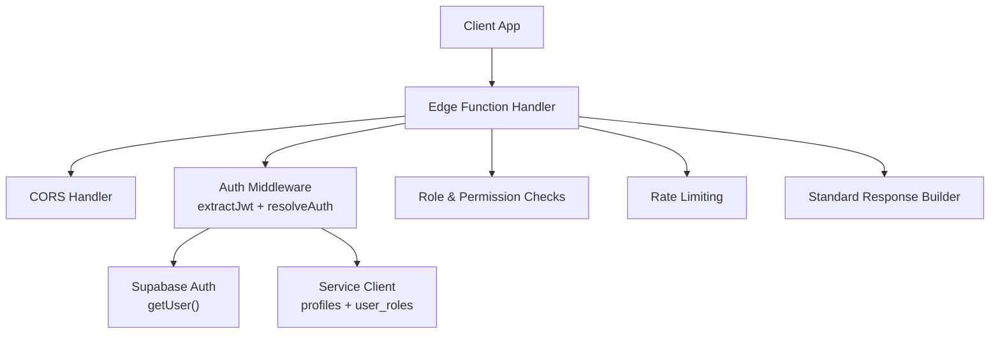
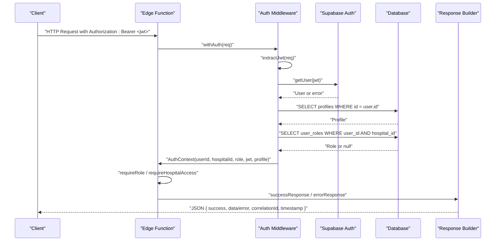
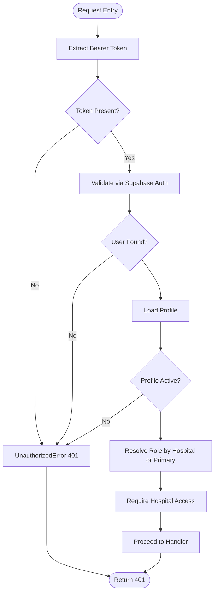
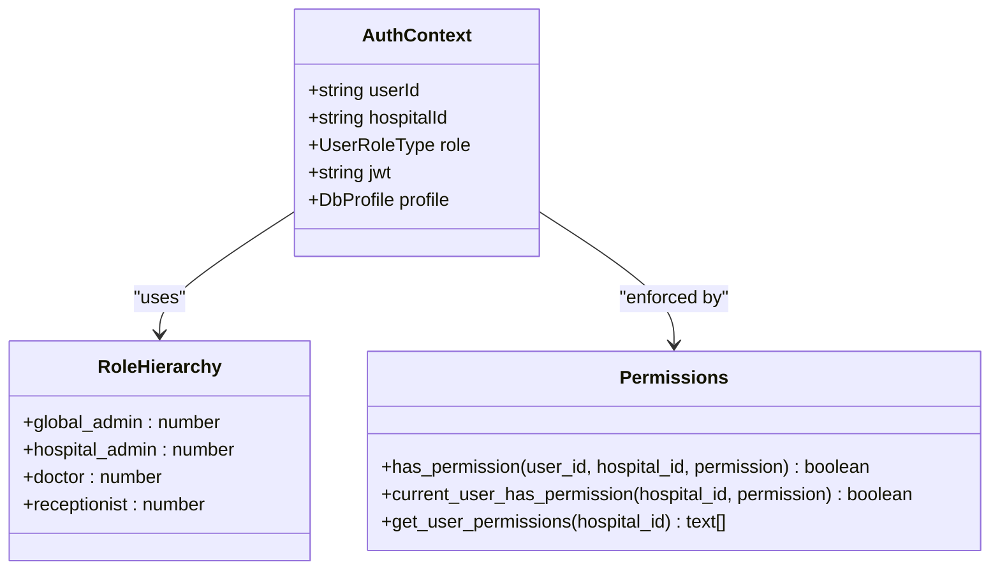
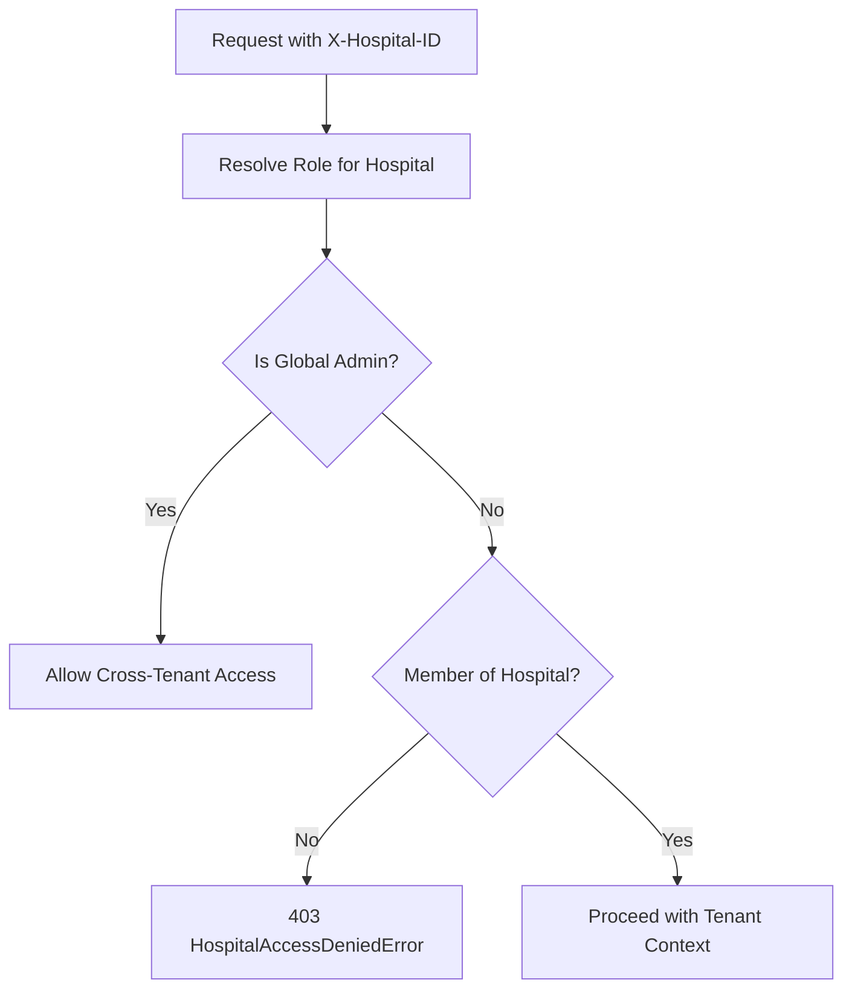
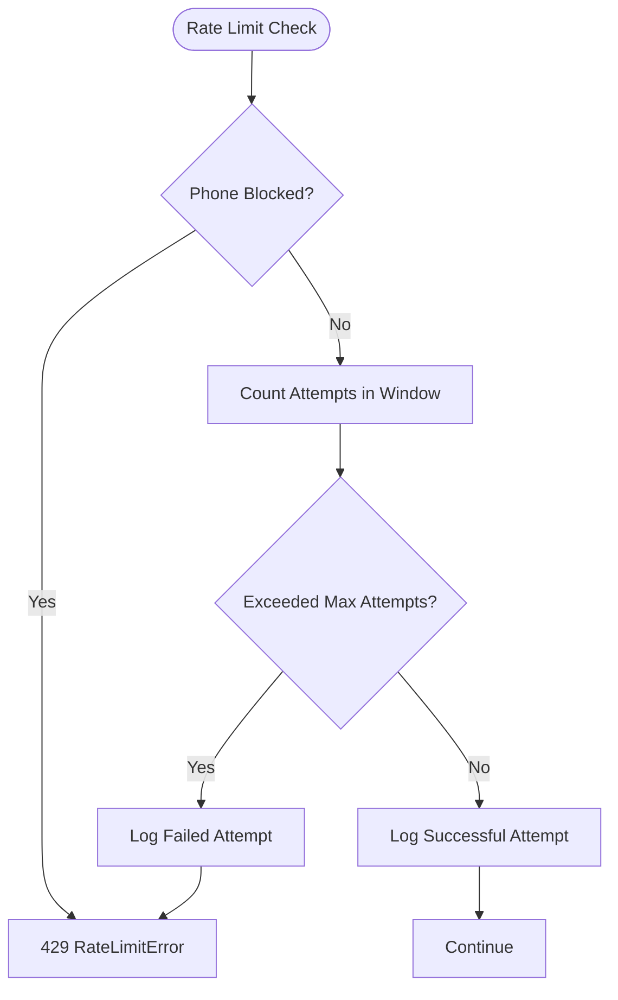
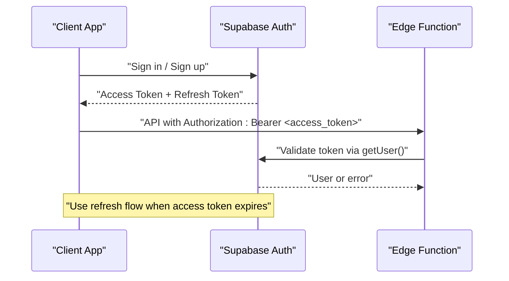
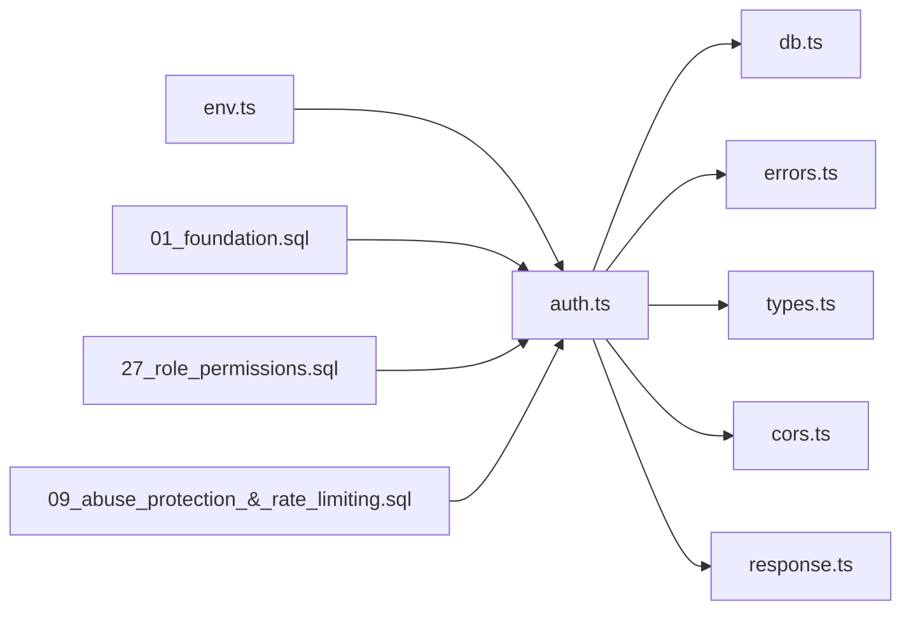

# Authentication APIs

<cite>
**Referenced Files in This Document**
- [auth.ts](file://supabase/functions/_shared/auth.ts)
- [errors.ts](file://supabase/functions/_shared/errors.ts)
- [response.ts](file://supabase/functions/_shared/response.ts)
- [cors.ts](file://supabase/functions/_shared/cors.ts)
- [db.ts](file://supabase/functions/_shared/db.ts)
- [env.ts](file://supabase/functions/_shared/env.ts)
- [types.ts](file://supabase/functions/_shared/types.ts)
- [rate_limit.ts](file://supabase/functions/_shared/rate_limit.ts)
- [01_foundation.sql](file://supabase/migrations/01_foundation.sql)
- [27_role_permissions.sql](file://supabase/migrations/27_role_permissions.sql)
- [09_abuse_protection_&_rate_limiting.sql](file://supabase/migrations/09_abuse_protection_&_rate_limiting.sql)
- [config.toml](file://supabase/config.toml)
</cite>

## Table of Contents

1. Introduction
2. Project Structure
3. Core Components
4. Architecture Overview
5. Detailed Component Analysis
6. Dependency Analysis
7. Performance Considerations
8. Troubleshooting Guide
9. Conclusion
10. Appendices

## Introduction

This document specifies the authentication and authorization behavior for Setura
Hospital OS Edge Functions. It covers:

- How clients authenticate using JWT bearer tokens
- How tokens are validated and how roles and hospital context are resolved
- Multi-tenant isolation by hospital
- Role-based access control (RBAC) and permission checks
- Error responses, token expiration handling, and rate limiting
- Client-side integration guidance for obtaining and managing tokens via
  Supabase Auth

## Project Structure

Authentication is implemented as shared middleware used by Edge Functions:

- Request parsing and CORS handling
- JWT extraction from Authorization header
- JWT validation against Supabase Auth
- Profile and role resolution from database tables
- Hospital-scoped authorization
- RBAC enforcement helpers
- Standardized error and response formatting
- Rate limiting utilities

**Diagram sources**

- [auth.ts:24-124](file://supabase/functions/_shared/auth.ts#L24-L124)
- [db.ts:87-106](file://supabase/functions/_shared/db.ts#L87-L106)
- [cors.ts:6-33](file://supabase/functions/_shared/cors.ts#L6-L33)
- [response.ts:94-112](file://supabase/functions/_shared/response.ts#L94-L112)
- [rate_limit.ts:27-111](file://supabase/functions/_shared/rate_limit.ts#L27-L111)

**Section sources**

- [auth.ts:24-124](file://supabase/functions/_shared/auth.ts#L24-L124)
- [cors.ts:6-33](file://supabase/functions/_shared/cors.ts#L6-L33)
- [response.ts:94-112](file://supabase/functions/_shared/response.ts#L94-L112)
- [db.ts:87-106](file://supabase/functions/_shared/db.ts#L87-L106)
- [rate_limit.ts:27-111](file://supabase/functions/_shared/rate_limit.ts#L27-L111)

## Core Components

- JWT extraction and validation:
  - Extracts Bearer token from Authorization header
  - Validates via Supabase Auth.getUser() to handle signature, expiry, and
    revocation
- Profile and role resolution:
  - Loads profile from profiles table
  - Resolves role per hospital or primary role if no hospital context
  - Supports global_admin bypass for multi-tenant access
- RBAC and permissions:
  - Role hierarchy and helper checks
  - Database-backed permission matrix and SQL functions for RLS and
    function-level checks
- Tenant isolation:
  - Enforces hospital_id context on every request
  - Prevents cross-hospital data access unless global_admin
- Error handling:
  - Centralized typed errors with HTTP status codes and retry flags
  - Standardized JSON responses with correlationId and timestamps
- Rate limiting:
  - Sliding window based on booking_attempt_logs
  - Configurable windows and limits via environment variables

**Section sources**

- [auth.ts:24-185](file://supabase/functions/_shared/auth.ts#L24-L185)
- [errors.ts:70-150](file://supabase/functions/_shared/errors.ts#L70-L150)
- [response.ts:44-112](file://supabase/functions/_shared/response.ts#L44-L112)
- [27_role_permissions.sql:133-212](file://supabase/migrations/27_role_permissions.sql#L133-L212)
- [09_abuse_protection_&_rate_limiting.sql:81-114](file://supabase/migrations/09_abuse_protection_&_rate_limiting.sql#L81-L114)
- [env.ts:183-191](file://supabase/functions/_shared/env.ts#L183-L191)

## Architecture Overview

The authentication flow enforces identity, tenant context, and permissions
before any business logic executes.

**Diagram sources**

- [auth.ts:24-124](file://supabase/functions/_shared/auth.ts#L24-L124)
- [response.ts:44-112](file://supabase/functions/_shared/response.ts#L44-L112)
- [db.ts:87-106](file://supabase/functions/_shared/db.ts#L87-L106)

## Detailed Component Analysis

### Authentication Middleware

- Token extraction:
  - Reads Authorization header and expects scheme Bearer
- JWT validation:
  - Uses Supabase Auth client to validate token integrity and expiry
- Profile loading:
  - Ensures profile exists and account is active
- Role resolution:
  - If hospitalId provided, resolves role for that hospital
  - Otherwise loads primary role
  - global_admin can access any hospital without explicit membership
- Hospital access enforcement:
  - Rejects requests where user lacks membership to requested hospital
- Role checks:
  - Provides helpers to enforce minimum roles or specific roles

**Diagram sources**

- [auth.ts:24-124](file://supabase/functions/_shared/auth.ts#L24-L124)

**Section sources**

- [auth.ts:24-124](file://supabase/functions/_shared/auth.ts#L24-L124)

### Role-Based Access Control (RBAC)

- Roles:
  - global_admin, hospital_admin, doctor, receptionist
- Role hierarchy:
  - Numeric hierarchy supports future threshold checks
- Permission matrix:
  - role_permissions table defines allowed operations per role
- SQL helpers:
  - has_permission(user_id, hospital_id, permission)
  - current_user_has_permission(hospital_id, permission)
  - get_user_permissions(hospital_id) returns an array of permissions
- Enforcement:
  - In middleware: requireRole(auth, requiredRoles[])
  - In handlers: requireHospitalAccess(auth, hospitalId)
  - In DB: RLS policies and SECURITY DEFINER functions

**Diagram sources**

- [types.ts:264-270](file://supabase/functions/_shared/types.ts#L264-L270)
- [auth.ts:129-185](file://supabase/functions/_shared/auth.ts#L129-L185)
- [27_role_permissions.sql:133-212](file://supabase/migrations/27_role_permissions.sql#L133-L212)

**Section sources**

- [auth.ts:129-185](file://supabase/functions/_shared/auth.ts#L129-L185)
- [27_role_permissions.sql:70-126](file://supabase/migrations/27_role_permissions.sql#L70-L126)
- [27_role_permissions.sql:133-212](file://supabase/migrations/27_role_permissions.sql#L133-L212)
- [01_foundation.sql:20-30](file://supabase/migrations/01_foundation.sql#L20-L30)

### Multi-Tenant Security Isolation

- Every request must include X-Hospital-ID header for hospital-scoped operations
- Authorization resolves role within that hospital context
- global_admin bypasses tenant checks; other roles must be members of the
  specified hospital
- Database RLS ensures row-level isolation at the data layer

**Diagram sources**

- [auth.ts:78-124](file://supabase/functions/_shared/auth.ts#L78-L124)
- [27_role_permissions.sql:133-155](file://supabase/migrations/27_role_permissions.sql#L133-L155)

**Section sources**

- [auth.ts:78-124](file://supabase/functions/_shared/auth.ts#L78-L124)
- [27_role_permissions.sql:133-155](file://supabase/migrations/27_role_permissions.sql#L133-L155)

### Rate Limiting Strategy

- Backed by booking_attempt_logs table
- Sliding window defined by RATE_LIMIT_WINDOW_MINUTES and
  RATE_LIMIT_MAX_ATTEMPTS
- Checks blocked numbers and temporary restrictions
- Returns 429 with Retry-After when exceeded
- Logs both successful and failed attempts for observability

**Diagram sources**

- [rate_limit.ts:27-111](file://supabase/functions/_shared/rate_limit.ts#L27-L111)
- [09_abuse_protection_&_rate_limiting.sql:81-114](file://supabase/migrations/09_abuse_protection_&_rate_limiting.sql#L81-L114)

**Section sources**

- [rate_limit.ts:27-111](file://supabase/functions/_shared/rate_limit.ts#L27-L111)
- [env.ts:183-191](file://supabase/functions/_shared/env.ts#L183-L191)
- [09_abuse_protection_&_rate_limiting.sql:81-114](file://supabase/migrations/09_abuse_protection_&_rate_limiting.sql#L81-L114)

### Token Lifecycle and Refresh

- Tokens are issued and managed by Supabase Auth
- JWT expiry is configured in Supabase configuration
- Refresh token rotation is enabled
- Clients should use Supabase Auth SDK to obtain and refresh tokens; Edge
  Functions only validate incoming JWTs

**Diagram sources**

- [config.toml:150-170](file://supabase/config.toml#L150-L170)
- [auth.ts:53-60](file://supabase/functions/_shared/auth.ts#L53-L60)

**Section sources**

- [config.toml:150-170](file://supabase/config.toml#L150-L170)
- [auth.ts:53-60](file://supabase/functions/_shared/auth.ts#L53-L60)

### API Contract: Headers and Responses

- Required headers:
  - Authorization: Bearer <jwt>
  - X-Hospital-ID: <uuid> (for hospital-scoped endpoints)
  - Idempotency-Key: <uuid> (where applicable)
  - Content-Type: application/json
- Success response shape:
  - success: true
  - data: <payload>
  - correlationId: string
  - timestamp: ISO 8601
  - meta: optional metadata
- Error response shape:
  - success: false
  - error.code: machine-readable code
  - error.message: human-readable message
  - error.retryable: boolean
  - correlationId: string
  - timestamp: ISO 8601
  - fieldErrors: optional per-field errors

**Section sources**

- [cors.ts:6-33](file://supabase/functions/_shared/cors.ts#L6-L33)
- [response.ts:14-32](file://supabase/functions/_shared/response.ts#L14-L32)
- [response.ts:44-112](file://supabase/functions/_shared/response.ts#L44-L112)

### Example Requests

- Create a booking (authenticated):
  - Method: POST
  - Headers:
    - Authorization: Bearer <jwt>
    - X-Hospital-ID: <hospital_uuid>
    - Content-Type: application/json
  - Body fields: hospitalId, patientName, patientPhone, appointmentDate, etc.
- Cancel a booking (authenticated):
  - Method: PATCH or POST (as defined by endpoint)
  - Headers: Authorization, X-Hospital-ID
  - Body: bookingId or reference

Note: Use your preferred HTTP client to attach the Authorization header with a
valid Supabase access token obtained via the Supabase Auth SDK.

**Section sources**

- [auth.ts:24-30](file://supabase/functions/_shared/auth.ts#L24-L30)
- [response.ts:44-67](file://supabase/functions/_shared/response.ts#L44-L67)

## Dependency Analysis

- auth.ts depends on:
  - db.ts for service and auth clients
  - errors.ts for typed error classes
  - types.ts for AuthContext and UserRoleType
  - cors.ts for preflight handling
  - response.ts for standardized error mapping
- env.ts provides runtime configuration including rate limit parameters
- Migrations define schema and RBAC functions used by authorization logic

**Diagram sources**

- [auth.ts:13-20](file://supabase/functions/_shared/auth.ts#L13-L20)
- [db.ts:87-106](file://supabase/functions/_shared/db.ts#L87-L106)
- [env.ts:183-191](file://supabase/functions/_shared/env.ts#L183-L191)
- [01_foundation.sql:20-30](file://supabase/migrations/01_foundation.sql#L20-L30)
- [27_role_permissions.sql:133-212](file://supabase/migrations/27_role_permissions.sql#L133-L212)
- [09_abuse_protection_&_rate_limiting.sql:81-114](file://supabase/migrations/09_abuse_protection_&_rate_limiting.sql#L81-L114)

**Section sources**

- [auth.ts:13-20](file://supabase/functions/_shared/auth.ts#L13-L20)
- [db.ts:87-106](file://supabase/functions/_shared/db.ts#L87-L106)
- [env.ts:183-191](file://supabase/functions/_shared/env.ts#L183-L191)
- [01_foundation.sql:20-30](file://supabase/migrations/01_foundation.sql#L20-L30)
- [27_role_permissions.sql:133-212](file://supabase/migrations/27_role_permissions.sql#L133-L212)
- [09_abuse_protection_&_rate_limiting.sql:81-114](file://supabase/migrations/09_abuse_protection_&_rate_limiting.sql#L81-L114)

## Performance Considerations

- JWT validation is delegated to Supabase Auth to avoid manual decoding overhead
  and to benefit from key rotation
- Database queries for profile and role are minimal and indexed
- Rate limiting uses efficient sliding window counts with indexes on
  booking_attempt_logs
- Service vs anon vs auth clients are optimized for their use cases; auth client
  is created per request to enforce RLS correctly

[No sources needed since this section provides general guidance]

## Troubleshooting Guide

Common authentication failures and their causes:

- Missing Bearer token:
  - Ensure Authorization header is set with scheme Bearer
  - Expected response: 401 UNAUTHORIZED
- Invalid or expired token:
  - Token may have expired or been revoked
  - Expected response: 401 UNAUTHORIZED
- Inactive user account:
  - Profile is_active flag is false
  - Expected response: 401 UNAUTHORIZED
- Hospital access denied:
  - User not a member of the requested hospital and not global_admin
  - Expected response: 403 HOSPITAL_ACCESS_DENIED
- Insufficient role:
  - Endpoint requires a higher role than the user’s
  - Expected response: 403 ROLE_INSUFFICIENT
- Rate limit exceeded:
  - Too many requests in the configured window
  - Expected response: 429 RATE_LIMIT_EXCEEDED with Retry-After

Client-side token management tips:

- Obtain tokens via Supabase Auth SDK sign-in flows
- Store tokens securely and attach Authorization header to all requests
- Implement token refresh when access token expires
- Handle 401 responses by refreshing tokens and retrying once

**Section sources**

- [auth.ts:47-76](file://supabase/functions/_shared/auth.ts#L47-L76)
- [auth.ts:78-124](file://supabase/functions/_shared/auth.ts#L78-L124)
- [errors.ts:108-150](file://supabase/functions/_shared/errors.ts#L108-L150)
- [response.ts:114-132](file://supabase/functions/_shared/response.ts#L114-L132)
- [rate_limit.ts:80-101](file://supabase/functions/_shared/rate_limit.ts#L80-L101)

## Conclusion

Setura Hospital OS enforces robust, multi-tenant authentication and
authorization using Supabase Auth and database-backed RBAC. All requests must
present a valid Bearer token and specify the target hospital. The system
validates tokens centrally, resolves roles and permissions, and isolates tenants
at both the middleware and data layers. Errors are standardized and informative,
and rate limiting protects against abuse. Clients should manage tokens through
the Supabase Auth SDK and handle 401/403/429 responses appropriately.

[No sources needed since this section summarizes without analyzing specific
files]

## Appendices

### Environment Variables Relevant to Authentication and Rate Limiting

- SUPABASE_URL, SUPABASE_ANON_KEY, SUPABASE_SERVICE_ROLE_KEY
- APP_ENV, LOG_LEVEL, DEPLOYMENT_VERSION
- RATE_LIMIT_WINDOW_MINUTES, RATE_LIMIT_MAX_ATTEMPTS
- ALLOWED_ORIGINS

**Section sources**

- [env.ts:82-90](file://supabase/functions/_shared/env.ts#L82-L90)
- [env.ts:155-191](file://supabase/functions/_shared/env.ts#L155-L191)
- [env.ts:211-221](file://supabase/functions/_shared/env.ts#L211-L221)

### Database Schema Highlights for Authentication and RBAC

- profiles linked to auth.users
- user_roles maps users to hospitals and roles
- role_permissions defines granular permissions per role
- SQL functions provide centralized permission checks

**Section sources**

- [01_foundation.sql:155-256](file://supabase/migrations/01_foundation.sql#L155-L256)
- [27_role_permissions.sql:42-126](file://supabase/migrations/27_role_permissions.sql#L42-L126)
- [27_role_permissions.sql:133-212](file://supabase/migrations/27_role_permissions.sql#L133-L212)
