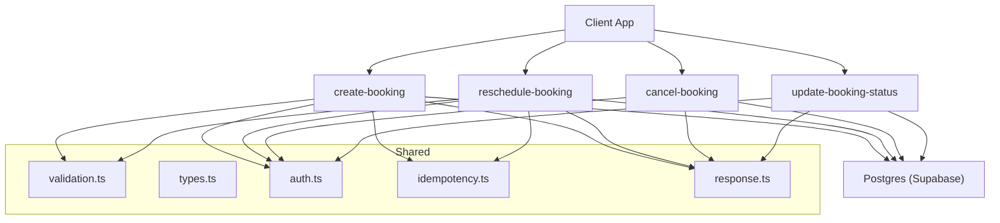
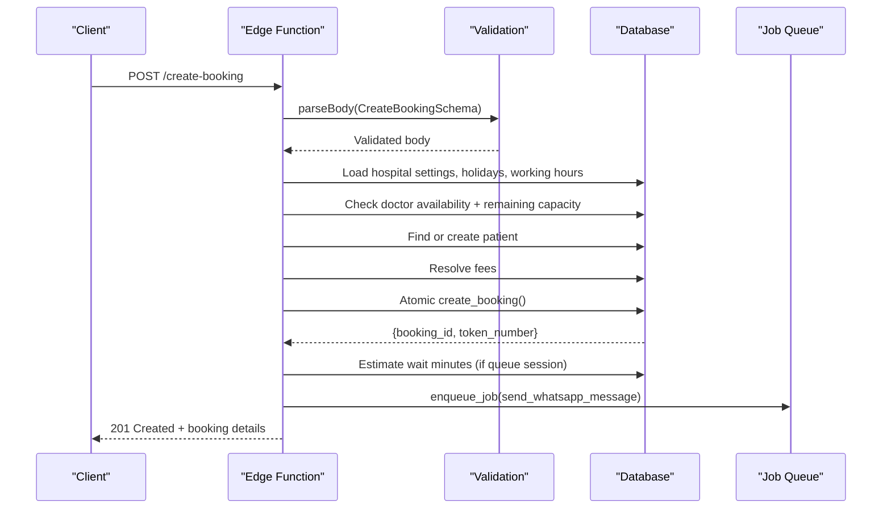
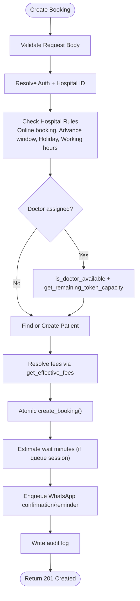
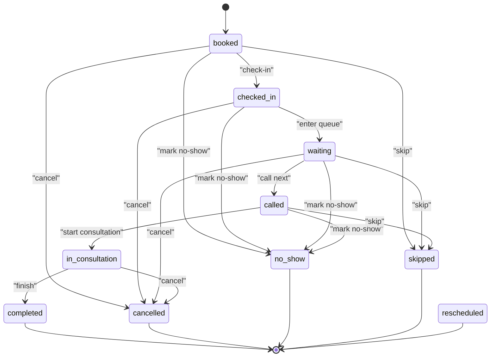
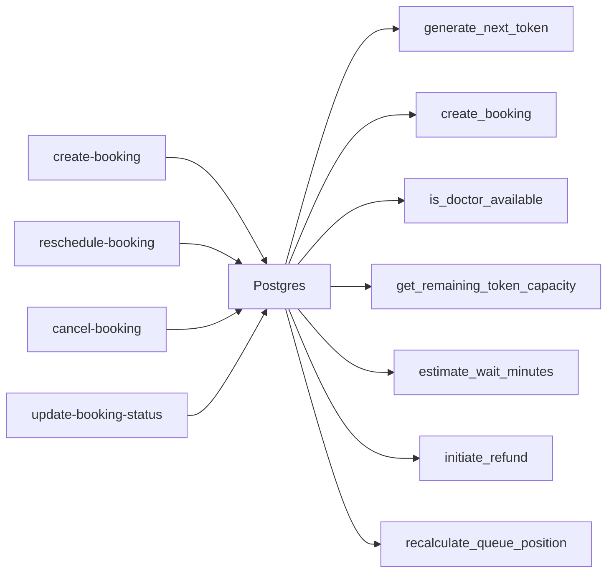

# Booking APIs

<cite>
**Referenced Files in This Document**
- [create-booking/index.ts](file://supabase/functions/create-booking/index.ts)
- [cancel-booking/index.ts](file://supabase/functions/cancel-booking/index.ts)
- [reschedule-booking/index.ts](file://supabase/functions/reschedule-booking/index.ts)
- [update-booking-status/index.ts](file://supabase/functions/update-booking-status/index.ts)
- [validation.ts](file://supabase/functions/_shared/validation.ts)
- [types.ts](file://supabase/functions/_shared/types.ts)
- [02_atomic_token_engine_&_bookings.sql](file://supabase/migrations/02_atomic_token_engine_&_bookings.sql)
- [28_booking_enhancements.sql](file://supabase/migrations/28_booking_enhancements.sql)
- [29_cancellation_policy.sql](file://supabase/migrations/29_cancellation_policy.sql)
</cite>

## Table of Contents

1. [Introduction](#introduction)
2. [Project Structure](#project-structure)
3. [Core Components](#core-components)
4. [Architecture Overview](#architecture-overview)
5. [Detailed Component Analysis](#detailed-component-analysis)
6. [Dependency Analysis](#dependency-analysis)
7. [Performance Considerations](#performance-considerations)
8. [Troubleshooting Guide](#troubleshooting-guide)
9. [Conclusion](#conclusion)
10. [Appendices](#appendices)

## Introduction

This document provides detailed API documentation for booking management
endpoints. It covers appointment creation with conflict detection, capacity
validation, and slot availability checking; the full booking lifecycle states;
request/response schemas including patient information, doctor selection, time
slots, and fee calculations; cancellation policies; rescheduling rules; status
update workflows; common scenarios such as same-day appointments, recurring
bookings, and bulk operations; and error handling for scheduling conflicts,
unavailable slots, and validation failures.

## Project Structure

The booking system is implemented as a set of Edge Functions (Deno) backed by
Supabase Postgres. Core files:

- Create, cancel, reschedule, and status update endpoints are each implemented
  as separate functions.
- Shared utilities handle validation, auth, idempotency, logging, metrics, and
  responses.
- Database schema and business logic live in SQL migrations, including atomic
  token generation, queue sessions, and policy engines.

**Diagram sources**

- [create-booking/index.ts:67-124](file://supabase/functions/create-booking/index.ts#L67-L124)
- [reschedule-booking/index.ts:51-125](file://supabase/functions/reschedule-booking/index.ts#L51-L125)
- [cancel-booking/index.ts:67-126](file://supabase/functions/cancel-booking/index.ts#L67-L126)
- [update-booking-status/index.ts:130-204](file://supabase/functions/update-booking-status/index.ts#L130-L204)
- [validation.ts:73-88](file://supabase/functions/_shared/validation.ts#L73-L88)
- [types.ts:17-33](file://supabase/functions/_shared/types.ts#L17-L33)

**Section sources**

- [create-booking/index.ts:1-666](file://supabase/functions/create-booking/index.ts#L1-L666)
- [reschedule-booking/index.ts:1-612](file://supabase/functions/reschedule-booking/index.ts#L1-L612)
- [cancel-booking/index.ts:1-482](file://supabase/functions/cancel-booking/index.ts#L1-L482)
- [update-booking-status/index.ts:1-642](file://supabase/functions/update-booking-status/index.ts#L1-L642)
- [validation.ts:1-157](file://supabase/functions/_shared/validation.ts#L1-L157)
- [types.ts:1-329](file://supabase/functions/_shared/types.ts#L1-L329)

## Core Components

- Create Booking: Validates inputs, enforces hospital rules (open hours,
  holidays, advance booking window), checks doctor availability and queue
  capacity, finds or creates patients, resolves fees, atomically creates
  bookings, estimates wait times, enqueues WhatsApp confirmations/reminders,
  writes audit logs, and returns typed response. Idempotent via idempotency key.
- Cancel Booking: Loads booking, validates state transitions, updates to
  cancelled with reason and timestamps, optionally initiates refund based on
  policy, recalculates queue position, sends cancellation notification, and
  audits.
- Reschedule Booking: Validates original booking state and date constraints,
  checks holiday/working hours, verifies doctor availability if changed, marks
  original as rescheduled, creates new booking with carry-forward link, notifies
  patient, and audits.
- Update Booking Status: Enforces a strict state machine with allowed
  transitions per role (receptionist/hospital_admin/doctor/global_admin),
  broadcasts queue advances when applicable, enqueues notifications (called,
  consultation started/completed, cancellation, no-show), schedules feedback
  requests, and audits.

Key data structures and types:

- BookingStatus includes: booked, checked_in, waiting, called, in_consultation,
  completed, cancelled, no_show, rescheduled, skipped.
- BookingSource includes: online, manual_free, manual_whatsapp, walkin.
- Request/response DTOs defined for create booking include patient fields,
  doctor selection, appointment date, and fee breakdown.

**Section sources**

- [types.ts:17-33](file://supabase/functions/_shared/types.ts#L17-L33)
- [types.ts:281-312](file://supabase/functions/_shared/types.ts#L281-L312)
- [update-booking-status/index.ts:28-75](file://supabase/functions/update-booking-status/index.ts#L28-L75)

## Architecture Overview

The booking system follows a layered architecture:

- API Layer: Edge Functions expose REST-like endpoints with CORS, method checks,
  tracing, metrics, and standardized success/error responses.
- Validation Layer: Zod schemas enforce input contracts and normalize phone
  numbers and dates.
- Business Logic: Each endpoint orchestrates domain rules (hospital settings,
  holidays, working hours, doctor availability, queue capacity).
- Persistence Layer: Postgres tables and stored procedures provide atomic token
  generation, queue session management, and consistent state transitions.
- Notifications: Jobs are enqueued for WhatsApp messages (confirmation,
  reminders, cancellations, reschedules, status updates, feedback).
- Audit & Metrics: Every mutation is audited and measured for observability.

**Diagram sources**

- [create-booking/index.ts:67-124](file://supabase/functions/create-booking/index.ts#L67-L124)
- [create-booking/index.ts:168-283](file://supabase/functions/create-booking/index.ts#L168-L283)
- [create-booking/index.ts:321-446](file://supabase/functions/create-booking/index.ts#L321-L446)
- [create-booking/index.ts:507-585](file://supabase/functions/create-booking/index.ts#L507-L585)
- [02_atomic_token_engine_&_bookings.sql:446-562](file://supabase/migrations/02_atomic_token_engine_&_bookings.sql#L446-L562)

## Detailed Component Analysis

### Create Booking

- Endpoint: POST /create-booking
- Authorization: Requires X-Hospital-ID header and roles: receptionist,
  hospital_admin, doctor, global_admin.
- Input validation: Uses CreateBookingSchema with normalized phone, future date,
  optional doctorId, and booking source.
- Rules enforced:
  - Online booking enabled/disabled per hospital.
  - Advance booking window validated against hospital max_advance_booking_days.
  - Holiday check for appointment date.
  - Working hours check for weekday.
  - Doctor availability via RPC is_doctor_available.
  - Queue capacity via get_remaining_token_capacity; throws if zero.
- Patient resolution: Deduplicated by normalized phone; updates existing patient
  details if present.
- Fees: Resolved via get_effective_fees RPC; includes platform, receptionist,
  hospital fees and total amount.
- Atomic creation: create_booking stored procedure ensures unique token per day
  and idempotency via idempotency_key constraint.
- Post-creation:
  - Estimate wait minutes using estimate_wait_minutes RPC.
  - Enqueue WhatsApp confirmation and reminder jobs (conditional on hospital
    settings).
  - Audit log written.
  - Response includes bookingId, tokenNumber, bookingReference,
    estimatedWaitMinutes, patientId, appointmentDate, queueSessionId, and fees.

Request schema (validated):

- hospitalId: UUID
- queueSessionId: optional UUID
- patientName: string (2–100 chars)
- patientPhone: normalized Indian mobile number
- patientAge: optional integer 0–150
- patientGender: M/F/Other
- village: optional string
- bloodGroup: A+/A-/B+/B-/AB+/AB-/O+/O-
- hasDiabetes: boolean
- hasBp: boolean
- bookingSource: online/manual_free/manual_whatsapp/walkin
- doctorId: optional UUID
- appointmentDate: YYYY-MM-DD (future)

Response schema:

- bookingId: string
- tokenNumber: number
- bookingReference: string
- estimatedWaitMinutes: number | null
- patientId: string
- appointmentDate: string
- queueSessionId: string | null
- fees: { platformFee, receptionistFee, hospitalFee, totalAmount }

Common errors:

- Missing X-Hospital-ID header
- Hospital closed (holiday or not open)
- Date out of allowed booking window
- Doctor unavailable
- Queue full (no remaining capacity)
- Internal database errors

Idempotency:

- Idempotency-Key header supported; duplicate requests return the existing
  booking without side effects.

**Section sources**

- [create-booking/index.ts:67-124](file://supabase/functions/create-booking/index.ts#L67-L124)
- [create-booking/index.ts:168-283](file://supabase/functions/create-booking/index.ts#L168-L283)
- [create-booking/index.ts:321-446](file://supabase/functions/create-booking/index.ts#L321-L446)
- [create-booking/index.ts:507-585](file://supabase/functions/create-booking/index.ts#L507-L585)
- [validation.ts:73-88](file://supabase/functions/_shared/validation.ts#L73-L88)
- [types.ts:281-312](file://supabase/functions/_shared/types.ts#L281-L312)
- [02_atomic_token_engine_&_bookings.sql:446-562](file://supabase/migrations/02_atomic_token_engine_&_bookings.sql#L446-L562)

#### Create Booking Flowchart

**Diagram sources**

- [create-booking/index.ts:168-283](file://supabase/functions/create-booking/index.ts#L168-L283)
- [create-booking/index.ts:321-446](file://supabase/functions/create-booking/index.ts#L321-L446)
- [create-booking/index.ts:507-585](file://supabase/functions/create-booking/index.ts#L507-L585)

### Cancel Booking

- Endpoint: POST /cancel-booking
- Authorization: Roles: receptionist, hospital_admin, global_admin.
- Input: bookingId, cancellationReason, initiateRefund (boolean).
- Behavior:
  - Loads booking and verifies ownership by hospital.
  - If already cancelled, returns idempotent success.
  - Disallows cancellation from terminal states: completed, no_show,
    rescheduled.
  - Updates status to cancelled with timestamps and actor.
  - Optionally initiates refund via initiate_refund RPC if payment_completed and
    refundable.
  - Recalculates queue position if part of a queue session.
  - Enqueues WhatsApp cancellation message.
  - Audits change.

Cancellation policy integration:

- Refund eligibility and amounts are governed by cancellation_policies table and
  calculate_refund_amount function.
- Only booking_fee_inr is considered for refunds; consultation fees are
  informational only.

Response:

- bookingId, cancelled flag, alreadyCancelled flag, refundInitiated flag.

Errors:

- Booking not found
- Terminal state cannot be cancelled
- Concurrency modification detected
- Refund initiation failure logged but non-fatal

**Section sources**

- [cancel-booking/index.ts:67-126](file://supabase/functions/cancel-booking/index.ts#L67-L126)
- [cancel-booking/index.ts:128-218](file://supabase/functions/cancel-booking/index.ts#L128-L218)
- [cancel-booking/index.ts:220-338](file://supabase/functions/cancel-booking/index.ts#L220-L338)
- [cancel-booking/index.ts:340-482](file://supabase/functions/cancel-booking/index.ts#L340-L482)
- [29_cancellation_policy.sql:160-276](file://supabase/migrations/29_cancellation_policy.sql#L160-L276)

### Reschedule Booking

- Endpoint: POST /reschedule-booking
- Authorization: Roles: receptionist, hospital_admin, global_admin.
- Input: bookingId, newDate, newDoctorId (optional), reason (optional).
- Behavior:
  - Loads original booking and validates hospital ownership.
  - Ensures newDate differs from current and is not in the past.
  - Validates advance booking window and holiday/working hours.
  - Checks doctor availability if doctor changed.
  - Marks original booking as rescheduled with timestamps and actor.
  - Creates new booking via create_booking RPC, preserving fee snapshots and
    linking carry_forwarded_from.
  - Enqueues WhatsApp reschedule notification.
  - Audits change.

Response:

- originalBookingId, newBookingId, newTokenNumber, newDate.

Errors:

- Booking not found
- Same date provided
- Past date
- Invalid state for rescheduling
- Doctor unavailable
- Holiday or closed on new date

**Section sources**

- [reschedule-booking/index.ts:51-125](file://supabase/functions/reschedule-booking/index.ts#L51-L125)
- [reschedule-booking/index.ts:127-244](file://supabase/functions/reschedule-booking/index.ts#L127-L244)
- [reschedule-booking/index.ts:246-369](file://supabase/functions/reschedule-booking/index.ts#L246-L369)
- [reschedule-booking/index.ts:371-567](file://supabase/functions/reschedule-booking/index.ts#L371-L567)

### Update Booking Status

- Endpoint: POST /update-booking-status
- Authorization: Roles: receptionist, hospital_admin, doctor, global_admin.
  Doctors restricted to specific transitions and must own the booking.
- Input: bookingId, newStatus (enum), notes (optional).
- State machine:
  - Transitions defined per current status; terminal states: completed,
    cancelled, no_show, rescheduled, skipped.
  - Allowed transitions include:
    - booked → checked_in, cancelled, no_show, skipped
    - checked_in → waiting, cancelled, no_show
    - waiting → called, cancelled, no_show, skipped
    - called → in_consultation, no_show, skipped
    - in_consultation → completed, cancelled
- Behavior:
  - Validates transition and role permissions.
  - Updates status with metadata notes if provided.
  - Broadcasts queue advance when applicable.
  - Enqueues WhatsApp notifications for certain statuses (called,
    consultation_started, consultation_completed, booking_cancelled,
    booking_no_show).
  - Schedules feedback request after completion.
  - Audits change.

Response:

- bookingId, status, changed flag.

Errors:

- Booking not found
- Terminal state
- Invalid transition
- Concurrency conflict

**Section sources**

- [update-booking-status/index.ts:130-204](file://supabase/functions/update-booking-status/index.ts#L130-L204)
- [update-booking-status/index.ts:206-353](file://supabase/functions/update-booking-status/index.ts#L206-L353)
- [update-booking-status/index.ts:355-448](file://supabase/functions/update-booking-status/index.ts#L355-L448)
- [update-booking-status/index.ts:450-547](file://supabase/functions/update-booking-status/index.ts#L450-L547)
- [update-booking-status/index.ts:549-617](file://supabase/functions/update-booking-status/index.ts#L549-L617)

#### Status Transition Diagram

**Diagram sources**

- [update-booking-status/index.ts:28-75](file://supabase/functions/update-booking-status/index.ts#L28-L75)

## Dependency Analysis

- Edge Functions depend on shared modules for validation, auth, idempotency,
  logging, metrics, and response formatting.
- Database interactions rely on stored procedures and RPCs:
  - generate_next_token: atomic daily token counter.
  - create_booking: inserts booking and updates patient visit counters.
  - is_doctor_available: checks doctor schedule and availability.
  - get_remaining_token_capacity: ensures capacity limits respected.
  - estimate_wait_minutes: computes expected wait based on queue.
  - initiate_refund: processes refund workflow.
  - recalculate_queue_position: adjusts queue after cancellation.
- Policies and constraints:
  - Unique idempotency_key prevents duplicate bookings.
  - Unique (queue_session_id, token_number) prevents duplicate tokens per
    session.
  - Row-level security restricts access by role and hospital context.

**Diagram sources**

- [02_atomic_token_engine_&_bookings.sql:31-64](file://supabase/migrations/02_atomic_token_engine_&_bookings.sql#L31-L64)
- [02_atomic_token_engine_&_bookings.sql:446-562](file://supabase/migrations/02_atomic_token_engine_&_bookings.sql#L446-L562)
- [create-booking/index.ts:251-283](file://supabase/functions/create-booking/index.ts#L251-L283)
- [cancel-booking/index.ts:265-338](file://supabase/functions/cancel-booking/index.ts#L265-L338)
- [reschedule-booking/index.ts:335-369](file://supabase/functions/reschedule-booking/index.ts#L335-L369)

**Section sources**

- [02_atomic_token_engine_&_bookings.sql:150-324](file://supabase/migrations/02_atomic_token_engine_&_bookings.sql#L150-L324)
- [28_booking_enhancements.sql:101-247](file://supabase/migrations/28_booking_enhancements.sql#L101-L247)
- [29_cancellation_policy.sql:22-153](file://supabase/migrations/29_cancellation_policy.sql#L22-L153)

## Performance Considerations

- Idempotency keys prevent duplicate work and ensure safe retries.
- Atomic token generation avoids race conditions during peak booking times.
- Queue capacity checks reduce overbooking risk and improve throughput.
- Asynchronous job queuing for notifications decouples messaging from critical
  paths.
- Metrics and tracing enable performance monitoring and bottleneck
  identification.
- Use of service-role client for DB mutations ensures efficient and secure
  operations.

[No sources needed since this section provides general guidance]

## Troubleshooting Guide

Common issues and resolutions:

- Validation failures: Ensure all required fields are present and correctly
  formatted (e.g., phone normalization, date format).
- Hospital closed: Verify hospital settings allow online booking and that the
  appointment date is not a holiday or outside working hours.
- Doctor unavailable: Confirm doctor schedule and availability for the requested
  date.
- Queue full: Check remaining capacity and consider alternative doctors or
  dates.
- Concurrency conflicts: Retry with updated state; use idempotency keys to avoid
  duplicates.
- Refund issues: Review cancellation policies and payment status; consult
  initiate_refund results and logs.

Error categories:

- ValidationError: Input validation or rule violations (dates, ranges, formats).
- HospitalClosedError: Holiday or closed on requested date.
- DoctorUnavailableError: Doctor not available on requested date.
- QueueFullError: No remaining capacity for the session.
- ForbiddenError: Access denied due to role or hospital mismatch.
- InternalError: Unexpected database or system errors.

**Section sources**

- [create-booking/index.ts:168-283](file://supabase/functions/create-booking/index.ts#L168-L283)
- [cancel-booking/index.ts:128-218](file://supabase/functions/cancel-booking/index.ts#L128-L218)
- [reschedule-booking/index.ts:246-369](file://supabase/functions/reschedule-booking/index.ts#L246-L369)
- [update-booking-status/index.ts:206-353](file://supabase/functions/update-booking-status/index.ts#L206-L353)

## Conclusion

The booking APIs provide a robust, production-grade system for managing
appointments with strong guarantees around concurrency, idempotency, and state
transitions. They integrate hospital policies, doctor availability, queue
management, fee calculations, and notifications while maintaining comprehensive
audit trails and observability. The design supports common scenarios like
same-day appointments, rescheduling, and scalable operations through
asynchronous job queues and atomic database operations.

[No sources needed since this section summarizes without analyzing specific
files]

## Appendices

### Common Booking Scenarios

- Same-day appointments:
  - Validate advance booking window allows same-day.
  - Check working hours and holidays for today.
  - Ensure doctor availability and queue capacity.
  - Create booking and send confirmation/reminder.
- Recurring bookings:
  - Use reschedule endpoint to move to next occurrence.
  - Maintain carry-forward links for traceability.
  - Re-validate doctor availability and capacity for new date.
- Bulk operations:
  - Use idempotency keys per request to safely retry.
  - Respect rate limits and queue capacities.
  - Monitor metrics and logs for throughput and errors.

[No sources needed since this section provides general guidance]
