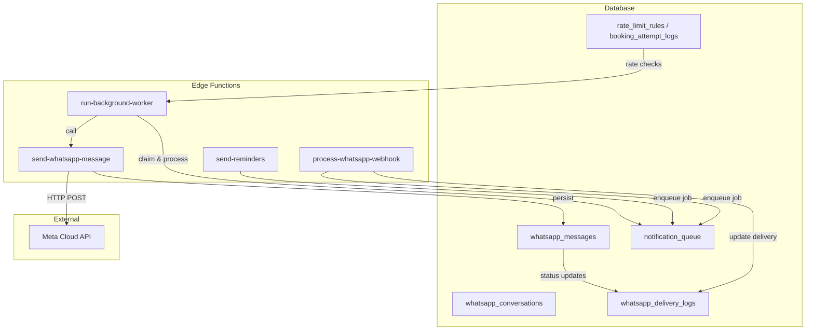
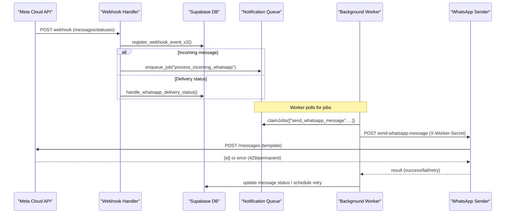
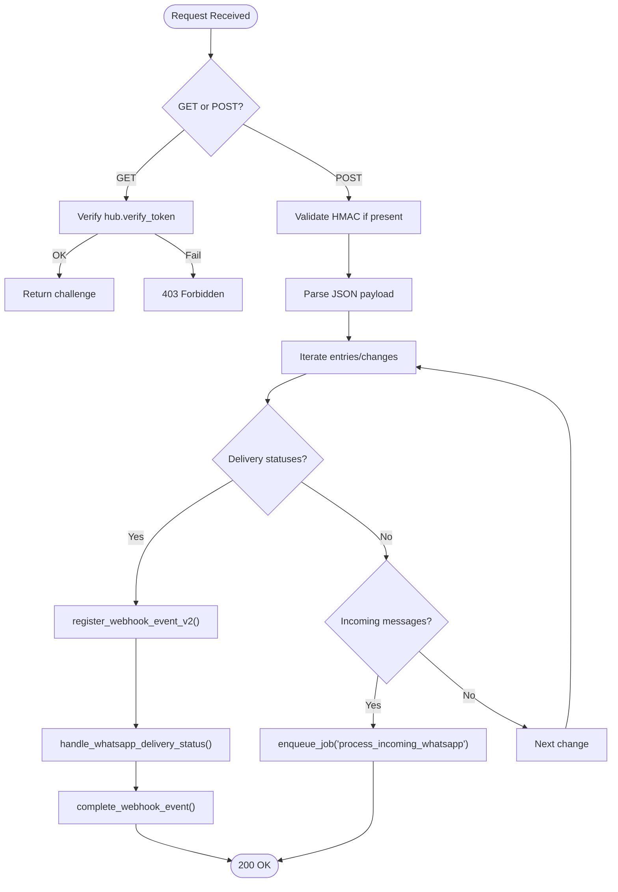
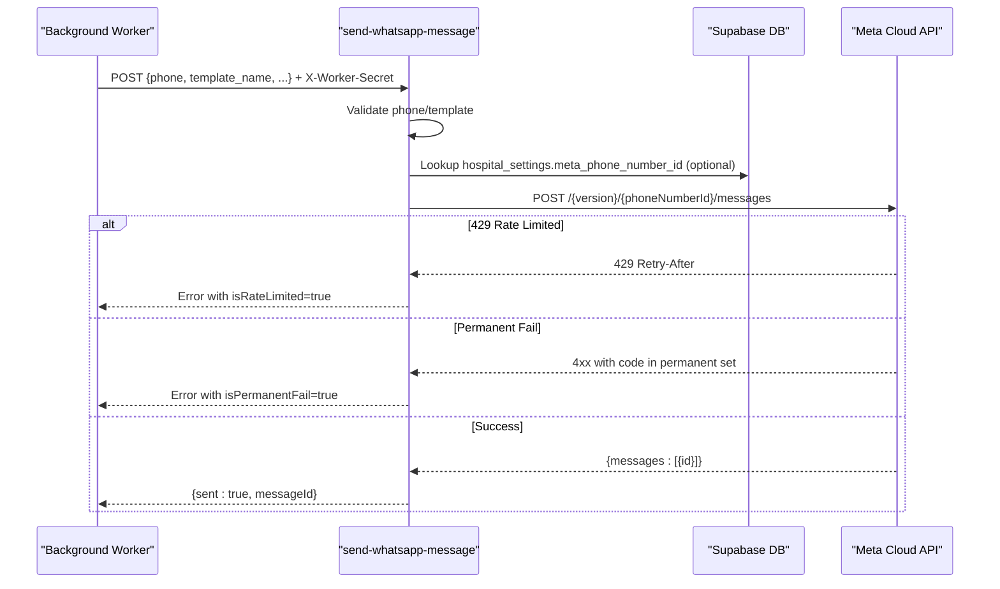
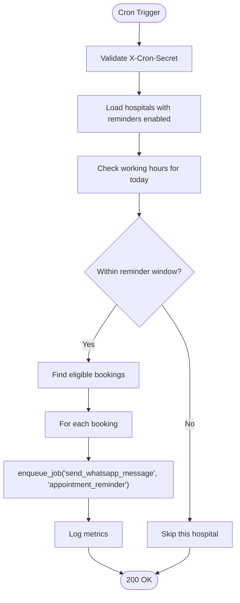
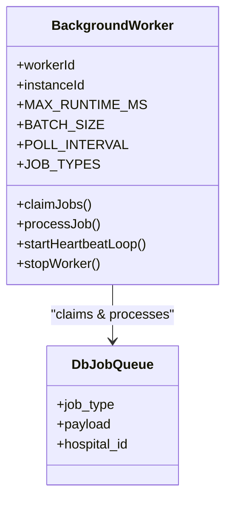
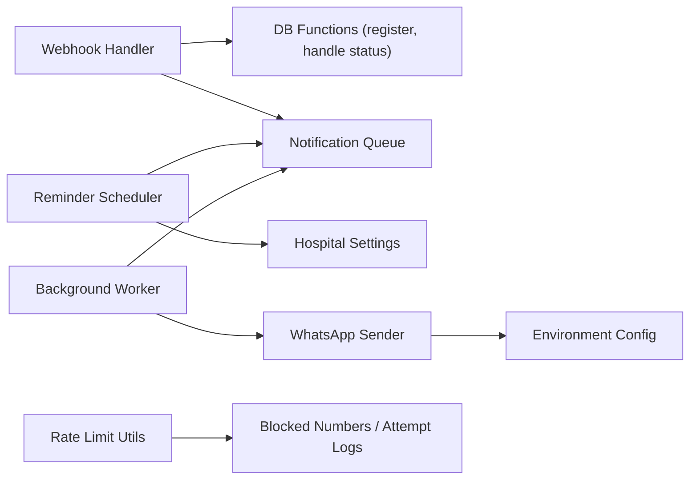

# Communication APIs

<cite>
**Referenced Files in This Document**
- [process-whatsapp-webhook/index.ts](file://supabase/functions/process-whatsapp-webhook/index.ts)
- [send-whatsapp-message/index.ts](file://supabase/functions/send-whatsapp-message/index.ts)
- [send-reminders/index.ts](file://supabase/functions/send-reminders/index.ts)
- [run-background-worker/index.ts](file://supabase/functions/run-background-worker/index.ts)
- [_shared/env.ts](file://supabase/functions/_shared/env.ts)
- [_shared/rate_limit.ts](file://supabase/functions/_shared/rate_limit.ts)
- [04_whatsapp_messaging_engine.sql](file://supabase/migrations/04_whatsapp_messaging_engine.sql)
- [05_notification_queue.sql](file://supabase/migrations/05_notification_queue.sql)
- [09_abuse_protection_&_rate_limiting.sql](file://supabase/migrations/09_abuse_protection_&_rate_limiting.sql)
</cite>

## Table of Contents

1. Introduction
2. Project Structure
3. Core Components
4. Architecture Overview
5. Detailed Component Analysis
6. Dependency Analysis
7. Performance Considerations
8. Troubleshooting Guide
9. Conclusion

## Introduction

This document provides comprehensive API documentation for communication
endpoints that power WhatsApp messaging, automated reminders, and delivery
status tracking within the system. It covers:

- Sending WhatsApp messages using approved templates
- Handling incoming WhatsApp messages and delivery receipts via webhooks
- Automated reminder scheduling for patient appointments
- Message queuing, retry mechanisms, and failure handling
- Rate limiting and compliance considerations for healthcare communications
- Examples of common scenarios such as appointment confirmations, status
  updates, and two-way messaging

The implementation is built on Supabase Edge Functions with a robust
database-backed queue and worker engine.

## Project Structure

Communication features are implemented across Edge Functions and database
migrations:

- Webhook handler for incoming Meta events and delivery receipts
- Worker endpoint to send WhatsApp messages via Meta Cloud API
- Cron-triggered reminder scheduler
- Background worker to process queued jobs (sending messages, processing
  incoming messages, notifications)
- Database schema for WhatsApp messages, conversations, delivery logs,
  notification queues, and rate limiting tables

**Diagram sources**

- [process-whatsapp-webhook/index.ts:124-220](file://supabase/functions/process-whatsapp-webhook/index.ts#L124-L220)
- [send-whatsapp-message/index.ts:326-391](file://supabase/functions/send-whatsapp-message/index.ts#L326-L391)
- [send-reminders/index.ts:40-95](file://supabase/functions/send-reminders/index.ts#L40-L95)
- [run-background-worker/index.ts:247-390](file://supabase/functions/run-background-worker/index.ts#L247-L390)
- [04_whatsapp_messaging_engine.sql:171-264](file://supabase/migrations/04_whatsapp_messaging_engine.sql#L171-L264)
- [05_notification_queue.sql:117-195](file://supabase/migrations/05_notification_queue.sql#L117-L195)
- [09_abuse_protection_&_rate_limiting.sql:120-167](file://supabase/migrations/09_abuse_protection_&_rate_limiting.sql#L120-L167)

**Section sources**

- [process-whatsapp-webhook/index.ts:1-220](file://supabase/functions/process-whatsapp-webhook/index.ts#L1-L220)
- [send-whatsapp-message/index.ts:1-120](file://supabase/functions/send-whatsapp-message/index.ts#L1-L120)
- [send-reminders/index.ts:1-120](file://supabase/functions/send-reminders/index.ts#L1-L120)
- [run-background-worker/index.ts:1-120](file://supabase/functions/run-background-worker/index.ts#L1-L120)
- [04_whatsapp_messaging_engine.sql:1-120](file://supabase/migrations/04_whatsapp_messaging_engine.sql#L1-L120)
- [05_notification_queue.sql:1-120](file://supabase/migrations/05_notification_queue.sql#L1-L120)
- [09_abuse_protection_&_rate_limiting.sql:1-120](file://supabase/migrations/09_abuse_protection_&_rate_limiting.sql#L1-L120)

## Core Components

- WhatsApp Webhook Handler: Validates Meta verification challenge and HMAC
  signatures; processes incoming messages and delivery receipts; enqueues jobs
  for further processing; ensures idempotency via event registration.
- WhatsApp Sender: Authenticated worker-only endpoint that validates input,
  builds template components, calls Meta Cloud API, handles rate limits and
  permanent failures, and records outcomes.
- Reminder Scheduler: Cron-protected endpoint that identifies due reminders
  based on hospital settings and working hours, then enqueues high-priority
  WhatsApp message jobs.
- Background Worker: Long-running worker that claims jobs from the queue,
  dispatches them to handlers (including sending WhatsApp messages), tracks
  success/failure, and supports retries.
- Notification Queue: Generic queue supporting multiple channels with priority,
  scheduling, and retry logic.
- Rate Limiting and Abuse Protection: Sliding window rate limit checks backed by
  database tables; blocked numbers and temporary restrictions.

**Section sources**

- [process-whatsapp-webhook/index.ts:124-220](file://supabase/functions/process-whatsapp-webhook/index.ts#L124-L220)
- [send-whatsapp-message/index.ts:326-391](file://supabase/functions/send-whatsapp-message/index.ts#L326-L391)
- [send-reminders/index.ts:40-120](file://supabase/functions/send-reminders/index.ts#L40-L120)
- [run-background-worker/index.ts:247-390](file://supabase/functions/run-background-worker/index.ts#L247-L390)
- [05_notification_queue.sql:117-195](file://supabase/migrations/05_notification_queue.sql#L117-L195)
- [_shared/rate_limit.ts:27-111](file://supabase/functions/_shared/rate_limit.ts#L27-L111)

## Architecture Overview

The communication architecture integrates webhook ingestion, asynchronous job
processing, and provider integration with strong reliability guarantees.

**Diagram sources**

- [process-whatsapp-webhook/index.ts:222-613](file://supabase/functions/process-whatsapp-webhook/index.ts#L222-L613)
- [run-background-worker/index.ts:36-121](file://supabase/functions/run-background-worker/index.ts#L36-L121)
- [send-whatsapp-message/index.ts:198-324](file://supabase/functions/send-whatsapp-message/index.ts#L198-L324)
- [04_whatsapp_messaging_engine.sql:467-503](file://supabase/migrations/04_whatsapp_messaging_engine.sql#L467-L503)
- [05_notification_queue.sql:346-392](file://supabase/migrations/05_notification_queue.sql#L346-L392)

## Detailed Component Analysis

### WhatsApp Webhook Handler

- Purpose: Accepts Meta webhook events for incoming messages and
  delivery/read/sent/failed statuses.
- Security:
  - GET verification challenge using hub.verify_token.
  - Optional HMAC verification using X-Hub-Signature-256 and app secret.
- Processing:
  - Deduplicates events via register_webhook_event_v2.
  - For delivery statuses, maps status names and persists via
    handle_whatsapp_delivery_status.
  - For incoming messages, enqueues a background job to process them.
- Reliability: Always returns HTTP 200 to prevent endless retries even on
  internal errors.

**Diagram sources**

- [process-whatsapp-webhook/index.ts:152-220](file://supabase/functions/process-whatsapp-webhook/index.ts#L152-L220)
- [process-whatsapp-webhook/index.ts:222-613](file://supabase/functions/process-whatsapp-webhook/index.ts#L222-L613)

**Section sources**

- [process-whatsapp-webhook/index.ts:1-220](file://supabase/functions/process-whatsapp-webhook/index.ts#L1-L220)
- [process-whatsapp-webhook/index.ts:222-613](file://supabase/functions/process-whatsapp-webhook/index.ts#L222-L613)

### WhatsApp Sender

- Purpose: Sends WhatsApp messages using approved templates via Meta Cloud API.
- Authentication: Requires X-Worker-Secret header matching configured worker
  secret.
- Input Validation: Phone number format, allowed template names, optional fields
  like booking_id, patient_name, token_number, dates, estimated_wait,
  cancellation_reason, wa_message_id, hospital_id.
- Template Building: Constructs body parameters per template type (e.g., booking
  confirmation, reminder, cancellation).
- Provider Integration: Calls Meta Graph API with timeout; handles 429 rate
  limiting and permanent failure codes; extracts messageId on success.
- Error Handling: Throws structured errors with rate limit and permanent failure
  flags; metrics and logging included.

**Diagram sources**

- [send-whatsapp-message/index.ts:326-391](file://supabase/functions/send-whatsapp-message/index.ts#L326-L391)
- [send-whatsapp-message/index.ts:198-324](file://supabase/functions/send-whatsapp-message/index.ts#L198-L324)

**Section sources**

- [send-whatsapp-message/index.ts:1-120](file://supabase/functions/send-whatsapp-message/index.ts#L1-L120)
- [send-whatsapp-message/index.ts:198-324](file://supabase/functions/send-whatsapp-message/index.ts#L198-L324)
- [send-whatsapp-message/index.ts:326-391](file://supabase/functions/send-whatsapp-message/index.ts#L326-L391)

### Reminder Scheduler

- Purpose: Queues appointment reminders for today’s bookings within a one-minute
  execution window aligned with hospital working hours.
- Authentication: Requires X-Cron-Secret header.
- Logic:
  - Loads hospitals with reminders enabled.
  - Checks working hours for current weekday and computes reminder window.
  - Finds eligible bookings (booked/checked-in, not deleted, reminder not sent).
  - Enqueues high-priority jobs to send WhatsApp reminders with template
    “appointment_reminder”.
- Idempotency: Uses idempotency keys per booking to avoid duplicates.

**Diagram sources**

- [send-reminders/index.ts:40-120](file://supabase/functions/send-reminders/index.ts#L40-L120)
- [send-reminders/index.ts:128-389](file://supabase/functions/send-reminders/index.ts#L128-L389)

**Section sources**

- [send-reminders/index.ts:40-120](file://supabase/functions/send-reminders/index.ts#L40-L120)
- [send-reminders/index.ts:128-389](file://supabase/functions/send-reminders/index.ts#L128-L389)

### Background Worker

- Purpose: Multi-type job processor with leases, heartbeat, crash recovery, and
  bounded runtime.
- Job Types: Includes send_whatsapp_message, process_incoming_whatsapp,
  send_notification, refresh_analytics, compute_sla, create_partition.
- Processing:
  - Claims jobs from the queue in batches.
  - Dispatches to specific processors (e.g., sends WhatsApp messages via the
    sender endpoint).
  - Tracks success/failure and emits metrics.
- Safety: Registers worker, starts heartbeat loop, stops worker cleanly on exit
  or crash.

**Diagram sources**

- [run-background-worker/index.ts:247-390](file://supabase/functions/run-background-worker/index.ts#L247-L390)

**Section sources**

- [run-background-worker/index.ts:247-390](file://supabase/functions/run-background-worker/index.ts#L247-L390)

### Database Schema Highlights

- WhatsApp Messaging Engine:
  - Enums for message status, direction, and template category.
  - Tables for templates, conversations, messages, delivery logs, and webhook
    events.
  - Functions for finding/creating conversations, queuing messages, fetching
    pending messages, handling delivery status, scheduling retries, and
    registering webhook events.
- Notification Queue:
  - Enums for channel, status, and priority.
  - Tables for templates, queue, and deliveries.
  - Functions for queuing notifications, fetching pending items, marking sent,
    and scheduling retries.
- Rate Limiting and Abuse Protection:
  - Tables for rate limit rules, attempt logs, spam events, blocked
    numbers/devices, abuse scores, and temporary restrictions.
  - Functions for checking rate limits, blocking phones, logging attempts,
    incrementing abuse scores, and cleaning expired restrictions.

**Section sources**

- [04_whatsapp_messaging_engine.sql:1-120](file://supabase/migrations/04_whatsapp_messaging_engine.sql#L1-L120)
- [04_whatsapp_messaging_engine.sql:171-264](file://supabase/migrations/04_whatsapp_messaging_engine.sql#L171-L264)
- [04_whatsapp_messaging_engine.sql:337-503](file://supabase/migrations/04_whatsapp_messaging_engine.sql#L337-L503)
- [04_whatsapp_messaging_engine.sql:512-661](file://supabase/migrations/04_whatsapp_messaging_engine.sql#L512-L661)
- [05_notification_queue.sql:117-195](file://supabase/migrations/05_notification_queue.sql#L117-L195)
- [05_notification_queue.sql:258-392](file://supabase/migrations/05_notification_queue.sql#L258-L392)
- [05_notification_queue.sql:401-507](file://supabase/migrations/05_notification_queue.sql#L401-L507)
- [09_abuse_protection_&_rate_limiting.sql:120-167](file://supabase/migrations/09_abuse_protection_&_rate_limiting.sql#L120-L167)
- [09_abuse_protection_&_rate_limiting.sql:385-473](file://supabase/migrations/09_abuse_protection_&_rate_limiting.sql#L385-L473)

## Dependency Analysis

- The webhook handler depends on database functions for event registration and
  delivery status handling, and enqueues jobs for incoming messages.
- The sender depends on environment configuration for Meta credentials and
  optionally hospital-specific phone number IDs.
- The reminder scheduler depends on hospital settings and working hours to
  determine when to queue reminders.
- The background worker orchestrates job processing and interacts with both the
  notification queue and the sender endpoint.
- Rate limiting utilities depend on database tables for attempt logs and blocked
  numbers.

**Diagram sources**

- [process-whatsapp-webhook/index.ts:222-613](file://supabase/functions/process-whatsapp-webhook/index.ts#L222-L613)
- [send-reminders/index.ts:128-389](file://supabase/functions/send-reminders/index.ts#L128-L389)
- [run-background-worker/index.ts:36-121](file://supabase/functions/run-background-worker/index.ts#L36-L121)
- [_shared/rate_limit.ts:27-111](file://supabase/functions/_shared/rate_limit.ts#L27-L111)

**Section sources**

- [process-whatsapp-webhook/index.ts:222-613](file://supabase/functions/process-whatsapp-webhook/index.ts#L222-L613)
- [send-reminders/index.ts:128-389](file://supabase/functions/send-reminders/index.ts#L128-L389)
- [run-background-worker/index.ts:36-121](file://supabase/functions/run-background-worker/index.ts#L36-L121)
- [_shared/rate_limit.ts:27-111](file://supabase/functions/_shared/rate_limit.ts#L27-L111)

## Performance Considerations

- Webhook handler always responds quickly (200 OK) to prevent Meta retry storms;
  heavy work is offloaded to background jobs.
- Sender uses timeouts for Meta API calls to avoid hanging requests.
- Background worker processes jobs in batches with bounded runtime and
  heartbeats to support graceful restarts.
- Database queries use indexes for efficient lookups and worker-safe locking
  (SKIP LOCKED) to avoid contention.
- Rate limiting uses sliding windows stored in the database to be
  distributed-safe across function instances.

[No sources needed since this section provides general guidance]

## Troubleshooting Guide

Common issues and diagnostics:

- Webhook HMAC verification failures: Check configured app secret and ensure
  signature matches request body.
- Invalid webhook JSON: Handled gracefully; verify payload structure and content
  type.
- Delivery status processing errors: Inspect logs for
  handle_whatsapp_delivery_status errors; check mapping of status names.
- Incoming message enqueue failures: Review enqueue_job errors and ensure job
  types are supported.
- Sender authentication failures: Ensure X-Worker-Secret matches configured
  worker secret.
- Template validation errors: Confirm template_name is allowed and has required
  components.
- Meta rate limiting: Observe 429 responses and Retry-After headers; adjust
  retry strategy accordingly.
- Permanent failures: Certain Meta error codes indicate non-retryable issues;
  mark messages as permanently failed and notify relevant systems.
- Reminder scheduler access: Ensure X-Cron-Secret is correctly configured;
  verify hospital settings and working hours.

**Section sources**

- [process-whatsapp-webhook/index.ts:222-613](file://supabase/functions/process-whatsapp-webhook/index.ts#L222-L613)
- [send-whatsapp-message/index.ts:326-391](file://supabase/functions/send-whatsapp-message/index.ts#L326-L391)
- [send-whatsapp-message/index.ts:198-324](file://supabase/functions/send-whatsapp-message/index.ts#L198-L324)
- [send-reminders/index.ts:40-120](file://supabase/functions/send-reminders/index.ts#L40-L120)

## Conclusion

The communication system provides a resilient, scalable foundation for WhatsApp
messaging and automated reminders in a healthcare context. It combines secure
webhook handling, asynchronous job processing, robust retry mechanisms, and
strict rate limiting to ensure reliable delivery while maintaining compliance
and operational safety.

[No sources needed since this section summarizes without analyzing specific
files]
