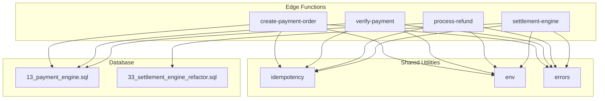
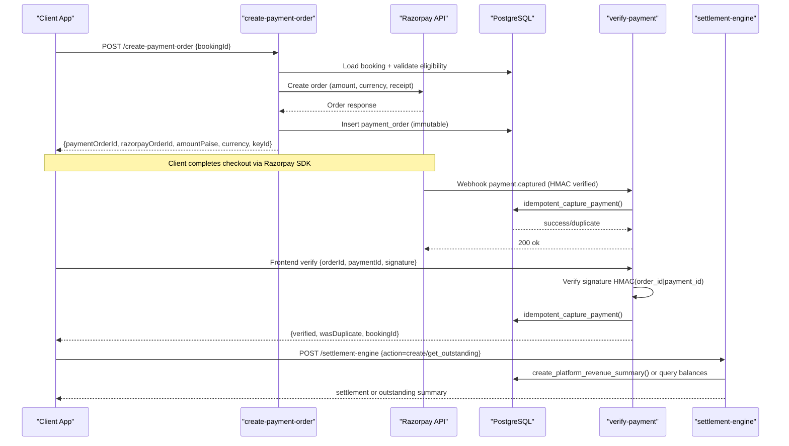
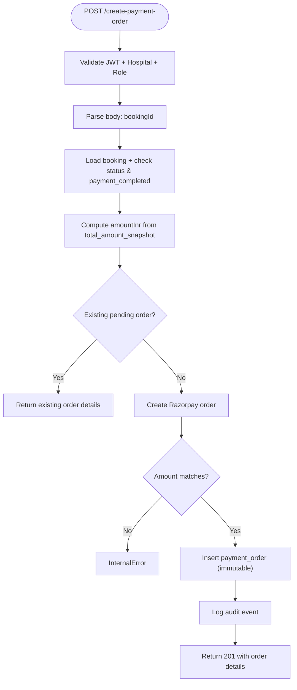
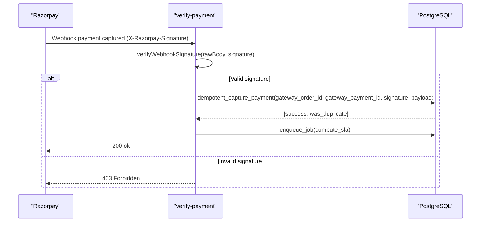
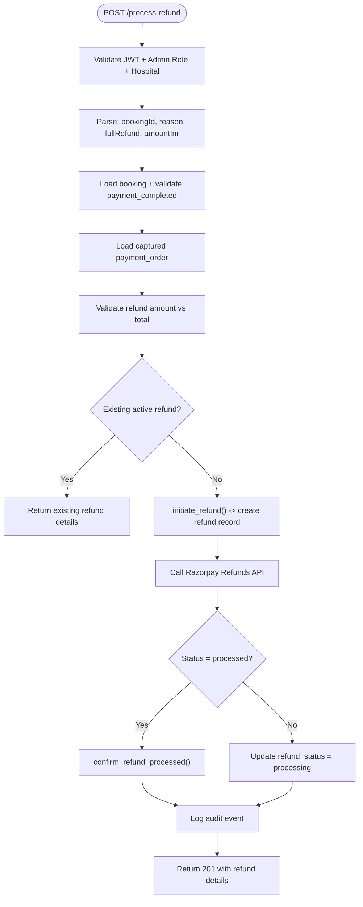
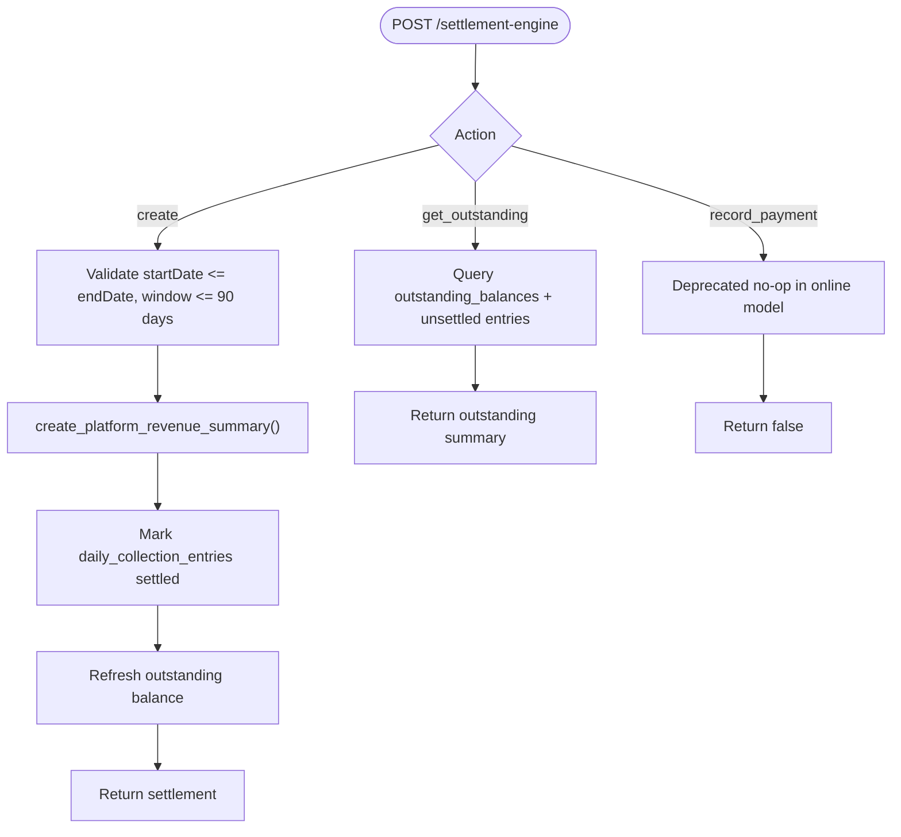
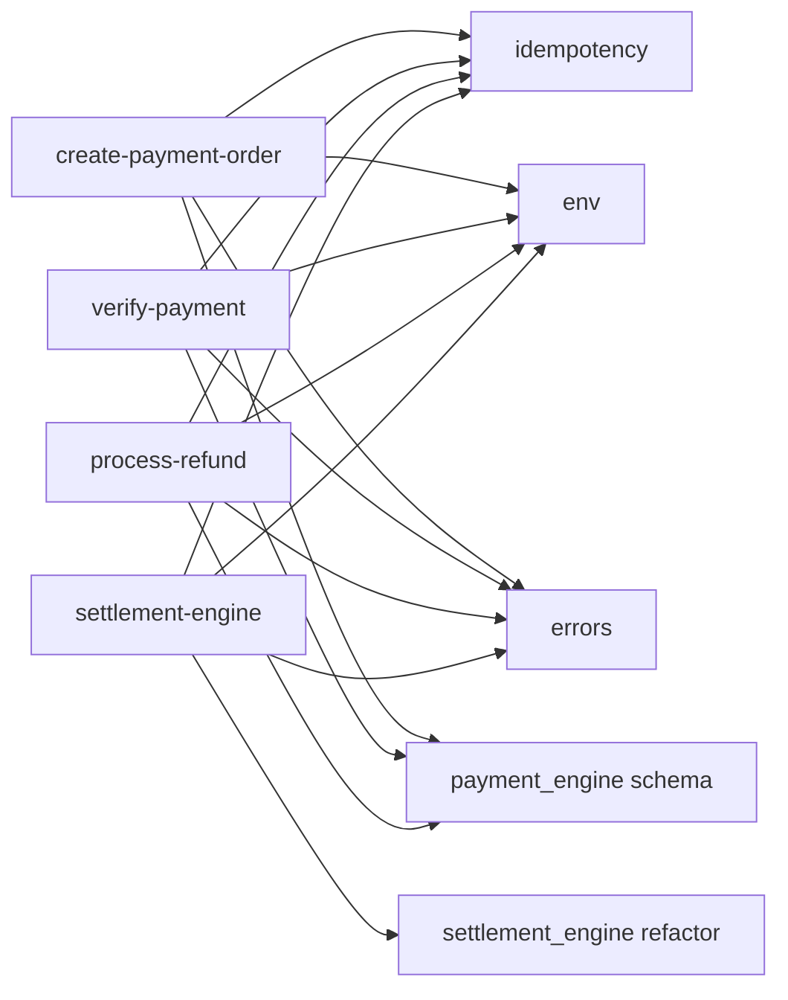

# Payment Processing APIs

<cite>
**Referenced Files in This Document**
- [create-payment-order/index.ts](file://supabase/functions/create-payment-order/index.ts)
- [verify-payment/index.ts](file://supabase/functions/verify-payment/index.ts)
- [process-refund/index.ts](file://supabase/functions/process-refund/index.ts)
- [settlement-engine/index.ts](file://supabase/functions/settlement-engine/index.ts)
- [13_payment_engine.sql](file://supabase/migrations/13_payment_engine.sql)
- [33_settlement_engine_refactor.sql](file://supabase/migrations/33_settlement_engine_refactor.sql)
- [_shared/idempotency.ts](file://supabase/functions/_shared/idempotency.ts)
- [_shared/env.ts](file://supabase/functions/_shared/env.ts)
- [_shared/errors.ts](file://supabase/functions/_shared/errors.ts)
</cite>

## Table of Contents

1. Introduction
2. Project Structure
3. Core Components
4. Architecture Overview
5. Detailed Component Analysis
6. Dependency Analysis
7. Performance Considerations
8. Troubleshooting Guide
9. Conclusion
10. Appendices

## Introduction

This document provides comprehensive API documentation for payment processing
endpoints in the system. It covers:

- Creating payment orders with fee calculation and gateway integration
- Verifying payments via webhooks and frontend callbacks
- Handling refunds end-to-end
- Settlement engine operations for financial reconciliation and reporting
- Security considerations, idempotency guarantees, error handling, and complete
  flow examples

The implementation integrates with Razorpay as the payment gateway and uses a
robust database schema to ensure data integrity, auditability, and financial
accuracy.

## Project Structure

Payment functionality is implemented as serverless functions under Supabase Edge
Functions, backed by PostgreSQL migrations that define schemas, constraints, and
stored procedures. Shared utilities provide idempotency, environment validation,
error handling, logging, and metrics.

**Diagram sources**

- [create-payment-order/index.ts:1-407](file://supabase/functions/create-payment-order/index.ts#L1-L407)
- [verify-payment/index.ts:1-480](file://supabase/functions/verify-payment/index.ts#L1-L480)
- [process-refund/index.ts:1-360](file://supabase/functions/process-refund/index.ts#L1-L360)
- [settlement-engine/index.ts:1-521](file://supabase/functions/settlement-engine/index.ts#L1-L521)
- [_shared/idempotency.ts:1-259](file://supabase/functions/_shared/idempotency.ts#L1-L259)
- [_shared/env.ts:1-279](file://supabase/functions/_shared/env.ts#L1-L279)
- [_shared/errors.ts:1-323](file://supabase/functions/_shared/errors.ts#L1-L323)
- [13_payment_engine.sql:1-962](file://supabase/migrations/13_payment_engine.sql#L1-L962)
- [33_settlement_engine_refactor.sql:1-308](file://supabase/migrations/33_settlement_engine_refactor.sql#L1-L308)

**Section sources**

- [create-payment-order/index.ts:1-407](file://supabase/functions/create-payment-order/index.ts#L1-L407)
- [verify-payment/index.ts:1-480](file://supabase/functions/verify-payment/index.ts#L1-L480)
- [process-refund/index.ts:1-360](file://supabase/functions/process-refund/index.ts#L1-L360)
- [settlement-engine/index.ts:1-521](file://supabase/functions/settlement-engine/index.ts#L1-L521)
- [_shared/idempotency.ts:1-259](file://supabase/functions/_shared/idempotency.ts#L1-L259)
- [_shared/env.ts:1-279](file://supabase/functions/_shared/env.ts#L1-L279)
- [_shared/errors.ts:1-323](file://supabase/functions/_shared/errors.ts#L1-L323)
- [13_payment_engine.sql:1-962](file://supabase/migrations/13_payment_engine.sql#L1-L962)
- [33_settlement_engine_refactor.sql:1-308](file://supabase/migrations/33_settlement_engine_refactor.sql#L1-L308)

## Core Components

- Create Payment Order: Creates a Razorpay order for an existing booking,
  validates fees, enforces idempotency, persists immutable order records, and
  returns checkout details.
- Verify Payment: Handles Razorpay webhooks and frontend verification, verifies
  signatures, performs idempotent capture, updates booking/payment states, and
  triggers downstream jobs.
- Process Refund: Initiates refunds against captured payments, validates
  amounts, creates refund records, calls gateway, and confirms processed
  refunds.
- Settlement Engine: Generates platform revenue summaries per hospital and
  period, marks collection entries settled, and supports outstanding balance
  queries.

Key shared capabilities:

- Idempotency: Request deduplication and safe retries using idempotency keys and
  request hashing.
- Environment: Centralized configuration for gateway credentials and runtime
  flags.
- Errors: Typed error hierarchy with codes, status codes, retry flags, and
  context.

**Section sources**

- [create-payment-order/index.ts:1-407](file://supabase/functions/create-payment-order/index.ts#L1-L407)
- [verify-payment/index.ts:1-480](file://supabase/functions/verify-payment/index.ts#L1-L480)
- [process-refund/index.ts:1-360](file://supabase/functions/process-refund/index.ts#L1-L360)
- [settlement-engine/index.ts:1-521](file://supabase/functions/settlement-engine/index.ts#L1-L521)
- [_shared/idempotency.ts:1-259](file://supabase/functions/_shared/idempotency.ts#L1-L259)
- [_shared/env.ts:1-279](file://supabase/functions/_shared/env.ts#L1-L279)
- [_shared/errors.ts:1-323](file://supabase/functions/_shared/errors.ts#L1-L323)

## Architecture Overview

The payment architecture follows a clear separation between API handlers,
gateway integrations, and database-backed state management.

**Diagram sources**

- [create-payment-order/index.ts:104-407](file://supabase/functions/create-payment-order/index.ts#L104-L407)
- [verify-payment/index.ts:188-480](file://supabase/functions/verify-payment/index.ts#L188-L480)
- [settlement-engine/index.ts:55-521](file://supabase/functions/settlement-engine/index.ts#L55-L521)
- [13_payment_engine.sql:593-666](file://supabase/migrations/13_payment_engine.sql#L593-L666)
- [33_settlement_engine_refactor.sql:171-308](file://supabase/migrations/33_settlement_engine_refactor.sql#L171-L308)

## Detailed Component Analysis

### Create Payment Order API

- Purpose: Create a Razorpay order for a booking, compute fees from booking
  snapshot, enforce idempotency, persist order, and return checkout parameters.
- Authentication: Requires valid JWT and role-based access; hospital scoping
  enforced via header.
- Input: bookingId (UUID).
- Output: paymentOrderId, razorpayOrderId, amountPaise, currency,
  bookingReference, razorpayKeyId.
- Fee Calculation: Uses booking total_amount_snapshot to derive amountInr and
  converts to paise for gateway.
- Gateway Integration: Calls Razorpay Orders API with auto-capture enabled;
  validates response amount matches expected.
- Persistence: Inserts immutable payment_order row with gateway identifiers and
  response payload.
- Idempotency: Uses idempotency key; if pending order exists for booking,
  returns existing order.
- Audit: Logs creation event with relevant metadata.

**Diagram sources**

- [create-payment-order/index.ts:104-407](file://supabase/functions/create-payment-order/index.ts#L104-L407)

**Section sources**

- [create-payment-order/index.ts:47-52](file://supabase/functions/create-payment-order/index.ts#L47-L52)
- [create-payment-order/index.ts:117-140](file://supabase/functions/create-payment-order/index.ts#L117-L140)
- [create-payment-order/index.ts:141-211](file://supabase/functions/create-payment-order/index.ts#L141-L211)
- [create-payment-order/index.ts:212-322](file://supabase/functions/create-payment-order/index.ts#L212-L322)
- [create-payment-order/index.ts:323-383](file://supabase/functions/create-payment-order/index.ts#L323-L383)
- [13_payment_engine.sql:65-129](file://supabase/migrations/13_payment_engine.sql#L65-L129)

### Verify Payment API

- Purpose: Handle Razorpay webhook events and frontend verification; perform
  idempotent capture and update booking/payment states.
- Two call patterns:
  - Webhook path: Validates X-Razorpay-Signature HMAC; processes
    payment.captured events; always returns 200 to prevent retries.
  - Frontend path: Validates JWT and role; verifies payment signature
    HMAC(order_id|payment_id); performs capture.
- Capture Logic: Calls idempotent_capture_payment RPC to safely update
  payment_orders, bookings, and financial_ledger.
- Post-Capture Actions: Logs audit event; enqueues SLA computation job for the
  booking.
- Refund Webhooks: Processes refund.processed events to confirm gateway refund
  status.

**Diagram sources**

- [verify-payment/index.ts:59-120](file://supabase/functions/verify-payment/index.ts#L59-L120)
- [verify-payment/index.ts:208-309](file://supabase/functions/verify-payment/index.ts#L208-L309)
- [13_payment_engine.sql:593-666](file://supabase/migrations/13_payment_engine.sql#L593-L666)

**Section sources**

- [verify-payment/index.ts:1-21](file://supabase/functions/verify-payment/index.ts#L1-L21)
- [verify-payment/index.ts:122-186](file://supabase/functions/verify-payment/index.ts#L122-L186)
- [verify-payment/index.ts:188-309](file://supabase/functions/verify-payment/index.ts#L188-L309)
- [verify-payment/index.ts:362-480](file://supabase/functions/verify-payment/index.ts#L362-L480)
- [13_payment_engine.sql:593-666](file://supabase/migrations/13_payment_engine.sql#L593-L666)

### Process Refund API

- Purpose: Initiate a refund for a captured payment via Razorpay Refunds API;
  mark booking as cancelled; write financial ledger on confirmation.
- Authentication: Requires admin roles; hospital scoping enforced.
- Input: bookingId, reason, fullRefund (boolean), optional amountInr.
- Validation: Ensures booking exists, belongs to hospital, has captured payment;
  validates refund amount constraints.
- Idempotency: If active refund exists for booking, returns existing refund
  details.
- Gateway Integration: Calls Razorpay Refunds API; if immediately processed,
  confirms via confirm_refund_processed; otherwise sets status to processing.
- Audit: Logs refund initiation and outcome.

**Diagram sources**

- [process-refund/index.ts:109-360](file://supabase/functions/process-refund/index.ts#L109-L360)
- [13_payment_engine.sql:672-734](file://supabase/migrations/13_payment_engine.sql#L672-L734)
- [13_payment_engine.sql:743-800](file://supabase/migrations/13_payment_engine.sql#L743-L800)

**Section sources**

- [process-refund/index.ts:32-47](file://supabase/functions/process-refund/index.ts#L32-L47)
- [process-refund/index.ts:122-181](file://supabase/functions/process-refund/index.ts#L122-L181)
- [process-refund/index.ts:182-249](file://supabase/functions/process-refund/index.ts#L182-L249)
- [process-refund/index.ts:250-325](file://supabase/functions/process-refund/index.ts#L250-L325)
- [13_payment_engine.sql:672-734](file://supabase/migrations/13_payment_engine.sql#L672-L734)
- [13_payment_engine.sql:743-800](file://supabase/migrations/13_payment_engine.sql#L743-L800)

### Settlement Engine API

- Purpose: Generate platform revenue summaries for a hospital over a date range;
  query outstanding balances; support recording payments (deprecated in online
  model).
- Actions:
  - create: Creates a platform revenue summary; marks daily_collection_entries
    settled; computes totals.
  - get_outstanding: Returns outstanding balance and unsettled entries.
  - record_payment: Deprecated no-op in online model; retained for
    compatibility.
- Idempotency: Prevents duplicate settlements per hospital and date range via
  unique constraint and advisory locks.
- Database Functions: Uses create_platform_revenue_summary() to aggregate and
  finalize settlements; refreshes outstanding balances.

**Diagram sources**

- [settlement-engine/index.ts:55-521](file://supabase/functions/settlement-engine/index.ts#L55-L521)
- [33_settlement_engine_refactor.sql:171-308](file://supabase/migrations/33_settlement_engine_refactor.sql#L171-L308)

**Section sources**

- [settlement-engine/index.ts:34-53](file://supabase/functions/settlement-engine/index.ts#L34-L53)
- [settlement-engine/index.ts:115-229](file://supabase/functions/settlement-engine/index.ts#L115-L229)
- [settlement-engine/index.ts:231-393](file://supabase/functions/settlement-engine/index.ts#L231-L393)
- [settlement-engine/index.ts:395-480](file://supabase/functions/settlement-engine/index.ts#L395-L480)
- [33_settlement_engine_refactor.sql:171-308](file://supabase/migrations/33_settlement_engine_refactor.sql#L171-L308)

## Dependency Analysis

- Edge Functions depend on shared utilities for idempotency, environment
  validation, error handling, logging, and metrics.
- Database schema defines entities and constraints ensuring referential
  integrity and immutability where required.
- Stored procedures encapsulate complex financial operations to maintain
  consistency and auditability.

**Diagram sources**

- [_shared/idempotency.ts:1-259](file://supabase/functions/_shared/idempotency.ts#L1-L259)
- [_shared/env.ts:1-279](file://supabase/functions/_shared/env.ts#L1-L279)
- [_shared/errors.ts:1-323](file://supabase/functions/_shared/errors.ts#L1-L323)
- [13_payment_engine.sql:1-962](file://supabase/migrations/13_payment_engine.sql#L1-L962)
- [33_settlement_engine_refactor.sql:1-308](file://supabase/migrations/33_settlement_engine_refactor.sql#L1-L308)

**Section sources**

- [_shared/idempotency.ts:1-259](file://supabase/functions/_shared/idempotency.ts#L1-L259)
- [_shared/env.ts:1-279](file://supabase/functions/_shared/env.ts#L1-L279)
- [_shared/errors.ts:1-323](file://supabase/functions/_shared/errors.ts#L1-L323)
- [13_payment_engine.sql:1-962](file://supabase/migrations/13_payment_engine.sql#L1-L962)
- [33_settlement_engine_refactor.sql:1-308](file://supabase/migrations/33_settlement_engine_refactor.sql#L1-L308)

## Performance Considerations

- Idempotency reduces duplicate processing and network calls, improving
  throughput and reliability.
- Database-level locking and atomic operations ensure consistency under
  concurrency.
- Metrics and tracing enable performance monitoring and bottleneck
  identification.
- Timeouts on external API calls prevent resource exhaustion during gateway
  outages.

[No sources needed since this section provides general guidance]

## Troubleshooting Guide

Common issues and resolutions:

- Missing or invalid Idempotency-Key: Ensure clients send UUID v4 keys for
  idempotent endpoints.
- Signature verification failures: Verify HMAC configuration and secret
  alignment between gateway and environment.
- Duplicate settlements: Use unique constraints and advisory locks to prevent
  concurrent duplicates.
- Refund amount mismatches: Validate refund amounts against captured payments
  before initiating.
- Gateway errors: Inspect logs and error contexts for detailed failure reasons
  from Razorpay.

**Section sources**

- [_shared/idempotency.ts:39-59](file://supabase/functions/_shared/idempotency.ts#L39-L59)
- [verify-payment/index.ts:59-120](file://supabase/functions/verify-payment/index.ts#L59-L120)
- [process-refund/index.ts:206-229](file://supabase/functions/process-refund/index.ts#L206-L229)
- [settlement-engine/index.ts:254-289](file://supabase/functions/settlement-engine/index.ts#L254-L289)

## Conclusion

The payment processing system provides a secure, idempotent, and auditable
foundation for handling payments, refunds, and settlements. Integration with
Razorpay ensures reliable transaction processing, while database constraints and
stored procedures maintain financial integrity. The settlement engine offers
accurate reconciliation and reporting capabilities aligned with the platform’s
business model.

[No sources needed since this section summarizes without analyzing specific
files]

## Appendices

### Complete Payment Flow Example

1. Create Payment Order:
   - Client calls create-payment-order with bookingId.
   - System validates booking, computes fees, creates Razorpay order, persists
     payment_order, and returns checkout details.
2. Frontend Checkout:
   - Client uses Razorpay SDK to complete payment.
3. Verify Payment:
   - Razorpay sends webhook; system verifies signature, performs idempotent
     capture, updates booking and ledger, and enqueues SLA job.
   - Alternatively, frontend calls verify-payment with signature for synchronous
     confirmation.
4. Settlement:
   - Periodically, settlement-engine creates platform revenue summaries, marking
     collection entries settled and refreshing outstanding balances.

**Section sources**

- [create-payment-order/index.ts:104-407](file://supabase/functions/create-payment-order/index.ts#L104-L407)
- [verify-payment/index.ts:188-480](file://supabase/functions/verify-payment/index.ts#L188-L480)
- [settlement-engine/index.ts:55-521](file://supabase/functions/settlement-engine/index.ts#L55-L521)

### Security Considerations for PCI Compliance

- Sensitive Data Handling:
  - Razorpay secrets are never exposed to clients; used only server-side for
    authentication and signature verification.
  - Payment signatures are verified using HMAC-SHA256 to ensure integrity and
    authenticity.
- Idempotency Guarantees:
  - Idempotency keys prevent duplicate charges and ensure consistent state
    across retries.
- Audit Logging:
  - All payment-related actions are logged with contextual metadata for
    traceability.
- Database Constraints:
  - Immutable records and referential integrity protect financial data from
    unauthorized modifications.

**Section sources**

- [verify-payment/index.ts:59-120](file://supabase/functions/verify-payment/index.ts#L59-L120)
- [_shared/idempotency.ts:1-259](file://supabase/functions/_shared/idempotency.ts#L1-L259)
- [13_payment_engine.sql:378-405](file://supabase/migrations/13_payment_engine.sql#L378-L405)
