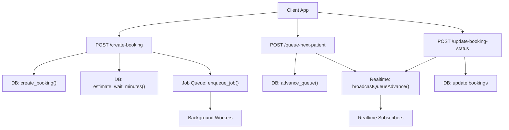
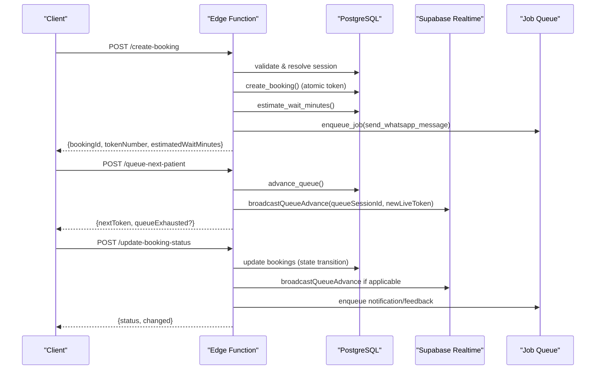
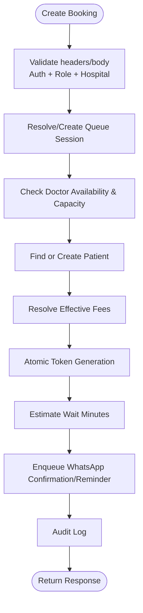
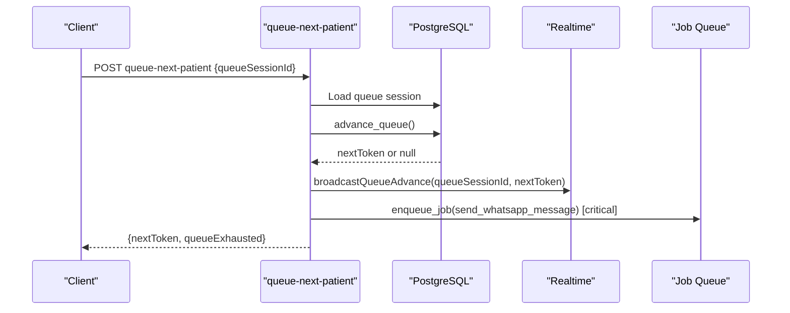
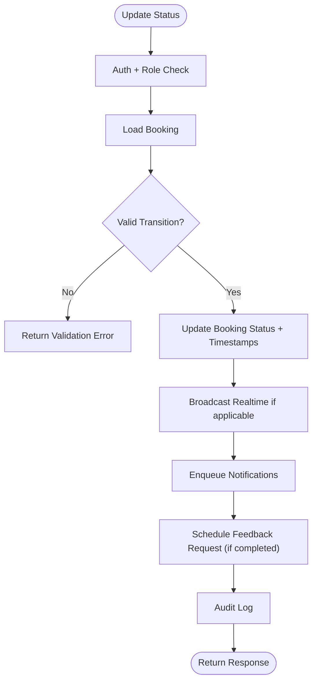
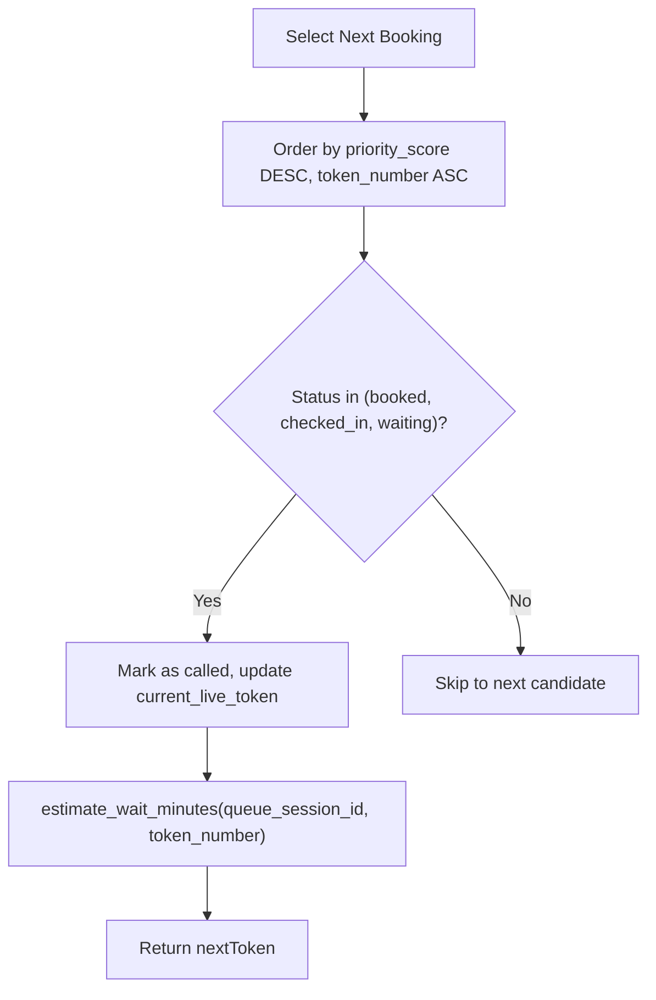
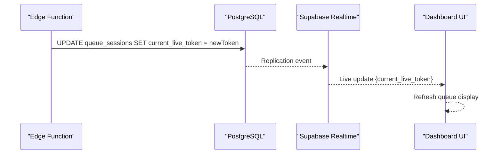
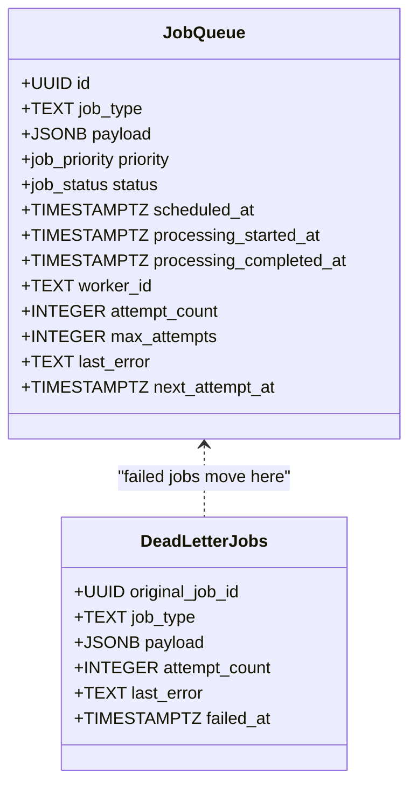
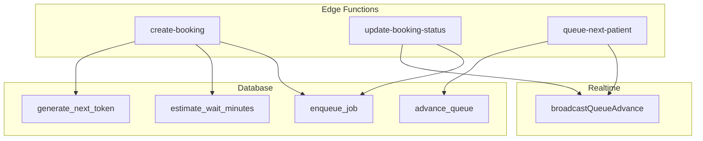

# Queue Management APIs

<cite>
**Referenced Files in This Document**
- [create-booking/index.ts](file://supabase/functions/create-booking/index.ts)
- [queue-next-patient/index.ts](file://supabase/functions/queue-next-patient/index.ts)
- [update-booking-status/index.ts](file://supabase/functions/update-booking-status/index.ts)
- [realtime.ts](file://supabase/functions/_shared/realtime.ts)
- [02_atomic_token_engine_&_bookings.sql](file://supabase/migrations/02_atomic_token_engine_&_bookings.sql)
- [06_background_job_queue.sql](file://supabase/migrations/06_background_job_queue.sql)
- [17_queue_monitoring_engine.sql](file://supabase/migrations/17_queue_monitoring_engine.sql)
</cite>

## Table of Contents

1. [Introduction](#introduction)
2. [Project Structure](#project-structure)
3. [Core Components](#core-components)
4. [Architecture Overview](#architecture-overview)
5. [Detailed Component Analysis](#detailed-component-analysis)
6. [Dependency Analysis](#dependency-analysis)
7. [Performance Considerations](#performance-considerations)
8. [Troubleshooting Guide](#troubleshooting-guide)
9. [Conclusion](#conclusion)
10. [Appendices](#appendices)

## Introduction

This document provides comprehensive API documentation for queue management
endpoints that support real-time patient flow operations across healthcare
scenarios such as emergency queues, regular appointments, and follow-up visits.
It covers token allocation, patient check-in, queue position updates, priority
rules, waiting time estimation, WebSocket-based live updates via Supabase
Realtime, and background worker integration for automated processing and
notifications.

## Project Structure

The queue system is implemented using:

- Edge Functions for HTTP endpoints handling booking creation, status
  transitions, and queue advancement.
- PostgreSQL functions and tables for atomic token generation, queue sessions,
  bookings, and job queues.
- Supabase Realtime subscriptions to broadcast live queue changes to clients.
- Background workers driven by a robust job queue with retries, dead-letter
  handling, and metrics.

**Diagram sources**

- [create-booking/index.ts:251-319](file://supabase/functions/create-booking/index.ts#L251-L319)
- [create-booking/index.ts:421-518](file://supabase/functions/create-booking/index.ts#L421-L518)
- [queue-next-patient/index.ts:159-167](file://supabase/functions/queue-next-patient/index.ts#L159-L167)
- [queue-next-patient/index.ts:258-272](file://supabase/functions/queue-next-patient/index.ts#L258-L272)
- [update-booking-status/index.ts:372-448](file://supabase/functions/update-booking-status/index.ts#L372-L448)
- [realtime.ts:24-44](file://supabase/functions/_shared/realtime.ts#L24-L44)
- [02_atomic_token_engine_&_bookings.sql:446-562](file://supabase/migrations/02_atomic_token_engine_&_bookings.sql#L446-L562)
- [02_atomic_token_engine_&_bookings.sql:576-622](file://supabase/migrations/02_atomic_token_engine_&_bookings.sql#L576-L622)
- [06_background_job_queue.sql:194-245](file://supabase/migrations/06_background_job_queue.sql#L194-L245)

**Section sources**

- [create-booking/index.ts:1-666](file://supabase/functions/create-booking/index.ts#L1-L666)
- [queue-next-patient/index.ts:1-342](file://supabase/functions/queue-next-patient/index.ts#L1-L342)
- [update-booking-status/index.ts:1-642](file://supabase/functions/update-booking-status/index.ts#L1-L642)
- [realtime.ts:1-71](file://supabase/functions/_shared/realtime.ts#L1-L71)
- [02_atomic_token_engine_&_bookings.sql:1-827](file://supabase/migrations/02_atomic_token_engine_&_bookings.sql#L1-L827)
- [06_background_job_queue.sql:1-550](file://supabase/migrations/06_background_job_queue.sql#L1-L550)
- [17_queue_monitoring_engine.sql:1-928](file://supabase/migrations/17_queue_monitoring_engine.sql#L1-L928)

## Core Components

- Token Allocation: Atomic token generation per hospital/day ensures unique,
  ordered tokens without race conditions.
- Queue Sessions: Per doctor/date sessions track capacity and current live
  token.
- Bookings: Store patient details, token numbers, priority flags/scores,
  timestamps for lifecycle events, and estimated wait minutes.
- Status Transitions: Enforce state machine for checked_in → waiting → called →
  in_consultation → completed/cancelled/no_show/skipped.
- Realtime Updates: Live broadcasting of queue advances and presence updates via
  Supabase Realtime.
- Background Jobs: Asynchronous processing for WhatsApp messages, reminders,
  feedback requests, and other tasks with retry and dead-letter handling.

**Section sources**

- [02_atomic_token_engine_&_bookings.sql:31-64](file://supabase/migrations/02_atomic_token_engine_&_bookings.sql#L31-L64)
- [02_atomic_token_engine_&_bookings.sql:81-116](file://supabase/migrations/02_atomic_token_engine_&_bookings.sql#L81-L116)
- [02_atomic_token_engine_&_bookings.sql:150-284](file://supabase/migrations/02_atomic_token_engine_&_bookings.sql#L150-L284)
- [02_atomic_token_engine_&_bookings.sql:576-622](file://supabase/migrations/02_atomic_token_engine_&_bookings.sql#L576-L622)
- [06_background_job_queue.sql:41-95](file://supabase/migrations/06_background_job_queue.sql#L41-L95)

## Architecture Overview

The system combines HTTP APIs with database-level concurrency controls and
background workers:

- Create Booking: Validates inputs, checks availability and capacity, creates or
  finds patients, atomically generates tokens, estimates wait times, enqueues
  notifications, and returns results.
- Advance Queue: Picks the next eligible booking based on priority and token
  order, marks it as called, updates live token, broadcasts realtime updates,
  and optionally enqueues WhatsApp notifications.
- Update Status: Enforces state transitions, updates timestamps, triggers
  realtime broadcasts, and schedules notifications or feedback requests.
- Realtime: Uses table mutations to trigger Supabase Realtime events for live
  dashboards and screens.
- Background Workers: Use claim/complete/fail patterns with exponential backoff
  and dead-letter queues.

**Diagram sources**

- [create-booking/index.ts:251-518](file://supabase/functions/create-booking/index.ts#L251-L518)
- [queue-next-patient/index.ts:159-272](file://supabase/functions/queue-next-patient/index.ts#L159-L272)
- [update-booking-status/index.ts:372-448](file://supabase/functions/update-booking-status/index.ts#L372-L448)
- [realtime.ts:24-44](file://supabase/functions/_shared/realtime.ts#L24-L44)
- [02_atomic_token_engine_&_bookings.sql:446-562](file://supabase/migrations/02_atomic_token_engine_&_bookings.sql#L446-L562)
- [02_atomic_token_engine_&_bookings.sql:576-622](file://supabase/migrations/02_atomic_token_engine_&_bookings.sql#L576-L622)
- [06_background_job_queue.sql:194-245](file://supabase/migrations/06_background_job_queue.sql#L194-L245)

## Detailed Component Analysis

### Endpoint: Create Booking (Token Allocation)

- Purpose: Allocate a token for a patient within a queue session, estimate wait
  time, and enqueue notifications.
- Key behaviors:
  - Resolves or auto-creates a queue session for the doctor/date.
  - Checks doctor availability and remaining token capacity.
  - Finds or creates patient record deduplicated by normalized phone.
  - Calls SQL function to generate next token atomically.
  - Estimates wait minutes using queue session and token number.
  - Enqueues WhatsApp confirmation and scheduled reminder jobs.
  - Returns booking ID, token number, reference, estimated wait, fees, and
    metadata.

**Diagram sources**

- [create-booking/index.ts:95-166](file://supabase/functions/create-booking/index.ts#L95-L166)
- [create-booking/index.ts:251-319](file://supabase/functions/create-booking/index.ts#L251-L319)
- [create-booking/index.ts:321-446](file://supabase/functions/create-booking/index.ts#L321-L446)
- [create-booking/index.ts:507-585](file://supabase/functions/create-booking/index.ts#L507-L585)
- [02_atomic_token_engine_&_bookings.sql:446-562](file://supabase/migrations/02_atomic_token_engine_&_bookings.sql#L446-L562)

**Section sources**

- [create-booking/index.ts:1-666](file://supabase/functions/create-booking/index.ts#L1-L666)
- [02_atomic_token_engine_&_bookings.sql:31-64](file://supabase/migrations/02_atomic_token_engine_&_bookings.sql#L31-L64)
- [02_atomic_token_engine_&_bookings.sql:446-562](file://supabase/migrations/02_atomic_token_engine_&_bookings.sql#L446-L562)

### Endpoint: Advance Queue (Next Patient)

- Purpose: Advance the queue to call the next patient based on priority and
  token order.
- Key behaviors:
  - Loads active queue session and validates ownership.
  - Calls SQL function to pick next eligible booking
    (booked/checked_in/waiting).
  - Marks selected booking as called and updates current_live_token.
  - Broadcasts realtime update to subscribers.
  - Enqueues critical WhatsApp message if patient phone exists.
  - Logs audit event.

**Diagram sources**

- [queue-next-patient/index.ts:104-167](file://supabase/functions/queue-next-patient/index.ts#L104-L167)
- [queue-next-patient/index.ts:217-272](file://supabase/functions/queue-next-patient/index.ts#L217-L272)
- [queue-next-patient/index.ts:278-320](file://supabase/functions/queue-next-patient/index.ts#L278-L320)
- [02_atomic_token_engine_&_bookings.sql:576-622](file://supabase/migrations/02_atomic_token_engine_&_bookings.sql#L576-L622)
- [realtime.ts:24-44](file://supabase/functions/_shared/realtime.ts#L24-L44)
- [06_background_job_queue.sql:194-245](file://supabase/migrations/06_background_job_queue.sql#L194-L245)

**Section sources**

- [queue-next-patient/index.ts:1-342](file://supabase/functions/queue-next-patient/index.ts#L1-L342)
- [02_atomic_token_engine_&_bookings.sql:576-622](file://supabase/migrations/02_atomic_token_engine_&_bookings.sql#L576-L622)

### Endpoint: Update Booking Status (Patient Check-in and Flow)

- Purpose: Manage patient lifecycle states with strict transitions and side
  effects.
- Key behaviors:
  - Validates role permissions and allowed transitions.
  - Updates booking status and timestamps (e.g., checked_in_at, called_at,
    consultation_started_at/completed_at).
  - Emits realtime updates when applicable.
  - Enqueues notifications for key transitions (called, started, completed,
    cancelled, no_show).
  - Schedules feedback request after completion.
  - Records audit logs and metrics.

**Diagram sources**

- [update-booking-status/index.ts:28-92](file://supabase/functions/update-booking-status/index.ts#L28-L92)
- [update-booking-status/index.ts:372-448](file://supabase/functions/update-booking-status/index.ts#L372-L448)
- [update-booking-status/index.ts:450-547](file://supabase/functions/update-booking-status/index.ts#L450-L547)
- [02_atomic_token_engine_&_bookings.sql:385-440](file://supabase/migrations/02_atomic_token_engine_&_bookings.sql#L385-L440)

**Section sources**

- [update-booking-status/index.ts:1-642](file://supabase/functions/update-booking-status/index.ts#L1-L642)
- [02_atomic_token_engine_&_bookings.sql:385-440](file://supabase/migrations/02_atomic_token_engine_&_bookings.sql#L385-L440)

### Priority Rules and Waiting Time Calculation

- Priority Rules:
  - Queue selection orders by priority_score descending, then token_number
    ascending.
  - Only eligible statuses are considered (booked, checked_in, waiting).
- Waiting Time Estimation:
  - After token allocation, the system calls estimate_wait_minutes using queue
    session and token number to provide an estimated wait duration.

**Diagram sources**

- [02_atomic_token_engine_&_bookings.sql:576-622](file://supabase/migrations/02_atomic_token_engine_&_bookings.sql#L576-L622)
- [create-booking/index.ts:507-518](file://supabase/functions/create-booking/index.ts#L507-L518)

**Section sources**

- [02_atomic_token_engine_&_bookings.sql:576-622](file://supabase/migrations/02_atomic_token_engine_&_bookings.sql#L576-L622)
- [create-booking/index.ts:507-518](file://supabase/functions/create-booking/index.ts#L507-L518)

### Realtime Subscriptions for Live Queue Updates

- Mechanism:
  - Edge functions mutate queue_sessions.current_live_token to trigger Supabase
    Realtime events.
  - Clients subscribe to queue_sessions and bookings tables to receive live
    updates.
- Usage:
  - Display screens refresh automatically when queue advances or status changes.
  - Presence indicators update via hospital_online_state mutations.

**Diagram sources**

- [realtime.ts:24-44](file://supabase/functions/_shared/realtime.ts#L24-L44)
- [02_atomic_token_engine_&_bookings.sql:631-655](file://supabase/migrations/02_atomic_token_engine_&_bookings.sql#L631-L655)

**Section sources**

- [realtime.ts:1-71](file://supabase/functions/_shared/realtime.ts#L1-L71)
- [02_atomic_token_engine_&_bookings.sql:631-655](file://supabase/migrations/02_atomic_token_engine_&_bookings.sql#L631-L655)

### Background Worker Integration

- Job Queue:
  - Jobs are enqueued with priorities (low, normal, high, critical), scheduling,
    idempotency keys, and metadata.
  - Workers claim jobs using SKIP LOCKED, process them, and mark complete or
    fail with exponential backoff.
  - Dead-letter queue captures permanently failed jobs for inspection.
- Integration Points:
  - WhatsApp confirmations, reminders, feedback requests, and queue-related
    notifications are enqueued from edge functions.
  - Monitoring and snapshots capture queue health metrics and throughput.

**Diagram sources**

- [06_background_job_queue.sql:41-95](file://supabase/migrations/06_background_job_queue.sql#L41-L95)
- [06_background_job_queue.sql:163-188](file://supabase/migrations/06_background_job_queue.sql#L163-L188)
- [06_background_job_queue.sql:194-245](file://supabase/migrations/06_background_job_queue.sql#L194-L245)
- [06_background_job_queue.sql:264-317](file://supabase/migrations/06_background_job_queue.sql#L264-L317)
- [06_background_job_queue.sql:326-348](file://supabase/migrations/06_background_job_queue.sql#L326-L348)
- [06_background_job_queue.sql:357-446](file://supabase/migrations/06_background_job_queue.sql#L357-L446)

**Section sources**

- [06_background_job_queue.sql:1-550](file://supabase/migrations/06_background_job_queue.sql#L1-L550)

## Dependency Analysis

- Edge Functions depend on:
  - Database functions for atomic operations (token generation, queue
    advancement, wait estimation).
  - Realtime module for live updates.
  - Job queue for asynchronous tasks.
- Database layer depends on:
  - Row Level Security policies for access control.
  - Triggers for timestamp updates and event logging.
  - Indexes for performance on queue lookups and job claims.

**Diagram sources**

- [create-booking/index.ts:251-518](file://supabase/functions/create-booking/index.ts#L251-L518)
- [queue-next-patient/index.ts:159-272](file://supabase/functions/queue-next-patient/index.ts#L159-L272)
- [update-booking-status/index.ts:372-448](file://supabase/functions/update-booking-status/index.ts#L372-L448)
- [02_atomic_token_engine_&_bookings.sql:31-64](file://supabase/migrations/02_atomic_token_engine_&_bookings.sql#L31-L64)
- [02_atomic_token_engine_&_bookings.sql:576-622](file://supabase/migrations/02_atomic_token_engine_&_bookings.sql#L576-L622)
- [06_background_job_queue.sql:194-245](file://supabase/migrations/06_background_job_queue.sql#L194-L245)
- [realtime.ts:24-44](file://supabase/functions/_shared/realtime.ts#L24-L44)

**Section sources**

- [create-booking/index.ts:1-666](file://supabase/functions/create-booking/index.ts#L1-L666)
- [queue-next-patient/index.ts:1-342](file://supabase/functions/queue-next-patient/index.ts#L1-L342)
- [update-booking-status/index.ts:1-642](file://supabase/functions/update-booking-status/index.ts#L1-L642)
- [02_atomic_token_engine_&_bookings.sql:1-827](file://supabase/migrations/02_atomic_token_engine_&_bookings.sql#L1-L827)
- [06_background_job_queue.sql:1-550](file://supabase/migrations/06_background_job_queue.sql#L1-L550)
- [realtime.ts:1-71](file://supabase/functions/_shared/realtime.ts#L1-L71)

## Performance Considerations

- Concurrency Safety:
  - Atomic token generation uses INSERT ... ON CONFLICT DO UPDATE RETURNING to
    prevent duplicates under load.
  - Queue advancement uses SELECT ... FOR UPDATE SKIP LOCKED to avoid contention
    and ensure safe concurrent calls.
- Indexing:
  - Optimized indexes on queue_sessions and bookings for fast lookups by
    hospital, date, doctor, and status.
  - Job queue indexes for efficient claiming and retry scheduling.
- Realtime Efficiency:
  - Minimal mutations to trigger replication streams; clients subscribe only to
    relevant tables.
- Background Processing:
  - Exponential backoff for retries reduces load during failures.
  - Dead-letter queue isolates problematic jobs for manual intervention.
- Metrics and Monitoring:
  - Queue metrics snapshots capture pending, processing, failed, and throughput
    stats for observability.

[No sources needed since this section provides general guidance]

## Troubleshooting Guide

- Common Issues:
  - Queue Exhausted: When no eligible bookings exist, advance_queue returns
    null; handle gracefully in UI.
  - Duplicate Requests: Idempotency keys prevent duplicate bookings; reuse
    existing response on conflict.
  - Concurrent Status Changes: State updates enforce optimistic concurrency;
    retry on conflicts.
  - Realtime Broadcast Failures: Non-fatal; log warnings and continue
    processing.
  - Job Failures: Check dead-letter queue for permanently failed jobs; adjust
    retry logic or payloads.
- Diagnostics:
  - Use queue health functions to inspect backlog and stuck jobs.
  - Monitor metrics snapshots for throughput and aging metrics.
  - Review audit logs for status changes and token advances.

**Section sources**

- [queue-next-patient/index.ts:189-213](file://supabase/functions/queue-next-patient/index.ts#L189-L213)
- [create-booking/index.ts:448-493](file://supabase/functions/create-booking/index.ts#L448-L493)
- [update-booking-status/index.ts:404-429](file://supabase/functions/update-booking-status/index.ts#L404-L429)
- [17_queue_monitoring_engine.sql:124-277](file://supabase/migrations/17_queue_monitoring_engine.sql#L124-L277)
- [17_queue_monitoring_engine.sql:283-401](file://supabase/migrations/17_queue_monitoring_engine.sql#L283-L401)

## Conclusion

The queue management system provides robust, production-grade capabilities for
token allocation, patient flow, and real-time updates. It leverages atomic
database operations, strict state machines, background workers, and Supabase
Realtime to deliver reliable performance under high-volume conditions. The
design supports diverse healthcare scenarios through flexible queue sessions,
priority rules, and extensible notification workflows.

[No sources needed since this section summarizes without analyzing specific
files]

## Appendices

### Example Scenarios

- Emergency Queue:
  - Set higher priority_score for urgent cases to jump ahead in line.
  - Use quick token allocation and immediate calling workflow.
- Regular Appointments:
  - Standard priority and token ordering; schedule reminders before clinic
    hours.
- Follow-up Visits:
  - Lower priority_score than emergencies but higher than routine; allow
    rescheduling and reminders.

[No sources needed since this section doesn't analyze specific files]
