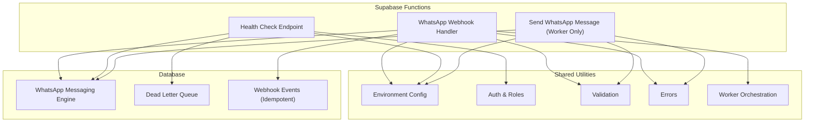
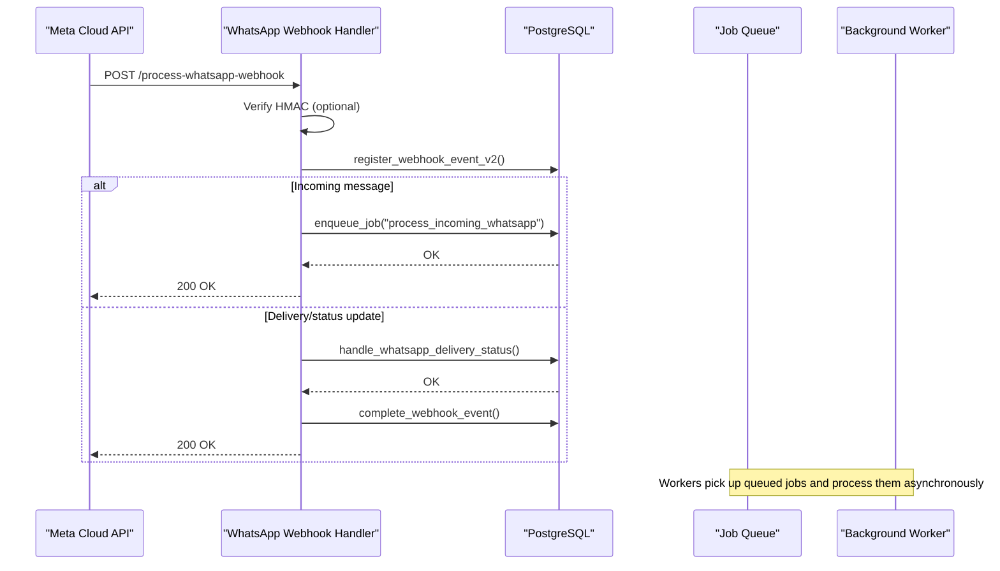
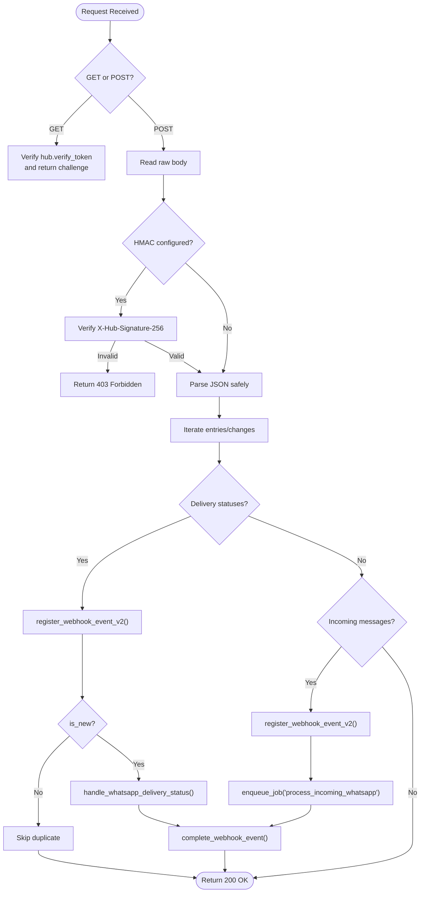
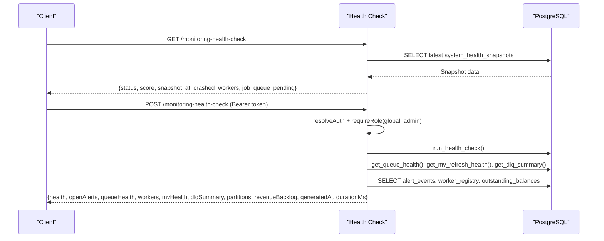
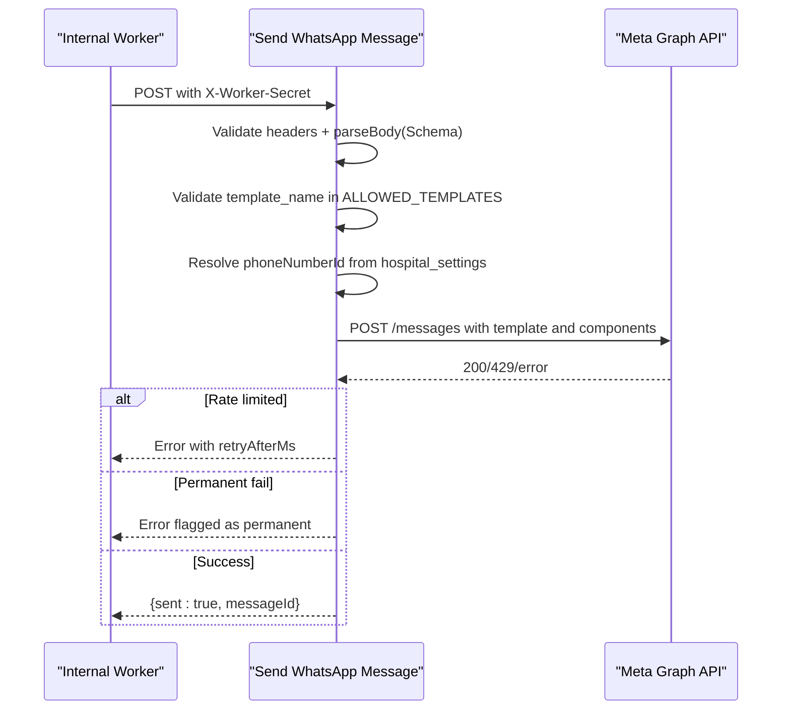
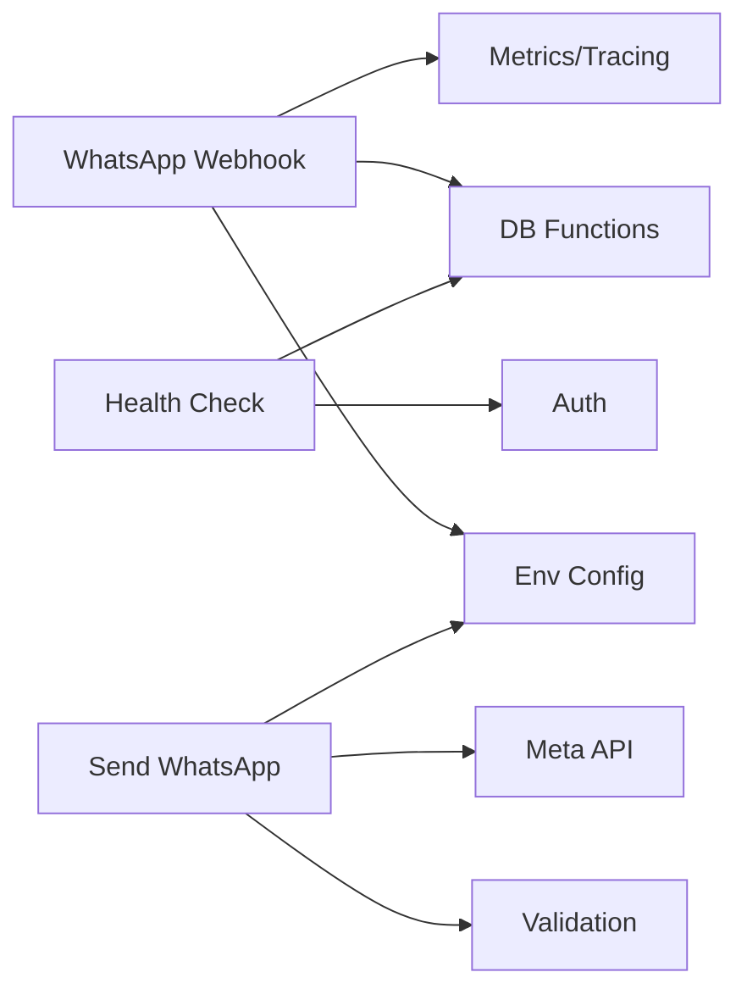
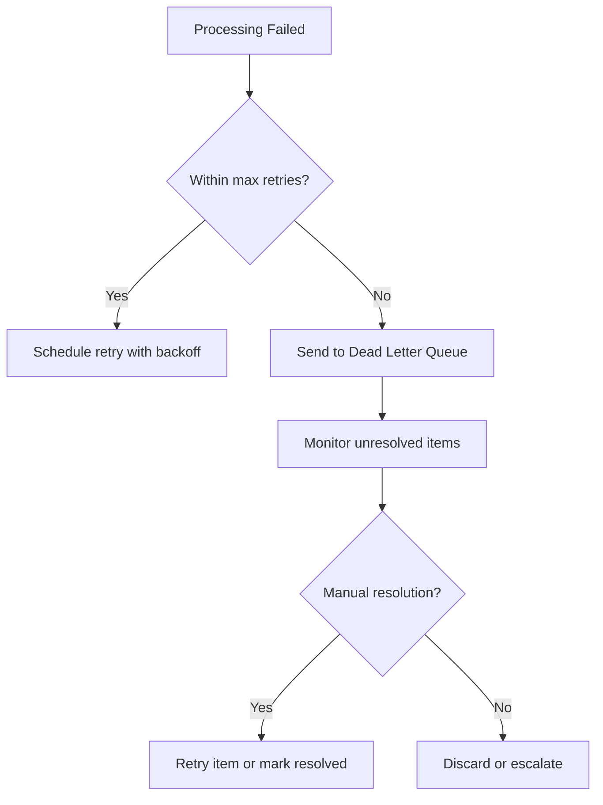

# Webhook Endpoints

<cite>
**Referenced Files in This Document**
- [process-whatsapp-webhook/index.ts](file://supabase/functions/process-whatsapp-webhook/index.ts)
- [monitoring-health-check/index.ts](file://supabase/functions/monitoring-health-check/index.ts)
- [send-whatsapp-message/index.ts](file://supabase/functions/send-whatsapp-message/index.ts)
- [env.ts](file://supabase/functions/_shared/env.ts)
- [auth.ts](file://supabase/functions/_shared/auth.ts)
- [validation.ts](file://supabase/functions/_shared/validation.ts)
- [errors.ts](file://supabase/functions/_shared/errors.ts)
- [worker.ts](file://supabase/functions/_shared/worker.ts)
- [04_whatsapp_messaging_engine.sql](file://supabase/migrations/04_whatsapp_messaging_engine.sql)
- [14_dead_letter_queue.sql](file://supabase/migrations/14_dead_letter_queue.sql)
- [16_idempotency_hardening.sql](file://supabase/migrations/16_idempotency_hardening.sql)
</cite>

## Table of Contents

1. Introduction
2. Project Structure
3. Core Components
4. Architecture Overview
5. Detailed Component Analysis
6. Dependency Analysis
7. Performance Considerations
8. Troubleshooting Guide
9. Conclusion
10. Appendices

## Introduction

This document provides detailed API documentation for webhook endpoints that
integrate with external services, focusing on WhatsApp webhooks and system
health monitoring. It covers:

- Incoming WhatsApp messages, delivery receipts, and status updates
- Health check endpoints for service availability and system status
- Webhook signature verification, payload validation, and error handling
  patterns
- Retry mechanisms for failed processing and dead letter queue handling
- Payload examples, response formats, and integration patterns
- Security considerations including request validation, IP whitelisting
  guidance, and audit logging

## Project Structure

The webhook system is implemented as Deno Edge Functions under Supabase
Functions, backed by PostgreSQL functions and tables defined in migrations. Key
modules:

- WhatsApp webhook ingestion and routing
- Health reporting endpoint
- Outbound WhatsApp message sending (worker-only)
- Shared utilities for environment, auth, validation, errors, worker
  orchestration
- Database schema for messaging, queues, DLQ, and idempotent webhook
  registration

**Diagram sources**

- [process-whatsapp-webhook/index.ts:1-657](file://supabase/functions/process-whatsapp-webhook/index.ts#L1-L657)
- [monitoring-health-check/index.ts:1-231](file://supabase/functions/monitoring-health-check/index.ts#L1-L231)
- [send-whatsapp-message/index.ts:1-583](file://supabase/functions/send-whatsapp-message/index.ts#L1-L583)
- [env.ts:1-279](file://supabase/functions/_shared/env.ts#L1-L279)
- [auth.ts:1-237](file://supabase/functions/_shared/auth.ts#L1-L237)
- [validation.ts:1-157](file://supabase/functions/_shared/validation.ts#L1-L157)
- [errors.ts:1-323](file://supabase/functions/_shared/errors.ts#L1-L323)
- [worker.ts:1-256](file://supabase/functions/_shared/worker.ts#L1-L256)
- [04_whatsapp_messaging_engine.sql:1-852](file://supabase/migrations/04_whatsapp_messaging_engine.sql#L1-L852)
- [14_dead_letter_queue.sql:1-481](file://supabase/migrations/14_dead_letter_queue.sql#L1-L481)
- [16_idempotency_hardening.sql:154-384](file://supabase/migrations/16_idempotency_hardening.sql#L154-L384)

**Section sources**

- [process-whatsapp-webhook/index.ts:1-657](file://supabase/functions/process-whatsapp-webhook/index.ts#L1-L657)
- [monitoring-health-check/index.ts:1-231](file://supabase/functions/monitoring-health-check/index.ts#L1-L231)
- [send-whatsapp-message/index.ts:1-583](file://supabase/functions/send-whatsapp-message/index.ts#L1-L583)

## Core Components

- WhatsApp Webhook Handler: Accepts Meta Cloud API webhooks for incoming
  messages and delivery/read statuses; performs HMAC verification, deduplication
  via payload hashing, and enqueues jobs or updates delivery states.
- Health Check Endpoint: Provides a lightweight GET for uptime checks and an
  authenticated POST to run a comprehensive health report across queues,
  workers, DLQ, MV freshness, and alerts.
- Send WhatsApp Message: Worker-only endpoint to send template-based WhatsApp
  messages to Meta Cloud API with rate-limit and permanent failure handling.

Key shared capabilities:

- Environment configuration with typed accessors
- Request validation using Zod schemas
- Centralized error types and responses
- Worker orchestration with leases, heartbeats, and retry safety
- Idempotent webhook event registration and completion

**Section sources**

- [process-whatsapp-webhook/index.ts:16-23](file://supabase/functions/process-whatsapp-webhook/index.ts#L16-L23)
- [monitoring-health-check/index.ts:12-20](file://supabase/functions/monitoring-health-check/index.ts#L12-L20)
- [send-whatsapp-message/index.ts:7-17](file://supabase/functions/send-whatsapp-message/index.ts#L7-L17)
- [env.ts:118-126](file://supabase/functions/_shared/env.ts#L118-L126)
- [validation.ts:99-134](file://supabase/functions/_shared/validation.ts#L99-L134)
- [errors.ts:70-104](file://supabase/functions/_shared/errors.ts#L70-L104)
- [worker.ts:217-256](file://supabase/functions/_shared/worker.ts#L217-L256)
- [16_idempotency_hardening.sql:154-384](file://supabase/migrations/16_idempotency_hardening.sql#L154-L384)

## Architecture Overview

The WhatsApp webhook flow ensures reliability through idempotent registration,
background job queuing, and robust delivery status handling. The health endpoint
aggregates operational metrics from multiple subsystems.

**Diagram sources**

- [process-whatsapp-webhook/index.ts:222-633](file://supabase/functions/process-whatsapp-webhook/index.ts#L222-L633)
- [16_idempotency_hardening.sql:154-384](file://supabase/migrations/16_idempotency_hardening.sql#L154-L384)
- [04_whatsapp_messaging_engine.sql:512-589](file://supabase/migrations/04_whatsapp_messaging_engine.sql#L512-L589)

## Detailed Component Analysis

### WhatsApp Webhook Handler

Handles:

- GET: Meta verification challenge
- POST: Incoming messages and delivery/read statuses

Security and validation:

- Optional HMAC-SHA256 verification using app secret header
- Constant-time comparison for tokens and signatures
- Safe JSON parsing with graceful fallback
- Large batch warning for >100 entries

Processing logic:

- Deduplication via payload hash and provider event ID
- For incoming messages: enqueue background job with idempotency key
- For delivery statuses: map status names and update message state
- Always returns HTTP 200 to prevent endless retries from Meta

Response behavior:

- Returns minimal JSON status for internal failures to avoid retry storms
- Metrics and tracing recorded per request

**Diagram sources**

- [process-whatsapp-webhook/index.ts:152-211](file://supabase/functions/process-whatsapp-webhook/index.ts#L152-L211)
- [process-whatsapp-webhook/index.ts:222-633](file://supabase/functions/process-whatsapp-webhook/index.ts#L222-L633)
- [16_idempotency_hardening.sql:154-384](file://supabase/migrations/16_idempotency_hardening.sql#L154-L384)
- [04_whatsapp_messaging_engine.sql:512-589](file://supabase/migrations/04_whatsapp_messaging_engine.sql#L512-L589)

**Section sources**

- [process-whatsapp-webhook/index.ts:1-657](file://supabase/functions/process-whatsapp-webhook/index.ts#L1-L657)
- [env.ts:118-126](file://supabase/functions/_shared/env.ts#L118-L126)
- [16_idempotency_hardening.sql:154-384](file://supabase/migrations/16_idempotency_hardening.sql#L154-L384)

### Health Check Endpoint

Endpoints:

- GET /monitoring-health-check: Lightweight uptime check without authentication
- POST /monitoring-health-check: Full health report requiring global admin role

Behavior:

- GET reads latest snapshot and returns status based on health score
- POST runs comprehensive checks: health RPC, open alerts, queue health, worker
  registry, materialized view refresh health, DLQ summary, partition readiness,
  revenue backlog
- Uses centralized success/error responses and metrics

**Diagram sources**

- [monitoring-health-check/index.ts:34-97](file://supabase/functions/monitoring-health-check/index.ts#L34-L97)
- [monitoring-health-check/index.ts:103-210](file://supabase/functions/monitoring-health-check/index.ts#L103-L210)
- [auth.ts:42-124](file://supabase/functions/_shared/auth.ts#L42-L124)

**Section sources**

- [monitoring-health-check/index.ts:1-231](file://supabase/functions/monitoring-health-check/index.ts#L1-L231)
- [auth.ts:1-237](file://supabase/functions/_shared/auth.ts#L1-L237)

### Send WhatsApp Message (Worker-Only)

Purpose:

- Sends template-based WhatsApp messages via Meta Cloud API
- Protected by X-Worker-Secret header
- Validates payload with Zod schema and allowed templates

Flow:

- Validate worker secret
- Parse and validate request body
- Resolve phone number ID from hospital settings if provided
- Build template components
- Call Meta API with timeout and rate-limit handling
- Track metrics and respond with standardized success/error

**Diagram sources**

- [send-whatsapp-message/index.ts:326-583](file://supabase/functions/send-whatsapp-message/index.ts#L326-L583)
- [send-whatsapp-message/index.ts:198-324](file://supabase/functions/send-whatsapp-message/index.ts#L198-L324)

**Section sources**

- [send-whatsapp-message/index.ts:1-583](file://supabase/functions/send-whatsapp-message/index.ts#L1-L583)
- [validation.ts:99-134](file://supabase/functions/_shared/validation.ts#L99-L134)
- [errors.ts:154-162](file://supabase/functions/_shared/errors.ts#L154-L162)

## Dependency Analysis

- WhatsApp Webhook Handler depends on:
  - Environment variables for Meta secrets and verification token
  - Validation utilities for safe JSON parsing
  - Database functions for idempotent event registration, delivery status
    handling, and job enqueuing
  - Metrics and tracing for observability
- Health Check depends on:
  - Auth middleware for role enforcement
  - Database RPCs and queries for system state aggregation
- Send WhatsApp Message depends on:
  - Worker secret validation
  - Zod-based payload validation
  - Meta API client with timeout and error classification

**Diagram sources**

- [process-whatsapp-webhook/index.ts:16-23](file://supabase/functions/process-whatsapp-webhook/index.ts#L16-L23)
- [monitoring-health-check/index.ts:12-20](file://supabase/functions/monitoring-health-check/index.ts#L12-L20)
- [send-whatsapp-message/index.ts:7-17](file://supabase/functions/send-whatsapp-message/index.ts#L7-L17)
- [env.ts:118-126](file://supabase/functions/_shared/env.ts#L118-L126)
- [auth.ts:42-124](file://supabase/functions/_shared/auth.ts#L42-L124)
- [validation.ts:99-134](file://supabase/functions/_shared/validation.ts#L99-L134)

**Section sources**

- [process-whatsapp-webhook/index.ts:16-23](file://supabase/functions/process-whatsapp-webhook/index.ts#L16-L23)
- [monitoring-health-check/index.ts:12-20](file://supabase/functions/monitoring-health-check/index.ts#L12-L20)
- [send-whatsapp-message/index.ts:7-17](file://supabase/functions/send-whatsapp-message/index.ts#L7-L17)

## Performance Considerations

- Webhook handler always returns 200 to prevent Meta retry storms; heavy work is
  offloaded to background jobs
- Idempotent webhook registration prevents duplicate processing under high load
- Batch warnings for large webhook payloads help detect anomalies
- Health endpoint uses snapshots for fast GET responses; POST triggers
  comprehensive checks suitable for admin dashboards
- Send WhatsApp Message includes timeouts and rate-limit handling to avoid
  long-running requests

[No sources needed since this section provides general guidance]

## Troubleshooting Guide

Common issues and resolutions:

- HMAC verification failures: Ensure correct app secret and header usage; verify
  constant-time comparison implementation
- Invalid JSON payloads: Handler logs and returns 200 with status indicating
  invalid JSON; inspect raw payload in webhook events
- Duplicate webhooks: Handled via payload hash and provider event ID; check
  duplicate_detected fields in webhook events
- Delivery status not updating: Confirm mapping of status names and ensure
  message exists; review delivery logs
- Rate limiting from Meta: Handle 429 responses with Retry-After; schedule
  retries accordingly
- Permanent failures: Certain Meta error codes are treated as permanent; mark
  messages accordingly and consider manual intervention

Operational checks:

- Use GET health endpoint for quick availability checks
- Use POST health endpoint for deep diagnostics including DLQ counts, worker
  status, and queue health

**Section sources**

- [process-whatsapp-webhook/index.ts:222-633](file://supabase/functions/process-whatsapp-webhook/index.ts#L222-L633)
- [monitoring-health-check/index.ts:34-210](file://supabase/functions/monitoring-health-check/index.ts#L34-L210)
- [send-whatsapp-message/index.ts:248-324](file://supabase/functions/send-whatsapp-message/index.ts#L248-L324)

## Conclusion

The webhook system provides a robust, secure, and observable integration layer
for WhatsApp messaging and system health monitoring. It emphasizes idempotency,
reliable delivery tracking, and clear separation between inbound webhook
handling and outbound message sending. Operational visibility is enhanced
through health checks and DLQ management, enabling proactive maintenance and
rapid incident resolution.

[No sources needed since this section summarizes without analyzing specific
files]

## Appendices

### API Definitions

#### WhatsApp Webhook

- Endpoint: POST /process-whatsapp-webhook
- Methods:
  - GET: Verification challenge with hub.mode, hub.verify_token, hub.challenge
  - POST: Incoming messages and delivery/read statuses
- Headers:
  - X-Hub-Signature-256: Optional HMAC signature for verification
- Request body: Meta Cloud API webhook payload containing entries and changes
- Response:
  - Always 200 OK with JSON status for successful processing or internal
    failures
  - 403 Forbidden for invalid verification or HMAC failures
  - 405 Method Not Allowed for unsupported methods

**Section sources**

- [process-whatsapp-webhook/index.ts:152-211](file://supabase/functions/process-whatsapp-webhook/index.ts#L152-L211)
- [process-whatsapp-webhook/index.ts:222-633](file://supabase/functions/process-whatsapp-webhook/index.ts#L222-L633)

#### Health Check

- Endpoint: /monitoring-health-check
- Methods:
  - GET: Lightweight uptime check returning status and score
  - POST: Full health report requiring global admin role
- Authentication:
  - GET: No auth required
  - POST: Bearer token with global_admin role
- Response:
  - GET: {status, score, snapshot_at, crashed_workers, job_queue_pending}
  - POST: Comprehensive report including health, alerts, queues, workers, DLQ,
    partitions, revenue backlog

**Section sources**

- [monitoring-health-check/index.ts:34-97](file://supabase/functions/monitoring-health-check/index.ts#L34-L97)
- [monitoring-health-check/index.ts:103-210](file://supabase/functions/monitoring-health-check/index.ts#L103-L210)
- [auth.ts:42-124](file://supabase/functions/_shared/auth.ts#L42-L124)

#### Send WhatsApp Message

- Endpoint: POST /send-whatsapp-message
- Authentication: X-Worker-Secret header must match configured secret
- Request body: Validated against schema including phone, template_name, and
  optional fields
- Response:
  - Success: {sent: true, messageId}
  - Failure: Standardized error response with context

**Section sources**

- [send-whatsapp-message/index.ts:326-583](file://supabase/functions/send-whatsapp-message/index.ts#L326-L583)
- [validation.ts:99-134](file://supabase/functions/_shared/validation.ts#L99-L134)

### Security Considerations

- Request validation: All inbound bodies validated using Zod schemas where
  applicable; webhook handler uses safe JSON parsing
- Signature verification: HMAC-SHA256 verification for webhooks using app
  secret; constant-time comparisons prevent timing attacks
- IP whitelisting: Not implemented in code; recommend configuring platform-level
  IP allowlisting at the edge or gateway
- Audit logging: Fire-and-forget audit events can be written for sensitive
  operations; failures do not impact primary flows
- Role enforcement: Health endpoint requires global_admin role; other endpoints
  may use auth middleware as needed

**Section sources**

- [process-whatsapp-webhook/index.ts:31-76](file://supabase/functions/process-whatsapp-webhook/index.ts#L31-L76)
- [monitoring-health-check/index.ts:103-107](file://supabase/functions/monitoring-health-check/index.ts#L103-L107)
- [auth.ts:42-124](file://supabase/functions/_shared/auth.ts#L42-L124)
- [audit.ts:51-74](file://supabase/functions/_shared/audit.ts#L51-L74)

### Retry Mechanisms and Dead Letter Queue

- WhatsApp message retries: Exponential backoff with configurable max retries;
  permanently failed messages after threshold
- Job queue retries: Worker orchestration handles failures with backoff and DLQ
  integration
- Dead letter queue: Centralized storage for failed items with source tracking,
  priority levels, and resolution workflows
- DLQ retry: Supports re-enqueueing or resetting message states based on source
  type

**Diagram sources**

- [04_whatsapp_messaging_engine.sql:598-658](file://supabase/migrations/04_whatsapp_messaging_engine.sql#L598-L658)
- [14_dead_letter_queue.sql:189-357](file://supabase/migrations/14_dead_letter_queue.sql#L189-L357)
- [worker.ts:217-256](file://supabase/functions/_shared/worker.ts#L217-L256)

**Section sources**

- [04_whatsapp_messaging_engine.sql:598-658](file://supabase/migrations/04_whatsapp_messaging_engine.sql#L598-L658)
- [14_dead_letter_queue.sql:189-357](file://supabase/migrations/14_dead_letter_queue.sql#L189-L357)
- [worker.ts:217-256](file://supabase/functions/_shared/worker.ts#L217-L256)

### Webhook Payload Examples

Note: The following describe structure and fields based on implementation;
actual payloads originate from Meta Cloud API.

- Incoming message payload:
  - entry[].changes[].value.messages[] contains message object with id, from,
    timestamp, and content details
  - Processed by registering webhook event and enqueuing job with idempotency
    key

- Delivery status payload:
  - entry[].changes[].value.statuses[] contains status object with id, status
    (sent/delivered/read/failed), and metadata
  - Processed by updating message state and logging delivery events

- Health check response:
  - GET: {status, score, snapshot_at, crashed_workers, job_queue_pending}
  - POST: {health, openAlerts, queueHealth, workers, mvHealth, dlqSummary,
    partitions, revenueBacklog, generatedAt, durationMs}

**Section sources**

- [process-whatsapp-webhook/index.ts:282-613](file://supabase/functions/process-whatsapp-webhook/index.ts#L282-L613)
- [monitoring-health-check/index.ts:34-97](file://supabase/functions/monitoring-health-check/index.ts#L34-L97)
- [monitoring-health-check/index.ts:187-210](file://supabase/functions/monitoring-health-check/index.ts#L187-L210)
