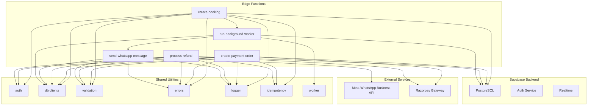
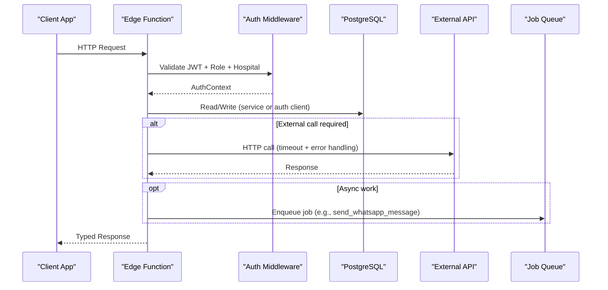
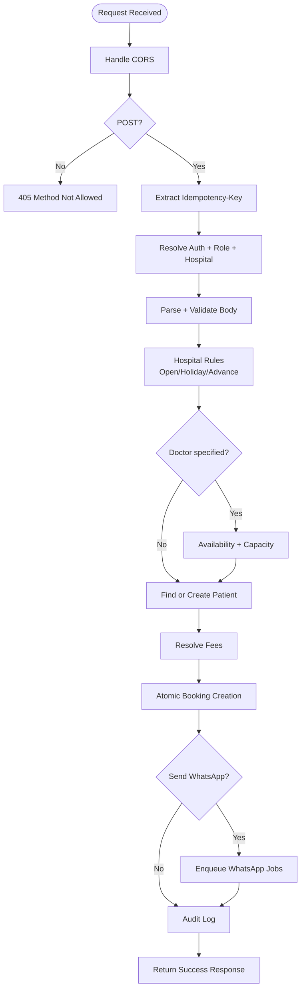
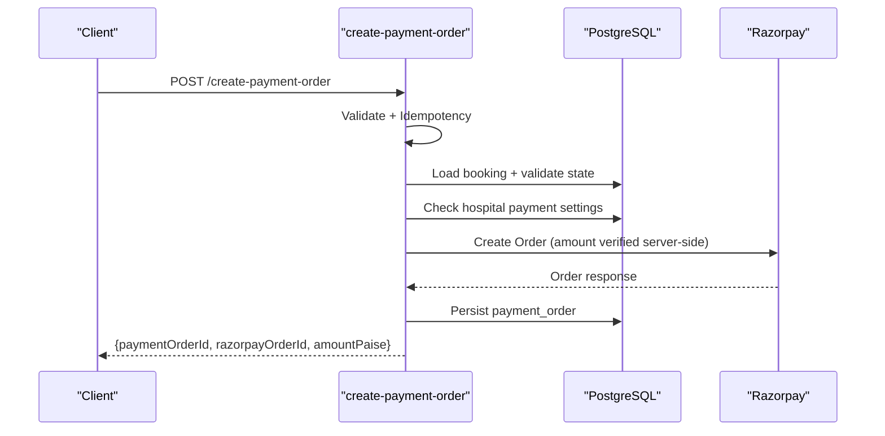
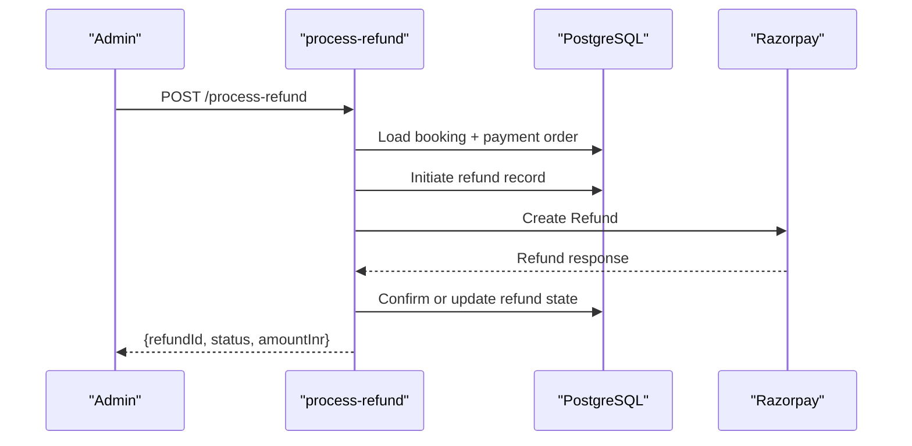
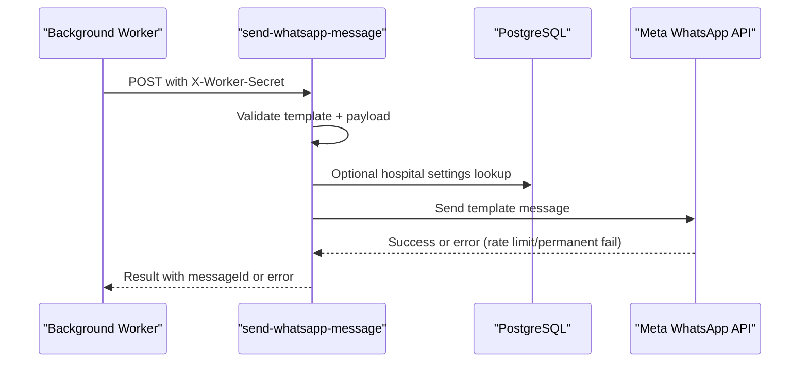
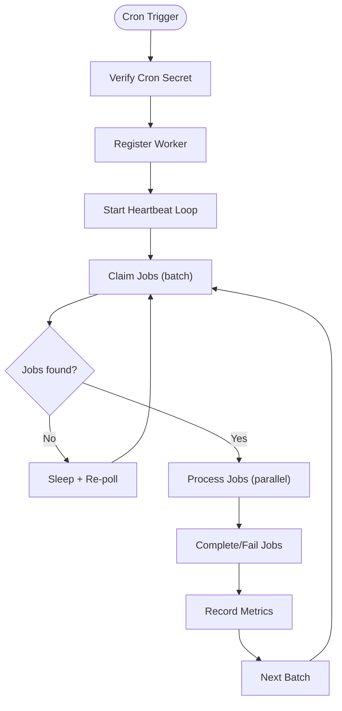
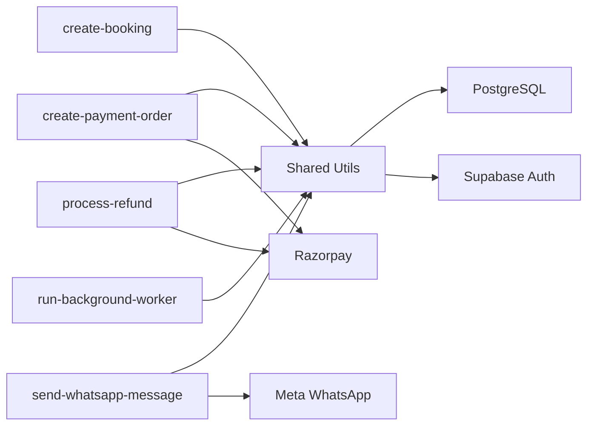

# Architecture Overview

<cite>
**Referenced Files in This Document**
- [auth.ts](file://supabase/functions/_shared/auth.ts)
- [db.ts](file://supabase/functions/_shared/db.ts)
- [database.generated.ts](file://supabase/functions/_shared/database.generated.ts)
- [validation.ts](file://supabase/functions/_shared/validation.ts)
- [errors.ts](file://supabase/functions/_shared/errors.ts)
- [logger.ts](file://supabase/functions/_shared/logger.ts)
- [idempotency.ts](file://supabase/functions/_shared/idempotency.ts)
- [worker.ts](file://supabase/functions/_shared/worker.ts)
- [create-booking/index.ts](file://supabase/functions/create-booking/index.ts)
- [create-payment-order/index.ts](file://supabase/functions/create-payment-order/index.ts)
- [process-refund/index.ts](file://supabase/functions/process-refund/index.ts)
- [send-whatsapp-message/index.ts](file://supabase/functions/send-whatsapp-message/index.ts)
- [run-background-worker/index.ts](file://supabase/functions/run-background-worker/index.ts)
- [config.toml](file://supabase/config.toml)
</cite>

## Table of Contents

1. [Introduction](#introduction)
2. [Project Structure](#project-structure)
3. [Core Components](#core-components)
4. [Architecture Overview](#architecture-overview)
5. [Detailed Component Analysis](#detailed-component-analysis)
6. [Dependency Analysis](#dependency-analysis)
7. [Performance Considerations](#performance-considerations)
8. [Troubleshooting Guide](#troubleshooting-guide)
9. [Conclusion](#conclusion)

## Introduction

This document describes the architecture of the Setura Hospital OS system built
on Supabase Edge Functions with a Postgres-backed database and event-driven
processing. The system implements multi-tenant hospital isolation, role-based
access control, idempotent APIs, and background workers for asynchronous tasks
such as WhatsApp messaging, notifications, analytics rollups, and SLA
computation. External integrations include the Meta WhatsApp Business API and
Razorpay payment gateway.

The design emphasizes:

- Serverless edge functions per business operation (booking, payments,
  notifications)
- Shared utilities for authentication, validation, logging, metrics, tracing,
  error handling, and idempotency
- Background worker orchestration via a job queue with leases and heartbeat
- Strong security boundaries and auditability

## Project Structure

At a high level:

- supabase/functions contains individual Deno Edge Functions for each business
  capability
- supabase/functions/_shared holds reusable modules used by all functions
- supabase/migrations define the relational schema and stored procedures/RPCs
- supabase/config.toml configures Supabase services including Auth, Realtime,
  Storage, and Edge Runtime

**Diagram sources**

- [create-booking/index.ts:67-666](file://supabase/functions/create-booking/index.ts#L67-L666)
- [create-payment-order/index.ts:104-407](file://supabase/functions/create-payment-order/index.ts#L104-L407)
- [process-refund/index.ts:109-360](file://supabase/functions/process-refund/index.ts#L109-L360)
- [send-whatsapp-message/index.ts:326-583](file://supabase/functions/send-whatsapp-message/index.ts#L326-L583)
- [run-background-worker/index.ts:247-454](file://supabase/functions/run-background-worker/index.ts#L247-L454)
- [auth.ts:42-237](file://supabase/functions/_shared/auth.ts#L42-L237)
- [db.ts:30-169](file://supabase/functions/_shared/db.ts#L30-L169)
- [idempotency.ts:196-259](file://supabase/functions/_shared/idempotency.ts#L196-L259)
- [worker.ts:30-257](file://supabase/functions/_shared/worker.ts#L30-L257)

**Section sources**

- [config.toml:369-378](file://supabase/config.toml#L369-L378)

## Core Components

- Authentication and authorization middleware: JWT validation, role resolution
  from user_roles, hospital access enforcement, and helper guards for roles and
  permissions.
- Database clients: service-role client (bypasses RLS), anon client (subject to
  RLS), and per-request auth client that impersonates the caller; typed RPC
  helpers and safe wrappers.
- Validation layer: Zod schemas for request bodies, phone normalization, date
  constraints, and generic parseBody utility.
- Error handling: Centralized typed error hierarchy with codes, status codes,
  retry flags, and context metadata.
- Logging and metrics: Structured JSON logs with correlation IDs, timers, and
  metrics collection per endpoint.
- Idempotency: Key extraction, claim/completion/failure flow backed by an
  idempotency registry table and request hashing to prevent replay and
  double-processing.
- Background workers: Worker registration, heartbeat, job claiming with skip
  locked semantics, and robust job completion/failure handling.

**Section sources**

- [auth.ts:42-237](file://supabase/functions/_shared/auth.ts#L42-L237)
- [db.ts:30-169](file://supabase/functions/_shared/db.ts#L30-L169)
- [validation.ts:71-157](file://supabase/functions/_shared/validation.ts#L71-L157)
- [errors.ts:70-323](file://supabase/functions/_shared/errors.ts#L70-L323)
- [logger.ts:122-190](file://supabase/functions/_shared/logger.ts#L122-L190)
- [idempotency.ts:39-259](file://supabase/functions/_shared/idempotency.ts#L39-L259)
- [worker.ts:30-257](file://supabase/functions/_shared/worker.ts#L30-L257)

## Architecture Overview

Setura uses a serverless microservices pattern where each business operation is
an independent Edge Function. Requests are authenticated and authorized before
any business logic runs. Data mutations go through service-role clients when
necessary, while read paths can use anon or auth-scoped clients depending on RLS
requirements. Asynchronous work is offloaded to a job queue processed by
background workers. External integrations are invoked within specific functions
with timeouts and structured error handling.

**Diagram sources**

- [create-booking/index.ts:67-666](file://supabase/functions/create-booking/index.ts#L67-L666)
- [auth.ts:42-237](file://supabase/functions/_shared/auth.ts#L42-L237)
- [db.ts:30-169](file://supabase/functions/_shared/db.ts#L30-L169)
- [send-whatsapp-message/index.ts:326-583](file://supabase/functions/send-whatsapp-message/index.ts#L326-L583)

## Detailed Component Analysis

### Booking Microservice (create-booking)

Responsibilities:

- Enforce CORS, method checks, and idempotency key handling
- Authenticate and authorize users with role and hospital checks
- Validate request body using Zod schemas
- Apply hospital rules (open hours, holidays, advance booking window)
- Check doctor availability and queue capacity
- Find-or-create patient deduplicated by normalized phone
- Create booking atomically via RPC and handle duplicate idempotency keys
- Enqueue WhatsApp confirmation and reminder jobs
- Write audit events and return typed response

**Diagram sources**

- [create-booking/index.ts:67-666](file://supabase/functions/create-booking/index.ts#L67-L666)

**Section sources**

- [create-booking/index.ts:67-666](file://supabase/functions/create-booking/index.ts#L67-L666)
- [validation.ts:71-157](file://supabase/functions/_shared/validation.ts#L71-L157)
- [idempotency.ts:196-259](file://supabase/functions/_shared/idempotency.ts#L196-L259)

### Payment Microservice (create-payment-order)

Responsibilities:

- Validate JWT and role/hospital access
- Ensure idempotency for order creation
- Load booking and validate payment eligibility
- Resolve fees and check hospital payment settings
- Call Razorpay Orders API with timeout and error mapping
- Persist payment_order row immutably after creation
- Return order details suitable for frontend checkout SDK

**Diagram sources**

- [create-payment-order/index.ts:104-407](file://supabase/functions/create-payment-order/index.ts#L104-L407)

**Section sources**

- [create-payment-order/index.ts:104-407](file://supabase/functions/create-payment-order/index.ts#L104-L407)

### Refund Microservice (process-refund)

Responsibilities:

- Validate JWT and role/hospital access
- Ensure idempotency for refund initiation
- Load booking and verify captured payment exists
- Compute refund amount and validate constraints
- Initiate refund record via RPC and call Razorpay Refunds API
- Update refund state based on gateway response
- Audit and return refund status

**Diagram sources**

- [process-refund/index.ts:109-360](file://supabase/functions/process-refund/index.ts#L109-L360)

**Section sources**

- [process-refund/index.ts:109-360](file://supabase/functions/process-refund/index.ts#L109-L360)

### WhatsApp Messaging Microservice (send-whatsapp-message)

Responsibilities:

- Protect endpoint with worker secret constant-time comparison
- Validate template payload against strict schema
- Build template components based on template name
- Call Meta Cloud API with timeout and rate-limit handling
- Track success/failure metrics and errors
- Support per-hospital phone number configuration

**Diagram sources**

- [send-whatsapp-message/index.ts:326-583](file://supabase/functions/send-whatsapp-message/index.ts#L326-L583)

**Section sources**

- [send-whatsapp-message/index.ts:326-583](file://supabase/functions/send-whatsapp-message/index.ts#L326-L583)

### Background Worker Orchestrator (run-background-worker)

Responsibilities:

- Secure entry via cron secret
- Register worker, start heartbeat loop
- Claim jobs in batches with skip locked semantics
- Dispatch job types to processors (WhatsApp send, incoming WhatsApp,
  notifications, analytics refresh, SLA compute)
- Complete or fail jobs with robust error handling
- Report metrics and exit cleanly after max runtime

**Diagram sources**

- [run-background-worker/index.ts:247-454](file://supabase/functions/run-background-worker/index.ts#L247-L454)
- [worker.ts:30-257](file://supabase/functions/_shared/worker.ts#L30-L257)

**Section sources**

- [run-background-worker/index.ts:247-454](file://supabase/functions/run-background-worker/index.ts#L247-L454)
- [worker.ts:30-257](file://supabase/functions/_shared/worker.ts#L30-L257)

### Shared Utilities Layer

- Authentication middleware:
  - Extracts JWT, validates via Supabase Auth, loads profile, resolves role and
    hospital access, and provides role guards.
- Database clients:
  - Service-role client bypasses RLS for internal operations; anon client
    subject to RLS; auth client impersonates caller per request; typed RPC
    helper and safe assertion wrapper.
- Validation schemas:
  - Zod schemas for create-booking and primitives; normalize phone numbers;
    enforce future dates and allowed booking sources.
- Error handling:
  - Centralized typed errors with codes, status codes, retry flags, and context;
    includes domain-specific errors for booking, payments, and infrastructure.
- Logging and metrics:
  - Structured JSON logs with correlation IDs; timers for durations; metrics
    counters/timers per endpoint; flush at end of requests.
- Idempotency:
  - Extracts UUID v4 Idempotency-Key; computes request hash; claims key
    atomically; returns cached responses for completed keys; handles processing
    conflicts; completes or fails keys after handler execution.
- Worker utilities:
  - Registration, heartbeat, stop, job claiming with skip locked, complete/fail
    job calls, and processJob wrapper with retry safety.

**Section sources**

- [auth.ts:42-237](file://supabase/functions/_shared/auth.ts#L42-L237)
- [db.ts:30-169](file://supabase/functions/_shared/db.ts#L30-L169)
- [validation.ts:71-157](file://supabase/functions/_shared/validation.ts#L71-L157)
- [errors.ts:70-323](file://supabase/functions/_shared/errors.ts#L70-L323)
- [logger.ts:122-190](file://supabase/functions/_shared/logger.ts#L122-L190)
- [idempotency.ts:39-259](file://supabase/functions/_shared/idempotency.ts#L39-L259)
- [worker.ts:30-257](file://supabase/functions/_shared/worker.ts#L30-L257)

## Dependency Analysis

Key dependency relationships:

- Edge functions depend on shared utilities for auth, db, validation, errors,
  logger, idempotency, and worker coordination.
- Database interactions rely on generated types for type safety and RPC calls
  for complex operations.
- External integrations are isolated within their respective functions with
  timeouts and error mapping.
- Background workers coordinate with the database job queue and invoke messaging
  endpoints internally.

**Diagram sources**

- [create-booking/index.ts:67-666](file://supabase/functions/create-booking/index.ts#L67-L666)
- [create-payment-order/index.ts:104-407](file://supabase/functions/create-payment-order/index.ts#L104-L407)
- [process-refund/index.ts:109-360](file://supabase/functions/process-refund/index.ts#L109-L360)
- [send-whatsapp-message/index.ts:326-583](file://supabase/functions/send-whatsapp-message/index.ts#L326-L583)
- [run-background-worker/index.ts:247-454](file://supabase/functions/run-background-worker/index.ts#L247-L454)
- [db.ts:30-169](file://supabase/functions/_shared/db.ts#L30-L169)

**Section sources**

- [database.generated.ts:1-800](file://supabase/functions/_shared/database.generated.ts#L1-L800)

## Performance Considerations

- Use service-role client for internal mutations to avoid RLS overhead; use
  anon/auth clients for user-facing reads/writes where RLS is required.
- Leverage idempotency to prevent duplicate work under retries and concurrent
  requests.
- Employ skip locked job claiming to avoid contention among workers.
- Keep external API calls short-lived with timeouts to prevent blocking edge
  function lifecycles.
- Batch job processing and parallelize independent tasks within worker runs.
- Use structured metrics and timers to identify hotspots and optimize slow
  paths.

[No sources needed since this section provides general guidance]

## Troubleshooting Guide

Common issues and diagnostics:

- Authentication failures: Check JWT presence, validity, and role/hospital
  access; review UnauthorizedError and RoleInsufficientError contexts.
- Validation errors: Inspect field-level errors returned by parseBody; ensure
  phone normalization and date formats match schemas.
- Idempotency conflicts: If receiving processing conflicts, implement client
  retry with backoff; verify unique Idempotency-Key usage per request.
- Database errors: Review DbError and constraint violations; inspect RPC
  parameters and transactional behavior.
- External API failures: For WhatsApp and Razorpay, check rate limits, permanent
  failure codes, and credential configuration; log full error context.
- Worker issues: Monitor heartbeat and job claim/fail logs; ensure worker
  registration succeeds and jobs are claimed without contention.

**Section sources**

- [errors.ts:70-323](file://supabase/functions/_shared/errors.ts#L70-L323)
- [logger.ts:122-190](file://supabase/functions/_shared/logger.ts#L122-L190)
- [idempotency.ts:196-259](file://supabase/functions/_shared/idempotency.ts#L196-L259)
- [worker.ts:96-257](file://supabase/functions/_shared/worker.ts#L96-L257)

## Conclusion

Setura Hospital OS adopts a robust serverless microservices architecture powered
by Supabase Edge Functions. Each business operation is encapsulated in its own
function with strong authentication, validation, idempotency, and error
handling. Background workers decouple asynchronous tasks like messaging and
analytics, ensuring scalability and resilience. Multi-tenant isolation is
enforced through hospital-scoped roles and data access patterns. External
integrations are isolated and protected with timeouts and structured error
handling. This design supports secure, scalable, and maintainable hospital
operations across multiple tenants.

[No sources needed since this section summarizes without analyzing specific
files]
