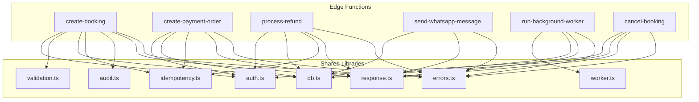
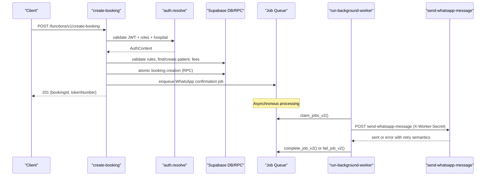
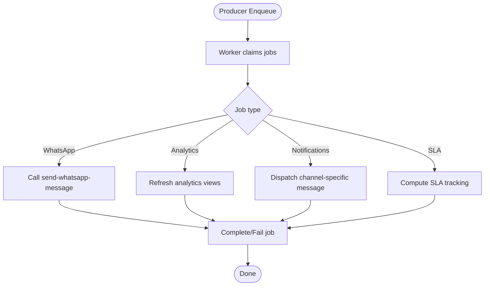
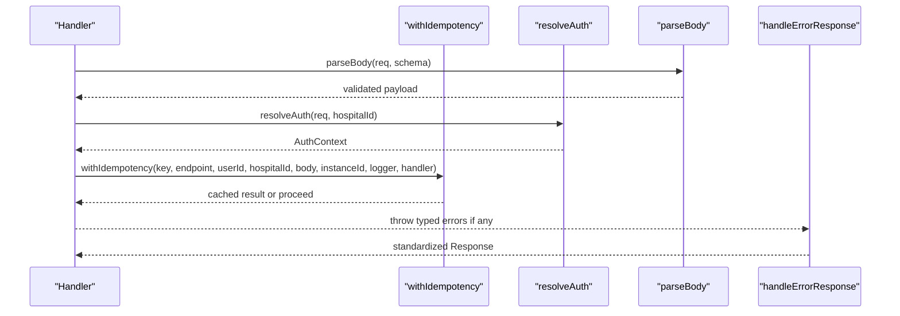
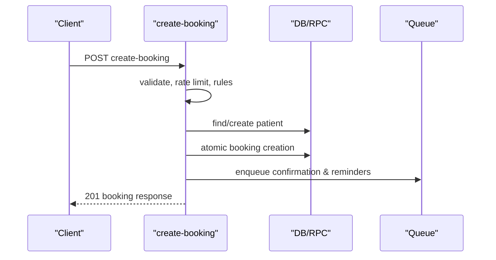
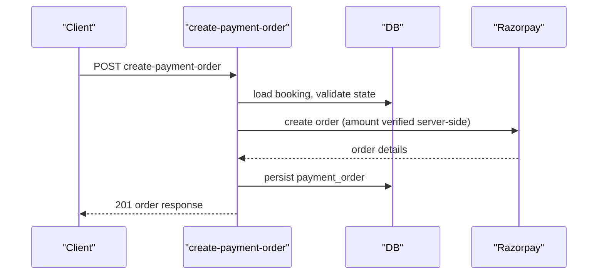
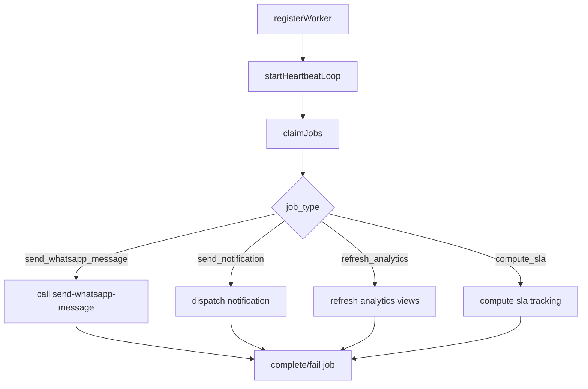
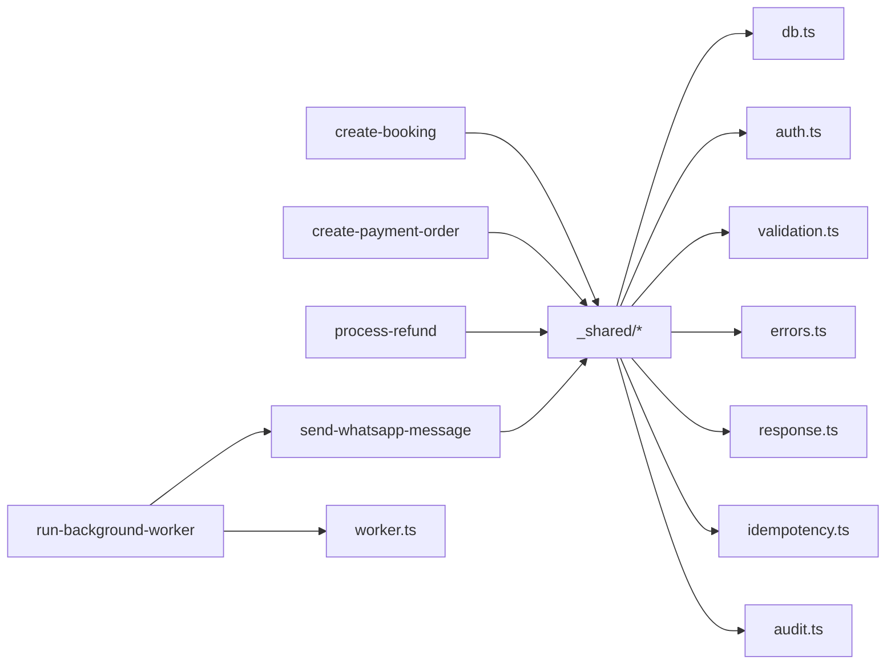

# Core Architecture Patterns

<cite>
**Referenced Files in This Document**
- [db.ts](file://supabase/functions/_shared/db.ts)
- [auth.ts](file://supabase/functions/_shared/auth.ts)
- [validation.ts](file://supabase/functions/_shared/validation.ts)
- [worker.ts](file://supabase/functions/_shared/worker.ts)
- [errors.ts](file://supabase/functions/_shared/errors.ts)
- [response.ts](file://supabase/functions/_shared/response.ts)
- [idempotency.ts](file://supabase/functions/_shared/idempotency.ts)
- [audit.ts](file://supabase/functions/_shared/audit.ts)
- [create-booking/index.ts](file://supabase/functions/create-booking/index.ts)
- [create-payment-order/index.ts](file://supabase/functions/create-payment-order/index.ts)
- [send-whatsapp-message/index.ts](file://supabase/functions/send-whatsapp-message/index.ts)
- [run-background-worker/index.ts](file://supabase/functions/run-background-worker/index.ts)
- [cancel-booking/index.ts](file://supabase/functions/cancel-booking/index.ts)
- [process-refund/index.ts](file://supabase/functions/process-refund/index.ts)
</cite>

## Table of Contents

1. Introduction
2. Project Structure
3. Core Components
4. Architecture Overview
5. Detailed Component Analysis
6. Dependency Analysis
7. Performance Considerations
8. Troubleshooting Guide
9. Conclusion

## Introduction

This document explains the core architectural patterns used in Setura Hospital
OS to deliver a scalable, maintainable system built on Supabase Edge Functions.
It focuses on:

- Serverless edge functions as independent business operations with clear
  separation of concerns
- Microservices-style isolation for booking, payment, and notification
  operations
- Event-driven processing using queue-based asynchronous jobs
- Repository-like abstractions over database operations via typed clients and
  RPC helpers
- Middleware composition for authentication, validation, rate limiting,
  idempotency, error handling, and observability
- Concrete examples from the codebase demonstrating how these patterns work
  together

The approach provides strong benefits including horizontal scalability through
serverless execution, fault isolation between domains, independent deployment
per function, and resilient background processing with retry and dead-letter
support.

## Project Structure

Setura organizes functionality into small, focused Edge Functions under
supabase/functions, each implementing a single business operation. Shared
cross-cutting capabilities live in _shared and are reused across functions.

**Diagram sources**

- [create-booking/index.ts:1-666](file://supabase/functions/create-booking/index.ts#L1-L666)
- [create-payment-order/index.ts:1-407](file://supabase/functions/create-payment-order/index.ts#L1-L407)
- [process-refund/index.ts:1-360](file://supabase/functions/process-refund/index.ts#L1-L360)
- [send-whatsapp-message/index.ts:1-583](file://supabase/functions/send-whatsapp-message/index.ts#L1-L583)
- [run-background-worker/index.ts:1-454](file://supabase/functions/run-background-worker/index.ts#L1-L454)
- [cancel-booking/index.ts:1-482](file://supabase/functions/cancel-booking/index.ts#L1-L482)
- [auth.ts:1-237](file://supabase/functions/_shared/auth.ts#L1-L237)
- [validation.ts:1-157](file://supabase/functions/_shared/validation.ts#L1-L157)
- [db.ts:1-169](file://supabase/functions/_shared/db.ts#L1-L169)
- [errors.ts:1-323](file://supabase/functions/_shared/errors.ts#L1-L323)
- [response.ts:1-206](file://supabase/functions/_shared/response.ts#L1-L206)
- [idempotency.ts:1-259](file://supabase/functions/_shared/idempotency.ts#L1-L259)
- [audit.ts:1-75](file://supabase/functions/_shared/audit.ts#L1-L75)
- [worker.ts:1-257](file://supabase/functions/_shared/worker.ts#L1-L257)

**Section sources**

- [create-booking/index.ts:1-666](file://supabase/functions/create-booking/index.ts#L1-L666)
- [create-payment-order/index.ts:1-407](file://supabase/functions/create-payment-order/index.ts#L1-L407)
- [send-whatsapp-message/index.ts:1-583](file://supabase/functions/send-whatsapp-message/index.ts#L1-L583)
- [run-background-worker/index.ts:1-454](file://supabase/functions/run-background-worker/index.ts#L1-L454)
- [cancel-booking/index.ts:1-482](file://supabase/functions/cancel-booking/index.ts#L1-L482)
- [auth.ts:1-237](file://supabase/functions/_shared/auth.ts#L1-L237)
- [validation.ts:1-157](file://supabase/functions/_shared/validation.ts#L1-L157)
- [db.ts:1-169](file://supabase/functions/_shared/db.ts#L1-L169)
- [errors.ts:1-323](file://supabase/functions/_shared/errors.ts#L1-L323)
- [response.ts:1-206](file://supabase/functions/_shared/response.ts#L1-L206)
- [idempotency.ts:1-259](file://supabase/functions/_shared/idempotency.ts#L1-L259)
- [audit.ts:1-75](file://supabase/functions/_shared/audit.ts#L1-L75)
- [worker.ts:1-257](file://supabase/functions/_shared/worker.ts#L1-L257)

## Core Components

- Database client abstraction: service-role, anon, and per-request auth-scoped
  clients; typed RPC helpers; safe assertion utilities
- Authentication middleware: JWT validation, role resolution, hospital access
  control, role guards
- Validation layer: Zod schemas, request body parsing, normalization, size
  limits
- Idempotency: key extraction, claim/complete/fail lifecycle, duplicate
  detection and replay protection
- Error model: centralized typed errors with codes, status codes, retry flags,
  and context
- Response standardization: consistent success/error envelopes with correlation
  IDs and timestamps
- Audit logging: fire-and-forget audit event writing
- Background worker runtime: job claiming, heartbeat, completion/failure, crash
  recovery

These components are composed by each Edge Function to implement a single
responsibility cleanly.

**Section sources**

- [db.ts:1-169](file://supabase/functions/_shared/db.ts#L1-L169)
- [auth.ts:1-237](file://supabase/functions/_shared/auth.ts#L1-L237)
- [validation.ts:1-157](file://supabase/functions/_shared/validation.ts#L1-L157)
- [idempotency.ts:1-259](file://supabase/functions/_shared/idempotency.ts#L1-L259)
- [errors.ts:1-323](file://supabase/functions/_shared/errors.ts#L1-L323)
- [response.ts:1-206](file://supabase/functions/_shared/response.ts#L1-L206)
- [audit.ts:1-75](file://supabase/functions/_shared/audit.ts#L1-L75)
- [worker.ts:1-257](file://supabase/functions/_shared/worker.ts#L1-L257)

## Architecture Overview

Setura implements a microservices-like architecture using Supabase Edge
Functions. Each function is an isolated unit of business capability:

- Booking: create-booking, cancel-booking
- Payment: create-payment-order, process-refund
- Notifications: send-whatsapp-message (worker-only), run-background-worker
  orchestrates job processing
- Shared infrastructure: db, auth, validation, idempotency, errors, response,
  audit, worker

**Diagram sources**

- [create-booking/index.ts:1-666](file://supabase/functions/create-booking/index.ts#L1-L666)
- [run-background-worker/index.ts:1-454](file://supabase/functions/run-background-worker/index.ts#L1-L454)
- [send-whatsapp-message/index.ts:1-583](file://supabase/functions/send-whatsapp-message/index.ts#L1-L583)
- [worker.ts:1-257](file://supabase/functions/_shared/worker.ts#L1-L257)
- [auth.ts:1-237](file://supabase/functions/_shared/auth.ts#L1-L237)
- [db.ts:1-169](file://supabase/functions/_shared/db.ts#L1-L169)

## Detailed Component Analysis

### Serverless Edge Functions Pattern

Each function encapsulates one business operation end-to-end:

- Input validation and normalization
- Authentication and authorization
- Business rule enforcement
- Data persistence via typed clients/RPC
- Side effects via queues or external APIs
- Standardized responses and metrics

Examples:

- create-booking orchestrates hospital rules, doctor availability, queue
  capacity, patient deduplication, atomic booking creation, and enqueues
  notifications
- create-payment-order validates booking state, resolves fees, creates Razorpay
  order, persists immutable order record, and returns SDK-ready data
- process-refund initiates refunds idempotently, calls gateway, updates
  financial records, and audits actions

Benefits:

- Independent scaling and deployment per domain
- Clear ownership and test boundaries
- Reduced blast radius on failures

**Section sources**

- [create-booking/index.ts:1-666](file://supabase/functions/create-booking/index.ts#L1-L666)
- [create-payment-order/index.ts:1-407](file://supabase/functions/create-payment-order/index.ts#L1-L407)
- [process-refund/index.ts:1-360](file://supabase/functions/process-refund/index.ts#L1-L360)

### Microservices Isolation: Booking, Payment, Notification

- Booking endpoints handle scheduling, queue management, and patient lifecycle
- Payment endpoints integrate with Razorpay, enforce amount integrity, and
  persist immutable orders/refunds
- Notification endpoints are worker-only and decoupled from user-facing flows,
  reducing latency and risk

Isolation guarantees:

- Separate secrets and credentials per domain
- Distinct error models and metrics
- Queue-based handoffs prevent tight coupling

**Section sources**

- [create-booking/index.ts:1-666](file://supabase/functions/create-booking/index.ts#L1-L666)
- [create-payment-order/index.ts:1-407](file://supabase/functions/create-payment-order/index.ts#L1-L407)
- [send-whatsapp-message/index.ts:1-583](file://supabase/functions/send-whatsapp-message/index.ts#L1-L583)
- [run-background-worker/index.ts:1-454](file://supabase/functions/run-background-worker/index.ts#L1-L454)

### Event-Driven Processing Model with Queues

Background tasks are queued and processed asynchronously:

- Producers enqueue jobs with types, payloads, priorities, schedules, and
  idempotency keys
- Workers register, heartbeat, claim batches, and process jobs with retry and
  dead-letter support
- Job outcomes update queue state and downstream systems

**Diagram sources**

- [run-background-worker/index.ts:1-454](file://supabase/functions/run-background-worker/index.ts#L1-L454)
- [worker.ts:1-257](file://supabase/functions/_shared/worker.ts#L1-L257)
- [send-whatsapp-message/index.ts:1-583](file://supabase/functions/send-whatsapp-message/index.ts#L1-L583)

**Section sources**

- [run-background-worker/index.ts:1-454](file://supabase/functions/run-background-worker/index.ts#L1-L454)
- [worker.ts:1-257](file://supabase/functions/_shared/worker.ts#L1-L257)

### Repository Pattern Abstraction Over Database Operations

While not a classic ORM, Setura uses a repository-like pattern:

- Centralized client management with service-role, anon, and per-request
  auth-scoped clients
- Typed RPC helpers that wrap Postgres functions with full type safety
- Assertion helpers to normalize errors and ensure no unexpected nulls
- Consistent schema usage across functions via generated types

This abstraction:

- Encapsulates connection details and headers
- Provides strongly-typed queries and mutations
- Centralizes error mapping and diagnostics

**Section sources**

- [db.ts:1-169](file://supabase/functions/_shared/db.ts#L1-L169)

### Middleware Composition Pattern

Functions compose reusable middleware for cross-cutting concerns:

- CORS preflight handling
- Request tracing and structured logging
- Metrics collection and flushing
- Authentication and role checks
- Body parsing and validation
- Idempotency enforcement
- Standardized error handling and response formatting

Composition example:

- A handler wraps logic inside withIdempotency, after resolveAuth and parseBody,
  ensuring security and correctness before business logic runs

**Diagram sources**

- [auth.ts:187-237](file://supabase/functions/_shared/auth.ts#L187-L237)
- [validation.ts:92-134](file://supabase/functions/_shared/validation.ts#L92-L134)
- [idempotency.ts:184-259](file://supabase/functions/_shared/idempotency.ts#L184-L259)
- [response.ts:192-206](file://supabase/functions/_shared/response.ts#L192-L206)

**Section sources**

- [auth.ts:187-237](file://supabase/functions/_shared/auth.ts#L187-L237)
- [validation.ts:92-134](file://supabase/functions/_shared/validation.ts#L92-L134)
- [idempotency.ts:184-259](file://supabase/functions/_shared/idempotency.ts#L184-L259)
- [response.ts:192-206](file://supabase/functions/_shared/response.ts#L192-L206)

### Concrete Examples

#### Booking Creation Flow

- Validates JWT, roles, and hospital membership
- Parses and validates request body
- Checks rate limits, hospital settings, holidays, working hours, doctor
  availability, and queue capacity
- Finds or creates patient with phone deduplication
- Creates booking atomically via RPC
- Enqueues WhatsApp confirmation and reminder jobs
- Writes audit events and returns typed response

**Diagram sources**

- [create-booking/index.ts:1-666](file://supabase/functions/create-booking/index.ts#L1-L666)

**Section sources**

- [create-booking/index.ts:1-666](file://supabase/functions/create-booking/index.ts#L1-L666)

#### Payment Order Creation Flow

- Validates JWT, roles, and hospital membership
- Ensures booking exists and is eligible for payment
- Resolves fees and verifies amounts
- Calls Razorpay Orders API and persists immutable order
- Returns SDK-ready order details

**Diagram sources**

- [create-payment-order/index.ts:1-407](file://supabase/functions/create-payment-order/index.ts#L1-L407)

**Section sources**

- [create-payment-order/index.ts:1-407](file://supabase/functions/create-payment-order/index.ts#L1-L407)

#### Background Worker Processing

- Registers worker and starts heartbeat loop
- Claims jobs in batches
- Processes job types (WhatsApp, notifications, analytics, SLA)
- Completes or fails jobs with retry and dead-letter support

**Diagram sources**

- [run-background-worker/index.ts:1-454](file://supabase/functions/run-background-worker/index.ts#L1-L454)
- [worker.ts:1-257](file://supabase/functions/_shared/worker.ts#L1-L257)

**Section sources**

- [run-background-worker/index.ts:1-454](file://supabase/functions/run-background-worker/index.ts#L1-L454)
- [worker.ts:1-257](file://supabase/functions/_shared/worker.ts#L1-L257)

### Benefits of This Approach

- Scalability: Horizontal scaling via serverless functions and distributed
  workers; queue batching improves throughput
- Fault isolation: Failures in one domain (e.g., payments) do not block others
  (e.g., bookings); retries and dead-letter queues contain impact
- Independent deployment: Each function can be updated, tested, and released
  independently
- Maintainability: Clear separation of concerns, shared libraries reduce
  duplication, and typed interfaces improve reliability
- Observability: Structured logging, metrics, and correlation IDs enable
  end-to-end tracing

[No sources needed since this section summarizes without analyzing specific
files]

## Dependency Analysis

Key dependency relationships:

- All functions depend on shared modules for auth, validation, db, errors,
  response, and idempotency
- Background worker depends on worker utilities and calls send-whatsapp-message
  internally
- Payment functions depend on environment variables for gateway credentials
- Audit logging is fire-and-forget and never blocks primary flows

**Diagram sources**

- [create-booking/index.ts:1-666](file://supabase/functions/create-booking/index.ts#L1-L666)
- [create-payment-order/index.ts:1-407](file://supabase/functions/create-payment-order/index.ts#L1-L407)
- [process-refund/index.ts:1-360](file://supabase/functions/process-refund/index.ts#L1-L360)
- [send-whatsapp-message/index.ts:1-583](file://supabase/functions/send-whatsapp-message/index.ts#L1-L583)
- [run-background-worker/index.ts:1-454](file://supabase/functions/run-background-worker/index.ts#L1-L454)
- [db.ts:1-169](file://supabase/functions/_shared/db.ts#L1-L169)
- [auth.ts:1-237](file://supabase/functions/_shared/auth.ts#L1-L237)
- [validation.ts:1-157](file://supabase/functions/_shared/validation.ts#L1-L157)
- [errors.ts:1-323](file://supabase/functions/_shared/errors.ts#L1-L323)
- [response.ts:1-206](file://supabase/functions/_shared/response.ts#L1-L206)
- [idempotency.ts:1-259](file://supabase/functions/_shared/idempotency.ts#L1-L259)
- [audit.ts:1-75](file://supabase/functions/_shared/audit.ts#L1-L75)
- [worker.ts:1-257](file://supabase/functions/_shared/worker.ts#L1-L257)

**Section sources**

- [create-booking/index.ts:1-666](file://supabase/functions/create-booking/index.ts#L1-L666)
- [create-payment-order/index.ts:1-407](file://supabase/functions/create-payment-order/index.ts#L1-L407)
- [process-refund/index.ts:1-360](file://supabase/functions/process-refund/index.ts#L1-L360)
- [send-whatsapp-message/index.ts:1-583](file://supabase/functions/send-whatsapp-message/index.ts#L1-L583)
- [run-background-worker/index.ts:1-454](file://supabase/functions/run-background-worker/index.ts#L1-L454)
- [db.ts:1-169](file://supabase/functions/_shared/db.ts#L1-L169)
- [auth.ts:1-237](file://supabase/functions/_shared/auth.ts#L1-L237)
- [validation.ts:1-157](file://supabase/functions/_shared/validation.ts#L1-L157)
- [errors.ts:1-323](file://supabase/functions/_shared/errors.ts#L1-L323)
- [response.ts:1-206](file://supabase/functions/_shared/response.ts#L1-L206)
- [idempotency.ts:1-259](file://supabase/functions/_shared/idempotency.ts#L1-L259)
- [audit.ts:1-75](file://supabase/functions/_shared/audit.ts#L1-L75)
- [worker.ts:1-257](file://supabase/functions/_shared/worker.ts#L1-L257)

## Performance Considerations

- Use service-role client for internal mutations to bypass RLS overhead where
  appropriate
- Batch job processing with bounded concurrency to avoid overwhelming downstream
  services
- Prefer RPCs for complex transactions to keep logic in the database when
  possible
- Leverage idempotency to safely retry without side effects
- Monitor metrics and logs to identify hotspots and tune timeouts and batch
  sizes

[No sources needed since this section provides general guidance]

## Troubleshooting Guide

Common issues and strategies:

- Authentication failures: Validate JWT presence, expiration, and role/hospital
  access; check X-Hospital-ID header consistency
- Validation errors: Inspect fieldErrors in responses; ensure request bodies
  conform to schemas
- Rate limiting: Respect Retry-After headers and backoff strategies
- Duplicate requests: Ensure clients generate unique Idempotency-Key values per
  request
- External service errors: Check timeouts and status codes; use retries with
  exponential backoff for transient failures
- Queue processing: Verify worker registration and heartbeats; inspect job
  claims and completions; review dead-letter queues for failed jobs

**Section sources**

- [auth.ts:22-124](file://supabase/functions/_shared/auth.ts#L22-L124)
- [validation.ts:92-134](file://supabase/functions/_shared/validation.ts#L92-L134)
- [response.ts:154-177](file://supabase/functions/_shared/response.ts#L154-L177)
- [idempotency.ts:37-129](file://supabase/functions/_shared/idempotency.ts#L37-L129)
- [worker.ts:180-257](file://supabase/functions/_shared/worker.ts#L180-L257)

## Conclusion

Setura Hospital OS leverages serverless edge functions to implement a
microservices-like architecture with clear separation of concerns. The
combination of robust middleware composition, typed database abstractions,
idempotent operations, and queue-driven background processing yields a system
that scales horizontally, isolates faults, and supports independent deployments.
These patterns make it straightforward to evolve individual domains like
booking, payment, and notifications while maintaining reliability and
observability across the platform.

[No sources needed since this section summarizes without analyzing specific
files]
