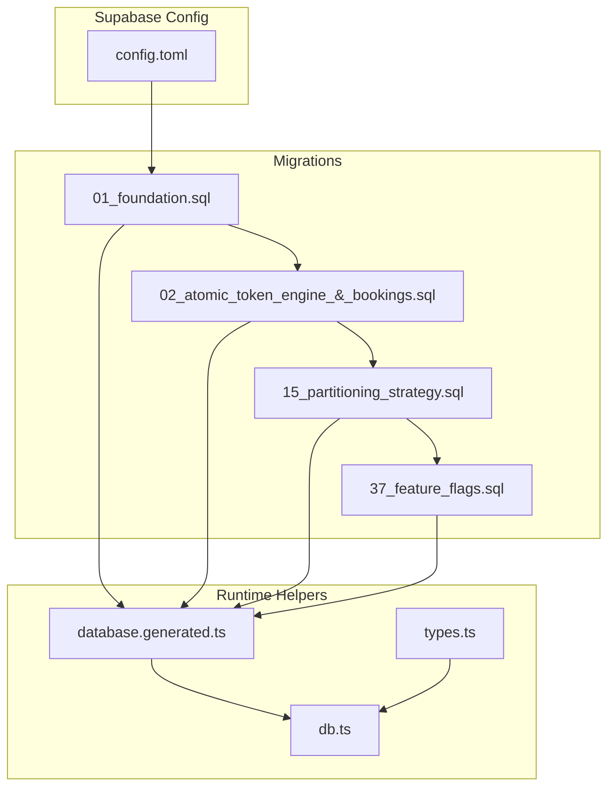
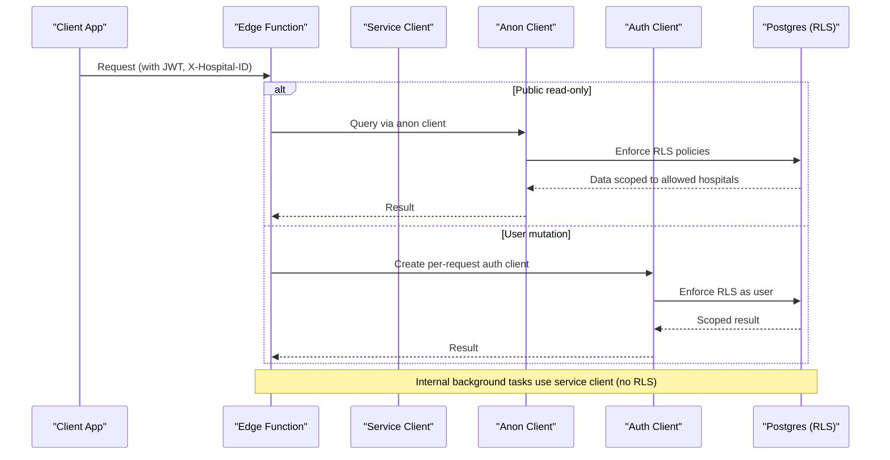
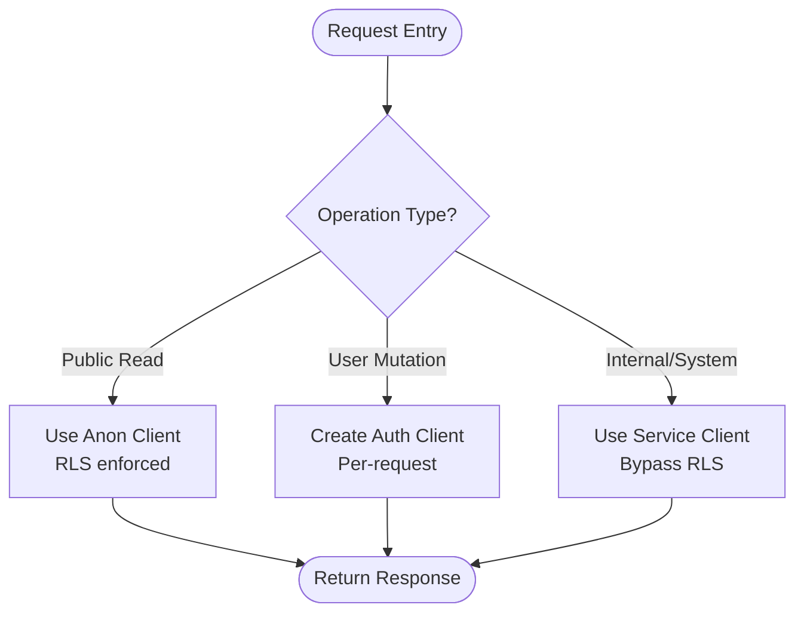
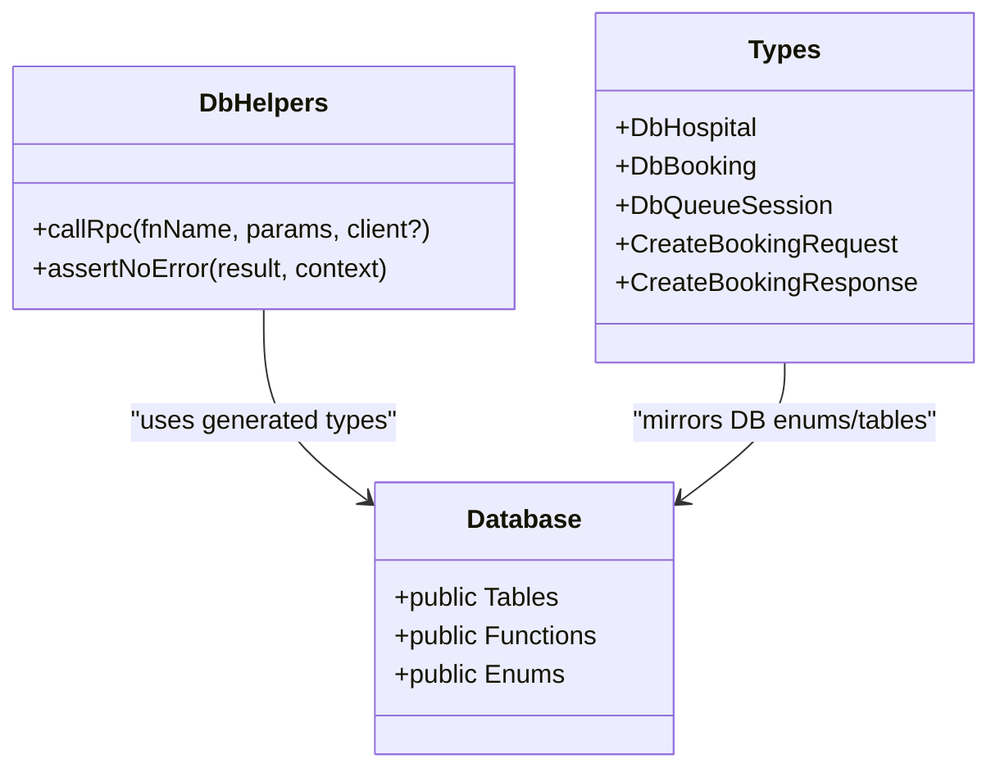
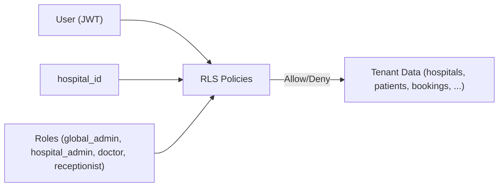
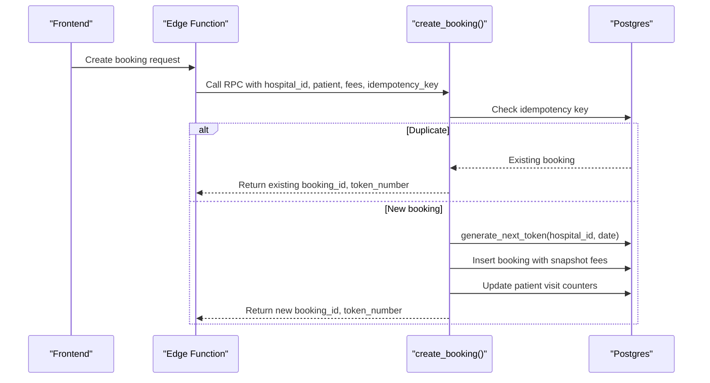
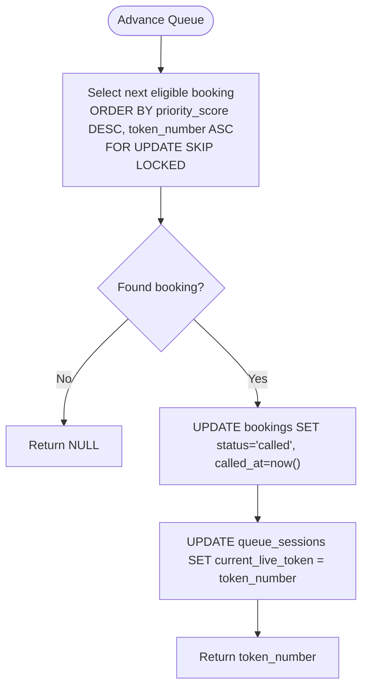
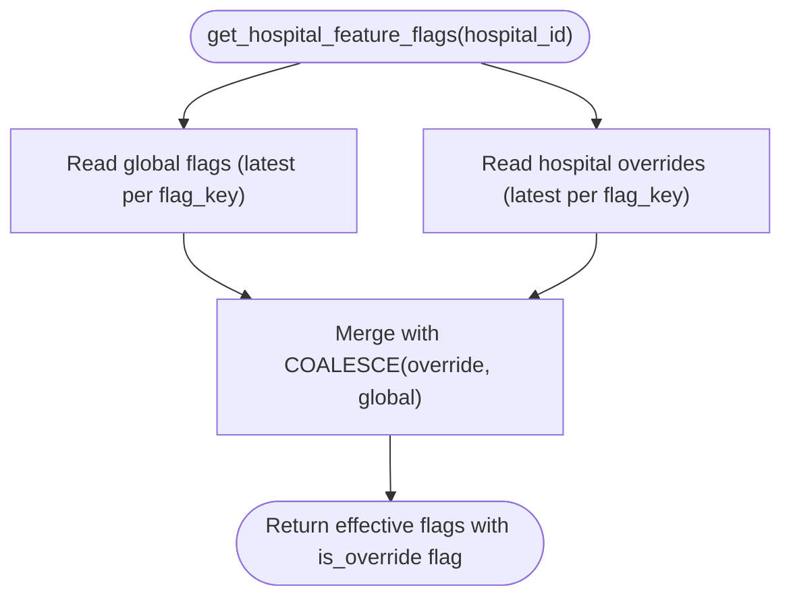
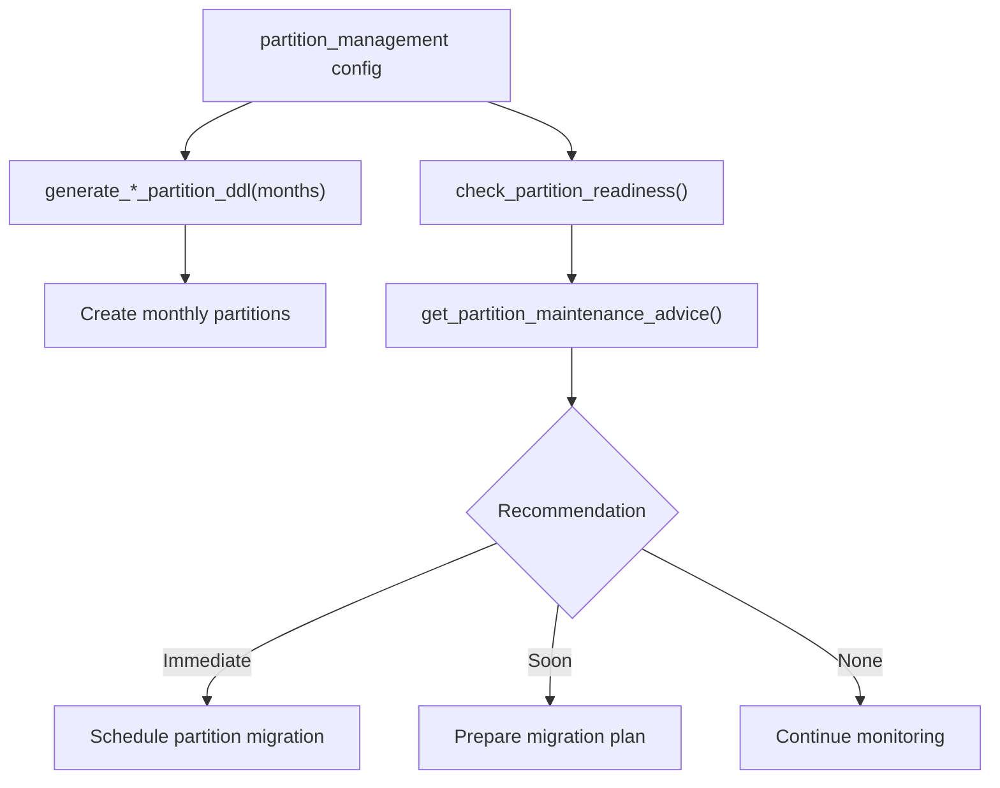
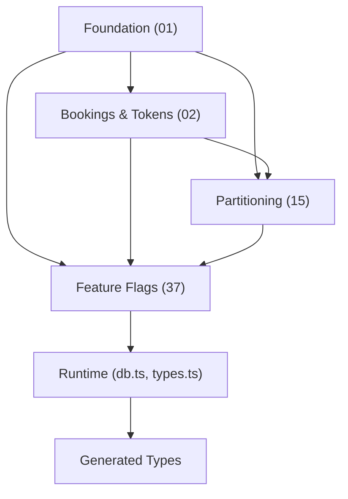

# Database Design Principles

<cite>
**Referenced Files in This Document**
- [01_foundation.sql](file://supabase/migrations/01_foundation.sql)
- [02_atomic_token_engine_&_bookings.sql](file://supabase/migrations/02_atomic_token_engine_&_bookings.sql)
- [15_partitioning_strategy.sql](file://supabase/migrations/15_partitioning_strategy.sql)
- [37_feature_flags.sql](file://supabase/migrations/37_feature_flags.sql)
- [database.generated.ts](file://supabase/functions/_shared/database.generated.ts)
- [db.ts](file://supabase/functions/_shared/db.ts)
- [types.ts](file://supabase/functions/_shared/types.ts)
- [config.toml](file://supabase/config.toml)
</cite>

## Table of Contents

1. Introduction
2. Project Structure
3. Core Components
4. Architecture Overview
5. Detailed Component Analysis
6. Dependency Analysis
7. Performance Considerations
8. Troubleshooting Guide
9. Conclusion

## Introduction

This document explains the database design principles and multi-client
architecture of Setura Hospital OS. It covers:

- Multi-client database management with service-level, anonymous, and
  auth-scoped clients for strict isolation
- Typed client generation from schema definitions to ensure type safety across
  the application
- A progressive migration strategy (37 migrations) covering foundation tables,
  booking systems, analytics, and security features
- Multi-tenant architecture with hospital isolation at both data and query
  levels
- Examples of complex queries, stored procedures, and triggers that implement
  business logic at the database level
- Performance considerations including indexing strategies, connection pooling,
  and query optimization techniques

## Project Structure

The database layer is implemented as a set of ordered SQL migrations under
supabase/migrations, with runtime helpers and typed clients under
supabase/functions/_shared. The Supabase configuration defines API exposure,
database versioning, and optional pooler settings.

**Diagram sources**

- [config.toml:1-409](file://supabase/config.toml#L1-L409)
- [01_foundation.sql:1-792](file://supabase/migrations/01_foundation.sql#L1-L792)
- [02_atomic_token_engine_&_bookings.sql:1-827](file://supabase/migrations/02_atomic_token_engine_&_bookings.sql#L1-L827)
- [15_partitioning_strategy.sql:1-542](file://supabase/migrations/15_partitioning_strategy.sql#L1-L542)
- [37_feature_flags.sql:1-225](file://supabase/migrations/37_feature_flags.sql#L1-L225)
- [database.generated.ts:1-800](file://supabase/functions/_shared/database.generated.ts#L1-L800)
- [db.ts:1-169](file://supabase/functions/_shared/db.ts#L1-L169)
- [types.ts:1-329](file://supabase/functions/_shared/types.ts#L1-L329)

**Section sources**

- [config.toml:1-409](file://supabase/config.toml#L1-L409)

## Core Components

- Multi-client database access:
  - Service-role client bypasses Row Level Security for internal operations
  - Anonymous client enforces RLS for public reads
  - Auth-scoped client impersonates the caller per request to enforce RLS
- Typed database client:
  - Generated types mirror the live Postgres schema
  - Strongly-typed RPC calls and table operations prevent mismatches between
    code and schema
- Migration-driven evolution:
  - Foundation, bookings, analytics, security, partitioning, feature flags, and
    more
- Multi-tenant isolation:
  - Every tenant-scoped table includes hospital_id
  - Row Level Security policies restrict access by role and hospital
- Business logic in the database:
  - Stored procedures and triggers implement token generation, queue
    advancement, status transitions, and audit logging

**Section sources**

- [db.ts:1-169](file://supabase/functions/_shared/db.ts#L1-L169)
- [database.generated.ts:1-800](file://supabase/functions/_shared/database.generated.ts#L1-L800)
- [01_foundation.sql:1-792](file://supabase/migrations/01_foundation.sql#L1-L792)
- [02_atomic_token_engine_&_bookings.sql:1-827](file://supabase/migrations/02_atomic_token_engine_&_bookings.sql#L1-L827)
- [15_partitioning_strategy.sql:1-542](file://supabase/migrations/15_partitioning_strategy.sql#L1-L542)
- [37_feature_flags.sql:1-225](file://supabase/migrations/37_feature_flags.sql#L1-L225)

## Architecture Overview

Setura uses a multi-tenant, row-level secure Postgres database accessed through
three distinct Supabase clients. Edge Functions orchestrate requests, choose the
appropriate client based on context, and call typed RPCs or tables.

**Diagram sources**

- [db.ts:1-169](file://supabase/functions/_shared/db.ts#L1-L169)
- [01_foundation.sql:560-792](file://supabase/migrations/01_foundation.sql#L560-L792)
- [02_atomic_token_engine_&_bookings.sql:658-827](file://supabase/migrations/02_atomic_token_engine_&_bookings.sql#L658-L827)

## Detailed Component Analysis

### Multi-Client Database Management

- Service-role client:
  - Singleton per isolate lifetime
  - Bypasses RLS; used for background workers, webhooks, internal mutations
  - Never exposed to user-controlled input
- Anonymous client:
  - Singleton per isolate lifetime
  - Subject to RLS; used for public read-only queries
- Auth-scoped client:
  - Created per request with JWT header
  - Enforces RLS as the authenticated user
  - Not cached to avoid cross-user leakage
- Type-safe RPC helper:
  - Calls SECURITY DEFINER functions with full type inference from generated
    schema
  - Throws structured errors with codes and hints

**Diagram sources**

- [db.ts:1-169](file://supabase/functions/_shared/db.ts#L1-L169)

**Section sources**

- [db.ts:1-169](file://supabase/functions/_shared/db.ts#L1-L169)

### Typed Database Client Generation

- Types are generated from the live schema into a single module
- All RPC signatures and table shapes are strongly typed
- Runtime usage benefits from compile-time checks for parameters and return
  values
- API DTOs remain separate from DB rows to avoid leaking internal columns

**Diagram sources**

- [database.generated.ts:1-800](file://supabase/functions/_shared/database.generated.ts#L1-L800)
- [db.ts:108-169](file://supabase/functions/_shared/db.ts#L108-L169)
- [types.ts:1-329](file://supabase/functions/_shared/types.ts#L1-L329)

**Section sources**

- [database.generated.ts:1-800](file://supabase/functions/_shared/database.generated.ts#L1-L800)
- [db.ts:108-169](file://supabase/functions/_shared/db.ts#L108-L169)
- [types.ts:1-329](file://supabase/functions/_shared/types.ts#L1-L329)

### Multi-Tenant Architecture and Isolation

- Tenant model:
  - Each tenant is a hospital identified by hospital_id
  - All tenant-scoped entities include hospital_id
- Authorization helpers:
  - Determine current user role within a hospital
  - Check global admin vs hospital-specific roles
- Row Level Security:
  - Policies enforce hospital isolation for reads/writes
  - Global admins can bypass tenant scoping where appropriate
- Header validation:
  - Edge Functions validate X-Hospital-ID against auth context

**Diagram sources**

- [01_foundation.sql:260-376](file://supabase/migrations/01_foundation.sql#L260-L376)
- [01_foundation.sql:560-792](file://supabase/migrations/01_foundation.sql#L560-L792)
- [02_atomic_token_engine_&_bookings.sql:658-827](file://supabase/migrations/02_atomic_token_engine_&_bookings.sql#L658-L827)

**Section sources**

- [01_foundation.sql:260-376](file://supabase/migrations/01_foundation.sql#L260-L376)
- [01_foundation.sql:560-792](file://supabase/migrations/01_foundation.sql#L560-L792)
- [02_atomic_token_engine_&_bookings.sql:658-827](file://supabase/migrations/02_atomic_token_engine_&_bookings.sql#L658-L827)

### Booking System and Atomic Token Engine

- Daily token counters ensure unique sequential tokens per hospital per day
- Atomic token generation uses upsert with increment to avoid races
- Queue sessions manage live tokens and capacity per doctor/session
- Bookings store rich metadata, fee snapshots, idempotency keys, and timestamps
- Status change triggers record events and update timestamps automatically

**Diagram sources**

- [02_atomic_token_engine_&_bookings.sql:31-75](file://supabase/migrations/02_atomic_token_engine_&_bookings.sql#L31-L75)
- [02_atomic_token_engine_&_bookings.sql:150-340](file://supabase/migrations/02_atomic_token_engine_&_bookings.sql#L150-L340)
- [02_atomic_token_engine_&_bookings.sql:385-440](file://supabase/migrations/02_atomic_token_engine_&_bookings.sql#L385-L440)
- [02_atomic_token_engine_&_bookings.sql:446-570](file://supabase/migrations/02_atomic_token_engine_&_bookings.sql#L446-L570)

**Section sources**

- [02_atomic_token_engine_&_bookings.sql:31-75](file://supabase/migrations/02_atomic_token_engine_&_bookings.sql#L31-L75)
- [02_atomic_token_engine_&_bookings.sql:150-340](file://supabase/migrations/02_atomic_token_engine_&_bookings.sql#L150-L340)
- [02_atomic_token_engine_&_bookings.sql:385-440](file://supabase/migrations/02_atomic_token_engine_&_bookings.sql#L385-L440)
- [02_atomic_token_engine_&_bookings.sql:446-570](file://supabase/migrations/02_atomic_token_engine_&_bookings.sql#L446-L570)

### Queue Advancement and Concurrency Control

- Advance queue selects next eligible booking using priority and token order
- Uses FOR UPDATE SKIP LOCKED to avoid contention and race conditions
- Updates booking status and session live token atomically

**Diagram sources**

- [02_atomic_token_engine_&_bookings.sql:576-625](file://supabase/migrations/02_atomic_token_engine_&_bookings.sql#L576-L625)

**Section sources**

- [02_atomic_token_engine_&_bookings.sql:576-625](file://supabase/migrations/02_atomic_token_engine_&_bookings.sql#L576-L625)

### Analytics Rollups and Feature Flags

- Analytics rollups provide weekly/monthly/quarterly metrics per hospital
- Feature flags support global defaults and hospital overrides
- Resolution function computes effective flags per hospital with override
  precedence

**Diagram sources**

- [37_feature_flags.sql:147-200](file://supabase/migrations/37_feature_flags.sql#L147-L200)

**Section sources**

- [37_feature_flags.sql:73-122](file://supabase/migrations/37_feature_flags.sql#L73-L122)
- [37_feature_flags.sql:147-200](file://supabase/migrations/37_feature_flags.sql#L147-L200)

### Partitioning Strategy and Maintenance

- Partition planning helpers define thresholds and retention policies
- DDL generators produce monthly partitions for high-volume tables
- Readiness and health views guide when to migrate to partitioned tables
- Advisory functions recommend maintenance actions based on row counts

**Diagram sources**

- [15_partitioning_strategy.sql:35-166](file://supabase/migrations/15_partitioning_strategy.sql#L35-L166)
- [15_partitioning_strategy.sql:172-243](file://supabase/migrations/15_partitioning_strategy.sql#L172-L243)
- [15_partitioning_strategy.sql:412-503](file://supabase/migrations/15_partitioning_strategy.sql#L412-L503)

**Section sources**

- [15_partitioning_strategy.sql:35-166](file://supabase/migrations/15_partitioning_strategy.sql#L35-L166)
- [15_partitioning_strategy.sql:172-243](file://supabase/migrations/15_partitioning_strategy.sql#L172-L243)
- [15_partitioning_strategy.sql:412-503](file://supabase/migrations/15_partitioning_strategy.sql#L412-L503)

## Dependency Analysis

- Migrations build upon each other:
  - Foundation sets enums, roles, RLS helpers, core tables, and policies
  - Bookings and queue engine depend on foundation roles and RLS helpers
  - Partitioning utilities reference high-volume tables defined earlier
  - Feature flags rely on role helpers and indexes created in prior migrations
- Runtime dependencies:
  - db.ts depends on generated Database types and environment variables
  - types.ts mirrors DB enums and provides API DTOs
  - config.toml controls API exposure and optional pooler

**Diagram sources**

- [01_foundation.sql:1-792](file://supabase/migrations/01_foundation.sql#L1-L792)
- [02_atomic_token_engine_&_bookings.sql:1-827](file://supabase/migrations/02_atomic_token_engine_&_bookings.sql#L1-L827)
- [15_partitioning_strategy.sql:1-542](file://supabase/migrations/15_partitioning_strategy.sql#L1-L542)
- [37_feature_flags.sql:1-225](file://supabase/migrations/37_feature_flags.sql#L1-L225)
- [db.ts:1-169](file://supabase/functions/_shared/db.ts#L1-L169)
- [types.ts:1-329](file://supabase/functions/_shared/types.ts#L1-L329)

**Section sources**

- [01_foundation.sql:1-792](file://supabase/migrations/01_foundation.sql#L1-L792)
- [02_atomic_token_engine_&_bookings.sql:1-827](file://supabase/migrations/02_atomic_token_engine_&_bookings.sql#L1-L827)
- [15_partitioning_strategy.sql:1-542](file://supabase/migrations/15_partitioning_strategy.sql#L1-L542)
- [37_feature_flags.sql:1-225](file://supabase/migrations/37_feature_flags.sql#L1-L225)
- [db.ts:1-169](file://supabase/functions/_shared/db.ts#L1-L169)
- [types.ts:1-329](file://supabase/functions/_shared/types.ts#L1-L329)

## Performance Considerations

- Indexing strategies:
  - Composite indexes on hospital_id and time-based columns for tenant-scoped
    queries
  - Partial indexes filtering soft-deleted rows to reduce index size and improve
    scan performance
  - Trigram GIN indexes for fuzzy name searches
  - Priority and token ordering indexes to optimize queue operations
- Connection pooling:
  - Local pooler disabled by default; enable transaction mode if needed for high
    concurrency
  - Configure default_pool_size and max_client_conn according to workload
- Query optimization:
  - Use SECURITY DEFINER functions to encapsulate complex logic and reduce round
    trips
  - Leverage FOR UPDATE SKIP LOCKED for lock-free queue processing
  - Prefer atomic upserts for counters to avoid race conditions
  - Partition large tables by month when thresholds are reached; use advisory
    functions to decide timing
- Realtime and replication:
  - Realtime publication configured for key tables to support live updates

**Section sources**

- [01_foundation.sql:139-147](file://supabase/migrations/01_foundation.sql#L139-L147)
- [01_foundation.sql:421-447](file://supabase/migrations/01_foundation.sql#L421-L447)
- [02_atomic_token_engine_&_bookings.sql:286-324](file://supabase/migrations/02_atomic_token_engine_&_bookings.sql#L286-L324)
- [02_atomic_token_engine_&_bookings.sql:576-625](file://supabase/migrations/02_atomic_token_engine_&_bookings.sql#L576-L625)
- [15_partitioning_strategy.sql:108-166](file://supabase/migrations/15_partitioning_strategy.sql#L108-L166)
- [15_partitioning_strategy.sql:412-503](file://supabase/migrations/15_partitioning_strategy.sql#L412-L503)
- [config.toml:38-48](file://supabase/config.toml#L38-L48)

## Troubleshooting Guide

- Common issues:
  - RLS policy violations: Ensure correct hospital_id and role resolution;
    verify policies allow requested operations
  - Race conditions in queue advancement: Confirm usage of FOR UPDATE SKIP
    LOCKED and proper error handling
  - Idempotency failures: Check idempotency_key uniqueness and retry behavior
  - Partition readiness: Use readiness and advice functions to determine when to
    migrate to partitioned tables
- Debugging steps:
  - Inspect generated types to confirm schema alignment
  - Validate edge function headers (X-Hospital-ID) and JWT claims
  - Review audit logs and booking events for state transitions
  - Use advisory functions to assess partition needs and maintenance actions

**Section sources**

- [01_foundation.sql:560-792](file://supabase/migrations/01_foundation.sql#L560-L792)
- [02_atomic_token_engine_&_bookings.sql:385-440](file://supabase/migrations/02_atomic_token_engine_&_bookings.sql#L385-L440)
- [02_atomic_token_engine_&_bookings.sql:576-625](file://supabase/migrations/02_atomic_token_engine_&_bookings.sql#L576-L625)
- [15_partitioning_strategy.sql:412-503](file://supabase/migrations/15_partitioning_strategy.sql#L412-L503)

## Conclusion

Setura Hospital OS implements a robust, multi-tenant database design with strong
isolation via Row Level Security and a layered multi-client architecture. The
progressive migration strategy ensures safe evolution of the schema while
maintaining production stability. Typed client generation guarantees type safety
across the application, and database-level business logic (procedures, triggers,
and functions) centralizes critical workflows like token generation, queue
management, and analytics rollups. Performance is addressed through careful
indexing, partitioning strategies, and controlled concurrency patterns.
Together, these practices deliver a scalable, secure, and maintainable platform
for hospital operations.
