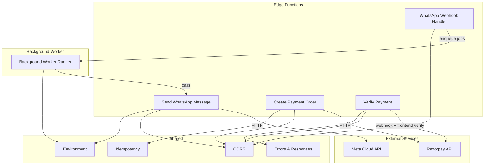
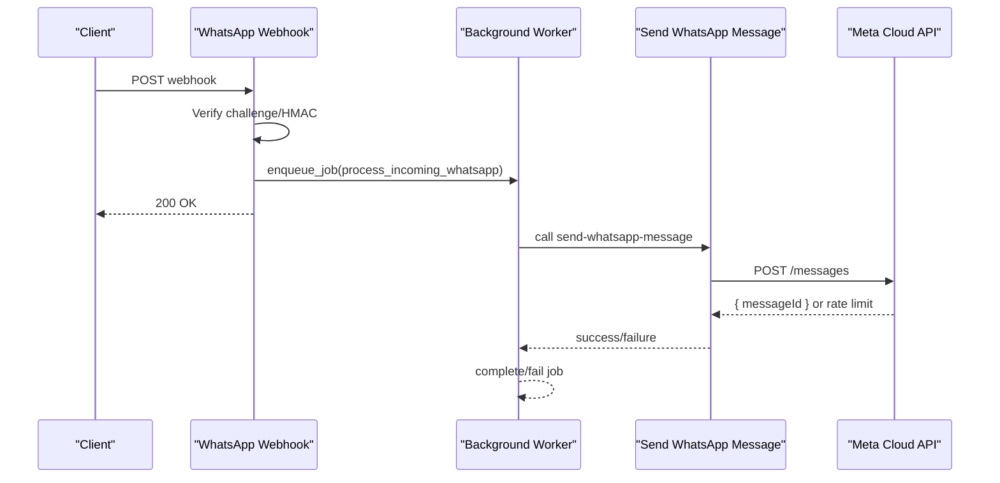
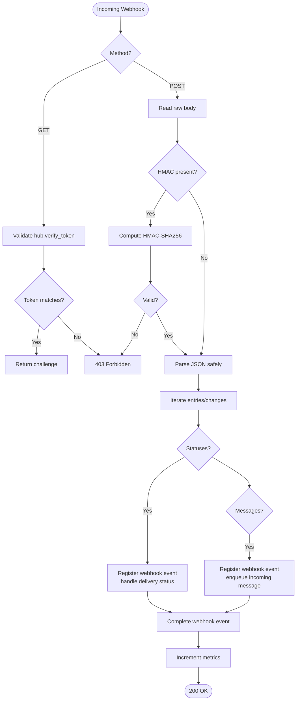
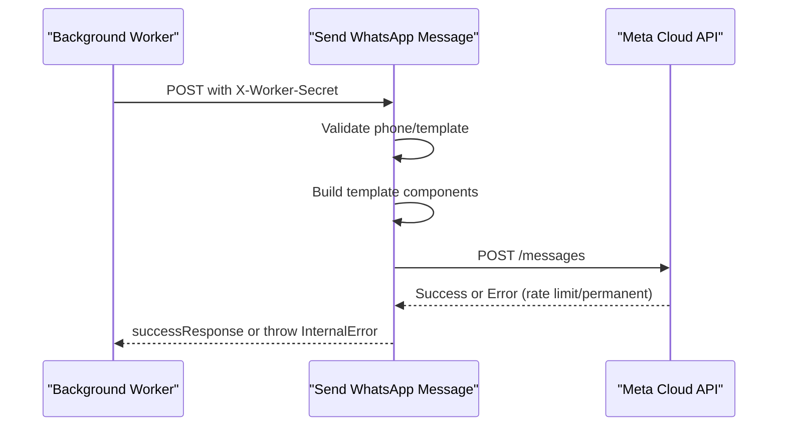
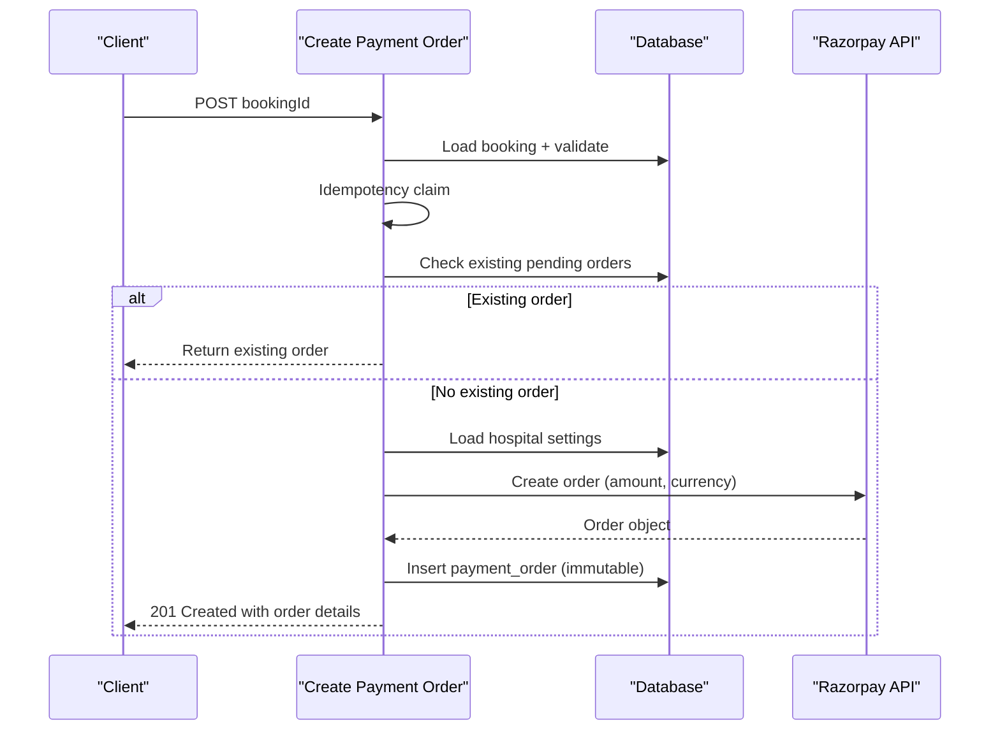
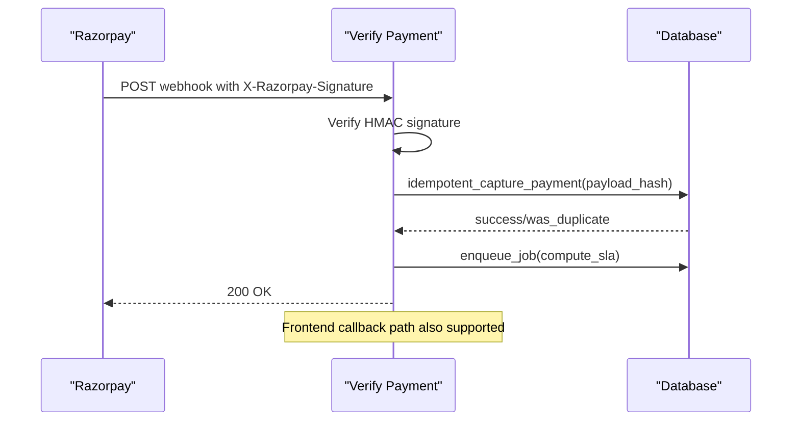
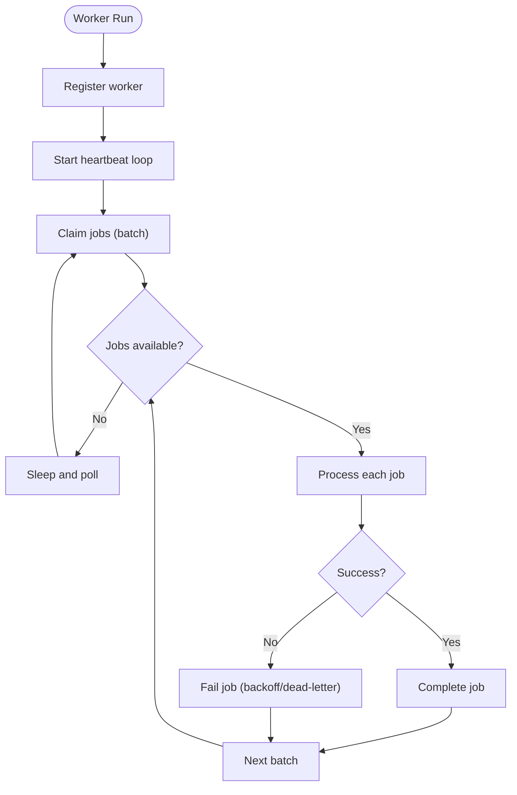
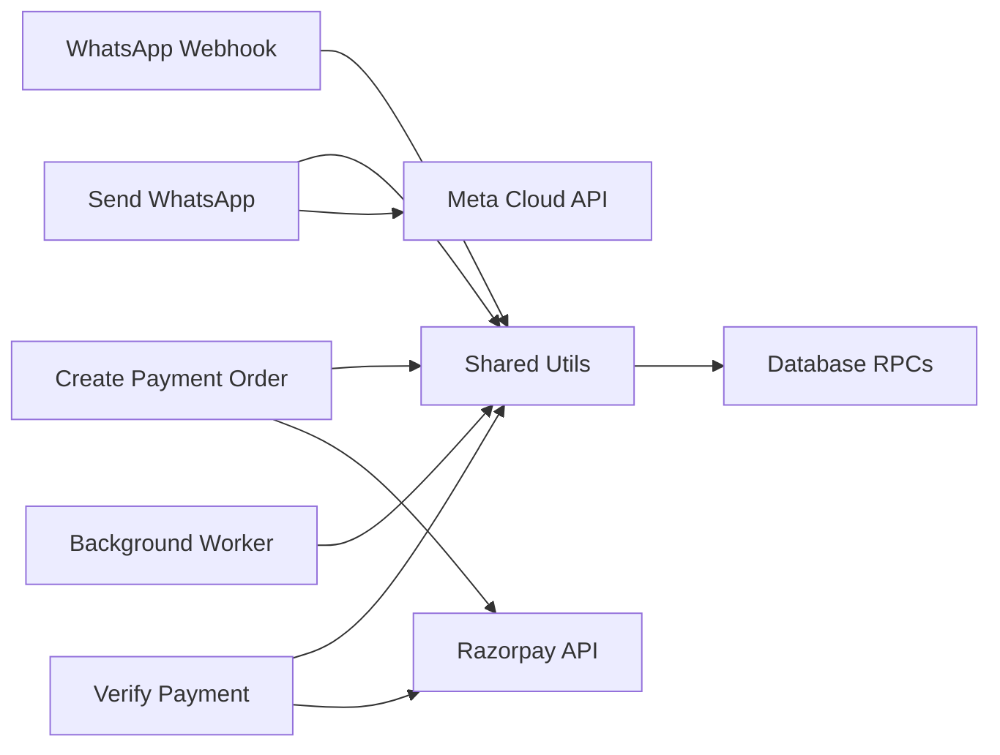

# Integration Patterns

<cite>
**Referenced Files in This Document**
- [process-whatsapp-webhook/index.ts](file://supabase/functions/process-whatsapp-webhook/index.ts)
- [send-whatsapp-message/index.ts](file://supabase/functions/send-whatsapp-message/index.ts)
- [create-payment-order/index.ts](file://supabase/functions/create-payment-order/index.ts)
- [verify-payment/index.ts](file://supabase/functions/verify-payment/index.ts)
- [_shared/cors.ts](file://supabase/functions/_shared/cors.ts)
- [_shared/env.ts](file://supabase/functions/_shared/env.ts)
- [_shared/idempotency.ts](file://supabase/functions/_shared/idempotency.ts)
- [_shared/errors.ts](file://supabase/functions/_shared/errors.ts)
- [_shared/response.ts](file://supabase/functions/_shared/response.ts)
- [run-background-worker/index.ts](file://supabase/functions/run-background-worker/index.ts)
- [_shared/worker.ts](file://supabase/functions/_shared/worker.ts)
</cite>

## Table of Contents

1. [Introduction](#introduction)
2. [Project Structure](#project-structure)
3. [Core Components](#core-components)
4. [Architecture Overview](#architecture-overview)
5. [Detailed Component Analysis](#detailed-component-analysis)
6. [Dependency Analysis](#dependency-analysis)
7. [Performance Considerations](#performance-considerations)
8. [Troubleshooting Guide](#troubleshooting-guide)
9. [Conclusion](#conclusion)

## Introduction

This document explains the external service integration patterns used by Setura
Hospital OS for:

- Receiving and processing webhooks from WhatsApp Business API (Meta)
- Sending outbound WhatsApp messages via Meta Cloud API
- Creating and verifying Razorpay payment orders
- Handling third-party callbacks securely and idempotently
- Managing cross-origin requests with CORS
- Implementing retry, error handling, and idempotency patterns
- Using a database-backed message queue for asynchronous processing
- Coordinating edge functions with background workers to maintain reliability
  and performance

## Project Structure

The integration surface is implemented as Supabase Edge Functions under
supabase/functions, with shared utilities under _shared. Key areas:

- Webhook handlers: process-whatsapp-webhook, verify-payment
- Outbound integrations: send-whatsapp-message, create-payment-order
- Background worker: run-background-worker with shared worker orchestration
- Shared infrastructure: CORS, environment validation, idempotency, errors,
  responses

**Diagram sources**

- [process-whatsapp-webhook/index.ts:124-220](file://supabase/functions/process-whatsapp-webhook/index.ts#L124-L220)
- [send-whatsapp-message/index.ts:326-386](file://supabase/functions/send-whatsapp-message/index.ts#L326-L386)
- [create-payment-order/index.ts:104-140](file://supabase/functions/create-payment-order/index.ts#L104-L140)
- [verify-payment/index.ts:188-230](file://supabase/functions/verify-payment/index.ts#L188-L230)
- [run-background-worker/index.ts:247-390](file://supabase/functions/run-background-worker/index.ts#L247-L390)
- [_shared/cors.ts:6-33](file://supabase/functions/_shared/cors.ts#L6-L33)
- [_shared/env.ts:118-149](file://supabase/functions/_shared/env.ts#L118-L149)

**Section sources**

- [process-whatsapp-webhook/index.ts:1-657](file://supabase/functions/process-whatsapp-webhook/index.ts#L1-L657)
- [send-whatsapp-message/index.ts:1-583](file://supabase/functions/send-whatsapp-message/index.ts#L1-L583)
- [create-payment-order/index.ts:1-407](file://supabase/functions/create-payment-order/index.ts#L1-L407)
- [verify-payment/index.ts:1-480](file://supabase/functions/verify-payment/index.ts#L1-L480)
- [_shared/cors.ts:1-34](file://supabase/functions/_shared/cors.ts#L1-L34)
- [_shared/env.ts:1-279](file://supabase/functions/_shared/env.ts#L1-L279)
- [_shared/idempotency.ts:1-259](file://supabase/functions/_shared/idempotency.ts#L1-L259)
- [_shared/errors.ts:1-323](file://supabase/functions/_shared/errors.ts#L1-L323)
- [_shared/response.ts:1-206](file://supabase/functions/_shared/response.ts#L1-L206)
- [run-background-worker/index.ts:1-454](file://supabase/functions/run-background-worker/index.ts#L1-L454)
- [_shared/worker.ts:1-257](file://supabase/functions/_shared/worker.ts#L1-L257)

## Core Components

- WhatsApp webhook handler: validates Meta verification challenge and HMAC
  signatures, deduplicates events, enqueues incoming messages and processes
  delivery statuses.
- WhatsApp sender: validates input, builds template components, calls Meta Cloud
  API, handles rate limits and permanent failures, and returns standardized
  responses.
- Payment order creation: authenticates users, validates booking state, ensures
  idempotency, creates Razorpay orders, persists immutable records, and audits
  actions.
- Payment verification: supports both Razorpay webhooks and frontend callback
  verification, verifies signatures, performs idempotent capture, and triggers
  downstream jobs.
- Background worker: polls job queue, claims jobs with leases, dispatches to
  processors, and completes or fails jobs with heartbeat and crash recovery.
- Shared utilities: CORS configuration, typed environment validation,
  idempotency key management, centralized error types, and consistent response
  builders.

**Section sources**

- [process-whatsapp-webhook/index.ts:124-657](file://supabase/functions/process-whatsapp-webhook/index.ts#L124-L657)
- [send-whatsapp-message/index.ts:326-583](file://supabase/functions/send-whatsapp-message/index.ts#L326-L583)
- [create-payment-order/index.ts:104-407](file://supabase/functions/create-payment-order/index.ts#L104-L407)
- [verify-payment/index.ts:188-480](file://supabase/functions/verify-payment/index.ts#L188-L480)
- [run-background-worker/index.ts:247-454](file://supabase/functions/run-background-worker/index.ts#L247-L454)
- [_shared/worker.ts:96-257](file://supabase/functions/_shared/worker.ts#L96-L257)
- [_shared/cors.ts:6-33](file://supabase/functions/_shared/cors.ts#L6-L33)
- [_shared/env.ts:118-221](file://supabase/functions/_shared/env.ts#L118-L221)
- [_shared/idempotency.ts:39-259](file://supabase/functions/_shared/idempotency.ts#L39-L259)
- [_shared/errors.ts:70-323](file://supabase/functions/_shared/errors.ts#L70-L323)
- [_shared/response.ts:44-206](file://supabase/functions/_shared/response.ts#L44-L206)

## Architecture Overview

The system uses a hybrid synchronous/asynchronous pattern:

- Synchronous paths handle immediate client interactions (e.g., creating payment
  orders).
- Asynchronous paths use a database-backed job queue for long-running or
  unreliable operations (e.g., sending WhatsApp messages, processing incoming
  messages).
- Webhooks are validated and immediately acknowledged to prevent retries; heavy
  work is offloaded to background workers.
- Idempotency keys and event hashing ensure safe retries and duplicate
  prevention across services.

**Diagram sources**

- [process-whatsapp-webhook/index.ts:124-657](file://supabase/functions/process-whatsapp-webhook/index.ts#L124-L657)
- [run-background-worker/index.ts:36-121](file://supabase/functions/run-background-worker/index.ts#L36-L121)
- [send-whatsapp-message/index.ts:198-324](file://supabase/functions/send-whatsapp-message/index.ts#L198-L324)

## Detailed Component Analysis

### WhatsApp Webhook Ingestion

- Handles GET verification challenge using configured token and constant-time
  comparison.
- For POST payloads:
  - Validates optional HMAC signature using app secret.
  - Safely parses JSON and iterates entries/changes/statuses/messages.
  - Deduplicates events by computing payload hashes and registering via RPC.
  - Processes delivery statuses by mapping status names and invoking RPCs to
    update message states.
  - Enqueues incoming messages into the job queue with idempotency keys derived
    from message IDs.
  - Always returns HTTP 200 to Meta to avoid endless retries, even on internal
    errors.

**Diagram sources**

- [process-whatsapp-webhook/index.ts:124-657](file://supabase/functions/process-whatsapp-webhook/index.ts#L124-L657)

**Section sources**

- [process-whatsapp-webhook/index.ts:152-220](file://supabase/functions/process-whatsapp-webhook/index.ts#L152-L220)
- [process-whatsapp-webhook/index.ts:222-304](file://supabase/functions/process-whatsapp-webhook/index.ts#L222-L304)
- [process-whatsapp-webhook/index.ts:306-493](file://supabase/functions/process-whatsapp-webhook/index.ts#L306-L493)
- [process-whatsapp-webhook/index.ts:495-614](file://supabase/functions/process-whatsapp-webhook/index.ts#L495-L614)
- [process-whatsapp-webhook/index.ts:616-657](file://supabase/functions/process-whatsapp-webhook/index.ts#L616-L657)

### Outbound WhatsApp Messaging

- Secured by X-Worker-Secret header and environment-based worker secret.
- Validates phone numbers and allowed templates via schema and allowlist.
- Builds template components based on template name and payload fields.
- Calls Meta Cloud API with timeout and handles:
  - Network errors
  - Rate limiting (reads Retry-After)
  - Permanent failure codes
  - Successful sends returning message ID
- Updates metrics and logs outcomes; throws structured errors for failures.

**Diagram sources**

- [send-whatsapp-message/index.ts:326-583](file://supabase/functions/send-whatsapp-message/index.ts#L326-L583)
- [send-whatsapp-message/index.ts:198-324](file://supabase/functions/send-whatsapp-message/index.ts#L198-L324)

**Section sources**

- [send-whatsapp-message/index.ts:47-74](file://supabase/functions/send-whatsapp-message/index.ts#L47-L74)
- [send-whatsapp-message/index.ts:94-187](file://supabase/functions/send-whatsapp-message/index.ts#L94-L187)
- [send-whatsapp-message/index.ts:198-324](file://supabase/functions/send-whatsapp-message/index.ts#L198-L324)
- [send-whatsapp-message/index.ts:326-583](file://supabase/functions/send-whatsapp-message/index.ts#L326-L583)

### Payment Order Creation (Razorpay)

- Requires hospital context and role-based authorization.
- Uses idempotency wrapper to prevent duplicate orders per request key.
- Loads booking and validates eligibility (not cancelled/completed, not already
  paid).
- Resolves amount from server-side snapshot and converts to paise.
- Checks for existing pending orders and reuses if found.
- Creates Razorpay order with auto-capture and verifies response amount.
- Persists payment_order row immutably and logs audit events.
- Returns order details suitable for frontend SDK checkout.

**Diagram sources**

- [create-payment-order/index.ts:104-407](file://supabase/functions/create-payment-order/index.ts#L104-L407)
- [create-payment-order/index.ts:64-102](file://supabase/functions/create-payment-order/index.ts#L64-L102)

**Section sources**

- [create-payment-order/index.ts:47-51](file://supabase/functions/create-payment-order/index.ts#L47-L51)
- [create-payment-order/index.ts:104-140](file://supabase/functions/create-payment-order/index.ts#L104-L140)
- [create-payment-order/index.ts:141-261](file://supabase/functions/create-payment-order/index.ts#L141-L261)
- [create-payment-order/index.ts:263-383](file://supabase/functions/create-payment-order/index.ts#L263-L383)
- [create-payment-order/index.ts:384-407](file://supabase/functions/create-payment-order/index.ts#L384-L407)

### Payment Verification (Webhook + Frontend Callback)

- Detects call source by presence of Razorpay signature header.
- Webhook path:
  - Verifies HMAC signature against key secret.
  - Parses event type and processes payment.captured events.
  - Invokes idempotent capture RPC with payload hash and metadata.
  - Logs audit events and enqueues SLA computation job.
  - Always returns 200 to Razorpay to prevent retries.
- Frontend path:
  - Validates hospital context and roles.
  - Verifies payment signature constructed from order_id|payment_id.
  - Performs idempotent capture and logs audit events.
  - Returns standardized success response.

**Diagram sources**

- [verify-payment/index.ts:188-480](file://supabase/functions/verify-payment/index.ts#L188-L480)
- [verify-payment/index.ts:41-120](file://supabase/functions/verify-payment/index.ts#L41-L120)

**Section sources**

- [verify-payment/index.ts:37-130](file://supabase/functions/verify-payment/index.ts#L37-L130)
- [verify-payment/index.ts:131-186](file://supabase/functions/verify-payment/index.ts#L131-L186)
- [verify-payment/index.ts:188-361](file://supabase/functions/verify-payment/index.ts#L188-L361)
- [verify-payment/index.ts:362-480](file://supabase/functions/verify-payment/index.ts#L362-L480)

### Background Job Queue and Worker Orchestration

- The background worker registers itself, starts heartbeats, and polls for jobs
  in batches.
- Jobs are claimed with per-job leases to support crash recovery and avoid
  double-processing.
- Processors dispatch to specific handlers (e.g., send WhatsApp messages,
  process incoming WhatsApp, refresh analytics, compute SLA).
- Each job is completed or failed with detailed logging and metrics.
- Heartbeat loop ensures worker liveness and lease renewal.

**Diagram sources**

- [run-background-worker/index.ts:247-454](file://supabase/functions/run-background-worker/index.ts#L247-L454)
- [_shared/worker.ts:96-257](file://supabase/functions/_shared/worker.ts#L96-L257)

**Section sources**

- [run-background-worker/index.ts:247-454](file://supabase/functions/run-background-worker/index.ts#L247-L454)
- [_shared/worker.ts:30-130](file://supabase/functions/_shared/worker.ts#L30-L130)
- [_shared/worker.ts:180-257](file://supabase/functions/_shared/worker.ts#L180-L257)

### CORS Configuration and Security Considerations

- CORS headers are built from allowed origins configured via environment
  variables.
- OPTIONS preflight requests return 204 with appropriate headers.
- Standard headers include Authorization, Content-Type, Idempotency-Key,
  correlation identifiers, and hospital context.
- Credentials are allowed when needed.
- Cross-origin access is restricted to configured origins; wildcard allows any
  origin only if explicitly set.

**Section sources**

- [_shared/cors.ts:6-33](file://supabase/functions/_shared/cors.ts#L6-L33)
- [_shared/env.ts:211-221](file://supabase/functions/_shared/env.ts#L211-L221)

### Retry Mechanisms, Error Handling, and Idempotency

- Idempotency keys:
  - Extracted and validated (UUID v4) from headers.
  - Claimed atomically; completed or failed states cached to prevent duplicate
    work.
  - Request body hashing detects misuse of same key with different payloads.
- Error hierarchy:
  - Centralized typed errors with machine-readable codes, status codes, retry
    flags, and context.
  - Response builders standardize success/error shapes and include correlation
    IDs.
- External service retries:
  - WhatsApp sender handles rate limiting and permanent failures, marking
    metrics accordingly.
  - Payment verification always acknowledges webhooks with 200 to prevent
    infinite retries.
  - Background worker uses leases and heartbeat to recover from crashes and
    avoid double-processing.

**Section sources**

- [_shared/idempotency.ts:39-259](file://supabase/functions/_shared/idempotency.ts#L39-L259)
- [_shared/errors.ts:70-323](file://supabase/functions/_shared/errors.ts#L70-L323)
- [_shared/response.ts:44-206](file://supabase/functions/_shared/response.ts#L44-L206)
- [send-whatsapp-message/index.ts:198-324](file://supabase/functions/send-whatsapp-message/index.ts#L198-L324)
- [verify-payment/index.ts:188-361](file://supabase/functions/verify-payment/index.ts#L188-L361)
- [_shared/worker.ts:96-257](file://supabase/functions/_shared/worker.ts#L96-L257)

## Dependency Analysis

Key dependencies between components:

- Webhook handlers depend on shared CORS, environment, logger, tracing, metrics,
  and database RPCs.
- Outbound messaging depends on environment credentials and Meta API endpoints.
- Payment flows depend on Razorpay API and database persistence with
  idempotency.
- Background worker depends on worker orchestration utilities and job
  processors.

**Diagram sources**

- [process-whatsapp-webhook/index.ts:124-657](file://supabase/functions/process-whatsapp-webhook/index.ts#L124-L657)
- [send-whatsapp-message/index.ts:326-583](file://supabase/functions/send-whatsapp-message/index.ts#L326-L583)
- [create-payment-order/index.ts:104-407](file://supabase/functions/create-payment-order/index.ts#L104-L407)
- [verify-payment/index.ts:188-480](file://supabase/functions/verify-payment/index.ts#L188-L480)
- [run-background-worker/index.ts:247-454](file://supabase/functions/run-background-worker/index.ts#L247-L454)

**Section sources**

- [process-whatsapp-webhook/index.ts:124-657](file://supabase/functions/process-whatsapp-webhook/index.ts#L124-L657)
- [send-whatsapp-message/index.ts:326-583](file://supabase/functions/send-whatsapp-message/index.ts#L326-L583)
- [create-payment-order/index.ts:104-407](file://supabase/functions/create-payment-order/index.ts#L104-L407)
- [verify-payment/index.ts:188-480](file://supabase/functions/verify-payment/index.ts#L188-L480)
- [run-background-worker/index.ts:247-454](file://supabase/functions/run-background-worker/index.ts#L247-L454)

## Performance Considerations

- Timeouts:
  - Outbound HTTP calls use timeouts to prevent hanging requests (e.g., 15s for
    Meta and Razorpay).
- Metrics and timing:
  - Handlers record request duration and operation-specific timers for
    observability.
- Batch processing:
  - Background worker claims jobs in batches to improve throughput.
- Rate limiting:
  - WhatsApp sender respects Retry-After headers and tracks rate-limited events.
- Database efficiency:
  - Idempotency and event hashing reduce redundant processing and write
    amplification.

[No sources needed since this section provides general guidance]

## Troubleshooting Guide

Common issues and diagnostics:

- Webhook signature mismatches:
  - Ensure correct secrets configured and HMAC computed consistently.
- Invalid JSON payloads:
  - Handlers parse safely and log warnings; still return 200 to prevent retries.
- Rate limiting from external APIs:
  - WhatsApp sender tracks rate-limited events; implement backoff strategies at
    callers.
- Duplicate payments or messages:
  - Use idempotency keys and event hashing to detect and skip duplicates.
- Worker crashes or lost leases:
  - Heartbeat and per-job leases enable automatic recovery and reprocessing.

**Section sources**

- [process-whatsapp-webhook/index.ts:222-304](file://supabase/functions/process-whatsapp-webhook/index.ts#L222-L304)
- [send-whatsapp-message/index.ts:198-324](file://supabase/functions/send-whatsapp-message/index.ts#L198-L324)
- [_shared/idempotency.ts:39-259](file://supabase/functions/_shared/idempotency.ts#L39-L259)
- [_shared/worker.ts:180-257](file://supabase/functions/_shared/worker.ts#L180-L257)

## Conclusion

Setura Hospital OS implements robust external service integration patterns:

- Secure webhook ingestion with signature verification and idempotent event
  registration.
- Reliable outbound messaging with rate limit handling and structured error
  reporting.
- Payment flows that are secure, audited, and idempotent across webhook and
  frontend verification paths.
- A resilient background worker system with leases, heartbeats, and crash
  recovery.
- Consistent CORS configuration and environment-driven security boundaries.
  These patterns ensure system reliability, performance, and maintainability
  while integrating with third-party services like Meta and Razorpay.

[No sources needed since this section summarizes without analyzing specific
files]
