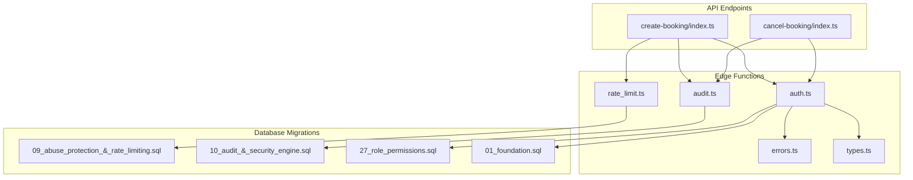
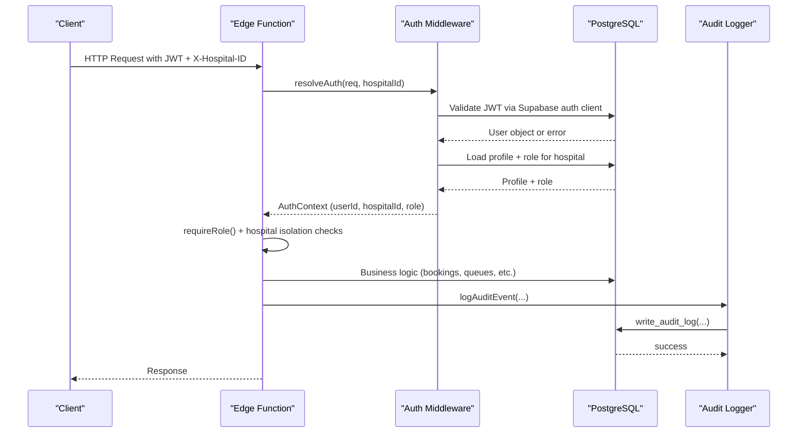
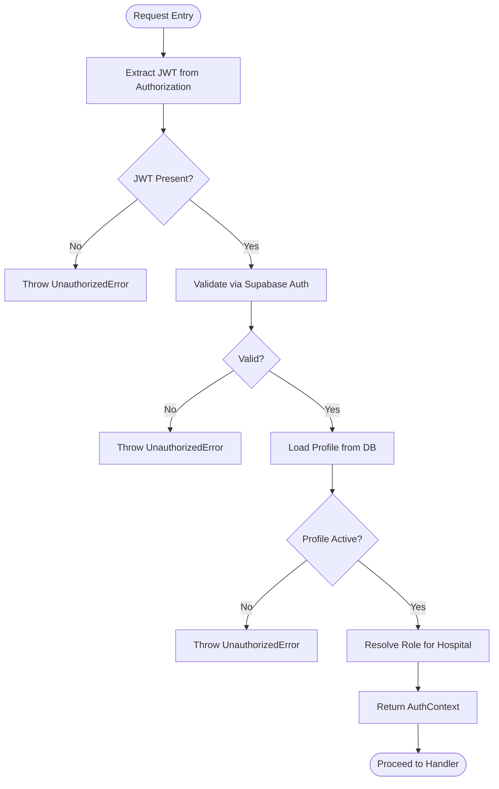
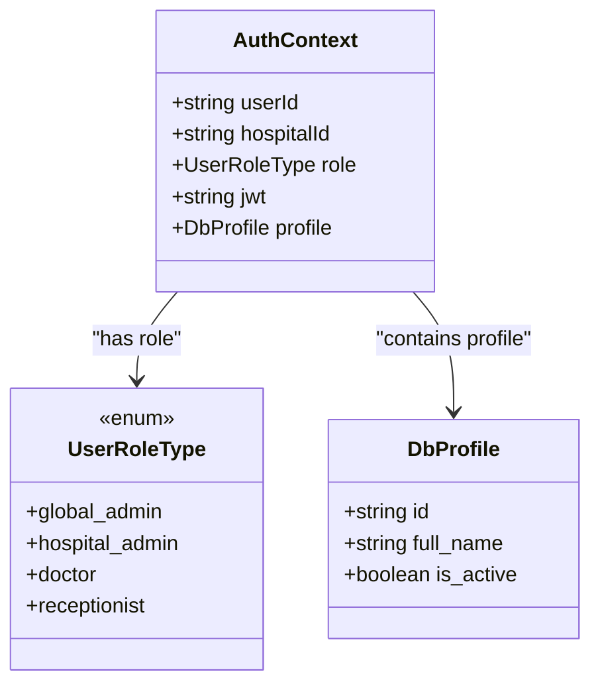
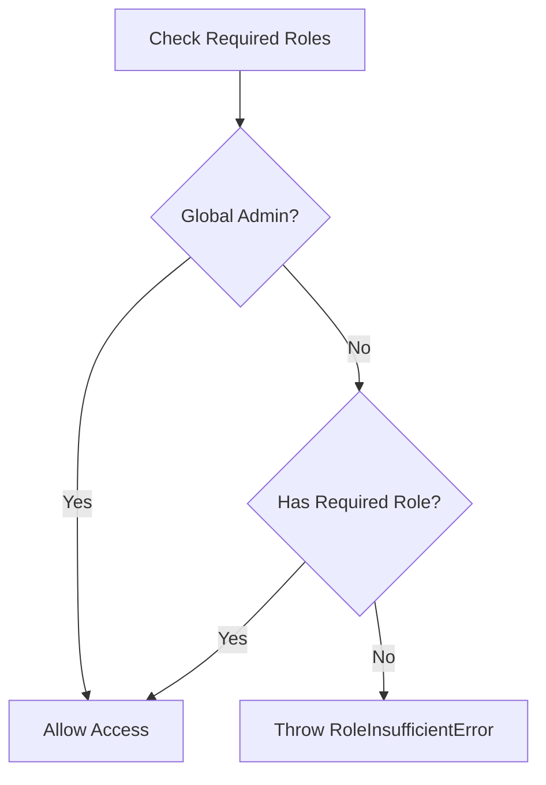
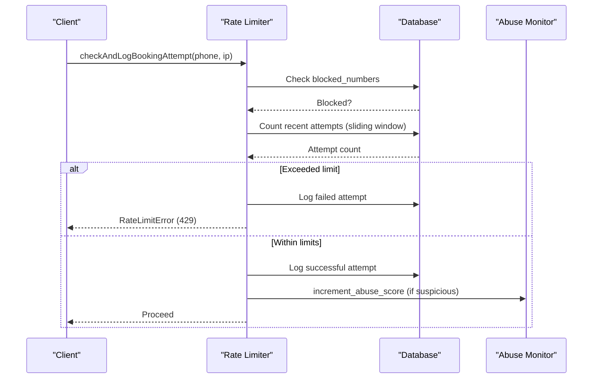
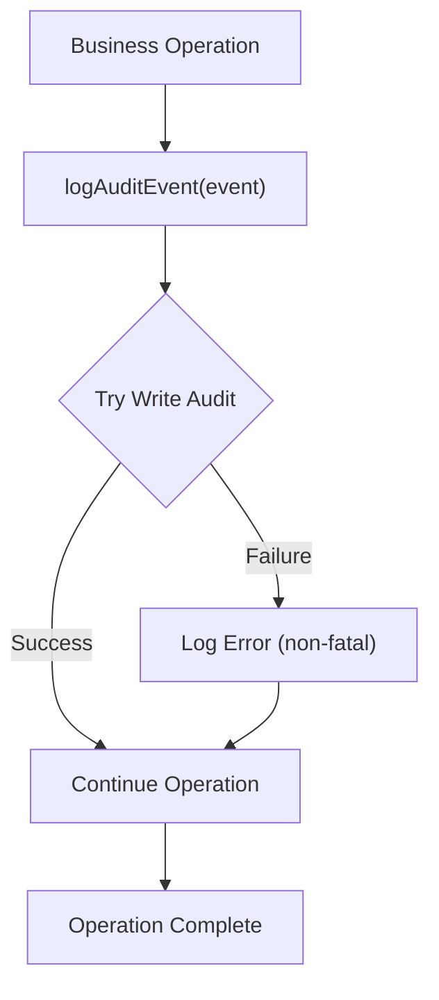
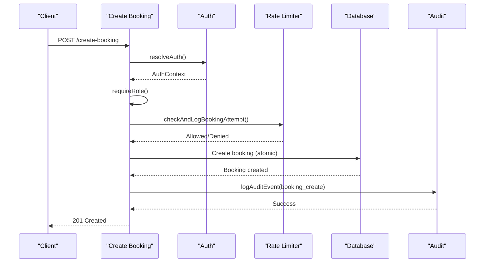
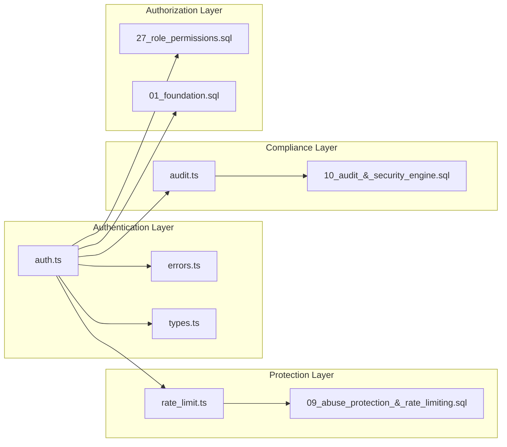

# Security Model

<cite>
**Referenced Files in This Document**
- [auth.ts](file://supabase/functions/_shared/auth.ts)
- [rate_limit.ts](file://supabase/functions/_shared/rate_limit.ts)
- [audit.ts](file://supabase/functions/_shared/audit.ts)
- [errors.ts](file://supabase/functions/_shared/errors.ts)
- [types.ts](file://supabase/functions/_shared/types.ts)
- [create-booking/index.ts](file://supabase/functions/create-booking/index.ts)
- [cancel-booking/index.ts](file://supabase/functions/cancel-booking/index.ts)
- [09_abuse_protection_&_rate_limiting.sql](file://supabase/migrations/09_abuse_protection_&_rate_limiting.sql)
- [10_audit_&_security_engine.sql](file://supabase/migrations/10_audit_&_security_engine.sql)
- [27_role_permissions.sql](file://supabase/migrations/27_role_permissions.sql)
- [01_foundation.sql](file://supabase/migrations/01_foundation.sql)
</cite>

## Table of Contents

1. [Introduction](#introduction)
2. [Project Structure](#project-structure)
3. [Core Components](#core-components)
4. [Architecture Overview](#architecture-overview)
5. [Detailed Component Analysis](#detailed-component-analysis)
6. [Dependency Analysis](#dependency-analysis)
7. [Performance Considerations](#performance-considerations)
8. [Troubleshooting Guide](#troubleshooting-guide)
9. [Conclusion](#conclusion)
10. [Appendices](#appendices)

## Introduction

This document explains the comprehensive security model implemented in Setura
Hospital OS, focusing on:

- JWT-based authentication with token validation and user context resolution
- Multi-tenant isolation by hospital using role-based access control (RBAC)
- Granular permissions for patients, doctors, receptionists, and administrators
- Abuse protection via rate limiting, request throttling, and security
  monitoring
- Audit logging for compliance and security analysis
- Secure API patterns used across endpoints

The system enforces strict boundaries between hospitals while sharing
infrastructure, ensuring that users can only access data and operations within
their authorized scope.

## Project Structure

Security is implemented across shared middleware and database layers:

- Edge Function middleware handles authentication, authorization, rate limiting,
  and audit logging
- Database migrations define roles, permissions, abuse protection tables, and
  audit structures
- Endpoints compose these components to enforce consistent security policies

**Diagram sources**

- [auth.ts:1-237](file://supabase/functions/_shared/auth.ts#L1-L237)
- [rate_limit.ts:1-124](file://supabase/functions/_shared/rate_limit.ts#L1-L124)
- [audit.ts:1-75](file://supabase/functions/_shared/audit.ts#L1-L75)
- [errors.ts:1-323](file://supabase/functions/_shared/errors.ts#L1-L323)
- [types.ts:1-329](file://supabase/functions/_shared/types.ts#L1-L329)
- [09_abuse_protection_&_rate_limiting.sql:1-729](file://supabase/migrations/09_abuse_protection_&_rate_limiting.sql#L1-L729)
- [10_audit_&_security_engine.sql:1-488](file://supabase/migrations/10_audit_&_security_engine.sql#L1-L488)
- [27_role_permissions.sql:1-273](file://supabase/migrations/27_role_permissions.sql#L1-L273)
- [01_foundation.sql:1-200](file://supabase/migrations/01_foundation.sql#L1-L200)

**Section sources**

- [auth.ts:1-237](file://supabase/functions/_shared/auth.ts#L1-L237)
- [09_abuse_protection_&_rate_limiting.sql:1-729](file://supabase/migrations/09_abuse_protection_&_rate_limiting.sql#L1-L729)
- [10_audit_&_security_engine.sql:1-488](file://supabase/migrations/10_audit_&_security_engine.sql#L1-L488)
- [27_role_permissions.sql:1-273](file://supabase/migrations/27_role_permissions.sql#L1-L273)
- [01_foundation.sql:1-200](file://supabase/migrations/01_foundation.sql#L1-L200)

## Core Components

- Authentication and Authorization:
  - JWT extraction and validation via Supabase auth client
  - Role resolution from database to ensure authoritative state
  - Hospital-scoped access enforcement before business logic
- Rate Limiting and Abuse Protection:
  - Distributed sliding window checks backed by database tables
  - Phone normalization and blocklist checks
  - Abuse scoring and temporary restrictions
- Audit Logging:
  - Fire-and-forget audit event writing
  - Immutable audit logs enforced at the database level
  - Security events tracking with risk scoring and resolution workflows
- Permission System:
  - Structured role-permission mapping
  - Centralized permission checks for RLS and Edge Functions
  - Clear separation of platform-level vs hospital-level privileges

**Section sources**

- [auth.ts:22-186](file://supabase/functions/_shared/auth.ts#L22-L186)
- [rate_limit.ts:16-124](file://supabase/functions/_shared/rate_limit.ts#L16-L124)
- [audit.ts:13-75](file://supabase/functions/_shared/audit.ts#L13-L75)
- [27_role_permissions.sql:35-273](file://supabase/migrations/27_role_permissions.sql#L35-L273)
- [10_audit_&_security_engine.sql:43-320](file://supabase/migrations/10_audit_&_security_engine.sql#L43-L320)

## Architecture Overview

The security architecture combines edge middleware with database-enforced
policies:

**Diagram sources**

- [auth.ts:42-124](file://supabase/functions/_shared/auth.ts#L42-L124)
- [create-booking/index.ts:95-119](file://supabase/functions/create-booking/index.ts#L95-L119)
- [audit.ts:51-75](file://supabase/functions/_shared/audit.ts#L51-L75)
- [10_audit_&_security_engine.sql:255-320](file://supabase/migrations/10_audit_&_security_engine.sql#L255-L320)

## Detailed Component Analysis

### JWT-Based Authentication Flow

- Token Extraction:
  - Extracts Bearer token from Authorization header
  - Validates presence and format
- Validation:
  - Uses Supabase auth client to validate signature, expiry, and revocation
  - Returns typed errors for missing, invalid, or expired tokens
- User Context Resolution:
  - Loads profile from database to ensure active status
  - Resolves role per hospital or primary role if no hospital context
  - Supports global_admin bypass for cross-hospital operations
- Middleware Composition:
  - withAuth wrapper provides CORS handling, correlation IDs, and error
    responses
  - Enforces required roles and hospital access before invoking handlers

**Diagram sources**

- [auth.ts:22-124](file://supabase/functions/_shared/auth.ts#L22-L124)

**Section sources**

- [auth.ts:22-186](file://supabase/functions/_shared/auth.ts#L22-L186)

### Multi-Tenant Security Model

- Hospital Isolation:
  - All requests must include X-Hospital-ID header
  - Role resolution scoped to specific hospital
  - Global admins can operate across hospitals
- Row-Level Security:
  - Database policies restrict access to hospital-scoped data
  - RLS enabled and forced on sensitive tables
- Permission Checks:
  - has_permission function validates role-permission mappings
  - current_user_has_permission convenience wrapper for SQL policies

**Diagram sources**

- [types.ts:11-15](file://supabase/functions/_shared/types.ts#L11-L15)
- [types.ts:106-116](file://supabase/functions/_shared/types.ts#L106-L116)
- [types.ts:264-270](file://supabase/functions/_shared/types.ts#L264-L270)

**Section sources**

- [auth.ts:78-124](file://supabase/functions/_shared/auth.ts#L78-L124)
- [27_role_permissions.sql:133-213](file://supabase/migrations/27_role_permissions.sql#L133-L213)
- [09_abuse_protection_&_rate_limiting.sql:627-729](file://supabase/migrations/09_abuse_protection_&_rate_limiting.sql#L627-L729)

### Role-Based Permission System

- Role Hierarchy:
  - global_admin: unrestricted access
  - hospital_admin: full hospital control
  - doctor: clinical operations only
  - receptionist: front-desk booking & communication
- Permission Matrix:
  - Structured in role_permissions table
  - Includes CREATE_BOOKING, CANCEL_BOOKING, VIEW_ANALYTICS, MANAGE_USERS, etc.
- Enforcement:
  - requireRole() in middleware for endpoint-level checks
  - has_permission() for database-level RLS policies
  - Global admin bypass for cross-hospital operations

**Diagram sources**

- [auth.ts:129-151](file://supabase/functions/_shared/auth.ts#L129-L151)
- [27_role_permissions.sql:70-126](file://supabase/migrations/27_role_permissions.sql#L70-L126)

**Section sources**

- [auth.ts:129-186](file://supabase/functions/_shared/auth.ts#L129-L186)
- [27_role_permissions.sql:35-126](file://supabase/migrations/27_role_permissions.sql#L35-L126)

### Abuse Protection Mechanisms

- Rate Limiting:
  - Sliding window approach using booking_attempt_logs table
  - Configurable window minutes and max attempts per phone number
  - IP address extraction from request headers
- Blocklist Management:
  - blocked_numbers table with restriction_status and expiration
  - Temporary restrictions for dynamic blocking
- Abuse Scoring:
  - Cumulative scoring based on suspicious activities
  - Increment_abuse_score function for tracking
- Monitoring:
  - spam_events table for different abuse types
  - Risk scoring and metadata capture

**Diagram sources**

- [rate_limit.ts:27-111](file://supabase/functions/_shared/rate_limit.ts#L27-L111)
- [09_abuse_protection_&_rate_limiting.sql:385-590](file://supabase/migrations/09_abuse_protection_&_rate_limiting.sql#L385-L590)

**Section sources**

- [rate_limit.ts:16-124](file://supabase/functions/_shared/rate_limit.ts#L16-L124)
- [09_abuse_protection_&_rate_limiting.sql:77-590](file://supabase/migrations/09_abuse_protection_&_rate_limiting.sql#L77-L590)

### Audit Logging System

- Event Types:
  - login, booking_create, booking_cancel, payment operations, admin actions
  - Severity levels: low, medium, high, critical
- Implementation:
  - Fire-and-forget logging to avoid impacting business operations
  - Centralized write_audit_log function with SECURITY DEFINER
  - Immutable audit logs enforced via database triggers
- Security Events:
  - Separate security_events table for security-specific monitoring
  - Risk scoring and resolution workflow
  - Real-time publication for live monitoring

**Diagram sources**

- [audit.ts:51-75](file://supabase/functions/_shared/audit.ts#L51-L75)
- [10_audit_&_security_engine.sql:255-320](file://supabase/migrations/10_audit_&_security_engine.sql#L255-L320)

**Section sources**

- [audit.ts:13-75](file://supabase/functions/_shared/audit.ts#L13-L75)
- [10_audit_&_security_engine.sql:43-320](file://supabase/migrations/10_audit_&_security_engine.sql#L43-L320)

### Secure API Implementation Examples

- Create Booking Endpoint:
  - Comprehensive security checks including JWT validation, role verification,
    hospital isolation
  - Rate limiting before booking creation
  - Idempotency protection against duplicate requests
  - Audit logging for compliance
- Cancel Booking Endpoint:
  - Role-based authorization for cancellation operations
  - State validation to prevent invalid cancellations
  - Optional refund initiation with proper auditing
  - Queue recalculation and notification queuing

**Diagram sources**

- [create-booking/index.ts:95-607](file://supabase/functions/create-booking/index.ts#L95-L607)
- [auth.ts:42-124](file://supabase/functions/_shared/auth.ts#L42-L124)
- [rate_limit.ts:27-111](file://supabase/functions/_shared/rate_limit.ts#L27-L111)
- [audit.ts:51-75](file://supabase/functions/_shared/audit.ts#L51-L75)

**Section sources**

- [create-booking/index.ts:1-666](file://supabase/functions/create-booking/index.ts#L1-L666)
- [cancel-booking/index.ts:1-482](file://supabase/functions/cancel-booking/index.ts#L1-L482)

## Dependency Analysis

The security system has clear dependency relationships:

**Diagram sources**

- [auth.ts:1-237](file://supabase/functions/_shared/auth.ts#L1-L237)
- [rate_limit.ts:1-124](file://supabase/functions/_shared/rate_limit.ts#L1-L124)
- [audit.ts:1-75](file://supabase/functions/_shared/audit.ts#L1-L75)
- [09_abuse_protection_&_rate_limiting.sql:1-729](file://supabase/migrations/09_abuse_protection_&_rate_limiting.sql#L1-L729)
- [10_audit_&_security_engine.sql:1-488](file://supabase/migrations/10_audit_&_security_engine.sql#L1-L488)
- [27_role_permissions.sql:1-273](file://supabase/migrations/27_role_permissions.sql#L1-L273)
- [01_foundation.sql:1-200](file://supabase/migrations/01_foundation.sql#L1-L200)

**Section sources**

- [auth.ts:1-237](file://supabase/functions/_shared/auth.ts#L1-L237)
- [rate_limit.ts:1-124](file://supabase/functions/_shared/rate_limit.ts#L1-L124)
- [audit.ts:1-75](file://supabase/functions/_shared/audit.ts#L1-L75)

## Performance Considerations

- Authentication:
  - JWT validation via Supabase auth client minimizes cryptographic overhead
  - Database queries for profile and role resolution are optimized with indexes
- Rate Limiting:
  - Sliding window implementation uses efficient database queries
  - Fail-open strategy prevents service degradation during database issues
- Audit Logging:
  - Fire-and-forget pattern ensures audit failures don't impact business
    operations
  - Database-level immutability prevents performance issues from updates/deletes
- Permission Checks:
  - Centralized functions reduce repeated permission calculation overhead
  - SECURITY DEFINER functions execute with elevated privileges efficiently

[No sources needed since this section provides general guidance]

## Troubleshooting Guide

Common security-related issues and their resolutions:

- Authentication Failures:
  - Missing or invalid JWT tokens result in UnauthorizedError
  - Inactive user profiles are rejected with appropriate error messages
  - Hospital access denied when user lacks membership
- Rate Limiting Issues:
  - Phone numbers may be temporarily blocked due to excessive attempts
  - IP-based rate limiting protects against distributed attacks
  - Failed rate limit checks are logged but don't block legitimate traffic
    during database errors
- Permission Errors:
  - RoleInsufficientError indicates insufficient privileges for requested
    operation
  - HospitalAccessDeniedError shows cross-hospital access attempts
- Audit Logging Problems:
  - Audit failures are non-fatal and logged internally
  - Security events can be resolved through dedicated workflows

**Section sources**

- [errors.ts:106-151](file://supabase/functions/_shared/errors.ts#L106-L151)
- [rate_limit.ts:72-78](file://supabase/functions/_shared/rate_limit.ts#L72-L78)
- [audit.ts:68-75](file://supabase/functions/_shared/audit.ts#L68-L75)

## Conclusion

Setura Hospital OS implements a comprehensive security model that combines:

- Robust JWT-based authentication with centralized validation
- Multi-tenant isolation ensuring strict hospital data separation
- Granular role-based permissions with clear hierarchy
- Advanced abuse protection with rate limiting and monitoring
- Comprehensive audit logging for compliance and security analysis

The architecture follows security best practices including fail-open strategies
for non-critical operations, immutable audit trails, and centralized error
handling. The system scales effectively while maintaining strong security
boundaries between tenants and enforcing least-privilege access controls.

[No sources needed since this section summarizes without analyzing specific
files]

## Appendices

### Security Patterns Summary

- **Defense in Depth**: Multiple layers of security (authentication,
  authorization, rate limiting, audit)
- **Fail-Secure**: Default deny policies with explicit allow rules
- **Least Privilege**: Users receive minimum necessary permissions
- **Auditability**: All sensitive operations logged with contextual information
- **Resilience**: Non-critical security features degrade gracefully under
  failure

### Compliance Features

- Immutable audit logs prevent tampering
- Security event tracking with resolution workflows
- Role-based access controls aligned with healthcare regulations
- Comprehensive logging for forensic analysis

[No sources needed since this section provides general guidance]
