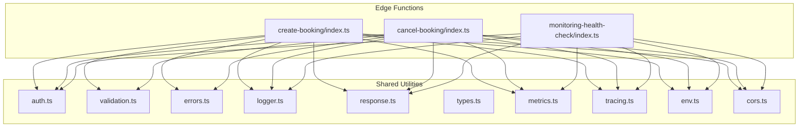
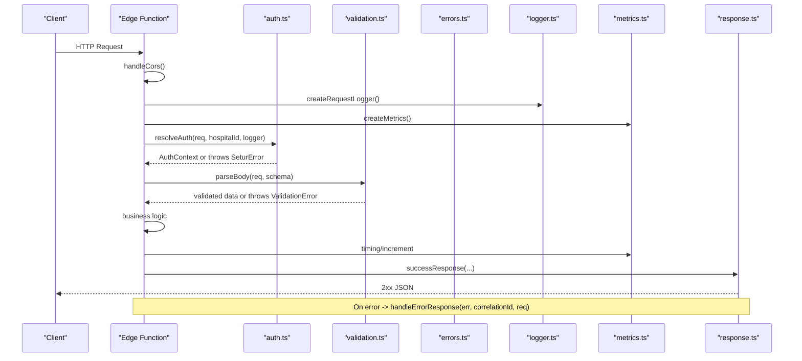
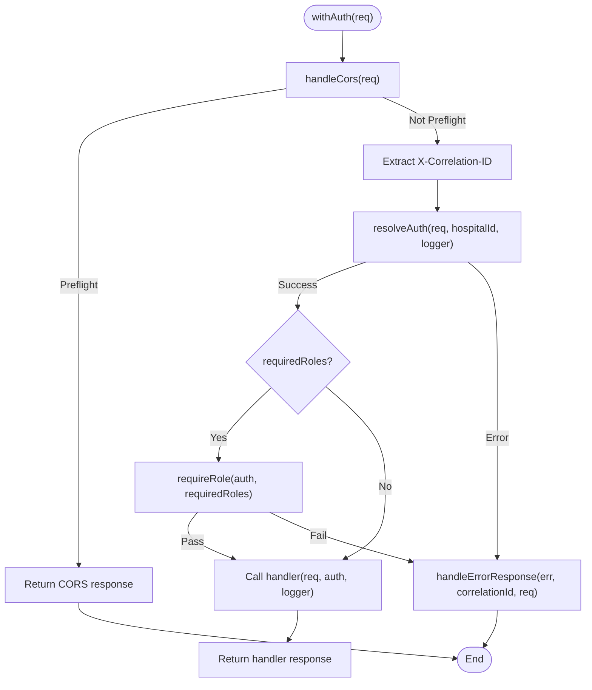
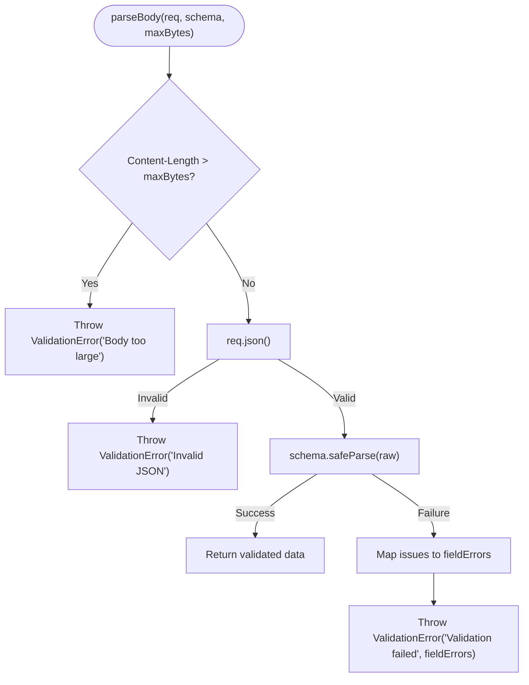
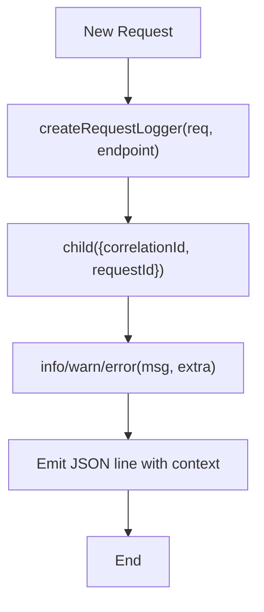
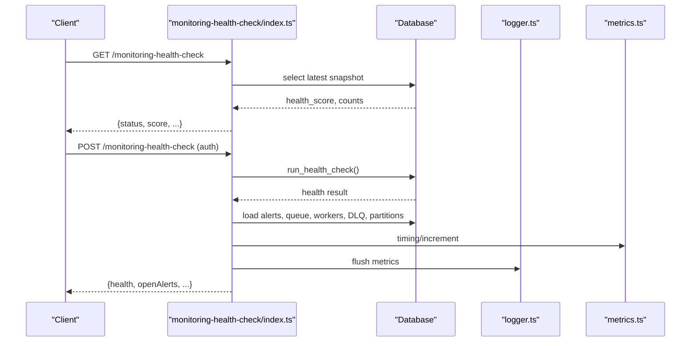
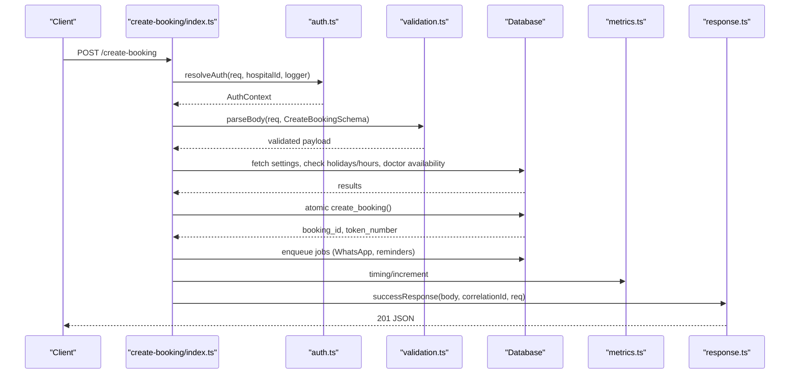
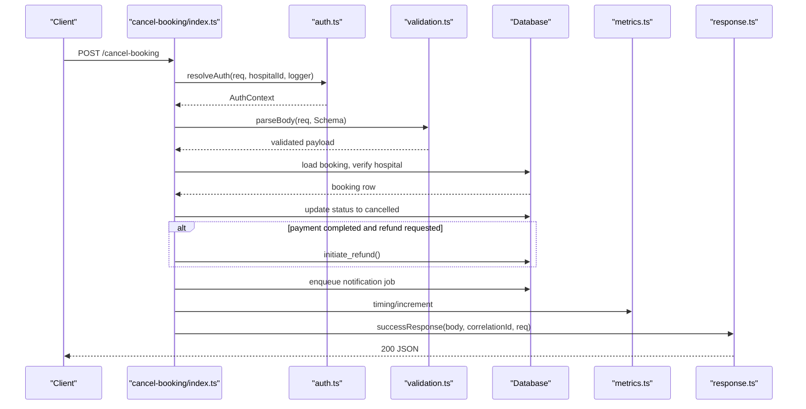
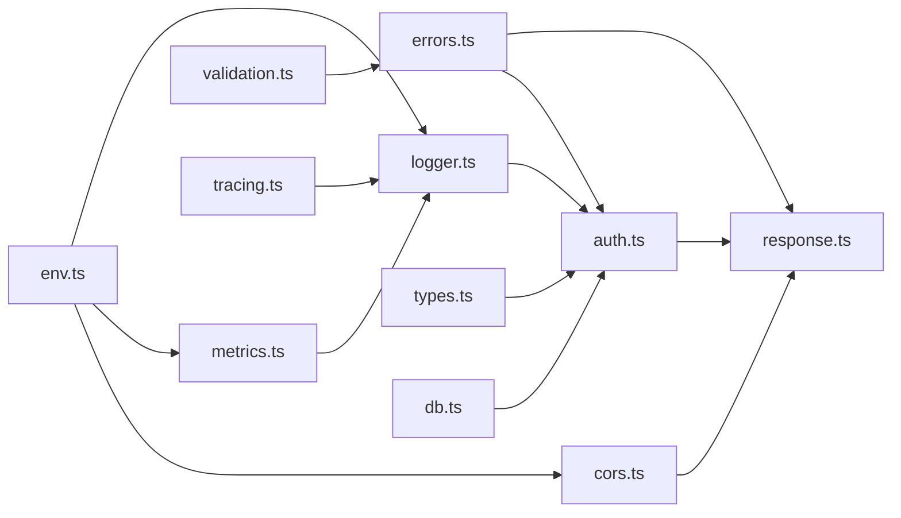

# Shared Utilities Layer

<cite>
**Referenced Files in This Document**
- [auth.ts](file://supabase/functions/_shared/auth.ts)
- [validation.ts](file://supabase/functions/_shared/validation.ts)
- [errors.ts](file://supabase/functions/_shared/errors.ts)
- [logger.ts](file://supabase/functions/_shared/logger.ts)
- [response.ts](file://supabase/functions/_shared/response.ts)
- [types.ts](file://supabase/functions/_shared/types.ts)
- [metrics.ts](file://supabase/functions/_shared/metrics.ts)
- [tracing.ts](file://supabase/functions/_shared/tracing.ts)
- [env.ts](file://supabase/functions/_shared/env.ts)
- [cors.ts](file://supabase/functions/_shared/cors.ts)
- [create-booking/index.ts](file://supabase/functions/create-booking/index.ts)
- [cancel-booking/index.ts](file://supabase/functions/cancel-booking/index.ts)
- [monitoring-health-check/index.ts](file://supabase/functions/monitoring-health-check/index.ts)
</cite>

## Table of Contents

1. [Introduction](#introduction)
2. [Project Structure](#project-structure)
3. [Core Components](#core-components)
4. [Architecture Overview](#architecture-overview)
5. [Detailed Component Analysis](#detailed-component-analysis)
6. [Dependency Analysis](#dependency-analysis)
7. [Performance Considerations](#performance-considerations)
8. [Troubleshooting Guide](#troubleshooting-guide)
9. [Conclusion](#conclusion)
10. [Appendices](#appendices)

## Introduction

This document describes the shared utilities layer that powers all edge
functions in the project. It focuses on:

- Authentication middleware for JWT validation, user context resolution, and
  role-based access control with hospital isolation
- A Zod-based validation layer for request parsing, input sanitization, and type
  coercion
- A centralized error handling system with domain-specific errors, consistent
  response formatting, and logging integration
- Structured logging with correlation IDs, performance metrics collection, and
  health check endpoints
- Practical examples showing how edge functions consume these utilities and the
  benefits of this shared approach

## Project Structure

The shared utilities live under a single directory and are consumed by each edge
function to ensure consistency across the system.

**Diagram sources**

- [auth.ts:1-237](file://supabase/functions/_shared/auth.ts#L1-L237)
- [validation.ts:1-157](file://supabase/functions/_shared/validation.ts#L1-L157)
- [errors.ts:1-323](file://supabase/functions/_shared/errors.ts#L1-L323)
- [logger.ts:1-190](file://supabase/functions/_shared/logger.ts#L1-L190)
- [response.ts:1-206](file://supabase/functions/_shared/response.ts#L1-L206)
- [types.ts:1-329](file://supabase/functions/_shared/types.ts#L1-L329)
- [metrics.ts:1-119](file://supabase/functions/_shared/metrics.ts#L1-L119)
- [tracing.ts:1-50](file://supabase/functions/_shared/tracing.ts#L1-L50)
- [env.ts:1-279](file://supabase/functions/_shared/env.ts#L1-L279)
- [cors.ts:1-34](file://supabase/functions/_shared/cors.ts#L1-L34)
- [create-booking/index.ts:1-666](file://supabase/functions/create-booking/index.ts#L1-L666)
- [cancel-booking/index.ts:1-482](file://supabase/functions/cancel-booking/index.ts#L1-L482)
- [monitoring-health-check/index.ts:1-231](file://supabase/functions/monitoring-health-check/index.ts#L1-L231)

**Section sources**

- [auth.ts:1-237](file://supabase/functions/_shared/auth.ts#L1-L237)
- [validation.ts:1-157](file://supabase/functions/_shared/validation.ts#L1-L157)
- [errors.ts:1-323](file://supabase/functions/_shared/errors.ts#L1-L323)
- [logger.ts:1-190](file://supabase/functions/_shared/logger.ts#L1-L190)
- [response.ts:1-206](file://supabase/functions/_shared/response.ts#L1-L206)
- [types.ts:1-329](file://supabase/functions/_shared/types.ts#L1-L329)
- [metrics.ts:1-119](file://supabase/functions/_shared/metrics.ts#L1-L119)
- [tracing.ts:1-50](file://supabase/functions/_shared/tracing.ts#L1-L50)
- [env.ts:1-279](file://supabase/functions/_shared/env.ts#L1-L279)
- [cors.ts:1-34](file://supabase/functions/_shared/cors.ts#L1-L34)

## Core Components

- Authentication middleware: validates JWT via Supabase, resolves user profile
  and role from the database, enforces hospital isolation, and provides helpers
  for role checks.
- Validation layer: Zod schemas for primitives and domain objects, body parsing
  with size guards, field-level error mapping, and normalization (e.g., phone
  numbers).
- Error handling: typed error hierarchy with codes, status codes, retry flags,
  and context; unified conversion to API responses.
- Logging: structured JSON logs with correlation IDs, child loggers per request,
  timers, and safe error serialization.
- Metrics: lightweight collector emitting timing and counters as structured logs
  for observability platforms.
- Tracing: correlation/request/span IDs propagated across calls; helper to
  compute elapsed time.
- Environment: typed configuration with required and optional variables, feature
  flags, and CORS allowlist.
- Response builders: standardized success/error shapes including correlation ID
  and timestamp.

**Section sources**

- [auth.ts:22-185](file://supabase/functions/_shared/auth.ts#L22-L185)
- [validation.ts:11-134](file://supabase/functions/_shared/validation.ts#L11-L134)
- [errors.ts:13-323](file://supabase/functions/_shared/errors.ts#L13-L323)
- [logger.ts:12-189](file://supabase/functions/_shared/logger.ts#L12-L189)
- [metrics.ts:16-119](file://supabase/functions/_shared/metrics.ts#L16-L119)
- [tracing.ts:9-50](file://supabase/functions/_shared/tracing.ts#L9-L50)
- [env.ts:16-279](file://supabase/functions/_shared/env.ts#L16-L279)
- [response.ts:14-206](file://supabase/functions/_shared/response.ts#L14-L206)

## Architecture Overview

The shared layer is composed around a consistent request lifecycle:

- CORS preflight handling
- Correlation ID extraction and logger creation
- Auth resolution and role enforcement
- Request body parsing and validation
- Business logic execution
- Metrics collection and flushing
- Unified error handling and response building

**Diagram sources**

- [auth.ts:42-124](file://supabase/functions/_shared/auth.ts#L42-L124)
- [validation.ts:99-134](file://supabase/functions/_shared/validation.ts#L99-L134)
- [errors.ts:70-162](file://supabase/functions/_shared/errors.ts#L70-L162)
- [logger.ts:122-189](file://supabase/functions/_shared/logger.ts#L122-L189)
- [metrics.ts:24-119](file://supabase/functions/_shared/metrics.ts#L24-L119)
- [response.ts:44-206](file://supabase/functions/_shared/response.ts#L44-L206)

## Detailed Component Analysis

### Authentication Middleware

Responsibilities:

- Extracts Bearer token from Authorization header
- Validates JWT using Supabase auth client
- Loads user profile and enforces active status
- Resolves role for a specific hospital or primary role when no hospital context
  is provided
- Enforces hospital isolation and global admin overrides
- Provides role helpers and a middleware wrapper to compose handlers

Key behaviors:

- Role resolution prefers explicit hospital-scoped roles; falls back to
  global_admin if present
- Global admin bypasses hospital isolation
- Middleware composes CORS, correlation ID, auth resolution, role checks, and
  error handling

**Diagram sources**

- [auth.ts:203-236](file://supabase/functions/_shared/auth.ts#L203-L236)
- [auth.ts:42-124](file://supabase/functions/_shared/auth.ts#L42-L124)
- [auth.ts:129-185](file://supabase/functions/_shared/auth.ts#L129-L185)

**Section sources**

- [auth.ts:22-185](file://supabase/functions/_shared/auth.ts#L22-L185)
- [auth.ts:203-236](file://supabase/functions/_shared/auth.ts#L203-L236)

### Validation Layer

Responsibilities:

- Define reusable Zod schemas for primitives and domain entities
- Normalize inputs (e.g., phone number normalization)
- Parse and validate request bodies with size limits
- Map validation issues to field-level errors

Key features:

- Phone normalization strips formatting and country code for Indian mobile
  numbers
- Date validation ensures ISO format and future dates where applicable
- Generic parser returns typed data or throws a typed validation error with
  field details

**Diagram sources**

- [validation.ts:99-134](file://supabase/functions/_shared/validation.ts#L99-L134)
- [validation.ts:29-53](file://supabase/functions/_shared/validation.ts#L29-L53)

**Section sources**

- [validation.ts:11-134](file://supabase/functions/_shared/validation.ts#L11-L134)

### Centralized Error Handling

Responsibilities:

- Provide a typed error hierarchy with machine-readable codes, HTTP status
  codes, retry flags, and context
- Convert any thrown error into a consistent API response
- Support field-level errors for validation failures

Design highlights:

- Base error class carries metadata and serializes to JSON for structured
  logging
- Domain-specific errors encode rich context (e.g., hospital ID, required roles)
- Response builder maps SeturError fields to a uniform error envelope

```mermaid
classDiagram
class SeturError {
+string code
+number statusCode
+boolean retryable
+object context
+string timestamp
+toJSON() object
}
class UnauthorizedError
class ForbiddenError
class HospitalAccessDeniedError
class RoleInsufficientError
class ValidationError {
+Record~string,string[]~ fieldErrors
}
class BookingDuplicateError
class HospitalClosedError
class QueueFullError
class TokenExhaustedError
class DoctorUnavailableError
class PatientBlockedError
class IdempotencyKeyRequiredError
class IdempotencyProcessingError
class RateLimitError
class ConcurrencyError
class DbError
class InternalError
SeturError <|-- UnauthorizedError
SeturError <|-- ForbiddenError
SeturError <|-- HospitalAccessDeniedError
SeturError <|-- RoleInsufficientError
SeturError <|-- ValidationError
SeturError <|-- BookingDuplicateError
SeturError <|-- HospitalClosedError
SeturError <|-- QueueFullError
SeturError <|-- TokenExhaustedError
SeturError <|-- DoctorUnavailableError
SeturError <|-- PatientBlockedError
SeturError <|-- IdempotencyKeyRequiredError
SeturError <|-- IdempotencyProcessingError
SeturError <|-- RateLimitError
SeturError <|-- ConcurrencyError
SeturError <|-- DbError
SeturError <|-- InternalError
```

**Diagram sources**

- [errors.ts:70-323](file://supabase/functions/_shared/errors.ts#L70-L323)

**Section sources**

- [errors.ts:13-323](file://supabase/functions/_shared/errors.ts#L13-L323)
- [response.ts:94-206](file://supabase/functions/_shared/response.ts#L94-L206)

### Structured Logging System

Responsibilities:

- Emit single-line JSON logs with level, service, version, environment, and
  correlation ID
- Provide child loggers to merge additional context per request
- Serialize errors safely, preserving stack traces in non-production
- Offer timers to measure durations and include them in logs

Key capabilities:

- Configurable log levels based on environment
- Root logger and request-scoped logger factory
- Child logger composition without mutating parent context

**Diagram sources**

- [logger.ts:122-189](file://supabase/functions/_shared/logger.ts#L122-L189)

**Section sources**

- [logger.ts:12-189](file://supabase/functions/_shared/logger.ts#L12-L189)

### Metrics Collection and Health Check Endpoints

Responsibilities:

- Collect timing and counter metrics per request
- Flush metrics as structured logs for external collectors
- Provide a health check endpoint that reports system state

Implementation notes:

- Metrics are tagged with endpoint and correlation ID
- Health GET returns lightweight uptime info; POST requires authentication and
  runs full diagnostics

**Diagram sources**

- [monitoring-health-check/index.ts:22-231](file://supabase/functions/monitoring-health-check/index.ts#L22-L231)
- [metrics.ts:24-119](file://supabase/functions/_shared/metrics.ts#L24-L119)
- [logger.ts:122-189](file://supabase/functions/_shared/logger.ts#L122-L189)

**Section sources**

- [metrics.ts:16-119](file://supabase/functions/_shared/metrics.ts#L16-L119)
- [monitoring-health-check/index.ts:22-231](file://supabase/functions/monitoring-health-check/index.ts#L22-L231)

### Practical Examples: Consuming the Shared Layer

#### Example: Creating a Booking

Flow:

- CORS preflight handled
- Trace context and logger created
- Idempotency key extracted
- Auth resolved with hospital context and role enforced
- Body parsed and validated against schema
- Business rules applied (hospital settings, holidays, working hours, doctor
  availability)
- Atomic booking creation via RPC
- Notifications queued
- Audit logged
- Metrics collected and flushed
- Success response returned

**Diagram sources**

- [create-booking/index.ts:67-666](file://supabase/functions/create-booking/index.ts#L67-L666)
- [auth.ts:42-124](file://supabase/functions/_shared/auth.ts#L42-L124)
- [validation.ts:99-134](file://supabase/functions/_shared/validation.ts#L99-L134)
- [metrics.ts:24-119](file://supabase/functions/_shared/metrics.ts#L24-L119)
- [response.ts:44-67](file://supabase/functions/_shared/response.ts#L44-L67)

**Section sources**

- [create-booking/index.ts:67-666](file://supabase/functions/create-booking/index.ts#L67-L666)

#### Example: Canceling a Booking

Flow:

- CORS and method guard
- Auth resolved and role checked
- Body parsed and validated
- Booking loaded and ownership verified
- State transitions enforced
- Optional refund initiated
- Queue recalculation and notifications queued
- Audit logged
- Metrics collected and flushed
- Success response returned

**Diagram sources**

- [cancel-booking/index.ts:67-482](file://supabase/functions/cancel-booking/index.ts#L67-L482)
- [auth.ts:42-124](file://supabase/functions/_shared/auth.ts#L42-L124)
- [validation.ts:99-134](file://supabase/functions/_shared/validation.ts#L99-L134)
- [metrics.ts:24-119](file://supabase/functions/_shared/metrics.ts#L24-L119)
- [response.ts:44-67](file://supabase/functions/_shared/response.ts#L44-L67)

**Section sources**

- [cancel-booking/index.ts:67-482](file://supabase/functions/cancel-booking/index.ts#L67-L482)

## Dependency Analysis

The shared utilities form a cohesive dependency graph with clear boundaries:

- auth depends on db clients, errors, types, and logger
- validation depends on errors and Zod
- response depends on cors and errors
- metrics and tracing depend on logger and env
- env is foundational and used widely
- cors is used by response and edge functions

**Diagram sources**

- [env.ts:227-279](file://supabase/functions/_shared/env.ts#L227-L279)
- [logger.ts:12-189](file://supabase/functions/_shared/logger.ts#L12-L189)
- [metrics.ts:14-119](file://supabase/functions/_shared/metrics.ts#L14-L119)
- [cors.ts:1-34](file://supabase/functions/_shared/cors.ts#L1-L34)
- [errors.ts:70-323](file://supabase/functions/_shared/errors.ts#L70-L323)
- [response.ts:11-206](file://supabase/functions/_shared/response.ts#L11-L206)
- [types.ts:264-279](file://supabase/functions/_shared/types.ts#L264-L279)
- [auth.ts:13-21](file://supabase/functions/_shared/auth.ts#L13-L21)
- [validation.ts:8-10](file://supabase/functions/_shared/validation.ts#L8-L10)
- [tracing.ts:1-50](file://supabase/functions/_shared/tracing.ts#L1-L50)

**Section sources**

- [env.ts:227-279](file://supabase/functions/_shared/env.ts#L227-L279)
- [auth.ts:13-21](file://supabase/functions/_shared/auth.ts#L13-L21)
- [validation.ts:8-10](file://supabase/functions/_shared/validation.ts#L8-L10)
- [response.ts:11-206](file://supabase/functions/_shared/response.ts#L11-L206)
- [metrics.ts:14-119](file://supabase/functions/_shared/metrics.ts#L14-L119)
- [logger.ts:12-189](file://supabase/functions/_shared/logger.ts#L12-L189)
- [cors.ts:1-34](file://supabase/functions/_shared/cors.ts#L1-L34)
- [tracing.ts:1-50](file://supabase/functions/_shared/tracing.ts#L1-L50)

## Performance Considerations

- Use minimal logging levels in production to reduce overhead
- Prefer scoped timers for critical paths (auth, DB queries, RPCs)
- Avoid heavy work inside hot paths; offload to background jobs where possible
- Ensure idempotency keys are used for write operations to prevent duplicate
  processing
- Cache or minimize repeated reads within a single request when feasible

[No sources needed since this section provides general guidance]

## Troubleshooting Guide

Common issues and resolutions:

- Missing or invalid JWT: ensure Authorization header contains a valid Bearer
  token; check token expiry and revocation
- Hospital access denied: verify user has a role for the specified hospital or
  is a global admin
- Validation errors: inspect fieldErrors in the response to identify malformed
  or missing fields
- Rate limiting: observe 429 responses and respect Retry-After headers
- Database errors: map DB errors to domain errors and review context for root
  cause
- Health checks: use GET for quick uptime checks; use POST for detailed
  diagnostics requiring admin privileges

**Section sources**

- [auth.ts:42-124](file://supabase/functions/_shared/auth.ts#L42-L124)
- [validation.ts:99-134](file://supabase/functions/_shared/validation.ts#L99-L134)
- [errors.ts:108-162](file://supabase/functions/_shared/errors.ts#L108-L162)
- [response.ts:154-177](file://supabase/functions/_shared/response.ts#L154-L177)
- [monitoring-health-check/index.ts:22-231](file://supabase/functions/monitoring-health-check/index.ts#L22-L231)

## Conclusion

The shared utilities layer standardizes cross-cutting concerns across all edge
functions:

- Consistent authentication and authorization with hospital isolation
- Robust validation with normalized inputs and typed errors
- Centralized error handling producing uniform API responses
- Structured logging and metrics enabling observability and debugging
- Reusable patterns that improve code reuse, maintainability, and reliability

[No sources needed since this section summarizes without analyzing specific
files]

## Appendices

### API Response Shape

All responses include:

- success flag
- correlationId for tracing
- timestamp
- data or error block

Error responses include:

- code, message, retryable
- optional fieldErrors for validation failures

**Section sources**

- [response.ts:14-32](file://supabase/functions/_shared/response.ts#L14-L32)
- [response.ts:69-92](file://supabase/functions/_shared/response.ts#L69-L92)

### Environment Configuration

Key environment variables include:

- Supabase URL and keys
- App environment and feature flags
- Observability settings (log level, deployment version)
- Runtime limits (advance booking days, rate limit windows)
- CORS allowed origins

**Section sources**

- [env.ts:82-279](file://supabase/functions/_shared/env.ts#L82-L279)
