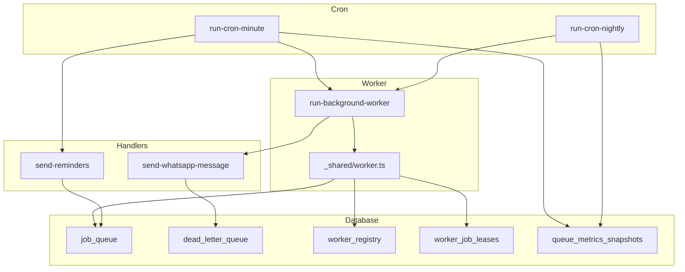
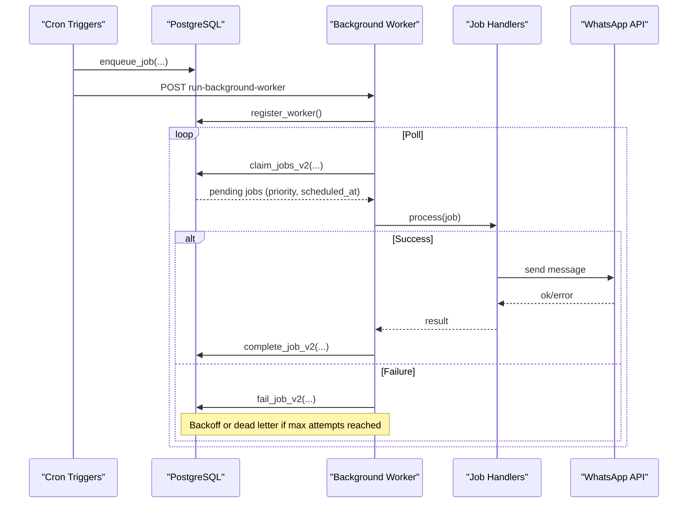
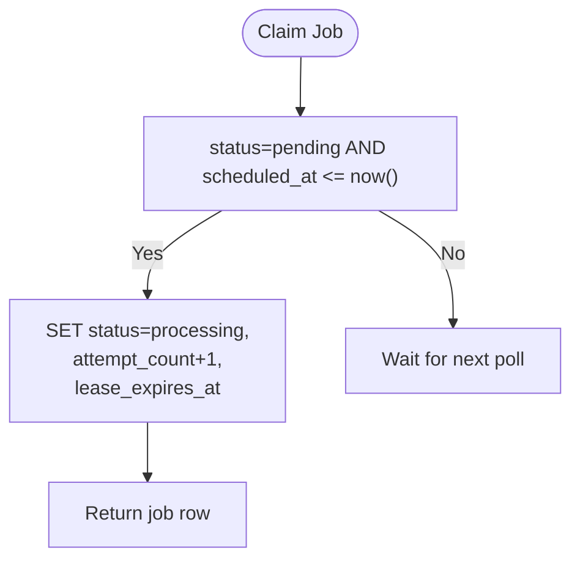
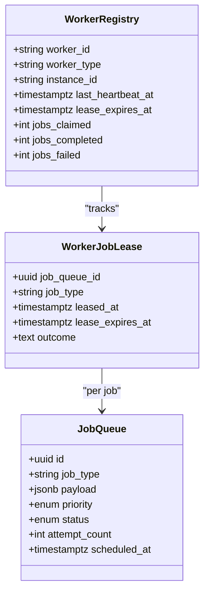
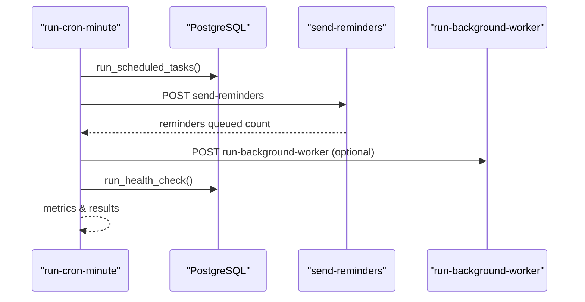
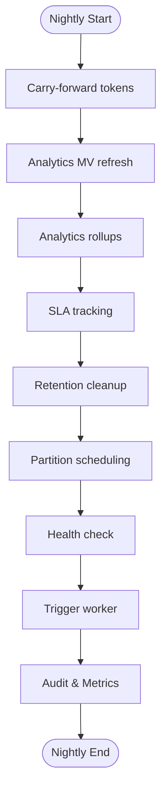
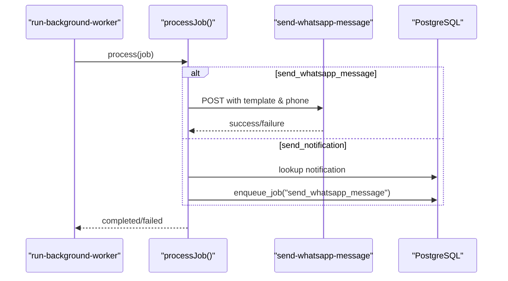
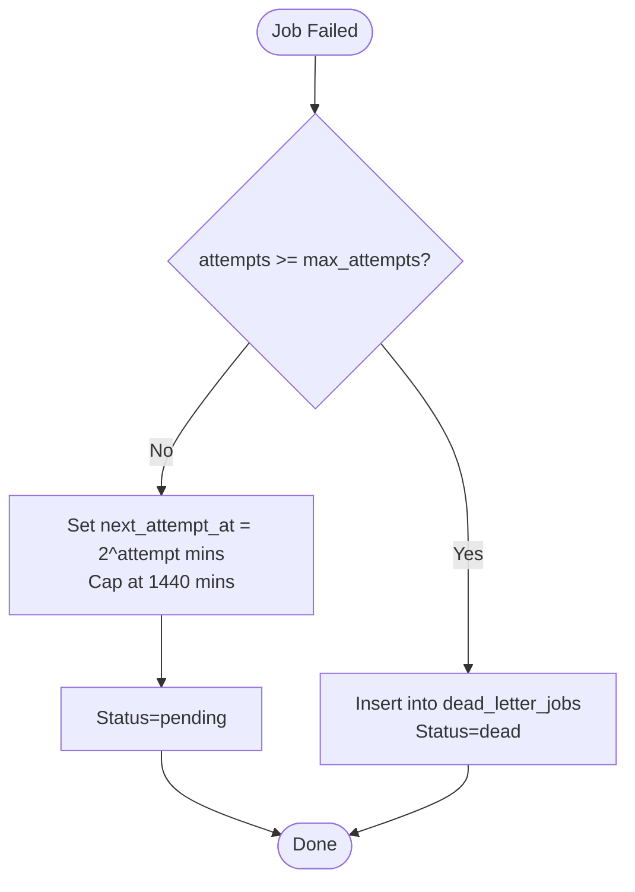
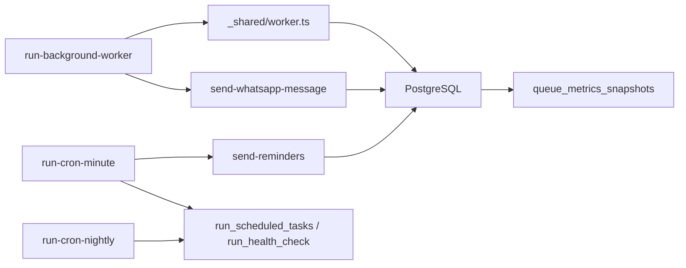

# Background Processing

<cite>
**Referenced Files in This Document**
- [run-background-worker/index.ts](file://supabase/functions/run-background-worker/index.ts)
- [run-cron-minute/index.ts](file://supabase/functions/run-cron-minute/index.ts)
- [run-cron-nightly/index.ts](file://supabase/functions/run-cron-nightly/index.ts)
- [_shared/worker.ts](file://supabase/functions/_shared/worker.ts)
- [06_background_job_queue.sql](file://supabase/migrations/06_background_job_queue.sql)
- [14_dead_letter_queue.sql](file://supabase/migrations/14_dead_letter_queue.sql)
- [19_background_worker_engine.sql](file://supabase/migrations/19_background_worker_engine.sql)
- [17_queue_monitoring_engine.sql](file://supabase/migrations/17_queue_monitoring_engine.sql)
- [send-reminders/index.ts](file://supabase/functions/send-reminders/index.ts)
- [send-whatsapp-message/index.ts](file://supabase/functions/send-whatsapp-message/index.ts)
</cite>

## Table of Contents

1. Introduction
2. Project Structure
3. Core Components
4. Architecture Overview
5. Detailed Component Analysis
6. Dependency Analysis
7. Performance Considerations
8. Troubleshooting Guide
9. Conclusion
10. Appendices

## Introduction

This document explains the background processing system in Setura Hospital OS.
It covers the job queue architecture, worker orchestration with retry and dead
letter handling, cron scheduling for minute-level and nightly tasks, patterns
for creating new jobs, error handling strategies (including exponential backoff
and alerting), prioritization and concurrency controls, resource management, and
monitoring and observability features to track performance and health.

## Project Structure

The background processing system is implemented as a set of Deno Edge Functions
backed by PostgreSQL functions and tables:

- Worker orchestration: run-background-worker
- Cron triggers: run-cron-minute, run-cron-nightly
- Job execution handlers: send-reminders, send-whatsapp-message, and others
  invoked by workers
- Shared worker utilities: _shared/worker.ts
- Database schema and SQL functions: migrations 06, 14, 17, 19

**Diagram sources**

- [run-cron-minute/index.ts:123-254](file://supabase/functions/run-cron-minute/index.ts#L123-L254)
- [run-cron-nightly/index.ts:110-276](file://supabase/functions/run-cron-nightly/index.ts#L110-L276)
- [run-background-worker/index.ts:309-421](file://supabase/functions/run-background-worker/index.ts#L309-L421)
- [_shared/worker.ts:98-178](file://supabase/functions/_shared/worker.ts#L98-L178)
- [06_background_job_queue.sql:41-138](file://supabase/migrations/06_background_job_queue.sql#L41-L138)
- [14_dead_letter_queue.sql:39-163](file://supabase/migrations/14_dead_letter_queue.sql#L39-L163)
- [19_background_worker_engine.sql:18-148](file://supabase/migrations/19_background_worker_engine.sql#L18-L148)
- [17_queue_monitoring_engine.sql:14-75](file://supabase/migrations/17_queue_monitoring_engine.sql#L14-L75)

**Section sources**

- [run-background-worker/index.ts:1-454](file://supabase/functions/run-background-worker/index.ts#L1-L454)
- [run-cron-minute/index.ts:1-347](file://supabase/functions/run-cron-minute/index.ts#L1-L347)
- [run-cron-nightly/index.ts:1-346](file://supabase/functions/run-cron-nightly/index.ts#L1-L346)
- [_shared/worker.ts:1-257](file://supabase/functions/_shared/worker.ts#L1-L257)
- [06_background_job_queue.sql:1-550](file://supabase/migrations/06_background_job_queue.sql#L1-L550)
- [14_dead_letter_queue.sql:1-481](file://supabase/migrations/14_dead_letter_queue.sql#L1-L481)
- [19_background_worker_engine.sql:1-957](file://supabase/migrations/19_background_worker_engine.sql#L1-L957)
- [17_queue_monitoring_engine.sql:1-928](file://supabase/migrations/17_queue_monitoring_engine.sql#L1-L928)
- [send-reminders/index.ts:1-445](file://supabase/functions/send-reminders/index.ts#L1-L445)
- [send-whatsapp-message/index.ts:1-583](file://supabase/functions/send-whatsapp-message/index.ts#L1-L583)

## Core Components

- Job Queue: Central table storing jobs with status, priority, attempts,
  scheduling, and idempotency keys. Includes claim, complete, fail, and reclaim
  functions.
- Worker Engine: Registry, heartbeat, per-job leases, crash detection, and
  reclaimed job recovery.
- Dead Letter Queue: Persistent record of failed items with source tracking,
  resolution workflow, and alerting metadata.
- Cron Scheduling: Minute-level tasks (scheduled tasks, reminders, optional
  worker wake-up, health snapshot) and nightly maintenance (ordered analytics
  refresh, rollups, SLA, retention, partition scheduling, health check, worker
  trigger).
- Monitoring: Queue metrics snapshots, stuck job detection, backlog alerts,
  materialized view refresh logs.

Key implementation highlights:

- Prioritized claiming with priority ordering and scheduled_at constraints.
- Exponential backoff on failures capped at one day.
- Idempotent enqueue via idempotency_key.
- Crash-safe processing using per-job leases and worker heartbeats.
- Observability through structured logging, metrics, and audit events.

**Section sources**

- [06_background_job_queue.sql:194-449](file://supabase/migrations/06_background_job_queue.sql#L194-L449)
- [19_background_worker_engine.sql:154-610](file://supabase/migrations/19_background_worker_engine.sql#L154-L610)
- [14_dead_letter_queue.sql:189-360](file://supabase/migrations/14_dead_letter_queue.sql#L189-L360)
- [17_queue_monitoring_engine.sql:124-488](file://supabase/migrations/17_queue_monitoring_engine.sql#L124-L488)

## Architecture Overview

The system uses a pull-based worker model:

- Cron jobs enqueue work or trigger workers.
- Workers register, heartbeat, and claim jobs from the queue.
- Jobs are processed; success marks them completed, failures schedule retries
  with exponential backoff or move to dead letter after max attempts.
- Nightly tasks perform ordered maintenance and analytics rollups.
- Monitoring captures queue health and alerts on backlogs or stuck jobs.

**Diagram sources**

- [run-background-worker/index.ts:309-421](file://supabase/functions/run-background-worker/index.ts#L309-L421)
- [_shared/worker.ts:98-178](file://supabase/functions/_shared/worker.ts#L98-L178)
- [19_background_worker_engine.sql:497-610](file://supabase/migrations/19_background_worker_engine.sql#L497-L610)
- [send-whatsapp-message/index.ts:198-324](file://supabase/functions/send-whatsapp-message/index.ts#L198-L324)

## Detailed Component Analysis

### Job Queue Schema and Operations

- Tables: job_queue with enums for status and priority; dead_letter_jobs for
  exhausted jobs.
- Indexes optimize claim, retry, processing, hospital-scoped queries, and
  type/status filtering.
- Functions:
  - enqueue_job: inserts with idempotency key deduplication.
  - claim_jobs: atomic update to processing with lease and attempt increment,
    ordered by priority and scheduled_at.
  - complete_job/fail_job: mark completion or schedule retry with exponential
    backoff; move to dead letter when max attempts exceeded.
  - reclaim_stale_jobs: reclaims jobs whose lease expired.

**Diagram sources**

- [06_background_job_queue.sql:264-317](file://supabase/migrations/06_background_job_queue.sql#L264-L317)

**Section sources**

- [06_background_job_queue.sql:41-138](file://supabase/migrations/06_background_job_queue.sql#L41-L138)
- [06_background_job_queue.sql:194-449](file://supabase/migrations/06_background_job_queue.sql#L194-L449)

### Worker Orchestration and Lease Management

- Worker registry tracks active workers, instance IDs, heartbeat timestamps, and
  job counters.
- Heartbeat loop extends worker lease and optionally samples heartbeat logs.
- Per-job leases recorded to support crash recovery and accurate outcome
  tracking.
- Claim v2 prevents draining workers from claiming and ensures safe concurrent
  claims with SKIP LOCKED.
- Complete/Fail v2 update job status, lease outcomes, and worker counters.

**Diagram sources**

- [19_background_worker_engine.sql:18-148](file://supabase/migrations/19_background_worker_engine.sql#L18-L148)
- [19_background_worker_engine.sql:497-610](file://supabase/migrations/19_background_worker_engine.sql#L497-L610)

**Section sources**

- [19_background_worker_engine.sql:154-610](file://supabase/migrations/19_background_worker_engine.sql#L154-L610)
- [_shared/worker.ts:30-178](file://supabase/functions/_shared/worker.ts#L30-L178)

### Cron Scheduling: Minute-Level Tasks

- Executes scheduled tasks via run_scheduled_tasks (includes stale job
  reclamation and metrics snapshot).
- Queues appointment reminders based on hospital settings and working hours
  within a narrow time window to avoid duplicates.
- Optionally wakes the background worker to process queued jobs.
- Captures health snapshot and records metrics.

**Diagram sources**

- [run-cron-minute/index.ts:123-254](file://supabase/functions/run-cron-minute/index.ts#L123-L254)
- [send-reminders/index.ts:128-388](file://supabase/functions/send-reminders/index.ts#L128-L388)
- [17_queue_monitoring_engine.sql:702-774](file://supabase/migrations/17_queue_monitoring_engine.sql#L702-L774)

**Section sources**

- [run-cron-minute/index.ts:1-347](file://supabase/functions/run-cron-minute/index.ts#L1-L347)
- [send-reminders/index.ts:1-445](file://supabase/functions/send-reminders/index.ts#L1-L445)
- [17_queue_monitoring_engine.sql:702-774](file://supabase/migrations/17_queue_monitoring_engine.sql#L702-L774)

### Cron Scheduling: Nightly Maintenance

- Orchestrates ordered steps: carry-forward tokens, analytics MV refresh,
  rollups, SLA tracking, retention cleanup, partition scheduling, health check,
  and worker trigger.
- Each step wrapped with try/catch to ensure partial failures do not abort
  subsequent steps.
- Audits the run with severity based on failure count and records metrics.

**Diagram sources**

- [run-cron-nightly/index.ts:110-276](file://supabase/functions/run-cron-nightly/index.ts#L110-L276)

**Section sources**

- [run-cron-nightly/index.ts:1-346](file://supabase/functions/run-cron-nightly/index.ts#L1-L346)

### Job Execution Patterns and Dependencies

- Worker dispatches specific job types to dedicated processors:
  - WhatsApp messaging: invokes send-whatsapp-message handler.
  - Notification routing: enqueues WhatsApp messages for notification_queue
    entries.
  - Analytics refresh: calls analytics refresh RPCs.
  - SLA computation: computes per-hospital or all hospitals.
- Dependencies between jobs are handled by chaining enqueue calls (e.g.,
  incoming WhatsApp processing enqueues a follow-up message).

**Diagram sources**

- [run-background-worker/index.ts:363-390](file://supabase/functions/run-background-worker/index.ts#L363-L390)
- [send-whatsapp-message/index.ts:326-583](file://supabase/functions/send-whatsapp-message/index.ts#L326-L583)

**Section sources**

- [run-background-worker/index.ts:36-245](file://supabase/functions/run-background-worker/index.ts#L36-L245)

### Error Handling, Retry, and Dead Letter Queue

- Exponential backoff: failed jobs reschedule with next_attempt_at computed as
  2^attempt minutes, capped at one day.
- Max attempts: configurable per job; exceeding moves the job to
  dead_letter_jobs and sets status to dead.
- Dead letter queue: persistent, searchable, and supports retry workflows that
  re-enqueue original jobs with higher priority.
- Alerting: DLQ includes alertable flags and priority levels; monitoring can
  surface critical unresolved items.

**Diagram sources**

- [06_background_job_queue.sql:357-449](file://supabase/migrations/06_background_job_queue.sql#L357-L449)
- [14_dead_letter_queue.sql:189-360](file://supabase/migrations/14_dead_letter_queue.sql#L189-L360)

**Section sources**

- [06_background_job_queue.sql:357-449](file://supabase/migrations/06_background_job_queue.sql#L357-L449)
- [14_dead_letter_queue.sql:189-360](file://supabase/migrations/14_dead_letter_queue.sql#L189-L360)

### Prioritization, Concurrency, and Resource Management

- Prioritization: claim order respects priority enum (critical > high > normal >
  low) then scheduled_at.
- Concurrency: multiple workers can run simultaneously; FOR UPDATE SKIP LOCKED
  prevents double-processing; per-job leases isolate long-running jobs.
- Resource limits: worker runtime bounded (MAX_RUNTIME_MS), batch size
  controlled, polling interval tuned; heartbeat intervals prevent stale workers.

**Section sources**

- [06_background_job_queue.sql:264-317](file://supabase/migrations/06_background_job_queue.sql#L264-L317)
- [19_background_worker_engine.sql:497-610](file://supabase/migrations/19_background_worker_engine.sql#L497-L610)
- [run-background-worker/index.ts:23-34](file://supabase/functions/run-background-worker/index.ts#L23-L34)

### Monitoring and Observability

- Queue metrics snapshots: periodic capture of pending, processing, failed, dead
  counts, throughput, and oldest pending age.
- Stuck job detection: identifies jobs processing beyond thresholds.
- Backlog alerts: surfaces HIGH_BACKLOG or STUCK_OLDEST_JOB conditions.
- Materialized view refresh logs: track duration, success, and staleness.
- Structured logging and metrics throughout worker and cron flows.

**Section sources**

- [17_queue_monitoring_engine.sql:124-488](file://supabase/migrations/17_queue_monitoring_engine.sql#L124-L488)
- [run-background-worker/index.ts:398-447](file://supabase/functions/run-background-worker/index.ts#L398-L447)
- [run-cron-minute/index.ts:256-299](file://supabase/functions/run-cron-minute/index.ts#L256-L299)
- [run-cron-nightly/index.ts:278-342](file://supabase/functions/run-cron-nightly/index.ts#L278-L342)

## Dependency Analysis

- The worker depends on shared worker utilities for registration, heartbeat,
  claim, complete, and fail operations.
- Cron jobs depend on database RPCs for scheduling and health checks, and may
  call other functions like send-reminders.
- Handlers depend on environment configuration and external APIs (e.g.,
  WhatsApp).
- Monitoring depends on queue health functions and snapshot writers.

**Diagram sources**

- [run-background-worker/index.ts:309-421](file://supabase/functions/run-background-worker/index.ts#L309-L421)
- [_shared/worker.ts:98-178](file://supabase/functions/_shared/worker.ts#L98-L178)
- [run-cron-minute/index.ts:123-254](file://supabase/functions/run-cron-minute/index.ts#L123-L254)
- [run-cron-nightly/index.ts:110-276](file://supabase/functions/run-cron-nightly/index.ts#L110-L276)
- [17_queue_monitoring_engine.sql:407-488](file://supabase/migrations/17_queue_monitoring_engine.sql#L407-L488)

**Section sources**

- [run-background-worker/index.ts:1-454](file://supabase/functions/run-background-worker/index.ts#L1-L454)
- [_shared/worker.ts:1-257](file://supabase/functions/_shared/worker.ts#L1-L257)
- [run-cron-minute/index.ts:1-347](file://supabase/functions/run-cron-minute/index.ts#L1-L347)
- [run-cron-nightly/index.ts:1-346](file://supabase/functions/run-cron-nightly/index.ts#L1-L346)
- [17_queue_monitoring_engine.sql:1-928](file://supabase/migrations/17_queue_monitoring_engine.sql#L1-L928)

## Performance Considerations

- Batch size tuning: adjust claim batch size to balance throughput and latency.
- Priority usage: use higher priorities for time-sensitive jobs (e.g.,
  reminders).
- Lease durations: ensure leases exceed expected job durations to avoid
  premature reclaims.
- External API rate limits: handle throttling gracefully; leverage backoff and
  retry mechanisms.
- Nightly task ordering: maintain strict dependency order to avoid inconsistent
  states.

[No sources needed since this section provides general guidance]

## Troubleshooting Guide

Common issues and resolutions:

- Jobs stuck in processing:
  - Check worker heartbeats and lease expirations; reclaim stale jobs via
    scheduled tasks.
  - Investigate long-running handlers or external API timeouts.
- High backlog:
  - Use backlog alerts to detect thresholds; scale workers or increase batch
    sizes.
  - Review priority settings and ensure critical jobs are prioritized.
- Frequent failures:
  - Inspect dead letter queue for unresolved items; retry or resolve manually.
  - Validate job payloads and idempotency keys to prevent duplicate processing.
- WhatsApp send errors:
  - Check rate limiting and permanent failure codes; adjust retry strategy.
  - Verify credentials and hospital-specific configurations.

**Section sources**

- [17_queue_monitoring_engine.sql:283-401](file://supabase/migrations/17_queue_monitoring_engine.sql#L283-L401)
- [14_dead_letter_queue.sql:366-481](file://supabase/migrations/14_dead_letter_queue.sql#L366-L481)
- [send-whatsapp-message/index.ts:248-324](file://supabase/functions/send-whatsapp-message/index.ts#L248-L324)

## Conclusion

The background processing system in Setura Hospital OS provides a robust,
scalable, and observable framework for asynchronous operations. It combines a
resilient job queue, worker orchestration with crash recovery, comprehensive
cron scheduling, and strong monitoring capabilities. By following the documented
patterns for job creation, error handling, prioritization, and observability,
teams can extend the system confidently while maintaining reliability and
performance.

[No sources needed since this section summarizes without analyzing specific
files]

## Appendices

### Creating a New Background Job

Steps:

- Define job_type and payload structure in your handler.
- Enqueue via enqueue_job with appropriate priority, scheduled_at, and
  idempotency_key.
- Add job_type handling in the worker’s switch logic to route to your processor.
- Implement success and failure paths; rely on fail_job for backoff and dead
  letter transitions.
- Add relevant metrics and logs for observability.

**Section sources**

- [run-background-worker/index.ts:363-390](file://supabase/functions/run-background-worker/index.ts#L363-L390)
- [06_background_job_queue.sql:194-245](file://supabase/migrations/06_background_job_queue.sql#L194-L245)

### Handling Job Dependencies

- Chain jobs by enqueuing dependent jobs after successful completion of upstream
  jobs.
- Use idempotency keys to prevent duplicate dependent job creation.
- Ensure downstream jobs have appropriate scheduling and priority.

**Section sources**

- [run-background-worker/index.ts:103-120](file://supabase/functions/run-background-worker/index.ts#L103-L120)
- [06_background_job_queue.sql:194-245](file://supabase/migrations/06_background_job_queue.sql#L194-L245)

### Monitoring Job Execution

- Use queue health functions to inspect pending, processing, failed, and dead
  counts.
- Capture metrics snapshots periodically via cron tasks.
- Leverage structured logs and metrics in worker and cron flows for tracing and
  alerting.

**Section sources**

- [17_queue_monitoring_engine.sql:124-488](file://supabase/migrations/17_queue_monitoring_engine.sql#L124-L488)
- [run-background-worker/index.ts:398-447](file://supabase/functions/run-background-worker/index.ts#L398-L447)
