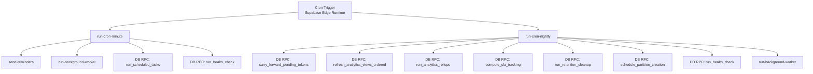
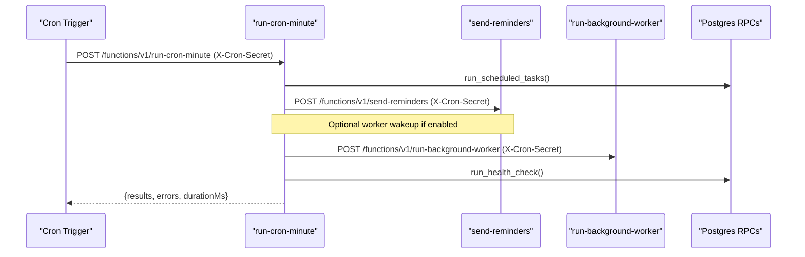
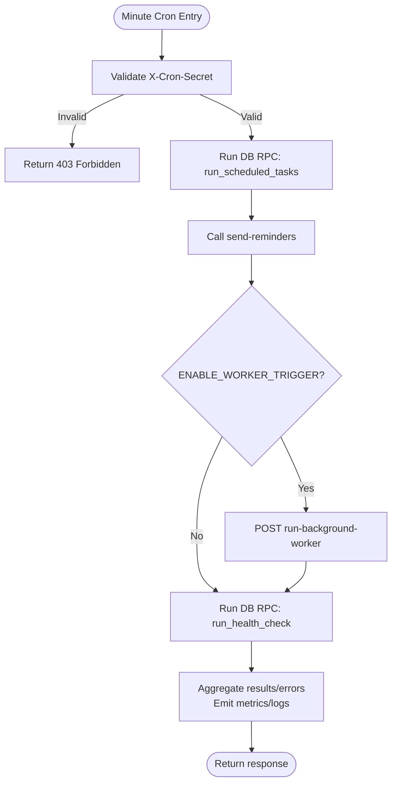
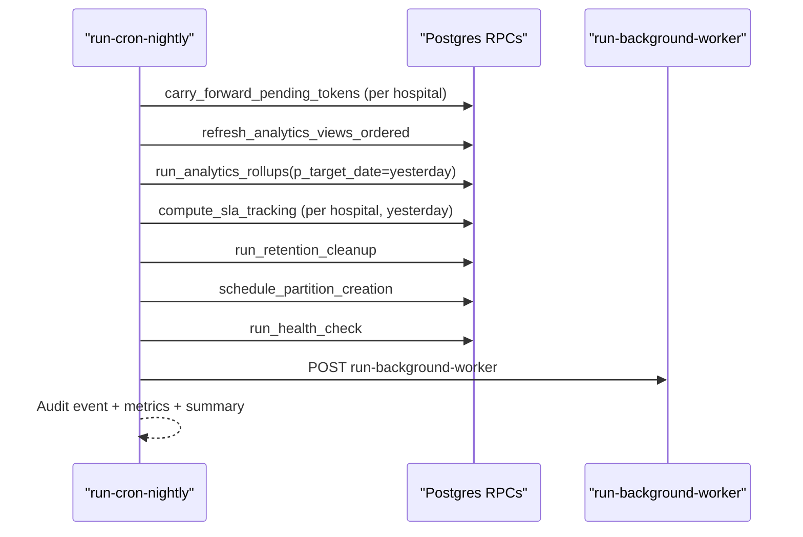
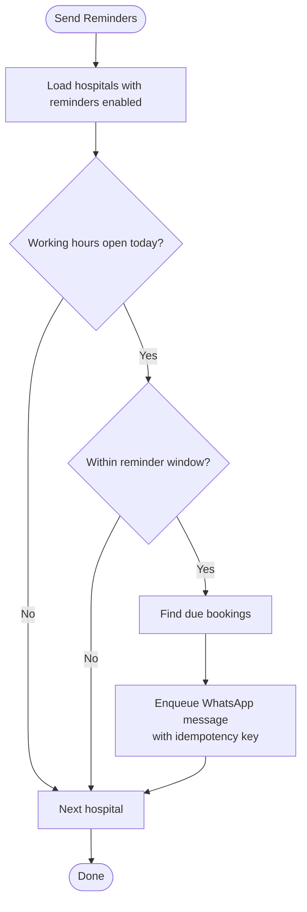
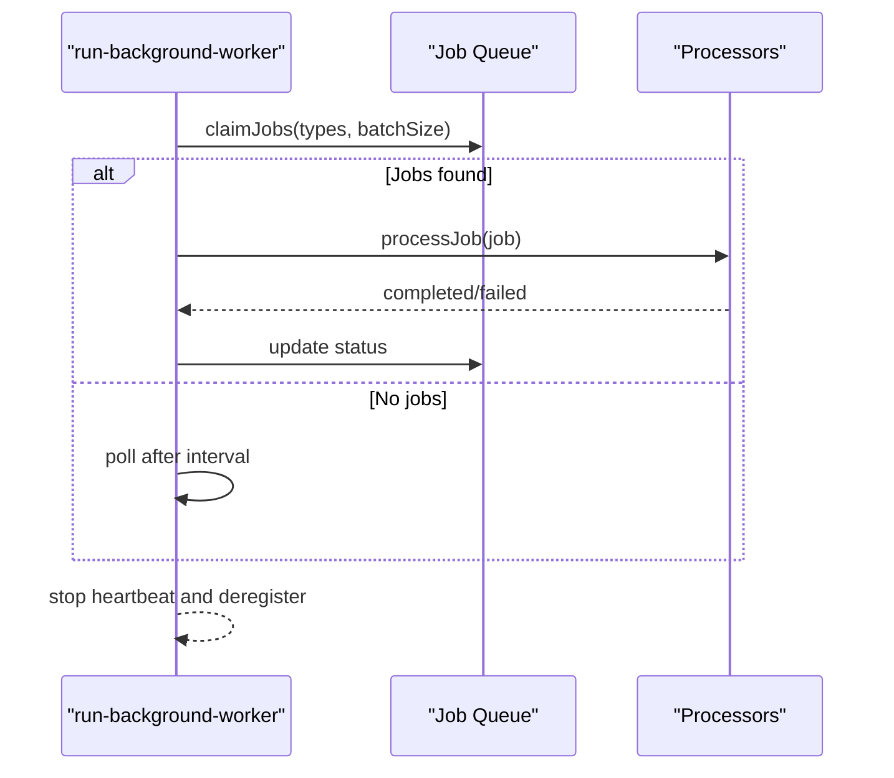
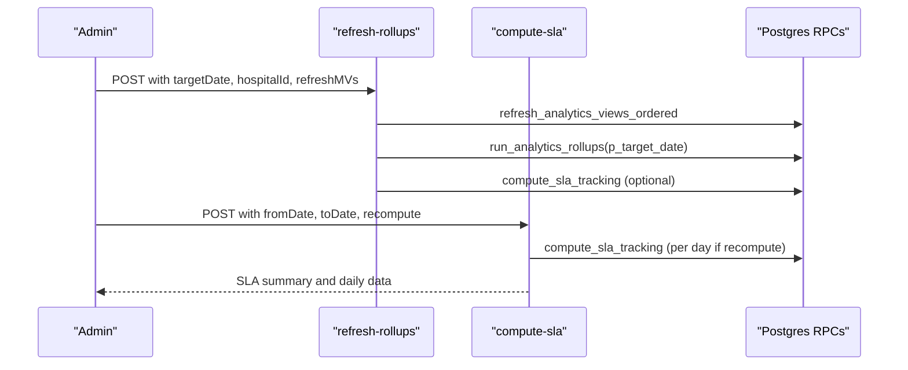
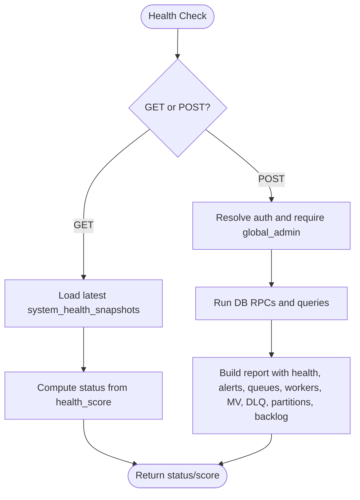
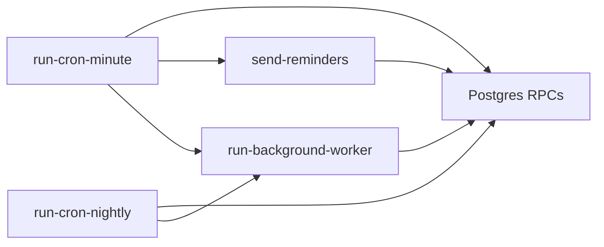

# Cron Scheduling

<cite>
**Referenced Files in This Document**
- [run-cron-minute/index.ts](file://supabase/functions/run-cron-minute/index.ts)
- [run-cron-nightly/index.ts](file://supabase/functions/run-cron-nightly/index.ts)
- [refresh-rollups/index.ts](file://supabase/functions/refresh-rollups/index.ts)
- [compute-sla/index.ts](file://supabase/functions/compute-sla/index.ts)
- [monitoring-health-check/index.ts](file://supabase/functions/monitoring-health-check/index.ts)
- [send-reminders/index.ts](file://supabase/functions/send-reminders/index.ts)
- [run-background-worker/index.ts](file://supabase/functions/run-background-worker/index.ts)
- [env.ts](file://supabase/functions/_shared/env.ts)
- [logger.ts](file://supabase/functions/_shared/logger.ts)
- [metrics.ts](file://supabase/functions/_shared/metrics.ts)
- [auth.ts](file://supabase/functions/_shared/auth.ts)
- [config.toml](file://supabase/config.toml)
</cite>

## Table of Contents

1. [Introduction](#introduction)
2. [Project Structure](#project-structure)
3. [Core Components](#core-components)
4. [Architecture Overview](#architecture-overview)
5. [Detailed Component Analysis](#detailed-component-analysis)
6. [Dependency Analysis](#dependency-analysis)
7. [Performance Considerations](#performance-considerations)
8. [Troubleshooting Guide](#troubleshooting-guide)
9. [Conclusion](#conclusion)
10. [Appendices](#appendices)

## Introduction

This document explains the cron scheduling system used by Setura Hospital OS to
run periodic tasks at minute-level and nightly cadence. It covers:

- Minute-level orchestration for quick, low-latency operations (e.g., reminders,
  worker wake-ups, health snapshots).
- Nightly orchestration for heavy, ordered workloads (e.g., analytics rollups,
  SLA computation, retention cleanup, partition scheduling).
- Secret-based authentication using a shared header token.
- Execution context via structured logging, tracing, and metrics.
- Error handling patterns that isolate failures per step and preserve partial
  progress.
- Monitoring and observability through logs, metrics, and health endpoints.
- Guidance for creating new cron jobs following established patterns and
  security requirements.

## Project Structure

The cron system is implemented as Deno Edge Functions under supabase/functions
with shared utilities in _shared. Key entry points:

- Minute-level orchestrator: run-cron-minute
- Nightly orchestrator: run-cron-nightly
- Supporting functions: send-reminders, run-background-worker, refresh-rollups,
  compute-sla, monitoring-health-check
- Shared environment, logging, metrics, and auth utilities

**Diagram sources**

- [run-cron-minute/index.ts:123-254](file://supabase/functions/run-cron-minute/index.ts#L123-L254)
- [run-cron-nightly/index.ts:110-276](file://supabase/functions/run-cron-nightly/index.ts#L110-L276)
- [send-reminders/index.ts:111-389](file://supabase/functions/send-reminders/index.ts#L111-L389)
- [run-background-worker/index.ts:247-453](file://supabase/functions/run-background-worker/index.ts#L247-L453)

**Section sources**

- [run-cron-minute/index.ts:1-347](file://supabase/functions/run-cron-minute/index.ts#L1-L347)
- [run-cron-nightly/index.ts:1-346](file://supabase/functions/run-cron-nightly/index.ts#L1-L346)
- [config.toml:369-378](file://supabase/config.toml#L369-L378)

## Core Components

- Minute-level orchestrator: Validates secret, runs scheduled tasks RPC, queues
  reminders, optionally wakes background workers, and captures a health
  snapshot. Each subtask is wrapped in try/catch; results and errors are
  aggregated and reported.
- Nightly orchestrator: Executes a strict dependency-ordered pipeline with
  independent error isolation, audit logging, and metrics. Steps include token
  carry-forward, analytics MV refresh, rollups, SLA tracking, retention cleanup,
  partition scheduling, health snapshot, and worker trigger.
- Background worker: Claims and processes job types from the queue with leases,
  heartbeats, crash recovery, and bounded runtime.
- Reminder generator: Queues WhatsApp appointment reminders within a one-minute
  window based on hospital working hours and settings.
- Analytics and SLA helpers: On-demand rollup refresh and SLA computation
  endpoints for admin use or reprocessing.
- Health check endpoint: Provides lightweight GET status and authenticated POST
  full health report including alerts, queues, workers, MV freshness, DLQ,
  partitions, and revenue backlog.

Security and configuration:

- Secret-based authentication via X-Cron-Secret header compared against
  Env.CRON_SECRET using constant-time comparison where applicable.
- Environment variables validated at module load time for required values and
  feature flags.
- CORS handling standardized across functions.

Observability:

- Structured JSON logs with correlation IDs and request metadata.
- Metrics recorded and flushed per request, including timing and counters.
- Audit events logged for nightly runs with success rate and failure details.

**Section sources**

- [run-cron-minute/index.ts:61-95](file://supabase/functions/run-cron-minute/index.ts#L61-L95)
- [run-cron-minute/index.ts:123-254](file://supabase/functions/run-cron-minute/index.ts#L123-L254)
- [run-cron-nightly/index.ts:33-60](file://supabase/functions/run-cron-nightly/index.ts#L33-L60)
- [run-cron-nightly/index.ts:110-276](file://supabase/functions/run-cron-nightly/index.ts#L110-L276)
- [run-background-worker/index.ts:247-453](file://supabase/functions/run-background-worker/index.ts#L247-L453)
- [send-reminders/index.ts:61-95](file://supabase/functions/send-reminders/index.ts#L61-L95)
- [send-reminders/index.ts:111-389](file://supabase/functions/send-reminders/index.ts#L111-L389)
- [env.ts:137-149](file://supabase/functions/_shared/env.ts#L137-L149)
- [logger.ts:122-189](file://supabase/functions/_shared/logger.ts#L122-L189)
- [metrics.ts:24-119](file://supabase/functions/_shared/metrics.ts#L24-L119)

## Architecture Overview

The cron system uses two primary orchestrators that call database RPCs and other
functions. Authentication is enforced via a shared secret header. Observability
is built-in with tracing, logging, and metrics. The background worker processes
queued jobs triggered by cron steps.

**Diagram sources**

- [run-cron-minute/index.ts:123-254](file://supabase/functions/run-cron-minute/index.ts#L123-L254)
- [send-reminders/index.ts:111-389](file://supabase/functions/send-reminders/index.ts#L111-L389)
- [run-background-worker/index.ts:247-453](file://supabase/functions/run-background-worker/index.ts#L247-L453)

## Detailed Component Analysis

### Minute-Level Cron Orchestrator

Responsibilities:

- Authenticate requests using X-Cron-Secret against Env.CRON_SECRET.
- Execute run_scheduled_tasks RPC.
- Queue reminders via send-reminders.
- Optionally wake background worker when ENABLE_WORKER_TRIGGER is true.
- Capture health snapshot via run_health_check RPC.
- Aggregate results/errors, emit metrics, and return summary.

Error handling:

- Each subtask is wrapped in try/catch; failures are captured in an errors map
  without aborting subsequent steps.
- Fatal errors outside subtasks are caught and returned with failureCount set.

Execution context:

- Tracing and correlation ID propagated across calls.
- Structured logs include success/error counts and duration.
- Metrics track success/partial failure and durations.

**Diagram sources**

- [run-cron-minute/index.ts:61-95](file://supabase/functions/run-cron-minute/index.ts#L61-L95)
- [run-cron-minute/index.ts:123-254](file://supabase/functions/run-cron-minute/index.ts#L123-L254)

**Section sources**

- [run-cron-minute/index.ts:61-95](file://supabase/functions/run-cron-minute/index.ts#L61-L95)
- [run-cron-minute/index.ts:123-254](file://supabase/functions/run-cron-minute/index.ts#L123-L254)
- [run-cron-minute/index.ts:256-343](file://supabase/functions/run-cron-minute/index.ts#L256-L343)

### Nightly Cron Orchestrator

Responsibilities:

- Carry forward pending tokens across all active hospitals.
- Refresh analytics materialized views in dependency order.
- Compute analytics rollups for previous day.
- Compute SLA tracking per hospital for previous day.
- Run retention cleanup for operational data.
- Schedule future partitions if auto-enabled.
- Capture health snapshot.
- Trigger background worker for post-nightly jobs.

Error handling:

- Each step wrapped in runStep helper with independent try/catch.
- Partial failures do not abort subsequent steps; audit event records failed
  steps and success rate.

Execution context:

- Step-level logs with duration.
- Metrics record failed steps count and total duration.
- Audit event includes severity based on number of failures.

**Diagram sources**

- [run-cron-nightly/index.ts:110-276](file://supabase/functions/run-cron-nightly/index.ts#L110-L276)

**Section sources**

- [run-cron-nightly/index.ts:33-60](file://supabase/functions/run-cron-nightly/index.ts#L33-L60)
- [run-cron-nightly/index.ts:110-276](file://supabase/functions/run-cron-nightly/index.ts#L110-L276)
- [run-cron-nightly/index.ts:278-344](file://supabase/functions/run-cron-nightly/index.ts#L278-L344)

### Reminder Generator

Responsibilities:

- Load hospitals with reminders enabled.
- Respect working hours and reminder windows per hospital.
- Find due bookings and enqueue WhatsApp messages with idempotency keys.
- Enforce one-minute execution window to prevent duplicates.

Error handling:

- Non-fatal warnings for lookup failures; continues processing other
  hospitals/bookings.
- Logs totals and emits metrics.

**Diagram sources**

- [send-reminders/index.ts:111-389](file://supabase/functions/send-reminders/index.ts#L111-L389)

**Section sources**

- [send-reminders/index.ts:61-95](file://supabase/functions/send-reminders/index.ts#L61-L95)
- [send-reminders/index.ts:111-389](file://supabase/functions/send-reminders/index.ts#L111-L389)

### Background Worker

Responsibilities:

- Register worker with heartbeat loop and crash recovery.
- Claim batches of jobs from the queue for supported types.
- Process job types: WhatsApp messaging, incoming WhatsApp processing, analytics
  refresh, notifications, SLA computation, partition creation.
- Track metrics for batch size, successes, failures, and runtime.

Error handling:

- Graceful retries via polling intervals.
- Heartbeat stops and worker marked crashed on errors.

**Diagram sources**

- [run-background-worker/index.ts:247-453](file://supabase/functions/run-background-worker/index.ts#L247-L453)

**Section sources**

- [run-background-worker/index.ts:247-453](file://supabase/functions/run-background-worker/index.ts#L247-L453)

### Analytics Rollup and SLA Helpers

- refresh-rollups: Admin-triggered endpoint to refresh materialized views,
  compute rollups, and optionally recompute SLA for a target date. Includes role
  checks and hospital isolation.
- compute-sla: Endpoint to compute or reload SLA metrics for a date range, with
  validation and optional recomputation.

**Diagram sources**

- [refresh-rollups/index.ts:61-289](file://supabase/functions/refresh-rollups/index.ts#L61-L289)
- [compute-sla/index.ts:27-203](file://supabase/functions/compute-sla/index.ts#L27-L203)

**Section sources**

- [refresh-rollups/index.ts:61-289](file://supabase/functions/refresh-rollups/index.ts#L61-L289)
- [compute-sla/index.ts:27-203](file://supabase/functions/compute-sla/index.ts#L27-L203)

### Health Check Endpoint

Responsibilities:

- GET: Lightweight uptime check returning latest health snapshot score and
  status.
- POST: Full health report requiring global admin auth, aggregating health,
  alerts, queues, workers, MV freshness, DLQ, partitions, and revenue backlog.

Error handling:

- GET returns degraded status codes based on health score.
- POST wraps all checks in try/catch and returns structured errors.

**Diagram sources**

- [monitoring-health-check/index.ts:22-230](file://supabase/functions/monitoring-health-check/index.ts#L22-L230)

**Section sources**

- [monitoring-health-check/index.ts:22-230](file://supabase/functions/monitoring-health-check/index.ts#L22-L230)

## Dependency Analysis

Key dependencies and relationships:

- Minute and nightly orchestrators depend on shared env, logger, metrics,
  tracing, and db client.
- Both orchestrators call Postgres RPCs for scheduling, rollups, SLA, retention,
  partitions, and health checks.
- Nightly orchestrator triggers background worker to process queued jobs created
  during its steps.
- Reminder generator depends on hospital settings and working hours to determine
  eligibility and timing.
- Background worker depends on job queue and processors for specific job types.

**Diagram sources**

- [run-cron-minute/index.ts:123-254](file://supabase/functions/run-cron-minute/index.ts#L123-L254)
- [run-cron-nightly/index.ts:110-276](file://supabase/functions/run-cron-nightly/index.ts#L110-L276)
- [send-reminders/index.ts:111-389](file://supabase/functions/send-reminders/index.ts#L111-L389)
- [run-background-worker/index.ts:247-453](file://supabase/functions/run-background-worker/index.ts#L247-L453)

**Section sources**

- [run-cron-minute/index.ts:123-254](file://supabase/functions/run-cron-minute/index.ts#L123-L254)
- [run-cron-nightly/index.ts:110-276](file://supabase/functions/run-cron-nightly/index.ts#L110-L276)
- [send-reminders/index.ts:111-389](file://supabase/functions/send-reminders/index.ts#L111-L389)
- [run-background-worker/index.ts:247-453](file://supabase/functions/run-background-worker/index.ts#L247-L453)

## Performance Considerations

- Minute-level tasks are designed to run under 10 seconds with short timeouts
  for remote calls (e.g., 8–10 seconds).
- Nightly tasks have a total runtime budget around 90 seconds, well within Deno
  Deploy limits.
- Use of Promise.allSettled for parallelizable steps (e.g., SLA per hospital)
  improves throughput while isolating failures.
- Background worker uses bounded runtime, batch sizes, and polling intervals to
  control resource usage.
- Metrics and structured logs enable performance profiling and bottleneck
  identification.

[No sources needed since this section provides general guidance]

## Troubleshooting Guide

Common issues and diagnostics:

- Authentication failures: Ensure X-Cron-Secret header matches Env.CRON_SECRET;
  missing or mismatched secrets return 403.
- Missing environment variables: Module load-time validation will fail fast if
  required variables are absent.
- Partial failures: Review step-level logs and metrics; nightly runs log failed
  steps and success rate in audit events.
- Health status: Use GET health endpoint to quickly assess system health; POST
  requires global admin and returns detailed diagnostics.
- Worker issues: Inspect worker heartbeat and crash logs; check job queue claims
  and processor errors.

Actionable checks:

- Verify CRON_SECRET and SUPABASE_URL are set correctly.
- Confirm ENABLE_WORKER_TRIGGER flag behavior if worker wake-ups are expected.
- Monitor metrics for cron.minute.duration, cron.nightly.duration, and
  worker.batch.failed.
- Review logs for correlation IDs to trace end-to-end flows.

**Section sources**

- [run-cron-minute/index.ts:61-95](file://supabase/functions/run-cron-minute/index.ts#L61-L95)
- [run-cron-nightly/index.ts:278-344](file://supabase/functions/run-cron-nightly/index.ts#L278-L344)
- [monitoring-health-check/index.ts:22-230](file://supabase/functions/monitoring-health-check/index.ts#L22-L230)
- [env.ts:18-49](file://supabase/functions/_shared/env.ts#L18-L49)
- [metrics.ts:76-119](file://supabase/functions/_shared/metrics.ts#L76-L119)

## Conclusion

The cron scheduling system in Setura Hospital OS provides robust, observable,
and secure periodic task execution through minute-level and nightly
orchestrators. It enforces secret-based authentication, isolates errors per
step, and integrates with a background worker for asynchronous processing.
Comprehensive logging, metrics, and health endpoints support monitoring and
troubleshooting. New jobs can be added by following established patterns for
authentication, error handling, and observability.

[No sources needed since this section summarizes without analyzing specific
files]

## Appendices

### Creating New Cron Jobs

Follow these patterns:

- Authentication: Validate X-Cron-Secret against Env.CRON_SECRET using
  constant-time comparison where appropriate.
- Execution context: Create tracing and request-scoped logger; create metrics
  collector tagged with endpoint and correlation ID.
- Error handling: Wrap each subtask in try/catch; aggregate results and errors;
  ensure partial failures do not abort the entire run.
- Database interactions: Use getServiceClient() for RPCs and queries; handle
  errors and map them to structured messages.
- Observability: Log step start/end with duration; record metrics for timing and
  counters; flush metrics at the end.
- Configuration: Use Env variables for toggles (e.g., ENABLE_WORKER_TRIGGER),
  timeouts, and feature flags.

Security requirements:

- Never expose secrets in logs or responses.
- Restrict access to sensitive endpoints via roles when applicable.
- Use idempotency keys for external calls and queue operations to prevent
  duplicates.

Configuration options:

- Job frequency: Controlled externally by Supabase Edge Runtime scheduling;
  minute vs nightly orchestrators define cadence.
- Execution windows: Implement time-window checks inside functions (e.g.,
  reminder window) to avoid duplicate runs.
- Resource limits: Use AbortSignal.timeout for outbound calls; bound worker
  runtime and batch sizes; rely on Deno Deploy limits.

Monitoring and logging:

- Use structured logs with correlation IDs for traceability.
- Record metrics for success/failure and durations; flush at the end of
  handlers.
- Leverage health endpoints and audit events for operational visibility.

Examples of common patterns:

- Data aggregation: Call run_analytics_rollups with target date; wrap in metrics
  and logs.
- Cleanup operations: Invoke run_retention_cleanup; capture results and errors.
- Report generation: Query relevant tables and compose summaries; emit metrics
  and logs.

**Section sources**

- [run-cron-minute/index.ts:61-95](file://supabase/functions/run-cron-minute/index.ts#L61-L95)
- [run-cron-nightly/index.ts:33-60](file://supabase/functions/run-cron-nightly/index.ts#L33-L60)
- [send-reminders/index.ts:61-95](file://supabase/functions/send-reminders/index.ts#L61-L95)
- [run-background-worker/index.ts:247-453](file://supabase/functions/run-background-worker/index.ts#L247-L453)
- [env.ts:137-149](file://supabase/functions/_shared/env.ts#L137-L149)
- [logger.ts:122-189](file://supabase/functions/_shared/logger.ts#L122-L189)
- [metrics.ts:24-119](file://supabase/functions/_shared/metrics.ts#L24-L119)
