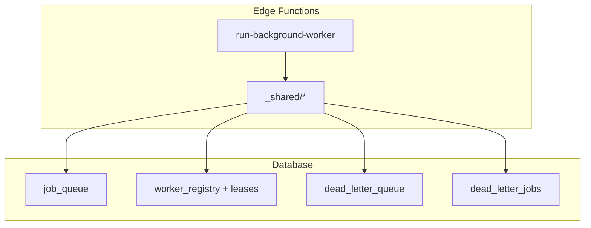
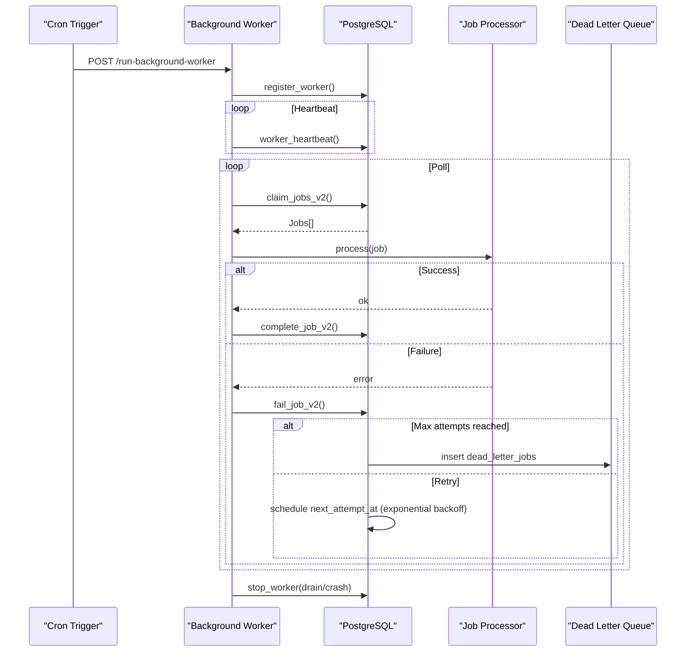
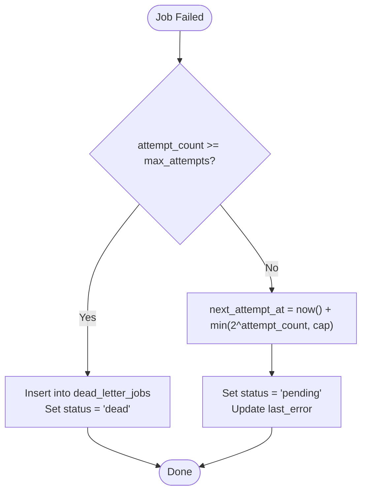
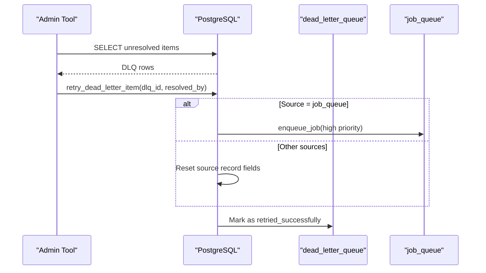
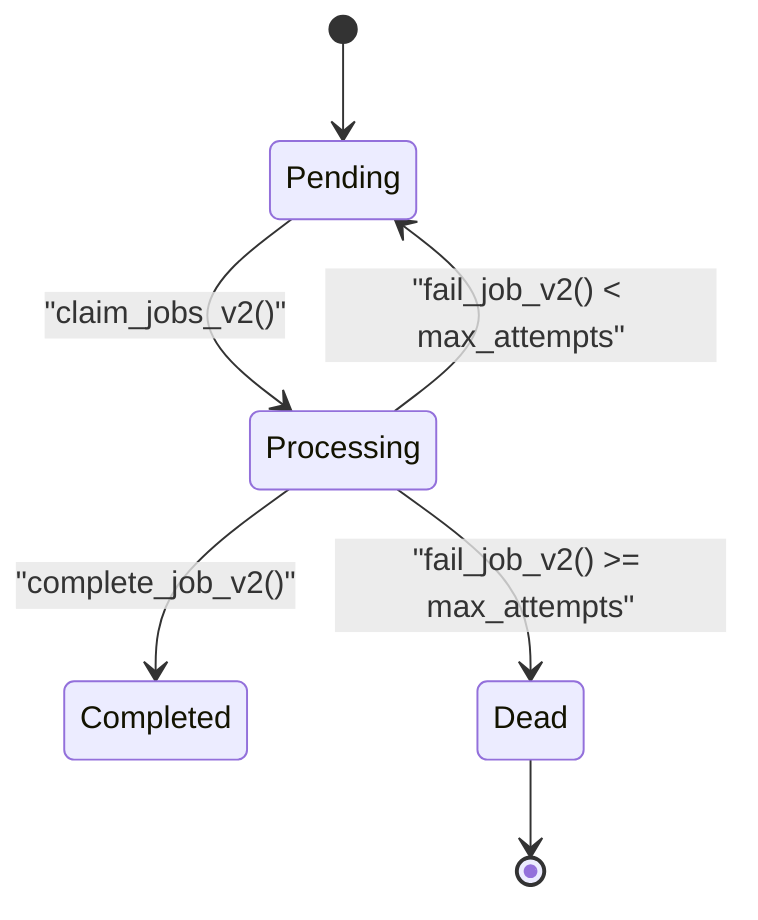
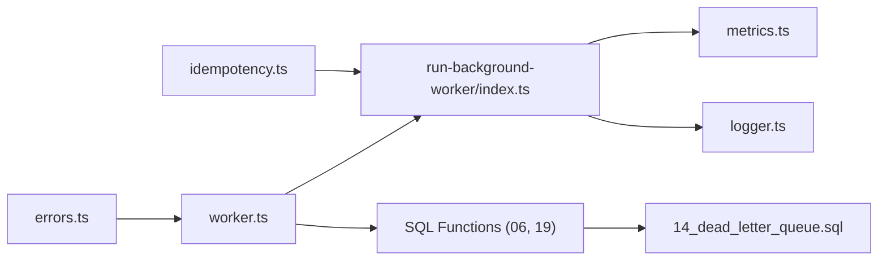

# Error Handling & Retries

<cite>
**Referenced Files in This Document**
- [errors.ts](file://supabase/functions/_shared/errors.ts)
- [worker.ts](file://supabase/functions/_shared/worker.ts)
- [run-background-worker/index.ts](file://supabase/functions/run-background-worker/index.ts)
- [06_background_job_queue.sql](file://supabase/migrations/06_background_job_queue.sql)
- [14_dead_letter_queue.sql](file://supabase/migrations/14_dead_letter_queue.sql)
- [19_background_worker_engine.sql](file://supabase/migrations/19_background_worker_engine.sql)
- [idempotency.ts](file://supabase/functions/_shared/idempotency.ts)
- [logger.ts](file://supabase/functions/_shared/logger.ts)
- [metrics.ts](file://supabase/functions/_shared/metrics.ts)
- [env.ts](file://supabase/functions/_shared/env.ts)
</cite>

## Table of Contents

1. [Introduction](#introduction)
2. [Project Structure](#project-structure)
3. [Core Components](#core-components)
4. [Architecture Overview](#architecture-overview)
5. [Detailed Component Analysis](#detailed-component-analysis)
6. [Dependency Analysis](#dependency-analysis)
7. [Performance Considerations](#performance-considerations)
8. [Troubleshooting Guide](#troubleshooting-guide)
9. [Conclusion](#conclusion)
10. [Appendices](#appendices)

## Introduction

This document explains how the background processing system handles errors and
retries, including exponential backoff, dead letter queues (DLQ), error
categorization, job state transitions, alerting, debugging, and best practices
for idempotent and batch processing. It is designed to be accessible to both
developers and operators while remaining grounded in the actual implementation.

## Project Structure

The error handling and retry mechanisms span shared utilities, worker
orchestration, database migrations, and a background worker entry point:

- Shared error types and helpers define a typed error hierarchy with
  retryability flags.
- Worker utilities manage leases, heartbeats, job claiming, completion, and
  failure.
- Database migrations implement the job queue, worker engine, and DLQ with SQL
  functions for retries and re-enqueueing.
- The background worker orchestrates job execution, metrics, logging, and
  lifecycle management.

**Diagram sources**

- [run-background-worker/index.ts:247-453](file://supabase/functions/run-background-worker/index.ts#L247-L453)
- [worker.ts:1-257](file://supabase/functions/_shared/worker.ts#L1-L257)
- [06_background_job_queue.sql:41-138](file://supabase/migrations/06_background_job_queue.sql#L41-L138)
- [19_background_worker_engine.sql:18-148](file://supabase/migrations/19_background_worker_engine.sql#L18-L148)
- [14_dead_letter_queue.sql:39-163](file://supabase/migrations/14_dead_letter_queue.sql#L39-L163)

**Section sources**

- [run-background-worker/index.ts:247-453](file://supabase/functions/run-background-worker/index.ts#L247-L453)
- [worker.ts:1-257](file://supabase/functions/_shared/worker.ts#L1-L257)
- [06_background_job_queue.sql:41-138](file://supabase/migrations/06_background_job_queue.sql#L41-L138)
- [19_background_worker_engine.sql:18-148](file://supabase/migrations/19_background_worker_engine.sql#L18-L148)
- [14_dead_letter_queue.sql:39-163](file://supabase/migrations/14_dead_letter_queue.sql#L39-L163)

## Core Components

- Typed error hierarchy with retryability classification
- Worker lease and heartbeat model for crash recovery
- Job claim/complete/fail flows with exponential backoff
- Dead letter queue for permanent failures and inspection/retry workflows
- Structured logging and metrics for observability
- Idempotency support to prevent duplicate processing

Key responsibilities:

- Errors: Categorize transient vs permanent failures via code and retryable
  flag.
- Worker: Manage leases, heartbeats, and safe job lifecycle transitions.
- Queue: Implement backoff scheduling and DLQ routing.
- Observability: Log structured events and emit metrics for monitoring.

**Section sources**

- [errors.ts:70-104](file://supabase/functions/_shared/errors.ts#L70-L104)
- [worker.ts:21-257](file://supabase/functions/_shared/worker.ts#L21-L257)
- [06_background_job_queue.sql:357-446](file://supabase/migrations/06_background_job_queue.sql#L357-L446)
- [19_background_worker_engine.sql:683-799](file://supabase/migrations/19_background_worker_engine.sql#L683-L799)
- [14_dead_letter_queue.sql:189-357](file://supabase/migrations/14_dead_letter_queue.sql#L189-L357)
- [logger.ts:122-189](file://supabase/functions/_shared/logger.ts#L122-L189)
- [metrics.ts:24-119](file://supabase/functions/_shared/metrics.ts#L24-L119)
- [idempotency.ts:72-129](file://supabase/functions/_shared/idempotency.ts#L72-L129)

## Architecture Overview

The background worker polls for jobs, claims them with per-job leases, processes
them, and marks completion or failure. Failures trigger exponential backoff and
eventual DLQ routing when max attempts are exceeded. A robust DLQ supports
inspection and manual retry.

**Diagram sources**

- [run-background-worker/index.ts:309-439](file://supabase/functions/run-background-worker/index.ts#L309-L439)
- [worker.ts:30-178](file://supabase/functions/_shared/worker.ts#L30-L178)
- [19_background_worker_engine.sql:154-318](file://supabase/migrations/19_background_worker_engine.sql#L154-L318)
- [19_background_worker_engine.sql:497-799](file://supabase/migrations/19_background_worker_engine.sql#L497-L799)
- [06_background_job_queue.sql:357-446](file://supabase/migrations/06_background_job_queue.sql#L357-L446)
- [14_dead_letter_queue.sql:189-357](file://supabase/migrations/14_dead_letter_queue.sql#L189-L357)

## Detailed Component Analysis

### Error Categorization System

- Centralized typed errors extend a base class carrying machine-readable codes,
  HTTP status codes, retryability, context metadata, and timestamps.
- Transient failures are marked retryable; examples include rate limiting and
  concurrency conflicts.
- Permanent failures are non-retryable; examples include validation errors,
  authorization failures, and internal server errors.
- Utilities provide type guards to detect SeturError instances and determine if
  an error is retryable.

Practical implications:

- Callers can branch on retryable to decide whether to retry immediately, apply
  backoff, or escalate to DLQ.
- Logging preserves error structure for downstream analysis.

**Section sources**

- [errors.ts:13-64](file://supabase/functions/_shared/errors.ts#L13-L64)
- [errors.ts:70-104](file://supabase/functions/_shared/errors.ts#L70-L104)
- [errors.ts:274-322](file://supabase/functions/_shared/errors.ts#L274-L322)
- [logger.ts:52-73](file://supabase/functions/_shared/logger.ts#L52-L73)

### Exponential Backoff Strategy

- On failure, jobs are rescheduled with next_attempt_at set using exponential
  growth based on attempt_count, capped at a maximum delay.
- The same exponential logic is used in both legacy and v2 job failure paths.
- When max_attempts is reached, the job is moved to dead letter storage and
  marked dead.

Configuration points:

- Default max attempts is defined in the job schema.
- Delay cap ensures retries do not grow indefinitely.

**Diagram sources**

- [06_background_job_queue.sql:357-446](file://supabase/migrations/06_background_job_queue.sql#L357-L446)
- [19_background_worker_engine.sql:683-799](file://supabase/migrations/19_background_worker_engine.sql#L683-L799)

**Section sources**

- [06_background_job_queue.sql:75-84](file://supabase/migrations/06_background_job_queue.sql#L75-L84)
- [06_background_job_queue.sql:357-446](file://supabase/migrations/06_background_job_queue.sql#L357-L446)
- [19_background_worker_engine.sql:683-799](file://supabase/migrations/19_background_worker_engine.sql#L683-L799)

### Dead Letter Queue Implementation

- A dedicated DLQ table tracks failed items from multiple sources with rich
  metadata, priority levels, and resolution states.
- Functions provide idempotent insertion and multi-worker safe retry operations
  that re-enqueue or reset source records.
- Views and summaries enable inspection and prioritization of unresolved items.

Inspection and retry workflow:

- Query unresolved items by source, hospital, or priority.
- Use the retry function to re-enqueue job_queue items or reset other sources,
  then mark the DLQ item as retried.

**Diagram sources**

- [14_dead_letter_queue.sql:189-357](file://supabase/migrations/14_dead_letter_queue.sql#L189-L357)
- [14_dead_letter_queue.sql:366-440](file://supabase/migrations/14_dead_letter_queue.sql#L366-L440)

**Section sources**

- [14_dead_letter_queue.sql:39-163](file://supabase/migrations/14_dead_letter_queue.sql#L39-L163)
- [14_dead_letter_queue.sql:189-357](file://supabase/migrations/14_dead_letter_queue.sql#L189-L357)
- [14_dead_letter_queue.sql:366-440](file://supabase/migrations/14_dead_letter_queue.sql#L366-L440)

### Job State Transitions and Audit Logging

- Job states: pending → processing → completed | failed → dead (after max
  attempts).
- Worker registry and per-job leases track ownership and outcomes for crash
  recovery.
- Heartbeats keep workers alive; stale leases are reclaimed.
- Each transition logs structured events and updates counters.

**Diagram sources**

- [19_background_worker_engine.sql:497-799](file://supabase/migrations/19_background_worker_engine.sql#L497-L799)
- [06_background_job_queue.sql:357-446](file://supabase/migrations/06_background_job_queue.sql#L357-L446)

**Section sources**

- [19_background_worker_engine.sql:18-148](file://supabase/migrations/19_background_worker_engine.sql#L18-L148)
- [19_background_worker_engine.sql:247-318](file://supabase/migrations/19_background_worker_engine.sql#L247-L318)
- [19_background_worker_engine.sql:423-488](file://supabase/migrations/19_background_worker_engine.sql#L423-L488)
- [19_background_worker_engine.sql:497-799](file://supabase/migrations/19_background_worker_engine.sql#L497-L799)
- [worker.ts:30-178](file://supabase/functions/_shared/worker.ts#L30-L178)

### Patterns for Custom Retry Logic and Error Recovery

- JobProcessor interface allows injecting custom shouldRetry logic to override
  default behavior.
- Use typed errors with retryable flags to signal transient vs permanent
  failures.
- For external service dependencies, wrap calls with try/catch and throw
  appropriate SeturError subclasses to control retry behavior.

Guidance:

- For transient network issues, throw a retryable error (e.g., rate limit or
  concurrency error).
- For invalid inputs or business rule violations, throw non-retryable errors to
  avoid wasteful retries.
- Combine with idempotency keys to ensure safe retries at the API boundary.

**Section sources**

- [worker.ts:219-257](file://supabase/functions/_shared/worker.ts#L219-L257)
- [errors.ts:274-322](file://supabase/functions/_shared/errors.ts#L274-L322)
- [idempotency.ts:72-129](file://supabase/functions/_shared/idempotency.ts#L72-L129)

### Failure Alerting and Notification Mechanisms

- Metrics collector emits structured metrics for worker runs, batch sizes,
  success/failure counts, and timing.
- Logger outputs structured JSON lines with correlation IDs, enabling log-based
  alerting pipelines.
- Health check endpoint aggregates queue health, worker status, and DLQ summary
  for operational dashboards.

Operational tips:

- Monitor worker run errors and failed job counts via metrics logs.
- Alert on spikes in DLQ unresolved counts or critical-priority items.
- Use correlation IDs to trace end-to-end request flows across services.

**Section sources**

- [metrics.ts:24-119](file://supabase/functions/_shared/metrics.ts#L24-L119)
- [logger.ts:122-189](file://supabase/functions/_shared/logger.ts#L122-L189)
- [run-background-worker/index.ts:398-447](file://supabase/functions/run-background-worker/index.ts#L398-L447)

### Debugging Failed Jobs and Analyzing Error Patterns

- Inspect job_queue for failed/dead jobs, last_error, attempt_count, and
  scheduled timestamps.
- Review worker_registry and worker_job_leases to identify crashed workers and
  reclaimed jobs.
- Use DLQ views to correlate failures with related entities (bookings, patients,
  messages).
- Correlate logs using correlation IDs and filter by endpoint and level.

Recommended steps:

- Query unresolved DLQ items by source and priority.
- Re-enqueue via retry function after root cause remediation.
- Validate idempotency keys and payload integrity for replayed requests.

**Section sources**

- [06_background_job_queue.sql:41-138](file://supabase/migrations/06_background_job_queue.sql#L41-L138)
- [19_background_worker_engine.sql:18-148](file://supabase/migrations/19_background_worker_engine.sql#L18-L148)
- [14_dead_letter_queue.sql:410-440](file://supabase/migrations/14_dead_letter_queue.sql#L410-L440)
- [logger.ts:122-189](file://supabase/functions/_shared/logger.ts#L122-L189)

### Best Practices for Idempotent Job Processing and Batch Operations

- Enforce idempotency at the API layer using idempotency keys to deduplicate
  concurrent or retried requests.
- Ensure job handlers are idempotent: use unique constraints or upserts where
  applicable.
- In batch processing, use Promise.allSettled to continue processing despite
  partial failures and aggregate results.
- Leverage idempotency keys when enqueuing downstream jobs to avoid duplicates.

**Section sources**

- [idempotency.ts:72-129](file://supabase/functions/_shared/idempotency.ts#L72-L129)
- [idempotency.ts:196-259](file://supabase/functions/_shared/idempotency.ts#L196-L259)
- [run-background-worker/index.ts:363-391](file://supabase/functions/run-background-worker/index.ts#L363-L391)

## Dependency Analysis

The system’s error handling and retry mechanisms depend on cohesive interactions
between shared utilities, worker orchestration, and database functions.

**Diagram sources**

- [errors.ts:70-104](file://supabase/functions/_shared/errors.ts#L70-L104)
- [worker.ts:1-257](file://supabase/functions/_shared/worker.ts#L1-L257)
- [run-background-worker/index.ts:247-453](file://supabase/functions/run-background-worker/index.ts#L247-L453)
- [06_background_job_queue.sql:357-446](file://supabase/migrations/06_background_job_queue.sql#L357-L446)
- [19_background_worker_engine.sql:497-799](file://supabase/migrations/19_background_worker_engine.sql#L497-L799)
- [14_dead_letter_queue.sql:189-357](file://supabase/migrations/14_dead_letter_queue.sql#L189-L357)
- [idempotency.ts:72-129](file://supabase/functions/_shared/idempotency.ts#L72-L129)
- [metrics.ts:24-119](file://supabase/functions/_shared/metrics.ts#L24-L119)
- [logger.ts:122-189](file://supabase/functions/_shared/logger.ts#L122-L189)

**Section sources**

- [worker.ts:1-257](file://supabase/functions/_shared/worker.ts#L1-L257)
- [run-background-worker/index.ts:247-453](file://supabase/functions/run-background-worker/index.ts#L247-L453)
- [06_background_job_queue.sql:357-446](file://supabase/migrations/06_background_job_queue.sql#L357-L446)
- [19_background_worker_engine.sql:497-799](file://supabase/migrations/19_background_worker_engine.sql#L497-L799)
- [14_dead_letter_queue.sql:189-357](file://supabase/migrations/14_dead_letter_queue.sql#L189-L357)
- [idempotency.ts:72-129](file://supabase/functions/_shared/idempotency.ts#L72-L129)
- [metrics.ts:24-119](file://supabase/functions/_shared/metrics.ts#L24-L119)
- [logger.ts:122-189](file://supabase/functions/_shared/logger.ts#L122-L189)

## Performance Considerations

- Exponential backoff prevents thundering herds during outages and reduces load
  on failing dependencies.
- Per-job leases and SKIP LOCKED claims avoid double-processing under
  concurrency.
- Heartbeats ensure timely detection of crashed workers and reclaim of stuck
  jobs.
- Metrics and structured logs enable performance tuning without impacting
  runtime.

[No sources needed since this section provides general guidance]

## Troubleshooting Guide

Common issues and resolutions:

- Stuck jobs: Check worker_registry for crashed workers and use reclaim
  functions to reset jobs to pending.
- Excessive retries: Verify error categorization; ensure transient errors are
  retryable and permanent errors are not.
- DLQ buildup: Inspect unresolved items, identify root causes, and use retry
  functions to re-enqueue after fixes.
- Duplicate processing: Confirm idempotency keys are present and enforced at API
  boundaries.

Operational checks:

- Monitor worker run errors and failed job counts via metrics logs.
- Use DLQ summaries and views to prioritize critical failures.
- Trace requests using correlation IDs across logs and metrics.

**Section sources**

- [19_background_worker_engine.sql:377-488](file://supabase/migrations/19_background_worker_engine.sql#L377-L488)
- [14_dead_letter_queue.sql:189-357](file://supabase/migrations/14_dead_letter_queue.sql#L189-L357)
- [idempotency.ts:72-129](file://supabase/functions/_shared/idempotency.ts#L72-L129)
- [metrics.ts:24-119](file://supabase/functions/_shared/metrics.ts#L24-L119)
- [logger.ts:122-189](file://supabase/functions/_shared/logger.ts#L122-L189)

## Conclusion

The background processing system implements a robust error handling and retry
framework with clear separation of transient and permanent failures, exponential
backoff, comprehensive DLQ support, and strong observability. By following the
patterns outlined here—typed errors, idempotency, structured logging, and
careful job state management—you can build resilient workflows that recover
gracefully from failures and remain auditable and debuggable.

[No sources needed since this section summarizes without analyzing specific
files]

## Appendices

### Configuration Notes

- Worker lease duration and idempotency TTL are configurable via environment
  variables.
- Rate limiting windows and attempt limits are exposed through configuration for
  tuning retry behavior.

**Section sources**

- [env.ts:173-205](file://supabase/functions/_shared/env.ts#L173-L205)
