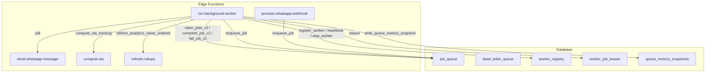
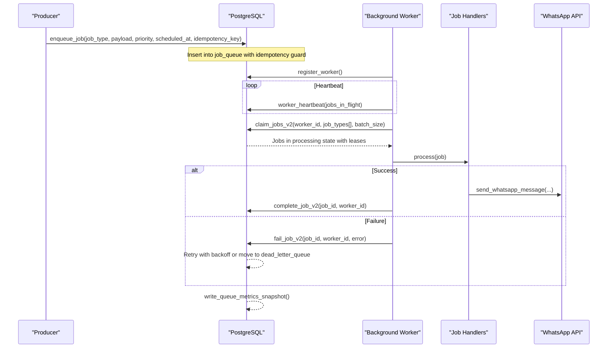
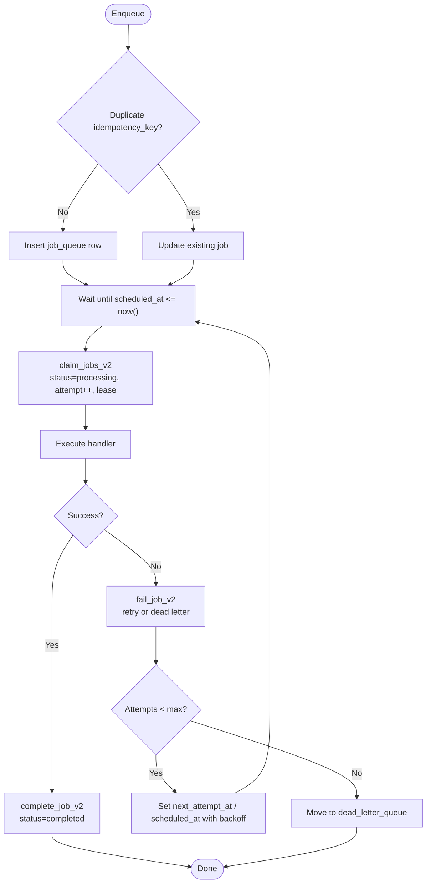
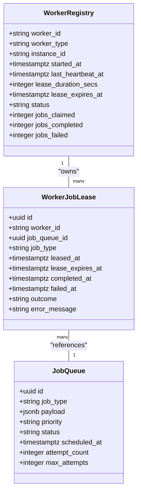
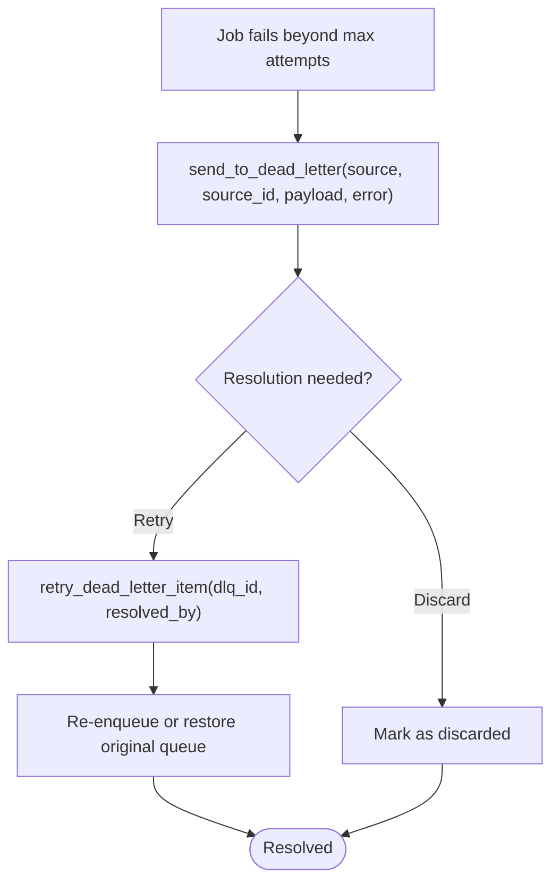
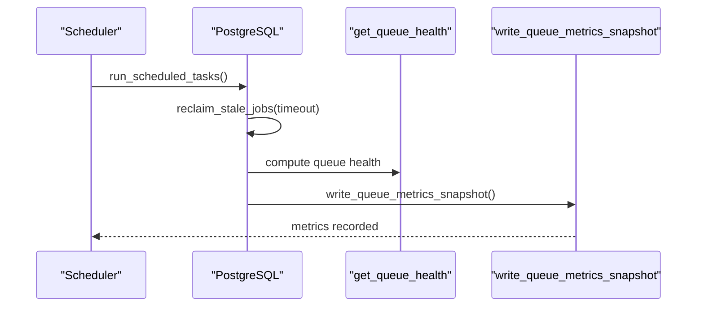
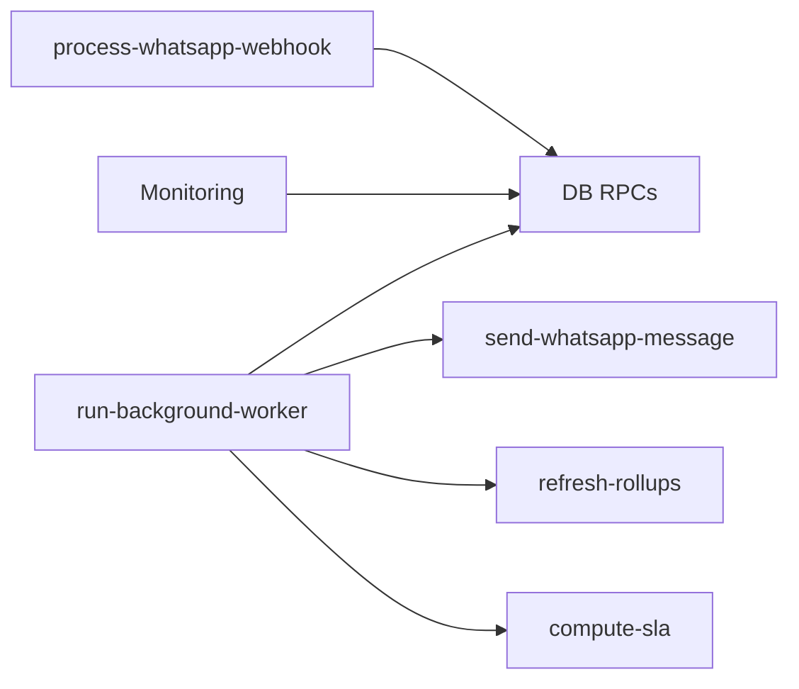

# Job Queue Architecture

<cite>
**Referenced Files in This Document**
- [06_background_job_queue.sql](file://supabase/migrations/06_background_job_queue.sql)
- [17_queue_monitoring_engine.sql](file://supabase/migrations/17_queue_monitoring_engine.sql)
- [14_dead_letter_queue.sql](file://supabase/migrations/14_dead_letter_queue.sql)
- [19_background_worker_engine.sql](file://supabase/migrations/19_background_worker_engine.sql)
- [worker.ts](file://supabase/functions/_shared/worker.ts)
- [run-background-worker/index.ts](file://supabase/functions/run-background-worker/index.ts)
- [send-whatsapp-message/index.ts](file://supabase/functions/send-whatsapp-message/index.ts)
- [process-whatsapp-webhook/index.ts](file://supabase/functions/process-whatsapp-webhook/index.ts)
- [compute-sla/index.ts](file://supabase/functions/compute-sla/index.ts)
- [refresh-rollups/index.ts](file://supabase/functions/refresh-rollups/index.ts)
</cite>

## Table of Contents

1. Introduction
2. Project Structure
3. Core Components
4. Architecture Overview
5. Detailed Component Analysis
6. Dependency Analysis
7. Performance Considerations
8. Troubleshooting Guide
9. Conclusion
10. Appendices

## Introduction

This document explains the database-backed job queue architecture in Setura
Hospital OS. It covers PostgreSQL tables and stored procedures that implement
enqueue, claim, process, complete, fail, and retry workflows; the worker
lifecycle with leases and heartbeats; prioritization and batching; idempotency;
dead-letter handling; and monitoring metrics. It also documents supported job
types and their payload structures as used by the background worker.

## Project Structure

The job queue spans migrations (schema and stored procedures), a background
worker Edge Function, and specialized functions for WhatsApp messaging,
webhooks, analytics rollups, and SLA computation.

**Diagram sources**

- [06_background_job_queue.sql:194-449](file://supabase/migrations/06_background_job_queue.sql#L194-L449)
- [19_background_worker_engine.sql:154-317](file://supabase/migrations/19_background_worker_engine.sql#L154-L317)
- [19_background_worker_engine.sql:497-603](file://supabase/migrations/19_background_worker_engine.sql#L497-L603)
- [19_background_worker_engine.sql:616-799](file://supabase/migrations/19_background_worker_engine.sql#L616-L799)
- [17_queue_monitoring_engine.sql:407-488](file://supabase/migrations/17_queue_monitoring_engine.sql#L407-L488)
- [run-background-worker/index.ts:27-34](file://supabase/functions/run-background-worker/index.ts#L27-L34)
- [process-whatsapp-webhook/index.ts:547-561](file://supabase/functions/process-whatsapp-webhook/index.ts#L547-L561)
- [send-whatsapp-message/index.ts:20-74](file://supabase/functions/send-whatsapp-message/index.ts#L20-L74)

**Section sources**

- [06_background_job_queue.sql:41-137](file://supabase/migrations/06_background_job_queue.sql#L41-L137)
- [19_background_worker_engine.sql:18-148](file://supabase/migrations/19_background_worker_engine.sql#L18-L148)
- [17_queue_monitoring_engine.sql:14-74](file://supabase/migrations/17_queue_monitoring_engine.sql#L14-L74)

## Core Components

- Job schema and lifecycle:
  - job_queue table defines job_type, payload, priority, status, scheduling
    fields, attempt tracking, idempotency_key, and metadata.
  - Stored procedures: enqueue_job, claim_jobs, complete_job, fail_job,
    reclaim_stale_jobs.
- Worker engine:
  - worker_registry tracks active workers, lease durations, and counts.
  - worker_job_leases records per-job leases for crash recovery.
  - claim_jobs_v2, complete_job_v2, fail_job_v2 provide robust processing with
    per-job leases.
- Dead letter queue:
  - dead_letter_queue captures failed items from multiple sources with
    resolution workflow and retry helpers.
- Monitoring:
  - queue_metrics_snapshots stores periodic snapshots of queue health.
  - get_queue_health, write_queue_metrics_snapshot, run_scheduled_tasks
    orchestrate metrics collection.

**Section sources**

- [06_background_job_queue.sql:12-95](file://supabase/migrations/06_background_job_queue.sql#L12-L95)
- [06_background_job_queue.sql:194-449](file://supabase/migrations/06_background_job_queue.sql#L194-L449)
- [19_background_worker_engine.sql:18-148](file://supabase/migrations/19_background_worker_engine.sql#L18-L148)
- [19_background_worker_engine.sql:497-799](file://supabase/migrations/19_background_worker_engine.sql#L497-L799)
- [14_dead_letter_queue.sql:39-123](file://supabase/migrations/14_dead_letter_queue.sql#L39-L123)
- [17_queue_monitoring_engine.sql:14-74](file://supabase/migrations/17_queue_monitoring_engine.sql#L14-L74)

## Architecture Overview

The system uses PostgreSQL as the durable queue store. Producers call
enqueue_job to insert jobs with optional idempotency keys. Workers register via
register_worker and periodically heartbeat. They claim batches using
claim_jobs_v2, which sets status to processing, increments attempts, and creates
per-job leases. Processing is handled by run-background-worker, which dispatches
to type-specific handlers. On success, complete_job_v2 marks jobs completed and
updates leases. On failure, fail_job_v2 schedules retries with exponential
backoff or moves to dead letter after max attempts. A monitoring pipeline writes
queue metrics snapshots and provides health queries.

**Diagram sources**

- [06_background_job_queue.sql:194-245](file://supabase/migrations/06_background_job_queue.sql#L194-L245)
- [19_background_worker_engine.sql:497-603](file://supabase/migrations/19_background_worker_engine.sql#L497-L603)
- [19_background_worker_engine.sql:616-799](file://supabase/migrations/19_background_worker_engine.sql#L616-L799)
- [17_queue_monitoring_engine.sql:407-488](file://supabase/migrations/17_queue_monitoring_engine.sql#L407-L488)
- [run-background-worker/index.ts:36-132](file://supabase/functions/run-background-worker/index.ts#L36-L132)
- [send-whatsapp-message/index.ts:198-324](file://supabase/functions/send-whatsapp-message/index.ts#L198-L324)

## Detailed Component Analysis

### Job Schema and Lifecycle

- Fields:
  - job_type: string identifying handler logic.
  - payload: JSONB object carrying operation data.
  - priority: low, normal, high, critical.
  - status: pending, processing, completed, failed, dead.
  - hospital_id, related_booking_id: tenant and context references.
  - scheduled_at, processing_started_at, processing_completed_at,
    lease_expires_at: timing controls.
  - worker_id, attempt_count, max_attempts, last_error, next_attempt_at:
    execution tracking.
  - idempotency_key: unique key to prevent duplicate enqueues.
  - metadata: JSONB for arbitrary context.
- Lifecycle:
  - Enqueue: enqueue_job inserts or upserts on idempotency_key.
  - Claim: claim_jobs_v2 selects pending jobs ordered by priority then
    scheduled_at, sets processing, increments attempts, and creates leases.
  - Process: worker executes handler logic.
  - Complete: complete_job_v2 marks completed and closes lease.
  - Fail: fail_job_v2 schedules retry with exponential backoff or moves to dead
    letter when max attempts reached.
  - Stale recovery: reclaim_stale_jobs resets stuck processing jobs.

**Diagram sources**

- [06_background_job_queue.sql:194-245](file://supabase/migrations/06_background_job_queue.sql#L194-L245)
- [06_background_job_queue.sql:264-317](file://supabase/migrations/06_background_job_queue.sql#L264-L317)
- [06_background_job_queue.sql:326-449](file://supabase/migrations/06_background_job_queue.sql#L326-L449)
- [19_background_worker_engine.sql:497-603](file://supabase/migrations/19_background_worker_engine.sql#L497-L603)
- [19_background_worker_engine.sql:616-799](file://supabase/migrations/19_background_worker_engine.sql#L616-L799)

**Section sources**

- [06_background_job_queue.sql:41-95](file://supabase/migrations/06_background_job_queue.sql#L41-L95)
- [06_background_job_queue.sql:194-449](file://supabase/migrations/06_background_job_queue.sql#L194-L449)
- [19_background_worker_engine.sql:497-799](file://supabase/migrations/19_background_worker_engine.sql#L497-L799)

### Worker Engine and Lease Management

- Registration: register_worker creates or updates worker_registry with lease
  duration and status.
- Heartbeat: worker_heartbeat extends lease and optionally logs activity.
- Claiming: claim_jobs_v2 prevents draining workers, claims pending jobs, sets
  processing, increments attempts, and inserts worker_job_leases.
- Completion/Failure: complete_job_v2 and fail_job_v2 update job_queue and
  worker_job_leases, adjust worker_registry counters.
- Crash recovery: detect_crashed_workers marks inactive workers;
  reclaim_crashed_worker_jobs reclaims their jobs.

**Diagram sources**

- [19_background_worker_engine.sql:18-148](file://supabase/migrations/19_background_worker_engine.sql#L18-L148)
- [19_background_worker_engine.sql:154-317](file://supabase/migrations/19_background_worker_engine.sql#L154-L317)
- [19_background_worker_engine.sql:497-799](file://supabase/migrations/19_background_worker_engine.sql#L497-L799)
- [06_background_job_queue.sql:41-95](file://supabase/migrations/06_background_job_queue.sql#L41-L95)

**Section sources**

- [19_background_worker_engine.sql:154-317](file://supabase/migrations/19_background_worker_engine.sql#L154-L317)
- [19_background_worker_engine.sql:497-799](file://supabase/migrations/19_background_worker_engine.sql#L497-L799)
- [worker.ts:30-94](file://supabase/functions/_shared/worker.ts#L30-L94)
- [worker.ts:98-178](file://supabase/functions/_shared/worker.ts#L98-L178)

### Dead Letter Queue

- Purpose: capture permanently failed items from multiple sources with rich
  metadata and resolution workflow.
- Key features:
  - source, source_id, source_table identify origin.
  - attempt_count, last_error, first_failed_at track failures.
  - resolution states: unresolved, retried_successfully, manually_resolved,
    discarded.
  - retry_dead_letter_item re-enqueues or restores original queues based on
    source.
  - Unique constraint prevents duplicate DLQ entries during storms.

**Diagram sources**

- [14_dead_letter_queue.sql:39-123](file://supabase/migrations/14_dead_letter_queue.sql#L39-L123)
- [14_dead_letter_queue.sql:189-257](file://supabase/migrations/14_dead_letter_queue.sql#L189-L257)
- [14_dead_letter_queue.sql:279-357](file://supabase/migrations/14_dead_letter_queue.sql#L279-L357)

**Section sources**

- [14_dead_letter_queue.sql:39-123](file://supabase/migrations/14_dead_letter_queue.sql#L39-L123)
- [14_dead_letter_queue.sql:189-357](file://supabase/migrations/14_dead_letter_queue.sql#L189-L357)

### Queue Monitoring and Metrics

- queue_metrics_snapshots stores periodic snapshots including
  pending/processing/failed/dead counts, oldest pending age, throughput, and
  average retry count.
- get_queue_health aggregates current health across job_queue,
  whatsapp_messages, and notification_queue.
- write_queue_metrics_snapshot writes snapshots and performs retention cleanup.
- run_scheduled_tasks orchestrates stale job reclamation and metrics
  snapshotting.

**Diagram sources**

- [17_queue_monitoring_engine.sql:124-277](file://supabase/migrations/17_queue_monitoring_engine.sql#L124-L277)
- [17_queue_monitoring_engine.sql:407-488](file://supabase/migrations/17_queue_monitoring_engine.sql#L407-L488)
- [17_queue_monitoring_engine.sql:702-774](file://supabase/migrations/17_queue_monitoring_engine.sql#L702-L774)

**Section sources**

- [17_queue_monitoring_engine.sql:14-74](file://supabase/migrations/17_queue_monitoring_engine.sql#L14-L74)
- [17_queue_monitoring_engine.sql:124-277](file://supabase/migrations/17_queue_monitoring_engine.sql#L124-L277)
- [17_queue_monitoring_engine.sql:407-488](file://supabase/migrations/17_queue_monitoring_engine.sql#L407-L488)
- [17_queue_monitoring_engine.sql:702-774](file://supabase/migrations/17_queue_monitoring_engine.sql#L702-L774)

### Job Prioritization and Batch Processing

- Prioritization:
  - Priority enum: low, normal, high, critical.
  - claim_jobs orders by priority DESC then scheduled_at ASC to serve critical
    jobs first.
- Batching:
  - claim_jobs_v2 supports batch_size parameter to fetch multiple jobs per
    claim.
  - run-background-worker processes batches concurrently with
    Promise.allSettled.

**Section sources**

- [06_background_job_queue.sql:264-317](file://supabase/migrations/06_background_job_queue.sql#L264-L317)
- [19_background_worker_engine.sql:497-603](file://supabase/migrations/19_background_worker_engine.sql#L497-L603)
- [run-background-worker/index.ts:363-391](file://supabase/functions/run-background-worker/index.ts#L363-L391)

### Idempotency Support

- enqueue_job accepts idempotency_key and uses ON CONFLICT to avoid duplicate
  jobs.
- Incoming webhook processing generates unique idempotency keys per event to
  prevent duplicate enqueues.

**Section sources**

- [06_background_job_queue.sql:194-245](file://supabase/migrations/06_background_job_queue.sql#L194-L245)
- [process-whatsapp-webhook/index.ts:547-561](file://supabase/functions/process-whatsapp-webhook/index.ts#L547-L561)

### Supported Job Types and Payloads

- send_whatsapp_message:
  - Payload includes phone, template_name, and optional booking/patient details.
  - Template names are validated against an allowlist.
- process_incoming_whatsapp:
  - Payload includes message and from metadata; worker extracts phone and may
    enqueue follow-up messages.
- send_notification:
  - Payload includes notification_id; worker reads notification_queue and may
    enqueue WhatsApp messages.
- refresh_analytics:
  - Triggers refresh_analytics_views_ordered to update materialized views.
- compute_sla:
  - Payload includes hospital_id and date; worker computes SLA tracking for
    specified scope.
- create_partition:
  - Referenced in worker job types list; specific handler not shown here.

**Section sources**

- [run-background-worker/index.ts:27-34](file://supabase/functions/run-background-worker/index.ts#L27-L34)
- [run-background-worker/index.ts:36-132](file://supabase/functions/run-background-worker/index.ts#L36-L132)
- [run-background-worker/index.ts:123-245](file://supabase/functions/run-background-worker/index.ts#L123-L245)
- [send-whatsapp-message/index.ts:20-74](file://supabase/functions/send-whatsapp-message/index.ts#L20-L74)
- [process-whatsapp-webhook/index.ts:547-561](file://supabase/functions/process-whatsapp-webhook/index.ts#L547-L561)
- [compute-sla/index.ts:27-204](file://supabase/functions/compute-sla/index.ts#L27-L204)
- [refresh-rollups/index.ts:154-260](file://supabase/functions/refresh-rollups/index.ts#L154-L260)

## Dependency Analysis

- Background worker depends on:
  - Database RPCs for worker lifecycle and job control.
  - WhatsApp sender function for outbound messages.
  - Analytics and SLA functions for background computations.
- Webhook processor depends on:
  - Database RPCs for event registration and job enqueueing.
- Monitoring depends on:
  - Health aggregation functions and snapshot writer.

**Diagram sources**

- [run-background-worker/index.ts:6-21](file://supabase/functions/run-background-worker/index.ts#L6-L21)
- [process-whatsapp-webhook/index.ts:16-23](file://supabase/functions/process-whatsapp-webhook/index.ts#L16-L23)
- [17_queue_monitoring_engine.sql:407-488](file://supabase/migrations/17_queue_monitoring_engine.sql#L407-L488)

**Section sources**

- [run-background-worker/index.ts:6-21](file://supabase/functions/run-background-worker/index.ts#L6-L21)
- [process-whatsapp-webhook/index.ts:16-23](file://supabase/functions/process-whatsapp-webhook/index.ts#L16-L23)
- [17_queue_monitoring_engine.sql:407-488](file://supabase/migrations/17_queue_monitoring_engine.sql#L407-L488)

## Performance Considerations

- Use SKIP LOCKED in claim operations to avoid contention under concurrency.
- Batch size tuning balances throughput and latency; default batch sizes are
  modest to reduce memory pressure.
- Exponential backoff limits retry storm risk; cap at maximum interval to
  prevent excessive delays.
- Leases ensure crash recovery without long-held locks; heartbeat intervals
  should be shorter than lease durations.
- Metrics snapshots provide visibility into throughput and aging; tune retention
  and sampling rates appropriately.

[No sources needed since this section provides general guidance]

## Troubleshooting Guide

- Stuck jobs:
  - Use get_stuck_jobs to find processing jobs exceeding threshold.
  - Reclaim stale jobs via reclaim_stale_jobs or rely on scheduled tasks.
- High backlog:
  - Monitor get_queue_health and check_queue_backlog_alerts for thresholds.
  - Increase worker instances or batch size cautiously.
- Dead letters:
  - Inspect dead_letter_queue for unresolved items.
  - Use retry_dead_letter_item to re-enqueue or restore original queues.
- Worker issues:
  - Check worker_registry for active status and lease expiration.
  - Ensure heartbeats are being sent; investigate crashes via
    detect_crashed_workers.

**Section sources**

- [17_queue_monitoring_engine.sql:283-342](file://supabase/migrations/17_queue_monitoring_engine.sql#L283-L342)
- [17_queue_monitoring_engine.sql:348-401](file://supabase/migrations/17_queue_monitoring_engine.sql#L348-L401)
- [14_dead_letter_queue.sql:279-357](file://supabase/migrations/14_dead_letter_queue.sql#L279-L357)
- [19_background_worker_engine.sql:377-487](file://supabase/migrations/19_background_worker_engine.sql#L377-L487)

## Conclusion

Setura’s job queue leverages PostgreSQL for durability and consistency, with
robust worker management, prioritization, batching, idempotency, and
comprehensive monitoring. The design supports reliable background processing
across messaging, analytics, and operational tasks while providing clear
observability and recovery mechanisms.

[No sources needed since this section summarizes without analyzing specific
files]

## Appendices

### Enqueue Job RPC Parameters

- p_job_type: string identifier for handler.
- p_payload: JSONB object with operation-specific fields.
- p_priority: low, normal, high, critical.
- p_scheduled_at: timestamp for execution time.
- p_idempotency_key: unique key to prevent duplicates.
- p_hospital_id: tenant identifier.
- p_booking_id: related booking reference.
- p_metadata: additional context.

**Section sources**

- [06_background_job_queue.sql:194-245](file://supabase/migrations/06_background_job_queue.sql#L194-L245)

### Claim Jobs Mechanism

- p_worker_id: unique worker identifier.
- p_job_types: array of job types to filter.
- p_batch_size: number of jobs to claim.
- p_lease_minutes: lease duration for claimed jobs.

**Section sources**

- [06_background_job_queue.sql:264-317](file://supabase/migrations/06_background_job_queue.sql#L264-L317)
- [19_background_worker_engine.sql:497-603](file://supabase/migrations/19_background_worker_engine.sql#L497-L603)
