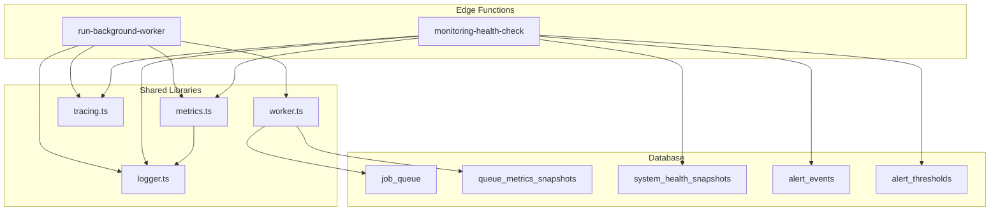
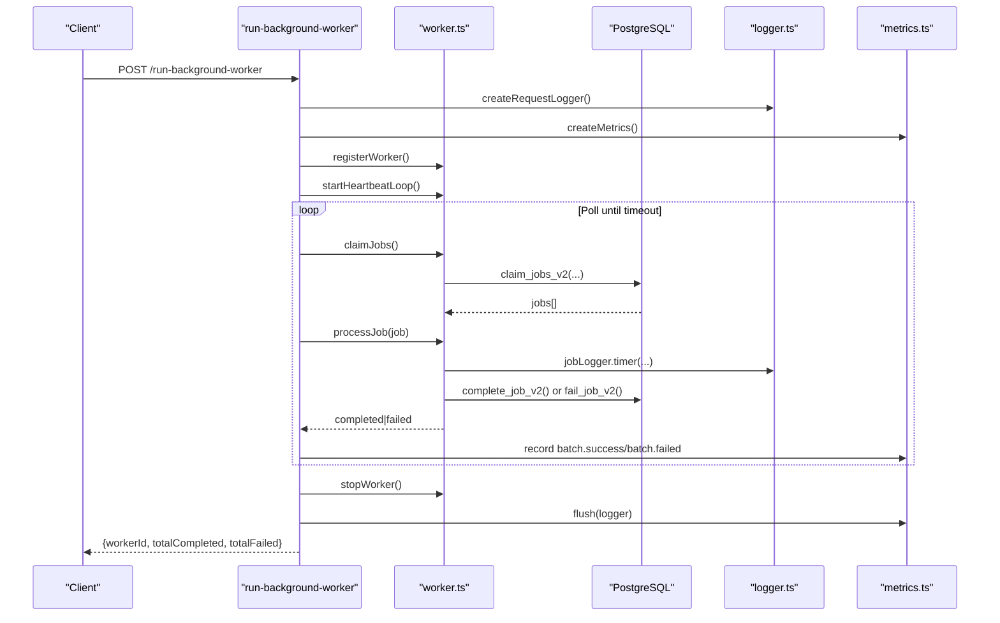
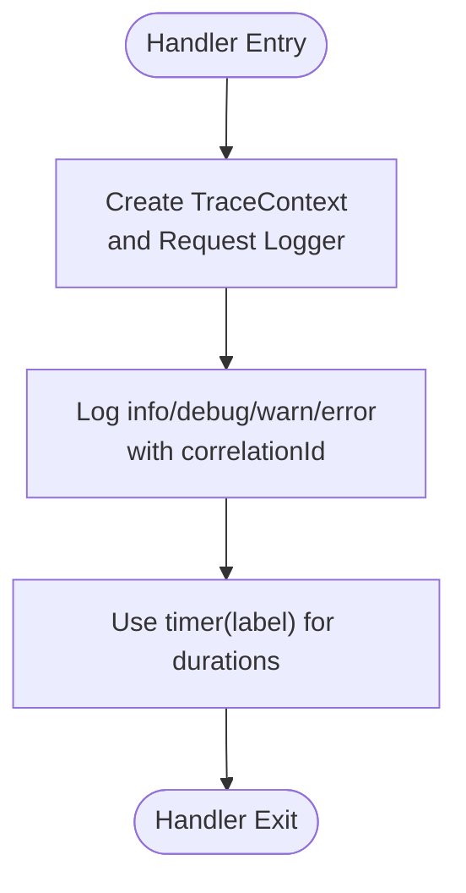
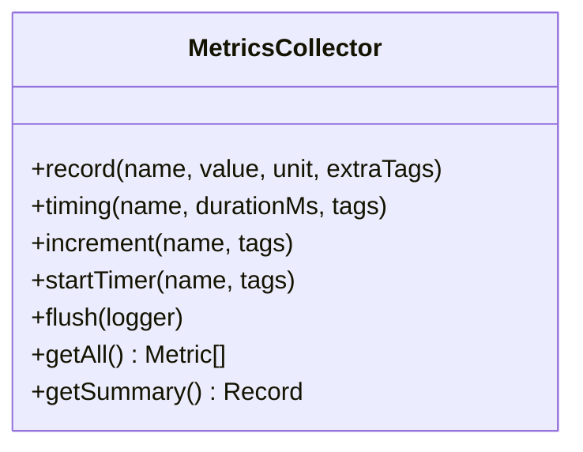
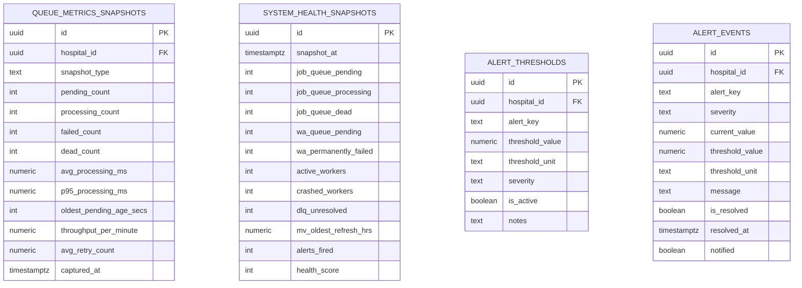
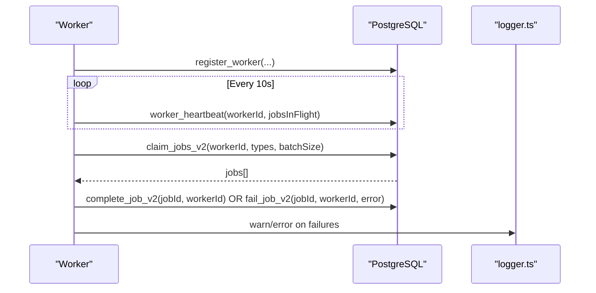
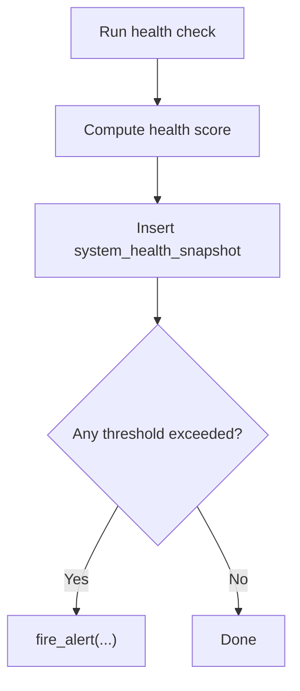
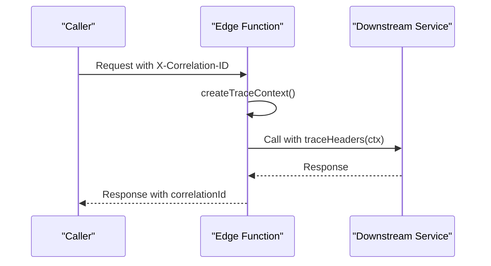
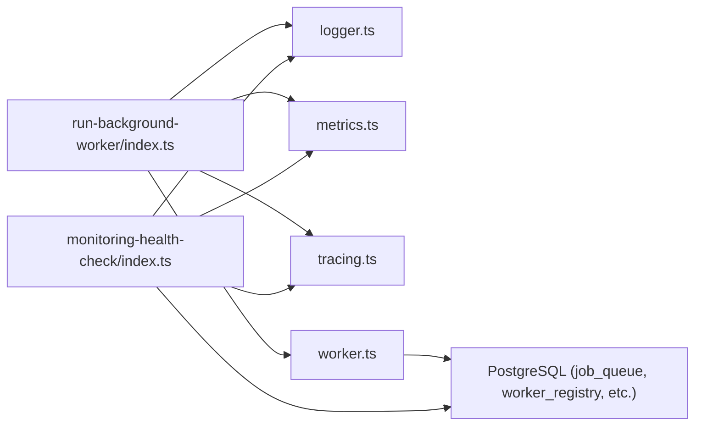

# Monitoring & Observability

<cite>
**Referenced Files in This Document**
- [logger.ts](file://supabase/functions/_shared/logger.ts)
- [metrics.ts](file://supabase/functions/_shared/metrics.ts)
- [tracing.ts](file://supabase/functions/_shared/tracing.ts)
- [worker.ts](file://supabase/functions/_shared/worker.ts)
- [run-background-worker/index.ts](file://supabase/functions/run-background-worker/index.ts)
- [monitoring-health-check/index.ts](file://supabase/functions/monitoring-health-check/index.ts)
- [17_queue_monitoring_engine.sql](file://supabase/migrations/17_queue_monitoring_engine.sql)
- [24_operational-monitoring_engine.sql](file://supabase/migrations/24_operational-monitoring_engine.sql)
- [06_background_job_queue.sql](file://supabase/migrations/06_background_job_queue.sql)
</cite>

## Table of Contents

1. [Introduction](#introduction)
2. [Project Structure](#project-structure)
3. [Core Components](#core-components)
4. [Architecture Overview](#architecture-overview)
5. [Detailed Component Analysis](#detailed-component-analysis)
6. [Dependency Analysis](#dependency-analysis)
7. [Performance Considerations](#performance-considerations)
8. [Troubleshooting Guide](#troubleshooting-guide)
9. [Conclusion](#conclusion)
10. [Appendices](#appendices)

## Introduction

This document explains the monitoring and observability features of the
background processing system. It covers structured logging with correlation IDs,
metrics collection for job processing times and success/failure rates,
operational tables that track worker health and queue status, alerting guidance,
tracing and debugging workflows, dashboard views, and best practices for
retention and profiling.

## Project Structure

The observability stack is implemented across shared libraries and background
workers:

- Structured logging and timers are provided by a logger module.
- Metrics are collected per request/worker run and flushed as structured logs.
- Tracing provides correlation IDs and span context propagation via headers.
- Worker utilities manage leases, heartbeats, job claiming, completion, and
  failure handling.
- A background worker orchestrates job processing and emits metrics/logs.
- A health check endpoint aggregates system state and exposes it for dashboards
  and uptime checks.
- Database migrations define monitoring tables, functions, and views used to
  persist snapshots and compute alerts.

**Diagram sources**

- [run-background-worker/index.ts:247-454](file://supabase/functions/run-background-worker/index.ts#L247-L454)
- [monitoring-health-check/index.ts:22-231](file://supabase/functions/monitoring-health-check/index.ts#L22-L231)
- [logger.ts:1-190](file://supabase/functions/_shared/logger.ts#L1-L190)
- [metrics.ts:1-119](file://supabase/functions/_shared/metrics.ts#L1-L119)
- [tracing.ts:1-50](file://supabase/functions/_shared/tracing.ts#L1-L50)
- [worker.ts:1-257](file://supabase/functions/_shared/worker.ts#L1-L257)
- [17_queue_monitoring_engine.sql:14-51](file://supabase/migrations/17_queue_monitoring_engine.sql#L14-L51)
- [24_operational-monitoring_engine.sql:157-185](file://supabase/migrations/24_operational-monitoring_engine.sql#L157-L185)

**Section sources**

- [run-background-worker/index.ts:247-454](file://supabase/functions/run-background-worker/index.ts#L247-L454)
- [monitoring-health-check/index.ts:22-231](file://supabase/functions/monitoring-health-check/index.ts#L22-L231)
- [logger.ts:1-190](file://supabase/functions/_shared/logger.ts#L1-L190)
- [metrics.ts:1-119](file://supabase/functions/_shared/metrics.ts#L1-L119)
- [tracing.ts:1-50](file://supabase/functions/_shared/tracing.ts#L1-L50)
- [worker.ts:1-257](file://supabase/functions/_shared/worker.ts#L1-L257)
- [17_queue_monitoring_engine.sql:14-51](file://supabase/migrations/17_queue_monitoring_engine.sql#L14-L51)
- [24_operational-monitoring_engine.sql:157-185](file://supabase/migrations/24_operational-monitoring_engine.sql#L157-L185)

## Core Components

- Structured Logger: Produces JSON log lines with consistent fields (timestamp,
  level, service, version, environment), supports child contexts, error
  serialization, and timing helpers. Correlation IDs flow from request headers
  into every log line.
- Metrics Collector: Collects counters, timings, and gauges per request/worker
  run; flushes them as structured log lines for external collectors.
- Tracing Context: Creates correlation/request/span IDs and propagates them via
  headers to downstream calls.
- Worker Utilities: Register workers, heartbeat, claim jobs with crash-safe
  leases, complete or fail jobs, and process jobs with retry safety and per-job
  logging/timing.
- Background Worker: Orchestrates batched job processing, records batch-level
  metrics, and ensures clean shutdown with heartbeat stop and worker
  deregistration.
- Health Check Endpoint: Aggregates live system state, open alerts, queue
  health, worker registry, materialized view freshness, DLQ summary, and
  partition readiness.

**Section sources**

- [logger.ts:1-190](file://supabase/functions/_shared/logger.ts#L1-L190)
- [metrics.ts:1-119](file://supabase/functions/_shared/metrics.ts#L1-L119)
- [tracing.ts:1-50](file://supabase/functions/_shared/tracing.ts#L1-L50)
- [worker.ts:1-257](file://supabase/functions/_shared/worker.ts#L1-L257)
- [run-background-worker/index.ts:247-454](file://supabase/functions/run-background-worker/index.ts#L247-L454)
- [monitoring-health-check/index.ts:22-231](file://supabase/functions/monitoring-health-check/index.ts#L22-L231)

## Architecture Overview

The system uses a layered approach:

- Edge Functions emit structured logs and metrics.
- Workers coordinate job execution with database-backed leases and heartbeats.
- Database functions and tables persist snapshots, alerts, and health scores.
- Dashboards consume snapshots and views to visualize performance and health.

**Diagram sources**

- [run-background-worker/index.ts:247-454](file://supabase/functions/run-background-worker/index.ts#L247-L454)
- [worker.ts:30-178](file://supabase/functions/_shared/worker.ts#L30-L178)
- [worker.ts:191-257](file://supabase/functions/_shared/worker.ts#L191-L257)
- [logger.ts:122-169](file://supabase/functions/_shared/logger.ts#L122-L169)
- [metrics.ts:24-119](file://supabase/functions/_shared/metrics.ts#L24-L119)

## Detailed Component Analysis

### Structured Logging with Correlation IDs

- Every log line is a single JSON object with timestamp, level, message,
  service, version, environment, and contextual fields.
- Correlation ID flows through all logs using request headers; if absent, a UUID
  is generated.
- Child loggers allow enriching logs per job or operation without polluting
  global context.
- Error serialization preserves name, message, stack (non-production), and
  custom fields when available.
- Timers measure durations and log them with labels.

**Diagram sources**

- [tracing.ts:17-50](file://supabase/functions/_shared/tracing.ts#L17-L50)
- [logger.ts:122-169](file://supabase/functions/_shared/logger.ts#L122-L169)

**Section sources**

- [logger.ts:1-190](file://supabase/functions/_shared/logger.ts#L1-L190)
- [tracing.ts:1-50](file://supabase/functions/_shared/tracing.ts#L1-L50)

### Metrics Collection System

- MetricsCollector accumulates metrics per request/worker run with tags like
  endpoint and correlationId.
- Supports counters, timings, and gauges; flushes as structured log lines for
  ingestion by external systems.
- The background worker records batch size, successes, failures, runtime, and
  completion counts.
- The health check endpoint records request duration and success/error counters.

**Diagram sources**

- [metrics.ts:24-119](file://supabase/functions/_shared/metrics.ts#L24-L119)

**Section sources**

- [metrics.ts:1-119](file://supabase/functions/_shared/metrics.ts#L1-L119)
- [run-background-worker/index.ts:398-447](file://supabase/functions/run-background-worker/index.ts#L398-L447)
- [monitoring-health-check/index.ts:109-208](file://supabase/functions/monitoring-health-check/index.ts#L109-L208)

### Operational Monitoring Tables and Views

- Queue metrics snapshots store periodic snapshots of queue depths, processing
  stats, throughput, and retry averages with retention cleanup.
- System health snapshots capture job queue and WhatsApp queue statuses,
  active/crashed workers, DLQ backlog, and computed health score.
- Alert thresholds define configurable limits per hospital/global with severity
  levels.
- Alert events record triggered alerts, values, and resolution state.
- Dashboard view surfaces the latest snapshot for quick consumption.

**Diagram sources**

- [17_queue_monitoring_engine.sql:14-51](file://supabase/migrations/17_queue_monitoring_engine.sql#L14-L51)
- [24_operational-monitoring_engine.sql:37-103](file://supabase/migrations/24_operational-monitoring_engine.sql#L37-L103)
- [24_operational-monitoring_engine.sql:109-185](file://supabase/migrations/24_operational-monitoring_engine.sql#L109-L185)

**Section sources**

- [17_queue_monitoring_engine.sql:14-51](file://supabase/migrations/17_queue_monitoring_engine.sql#L14-L51)
- [24_operational-monitoring_engine.sql:37-103](file://supabase/migrations/24_operational-monitoring_engine.sql#L37-L103)
- [24_operational-monitoring_engine.sql:109-185](file://supabase/migrations/24_operational-monitoring_engine.sql#L109-L185)

### Worker Health, Job Queues, and Performance Indicators

- Worker registration and heartbeat maintain a registry of active workers and
  their last heartbeat timestamps.
- Claiming jobs uses FOR UPDATE SKIP LOCKED semantics to prevent
  double-processing and support crash recovery via per-job leases.
- Completion and failure update job states and move exhausted jobs to the dead
  letter queue.
- Health check aggregates queue health, worker status, MV freshness, DLQ
  summary, and partition readiness.

**Diagram sources**

- [worker.ts:30-178](file://supabase/functions/_shared/worker.ts#L30-L178)
- [06_background_job_queue.sql:41-95](file://supabase/migrations/06_background_job_queue.sql#L41-L95)

**Section sources**

- [worker.ts:30-178](file://supabase/functions/_shared/worker.ts#L30-L178)
- [06_background_job_queue.sql:41-95](file://supabase/migrations/06_background_job_queue.sql#L41-L95)

### Alerts and Thresholds

- Default thresholds include warnings and criticals for queue backlogs, worker
  crashes, WhatsApp permanent failures, DLQ backlog, and analytics refresh lag.
- fire_alert prevents duplicate alerts within an hour for the same
  key/severity/hospital scope.
- Health scoring combines critical/warning alerts and crashed workers to produce
  a composite score.

**Diagram sources**

- [24_operational-monitoring_engine.sql:194-277](file://supabase/migrations/24_operational-monitoring_engine.sql#L194-L277)
- [24_operational-monitoring_engine.sql:283-397](file://supabase/migrations/24_operational-monitoring_engine.sql#L283-L397)

**Section sources**

- [24_operational-monitoring_engine.sql:86-103](file://supabase/migrations/24_operational-monitoring_engine.sql#L86-L103)
- [24_operational-monitoring_engine.sql:194-277](file://supabase/migrations/24_operational-monitoring_engine.sql#L194-L277)
- [24_operational-monitoring_engine.sql:283-397](file://supabase/migrations/24_operational-monitoring_engine.sql#L283-L397)

### Tracing and Debugging Workflows

- Create trace context at function entry to propagate correlationId, requestId,
  and spanId via headers.
- Use child spans for downstream calls to correlate multi-step operations.
- Include correlationId in responses and logs to enable cross-service tracing.
- For long-running jobs, use per-job timers and structured logs to pinpoint
  bottlenecks.

**Diagram sources**

- [tracing.ts:17-50](file://supabase/functions/_shared/tracing.ts#L17-L50)

**Section sources**

- [tracing.ts:1-50](file://supabase/functions/_shared/tracing.ts#L1-L50)

### Dashboard Views and Reporting

- The monitoring dashboard view returns the latest system health snapshot
  including health score, queue depths, worker counts, and alert counts.
- Queue metrics snapshots provide historical trends for queue depth, processing
  latency percentiles, throughput, and retry behavior.
- Health check endpoint aggregates multiple subsystems for comprehensive
  reporting.

**Section sources**

- [24_operational-monitoring_engine.sql:433-447](file://supabase/migrations/24_operational-monitoring_engine.sql#L433-L447)
- [17_queue_monitoring_engine.sql:14-51](file://supabase/migrations/17_queue_monitoring_engine.sql#L14-L51)
- [monitoring-health-check/index.ts:128-198](file://supabase/functions/monitoring-health-check/index.ts#L128-L198)

### Custom Metrics and Logs for Business Operations

- Add business-specific counters and timings using the metrics collector (e.g.,
  per job type or feature flag).
- Enrich logs with child contexts for user, hospital, and business entity
  identifiers to segment data.
- Flush metrics at the end of handlers to ensure they are emitted even on
  errors.

**Section sources**

- [metrics.ts:24-119](file://supabase/functions/_shared/metrics.ts#L24-L119)
- [logger.ts:122-169](file://supabase/functions/_shared/logger.ts#L122-L169)

## Dependency Analysis

- The background worker depends on shared modules for logging, metrics, tracing,
  and worker orchestration.
- The health check endpoint depends on shared modules and database
  functions/views to aggregate state.
- Database migrations introduce tables and functions consumed by both worker and
  health check components.

**Diagram sources**

- [run-background-worker/index.ts:247-454](file://supabase/functions/run-background-worker/index.ts#L247-L454)
- [monitoring-health-check/index.ts:22-231](file://supabase/functions/monitoring-health-check/index.ts#L22-L231)
- [worker.ts:1-257](file://supabase/functions/_shared/worker.ts#L1-L257)

**Section sources**

- [run-background-worker/index.ts:247-454](file://supabase/functions/run-background-worker/index.ts#L247-L454)
- [monitoring-health-check/index.ts:22-231](file://supabase/functions/monitoring-health-check/index.ts#L22-L231)
- [worker.ts:1-257](file://supabase/functions/_shared/worker.ts#L1-L257)

## Performance Considerations

- Use timers around expensive operations to capture durations and identify
  hotspots.
- Batch job claims to reduce database round-trips while balancing concurrency.
- Ensure heartbeat intervals are tuned to avoid excessive load while maintaining
  timely crash detection.
- Retain only necessary metric history; leverage built-in retention cleanup for
  snapshots.
- Profile long-running jobs by adding granular timers and structured logs per
  step.

[No sources needed since this section provides general guidance]

## Troubleshooting Guide

- High failure rates: Inspect job failure logs and DLQ entries; verify retry
  policies and thresholds.
- Queue buildup: Check queue health and backlog alerts; consider scaling workers
  or adjusting batch sizes.
- Worker crashes: Review worker registry and heartbeat gaps; investigate error
  logs and crash points.
- Stuck jobs: Use stuck job detection to find jobs stuck in processing beyond
  thresholds.
- Analytics staleness: Monitor materialized view refresh health and adjust
  schedules if needed.

**Section sources**

- [worker.ts:155-178](file://supabase/functions/_shared/worker.ts#L155-L178)
- [17_queue_monitoring_engine.sql:283-342](file://supabase/migrations/17_queue_monitoring_engine.sql#L283-L342)
- [24_operational-monitoring_engine.sql:283-397](file://supabase/migrations/24_operational-monitoring_engine.sql#L283-L397)

## Conclusion

The background processing system provides robust observability through
structured logging, metrics, tracing, and persistent operational snapshots.
Together, these capabilities enable proactive monitoring, rapid troubleshooting,
and informed capacity planning. By following the recommended practices for
alerting, retention, and profiling, teams can maintain high reliability and
performance.

[No sources needed since this section summarizes without analyzing specific
files]

## Appendices

### Best Practices

- Log retention: Keep structured logs for a defined period; rely on snapshot
  retention policies for long-term trends.
- Metric aggregation: Aggregate metrics at the edge where possible; flush
  consistently to avoid loss.
- Profiling long-running jobs: Break work into steps with timers and logs;
  capture key intermediates for analysis.
- Alert tuning: Adjust thresholds based on observed baselines; prefer
  severity-based escalation.

[No sources needed since this section provides general guidance]
