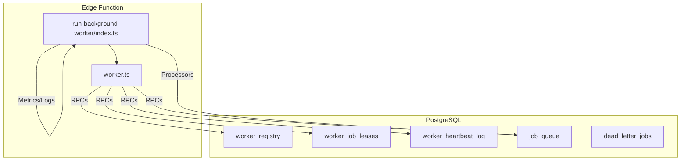
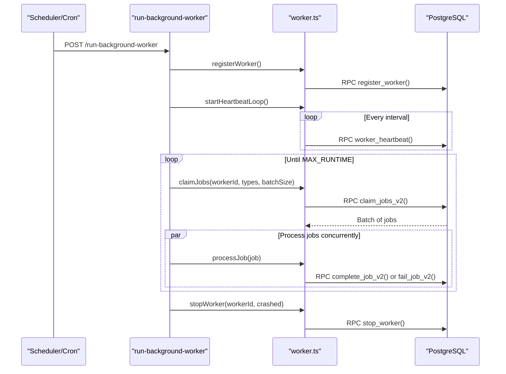
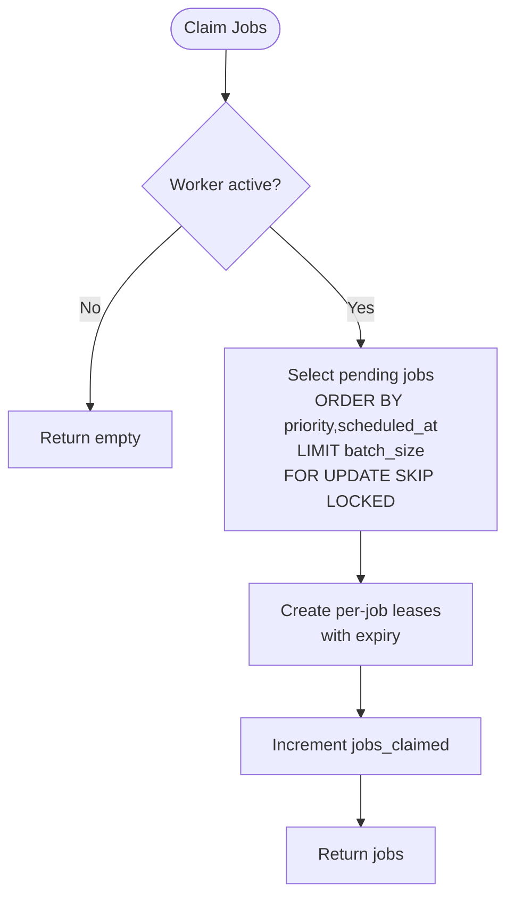
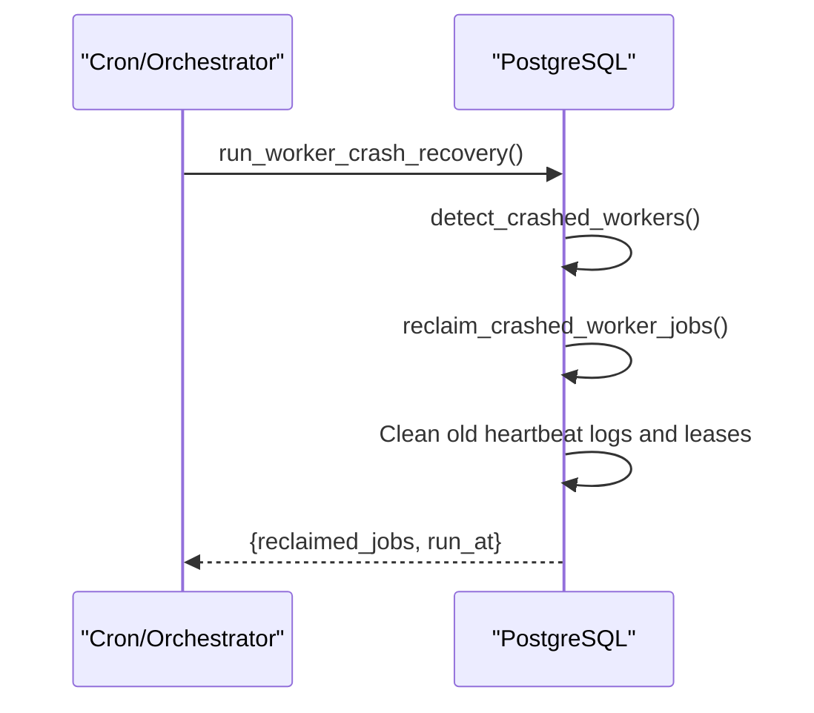
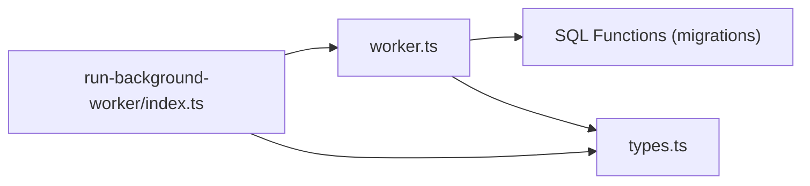

# Worker Orchestration

<cite>
**Referenced Files in This Document**
- [worker.ts](file://supabase/functions/_shared/worker.ts)
- [run-background-worker/index.ts](file://supabase/functions/run-background-worker/index.ts)
- [19_background_worker_engine.sql](file://supabase/migrations/19_background_worker_engine.sql)
- [06_background_job_queue.sql](file://supabase/migrations/06_background_job_queue.sql)
- [types.ts](file://supabase/functions/_shared/types.ts)
- [monitoring-health-check/index.ts](file://supabase/functions/monitoring-health-check/index.ts)
</cite>

## Table of Contents

1. [Introduction](#introduction)
2. [Project Structure](#project-structure)
3. [Core Components](#core-components)
4. [Architecture Overview](#architecture-overview)
5. [Detailed Component Analysis](#detailed-component-analysis)
6. [Dependency Analysis](#dependency-analysis)
7. [Performance Considerations](#performance-considerations)
8. [Troubleshooting Guide](#troubleshooting-guide)
9. [Conclusion](#conclusion)
10. [Appendices](#appendices)

## Introduction

This document explains the worker orchestration system that processes background
jobs using Supabase Edge Functions and PostgreSQL. It covers worker
registration, heartbeat and lease management, crash recovery, job claiming with
concurrency safety, execution lifecycle, graceful shutdown, horizontal scaling,
health monitoring, error handling, timeouts, and cleanup procedures.

## Project Structure

The worker system is implemented across shared utilities, a background worker
entrypoint, and database migrations:

- Shared worker utilities provide registration, heartbeats, job claiming,
  completion, failure, and processing helpers.
- The background worker entrypoint orchestrates the worker loop, claims batches,
  dispatches to type-specific processors, and manages lifecycle.
- Database migrations define the worker registry, leases, heartbeat logs, and
  SQL functions for safe claim/complete/fail/recovery.

**Diagram sources**

- [run-background-worker/index.ts:247-453](file://supabase/functions/run-background-worker/index.ts#L247-L453)
- [worker.ts:30-256](file://supabase/functions/_shared/worker.ts#L30-L256)
- [19_background_worker_engine.sql:18-148](file://supabase/migrations/19_background_worker_engine.sql#L18-L148)
- [06_background_job_queue.sql:264-317](file://supabase/migrations/06_background_job_queue.sql#L264-L317)

**Section sources**

- [run-background-worker/index.ts:247-453](file://supabase/functions/run-background-worker/index.ts#L247-L453)
- [worker.ts:1-256](file://supabase/functions/_shared/worker.ts#L1-L256)
- [19_background_worker_engine.sql:1-957](file://supabase/migrations/19_background_worker_engine.sql#L1-L957)
- [06_background_job_queue.sql:264-317](file://supabase/migrations/06_background_job_queue.sql#L264-L317)

## Core Components

- Worker registration: Registers each invocation as a unique worker with a type
  and instance ID, setting an initial lease expiration.
- Heartbeat loop: Periodically renews the worker’s lease and records in-flight
  job counts.
- Job claiming: Uses FOR UPDATE SKIP LOCKED to safely claim a batch of pending
  jobs and creates per-job leases for crash recovery.
- Job execution: Wraps each job with robust error handling, marking completed or
  failed and updating metrics/logs.
- Graceful shutdown: Stops heartbeats, signals stop/drain, and exits after a
  bounded runtime.

Key implementation references:

- Registration, heartbeat, stop, claim, complete, fail, process helper:
  [worker.ts:30-256](file://supabase/functions/_shared/worker.ts#L30-L256)
- Worker loop and processor dispatch:
  [run-background-worker/index.ts:247-453](file://supabase/functions/run-background-worker/index.ts#L247-L453)
- SQL functions for claim/complete/fail/recovery:
  [19_background_worker_engine.sql:497-853](file://supabase/migrations/19_background_worker_engine.sql#L497-L853)

**Section sources**

- [worker.ts:30-256](file://supabase/functions/_shared/worker.ts#L30-L256)
- [run-background-worker/index.ts:247-453](file://supabase/functions/run-background-worker/index.ts#L247-L453)
- [19_background_worker_engine.sql:497-853](file://supabase/migrations/19_background_worker_engine.sql#L497-L853)

## Architecture Overview

The system runs multiple concurrent Edge Function instances as workers. Each
worker:

1. Registers itself and starts a heartbeat loop.
2. Polls for jobs in batches, creating per-job leases.
3. Executes jobs concurrently within the batch.
4. Marks jobs completed or failed; on failure, exponential backoff and
   dead-letter are handled by SQL.
5. Exits after a maximum runtime, stopping heartbeats and signaling drain/crash.

**Diagram sources**

- [run-background-worker/index.ts:247-453](file://supabase/functions/run-background-worker/index.ts#L247-L453)
- [worker.ts:30-256](file://supabase/functions/_shared/worker.ts#L30-L256)
- [19_background_worker_engine.sql:497-853](file://supabase/migrations/19_background_worker_engine.sql#L497-L853)

## Detailed Component Analysis

### Worker Lifecycle

- Startup: Generate unique workerId and instanceId, register worker, start
  heartbeat loop.
- Claim loop: Poll every fixed interval; if no jobs, sleep and retry.
- Execution: For each batch, run jobs concurrently with Promise.allSettled.
- Shutdown: Stop heartbeat, call stop with drain flag based on crash status,
  flush metrics, return response.

References:

- Lifecycle control and constants (MAX_RUNTIME, BATCH_SIZE, POLL_INTERVAL):
  [run-background-worker/index.ts:23-34](file://supabase/functions/run-background-worker/index.ts#L23-L34)
- Main loop and flow:
  [run-background-worker/index.ts:328-421](file://supabase/functions/run-background-worker/index.ts#L328-L421)
- Heartbeat loop utility:
  [worker.ts:191-215](file://supabase/functions/_shared/worker.ts#L191-L215)

**Section sources**

- [run-background-worker/index.ts:23-34](file://supabase/functions/run-background-worker/index.ts#L23-L34)
- [run-background-worker/index.ts:328-421](file://supabase/functions/run-background-worker/index.ts#L328-L421)
- [worker.ts:191-215](file://supabase/functions/_shared/worker.ts#L191-L215)

### Job Claiming and Concurrency Model

- Claiming uses FOR UPDATE SKIP LOCKED to prevent duplicate processing across
  concurrent workers.
- Per-job leases are created to support crash recovery independent of
  worker-level leases.
- Batch size controls throughput vs. resource usage; default is small to balance
  latency and load.

References:

- Claim function wrapper:
  [worker.ts:98-130](file://supabase/functions/_shared/worker.ts#L98-L130)
- SQL claim logic and per-job lease creation:
  [19_background_worker_engine.sql:497-603](file://supabase/migrations/19_background_worker_engine.sql#L497-L603)
- Legacy claim for comparison:
  [06_background_job_queue.sql:264-317](file://supabase/migrations/06_background_job_queue.sql#L264-L317)

**Diagram sources**

- [19_background_worker_engine.sql:497-603](file://supabase/migrations/19_background_worker_engine.sql#L497-L603)
- [worker.ts:98-130](file://supabase/functions/_shared/worker.ts#L98-L130)

**Section sources**

- [worker.ts:98-130](file://supabase/functions/_shared/worker.ts#L98-L130)
- [19_background_worker_engine.sql:497-603](file://supabase/migrations/19_background_worker_engine.sql#L497-L603)
- [06_background_job_queue.sql:264-317](file://supabase/migrations/06_background_job_queue.sql#L264-L317)

### Heartbeat Mechanism and Instance Tracking

- Workers send periodic heartbeats to renew their lease and update last
  heartbeat timestamp.
- Heartbeat payload includes jobs-in-flight count for observability.
- Heartbeat log stores sampled entries for diagnostics.

References:

- Heartbeat loop and send:
  [worker.ts:58-77](file://supabase/functions/_shared/worker.ts#L58-L77),
  [worker.ts:191-215](file://supabase/functions/_shared/worker.ts#L191-L215)
- SQL heartbeat function and sampling:
  [19_background_worker_engine.sql:247-318](file://supabase/migrations/19_background_worker_engine.sql#L247-L318)
- Registry fields tracked:
  [19_background_worker_engine.sql:18-61](file://supabase/migrations/19_background_worker_engine.sql#L18-L61)

**Section sources**

- [worker.ts:58-77](file://supabase/functions/_shared/worker.ts#L58-L77)
- [worker.ts:191-215](file://supabase/functions/_shared/worker.ts#L191-L215)
- [19_background_worker_engine.sql:18-61](file://supabase/migrations/19_background_worker_engine.sql#L18-L61)
- [19_background_worker_engine.sql:247-318](file://supabase/migrations/19_background_worker_engine.sql#L247-L318)

### Crash Recovery and Leasing

- Per-job leases ensure that if a worker crashes mid-execution, its jobs can be
  reclaimed when the lease expires.
- A recovery routine detects crashed workers and reclaims their jobs, then
  cleans up old logs and leases.
- Failed jobs use exponential backoff and move to dead letter queue after max
  attempts.

References:

- Reclaim function:
  [19_background_worker_engine.sql:422-491](file://supabase/migrations/19_background_worker_engine.sql#L422-L491)
- Recovery orchestrator:
  [19_background_worker_engine.sql:813-853](file://supabase/migrations/19_background_worker_engine.sql#L813-L853)
- Fail job with backoff and dead-letter:
  [19_background_worker_engine.sql:683-807](file://supabase/migrations/19_background_worker_engine.sql#L683-L807)

**Diagram sources**

- [19_background_worker_engine.sql:813-853](file://supabase/migrations/19_background_worker_engine.sql#L813-L853)
- [19_background_worker_engine.sql:422-491](file://supabase/migrations/19_background_worker_engine.sql#L422-L491)

**Section sources**

- [19_background_worker_engine.sql:422-491](file://supabase/migrations/19_background_worker_engine.sql#L422-L491)
- [19_background_worker_engine.sql:683-807](file://supabase/migrations/19_background_worker_engine.sql#L683-L807)
- [19_background_worker_engine.sql:813-853](file://supabase/migrations/19_background_worker_engine.sql#L813-L853)

### Job Processing Pipeline and Extensibility

- The worker dispatches to handlers based on job_type.
- To add a new job type:
  - Add a handler function in the worker entrypoint.
  - Include the new type in the JOB_TYPES list.
  - Implement business logic and external calls with appropriate timeouts.
  - Use the shared processJob helper for consistent completion/failure
    semantics.

References:

- Handler switch and job types:
  [run-background-worker/index.ts:27-34](file://supabase/functions/run-background-worker/index.ts#L27-L34),
  [run-background-worker/index.ts:363-390](file://supabase/functions/run-background-worker/index.ts#L363-L390)
- Shared processor interface and wrapper:
  [worker.ts:219-256](file://supabase/functions/_shared/worker.ts#L219-L256)

**Section sources**

- [run-background-worker/index.ts:27-34](file://supabase/functions/run-background-worker/index.ts#L27-L34)
- [run-background-worker/index.ts:363-390](file://supabase/functions/run-background-worker/index.ts#L363-L390)
- [worker.ts:219-256](file://supabase/functions/_shared/worker.ts#L219-L256)

### Health Monitoring and Observability

- Heartbeat logs and worker registry enable tracking of active workers, success
  rates, and lease status.
- A health check endpoint exposes aggregated system health including worker and
  queue metrics.

References:

- Performance view and metrics:
  [19_background_worker_engine.sql:859-893](file://supabase/migrations/19_background_worker_engine.sql#L859-L893)
- Health check endpoint:
  [monitoring-health-check/index.ts:33-96](file://supabase/functions/monitoring-health-check/index.ts#L33-L96),
  [monitoring-health-check/index.ts:103-230](file://supabase/functions/monitoring-health-check/index.ts#L103-L230)

**Section sources**

- [19_background_worker_engine.sql:859-893](file://supabase/migrations/19_background_worker_engine.sql#L859-L893)
- [monitoring-health-check/index.ts:33-96](file://supabase/functions/monitoring-health-check/index.ts#L33-L96)
- [monitoring-health-check/index.ts:103-230](file://supabase/functions/monitoring-health-check/index.ts#L103-L230)

## Dependency Analysis

- The worker entrypoint depends on shared worker utilities for lifecycle and job
  control.
- Shared utilities depend on database RPCs defined in migrations.
- Types are shared via a central types file to keep consistency between runtime
  and schema.

**Diagram sources**

- [run-background-worker/index.ts:1-21](file://supabase/functions/run-background-worker/index.ts#L1-L21)
- [worker.ts:17-19](file://supabase/functions/_shared/worker.ts#L17-L19)
- [types.ts:230-250](file://supabase/functions/_shared/types.ts#L230-L250)
- [19_background_worker_engine.sql:497-853](file://supabase/migrations/19_background_worker_engine.sql#L497-L853)

**Section sources**

- [run-background-worker/index.ts:1-21](file://supabase/functions/run-background-worker/index.ts#L1-L21)
- [worker.ts:17-19](file://supabase/functions/_shared/worker.ts#L17-L19)
- [types.ts:230-250](file://supabase/functions/_shared/types.ts#L230-L250)
- [19_background_worker_engine.sql:497-853](file://supabase/migrations/19_background_worker_engine.sql#L497-L853)

## Performance Considerations

- Batch size tuning: Larger batches increase throughput but raise memory and
  timeout pressure; smaller batches reduce latency spikes.
- Concurrency: Using Promise.allSettled processes all jobs in a batch
  concurrently; monitor downstream service limits.
- Heartbeat interval: Shorter intervals improve responsiveness to crashes but
  increase DB writes; default balances cost and safety.
- External timeouts: Outbound calls (e.g., messaging) should have explicit
  timeouts to avoid holding leases too long.
- Dead-letter and retries: Exponential backoff prevents thundering herds; ensure
  DLQ monitoring.

[No sources needed since this section provides general guidance]

## Troubleshooting Guide

- Duplicate processing: Ensure claim_jobs_v2 is used and SKIP LOCKED is
  effective; verify worker state is active before claiming.
- Stuck jobs: Check worker_job_leases for expired leases without outcome; run
  crash recovery to reclaim.
- Failed jobs: Inspect last_error and attempt_count; confirm max_attempts and
  backoff behavior; review DLQ for permanently failed jobs.
- Worker liveness: Monitor worker_heartbeat_log and worker_registry status;
  investigate missing heartbeats.
- Health checks: Use the health endpoint to get current system score and queued
  backlog.

**Section sources**

- [19_background_worker_engine.sql:422-491](file://supabase/migrations/19_background_worker_engine.sql#L422-L491)
- [19_background_worker_engine.sql:683-807](file://supabase/migrations/19_background_worker_engine.sql#L683-L807)
- [monitoring-health-check/index.ts:33-96](file://supabase/functions/monitoring-health-check/index.ts#L33-L96)

## Conclusion

The worker orchestration system provides robust, fault-tolerant background job
processing with clear lifecycle management, safe concurrency, and comprehensive
observability. By leveraging per-job leases, heartbeats, and SQL-driven
recovery, it ensures reliable execution even under failures. Scaling
horizontally is straightforward by running more worker invocations, while tuning
batch size and concurrency meets performance needs.

[No sources needed since this section summarizes without analyzing specific
files]

## Appendices

### Worker Registration, Heartbeat, and Stop API Surface

- Register worker:
  [worker.ts:30-54](file://supabase/functions/_shared/worker.ts#L30-L54)
- Send heartbeat:
  [worker.ts:58-77](file://supabase/functions/_shared/worker.ts#L58-L77)
- Stop worker:
  [worker.ts:81-94](file://supabase/functions/_shared/worker.ts#L81-L94)

**Section sources**

- [worker.ts:30-94](file://supabase/functions/_shared/worker.ts#L30-L94)

### Job Claim, Complete, Fail APIs

- Claim jobs:
  [worker.ts:98-130](file://supabase/functions/_shared/worker.ts#L98-L130)
- Complete job:
  [worker.ts:134-151](file://supabase/functions/_shared/worker.ts#L134-L151)
- Fail job:
  [worker.ts:155-178](file://supabase/functions/_shared/worker.ts#L155-L178)

**Section sources**

- [worker.ts:98-178](file://supabase/functions/_shared/worker.ts#L98-L178)

### Data Models

- Job queue row shape:
  [types.ts:230-250](file://supabase/functions/_shared/types.ts#L230-L250)
- Worker registry and leases tables:
  [19_background_worker_engine.sql:18-148](file://supabase/migrations/19_background_worker_engine.sql#L18-L148)

**Section sources**

- [types.ts:230-250](file://supabase/functions/_shared/types.ts#L230-L250)
- [19_background_worker_engine.sql:18-148](file://supabase/migrations/19_background_worker_engine.sql#L18-L148)
