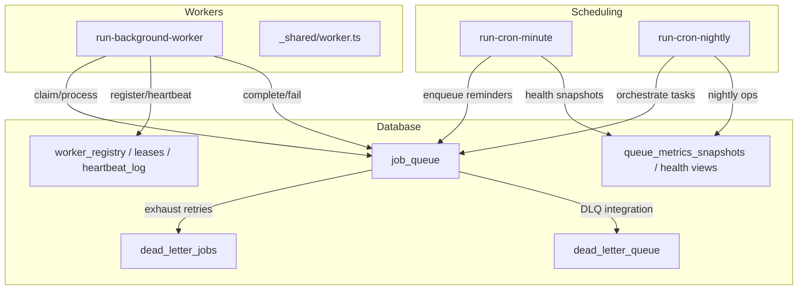
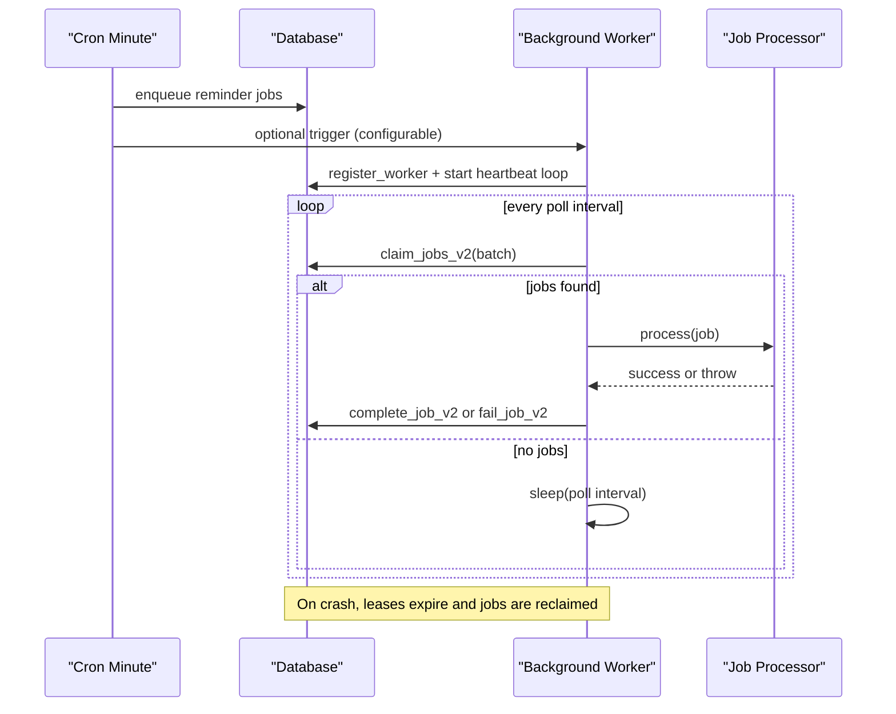
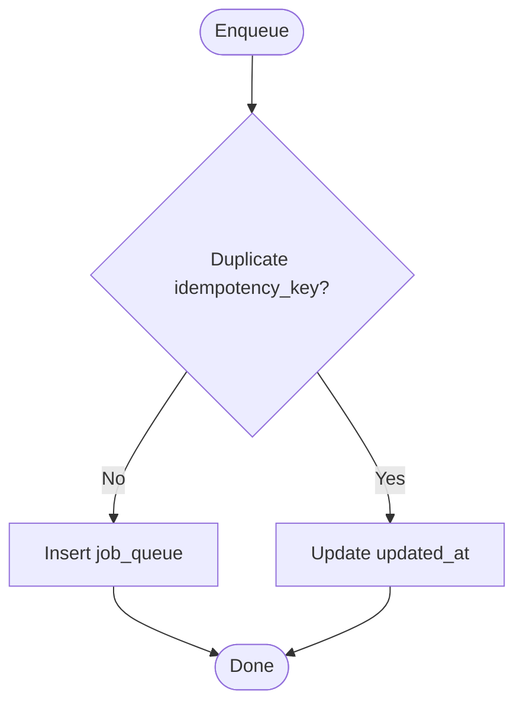
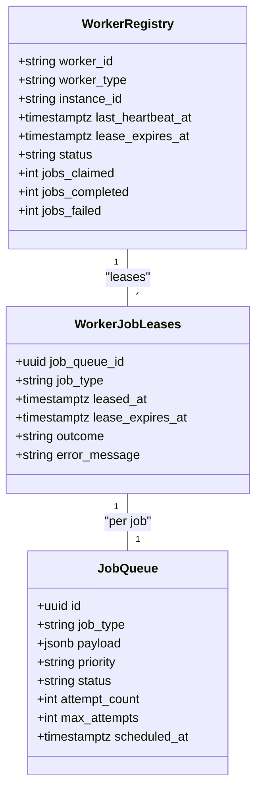
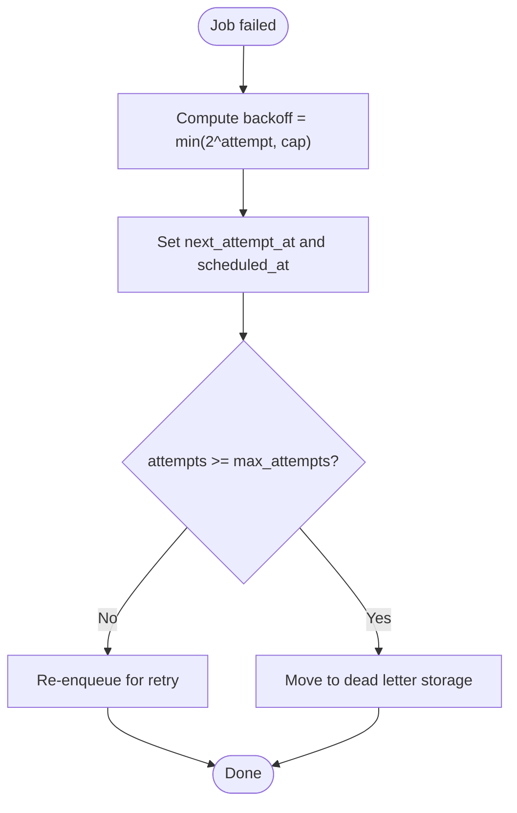
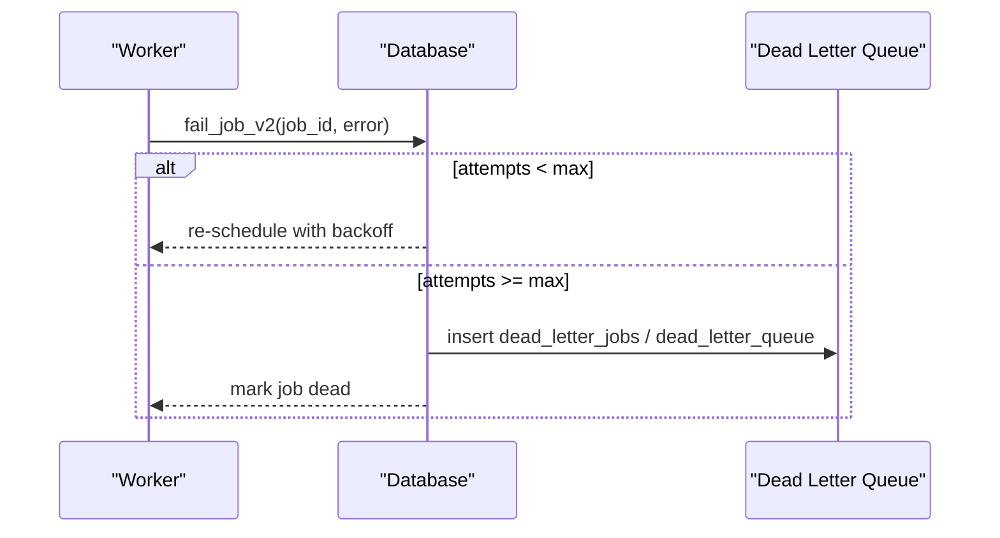
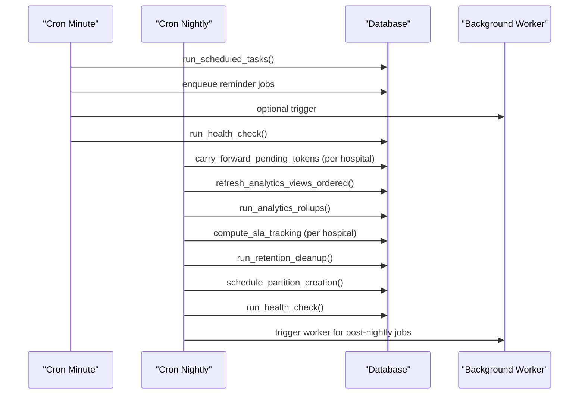
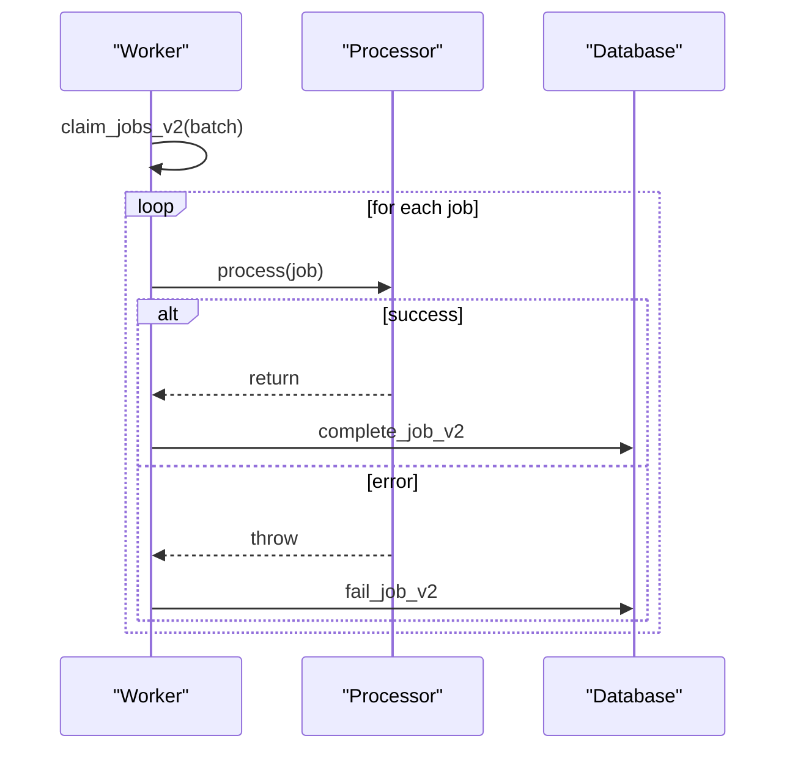
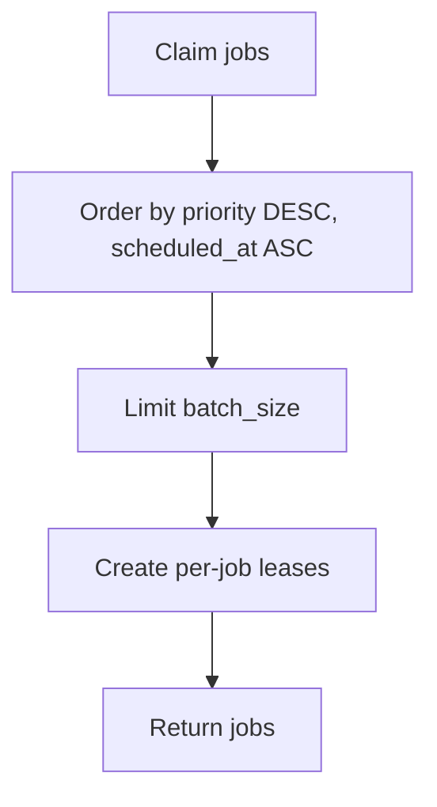
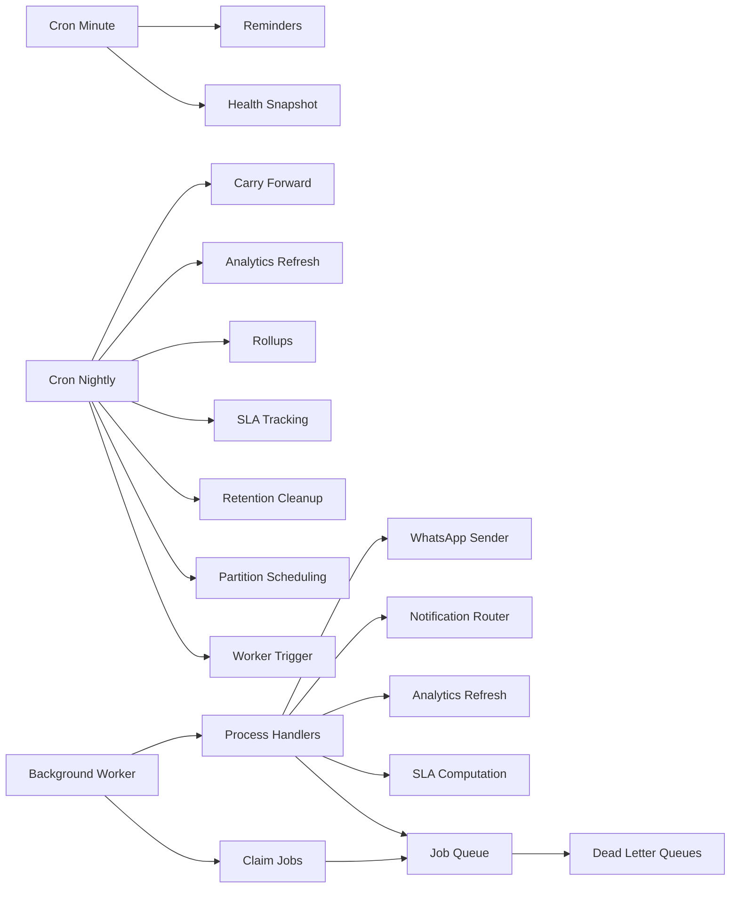

# Background Processing

<cite>
**Referenced Files in This Document**
- [06_background_job_queue.sql](file://supabase/migrations/06_background_job_queue.sql)
- [14_dead_letter_queue.sql](file://supabase/migrations/14_dead_letter_queue.sql)
- [19_background_worker_engine.sql](file://supabase/migrations/19_background_worker_engine.sql)
- [17_queue_monitoring_engine.sql](file://supabase/migrations/17_queue_monitoring_engine.sql)
- [run-background-worker/index.ts](file://supabase/functions/run-background-worker/index.ts)
- [_shared/worker.ts](file://supabase/functions/_shared/worker.ts)
- [run-cron-minute/index.ts](file://supabase/functions/run-cron-minute/index.ts)
- [run-cron-nightly/index.ts](file://supabase/functions/run-cron-nightly/index.ts)
- [send-whatsapp-message/index.ts](file://supabase/functions/send-whatsapp-message/index.ts)
- [send-reminders/index.ts](file://supabase/functions/send-reminders/index.ts)
- [_shared/types.ts](file://supabase/functions/_shared/types.ts)
</cite>

## Table of Contents

1. [Introduction](#introduction)
2. [Project Structure](#project-structure)
3. [Core Components](#core-components)
4. [Architecture Overview](#architecture-overview)
5. [Detailed Component Analysis](#detailed-component-analysis)
6. [Dependency Analysis](#dependency-analysis)
7. [Performance Considerations](#performance-considerations)
8. [Troubleshooting Guide](#troubleshooting-guide)
9. [Conclusion](#conclusion)
10. [Appendices](#appendices)

## Introduction

This document explains the Background Processing system used to schedule,
execute, and monitor background jobs across the platform. It covers:

- Job queue architecture and data model
- Worker orchestration with leases, heartbeats, and crash recovery
- Retry mechanisms and exponential backoff
- Dead letter queues for failed jobs
- Cron scheduling for minute-level and nightly tasks
- Job execution patterns, error handling, and monitoring
- Scaling considerations, performance optimization, debugging, and operational
  procedures

## Project Structure

The background processing system spans database migrations (PostgreSQL
functions, tables, indexes), Deno Edge Functions as workers and schedulers, and
shared utilities for worker lifecycle management.

**Diagram sources**

- [run-cron-minute/index.ts:123-254](file://supabase/functions/run-cron-minute/index.ts#L123-L254)
- [run-cron-nightly/index.ts:110-276](file://supabase/functions/run-cron-nightly/index.ts#L110-L276)
- [run-background-worker/index.ts:309-421](file://supabase/functions/run-background-worker/index.ts#L309-L421)
- [_shared/worker.ts:30-130](file://supabase/functions/_shared/worker.ts#L30-L130)
- [06_background_job_queue.sql:41-137](file://supabase/migrations/06_background_job_queue.sql#L41-L137)
- [14_dead_letter_queue.sql:39-162](file://supabase/migrations/14_dead_letter_queue.sql#L39-L162)
- [19_background_worker_engine.sql:18-148](file://supabase/migrations/19_background_worker_engine.sql#L18-L148)
- [17_queue_monitoring_engine.sql:14-74](file://supabase/migrations/17_queue_monitoring_engine.sql#L14-L74)

**Section sources**

- [run-cron-minute/index.ts:1-347](file://supabase/functions/run-cron-minute/index.ts#L1-L347)
- [run-cron-nightly/index.ts:1-346](file://supabase/functions/run-cron-nightly/index.ts#L1-L346)
- [run-background-worker/index.ts:1-454](file://supabase/functions/run-background-worker/index.ts#L1-L454)
- [_shared/worker.ts:1-257](file://supabase/functions/_shared/worker.ts#L1-L257)
- [06_background_job_queue.sql:1-550](file://supabase/migrations/06_background_job_queue.sql#L1-L550)
- [14_dead_letter_queue.sql:1-481](file://supabase/migrations/14_dead_letter_queue.sql#L1-L481)
- [19_background_worker_engine.sql:1-957](file://supabase/migrations/19_background_worker_engine.sql#L1-L957)
- [17_queue_monitoring_engine.sql:1-928](file://supabase/migrations/17_queue_monitoring_engine.sql#L1-L928)

## Core Components

- Job Queue: Persistent queue with priority, scheduling, idempotency, and
  retry/backoff.
- Worker Engine: Worker registry, per-job leases, heartbeat, crash detection,
  and job reclamation.
- Dead Letter Queues: Two-tier DLQ for final failures and cross-system failure
  tracking.
- Schedulers: Minute-level cron for periodic tasks; nightly cron for heavy batch
  operations.
- Monitoring: Health views, metrics snapshots, stuck job detection, backlog
  alerts.

Key responsibilities:

- Enqueue jobs with priority and idempotency keys.
- Claim jobs safely using SKIP LOCKED and per-job leases.
- Process jobs with robust error handling and retry/backoff.
- Move exhausted jobs to dead letter storage.
- Schedule recurring work via cron endpoints.
- Monitor queue health and alert on anomalies.

**Section sources**

- [06_background_job_queue.sql:194-449](file://supabase/migrations/06_background_job_queue.sql#L194-L449)
- [19_background_worker_engine.sql:154-800](file://supabase/migrations/19_background_worker_engine.sql#L154-L800)
- [14_dead_letter_queue.sql:189-360](file://supabase/migrations/14_dead_letter_queue.sql#L189-L360)
- [run-cron-minute/index.ts:123-254](file://supabase/functions/run-cron-minute/index.ts#L123-L254)
- [run-cron-nightly/index.ts:110-276](file://supabase/functions/run-cron-nightly/index.ts#L110-L276)
- [17_queue_monitoring_engine.sql:124-401](file://supabase/migrations/17_queue_monitoring_engine.sql#L124-L401)

## Architecture Overview

The system uses a database-backed job queue with edge function workers that
claim and process jobs concurrently. Workers register themselves, send
heartbeats, and maintain per-job leases to ensure crash recovery. Failed jobs
are retried with exponential backoff and eventually moved to dead letter queues.
Cron endpoints trigger periodic tasks and can optionally wake workers.

**Diagram sources**

- [run-cron-minute/index.ts:136-229](file://supabase/functions/run-cron-minute/index.ts#L136-L229)
- [run-background-worker/index.ts:309-421](file://supabase/functions/run-background-worker/index.ts#L309-L421)
- [_shared/worker.ts:30-130](file://supabase/functions/_shared/worker.ts#L30-L130)
- [19_background_worker_engine.sql:497-603](file://supabase/migrations/19_background_worker_engine.sql#L497-L603)

## Detailed Component Analysis

### Job Queue Data Model and Operations

- Tables:
  - job_queue: core queue with status, priority, scheduling, attempts,
    idempotency key, hospital/booking linkage.
  - dead_letter_jobs: legacy per-job DLQ entries when max attempts exceeded.
  - dead_letter_queue: unified DLQ with source tracking, resolution workflow,
    and alerting.
- Key functions:
  - enqueue_job: insert with idempotency deduplication.
  - claim_jobs / claim_jobs_v2: safe concurrent claiming with priority ordering
    and lease creation.
  - complete_job / complete_job_v2: mark completed and update worker stats.
  - fail_job / fail_job_v2: handle retries with exponential backoff; move to DLQ
    when exhausted.
  - reclaim_stale_jobs: fallback for older lease semantics.
  - detect_crashed_workers / reclaim_crashed_worker_jobs: modern crash recovery
    using worker registry and leases.
- Indexes: optimized for pending, retry, processing, hospital-scoped queries,
  type/status, and worker-scoped lookups.

**Diagram sources**

- [06_background_job_queue.sql:194-245](file://supabase/migrations/06_background_job_queue.sql#L194-L245)

**Section sources**

- [06_background_job_queue.sql:41-137](file://supabase/migrations/06_background_job_queue.sql#L41-L137)
- [06_background_job_queue.sql:194-449](file://supabase/migrations/06_background_job_queue.sql#L194-L449)
- [14_dead_letter_queue.sql:39-162](file://supabase/migrations/14_dead_letter_queue.sql#L39-L162)
- [19_background_worker_engine.sql:497-800](file://supabase/migrations/19_background_worker_engine.sql#L497-L800)

### Worker Orchestration and Lifecycle

- Registration: Each worker registers with a unique ID, type, instance ID, and
  lease duration.
- Heartbeat: Periodic updates renew lease and record activity; sampled logging
  reduces overhead.
- Claiming: claim_jobs_v2 selects pending jobs by priority and scheduled time,
  marks them processing, creates per-job leases, and increments attempt counts.
- Processing: The worker dispatches to typed handlers based on job_type.
- Completion/Failure:
  - Success: complete_job_v2 marks completed and updates worker counters.
  - Failure: fail_job_v2 applies exponential backoff; if attempts exceed max,
    moves to dead letter storage and marks job dead.
- Crash Recovery: If a worker stops heartbeating, its leases expire; stale jobs
  are reclaimed and returned to pending.

**Diagram sources**

- [19_background_worker_engine.sql:18-148](file://supabase/migrations/19_background_worker_engine.sql#L18-L148)
- [19_background_worker_engine.sql:497-800](file://supabase/migrations/19_background_worker_engine.sql#L497-L800)

**Section sources**

- [_shared/worker.ts:30-130](file://supabase/functions/_shared/worker.ts#L30-L130)
- [_shared/worker.ts:180-257](file://supabase/functions/_shared/worker.ts#L180-L257)
- [19_background_worker_engine.sql:154-800](file://supabase/migrations/19_background_worker_engine.sql#L154-L800)

### Retry Mechanisms and Backoff

- Exponential backoff is applied on each failure using attempt-based intervals
  capped at a maximum.
- Jobs are rescheduled with next_attempt_at and scheduled_at set accordingly.
- When attempts reach max_attempts, jobs are moved to dead letter storage and
  marked dead.

**Diagram sources**

- [06_background_job_queue.sql:357-449](file://supabase/migrations/06_background_job_queue.sql#L357-L449)
- [19_background_worker_engine.sql:683-800](file://supabase/migrations/19_background_worker_engine.sql#L683-L800)

**Section sources**

- [06_background_job_queue.sql:357-449](file://supabase/migrations/06_background_job_queue.sql#L357-L449)
- [19_background_worker_engine.sql:683-800](file://supabase/migrations/19_background_worker_engine.sql#L683-L800)

### Dead Letter Queues

- Legacy DLQ: dead_letter_jobs stores final failures from job_queue with
  original job metadata and last error.
- Unified DLQ: dead_letter_queue tracks failures across multiple sources (jobs,
  WhatsApp, notifications, payments, webhooks, analytics). Includes resolution
  workflow (unresolved, retried successfully, manually resolved, discarded),
  alertability, and priority levels.
- Retry from DLQ: retry_dead_letter_item can re-enqueue job_queue items with
  high priority and reset state for other sources.

**Diagram sources**

- [06_background_job_queue.sql:357-449](file://supabase/migrations/06_background_job_queue.sql#L357-L449)
- [14_dead_letter_queue.sql:189-360](file://supabase/migrations/14_dead_letter_queue.sql#L189-L360)
- [19_background_worker_engine.sql:683-800](file://supabase/migrations/19_background_worker_engine.sql#L683-L800)

**Section sources**

- [06_background_job_queue.sql:163-188](file://supabase/migrations/06_background_job_queue.sql#L163-L188)
- [14_dead_letter_queue.sql:39-162](file://supabase/migrations/14_dead_letter_queue.sql#L39-L162)
- [14_dead_letter_queue.sql:189-360](file://supabase/migrations/14_dead_letter_queue.sql#L189-L360)

### Job Scheduling System

- Minute-level cron:
  - Executes run_scheduled_tasks to reclaim stale jobs and capture metrics.
  - Triggers reminder queuing for upcoming appointments.
  - Optionally triggers background worker to process queued jobs.
  - Captures health snapshot.
- Nightly cron:
  - Orchestrates multi-step workflows: carry-forward tokens, ordered
    materialized view refreshes, analytics rollups, SLA tracking, retention
    cleanup, partition scheduling, health check, and worker trigger.
  - Each step is isolated with try/catch to allow partial failures without
    aborting the entire run.

**Diagram sources**

- [run-cron-minute/index.ts:123-254](file://supabase/functions/run-cron-minute/index.ts#L123-L254)
- [run-cron-nightly/index.ts:110-276](file://supabase/functions/run-cron-nightly/index.ts#L110-L276)
- [17_queue_monitoring_engine.sql:702-777](file://supabase/migrations/17_queue_monitoring_engine.sql#L702-L777)

**Section sources**

- [run-cron-minute/index.ts:1-347](file://supabase/functions/run-cron-minute/index.ts#L1-L347)
- [run-cron-nightly/index.ts:1-346](file://supabase/functions/run-cron-nightly/index.ts#L1-L346)
- [17_queue_monitoring_engine.sql:702-777](file://supabase/migrations/17_queue_monitoring_engine.sql#L702-L777)

### Worker Execution Patterns and Error Handling

- Multi-type job processor:
  - Dispatches by job_type to specific handlers (e.g., WhatsApp messaging,
    incoming message processing, analytics refresh, notification routing, SLA
    computation).
  - Uses Promise.allSettled to process batches concurrently while tracking
    successes and failures.
- Error handling:
  - Each handler throws errors on failure; processJob wraps execution to call
    complete_job_v2 on success or fail_job_v2 on failure.
  - External service calls include timeouts and structured error classification
    (rate limiting, permanent failures).
- Metrics and tracing:
  - Per-request correlation IDs, timers, and metrics flush at completion.

**Diagram sources**

- [run-background-worker/index.ts:363-391](file://supabase/functions/run-background-worker/index.ts#L363-L391)
- [_shared/worker.ts:219-257](file://supabase/functions/_shared/worker.ts#L219-L257)
- [19_background_worker_engine.sql:616-800](file://supabase/migrations/19_background_worker_engine.sql#L616-L800)

**Section sources**

- [run-background-worker/index.ts:36-245](file://supabase/functions/run-background-worker/index.ts#L36-L245)
- [_shared/worker.ts:219-257](file://supabase/functions/_shared/worker.ts#L219-L257)
- [send-whatsapp-message/index.ts:198-324](file://supabase/functions/send-whatsapp-message/index.ts#L198-L324)

### Priority Handling

- Priority enum: low, normal, high, critical.
- Claiming order: higher priority first, then earliest scheduled time.
- Idempotency: enqueue supports idempotency keys to prevent duplicate enqueues.

**Diagram sources**

- [19_background_worker_engine.sql:533-603](file://supabase/migrations/19_background_worker_engine.sql#L533-L603)
- [06_background_job_queue.sql:264-317](file://supabase/migrations/06_background_job_queue.sql#L264-L317)

**Section sources**

- [06_background_job_queue.sql:27-35](file://supabase/migrations/06_background_job_queue.sql#L27-L35)
- [19_background_worker_engine.sql:533-603](file://supabase/migrations/19_background_worker_engine.sql#L533-L603)

### Scaling Considerations

- Concurrency:
  - Multiple worker instances can run simultaneously; FOR UPDATE SKIP LOCKED
    prevents double-processing.
  - Batch size controls throughput per invocation; tune based on workload
    characteristics.
- Leases and heartbeats:
  - Per-job leases protect against long-running jobs exceeding function runtime
    limits.
  - Heartbeat interval and lease durations should be tuned to balance
    responsiveness and overhead.
- Database indexing:
  - Optimized indexes for pending, retry, processing, hospital-scoped queries,
    and worker-scoped lookups support scaling.
- Isolation:
  - Hospital-scoped operations and RLS policies isolate tenant data.

**Section sources**

- [19_background_worker_engine.sql:18-148](file://supabase/migrations/19_background_worker_engine.sql#L18-L148)
- [06_background_job_queue.sql:101-137](file://supabase/migrations/06_background_job_queue.sql#L101-L137)
- [_shared/worker.ts:1-15](file://supabase/functions/_shared/worker.ts#L1-L15)

## Dependency Analysis

High-level dependencies between components:

**Diagram sources**

- [run-cron-minute/index.ts:123-254](file://supabase/functions/run-cron-minute/index.ts#L123-L254)
- [run-cron-nightly/index.ts:110-276](file://supabase/functions/run-cron-nightly/index.ts#L110-L276)
- [run-background-worker/index.ts:36-245](file://supabase/functions/run-background-worker/index.ts#L36-L245)
- [06_background_job_queue.sql:194-449](file://supabase/migrations/06_background_job_queue.sql#L194-L449)
- [14_dead_letter_queue.sql:189-360](file://supabase/migrations/14_dead_letter_queue.sql#L189-L360)

**Section sources**

- [run-cron-minute/index.ts:1-347](file://supabase/functions/run-cron-minute/index.ts#L1-L347)
- [run-cron-nightly/index.ts:1-346](file://supabase/functions/run-cron-nightly/index.ts#L1-L346)
- [run-background-worker/index.ts:1-454](file://supabase/functions/run-background-worker/index.ts#L1-L454)

## Performance Considerations

- Tune batch size and poll interval to match workload and external API rate
  limits.
- Use per-job leases to avoid long-running jobs timing out; extend leases if
  necessary.
- Prefer batch operations where possible (e.g., parallel computations with
  Promise.allSettled).
- Keep heartbeat sampling to reduce write overhead.
- Ensure indexes are present for fast claims and retries.
- Monitor queue health and adjust priorities or scaling based on metrics.

[No sources needed since this section provides general guidance]

## Troubleshooting Guide

Common issues and diagnostics:

- Stuck jobs:
  - Use get_stuck_jobs to identify jobs processing too long.
  - Investigate worker heartbeats and leases; reclaim if necessary.
- Backlog alerts:
  - Use check_queue_backlog_alerts to detect high pending counts or aged jobs.
- Dead letters:
  - Inspect dead_letter_queue for unresolved items; use retry_dead_letter_item
    to reprocess.
- Worker crashes:
  - detect_crashed_workers marks inactive workers; reclaim_crashed_worker_jobs
    returns their jobs to pending.
- Metrics and snapshots:
  - write_queue_metrics_snapshot captures queue health; review mv_refresh_log
    for analytics refresh status.

Operational steps:

- Verify cron secrets and authentication headers.
- Confirm worker registration and heartbeat logs.
- Review job payloads and errors in job_queue.last_error and DLQ entries.
- Adjust max_attempts and backoff caps if needed.

**Section sources**

- [17_queue_monitoring_engine.sql:283-401](file://supabase/migrations/17_queue_monitoring_engine.sql#L283-L401)
- [17_queue_monitoring_engine.sql:702-777](file://supabase/migrations/17_queue_monitoring_engine.sql#L702-L777)
- [14_dead_letter_queue.sql:189-360](file://supabase/migrations/14_dead_letter_queue.sql#L189-L360)
- [19_background_worker_engine.sql:377-488](file://supabase/migrations/19_background_worker_engine.sql#L377-L488)

## Conclusion

The Background Processing system provides a robust, scalable, and observable
framework for executing asynchronous workloads. It combines a resilient
database-backed queue, worker orchestration with leases and heartbeats,
comprehensive retry/backoff logic, and dual dead letter queues for failure
isolation. Cron schedulers coordinate routine and nightly tasks, while
monitoring tools enable proactive operations. Proper tuning of batch sizes,
lease durations, and priorities ensures reliable throughput under load.

[No sources needed since this section summarizes without analyzing specific
files]

## Appendices

### Examples: Creating Background Jobs

- Enqueue a job:
  - Use enqueue_job with job_type, payload, priority, scheduled_at,
    idempotency_key, hospital_id, booking_id, metadata.
  - Example usage in code paths:
    - Reminder queuing:
      [send-reminders/index.ts:340-371](file://supabase/functions/send-reminders/index.ts#L340-L371)
    - Incoming WhatsApp processing:
      [run-background-worker/index.ts:105-119](file://supabase/functions/run-background-worker/index.ts#L105-L119)
    - Notification routing:
      [run-background-worker/index.ts:149-161](file://supabase/functions/run-background-worker/index.ts#L149-L161)

**Section sources**

- [06_background_job_queue.sql:194-245](file://supabase/migrations/06_background_job_queue.sql#L194-L245)
- [send-reminders/index.ts:340-371](file://supabase/functions/send-reminders/index.ts#L340-L371)
- [run-background-worker/index.ts:105-119](file://supabase/functions/run-background-worker/index.ts#L105-L119)
- [run-background-worker/index.ts:149-161](file://supabase/functions/run-background-worker/index.ts#L149-L161)

### Implementing Workers

- Register worker and start heartbeat:
  - Use registerWorker and startHeartbeatLoop from _shared/worker.ts.
- Claim and process jobs:
  - Use claimJobs to fetch a batch; map job_type to processors; wrap with
    processJob for consistent completion/failure handling.
- Example flow:
  - [run-background-worker/index.ts:309-421](file://supabase/functions/run-background-worker/index.ts#L309-L421)
  - [_shared/worker.ts:30-130](file://supabase/functions/_shared/worker.ts#L30-L130)
  - [_shared/worker.ts:219-257](file://supabase/functions/_shared/worker.ts#L219-L257)

**Section sources**

- [_shared/worker.ts:30-130](file://supabase/functions/_shared/worker.ts#L30-L130)
- [_shared/worker.ts:219-257](file://supabase/functions/_shared/worker.ts#L219-L257)
- [run-background-worker/index.ts:309-421](file://supabase/functions/run-background-worker/index.ts#L309-L421)

### Handling Job Failures

- Automatic retries:
  - fail_job_v2 applies exponential backoff and reschedules until max_attempts
    reached.
- Dead lettering:
  - After exhausting retries, jobs are moved to dead_letter_jobs and/or
    dead_letter_queue.
- Manual intervention:
  - Use retry_dead_letter_item to re-enqueue or reset related entities.

**Section sources**

- [19_background_worker_engine.sql:683-800](file://supabase/migrations/19_background_worker_engine.sql#L683-L800)
- [06_background_job_queue.sql:357-449](file://supabase/migrations/06_background_job_queue.sql#L357-L449)
- [14_dead_letter_queue.sql:189-360](file://supabase/migrations/14_dead_letter_queue.sql#L189-L360)

### Monitoring Job Execution

- Health checks:
  - run_health_check and get_queue_health provide current queue states.
- Metrics snapshots:
  - write_queue_metrics_snapshot records pending/processing/failed/dead counts
    and throughput.
- Stuck job detection:
  - get_stuck_jobs identifies long-running processing jobs.
- Backlog alerts:
  - check_queue_backlog_alerts flags high backlogs or aged jobs.

**Section sources**

- [17_queue_monitoring_engine.sql:124-401](file://supabase/migrations/17_queue_monitoring_engine.sql#L124-L401)
- [17_queue_monitoring_engine.sql:407-488](file://supabase/migrations/17_queue_monitoring_engine.sql#L407-L488)
- [run-cron-minute/index.ts:237-254](file://supabase/functions/run-cron-minute/index.ts#L237-L254)

### Operational Procedures

- Configure cron secrets and worker secrets securely.
- Ensure environment variables (SUPABASE_URL, CRON_SECRET, WORKER_SECRET, Meta
  credentials) are set.
- Regularly review DLQ for unresolved items and resolve or discard
  appropriately.
- Tune worker concurrency and batch sizes based on observed throughput and
  latency.
- Monitor metrics snapshots and alerts to proactively scale or investigate
  issues.

**Section sources**

- [run-cron-minute/index.ts:61-95](file://supabase/functions/run-cron-minute/index.ts#L61-L95)
- [send-whatsapp-message/index.ts:361-386](file://supabase/functions/send-whatsapp-message/index.ts#L361-L386)
- [17_queue_monitoring_engine.sql:407-488](file://supabase/migrations/17_queue_monitoring_engine.sql#L407-L488)
