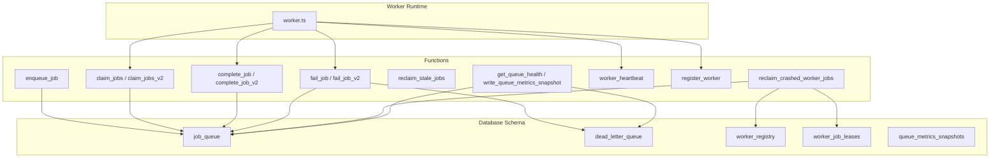
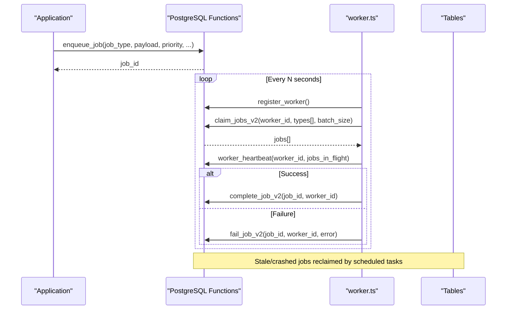
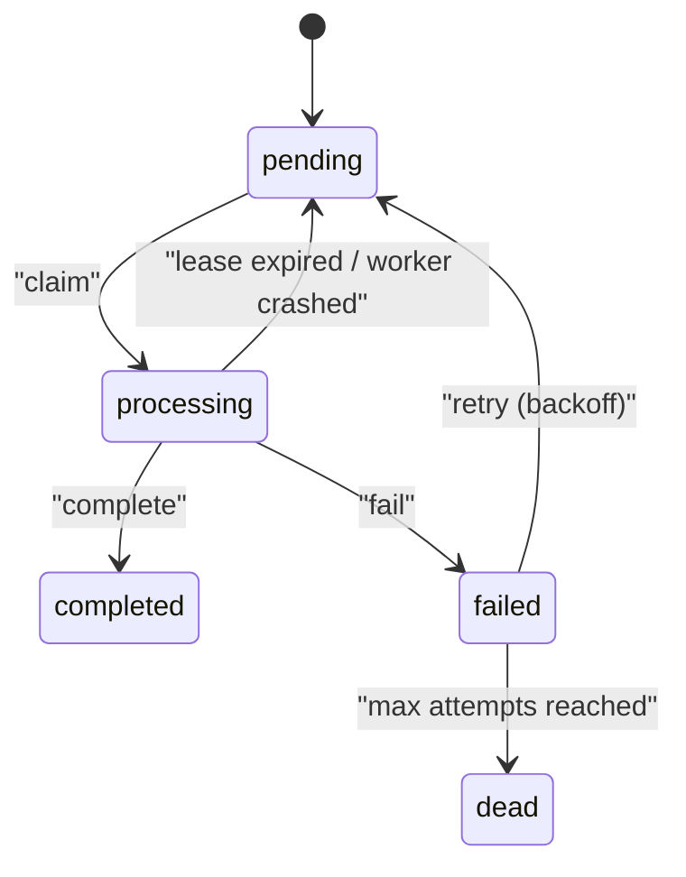
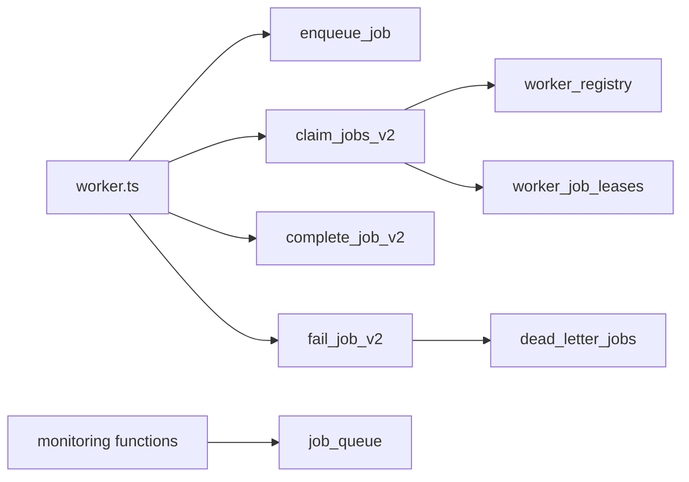

# Job Queue System

<cite>
**Referenced Files in This Document**
- [06_background_job_queue.sql](file://supabase/migrations/06_background_job_queue.sql)
- [14_dead_letter_queue.sql](file://supabase/migrations/14_dead_letter_queue.sql)
- [17_queue_monitoring_engine.sql](file://supabase/migrations/17_queue_monitoring_engine.sql)
- [19_background_worker_engine.sql](file://supabase/migrations/19_background_worker_engine.sql)
- [worker.ts](file://supabase/functions/_shared/worker.ts)
- [types.ts](file://supabase/functions/_shared/types.ts)
</cite>

## Table of Contents

1. [Introduction](#introduction)
2. [Project Structure](#project-structure)
3. [Core Components](#core-components)
4. [Architecture Overview](#architecture-overview)
5. [Detailed Component Analysis](#detailed-component-analysis)
6. [Dependency Analysis](#dependency-analysis)
7. [Performance Considerations](#performance-considerations)
8. [Troubleshooting Guide](#troubleshooting-guide)
9. [Conclusion](#conclusion)
10. [Appendices](#appendices)

## Introduction

This document describes the Job Queue System used for background processing
across the application. It covers the database schema, job lifecycle management
(creation, claiming, completion, failure, retries, and dead-letter handling),
queue operations, priority and ordering strategies, and monitoring and
performance considerations. The system is implemented as PostgreSQL functions
and tables with a TypeScript worker integration that calls these functions via
RPC.

## Project Structure

The job queue spans several migrations and a shared worker utility:

- Core job queue schema and operations are defined in the background job queue
  migration.
- Dead letter queue and retry/recovery utilities are defined in the dead letter
  queue migration.
- Monitoring, metrics snapshots, and health checks are provided by the queue
  monitoring engine migration.
- Worker registry, leases, and advanced claim/completion/failure flows are
  defined in the background worker engine migration.
- A TypeScript worker helper integrates with the database to register workers,
  heartbeat, claim jobs, complete or fail them, and process jobs safely.

**Diagram sources**

- [06_background_job_queue.sql:41-138](file://supabase/migrations/06_background_job_queue.sql#L41-L138)
- [14_dead_letter_queue.sql:39-162](file://supabase/migrations/14_dead_letter_queue.sql#L39-L162)
- [19_background_worker_engine.sql:18-148](file://supabase/migrations/19_background_worker_engine.sql#L18-L148)
- [17_queue_monitoring_engine.sql:14-74](file://supabase/migrations/17_queue_monitoring_engine.sql#L14-L74)
- [worker.ts:30-178](file://supabase/functions/_shared/worker.ts#L30-L178)

**Section sources**

- [06_background_job_queue.sql:1-550](file://supabase/migrations/06_background_job_queue.sql#L1-L550)
- [14_dead_letter_queue.sql:1-481](file://supabase/migrations/14_dead_letter_queue.sql#L1-L481)
- [17_queue_monitoring_engine.sql:1-928](file://supabase/migrations/17_queue_monitoring_engine.sql#L1-L928)
- [19_background_worker_engine.sql:1-957](file://supabase/migrations/19_background_worker_engine.sql#L1-L957)
- [worker.ts:1-257](file://supabase/functions/_shared/worker.ts#L1-L257)

## Core Components

- Job table and enums: Defines job states and priorities, core fields, and
  indexes for efficient claiming and retry scheduling.
- Enqueue function: Inserts jobs with idempotency support and optional
  scheduling.
- Claim functions: Two versions; v2 adds per-job leases and worker registry
  integration for robust crash recovery.
- Completion and failure functions: Transition jobs to completed or failed/dead,
  manage retries with exponential backoff, and move exhausted jobs to dead
  letter.
- Worker registry and leases: Track active workers, heartbeats, and per-job
  lease lifetimes to detect and reclaim stuck work.
- Monitoring: Health queries, backlog alerts, and periodic metric snapshots.

**Section sources**

- [06_background_job_queue.sql:12-138](file://supabase/migrations/06_background_job_queue.sql#L12-L138)
- [06_background_job_queue.sql:194-449](file://supabase/migrations/06_background_job_queue.sql#L194-L449)
- [19_background_worker_engine.sql:18-148](file://supabase/migrations/19_background_worker_engine.sql#L18-L148)
- [19_background_worker_engine.sql:154-800](file://supabase/migrations/19_background_worker_engine.sql#L154-L800)
- [17_queue_monitoring_engine.sql:124-488](file://supabase/migrations/17_queue_monitoring_engine.sql#L124-L488)

## Architecture Overview

The system uses PostgreSQL functions to enforce consistency and concurrency
control. Workers call these functions via RPC from TypeScript runtime code.

**Diagram sources**

- [06_background_job_queue.sql:194-449](file://supabase/migrations/06_background_job_queue.sql#L194-L449)
- [19_background_worker_engine.sql:154-800](file://supabase/migrations/19_background_worker_engine.sql#L154-L800)
- [worker.ts:30-178](file://supabase/functions/_shared/worker.ts#L30-L178)

## Detailed Component Analysis

### Database Schema: job_queue

Key fields and constraints:

- id: Primary key UUID
- job_type: Text identifier for the kind of job
- payload: JSONB object validated at insert/update
- priority: Enum low/normal/high/critical
- status: Enum pending/processing/completed/failed/dead
- hospital_id, related_booking_id: Optional references for multi-tenancy and
  domain linkage
- scheduled_at: When the job becomes eligible for processing
- processing_started_at, processing_completed_at: Lifecycle timestamps
- lease_expires_at, worker_id: Ownership during processing
- attempt_count, max_attempts: Retry controls
- last_error, next_attempt_at: Error tracking and retry scheduling
- idempotency_key: Prevents duplicate enqueues
- metadata: Additional context
- created_at, updated_at: Audit timestamps

Indexes optimize:

- Claiming pending jobs by schedule time and creation time
- Failed jobs waiting for retry
- Processing jobs by lease expiry
- Hospital-scoped queries
- Type/status filtering
- Worker-scoped processing queries

**Section sources**

- [06_background_job_queue.sql:41-138](file://supabase/migrations/06_background_job_queue.sql#L41-L138)

### Job States and Transitions

States:

- pending: Eligible for processing when scheduled_at <= now()
- processing: Claimed by a worker; has worker_id and lease_expires_at
- completed: Successfully finished
- failed: Temporary failure; will be retried based on attempt_count and backoff
- dead: Exhausted retries; moved to dead letter

Transitions:

- pending -> processing: via claim_jobs or claim_jobs_v2
- processing -> completed: via complete_job or complete_job_v2
- processing -> failed: via fail_job or fail_job_v2
- failed -> pending: automatic rescheduling with exponential backoff
- failed -> dead: when attempt_count >= max_attempts
- processing -> pending: reclaimed if lease expires or worker crashes

**Diagram sources**

- [06_background_job_queue.sql:12-23](file://supabase/migrations/06_background_job_queue.sql#L12-L23)
- [06_background_job_queue.sql:264-449](file://supabase/migrations/06_background_job_queue.sql#L264-L449)
- [19_background_worker_engine.sql:423-800](file://supabase/migrations/19_background_worker_engine.sql#L423-L800)

**Section sources**

- [06_background_job_queue.sql:12-23](file://supabase/migrations/06_background_job_queue.sql#L12-L23)
- [06_background_job_queue.sql:264-449](file://supabase/migrations/06_background_job_queue.sql#L264-L449)
- [19_background_worker_engine.sql:423-800](file://supabase/migrations/19_background_worker_engine.sql#L423-L800)

### Enqueue Jobs

- Use enqueue_job to insert jobs with idempotency_key to avoid duplicates.
- Supports priority, scheduled_at, hospital_id, related_booking_id, and
  metadata.
- Returns the job id for tracking.

Typical usage patterns:

- Immediate execution: set scheduled_at to now()
- Delayed execution: set scheduled_at to a future time
- Idempotent enqueues: reuse idempotency_key to prevent double-processing

**Section sources**

- [06_background_job_queue.sql:194-257](file://supabase/migrations/06_background_job_queue.sql#L194-L257)

### Claiming Jobs and Priority Handling

Two claim mechanisms exist:

- claim_jobs: Basic version with lease minutes parameter and priority ordering
  using a CASE expression mapping enum values to numeric ranks.
- claim_jobs_v2: Advanced version that:
  - Checks worker status to prevent draining workers from claiming
  - Orders by priority DESC then scheduled_at ASC
  - Registers per-job leases in worker_job_leases for crash recovery
  - Updates worker_registry counters

Priority ordering:

- In claim_jobs, priority is mapped to numeric ranks: critical=1, high=2,
  normal=3, low=4
- In claim_jobs_v2, ORDER BY priority DESC leverages enum ordering where higher
  values have precedence

Batch size controls throughput per claim cycle.

**Section sources**

- [06_background_job_queue.sql:264-321](file://supabase/migrations/06_background_job_queue.sql#L264-L321)
- [19_background_worker_engine.sql:497-610](file://supabase/migrations/19_background_worker_engine.sql#L497-L610)

### Completing and Failing Jobs

- complete_job / complete_job_v2: Mark job as completed, clear worker ownership,
  record completion timestamp, update worker metrics.
- fail_job / fail_job_v2: On failure:
  - If attempt_count >= max_attempts: move to dead state and insert into
    dead_letter_jobs
  - Else: reset to pending with next_attempt_at and scheduled_at set using
    exponential backoff capped at one day
  - Update worker metrics and lease records

Exponential backoff formula:

- next_attempt_at = now() + min(2^attempt_count minutes, 1440 minutes)

**Section sources**

- [06_background_job_queue.sql:326-449](file://supabase/migrations/06_background_job_queue.sql#L326-L449)
- [19_background_worker_engine.sql:616-800](file://supabase/migrations/19_background_worker_engine.sql#L616-L800)

### Dead Letter Queue

- dead_letter_queue captures failed items from multiple sources with rich
  metadata, including source type, source id, job type, errors, and resolution
  state.
- send_to_dead_letter inserts or updates entries idempotently.
- retry_dead_letter_item re-enqueues or resets source records depending on
  source type and marks the item resolved.

Dead letter resolution states include unresolved, retried_successfully,
manually_resolved, discarded.

**Section sources**

- [14_dead_letter_queue.sql:39-162](file://supabase/migrations/14_dead_letter_queue.sql#L39-L162)
- [14_dead_letter_queue.sql:189-360](file://supabase/migrations/14_dead_letter_queue.sql#L189-L360)

### Worker Registry and Lease Management

- worker_registry tracks worker identity, type, instance, heartbeat, lease
  duration, status, and counters.
- worker_job_leases records per-job leases with expiration times and outcomes.
- register_worker initializes or refreshes worker entry.
- worker_heartbeat extends lease and optionally logs metrics.
- extend_job_lease allows long-running jobs to renew their lease.
- detect_crashed_workers marks inactive workers as crashed.
- reclaim_crashed_worker_jobs moves stuck jobs back to pending and marks leases
  reclaimed.

**Section sources**

- [19_background_worker_engine.sql:18-148](file://supabase/migrations/19_background_worker_engine.sql#L18-L148)
- [19_background_worker_engine.sql:154-488](file://supabase/migrations/19_background_worker_engine.sql#L154-L488)

### TypeScript Worker Integration

The worker.ts module provides:

- registerWorker: Calls register_worker RPC
- sendWorkerHeartbeat: Calls worker_heartbeat RPC
- claimJobs: Calls claim_jobs_v2 RPC
- completeJob: Calls complete_job_v2 RPC
- failJob: Calls fail_job_v2 RPC
- startHeartbeatLoop: Periodically sends heartbeats
- processJob: Wraps job processing with try/catch to ensure completion or
  failure is recorded

Types:

- DbJobQueue mirrors the job_queue row shape, including status, priority,
  timestamps, and attempt counts.

**Section sources**

- [worker.ts:30-178](file://supabase/functions/_shared/worker.ts#L30-L178)
- [types.ts:230-250](file://supabase/functions/_shared/types.ts#L230-L250)

### Monitoring and Health

- get_queue_health returns counts and age metrics for job queues, WhatsApp
  messages, and notifications.
- check_queue_backlog_alerts flags high backlog or stuck oldest jobs.
- write_queue_metrics_snapshot persists metrics to queue_metrics_snapshots with
  retention cleanup.
- run_scheduled_tasks orchestrates stale job reclamation and metrics
  snapshotting.

**Section sources**

- [17_queue_monitoring_engine.sql:124-488](file://supabase/migrations/17_queue_monitoring_engine.sql#L124-L488)
- [17_queue_monitoring_engine.sql:702-777](file://supabase/migrations/17_queue_monitoring_engine.sql#L702-L777)

## Dependency Analysis

- worker.ts depends on database RPCs exposed by migrations.
- claim_jobs_v2 depends on worker_registry and worker_job_leases for robustness.
- fail_job and fail_job_v2 depend on dead_letter_jobs and dead_letter_queue for
  finalization.
- Monitoring functions depend on job_queue and other queues for health metrics.

**Diagram sources**

- [worker.ts:30-178](file://supabase/functions/_shared/worker.ts#L30-L178)
- [19_background_worker_engine.sql:497-800](file://supabase/migrations/19_background_worker_engine.sql#L497-L800)
- [14_dead_letter_queue.sql:189-360](file://supabase/migrations/14_dead_letter_queue.sql#L189-L360)
- [17_queue_monitoring_engine.sql:124-488](file://supabase/migrations/17_queue_monitoring_engine.sql#L124-L488)

**Section sources**

- [worker.ts:30-178](file://supabase/functions/_shared/worker.ts#L30-L178)
- [19_background_worker_engine.sql:497-800](file://supabase/migrations/19_background_worker_engine.sql#L497-L800)
- [14_dead_letter_queue.sql:189-360](file://supabase/migrations/14_dead_letter_queue.sql#L189-L360)
- [17_queue_monitoring_engine.sql:124-488](file://supabase/migrations/17_queue_monitoring_engine.sql#L124-L488)

## Performance Considerations

Indexing strategy:

- Partial indexes on job_queue for pending, failed, and processing states reduce
  scan sizes and improve claim speed.
- Composite indexes on hospital_id and created_at enable tenant-scoped queries.
- Indexes on next_attempt_at accelerate retry scheduling.

Concurrency and locking:

- FOR UPDATE SKIP LOCKED prevents double-processing under concurrent workers.
- Per-job leases in worker_job_leases allow safe detection and reclamation of
  stuck work.

Backoff and retry:

- Exponential backoff limits retry frequency while ensuring eventual processing.
- Max attempts cap retries and route to dead letter to prevent infinite loops.

Monitoring:

- Metrics snapshots capture throughput and aging metrics for alerting and
  capacity planning.
- Backlog alerts help identify bottlenecks early.

Recommendations:

- Tune batch_size based on worker capacity and job complexity.
- Adjust lease durations and heartbeat intervals to match job SLAs.
- Monitor dead letter growth and investigate recurring failures.
- Partition or archive completed jobs periodically to maintain query
  performance.

[No sources needed since this section provides general guidance]

## Troubleshooting Guide

Common issues and resolutions:

- Stuck jobs in processing:
  - Check lease_expires_at and worker status; use reclaim_stale_jobs or
    reclaim_crashed_worker_jobs to reset to pending.
- High backlog:
  - Use get_queue_health and check_queue_backlog_alerts to assess pending counts
    and oldest job age.
- Frequent failures:
  - Inspect last_error and attempt_count; consider increasing max_attempts or
    fixing upstream dependencies.
- Dead letter accumulation:
  - Review dead_letter_queue entries; use retry_dead_letter_item to reprocess
    after remediation.

Operational tasks:

- Reclaim stale jobs: reclaim_stale_jobs(timeout_minutes)
- Detect crashed workers: detect_crashed_workers()
- Reclaim crashed worker jobs: reclaim_crashed_worker_jobs()
- Write metrics snapshot: write_queue_metrics_snapshot()

**Section sources**

- [06_background_job_queue.sql:455-484](file://supabase/migrations/06_background_job_queue.sql#L455-L484)
- [19_background_worker_engine.sql:377-488](file://supabase/migrations/19_background_worker_engine.sql#L377-L488)
- [17_queue_monitoring_engine.sql:348-488](file://supabase/migrations/17_queue_monitoring_engine.sql#L348-L488)

## Conclusion

The Job Queue System provides a robust, production-ready mechanism for
background job processing with strong guarantees around concurrency, retries,
and failure handling. Its design leverages PostgreSQL functions for atomicity
and safety, TypeScript worker utilities for operational simplicity, and
comprehensive monitoring for observability. By following the recommended
practices for indexing, batching, and monitoring, teams can scale reliably under
high-volume workloads.

[No sources needed since this section summarizes without analyzing specific
files]

## Appendices

### Example Workflows

- Enqueue a job:
  - Call enqueue_job with job_type, payload, priority, and optional scheduling
    and idempotency key.
  - Reference:
    [enqueue_job:194-257](file://supabase/migrations/06_background_job_queue.sql#L194-L257)

- Claim and process jobs:
  - Register worker and heartbeat via register_worker and worker_heartbeat.
  - Claim jobs using claim_jobs_v2 with desired job types and batch size.
  - Process each job; on success call complete_job_v2; on failure call
    fail_job_v2.
  - References:
    - [register_worker:154-232](file://supabase/migrations/19_background_worker_engine.sql#L154-L232)
    - [worker_heartbeat:247-318](file://supabase/migrations/19_background_worker_engine.sql#L247-L318)
    - [claim_jobs_v2:497-610](file://supabase/migrations/19_background_worker_engine.sql#L497-L610)
    - [complete_job_v2:616-677](file://supabase/migrations/19_background_worker_engine.sql#L616-L677)
    - [fail_job_v2:683-800](file://supabase/migrations/19_background_worker_engine.sql#L683-L800)

- Query job status:
  - Read from job_queue filtered by id or status; use indexes for performance.
  - Reference:
    [job_queue schema and indexes:41-138](file://supabase/migrations/06_background_job_queue.sql#L41-L138)

- Manage lifecycles:
  - Reclaim stale jobs: reclaim_stale_jobs
  - Detect and recover from crashes: detect_crashed_workers,
    reclaim_crashed_worker_jobs
  - Reference:
    [stale job reclamation:455-484](file://supabase/migrations/06_background_job_queue.sql#L455-L484),
    [crash recovery:377-488](file://supabase/migrations/19_background_worker_engine.sql#L377-L488)

**Section sources**

- [06_background_job_queue.sql:194-484](file://supabase/migrations/06_background_job_queue.sql#L194-L484)
- [19_background_worker_engine.sql:154-800](file://supabase/migrations/19_background_worker_engine.sql#L154-L800)
