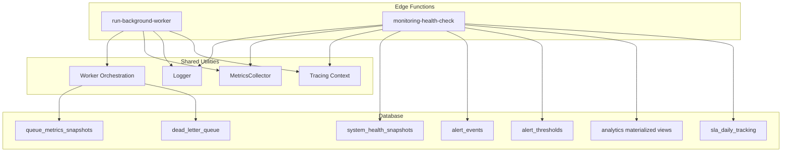
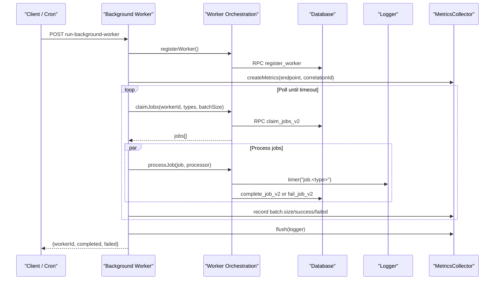
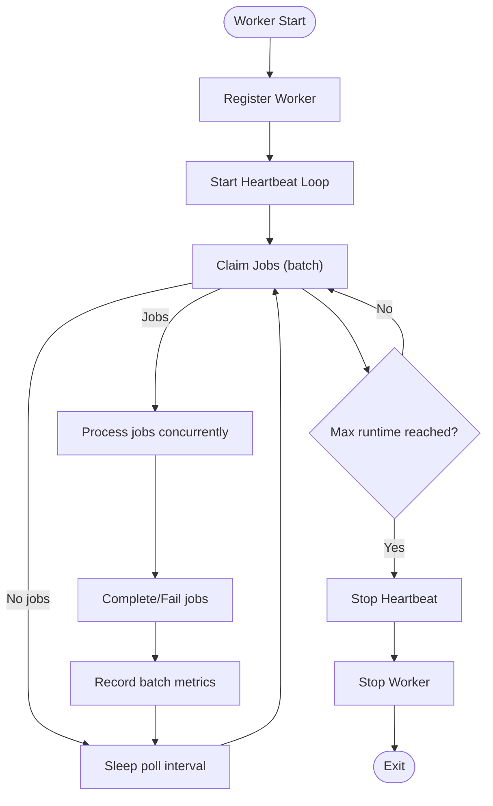
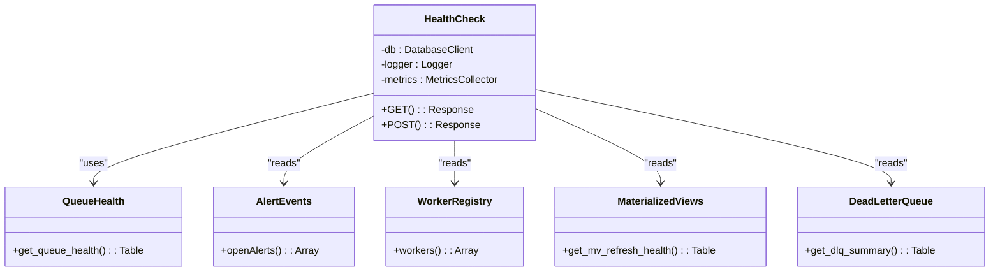
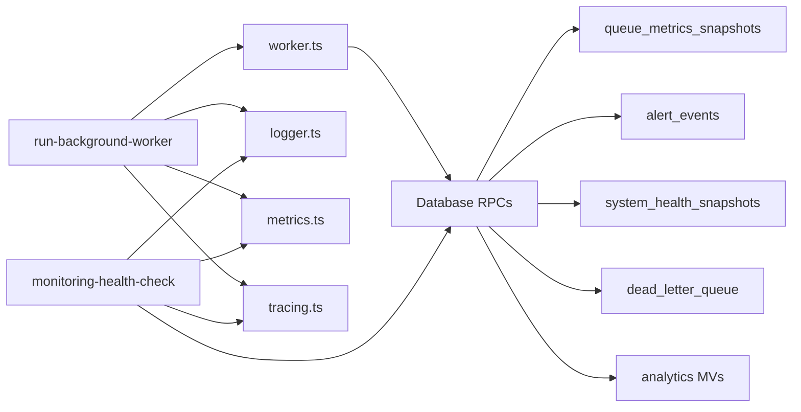

# Monitoring & Analytics

<cite>
**Referenced Files in This Document**
- [logger.ts](file://supabase/functions/_shared/logger.ts)
- [metrics.ts](file://supabase/functions/_shared/metrics.ts)
- [tracing.ts](file://supabase/functions/_shared/tracing.ts)
- [worker.ts](file://supabase/functions/_shared/worker.ts)
- [run-background-worker/index.ts](file://supabase/functions/run-background-worker/index.ts)
- [monitoring-health-check/index.ts](file://supabase/functions/monitoring-health-check/index.ts)
- [17_queue_monitoring_engine.sql](file://supabase/migrations/17_queue_monitoring_engine.sql)
- [24_operational-monitoring_engine.sql](file://supabase/migrations/24_operational-monitoring_engine.sql)
- [14_dead_letter_queue.sql](file://supabase/migrations/14_dead_letter_queue.sql)
- [08_analytics_engine.sql](file://supabase/migrations/08_analytics_engine.sql)
- [types.ts](file://supabase/functions/_shared/types.ts)
</cite>

## Table of Contents

1. Introduction
2. Project Structure
3. Core Components
4. Architecture Overview
5. Detailed Component Analysis
6. Dependency Analysis
7. Performance Considerations
8. Troubleshooting Guide
9. Conclusion
10. Appendices

## Introduction

This document provides comprehensive guidance for monitoring and analytics of
background processing systems in the project. It covers logging strategies,
worker performance metrics, system health indicators, metrics collection for
throughput and latency, dashboard setup, alerting rules, profiling techniques,
log aggregation, search capabilities, and troubleshooting workflows. The focus
is on how the codebase implements structured logging, runtime metrics, worker
lifecycle management, queue health, dead-letter handling, and operational
dashboards.

## Project Structure

The monitoring and analytics features are implemented across shared utilities
and Edge Functions, with persistent state and analytics stored in database
migrations:

- Shared utilities provide structured logging, metrics collection, tracing
  context, and worker orchestration.
- Background worker function orchestrates job claiming, processing, heartbeat,
  and metrics flushing.
- Health check function aggregates system health, alerts, queue status, worker
  registry, materialized view freshness, DLQ summary, and partition readiness.
- Database migrations define queue metrics snapshots, alert thresholds/events,
  system health snapshots, SLA tracking, and analytics materialized views.

**Diagram sources**

- [run-background-worker/index.ts:247-453](file://supabase/functions/run-background-worker/index.ts#L247-L453)
- [monitoring-health-check/index.ts:22-230](file://supabase/functions/monitoring-health-check/index.ts#L22-L230)
- [logger.ts:122-189](file://supabase/functions/_shared/logger.ts#L122-L189)
- [metrics.ts:24-118](file://supabase/functions/_shared/metrics.ts#L24-L118)
- [tracing.ts:17-49](file://supabase/functions/_shared/tracing.ts#L17-L49)
- [worker.ts:30-257](file://supabase/functions/_shared/worker.ts#L30-L257)
- [17_queue_monitoring_engine.sql:14-51](file://supabase/migrations/17_queue_monitoring_engine.sql#L14-L51)
- [24_operational-monitoring_engine.sql:37-138](file://supabase/migrations/24_operational-monitoring_engine.sql#L37-L138)
- [14_dead_letter_queue.sql:39-123](file://supabase/migrations/14_dead_letter_queue.sql#L39-L123)
- [08_analytics_engine.sql:48-148](file://supabase/migrations/08_analytics_engine.sql#L48-L148)

**Section sources**

- [run-background-worker/index.ts:247-453](file://supabase/functions/run-background-worker/index.ts#L247-L453)
- [monitoring-health-check/index.ts:22-230](file://supabase/functions/monitoring-health-check/index.ts#L22-L230)
- [17_queue_monitoring_engine.sql:14-51](file://supabase/migrations/17_queue_monitoring_engine.sql#L14-L51)
- [24_operational-monitoring_engine.sql:37-138](file://supabase/migrations/24_operational-monitoring_engine.sql#L37-L138)
- [14_dead_letter_queue.sql:39-123](file://supabase/migrations/14_dead_letter_queue.sql#L39-L123)
- [08_analytics_engine.sql:48-148](file://supabase/migrations/08_analytics_engine.sql#L48-L148)

## Core Components

- Structured Logger: Produces JSON log lines with correlation IDs, levels, and
  error serialization; supports child loggers and timers.
- Metrics Collector: Collects timing, counters, and gauges per request; flushes
  as structured logs parseable by external collectors.
- Tracing Context: Generates and propagates correlation/request/span IDs and
  measures elapsed time.
- Worker Orchestration: Registers workers, heartbeats, claims jobs safely,
  completes/fails jobs, and processes jobs with retry safety.
- Background Worker Function: Runs a bounded loop to claim and process multiple
  job types, records batch metrics, and flushes metrics at completion.
- Health Check Function: Aggregates health score, open alerts, queue health,
  worker status, materialized view freshness, DLQ summary, partitions, and
  revenue backlog.

Key implementation references:

- Logging and timers:
  [logger.ts:122-189](file://supabase/functions/_shared/logger.ts#L122-L189)
- Metrics emission:
  [metrics.ts:24-118](file://supabase/functions/_shared/metrics.ts#L24-L118)
- Trace propagation:
  [tracing.ts:17-49](file://supabase/functions/_shared/tracing.ts#L17-L49)
- Worker lifecycle and job processing:
  [worker.ts:30-257](file://supabase/functions/_shared/worker.ts#L30-L257)
- Worker run loop and metrics:
  [run-background-worker/index.ts:247-453](file://supabase/functions/run-background-worker/index.ts#L247-L453)
- Health aggregation:
  [monitoring-health-check/index.ts:22-230](file://supabase/functions/monitoring-health-check/index.ts#L22-L230)

**Section sources**

- [logger.ts:122-189](file://supabase/functions/_shared/logger.ts#L122-L189)
- [metrics.ts:24-118](file://supabase/functions/_shared/metrics.ts#L24-L118)
- [tracing.ts:17-49](file://supabase/functions/_shared/tracing.ts#L17-L49)
- [worker.ts:30-257](file://supabase/functions/_shared/worker.ts#L30-L257)
- [run-background-worker/index.ts:247-453](file://supabase/functions/run-background-worker/index.ts#L247-L453)
- [monitoring-health-check/index.ts:22-230](file://supabase/functions/monitoring-health-check/index.ts#L22-L230)

## Architecture Overview

The system uses a combination of in-process metrics and structured logs emitted
from Edge Functions, persisted via database tables for historical analysis and
dashboards. Workers maintain leases and heartbeats to ensure crash recovery and
accurate health reporting. Operational checks aggregate multi-source signals
into a unified health score and expose them through a health endpoint.

**Diagram sources**

- [run-background-worker/index.ts:247-453](file://supabase/functions/run-background-worker/index.ts#L247-L453)
- [worker.ts:30-257](file://supabase/functions/_shared/worker.ts#L30-L257)
- [metrics.ts:24-118](file://supabase/functions/_shared/metrics.ts#L24-L118)
- [logger.ts:122-189](file://supabase/functions/_shared/logger.ts#L122-L189)

## Detailed Component Analysis

### Structured Logging Strategy

- Every log line is a single JSON object with timestamp, level, message,
  service, version, environment, and contextual fields.
- Correlation ID flows across services via headers; child loggers merge
  additional context per request/job.
- Error serialization preserves stack traces in non-production and captures
  custom error fields.
- Timers measure durations and emit info logs with durationMs.

Usage patterns:

- Create request-scoped logger at handler entry.
- Use child logger for job-level context (jobId, jobType, attempt).
- Emit metric events via metrics collector flushed at end of handler.

**Section sources**

- [logger.ts:122-189](file://supabase/functions/_shared/logger.ts#L122-L189)
- [tracing.ts:17-49](file://supabase/functions/_shared/tracing.ts#L17-L49)

### Metrics Collection for Throughput and Latency

- MetricsCollector records counts, timings, and gauges with tags (endpoint,
  correlationId, hospitalId).
- Timing helpers wrap critical sections; flush emits structured logs parseable
  by Datadog/Grafana Loki/CloudWatch.
- Background worker records batch size, success, failed counts, and total
  runtime; health check records request timing and success/error increments.

Examples of recorded metrics:

- Batch metrics: worker.batch.size, worker.batch.success, worker.batch.failed
- Runtime: worker.runtime, request.total
- Health: health.check.success, health.check.error

**Section sources**

- [metrics.ts:24-118](file://supabase/functions/_shared/metrics.ts#L24-L118)
- [run-background-worker/index.ts:398-447](file://supabase/functions/run-background-worker/index.ts#L398-L447)
- [monitoring-health-check/index.ts:206-208](file://supabase/functions/monitoring-health-check/index.ts#L206-L208)

### Worker Performance and Lease Management

- Workers register with unique IDs and instance IDs; heartbeat every interval
  reports jobs-in-flight.
- Jobs are claimed using FOR UPDATE SKIP LOCKED semantics via RPC to prevent
  double-processing.
- Job processing wraps each job with a child logger and timer; completion or
  failure updates DB and logs accordingly.
- Heartbeat loop runs asynchronously and can be stopped when worker finishes.

**Diagram sources**

- [worker.ts:30-257](file://supabase/functions/_shared/worker.ts#L30-L257)
- [run-background-worker/index.ts:309-439](file://supabase/functions/run-background-worker/index.ts#L309-L439)

**Section sources**

- [worker.ts:30-257](file://supabase/functions/_shared/worker.ts#L30-L257)
- [run-background-worker/index.ts:309-439](file://supabase/functions/run-background-worker/index.ts#L309-L439)

### System Health Indicators and Dashboard Data

- Health endpoint returns lightweight GET snapshot or full POST report including
  health score, open alerts, queue health, worker registry, materialized view
  freshness, DLQ summary, partitions, and revenue backlog.
- Health score computed from critical/warning alerts and crashed workers;
  snapshots stored for historical trends.
- Queue health function aggregates pending/processing/failed/dead counts and
  throughput across job queues, WhatsApp messages, and notifications.

**Diagram sources**

- [monitoring-health-check/index.ts:22-230](file://supabase/functions/monitoring-health-check/index.ts#L22-L230)
- [17_queue_monitoring_engine.sql:124-277](file://supabase/migrations/17_queue_monitoring_engine.sql#L124-L277)
- [24_operational-monitoring_engine.sql:109-138](file://supabase/migrations/24_operational-monitoring_engine.sql#L109-L138)
- [14_dead_letter_queue.sql:366-401](file://supabase/migrations/14_dead_letter_queue.sql#L366-L401)

**Section sources**

- [monitoring-health-check/index.ts:22-230](file://supabase/functions/monitoring-health-check/index.ts#L22-L230)
- [17_queue_monitoring_engine.sql:124-277](file://supabase/migrations/17_queue_monitoring_engine.sql#L124-L277)
- [24_operational-monitoring_engine.sql:109-138](file://supabase/migrations/24_operational-monitoring_engine.sql#L109-L138)
- [14_dead_letter_queue.sql:366-401](file://supabase/migrations/14_dead_letter_queue.sql#L366-L401)

### Alerting Rules and Thresholds

- Alert thresholds table defines configurable keys, values, units, severity, and
  notes; defaults include queue backlog, worker crashes, WhatsApp failures, DLQ
  backlog, and analytics refresh lag.
- fire_alert function prevents duplicate alerts within an hour and persists
  alert events with severity and current/threshold values.
- Health check computes health score based on critical/warning alerts and
  crashed workers; snapshots store aggregated metrics.

Operational usage:

- Configure thresholds per hospital or globally.
- Use health endpoint to retrieve open alerts and health score.
- Integrate with external alerting systems by parsing alert_events.

**Section sources**

- [24_operational-monitoring_engine.sql:37-103](file://supabase/migrations/24_operational-monitoring_engine.sql#L37-L103)
- [24_operational-monitoring_engine.sql:216-277](file://supabase/migrations/24_operational-monitoring_engine.sql#L216-L277)
- [24_operational-monitoring_engine.sql:283-397](file://supabase/migrations/24_operational-monitoring_engine.sql#L283-L397)

### Dead Letter Queue and Failure Handling

- Dead letter queue stores failed items with source, payload, errors, priority,
  and resolution state; includes indexes for unresolved and alertable items.
- send_to_dead_letter is idempotent and race-safe; retry_dead_letter_item
  re-enqueues or resets original item and marks resolved.
- get_dlq_summary provides unresolved and critical counts per source.

Integration points:

- Worker fail path calls fail_job_v2 which routes to DLQ logic.
- Health endpoint includes DLQ summary for operational visibility.

**Section sources**

- [14_dead_letter_queue.sql:39-123](file://supabase/migrations/14_dead_letter_queue.sql#L39-L123)
- [14_dead_letter_queue.sql:189-257](file://supabase/migrations/14_dead_letter_queue.sql#L189-L257)
- [14_dead_letter_queue.sql:279-357](file://supabase/migrations/14_dead_letter_queue.sql#L279-L357)
- [14_dead_letter_queue.sql:366-401](file://supabase/migrations/14_dead_letter_queue.sql#L366-L401)

### Analytics Engine and Materialized Views

- Materialized views compute daily hospital stats, doctor performance, peak hour
  analysis, village analysis, and revenue forecast with rolling averages.
- Ordered refresh function refreshes views sequentially with logging and
  concurrency control via advisory locks.
- MV refresh health exposes last refresh times, durations, success, row counts,
  and staleness.

Dashboard integration:

- Use mv refresh health to monitor freshness and detect stale data.
- Query materialized views for operational dashboards and SLA reporting.

**Section sources**

- [08_analytics_engine.sql:48-148](file://supabase/migrations/08_analytics_engine.sql#L48-L148)
- [08_analytics_engine.sql:154-226](file://supabase/migrations/08_analytics_engine.sql#L154-L226)
- [08_analytics_engine.sql:239-301](file://supabase/migrations/08_analytics_engine.sql#L239-L301)
- [08_analytics_engine.sql:314-347](file://supabase/migrations/08_analytics_engine.sql#L314-L347)
- [08_analytics_engine.sql:377-446](file://supabase/migrations/08_analytics_engine.sql#L377-L446)
- [17_queue_monitoring_engine.sql:653-696](file://supabase/migrations/17_queue_monitoring_engine.sql#L653-L696)

## Dependency Analysis

- Background worker depends on shared worker orchestration, logger, metrics, and
  tracing utilities; interacts with database RPCs for job claiming and
  completion.
- Health check depends on database functions for queue health, MV refresh
  health, DLQ summary, and alert events; uses logger and metrics for request
  instrumentation.
- Migrations define persistent structures consumed by both worker and health
  components.

**Diagram sources**

- [run-background-worker/index.ts:247-453](file://supabase/functions/run-background-worker/index.ts#L247-L453)
- [monitoring-health-check/index.ts:22-230](file://supabase/functions/monitoring-health-check/index.ts#L22-L230)
- [worker.ts:30-257](file://supabase/functions/_shared/worker.ts#L30-L257)
- [17_queue_monitoring_engine.sql:14-51](file://supabase/migrations/17_queue_monitoring_engine.sql#L14-L51)
- [24_operational-monitoring_engine.sql:109-138](file://supabase/migrations/24_operational-monitoring_engine.sql#L109-L138)
- [14_dead_letter_queue.sql:39-123](file://supabase/migrations/14_dead_letter_queue.sql#L39-L123)
- [08_analytics_engine.sql:48-148](file://supabase/migrations/08_analytics_engine.sql#L48-L148)

**Section sources**

- [run-background-worker/index.ts:247-453](file://supabase/functions/run-background-worker/index.ts#L247-L453)
- [monitoring-health-check/index.ts:22-230](file://supabase/functions/monitoring-health-check/index.ts#L22-L230)
- [worker.ts:30-257](file://supabase/functions/_shared/worker.ts#L30-L257)

## Performance Considerations

- Use batched job claiming to reduce DB contention and improve throughput.
- Employ FOR UPDATE SKIP LOCKED semantics to avoid double-processing and
  minimize lock waits.
- Keep heartbeat intervals reasonable to balance liveness detection with
  overhead.
- Flush metrics at handler boundaries to avoid excessive log volume during
  processing.
- Monitor materialized view refresh durations and staleness to ensure dashboard
  accuracy.
- Leverage structured logs for efficient parsing and filtering in log
  aggregators.

[No sources needed since this section provides general guidance]

## Troubleshooting Guide

Common issues and workflows:

- Stuck jobs: Use stuck job detector to identify jobs processing beyond
  threshold; reclaim stale jobs via scheduled tasks.
- High backlog: Check queue health and backlog alerts; adjust worker capacity or
  job priorities.
- Worker crashes: Inspect worker registry and health snapshots; verify heartbeat
  and lease expiration.
- DLQ accumulation: Review DLQ summary and unresolved items; retry or resolve
  manually.
- Analytics staleness: Check MV refresh health and logs; trigger ordered refresh
  if necessary.

Investigation steps:

- Correlate logs using correlationId across services.
- Query system_health_snapshots for recent health scores and component statuses.
- Use alert_events to identify open alerts and their severity.
- Examine queue_metrics_snapshots for historical trends in
  pending/processing/failed/dead counts and throughput.

**Section sources**

- [17_queue_monitoring_engine.sql:283-342](file://supabase/migrations/17_queue_monitoring_engine.sql#L283-L342)
- [17_queue_monitoring_engine.sql:348-401](file://supabase/migrations/17_queue_monitoring_engine.sql#L348-L401)
- [24_operational-monitoring_engine.sql:157-188](file://supabase/migrations/24_operational-monitoring_engine.sql#L157-L188)
- [14_dead_letter_queue.sql:366-401](file://supabase/migrations/14_dead_letter_queue.sql#L366-L401)

## Conclusion

The system implements robust monitoring and analytics for background processing
through structured logging, runtime metrics, worker lifecycle management, queue
health aggregation, alerting thresholds, and operational dashboards. By
leveraging correlation IDs, heartbeat-based worker liveness, and persistent
snapshots, operators can track throughput, latency distributions, error rates,
and system health in real time. Integrating these components with external log
aggregators and dashboards enables proactive alerting and efficient
troubleshooting.

[No sources needed since this section summarizes without analyzing specific
files]

## Appendices

### Example: Implementing Custom Metrics

- Create a metrics collector with endpoint and correlationId tags.
- Record counters for business events and timings for critical operations.
- Flush metrics at the end of handlers to emit structured logs.

References:

- [metrics.ts:24-118](file://supabase/functions/_shared/metrics.ts#L24-L118)
- [run-background-worker/index.ts:398-447](file://supabase/functions/run-background-worker/index.ts#L398-L447)

### Example: Setting Up Alerts for Job Failures

- Define alert thresholds for queue backlogs and DLQ counts.
- Use fire_alert to persist alert events when thresholds are exceeded.
- Retrieve open alerts via health endpoint for dashboards and external alerting.

References:

- [24_operational-monitoring_engine.sql:37-103](file://supabase/migrations/24_operational-monitoring_engine.sql#L37-L103)
- [24_operational-monitoring_engine.sql:216-277](file://supabase/migrations/24_operational-monitoring_engine.sql#L216-L277)
- [monitoring-health-check/index.ts:128-137](file://supabase/functions/monitoring-health-check/index.ts#L128-L137)

### Example: Creating Operational Dashboards

- Query system_health_snapshots for health score trends and component statuses.
- Use queue_metrics_snapshots for historical queue depth and throughput.
- Monitor MV refresh health to ensure analytics freshness.

References:

- [24_operational-monitoring_engine.sql:157-188](file://supabase/migrations/24_operational-monitoring_engine.sql#L157-L188)
- [17_queue_monitoring_engine.sql:14-51](file://supabase/migrations/17_queue_monitoring_engine.sql#L14-L51)
- [17_queue_monitoring_engine.sql:653-696](file://supabase/migrations/17_queue_monitoring_engine.sql#L653-L696)

### Log Aggregation and Search

- Logs are structured JSON with correlationId, enabling cross-service tracing.
- External collectors (Datadog/Grafana Loki/CloudWatch) can parse metric entries
  and logs for dashboards and alerts.
- Use correlationId to filter logs across worker invocations and downstream
  calls.

References:

- [logger.ts:122-189](file://supabase/functions/_shared/logger.ts#L122-L189)
- [metrics.ts:76-90](file://supabase/functions/_shared/metrics.ts#L76-L90)
- [tracing.ts:17-49](file://supabase/functions/_shared/tracing.ts#L17-L49)
