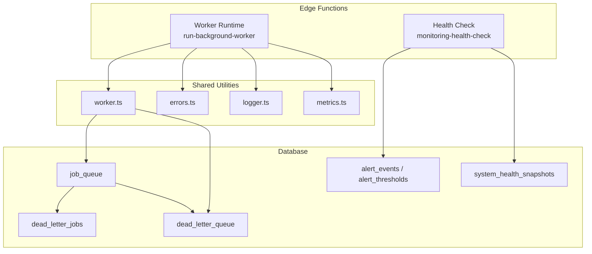
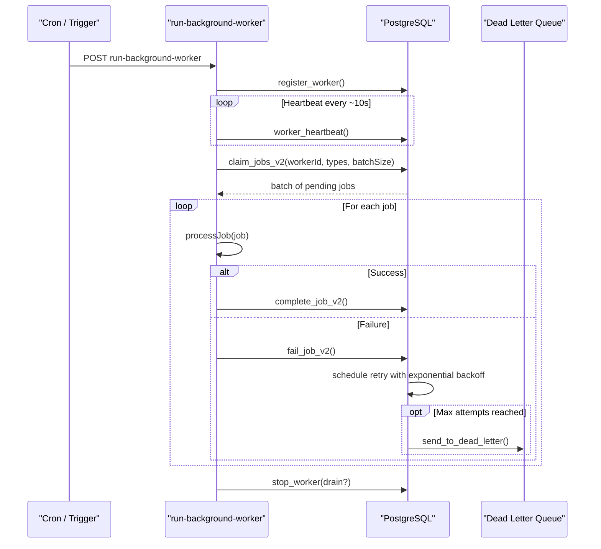
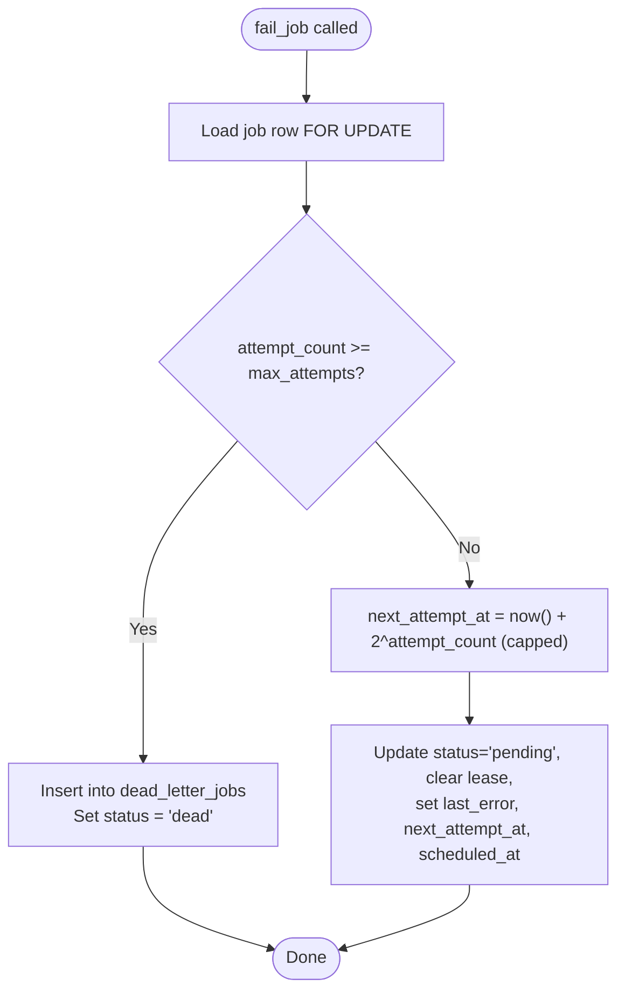
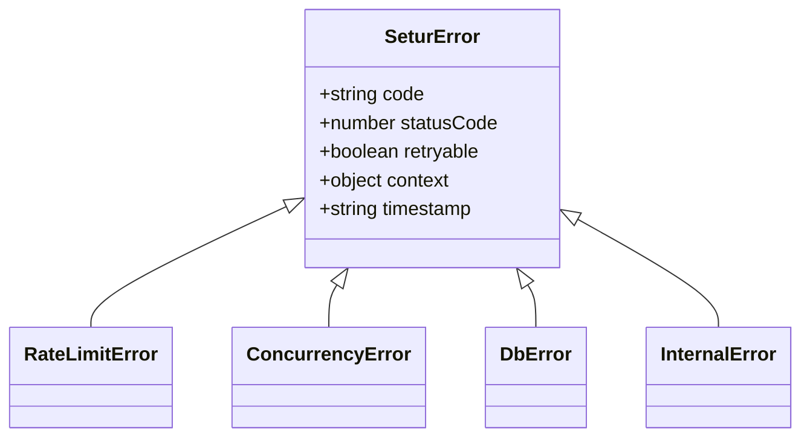
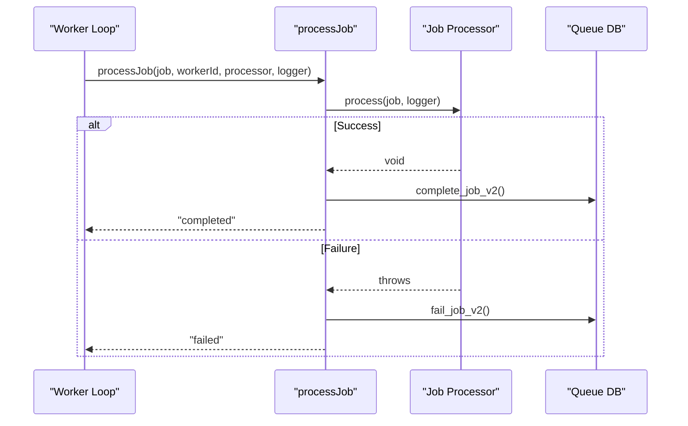
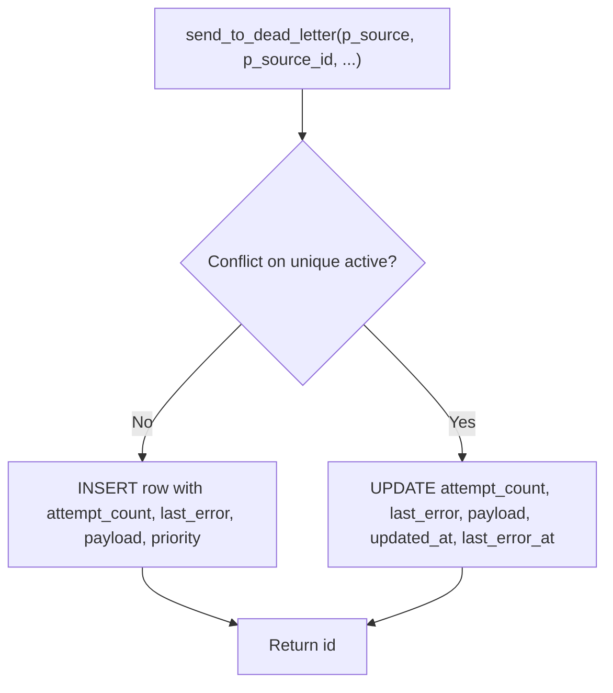
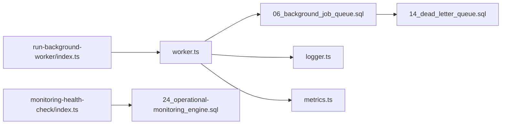

# Retry Mechanisms & Error Handling

<cite>
**Referenced Files in This Document**
- [worker.ts](file://supabase/functions/_shared/worker.ts)
- [errors.ts](file://supabase/functions/_shared/errors.ts)
- [06_background_job_queue.sql](file://supabase/migrations/06_background_job_queue.sql)
- [14_dead_letter_queue.sql](file://supabase/migrations/14_dead_letter_queue.sql)
- [23_retention_&_cleanup_engine.sql](file://supabase/migrations/23_retention_&_cleanup_engine.sql)
- [24_operational-monitoring_engine.sql](file://supabase/migrations/24_operational-monitoring_engine.sql)
- [run-background-worker/index.ts](file://supabase/functions/run-background-worker/index.ts)
- [monitoring-health-check/index.ts](file://supabase/functions/monitoring-health-check/index.ts)
- [logger.ts](file://supabase/functions/_shared/logger.ts)
- [metrics.ts](file://supabase/functions/_shared/metrics.ts)
</cite>

## Table of Contents

1. Introduction
2. Project Structure
3. Core Components
4. Architecture Overview
5. Detailed Component Analysis
6. Dependency Analysis
7. Performance Considerations
8. Troubleshooting Guide
9. Conclusion
10. Appendices

## Introduction

This document explains how background jobs are retried and how failures are
handled across the system. It covers exponential backoff, retry limits, failure
categorization, dead letter queues (DLQ), retention policies, alerting, and
operational procedures for recovering from job failures. It also provides
guidance on implementing custom retry logic per job type and debugging failed
jobs using logs and metrics.

## Project Structure

The retry and error handling system spans shared worker utilities,
database-backed queues, and monitoring/alerting infrastructure:

- Worker runtime and job processing with heartbeat and lease management
- Database functions for enqueueing, claiming, completing, failing, and
  reclaiming jobs
- Dead letter queue tables and functions for permanently failed items
- Retention and cleanup engine to manage data lifecycle
- Operational monitoring engine for health scoring, alerts, and dashboards
- Structured logging and metrics emission for observability

**Diagram sources**

- [run-background-worker/index.ts:1-454](file://supabase/functions/run-background-worker/index.ts#L1-L454)
- [worker.ts:1-257](file://supabase/functions/_shared/worker.ts#L1-L257)
- [06_background_job_queue.sql:1-550](file://supabase/migrations/06_background_job_queue.sql#L1-L550)
- [14_dead_letter_queue.sql:1-481](file://supabase/migrations/14_dead_letter_queue.sql#L1-L481)
- [24_operational-monitoring_engine.sql:1-559](file://supabase/migrations/24_operational-monitoring_engine.sql#L1-L559)
- [monitoring-health-check/index.ts:1-231](file://supabase/functions/monitoring-health-check/index.ts#L1-L231)

**Section sources**

- [run-background-worker/index.ts:1-454](file://supabase/functions/run-background-worker/index.ts#L1-L454)
- [worker.ts:1-257](file://supabase/functions/_shared/worker.ts#L1-L257)
- [06_background_job_queue.sql:1-550](file://supabase/migrations/06_background_job_queue.sql#L1-L550)
- [14_dead_letter_queue.sql:1-481](file://supabase/migrations/14_dead_letter_queue.sql#L1-L481)
- [24_operational-monitoring_engine.sql:1-559](file://supabase/migrations/24_operational-monitoring_engine.sql#L1-L559)
- [monitoring-health-check/index.ts:1-231](file://supabase/functions/monitoring-health-check/index.ts#L1-L231)

## Core Components

- Job processor wrapper that executes a job, completes it on success, or fails
  it on error with structured logging and metrics.
- Database-backed job queue with claim, complete, fail, and stale job
  reclamation.
- Exponential backoff scheduling for retries via next_attempt_at and
  scheduled_at.
- Dead letter queues for permanent failures with idempotent insertion and
  multi-source support.
- Alert thresholds and health snapshots to detect anomalies and drive
  operational actions.
- Structured logging and metrics for debugging and analysis.

Key responsibilities:

- Worker runtime orchestrates polling, batching, and execution.
- Shared worker utilities provide safe claim/complete/fail and heartbeat loops.
- Database functions implement concurrency-safe operations and backoff
  scheduling.
- Monitoring engine aggregates health signals and fires alerts based on
  thresholds.

**Section sources**

- [worker.ts:96-178](file://supabase/functions/_shared/worker.ts#L96-L178)
- [06_background_job_queue.sql:264-449](file://supabase/migrations/06_background_job_queue.sql#L264-L449)
- [14_dead_letter_queue.sql:189-357](file://supabase/migrations/14_dead_letter_queue.sql#L189-L357)
- [24_operational-monitoring_engine.sql:86-103](file://supabase/migrations/24_operational-monitoring_engine.sql#L86-L103)

## Architecture Overview

The system uses a robust, database-backed queue with worker leases and
heartbeats. Jobs are claimed concurrently without double-processing. Failures
trigger exponential backoff; after exhausting attempts, jobs move to dead letter
storage. Alerts and health snapshots surface operational issues.

**Diagram sources**

- [run-background-worker/index.ts:309-439](file://supabase/functions/run-background-worker/index.ts#L309-L439)
- [worker.ts:30-94](file://supabase/functions/_shared/worker.ts#L30-L94)
- [worker.ts:96-178](file://supabase/functions/_shared/worker.ts#L96-L178)
- [06_background_job_queue.sql:264-449](file://supabase/migrations/06_background_job_queue.sql#L264-L449)
- [14_dead_letter_queue.sql:189-357](file://supabase/migrations/14_dead_letter_queue.sql#L189-L357)

## Detailed Component Analysis

### Exponential Backoff and Retry Limits

- The fail path schedules the next attempt using an exponential function capped
  at a maximum interval.
- Each job tracks attempt_count and max_attempts; when attempts exceed the
  limit, the job is marked dead and moved to dead letter storage.
- Stale processing is reclaimed by resetting jobs whose lease has expired.

**Diagram sources**

- [06_background_job_queue.sql:357-449](file://supabase/migrations/06_background_job_queue.sql#L357-L449)

**Section sources**

- [06_background_job_queue.sql:357-449](file://supabase/migrations/06_background_job_queue.sql#L357-L449)

### Failure Categorization Strategy

- Errors are modeled with a typed hierarchy carrying machine-readable codes,
  HTTP status codes, retry flags, and context metadata.
- Some errors are explicitly marked retryable (e.g., rate limits, concurrency
  conflicts), while others are not (e.g., validation, authorization).
- Logging preserves these fields for downstream analysis and routing.

**Diagram sources**

- [errors.ts:70-104](file://supabase/functions/_shared/errors.ts#L70-L104)
- [errors.ts:274-312](file://supabase/functions/_shared/errors.ts#L274-L312)

**Section sources**

- [errors.ts:13-64](file://supabase/functions/_shared/errors.ts#L13-L64)
- [errors.ts:274-312](file://supabase/functions/_shared/errors.ts#L274-L312)
- [logger.ts:52-73](file://supabase/functions/_shared/logger.ts#L52-L73)

### Custom Retry Strategies Per Job Type

- The worker dispatches to job-type-specific processors. You can add new job
  types and attach custom retry behavior by:
  - Throwing typed errors with retryable flags where appropriate.
  - Using the shared processJob wrapper to centralize completion/failure
    handling.
  - Optionally overriding shouldRetry in a custom processor interface if needed.

**Diagram sources**

- [worker.ts:219-257](file://supabase/functions/_shared/worker.ts#L219-L257)
- [run-background-worker/index.ts:363-391](file://supabase/functions/run-background-worker/index.ts#L363-L391)

**Section sources**

- [run-background-worker/index.ts:36-167](file://supabase/functions/run-background-worker/index.ts#L36-L167)
- [worker.ts:219-257](file://supabase/functions/_shared/worker.ts#L219-L257)

### Dead Letter Queue Implementation

- A unified dead letter queue stores permanently failed items with source
  tracking, payload, priority, and resolution state.
- Idempotent insertion prevents duplicate DLQ entries during storms.
- Multi-source retry support allows re-enqueueing or resetting related records
  depending on the source.

**Diagram sources**

- [14_dead_letter_queue.sql:189-257](file://supabase/migrations/14_dead_letter_queue.sql#L189-L257)

**Section sources**

- [14_dead_letter_queue.sql:39-163](file://supabase/migrations/14_dead_letter_queue.sql#L39-L163)
- [14_dead_letter_queue.sql:189-357](file://supabase/migrations/14_dead_letter_queue.sql#L189-L357)

### Retention Policies and Cleanup

- Retention policies define soft/hard delete timelines for operational tables
  including job queues and DLQs.
- Default policies include durations for completed jobs, DLQ entries, and other
  ephemeral data.
- Cleanup functions archive or soft-delete aged messages and operational data.

**Section sources**

- [23_retention_&_cleanup_engine.sql:55-184](file://supabase/migrations/23_retention_&_cleanup_engine.sql#L55-L184)
- [23_retention_&_cleanup_engine.sql:190-321](file://supabase/migrations/23_retention_&_cleanup_engine.sql#L190-L321)

### Alerting and Health Monitoring

- Alert thresholds define triggers for queue backlogs, worker crashes, DLQ
  backlogs, and more.
- Health checks compute scores and snapshot key metrics periodically.
- Health endpoint exposes current status and aggregated diagnostics.

**Section sources**

- [24_operational-monitoring_engine.sql:86-103](file://supabase/migrations/24_operational-monitoring_engine.sql#L86-L103)
- [24_operational-monitoring_engine.sql:194-277](file://supabase/migrations/24_operational-monitoring_engine.sql#L194-L277)
- [24_operational-monitoring_engine.sql:283-397](file://supabase/migrations/24_operational-monitoring_engine.sql#L283-L397)
- [monitoring-health-check/index.ts:33-97](file://supabase/functions/monitoring-health-check/index.ts#L33-L97)
- [monitoring-health-check/index.ts:108-210](file://supabase/functions/monitoring-health-check/index.ts#L108-L210)

## Dependency Analysis

- Worker runtime depends on shared worker utilities for claim/complete/fail and
  heartbeat.
- Job queue functions enforce concurrency safety and backoff scheduling.
- Dead letter queue functions depend on job queue and other domain tables for
  re-enqueue/reset flows.
- Monitoring depends on alert thresholds and health snapshots to produce
  actionable insights.

**Diagram sources**

- [run-background-worker/index.ts:1-454](file://supabase/functions/run-background-worker/index.ts#L1-L454)
- [worker.ts:1-257](file://supabase/functions/_shared/worker.ts#L1-L257)
- [06_background_job_queue.sql:1-550](file://supabase/migrations/06_background_job_queue.sql#L1-L550)
- [14_dead_letter_queue.sql:1-481](file://supabase/migrations/14_dead_letter_queue.sql#L1-L481)
- [24_operational-monitoring_engine.sql:1-559](file://supabase/migrations/24_operational-monitoring_engine.sql#L1-L559)
- [monitoring-health-check/index.ts:1-231](file://supabase/functions/monitoring-health-check/index.ts#L1-L231)

**Section sources**

- [run-background-worker/index.ts:1-454](file://supabase/functions/run-background-worker/index.ts#L1-L454)
- [worker.ts:1-257](file://supabase/functions/_shared/worker.ts#L1-L257)
- [06_background_job_queue.sql:1-550](file://supabase/migrations/06_background_job_queue.sql#L1-L550)
- [14_dead_letter_queue.sql:1-481](file://supabase/migrations/14_dead_letter_queue.sql#L1-L481)
- [24_operational-monitoring_engine.sql:1-559](file://supabase/migrations/24_operational-monitoring_engine.sql#L1-L559)
- [monitoring-health-check/index.ts:1-231](file://supabase/functions/monitoring-health-check/index.ts#L1-L231)

## Performance Considerations

- Use SKIP LOCKED claims to avoid contention and ensure only one worker
  processes a job.
- Batch claim sizes should be tuned to balance throughput and latency.
- Heartbeat intervals and lease durations must reflect typical job durations to
  prevent premature reclaims.
- Exponential backoff caps prevent excessive retries under sustained failures.
- Retention policies keep operational tables bounded to maintain performance.

[No sources needed since this section provides general guidance]

## Troubleshooting Guide

- Debugging failed jobs:
  - Inspect job_queue for last_error, attempt_count, next_attempt_at, and status
    transitions.
  - Check dead_letter_jobs or dead_letter_queue for permanently failed items and
    their payloads.
  - Use structured logs to correlate errors with correlation IDs and timing
    metrics.
- Analyzing error patterns:
  - Filter logs by error codes and retryable flags to identify transient vs
    permanent issues.
  - Review alert_events for threshold breaches and severity levels.
- Operational recovery:
  - Reclaim stale jobs by invoking the reclamation function to reset leases.
  - Re-enqueue DLQ items using the provided retry function for supported
    sources.
  - Adjust alert thresholds to reduce noise or increase sensitivity as needed.

**Section sources**

- [06_background_job_queue.sql:455-484](file://supabase/migrations/06_background_job_queue.sql#L455-L484)
- [14_dead_letter_queue.sql:279-357](file://supabase/migrations/14_dead_letter_queue.sql#L279-L357)
- [24_operational-monitoring_engine.sql:86-103](file://supabase/migrations/24_operational-monitoring_engine.sql#L86-L103)
- [monitoring-health-check/index.ts:128-161](file://supabase/functions/monitoring-health-check/index.ts#L128-L161)

## Conclusion

The system implements a resilient background processing model with
database-backed queues, exponential backoff, and comprehensive dead letter
handling. Typed errors enable precise categorization and controlled retries.
Operational monitoring and alerting provide visibility and early warning.
Operators can recover from failures through reclamation and DLQ re-enqueue
workflows while maintaining performance via retention policies and efficient
locking strategies.

[No sources needed since this section summarizes without analyzing specific
files]

## Appendices

### Implementing Custom Retry Logic

- Throw typed errors with retryable set appropriately for transient conditions.
- Leverage processJob to centralize completion/failure handling.
- Add new job types in the worker’s switch and handle them with dedicated
  processors.

**Section sources**

- [errors.ts:274-312](file://supabase/functions/_shared/errors.ts#L274-L312)
- [worker.ts:219-257](file://supabase/functions/_shared/worker.ts#L219-L257)
- [run-background-worker/index.ts:363-391](file://supabase/functions/run-background-worker/index.ts#L363-L391)

### Configuring Retry Policies

- Tune max_attempts and default backoff caps in job definitions and queue
  functions.
- Monitor next_attempt_at and scheduled_at to validate backoff behavior.
- Use alert thresholds to detect abnormal retry spikes or backlog growth.

**Section sources**

- [06_background_job_queue.sql:75-84](file://supabase/migrations/06_background_job_queue.sql#L75-L84)
- [06_background_job_queue.sql:421-439](file://supabase/migrations/06_background_job_queue.sql#L421-L439)
- [24_operational-monitoring_engine.sql:86-103](file://supabase/migrations/24_operational-monitoring_engine.sql#L86-L103)

### Circuit Breaker Patterns

- While no explicit circuit breaker implementation exists, you can approximate
  protection by:
  - Marking external service errors as non-retryable to short-circuit repeated
    calls.
  - Using alert thresholds to pause ingestion when failures spike.
  - Leveraging health checks to gate traffic until services recover.

[No sources needed since this section provides conceptual guidance]
