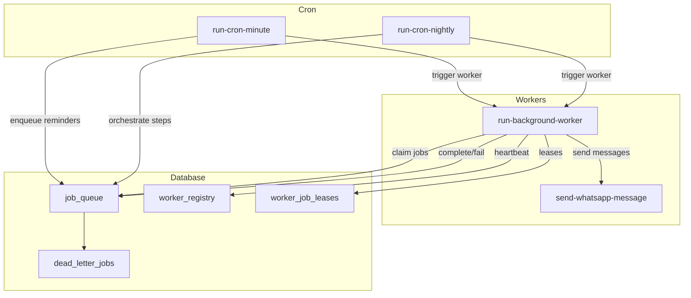
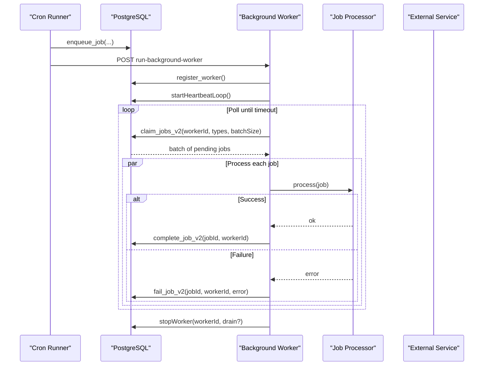
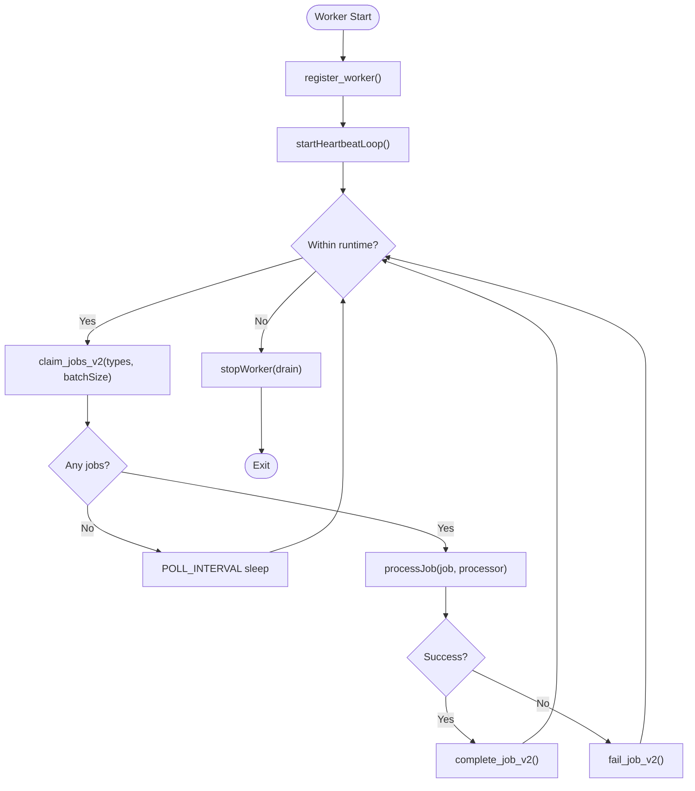
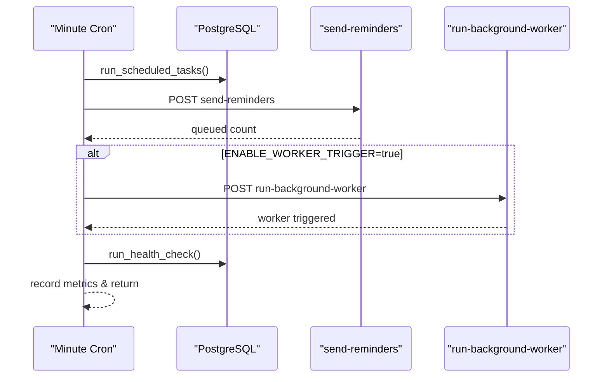
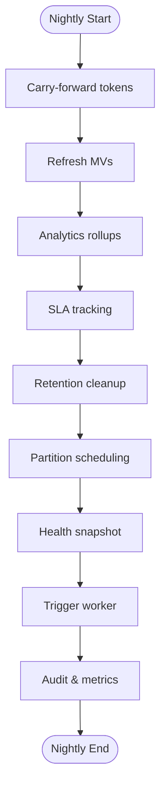
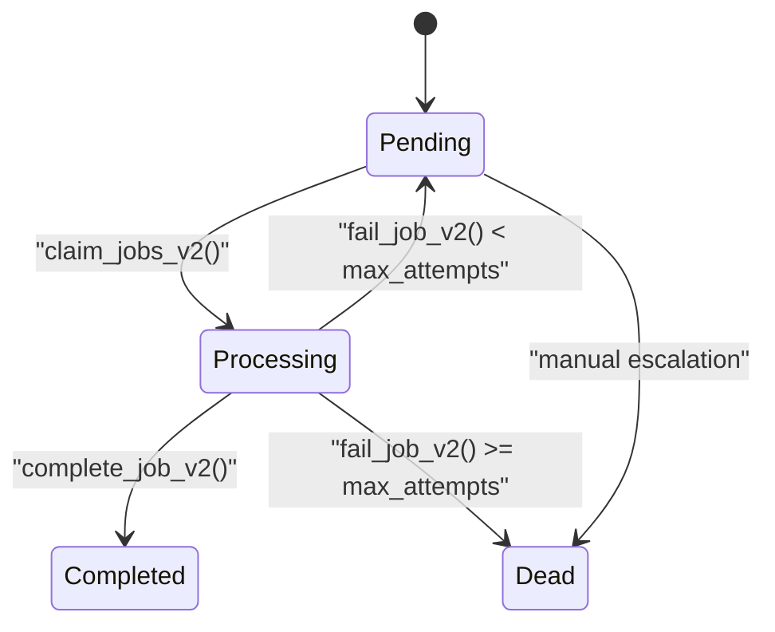
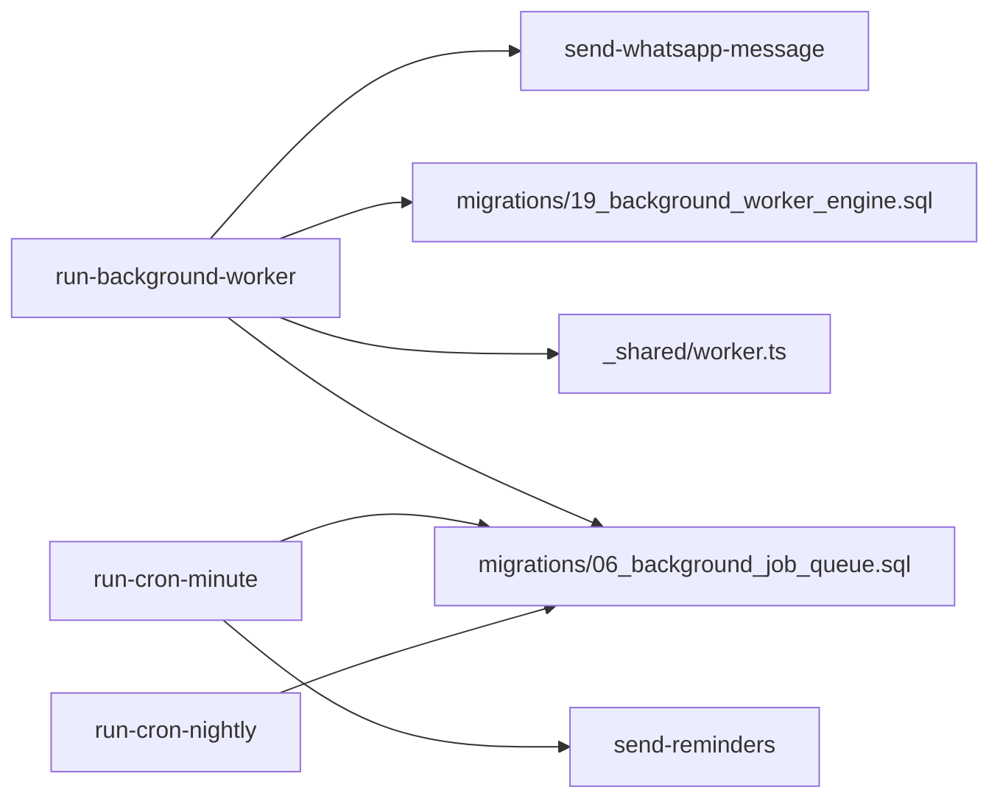

# Worker Orchestration

<cite>
**Referenced Files in This Document**
- [worker.ts](file://supabase/functions/_shared/worker.ts)
- [run-background-worker/index.ts](file://supabase/functions/run-background-worker/index.ts)
- [run-cron-minute/index.ts](file://supabase/functions/run-cron-minute/index.ts)
- [run-cron-nightly/index.ts](file://supabase/functions/run-cron-nightly/index.ts)
- [06_background_job_queue.sql](file://supabase/migrations/06_background_job_queue.sql)
- [19_background_worker_engine.sql](file://supabase/migrations/19_background_worker_engine.sql)
- [types.ts](file://supabase/functions/_shared/types.ts)
- [send-whatsapp-message/index.ts](file://supabase/functions/send-whatsapp-message/index.ts)
- [send-reminders/index.ts](file://supabase/functions/send-reminders/index.ts)
- [monitoring-health-check/index.ts](file://supabase/functions/monitoring-health-check/index.ts)
</cite>

## Table of Contents

1. [Introduction](#introduction)
2. [Project Structure](#project-structure)
3. [Core Components](#core-components)
4. [Architecture Overview](#architecture-overview)
5. [Detailed Component Analysis](#detailed-component-analysis)
6. [Dependency Analysis](#dependency-analysis)
7. [Performance Considerations](#performance-considerations)
8. [Troubleshooting Guide](#troubleshooting-guide)
9. [Conclusion](#conclusion)
10. [Appendices](#appendices)

## Introduction

This document explains the Worker Orchestration system that processes background
jobs, schedules periodic tasks, and supports scaling and resilience. It covers
how workers register, claim jobs from a database-backed queue, execute them with
retry and dead-letter handling, maintain health via heartbeats, and shut down
gracefully. It also documents minute-level and nightly cron orchestration, job
registration patterns, and monitoring for distributed deployments.

## Project Structure

The worker orchestration spans shared utilities, worker runtime, cron
orchestrators, SQL migrations, and integrations:

- Shared worker primitives: registration, heartbeat, job claiming,
  completion/failure, and a safe processor wrapper.
- Background worker function: long-running loop that claims batches, dispatches
  to type-specific handlers, and tracks metrics.
- Cron functions: minute-level scheduler and nightly orchestrator that
  coordinate multiple steps and trigger workers.
- Database schema: job queue, dead letter queue, worker registry, leases, and
  helper RPCs.
- Integrations: WhatsApp messaging and reminder queuing.
- Health endpoint: exposes system health snapshots and detailed diagnostics.

**Diagram sources**

- [run-cron-minute/index.ts:123-229](file://supabase/functions/run-cron-minute/index.ts#L123-L229)
- [run-cron-nightly/index.ts:110-276](file://supabase/functions/run-cron-nightly/index.ts#L110-L276)
- [run-background-worker/index.ts:309-421](file://supabase/functions/run-background-worker/index.ts#L309-L421)
- [06_background_job_queue.sql:41-138](file://supabase/migrations/06_background_job_queue.sql#L41-L138)
- [19_background_worker_engine.sql:18-148](file://supabase/migrations/19_background_worker_engine.sql#L18-L148)

**Section sources**

- [run-cron-minute/index.ts:1-347](file://supabase/functions/run-cron-minute/index.ts#L1-L347)
- [run-cron-nightly/index.ts:1-346](file://supabase/functions/run-cron-nightly/index.ts#L1-L346)
- [run-background-worker/index.ts:1-454](file://supabase/functions/run-background-worker/index.ts#L1-L454)
- [06_background_job_queue.sql:1-550](file://supabase/migrations/06_background_job_queue.sql#L1-L550)
- [19_background_worker_engine.sql:1-800](file://supabase/migrations/19_background_worker_engine.sql#L1-L800)

## Core Components

- Worker lifecycle helpers: register, heartbeat, stop, claim jobs (v2),
  complete/fail, process wrapper, heartbeat loop.
- Background worker: registers, polls for jobs, dispatches by job type, measures
  performance, shuts down cleanly.
- Minute cron: runs scheduled tasks, queues reminders, optionally triggers
  worker, captures health snapshot.
- Nightly cron: ordered pipeline of heavy tasks, then triggers worker for
  post-processing.
- Job queue schema: job states, priorities, retries, idempotency, indexes,
  dead-letter queue.
- Worker engine schema: worker registry, leases, heartbeat log, crash detection,
  reclaim logic, v2 claim/complete/fail.

Key responsibilities:

- Concurrency safety: FOR UPDATE SKIP LOCKED prevents double processing; per-job
  leases enable crash recovery.
- Retry and backoff: exponential backoff capped at one day; max attempts move
  jobs to dead-letter.
- Observability: metrics, tracing, structured logs, health snapshots.

**Section sources**

- [worker.ts:21-257](file://supabase/functions/_shared/worker.ts#L21-L257)
- [run-background-worker/index.ts:23-454](file://supabase/functions/run-background-worker/index.ts#L23-L454)
- [run-cron-minute/index.ts:123-254](file://supabase/functions/run-cron-minute/index.ts#L123-L254)
- [run-cron-nightly/index.ts:35-346](file://supabase/functions/run-cron-nightly/index.ts#L35-L346)
- [06_background_job_queue.sql:194-449](file://supabase/migrations/06_background_job_queue.sql#L194-L449)
- [19_background_worker_engine.sql:154-800](file://supabase/migrations/19_background_worker_engine.sql#L154-L800)

## Architecture Overview

The system uses a database-backed job queue with worker leases and heartbeats
for reliability. Cron orchestrators enqueue work and trigger workers. Workers
claim jobs atomically, process them, and update status. Failed jobs retry with
exponential backoff or move to a dead-letter queue.

**Diagram sources**

- [run-cron-minute/index.ts:136-229](file://supabase/functions/run-cron-minute/index.ts#L136-L229)
- [run-background-worker/index.ts:309-421](file://supabase/functions/run-background-worker/index.ts#L309-L421)
- [worker.ts:30-178](file://supabase/functions/_shared/worker.ts#L30-L178)
- [19_background_worker_engine.sql:497-800](file://supabase/migrations/19_background_worker_engine.sql#L497-L800)

## Detailed Component Analysis

### Worker Lifecycle and Job Execution

- Registration: Each worker instance registers with a unique ID, type, and lease
  duration. Heartbeats renew the lease and track activity.
- Claiming: claim_jobs_v2 selects pending jobs by priority and schedule time
  using SKIP LOCKED, marks them processing, records attempt count, and creates
  per-job leases.
- Processing: The worker maps job_type to a handler, executes with a bounded
  timeout where applicable, and updates status via complete_job_v2 or
  fail_job_v2.
- Retry and Dead Letter: fail_job_v2 sets next_attempt_at with exponential
  backoff up to one day; exceeding max_attempts moves the job to
  dead_letter_jobs.
- Graceful Shutdown: stopWorker signals draining; the worker stops polling and
  exits after finishing current batch.

**Diagram sources**

- [run-background-worker/index.ts:309-421](file://supabase/functions/run-background-worker/index.ts#L309-L421)
- [worker.ts:98-178](file://supabase/functions/_shared/worker.ts#L98-L178)
- [19_background_worker_engine.sql:497-800](file://supabase/migrations/19_background_worker_engine.sql#L497-L800)

**Section sources**

- [worker.ts:21-257](file://supabase/functions/_shared/worker.ts#L21-L257)
- [run-background-worker/index.ts:23-454](file://supabase/functions/run-background-worker/index.ts#L23-L454)
- [19_background_worker_engine.sql:154-800](file://supabase/migrations/19_background_worker_engine.sql#L154-L800)

### Minute-Level Cron Orchestration

- Authentication: Validates X-Cron-Secret against configured secret.
- Steps:
  - Run scheduled tasks via SQL RPC.
  - Queue reminders for upcoming appointments.
  - Optionally trigger background worker if enabled.
  - Capture health snapshot last to reflect latest state.
- Metrics and logging capture success/partial failure counts and durations.

**Diagram sources**

- [run-cron-minute/index.ts:123-254](file://supabase/functions/run-cron-minute/index.ts#L123-L254)
- [send-reminders/index.ts:128-388](file://supabase/functions/send-reminders/index.ts#L128-L388)

**Section sources**

- [run-cron-minute/index.ts:1-347](file://supabase/functions/run-cron-minute/index.ts#L1-L347)
- [send-reminders/index.ts:1-445](file://supabase/functions/send-reminders/index.ts#L1-L445)

### Nightly Cron Orchestration

- Ordered steps: carry-forward tokens, refresh materialized views, analytics
  rollups, SLA tracking, retention cleanup, partition scheduling, health
  snapshot, trigger worker.
- Each step wrapped with timing and error capture; partial failures do not abort
  subsequent steps.
- Audits the run with severity based on failure count.

**Diagram sources**

- [run-cron-nightly/index.ts:110-276](file://supabase/functions/run-cron-nightly/index.ts#L110-L276)

**Section sources**

- [run-cron-nightly/index.ts:1-346](file://supabase/functions/run-cron-nightly/index.ts#L1-L346)

### Job Data Model and Retries

- Job states: pending, processing, completed, failed, dead.
- Priorities: low, normal, high, critical.
- Retry policy: exponential backoff capped at one day; max attempts configurable
  per job.
- Idempotency: optional idempotency_key prevents duplicate enqueues.
- Dead-letter: jobs exceeding max attempts are moved to dead_letter_jobs for
  inspection.

**Diagram sources**

- [06_background_job_queue.sql:12-23](file://supabase/migrations/06_background_job_queue.sql#L12-L23)
- [06_background_job_queue.sql:41-95](file://supabase/migrations/06_background_job_queue.sql#L41-L95)
- [06_background_job_queue.sql:357-449](file://supabase/migrations/06_background_job_queue.sql#L357-L449)
- [19_background_worker_engine.sql:683-800](file://supabase/migrations/19_background_worker_engine.sql#L683-L800)

**Section sources**

- [06_background_job_queue.sql:1-550](file://supabase/migrations/06_background_job_queue.sql#L1-L550)
- [19_background_worker_engine.sql:1-800](file://supabase/migrations/19_background_worker_engine.sql#L1-L800)

### Custom Worker Implementation Guide

To implement a new job type:

- Add a handler in the background worker’s switch for the new job_type.
- Ensure the job is enqueued with enqueue_job including job_type, payload,
  priority, scheduled_at, and idempotency_key.
- Use the provided processJob wrapper to handle completion/failure
  automatically.
- For external calls, set timeouts and propagate errors so fail_job_v2 can apply
  retry/backoff.

Example references:

- Handler pattern: see existing job handlers mapped by job_type.
- Enqueue pattern: see reminder enqueuing and notification routing.

**Section sources**

- [run-background-worker/index.ts:363-391](file://supabase/functions/run-background-worker/index.ts#L363-L391)
- [send-reminders/index.ts:322-388](file://supabase/functions/send-reminders/index.ts#L322-L388)
- [worker.ts:219-257](file://supabase/functions/_shared/worker.ts#L219-L257)

### Monitoring and Health

- Health endpoint provides lightweight GET status and full POST diagnostics
  including queue depth, worker status, DLQ summary, MV freshness, partitions,
  and revenue backlog.
- Minute and nightly cron capture health snapshots and metrics.
- Worker registry and heartbeat log provide visibility into active workers and
  their load.

**Section sources**

- [monitoring-health-check/index.ts:1-231](file://supabase/functions/monitoring-health-check/index.ts#L1-L231)
- [run-cron-minute/index.ts:237-254](file://supabase/functions/run-cron-minute/index.ts#L237-L254)
- [run-cron-nightly/index.ts:248-257](file://supabase/functions/run-cron-nightly/index.ts#L248-L257)
- [19_background_worker_engine.sql:18-102](file://supabase/migrations/19_background_worker_engine.sql#L18-L102)

## Dependency Analysis

- Worker runtime depends on shared worker utilities and database RPCs for
  leasing and status updates.
- Cron runners depend on database RPCs and may call other functions (e.g.,
  send-reminders).
- External integrations (WhatsApp) are invoked by workers with authentication
  and rate-limit handling.

**Diagram sources**

- [run-background-worker/index.ts:1-21](file://supabase/functions/run-background-worker/index.ts#L1-L21)
- [run-cron-minute/index.ts:1-13](file://supabase/functions/run-cron-minute/index.ts#L1-L13)
- [run-cron-nightly/index.ts:21-29](file://supabase/functions/run-cron-nightly/index.ts#L21-L29)
- [send-whatsapp-message/index.ts:1-17](file://supabase/functions/send-whatsapp-message/index.ts#L1-L17)

**Section sources**

- [run-background-worker/index.ts:1-454](file://supabase/functions/run-background-worker/index.ts#L1-L454)
- [run-cron-minute/index.ts:1-347](file://supabase/functions/run-cron-minute/index.ts#L1-L347)
- [run-cron-nightly/index.ts:1-346](file://supabase/functions/run-cron-nightly/index.ts#L1-L346)
- [send-whatsapp-message/index.ts:1-583](file://supabase/functions/send-whatsapp-message/index.ts#L1-L583)

## Performance Considerations

- Batch size tuning: adjust BATCH_SIZE to balance throughput vs. memory/CPU
  usage.
- Poll interval: tune POLL_INTERVAL to reduce DB churn when idle.
- Lease duration: ensure lease_duration_secs accommodates longest job plus
  overhead; heartbeats extend worker liveness.
- Indexes: job_queue has targeted indexes for claim, retry, processing,
  hospital-scoped queries, and worker-scoped queries.
- Concurrency: multiple worker instances can run safely due to SKIP LOCKED and
  per-job leases.
- Timeouts: external calls use AbortSignal.timeout to prevent hanging workers.

[No sources needed since this section provides general guidance]

## Troubleshooting Guide

Common issues and remedies:

- Jobs stuck in processing: check worker heartbeats and lease_expires_at; use
  reclaim_crashed_worker_jobs to recover.
- High failure rates: inspect last_error and attempt_count; verify downstream
  dependencies and rate limits.
- Dead-letter accumulation: review dead_letter_jobs for permanent failures;
  consider re-enqueueing with adjusted payloads.
- Worker not picking up jobs: confirm worker registration, active status, and
  job eligibility (scheduled_at <= now, matching job_types).
- Rate limiting: WhatsApp sender handles 429 with retry-after; ensure backoff
  and max attempts are appropriate.

Operational checks:

- Use monitoring-health-check GET for quick uptime and health score.
- Use POST for detailed diagnostics including queue health, worker status, DLQ
  summary, and MV freshness.

**Section sources**

- [19_background_worker_engine.sql:377-488](file://supabase/migrations/19_background_worker_engine.sql#L377-L488)
- [06_background_job_queue.sql:455-484](file://supabase/migrations/06_background_job_queue.sql#L455-L484)
- [monitoring-health-check/index.ts:33-97](file://supabase/functions/monitoring-health-check/index.ts#L33-L97)
- [send-whatsapp-message/index.ts:248-307](file://supabase/functions/send-whatsapp-message/index.ts#L248-L307)

## Conclusion

The Worker Orchestration system provides a robust, scalable, and observable
framework for background job processing. It leverages database transactions,
atomic locking, per-job leases, and heartbeats to ensure reliability under
failures. Cron orchestrators coordinate routine and nightly tasks, while
comprehensive monitoring enables proactive operations. With clear extension
points for custom workers and strong retry/dead-letter semantics, the system
supports growth and operational maturity.

[No sources needed since this section summarizes without analyzing specific
files]

## Appendices

### Example: Implementing a Custom Worker Job

- Define a handler in the background worker mapping the new job_type to your
  processing logic.
- Enqueue jobs using enqueue_job with appropriate payload, priority,
  scheduled_at, and idempotency_key.
- Rely on processJob to wrap execution and update status via complete_job_v2 or
  fail_job_v2.

References:

- Handler mapping and dispatch:
  [run-background-worker/index.ts:363-391](file://supabase/functions/run-background-worker/index.ts#L363-L391)
- Enqueue example:
  [send-reminders/index.ts:322-388](file://supabase/functions/send-reminders/index.ts#L322-L388)
- Job processor wrapper:
  [worker.ts:219-257](file://supabase/functions/_shared/worker.ts#L219-L257)

### Scaling and Load Balancing

- Horizontal scaling: run multiple worker instances; they share the queue and
  avoid conflicts via SKIP LOCKED and per-job leases.
- Partitioning: nightly cron schedules future partitions to keep query
  performance stable.
- Resource management: bound worker runtime, use timeouts for external calls,
  and tune batch sizes and poll intervals.

References:

- SKIP LOCKED and leases:
  [19_background_worker_engine.sql:497-603](file://supabase/migrations/19_background_worker_engine.sql#L497-L603)
- Partition scheduling:
  [run-cron-nightly/index.ts:237-246](file://supabase/functions/run-cron-nightly/index.ts#L237-L246)
