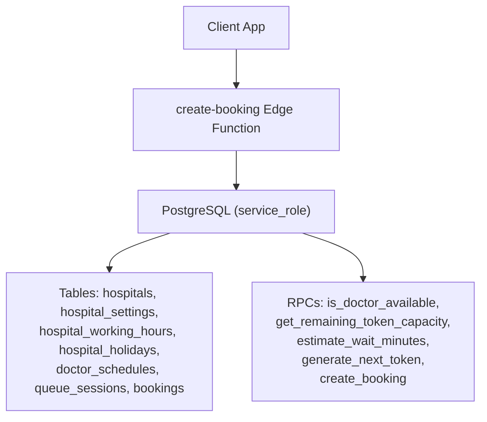
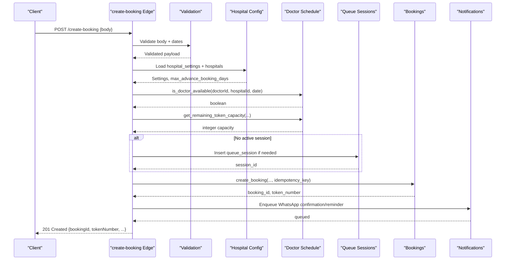
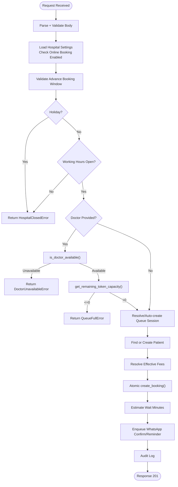
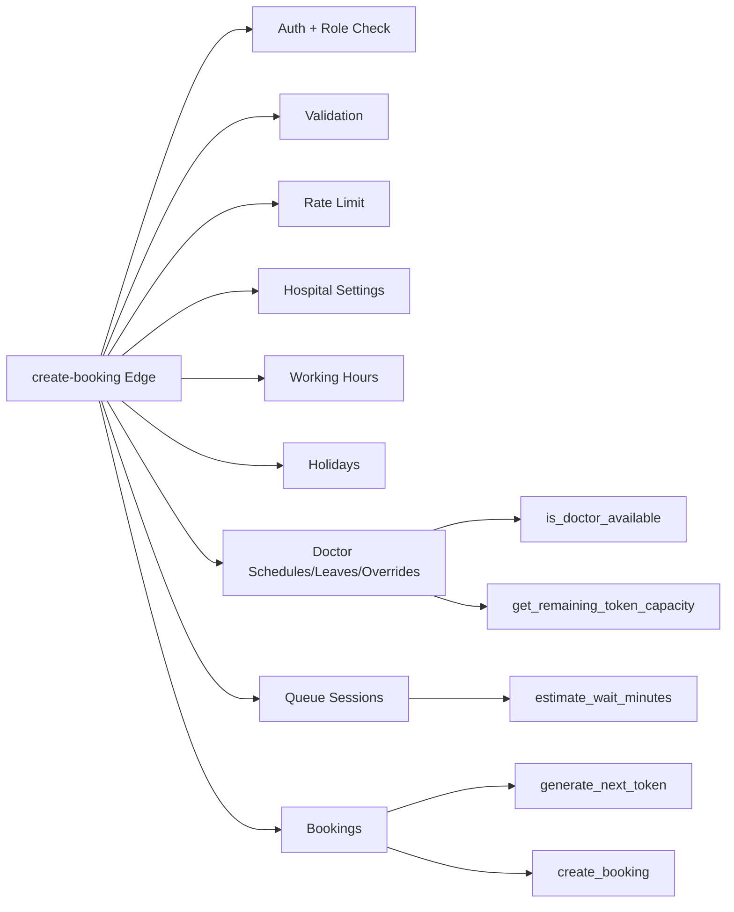
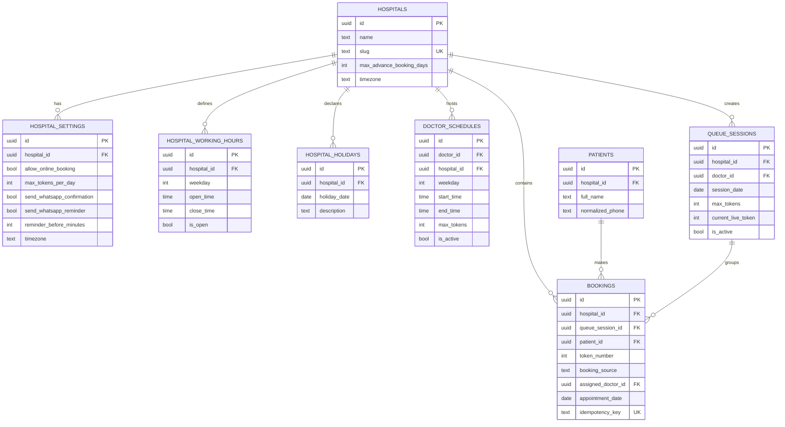

# Appointment Scheduling

<cite>
**Referenced Files in This Document**
- [create-booking/index.ts](file://supabase/functions/create-booking/index.ts)
- [validation.ts](file://supabase/functions/_shared/validation.ts)
- [01_foundation.sql](file://supabase/migrations/01_foundation.sql)
- [02_atomic_token_engine_&_bookings.sql](file://supabase/migrations/02_atomic_token_engine_&_bookings.sql)
- [03_doctorscheduling&slotengine.sql](file://supabase/migrations/03_doctorscheduling&slotengine.sql)
- [12_hospital_configuration_engine.sql](file://supabase/migrations/12_hospital_configuration_engine.sql)
- [38_missing_rpc_functions.sql](file://supabase/migrations/38_missing_rpc_functions.sql)
- [39_schema_alignment.sql](file://supabase/migrations/39_schema_alignment.sql)
</cite>

## Table of Contents

1. [Introduction](#introduction)
2. [Project Structure](#project-structure)
3. [Core Components](#core-components)
4. [Architecture Overview](#architecture-overview)
5. [Detailed Component Analysis](#detailed-component-analysis)
6. [Dependency Analysis](#dependency-analysis)
7. [Performance Considerations](#performance-considerations)
8. [Troubleshooting Guide](#troubleshooting-guide)
9. [Conclusion](#conclusion)
10. [Appendices](#appendices)

## Introduction

This document explains the appointment scheduling system’s booking creation
workflow, including hospital rules validation, doctor availability checks,
advance booking windows, holiday and working hours restrictions, slot capacity
management, queue session auto-creation, conflict detection, and database RPCs
used during booking. It also covers API request/response schemas, error handling
for unavailable doctors, integration with hospital configuration settings, and
advanced features such as multi-doctor scheduling, time zone handling, and
booking source validation.

## Project Structure

The appointment scheduling system is implemented as a Deno Edge Function backed
by PostgreSQL functions and tables defined via migrations. The key parts are:

- Edge function orchestrating the booking flow
- Validation layer for request bodies and date helpers
- Database schema for hospitals, patients, bookings, queue sessions, schedules,
  holidays, and working hours
- SQL RPCs for availability, capacity, wait estimation, and atomic token
  generation

**Diagram sources**

- [create-booking/index.ts:67-666](file://supabase/functions/create-booking/index.ts#L67-L666)
- [02_atomic_token_engine_&_bookings.sql:31-64](file://supabase/migrations/02_atomic_token_engine_&_bookings.sql#L31-L64)
- [02_atomic_token_engine_&_bookings.sql:446-562](file://supabase/migrations/02_atomic_token_engine_&_bookings.sql#L446-L562)
- [03_doctorscheduling&slotengine.sql:377-438](file://supabase/migrations/03_doctorscheduling&slotengine.sql#L377-L438)
- [03_doctorscheduling&slotengine.sql:447-497](file://supabase/migrations/03_doctorscheduling&slotengine.sql#L447-L497)
- [03_doctorscheduling&slotengine.sql:506-555](file://supabase/migrations/03_doctorscheduling&slotengine.sql#L506-L555)

**Section sources**

- [create-booking/index.ts:1-666](file://supabase/functions/create-booking/index.ts#L1-L666)
- [01_foundation.sql:100-137](file://supabase/migrations/01_foundation.sql#L100-L137)
- [02_atomic_token_engine_&_bookings.sql:81-116](file://supabase/migrations/02_atomic_token_engine_&_bookings.sql#L81-L116)
- [02_atomic_token_engine_&_bookings.sql:150-284](file://supabase/migrations/02_atomic_token_engine_&_bookings.sql#L150-L284)
- [03_doctorscheduling&slotengine.sql:79-149](file://supabase/migrations/03_doctorscheduling&slotengine.sql#L79-L149)
- [12_hospital_configuration_engine.sql:115-210](file://supabase/migrations/12_hospital_configuration_engine.sql#L115-L210)

## Core Components

- Booking Edge Function: Validates auth, rate limits, hospital rules, doctor
  availability, capacity, resolves or creates patient, enqueues notifications,
  and atomically creates bookings.
- Validation Layer: Zod schemas for request body, phone normalization, future
  date validation, and advance booking window helper.
- Hospital Configuration: Settings controlling online booking, max tokens per
  day, WhatsApp notifications, reminders, timezone, and fees.
- Doctor Scheduling & Slot Engine: Doctor schedules, blocks, leaves,
  availability overrides, and SQL functions to check availability and remaining
  capacity.
- Queue Sessions & Bookings: Atomic token generation, unique session-token
  constraints, status transitions, and wait estimation.

**Section sources**

- [create-booking/index.ts:67-666](file://supabase/functions/create-booking/index.ts#L67-L666)
- [validation.ts:71-148](file://supabase/functions/_shared/validation.ts#L71-L148)
- [12_hospital_configuration_engine.sql:115-210](file://supabase/migrations/12_hospital_configuration_engine.sql#L115-L210)
- [03_doctorscheduling&slotengine.sql:79-149](file://supabase/migrations/03_doctorscheduling&slotengine.sql#L79-L149)
- [02_atomic_token_engine_&_bookings.sql:81-116](file://supabase/migrations/02_atomic_token_engine_&_bookings.sql#L81-L116)
- [02_atomic_token_engine_&_bookings.sql:150-284](file://supabase/migrations/02_atomic_token_engine_&_bookings.sql#L150-L284)

## Architecture Overview

The booking flow enforces multiple layers of validation and concurrency safety:

- Auth and role checks ensure only authorized users can create bookings.
- Rate limiting protects against abuse using phone and IP.
- Hospital rules enforce open/closed days, holidays, and advance booking
  windows.
- Doctor availability and capacity checks prevent overbooking.
- Queue sessions are auto-created when missing for the same doctor/date.
- Patient records are deduplicated by normalized phone within a hospital.
- Bookings are created atomically with idempotency keys to prevent duplicates.
- Notifications (WhatsApp confirmations/reminders) are enqueued asynchronously.

**Diagram sources**

- [create-booking/index.ts:67-666](file://supabase/functions/create-booking/index.ts#L67-L666)
- [03_doctorscheduling&slotengine.sql:377-438](file://supabase/migrations/03_doctorscheduling&slotengine.sql#L377-L438)
- [03_doctorscheduling&slotengine.sql:447-497](file://supabase/migrations/03_doctorscheduling&slotengine.sql#L447-L497)
- [02_atomic_token_engine_&_bookings.sql:446-562](file://supabase/migrations/02_atomic_token_engine_&_bookings.sql#L446-L562)

## Detailed Component Analysis

### Booking Creation Workflow

- CORS and method checks
- Idempotency key extraction and claim
- JWT resolution and role enforcement
- Request parsing and validation
- Rate limit check by phone and IP
- Hospital rules:
  - Online booking enabled flag
  - Advance booking window from hospital config
  - Holiday check on requested date
  - Working hours check based on weekday
- Doctor availability and capacity:
  - Availability via SQL function
  - Remaining token capacity via SQL function
- Queue session resolution or auto-creation
- Patient find-or-create with deduplication by normalized phone
- Fee resolution from hospital settings
- Atomic booking creation via SQL function
- Wait time estimation
- Asynchronous notification enqueueing
- Audit logging and response

**Diagram sources**

- [create-booking/index.ts:67-666](file://supabase/functions/create-booking/index.ts#L67-L666)
- [validation.ts:71-148](file://supabase/functions/_shared/validation.ts#L71-L148)
- [03_doctorscheduling&slotengine.sql:377-438](file://supabase/migrations/03_doctorscheduling&slotengine.sql#L377-L438)
- [03_doctorscheduling&slotengine.sql:447-497](file://supabase/migrations/03_doctorscheduling&slotengine.sql#L447-L497)
- [02_atomic_token_engine_&_bookings.sql:446-562](file://supabase/migrations/02_atomic_token_engine_&_bookings.sql#L446-L562)

**Section sources**

- [create-booking/index.ts:67-666](file://supabase/functions/create-booking/index.ts#L67-L666)
- [validation.ts:71-148](file://supabase/functions/_shared/validation.ts#L71-L148)

### Hospital Rules Validation

- Online booking disabled: If bookingSource is online and hospital setting
  disallows it, reject immediately.
- Advance booking window: Uses hospital.max_advance_booking_days; requests
  outside this window are rejected.
- Holidays: Any matching hospital_holiday_date rejects the booking.
- Working hours: Checks hospital_working_hours.is_open for the requested
  weekday.

**Section sources**

- [create-booking/index.ts:184-249](file://supabase/functions/create-booking/index.ts#L184-L249)
- [01_foundation.sql:468-522](file://supabase/migrations/01_foundation.sql#L468-L522)
- [12_hospital_configuration_engine.sql:115-210](file://supabase/migrations/12_hospital_configuration_engine.sql#L115-L210)

### Doctor Availability Checks

- Availability function checks:
  - Doctor leave ranges
  - Availability overrides marked unavailable or emergency leave
  - Hospital holidays
  - Active schedule for the requested weekday
- Capacity function counts booked tokens for the doctor/date excluding
  cancelled/no-show statuses and returns remaining capacity.

**Section sources**

- [03_doctorscheduling&slotengine.sql:377-438](file://supabase/migrations/03_doctorscheduling&slotengine.sql#L377-L438)
- [03_doctorscheduling&slotengine.sql:447-497](file://supabase/migrations/03_doctorscheduling&slotengine.sql#L447-L497)

### Advance Booking Windows

- Enforced by validating the requested date against
  hospital.max_advance_booking_days using a helper that computes difference in
  days.

**Section sources**

- [create-booking/index.ts:194-218](file://supabase/functions/create-booking/index.ts#L194-L218)
- [validation.ts:138-148](file://supabase/functions/_shared/validation.ts#L138-L148)
- [01_foundation.sql:100-137](file://supabase/migrations/01_foundation.sql#L100-L137)

### Holiday Restrictions

- Any entry in hospital_holidays for the requested date blocks booking.

**Section sources**

- [create-booking/index.ts:220-233](file://supabase/functions/create-booking/index.ts#L220-L233)
- [01_foundation.sql:507-522](file://supabase/migrations/01_foundation.sql#L507-L522)

### Working Hours Validation

- For the requested date’s weekday, checks hospital_working_hours.is_open; if
  false, booking is rejected.

**Section sources**

- [create-booking/index.ts:235-249](file://supabase/functions/create-booking/index.ts#L235-L249)
- [01_foundation.sql:468-493](file://supabase/migrations/01_foundation.sql#L468-L493)

### Slot Capacity Management

- Remaining capacity computed by subtracting current non-cancelled/non-no-show
  bookings from schedule max_tokens for the doctor/date.
- If capacity <= 0, a queue full error is raised.

**Section sources**

- [03_doctorscheduling&slotengine.sql:447-497](file://supabase/migrations/03_doctorscheduling&slotengine.sql#L447-L497)
- [create-booking/index.ts:270-283](file://supabase/functions/create-booking/index.ts#L270-L283)

### Queue Session Auto-Creation

- If no active queue session exists for the doctor/date, one is created with
  max_tokens from hospital_settings and marked active.

**Section sources**

- [create-booking/index.ts:285-319](file://supabase/functions/create-booking/index.ts#L285-L319)
- [02_atomic_token_engine_&_bookings.sql:81-116](file://supabase/migrations/02_atomic_token_engine_&_bookings.sql#L81-L116)
- [12_hospital_configuration_engine.sql:115-210](file://supabase/migrations/12_hospital_configuration_engine.sql#L115-L210)

### Conflict Detection Mechanisms

- Idempotency key uniqueness on bookings prevents duplicate bookings for the
  same request.
- Unique constraint on queue_session_id + token_number prevents duplicate tokens
  within a session.
- Overlap constraints on doctor schedules and blocks prevent overlapping time
  slots.
- Leave and override constraints prevent double-booking across leave periods.

**Section sources**

- [02_atomic_token_engine_&_bookings.sql:150-284](file://supabase/migrations/02_atomic_token_engine_&_bookings.sql#L150-L284)
- [03_doctorscheduling&slotengine.sql:125-149](file://supabase/migrations/03_doctorscheduling&slotengine.sql#L125-L149)
- [03_doctorscheduling&slotengine.sql:207-228](file://supabase/migrations/03_doctorscheduling&slotengine.sql#L207-L228)
- [03_doctorscheduling&slotengine.sql:266-279](file://supabase/migrations/03_doctorscheduling&slotengine.sql#L266-L279)

### Database RPC Functions

- is_doctor_available(p_doctor_id, p_hospital_id, p_date): Returns boolean
  indicating availability considering leaves, overrides, holidays, and
  schedules.
- get_remaining_token_capacity(p_doctor_id, p_hospital_id, p_date): Returns
  integer capacity after counting existing bookings.
- estimate_wait_minutes(p_queue_session_id, p_token_number): Estimates wait time
  based on ahead-of-token count and average consultation minutes.
- generate_next_token(p_hospital_id, p_visit_date): Atomically increments daily
  counter to produce unique token numbers.
- create_booking(...): Inserts booking with idempotency key, updates patient
  visit counters, and returns booking_id and token_number.

**Section sources**

- [03_doctorscheduling&slotengine.sql:377-438](file://supabase/migrations/03_doctorscheduling&slotengine.sql#L377-L438)
- [03_doctorscheduling&slotengine.sql:447-497](file://supabase/migrations/03_doctorscheduling&slotengine.sql#L447-L497)
- [03_doctorscheduling&slotengine.sql:506-555](file://supabase/migrations/03_doctorscheduling&slotengine.sql#L506-L555)
- [02_atomic_token_engine_&_bookings.sql:31-64](file://supabase/migrations/02_atomic_token_engine_&_bookings.sql#L31-L64)
- [02_atomic_token_engine_&_bookings.sql:446-562](file://supabase/migrations/02_atomic_token_engine_&_bookings.sql#L446-L562)
- [39_schema_alignment.sql:139-255](file://supabase/migrations/39_schema_alignment.sql#L139-L255)

### Scheduling API Endpoints, Request/Response Schemas, Error Handling

- Endpoint: POST /create-booking
- Headers:
  - X-Hospital-ID: Required hospital identifier
  - Idempotency-Key: Recommended for idempotent retries
- Request Schema (validated fields):
  - hospitalId: UUID
  - queueSessionId: Optional UUID
  - patientName: string (min length, trimmed)
  - patientPhone: normalized Indian mobile number
  - patientAge: optional integer
  - patientGender: optional enum M/F/Other
  - village: optional string
  - bloodGroup: optional enum
  - hasDiabetes: boolean default false
  - hasBp: boolean default false
  - bookingSource: enum online/manual_free/manual_whatsapp/walkin
  - doctorId: optional UUID
  - appointmentDate: future date YYYY-MM-DD
- Response Schema:
  - bookingId: UUID
  - tokenNumber: integer
  - bookingReference: string
  - estimatedWaitMinutes: integer or null
  - patientId: UUID
  - appointmentDate: string
  - queueSessionId: string or null
  - fees: object with platformFee, receptionistFee, hospitalFee, totalAmount
- Error Handling:
  - ValidationError: Invalid input or out-of-window date
  - HospitalClosedError: Online booking disabled, holiday, closed weekday
  - DoctorUnavailableError: Doctor not available on date
  - QueueFullError: No remaining capacity
  - InternalError: Unexpected failures (e.g., fee resolution, patient creation
    race)

**Section sources**

- [create-booking/index.ts:67-666](file://supabase/functions/create-booking/index.ts#L67-L666)
- [validation.ts:71-148](file://supabase/functions/_shared/validation.ts#L71-L148)

### Integration with Hospital Configuration Settings

- allow_online_booking: Controls whether online bookings are permitted.
- max_tokens_per_day: Default maximum tokens for auto-created queue sessions.
- send_whatsapp_confirmation/send_whatsapp_reminder: Controls asynchronous
  notification enqueueing.
- reminder_before_minutes: Determines reminder scheduling relative to clinic
  open time.
- timezone: Used for time-aware operations; defaults to Asia/Kolkata.
- Fees: platform_fee_online, platform_fee_whatsapp, receptionist_fee influence
  effective fees resolved at booking time.

**Section sources**

- [create-booking/index.ts:168-182](file://supabase/functions/create-booking/index.ts#L168-L182)
- [create-booking/index.ts:520-585](file://supabase/functions/create-booking/index.ts#L520-L585)
- [12_hospital_configuration_engine.sql:115-210](file://supabase/migrations/12_hospital_configuration_engine.sql#L115-L210)

### Advanced Features

- Multi-doctor scheduling:
  - Doctor schedules define weekday time windows and max_tokens.
  - Overlap constraints prevent conflicting schedules.
  - Doctor leaves and availability overrides adjust availability dynamically.
- Time zone handling:
  - Hospitals store timezone; default is Asia/Kolkata.
  - Reminder scheduling uses open_time and reminder_before_minutes to compute
    scheduled times.
- Booking source validation:
  - bookingSource validated against allowed enums.
  - Online booking feature flag gating enforced via hospital settings.

**Section sources**

- [03_doctorscheduling&slotengine.sql:79-149](file://supabase/migrations/03_doctorscheduling&slotengine.sql#L79-L149)
- [03_doctorscheduling&slotengine.sql:237-279](file://supabase/migrations/03_doctorscheduling&slotengine.sql#L237-L279)
- [01_foundation.sql:100-137](file://supabase/migrations/01_foundation.sql#L100-L137)
- [create-booking/index.ts:184-218](file://supabase/functions/create-booking/index.ts#L184-L218)

## Dependency Analysis

The booking flow depends on several modules and database objects:

- Edge function depends on shared utilities for auth, validation, idempotency,
  rate limiting, audit, tracing, metrics, and response formatting.
- Database dependencies include:
  - hospital_settings and hospitals for configuration and advance booking window
  - hospital_working_hours and hospital_holidays for operational rules
  - doctor_schedules, doctor_leaves, doctor_availability_overrides for
    availability
  - queue_sessions for session management
  - bookings for persistent records and constraints
  - RPCs for availability, capacity, wait estimation, token generation, and
    booking creation

**Diagram sources**

- [create-booking/index.ts:67-666](file://supabase/functions/create-booking/index.ts#L67-L666)
- [03_doctorscheduling&slotengine.sql:377-438](file://supabase/migrations/03_doctorscheduling&slotengine.sql#L377-L438)
- [03_doctorscheduling&slotengine.sql:447-497](file://supabase/migrations/03_doctorscheduling&slotengine.sql#L447-L497)
- [02_atomic_token_engine_&_bookings.sql:31-64](file://supabase/migrations/02_atomic_token_engine_&_bookings.sql#L31-L64)
- [02_atomic_token_engine_&_bookings.sql:446-562](file://supabase/migrations/02_atomic_token_engine_&_bookings.sql#L446-L562)

**Section sources**

- [create-booking/index.ts:67-666](file://supabase/functions/create-booking/index.ts#L67-L666)
- [01_foundation.sql:100-137](file://supabase/migrations/01_foundation.sql#L100-L137)
- [02_atomic_token_engine_&_bookings.sql:81-116](file://supabase/migrations/02_atomic_token_engine_&_bookings.sql#L81-L116)
- [03_doctorscheduling&slotengine.sql:79-149](file://supabase/migrations/03_doctorscheduling&slotengine.sql#L79-L149)

## Performance Considerations

- Concurrency safety:
  - Atomic token generation via upsert on daily counters avoids races.
  - SKIP LOCKED usage in queue advancement ensures safe concurrent processing.
  - Advisory locks serialize carry-forward operations per hospital.
- Indexing:
  - Multiple indexes support fast lookups by hospital, date, doctor, and status.
- Idempotency:
  - Unique idempotency_key prevents duplicate bookings under load.
- Notification queuing:
  - Non-blocking enqueue reduces latency impact on booking creation.

[No sources needed since this section provides general guidance]

## Troubleshooting Guide

Common errors and their causes:

- ValidationError:
  - Missing or invalid fields (e.g., phone format, date range).
  - Appointment date outside allowed advance booking window.
- HospitalClosedError:
  - Online booking disabled for the hospital.
  - Requested date falls on a holiday.
  - Requested weekday is closed per working hours.
- DoctorUnavailableError:
  - Doctor on leave, unavailable override, or no schedule for the weekday.
- QueueFullError:
  - Remaining token capacity <= 0 for the doctor/date.
- InternalError:
  - Failed fee resolution or patient creation race conditions.

Diagnostic steps:

- Verify hospital_settings.allow_online_booking and max_advance_booking_days.
- Check hospital_holidays and hospital_working_hours for the requested
  date/weekday.
- Inspect doctor_schedules, doctor_leaves, and doctor_availability_overrides.
- Review queue_sessions for active sessions and max_tokens.
- Examine bookings for existing tokens and statuses affecting capacity.

**Section sources**

- [create-booking/index.ts:184-283](file://supabase/functions/create-booking/index.ts#L184-L283)
- [03_doctorscheduling&slotengine.sql:377-438](file://supabase/migrations/03_doctorscheduling&slotengine.sql#L377-L438)
- [03_doctorscheduling&slotengine.sql:447-497](file://supabase/migrations/03_doctorscheduling&slotengine.sql#L447-L497)
- [02_atomic_token_engine_&_bookings.sql:150-284](file://supabase/migrations/02_atomic_token_engine_&_bookings.sql#L150-L284)

## Conclusion

The appointment scheduling system implements a robust, production-grade booking
workflow with comprehensive validation, concurrency-safe token allocation, and
flexible hospital configuration. It integrates doctor scheduling, queue
management, and asynchronous notifications while ensuring data integrity through
idempotency and strong constraints. The design supports multi-doctor
environments, configurable time zones, and diverse booking sources, providing a
scalable foundation for hospital operations.

[No sources needed since this section summarizes without analyzing specific
files]

## Appendices

### Data Models Diagram

**Diagram sources**

- [01_foundation.sql:100-137](file://supabase/migrations/01_foundation.sql#L100-L137)
- [01_foundation.sql:468-522](file://supabase/migrations/01_foundation.sql#L468-L522)
- [02_atomic_token_engine_&_bookings.sql:81-116](file://supabase/migrations/02_atomic_token_engine_&_bookings.sql#L81-L116)
- [02_atomic_token_engine_&_bookings.sql:150-284](file://supabase/migrations/02_atomic_token_engine_&_bookings.sql#L150-L284)
- [03_doctorscheduling&slotengine.sql:79-149](file://supabase/migrations/03_doctorscheduling&slotengine.sql#L79-L149)
- [12_hospital_configuration_engine.sql:115-210](file://supabase/migrations/12_hospital_configuration_engine.sql#L115-L210)
