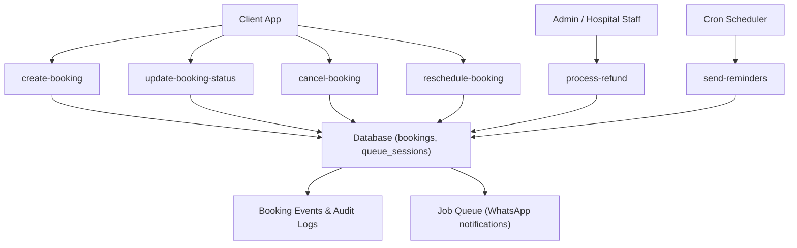
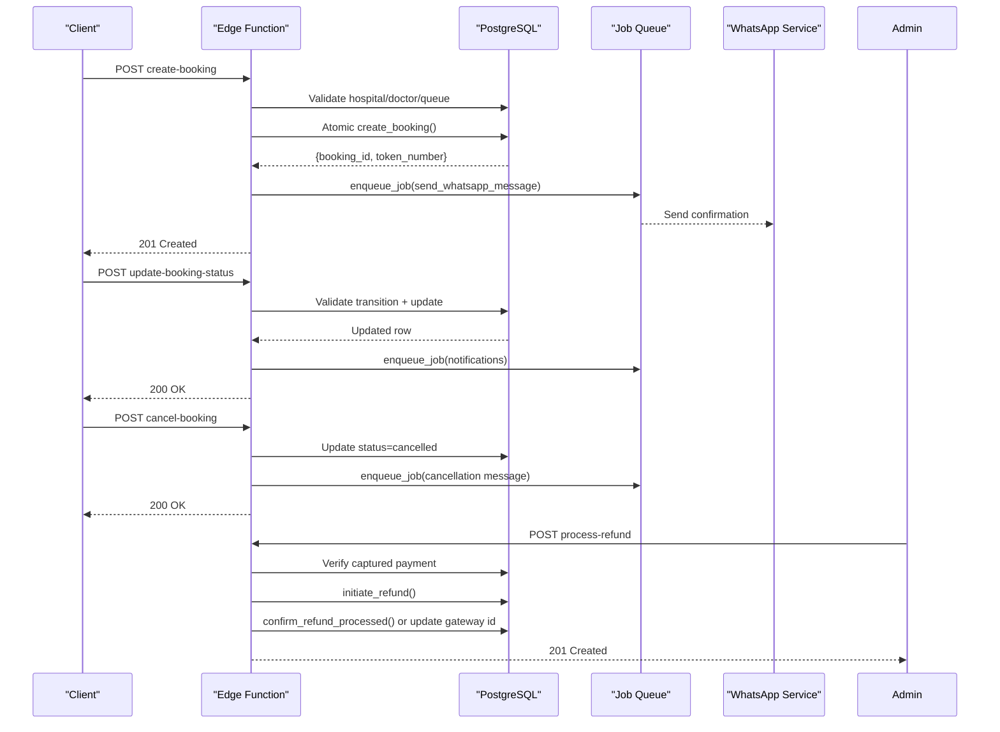
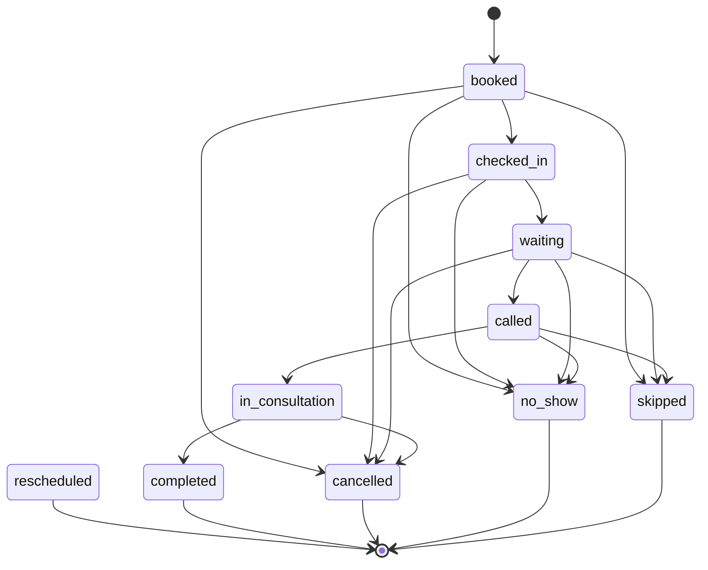
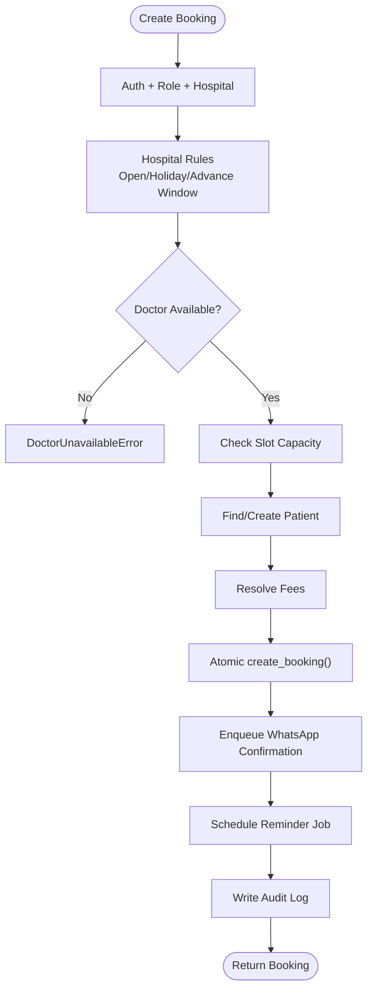
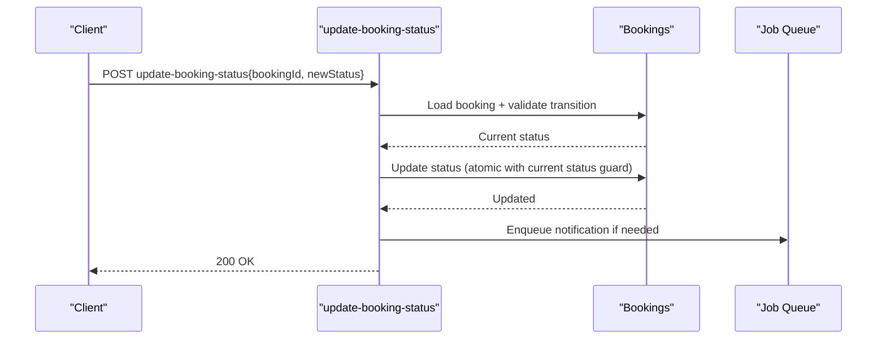
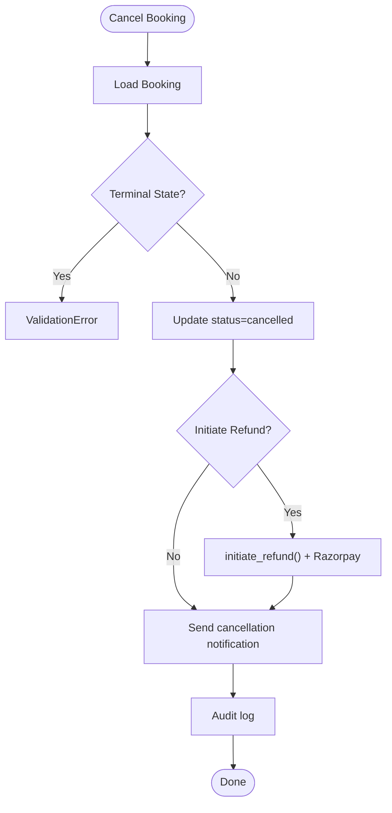
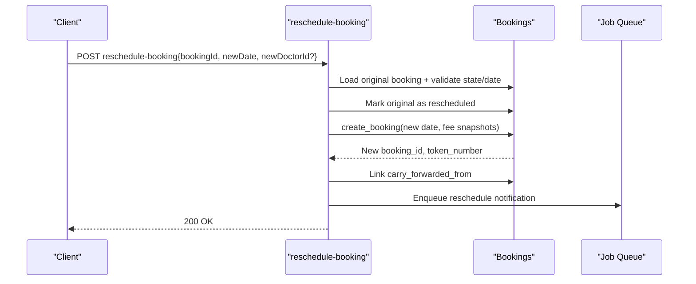
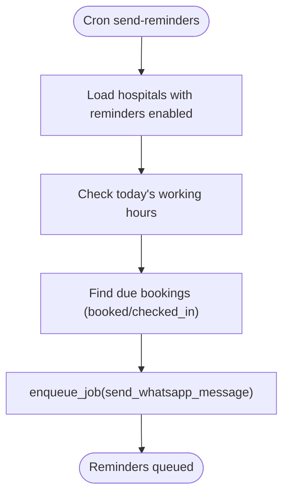
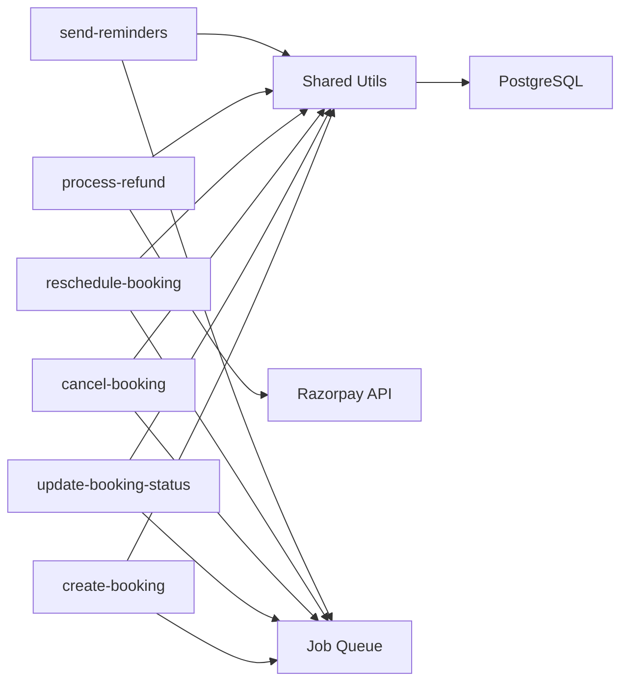

# Booking Lifecycle Management

<cite>
**Referenced Files in This Document**
- [create-booking/index.ts](file://supabase/functions/create-booking/index.ts)
- [cancel-booking/index.ts](file://supabase/functions/cancel-booking/index.ts)
- [reschedule-booking/index.ts](file://supabase/functions/reschedule-booking/index.ts)
- [update-booking-status/index.ts](file://supabase/functions/update-booking-status/index.ts)
- [process-refund/index.ts](file://supabase/functions/process-refund/index.ts)
- [send-reminders/index.ts](file://supabase/functions/send-reminders/index.ts)
- [_shared/types.ts](file://supabase/functions/_shared/types.ts)
- [_shared/audit.ts](file://supabase/functions/_shared/audit.ts)
- [02_atomic_token_engine_&_bookings.sql](file://supabase/migrations/02_atomic_token_engine_&_bookings.sql)
- [28_booking_enhancements.sql](file://supabase/migrations/28_booking_enhancements.sql)
- [29_cancellation_policy.sql](file://supabase/migrations/29_cancellation_policy.sql)
</cite>

## Table of Contents

1. [Introduction](#introduction)
2. [Project Structure](#project-structure)
3. [Core Components](#core-components)
4. [Architecture Overview](#architecture-overview)
5. [Detailed Component Analysis](#detailed-component-analysis)
6. [Dependency Analysis](#dependency-analysis)
7. [Performance Considerations](#performance-considerations)
8. [Troubleshooting Guide](#troubleshooting-guide)
9. [Conclusion](#conclusion)
10. [Appendices](#appendices)

## Introduction

This document describes the complete booking lifecycle from creation to
completion, including all supported states and transitions, cancellation and
refund processing, rescheduling workflows, status updates, check-in processes,
completion workflows, audit logging, and integrations with payment and
notification systems. It also covers edge cases such as partial cancellations,
no-shows, and emergency overrides.

## Project Structure

The booking lifecycle is implemented as a set of Edge Functions (API endpoints)
backed by database functions and triggers:

- Creation: create-booking
- Status transitions and check-in: update-booking-status
- Cancellation and refunds: cancel-booking, process-refund
- Rescheduling: reschedule-booking
- Notifications: send-reminders and queued WhatsApp messages
- Data model and state machine: SQL migrations for bookings, queue sessions,
  events, and policies

**Diagram sources**

- [create-booking/index.ts:67-665](file://supabase/functions/create-booking/index.ts#L67-L665)
- [update-booking-status/index.ts:130-641](file://supabase/functions/update-booking-status/index.ts#L130-L641)
- [cancel-booking/index.ts:67-482](file://supabase/functions/cancel-booking/index.ts#L67-L482)
- [reschedule-booking/index.ts:51-612](file://supabase/functions/reschedule-booking/index.ts#L51-L612)
- [process-refund/index.ts:109-360](file://supabase/functions/process-refund/index.ts#L109-L360)
- [send-reminders/index.ts:40-445](file://supabase/functions/send-reminders/index.ts#L40-L445)
- [02_atomic_token_engine_&_bookings.sql:150-380](file://supabase/migrations/02_atomic_token_engine_&_bookings.sql#L150-L380)

**Section sources**

- [create-booking/index.ts:1-666](file://supabase/functions/create-booking/index.ts#L1-L666)
- [update-booking-status/index.ts:1-642](file://supabase/functions/update-booking-status/index.ts#L1-L642)
- [cancel-booking/index.ts:1-482](file://supabase/functions/cancel-booking/index.ts#L1-L482)
- [reschedule-booking/index.ts:1-612](file://supabase/functions/reschedule-booking/index.ts#L1-L612)
- [process-refund/index.ts:1-360](file://supabase/functions/process-refund/index.ts#L1-L360)
- [send-reminders/index.ts:1-445](file://supabase/functions/send-reminders/index.ts#L1-L445)
- [02_atomic_token_engine_&_bookings.sql:1-827](file://supabase/migrations/02_atomic_token_engine_&_bookings.sql#L1-L827)

## Core Components

- Booking creation: validates hospital rules, doctor availability, queue
  capacity, patient deduplication, atomic token generation, fee resolution, and
  enqueues confirmation and reminder notifications; writes audit logs.
- Status transitions: central state machine enforcing allowed transitions,
  concurrency-safe updates, realtime queue broadcasting, and automated
  notifications.
- Cancellation: prevents cancellation from terminal states, supports optional
  refund initiation, updates queue positions, sends cancellation notifications,
  and audits changes.
- Rescheduling: marks original booking as rescheduled, creates a new booking on
  a valid date, preserves fee snapshots, links carry-forward, and notifies
  patients.
- Refunds: idempotent initiation against captured payments, calls Razorpay,
  records gateway IDs, confirms processed refunds, and audits actions.
- Reminders: cron-driven job queuing appointment reminders based on hospital
  settings and working hours.

**Section sources**

- [_shared/types.ts:17-27](file://supabase/functions/_shared/types.ts#L17-L27)
- [_shared/audit.ts:15-33](file://supabase/functions/_shared/audit.ts#L15-L33)
- [02_atomic_token_engine_&_bookings.sql:150-380](file://supabase/migrations/02_atomic_token_engine_&_bookings.sql#L150-L380)

## Architecture Overview

The system uses a strict state machine for bookings, enforced both at the API
layer and via database triggers. All mutations are audited and idempotent where
applicable. External integrations include:

- Payment gateway (Razorpay) for captures and refunds
- WhatsApp messaging via queued jobs
- Realtime queue broadcasting for live updates

**Diagram sources**

- [create-booking/index.ts:67-665](file://supabase/functions/create-booking/index.ts#L67-L665)
- [update-booking-status/index.ts:130-641](file://supabase/functions/update-booking-status/index.ts#L130-L641)
- [cancel-booking/index.ts:67-482](file://supabase/functions/cancel-booking/index.ts#L67-L482)
- [process-refund/index.ts:109-360](file://supabase/functions/process-refund/index.ts#L109-L360)

## Detailed Component Analysis

### Booking States and Transitions

Supported states:

- booked, checked_in, waiting, called, in_consultation, completed, cancelled,
  no_show, rescheduled, skipped

Allowed transitions are enforced centrally in the status update endpoint.
Terminal states: completed, cancelled, no_show, rescheduled.

**Diagram sources**

- [update-booking-status/index.ts:28-75](file://supabase/functions/update-booking-status/index.ts#L28-L75)
- [_shared/types.ts:17-27](file://supabase/functions/_shared/types.ts#L17-L27)

**Section sources**

- [update-booking-status/index.ts:28-75](file://supabase/functions/update-booking-status/index.ts#L28-L75)

### Booking Creation Flow

Key steps:

- Auth, role, and hospital validation
- Idempotency key handling
- Rate limiting
- Hospital open/holiday/advance-booking checks
- Doctor availability and slot capacity checks
- Patient find-or-create (deduplicated by normalized phone)
- Fee resolution and atomic booking creation
- Enqueue WhatsApp confirmation and scheduled reminder
- Audit log write
- Return response with token number, reference, fees, and estimated wait

**Diagram sources**

- [create-booking/index.ts:67-665](file://supabase/functions/create-booking/index.ts#L67-L665)
- [02_atomic_token_engine_&_bookings.sql:446-562](file://supabase/migrations/02_atomic_token_engine_&bookings.sql#L446-L562)

**Section sources**

- [create-booking/index.ts:67-665](file://supabase/functions/create-booking/index.ts#L67-L665)
- [02_atomic_token_engine_&_bookings.sql:446-562](file://supabase/migrations/02_atomic_token_engine_&_bookings.sql#L446-L562)

### Check-in and Status Updates

- Centralized state machine validates transitions and prevents updates from
  terminal states.
- Concurrency-safe updates using current status in WHERE clause.
- Realtime broadcast of queue advances when applicable.
- Automated notifications for specific statuses (called, consultation
  started/completed, cancellation, no-show).
- Feedback request queued after completion.

**Diagram sources**

- [update-booking-status/index.ts:130-641](file://supabase/functions/update-booking-status/index.ts#L130-L641)

**Section sources**

- [update-booking-status/index.ts:130-641](file://supabase/functions/update-booking-status/index.ts#L130-L641)

### Cancellation and Refund Processing

Cancellation:

- Prevents cancellation from terminal states (completed, no_show, rescheduled).
- Updates status to cancelled, records reason and timestamps.
- Optionally initiates refund if payment was captured and eligible.
- Recalculates queue position and sends cancellation notification.
- Audits change.

Refund:

- Idempotent initiation for captured payments only.
- Validates amount constraints (full or partial).
- Calls Razorpay Refunds API and records gateway refund ID.
- Confirms processed refunds immediately or updates status to processing for
  async completion.
- Audits action.

**Diagram sources**

- [cancel-booking/index.ts:67-482](file://supabase/functions/cancel-booking/index.ts#L67-L482)
- [process-refund/index.ts:109-360](file://supabase/functions/process-refund/index.ts#L109-L360)

**Section sources**

- [cancel-booking/index.ts:67-482](file://supabase/functions/cancel-booking/index.ts#L67-L482)
- [process-refund/index.ts:109-360](file://supabase/functions/process-refund/index.ts#L109-L360)

### Rescheduling Workflow

- Validates reschedulable states (booked, checked_in, waiting).
- Ensures new date is not past and within advance booking window.
- Checks holidays and working hours for the new date.
- Validates doctor availability if provided.
- Marks original booking as rescheduled and creates a new booking with preserved
  fee snapshots.
- Links new booking to original via carry_forwarded_from.
- Sends reschedule notification and audits change.

**Diagram sources**

- [reschedule-booking/index.ts:51-612](file://supabase/functions/reschedule-booking/index.ts#L51-L612)

**Section sources**

- [reschedule-booking/index.ts:51-612](file://supabase/functions/reschedule-booking/index.ts#L51-L612)

### Notification and Reminder System

- Confirmation and reminders are queued via a job queue with idempotency keys.
- Reminders run on a cron schedule per hospital settings and working hours.
- Notifications are sent via WhatsApp templates for key lifecycle events.

**Diagram sources**

- [send-reminders/index.ts:40-445](file://supabase/functions/send-reminders/index.ts#L40-L445)

**Section sources**

- [send-reminders/index.ts:40-445](file://supabase/functions/send-reminders/index.ts#L40-L445)

### Audit Logging

All critical operations write audit events:

- booking_create, booking_status_change, booking_cancel, payment_refund, etc.
- Fire-and-forget semantics ensure operational resilience.

**Section sources**

- [_shared/audit.ts:15-75](file://supabase/functions/_shared/audit.ts#L15-L75)

## Dependency Analysis

- Edge Functions depend on shared utilities for auth, validation, idempotency,
  rate limiting, tracing, metrics, and error handling.
- Database interactions use service-role client and rely on PostgreSQL
  functions/triggers for atomicity and consistency.
- External integrations:
  - Razorpay: refund initiation and status handling
  - WhatsApp: queued messaging via job queue
  - Realtime: queue advancement broadcasts

**Diagram sources**

- [create-booking/index.ts:34-63](file://supabase/functions/create-booking/index.ts#L34-L63)
- [update-booking-status/index.ts:7-24](file://supabase/functions/update-booking-status/index.ts#L7-L24)
- [cancel-booking/index.ts:7-22](file://supabase/functions/cancel-booking/index.ts#L7-L22)
- [reschedule-booking/index.ts:7-34](file://supabase/functions/reschedule-booking/index.ts#L7-L34)
- [process-refund/index.ts:10-30](file://supabase/functions/process-refund/index.ts#L10-L30)
- [send-reminders/index.ts:6-12](file://supabase/functions/send-reminders/index.ts#L6-L12)

**Section sources**

- [create-booking/index.ts:34-63](file://supabase/functions/create-booking/index.ts#L34-L63)
- [update-booking-status/index.ts:7-24](file://supabase/functions/update-booking-status/index.ts#L7-L24)
- [cancel-booking/index.ts:7-22](file://supabase/functions/cancel-booking/index.ts#L7-L22)
- [reschedule-booking/index.ts:7-34](file://supabase/functions/reschedule-booking/index.ts#L7-L34)
- [process-refund/index.ts:10-30](file://supabase/functions/process-refund/index.ts#L10-L30)
- [send-reminders/index.ts:6-12](file://supabase/functions/send-reminders/index.ts#L6-L12)

## Performance Considerations

- Atomic token generation and booking creation reduce race conditions and
  double-bookings.
- Idempotency keys prevent duplicate operations across retries.
- Concurrency guards in status updates avoid lost updates.
- Queued notifications decouple I/O-bound tasks from critical paths.
- Realtime broadcasts minimize polling overhead for queue status.

[No sources needed since this section provides general guidance]

## Troubleshooting Guide

Common issues and resolutions:

- Invalid state transition: Ensure requested next status is allowed from current
  state; consult the state machine.
- Concurrent modification errors: Retry with fresh state; verify that status was
  not changed by another actor.
- No refund available: Confirm payment was captured and policy allows refund;
  check minimum refund amounts.
- Doctor unavailable: Recheck availability for the requested date/time; consider
  alternative doctors or dates.
- WhatsApp failures: Non-fatal; monitor job queue and retry logic; ensure
  correct phone numbers and templates.

**Section sources**

- [update-booking-status/index.ts:314-353](file://supabase/functions/update-booking-status/index.ts#L314-L353)
- [cancel-booking/index.ts:188-218](file://supabase/functions/cancel-booking/index.ts#L188-L218)
- [process-refund/index.ts:174-229](file://supabase/functions/process-refund/index.ts#L174-L229)

## Conclusion

The booking lifecycle is robustly implemented with explicit state management,
idempotent operations, comprehensive auditing, and resilient integrations. The
system supports full cancellation and refund workflows, safe rescheduling, and
timely notifications, ensuring reliable operations across high-concurrency
environments.

[No sources needed since this section summarizes without analyzing specific
files]

## Appendices

### API Endpoints Summary

- Create booking: POST create-booking
- Update status: POST update-booking-status
- Cancel booking: POST cancel-booking
- Reschedule booking: POST reschedule-booking
- Process refund: POST process-refund
- Send reminders: POST send-reminders (cron-protected)

**Section sources**

- [create-booking/index.ts:67-665](file://supabase/functions/create-booking/index.ts#L67-L665)
- [update-booking-status/index.ts:130-641](file://supabase/functions/update-booking-status/index.ts#L130-L641)
- [cancel-booking/index.ts:67-482](file://supabase/functions/cancel-booking/index.ts#L67-L482)
- [reschedule-booking/index.ts:51-612](file://supabase/functions/reschedule-booking/index.ts#L51-L612)
- [process-refund/index.ts:109-360](file://supabase/functions/process-refund/index.ts#L109-L360)
- [send-reminders/index.ts:40-445](file://supabase/functions/send-reminders/index.ts#L40-L445)

### Cancellation Policy Engine

Per-hospital configurable refund tiers:

- Full refund within N minutes
- Partial refund percentage within M minutes
- Same-day cancellation percentage override
- No-show penalty configuration
- Manual full refund allowance

Calculations are performed via a dedicated function considering booking time and
policy windows.

**Section sources**

- [29_cancellation_policy.sql:22-63](file://supabase/migrations/29_cancellation_policy.sql#L22-L63)
- [29_cancellation_policy.sql:160-276](file://supabase/migrations/29_cancellation_policy.sql#L160-L276)

### Data Model Highlights

- Bookings table includes timestamps for key lifecycle events, fee snapshots,
  payment flags, and references to queue sessions.
- Booking events table records status changes automatically via triggers.
- Queue sessions manage token allocation and live token tracking.

**Section sources**

- [02_atomic_token_engine_&_bookings.sql:150-380](file://supabase/migrations/02_atomic_token_engine_&_bookings.sql#L150-L380)
- [02_atomic_token_engine_&_bookings.sql:345-441](file://supabase/migrations/02_atomic_token_engine_&_bookings.sql#L345-L441)
