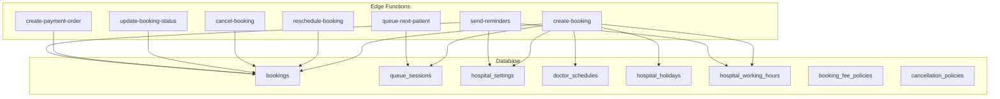
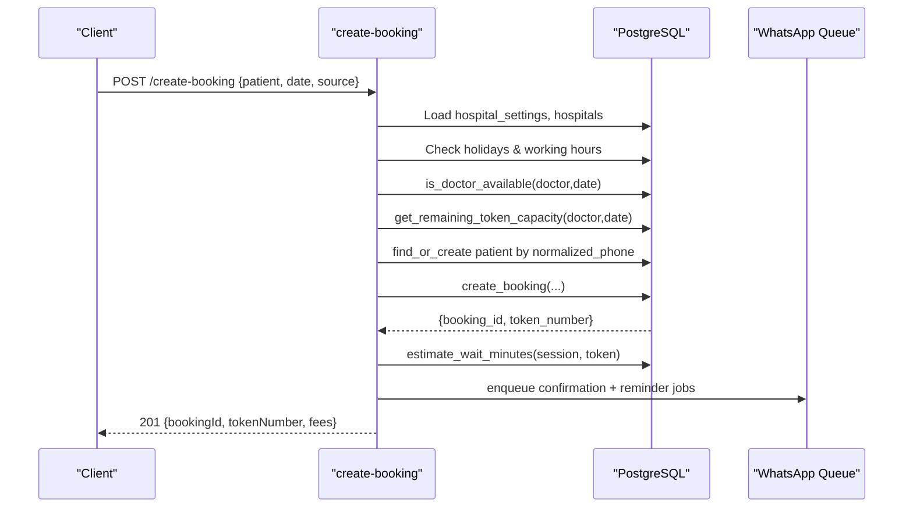
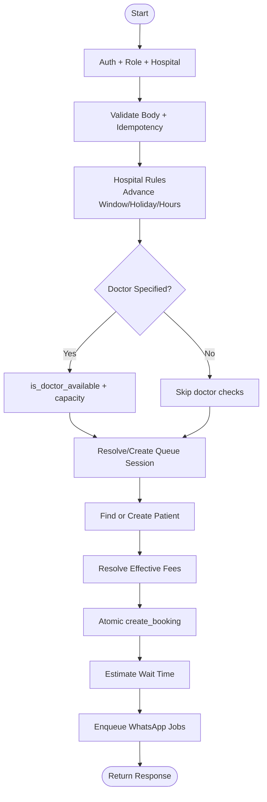
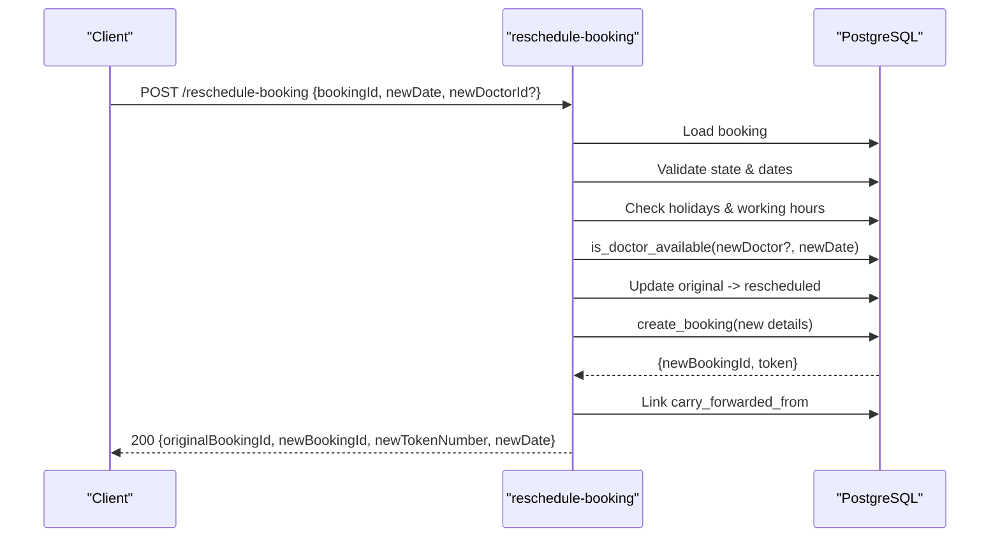
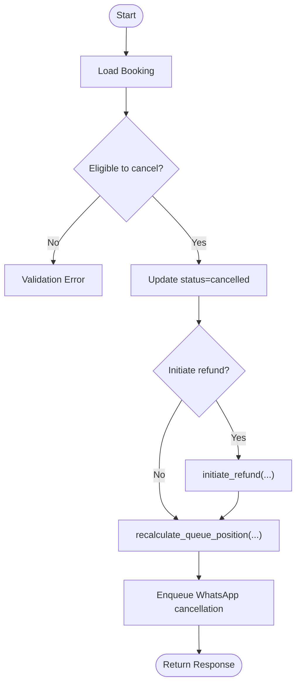
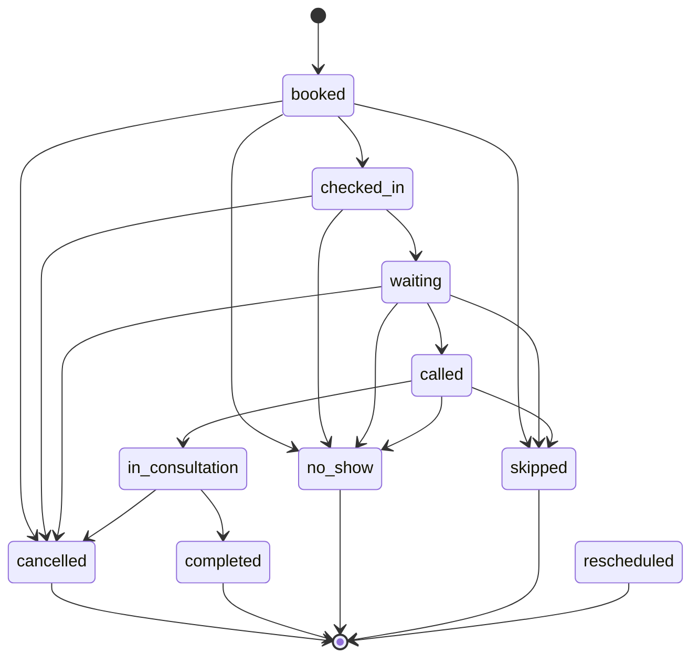
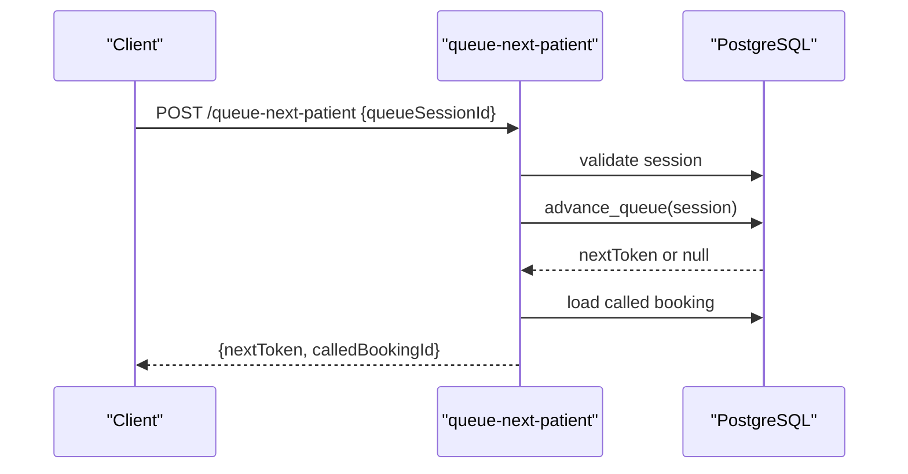
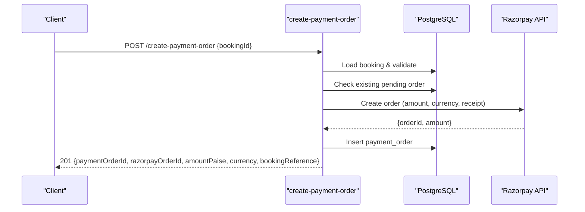
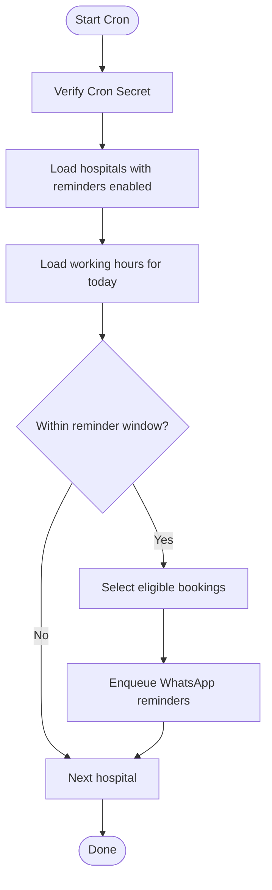
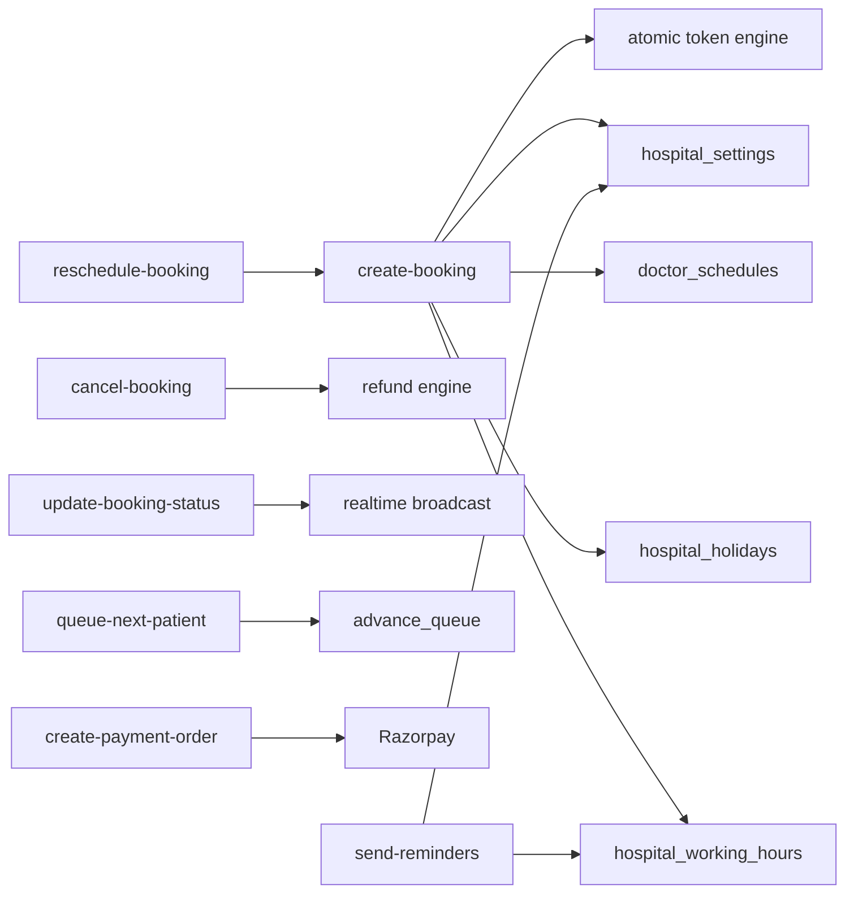

# Booking System

<cite>
**Referenced Files in This Document**
- [create-booking/index.ts](file://supabase/functions/create-booking/index.ts)
- [reschedule-booking/index.ts](file://supabase/functions/reschedule-booking/index.ts)
- [cancel-booking/index.ts](file://supabase/functions/cancel-booking/index.ts)
- [update-booking-status/index.ts](file://supabase/functions/update-booking-status/index.ts)
- [queue-next-patient/index.ts](file://supabase/functions/queue-next-patient/index.ts)
- [create-payment-order/index.ts](file://supabase/functions/create-payment-order/index.ts)
- [send-reminders/index.ts](file://supabase/functions/send-reminders/index.ts)
- [02_atomic_token_engine_&_bookings.sql](file://supabase/migrations/02_atomic_token_engine_&_bookings.sql)
- [03_doctorscheduling&slotengine.sql](file://supabase/migrations/03_doctorscheduling&slotengine.sql)
- [12_hospital_configuration_engine.sql](file://supabase/migrations/12_hospital_configuration_engine.sql)
- [28_booking_enhancements.sql](file://supabase/migrations/28_booking_enhancements.sql)
- [29_cancellation_policy.sql](file://supabase/migrations/29_cancellation_policy.sql)
- [types.ts](file://supabase/functions/_shared/types.ts)
</cite>

## Table of Contents

1. Introduction
2. Project Structure
3. Core Components
4. Architecture Overview
5. Detailed Component Analysis
6. Dependency Analysis
7. Performance Considerations
8. Troubleshooting Guide
9. Conclusion
10. Appendices

## Introduction

This document provides comprehensive documentation for the Booking System,
covering appointment scheduling, conflict detection, capacity management, and
the full booking lifecycle from creation to completion or cancellation. It
explains hospital rules validation, doctor availability checks, queue session
management, atomic token allocation, booking states, cancellation policies,
rescheduling workflows, database schema, API endpoints, error handling patterns,
integrations with payment processing and notifications, and advanced features
such as advance booking windows, holiday restrictions, and working hours
validation.

## Project Structure

The system is implemented as a set of Deno Edge Functions (Supabase functions)
backed by PostgreSQL migrations that define the data model and business logic
via stored procedures and triggers. Key areas:

- Functions implement HTTP APIs for booking operations, queue management,
  payments, reminders, and status transitions.
- Migrations define tables, constraints, indexes, RLS policies, and SQL
  functions for atomicity and consistency.
- Shared utilities handle auth, validation, idempotency, logging, metrics,
  tracing, and responses.



**Diagram sources**

- [create-booking/index.ts:150-446](file://supabase/functions/create-booking/index.ts#L150-L446)
- [02_atomic_token_engine_&_bookings.sql:150-284](file://supabase/migrations/02_atomic_token_engine_&_bookings.sql#L150-L284)
- [03_doctorscheduling&slotengine.sql:79-149](file://supabase/migrations/03_doctorscheduling&slotengine.sql#L79-L149)
- [12_hospital_configuration_engine.sql:115-210](file://supabase/migrations/12_hospital_configuration_engine.sql#L115-L210)
- [28_booking_enhancements.sql:101-143](file://supabase/migrations/28_booking_enhancements.sql#L101-L143)
- [29_cancellation_policy.sql:22-63](file://supabase/migrations/29_cancellation_policy.sql#L22-L63)

**Section sources**

- [create-booking/index.ts:1-666](file://supabase/functions/create-booking/index.ts#L1-L666)
- [02_atomic_token_engine_&_bookings.sql:1-827](file://supabase/migrations/02_atomic_token_engine_&_bookings.sql#L1-L827)
- [03_doctorscheduling&slotengine.sql:1-795](file://supabase/migrations/03_doctorscheduling&slotengine.sql#L1-L795)
- [12_hospital_configuration_engine.sql:1-692](file://supabase/migrations/12_hospital_configuration_engine.sql#L1-L692)
- [28_booking_enhancements.sql:1-277](file://supabase/migrations/28_booking_enhancements.sql#L1-L277)
- [29_cancellation_policy.sql:1-313](file://supabase/migrations/29_cancellation_policy.sql#L1-L313)

## Core Components

- Appointment Scheduling and Conflict Detection: Doctor schedules, holidays,
  working hours, and leave blocks prevent double-booking and enforce
  availability.
- Capacity Management: Per-day token counters and per-doctor schedule capacities
  limit bookings; queue sessions track live tokens.
- Atomic Token Allocation: A stored procedure generates unique sequential tokens
  per hospital/day using an upsert on daily counters.
- Queue Session Management: Active sessions per doctor/date manage current live
  token and support advancing the queue safely.
- Booking Lifecycle: State machine governs transitions, enforces allowed moves,
  and emits notifications and audit events.
- Payment Integration: Creates Razorpay orders for eligible bookings, persists
  order metadata, and supports verification flows.
- Notifications: WhatsApp confirmation, reminders, and status updates are queued
  asynchronously.

**Section sources**

- [02_atomic_token_engine_&_bookings.sql:31-64](file://supabase/migrations/02_atomic_token_engine_&_bookings.sql#L31-L64)
- [02_atomic_token_engine_&_bookings.sql:81-116](file://supabase/migrations/02_atomic_token_engine_&_bookings.sql#L81-L116)
- [03_doctorscheduling&slotengine.sql:377-438](file://supabase/migrations/03_doctorscheduling&slotengine.sql#L377-L438)
- [update-booking-status/index.ts:28-75](file://supabase/functions/update-booking-status/index.ts#L28-L75)
- [create-payment-order/index.ts:104-407](file://supabase/functions/create-payment-order/index.ts#L104-L407)
- [send-reminders/index.ts:111-445](file://supabase/functions/send-reminders/index.ts#L111-L445)

## Architecture Overview

The booking flow validates inputs, enforces hospital rules, checks doctor
availability and capacity, resolves or creates patients, and atomically creates
a booking with a unique token. Subsequent steps enqueue notifications and
compute estimated wait times.



**Diagram sources**

- [create-booking/index.ts:168-446](file://supabase/functions/create-booking/index.ts#L168-L446)
- [02_atomic_token_engine_&_bookings.sql:446-562](file://supabase/migrations/02_atomic_token_engine_&_bookings.sql#L446-L562)
- [03_doctorscheduling&slotengine.sql:377-497](file://supabase/migrations/03_doctorscheduling&slotengine.sql#L377-L497)

## Detailed Component Analysis

### Create Booking Flow

- Validates role and hospital context, parses and validates request body.
- Enforces rate limits and idempotency key semantics.
- Loads hospital settings and applies online booking enablement, advance booking
  window, holiday check, and working hours validation.
- If a doctor is specified, checks availability and remaining token capacity.
- Resolves or auto-creates a queue session for the doctor/date if needed.
- Finds or creates patient by normalized phone, updating demographics when
  present.
- Resolves effective fees based on booking source and hospital configuration.
- Calls the atomic create_booking function to generate a unique token and
  persist the booking.
- Computes estimated wait time and enqueues WhatsApp confirmation and scheduled
  reminders.
- Writes audit log and returns typed response.



**Diagram sources**

- [create-booking/index.ts:87-446](file://supabase/functions/create-booking/index.ts#L87-L446)
- [02_atomic_token_engine_&_bookings.sql:446-562](file://supabase/migrations/02_atomic_token_engine_&_bookings.sql#L446-L562)

**Section sources**

- [create-booking/index.ts:87-635](file://supabase/functions/create-booking/index.ts#L87-L635)
- [02_atomic_token_engine_&_bookings.sql:446-562](file://supabase/migrations/02_atomic_token_engine_&_bookings.sql#L446-L562)
- [12_hospital_configuration_engine.sql:515-559](file://supabase/migrations/12_hospital_configuration_engine.sql#L515-L559)

### Reschedule Booking

- Validates booking existence, ownership, and state eligibility.
- Ensures new date is not past and within advance booking window.
- Checks holidays and working hours for the new date.
- Optionally validates doctor availability if changing doctors.
- Marks original booking as rescheduled and creates a new booking carrying
  forward fee snapshots.
- Links new booking to original via carry_forwarded_from.
- Enqueues WhatsApp notification for reschedule and logs audit event.



**Diagram sources**

- [reschedule-booking/index.ts:127-567](file://supabase/functions/reschedule-booking/index.ts#L127-L567)

**Section sources**

- [reschedule-booking/index.ts:127-567](file://supabase/functions/reschedule-booking/index.ts#L127-L567)

### Cancel Booking

- Validates booking existence and ownership.
- Prevents cancellation from terminal states.
- Updates booking status to cancelled with reason and timestamps.
- Optionally initiates refund for paid bookings by calling refund engine.
- Recalculates queue position if applicable.
- Enqueues WhatsApp cancellation notification and logs audit event.



**Diagram sources**

- [cancel-booking/index.ts:127-460](file://supabase/functions/cancel-booking/index.ts#L127-L460)

**Section sources**

- [cancel-booking/index.ts:127-460](file://supabase/functions/cancel-booking/index.ts#L127-L460)

### Update Booking Status (State Machine)

- Defines allowed transitions between statuses and terminal states.
- Enforces role-based permissions (e.g., doctors can only move to
  consultation/completed).
- Updates status with concurrency control and optional notes in metadata.
- Broadcasts real-time queue advances when applicable.
- Enqueues notifications for specific transitions and schedules feedback
  requests post-completion.



**Diagram sources**

- [update-booking-status/index.ts:28-75](file://supabase/functions/update-booking-status/index.ts#L28-L75)

**Section sources**

- [update-booking-status/index.ts:172-617](file://supabase/functions/update-booking-status/index.ts#L172-L617)

### Queue Next Patient

- Validates queue session existence, ownership, and active state.
- Advances the queue atomically using a stored procedure that selects the next
  eligible booking with priority and token ordering, locks it, marks it as
  called, and updates the session’s current live token.
- Broadcasts real-time update and enqueues WhatsApp “patient called” message.
- Logs audit event and returns next token info.



**Diagram sources**

- [queue-next-patient/index.ts:104-388](file://supabase/functions/queue-next-patient/index.ts#L104-L388)
- [02_atomic_token_engine_&_bookings.sql:576-622](file://supabase/migrations/02_atomic_token_engine_&_bookings.sql#L576-L622)

**Section sources**

- [queue-next-patient/index.ts:104-388](file://supabase/functions/queue-next-patient/index.ts#L104-L388)

### Payment Order Creation

- Validates booking eligibility and ensures no existing pending order.
- Resolves amount from booking snapshot and verifies non-zero.
- Creates a Razorpay order server-side and persists payment order record.
- Returns order details including public key for client SDK integration.



**Diagram sources**

- [create-payment-order/index.ts:104-407](file://supabase/functions/create-payment-order/index.ts#L104-L407)

**Section sources**

- [create-payment-order/index.ts:104-407](file://supabase/functions/create-payment-order/index.ts#L104-L407)

### Reminders Cron

- Authenticates via cron secret.
- For each hospital with reminders enabled, computes reminder window based on
  today’s working hours and configured minutes before opening.
- Queues WhatsApp reminders for eligible bookings (today, not yet reminded).



**Diagram sources**

- [send-reminders/index.ts:111-445](file://supabase/functions/send-reminders/index.ts#L111-L445)

**Section sources**

- [send-reminders/index.ts:111-445](file://supabase/functions/send-reminders/index.ts#L111-L445)

## Dependency Analysis

Key dependencies and relationships:

- create-booking depends on hospital settings, holidays, working hours, doctor
  schedules, queue sessions, and atomic token generation.
- reschedule-booking reuses create_booking and links to original booking via
  carry-forward fields.
- cancel-booking integrates with refund engine and queue recalculation.
- update-booking-status drives state transitions and real-time broadcasts.
- queue-next-patient relies on advance_queue stored procedure and updates queue
  session state.
- create-payment-order depends on booking snapshots and external Razorpay
  service.
- send-reminders depends on hospital settings and working hours to schedule
  messages.



**Diagram sources**

- [create-booking/index.ts:168-446](file://supabase/functions/create-booking/index.ts#L168-L446)
- [02_atomic_token_engine_&_bookings.sql:31-64](file://supabase/migrations/02_atomic_token_engine_&_bookings.sql#L31-L64)
- [03_doctorscheduling&slotengine.sql:377-497](file://supabase/migrations/03_doctorscheduling&slotengine.sql#L377-L497)
- [create-payment-order/index.ts:104-407](file://supabase/functions/create-payment-order/index.ts#L104-L407)
- [send-reminders/index.ts:111-445](file://supabase/functions/send-reminders/index.ts#L111-L445)

**Section sources**

- [create-booking/index.ts:168-446](file://supabase/functions/create-booking/index.ts#L168-L446)
- [02_atomic_token_engine_&_bookings.sql:31-64](file://supabase/migrations/02_atomic_token_engine_&_bookings.sql#L31-L64)
- [03_doctorscheduling&slotengine.sql:377-497](file://supabase/migrations/03_doctorscheduling&slotengine.sql#L377-L497)
- [create-payment-order/index.ts:104-407](file://supabase/functions/create-payment-order/index.ts#L104-L407)
- [send-reminders/index.ts:111-445](file://supabase/functions/send-reminders/index.ts#L111-L445)

## Performance Considerations

- Atomic token generation uses upsert on daily counters to avoid race conditions
  and ensure monotonic token sequences per hospital/day.
- Queue advancement uses SKIP LOCKED to safely select the next eligible booking
  without blocking concurrent callers.
- Estimated wait time calculation leverages average consultation minutes and
  counts ahead-of-token bookings to provide quick estimates.
- Idempotency keys and unique constraints prevent duplicate bookings and payment
  orders under concurrent retries.
- Asynchronous job queuing for WhatsApp notifications decouples messaging from
  critical paths.

[No sources needed since this section provides general guidance]

## Troubleshooting Guide

Common issues and resolutions:

- Duplicate booking attempts: Handled by idempotency_key uniqueness; repeated
  calls return the same booking.
- Doctor unavailable or capacity exceeded: Availability and capacity checks
  throw explicit errors; adjust schedules or reduce demand.
- Holiday or closed day: Requests fail with hospital closed errors; verify
  hospital_holidays and hospital_working_hours.
- Concurrent status updates: State transitions use optimistic locking; retry
  with latest state on conflicts.
- Payment order failures: External gateway errors surfaced; verify credentials
  and amounts; reuse existing pending orders when possible.
- Reminder not sent: Ensure hospital has reminders enabled, working hours
  configured, and booking meets criteria; check job queue for failures.

**Section sources**

- [create-booking/index.ts:448-493](file://supabase/functions/create-booking/index.ts#L448-L493)
- [update-booking-status/index.ts:314-353](file://supabase/functions/update-booking-status/index.ts#L314-L353)
- [create-payment-order/index.ts:213-261](file://supabase/functions/create-payment-order/index.ts#L213-L261)
- [send-reminders/index.ts:128-388](file://supabase/functions/send-reminders/index.ts#L128-L388)

## Conclusion

The Booking System provides a robust, production-grade foundation for hospital
appointment scheduling with strong guarantees around concurrency, consistency,
and user experience. It integrates scheduling, capacity management, queue
operations, payments, and notifications while enforcing configurable hospital
policies and advanced features like advance booking windows and holiday
restrictions.

[No sources needed since this section summarizes without analyzing specific
files]

## Appendices

### Database Schema Highlights

- Bookings: Stores all booking details, timestamps for lifecycle events, fee
  snapshots, payment flags, and references to queue sessions and original
  bookings for rescheduling.
- Queue Sessions: Tracks per-doctor daily sessions, max tokens, and current live
  token.
- Doctor Schedules: Defines weekly schedules with time ranges, buffer, and
  capacity; prevents overlaps via exclusion constraints.
- Hospital Settings: Controls fees, queue behavior, notifications, and payment
  toggles.
- Booking Fee Policies: Configures per-hospital booking fees, GST, and refund
  windows.
- Cancellation Policies: Defines refund tiers, penalties, and versioning
  history.

```mermaid
erDiagram
BOOKINGS {
uuid id PK
uuid hospital_id FK
uuid queue_session_id FK
uuid patient_id FK
text patient_name
text patient_phone
int patient_age
text patient_gender
text village
text blood_group
boolean has_diabetes
boolean has_bp
int token_number
int priority_score
boolean priority_flag
enum status
enum booking_source
uuid assigned_doctor_id FK
uuid booked_by FK
date appointment_date
timestamptz checked_in_at
timestamptz called_at
timestamptz consultation_started_at
timestamptz consultation_completed_at
timestamptz cancelled_at
timestamptz no_show_marked_at
uuid carry_forwarded_from FK
boolean is_carry_forward
text cancellation_reason
numeric platform_fee_snapshot
numeric receptionist_fee_snapshot
numeric hospital_fee_snapshot
numeric total_amount_snapshot
boolean payment_completed
text payment_reference
boolean whatsapp_confirmation_sent
boolean whatsapp_reminder_sent
boolean feedback_sent
int estimated_wait_minutes
text idempotency_key UK
text booking_reference UK
jsonb metadata
boolean is_deleted
timestamptz deleted_at
timestamptz created_at
timestamptz updated_at
}
QUEUE_SESSIONS {
uuid id PK
uuid hospital_id FK
uuid doctor_id FK
date session_date
text session_name
int max_tokens
int current_live_token
boolean is_active
timestamptz started_at
timestamptz ended_at
timestamptz created_at
timestamptz updated_at
}
DOCTOR_SCHEDULES {
uuid id PK
uuid doctor_id FK
uuid hospital_id FK
int weekday
time start_time
time end_time
int max_tokens
int average_consultation_minutes
int buffer_minutes
boolean is_active
boolean is_walkin_allowed
uuid created_by FK
boolean is_deleted
timestamptz created_at
timestamptz updated_at
}
HOSPITAL_SETTINGS {
uuid id PK
uuid hospital_id FK
numeric platform_fee_online
numeric platform_fee_whatsapp
numeric receptionist_fee
boolean online_booking_fee_enabled
int max_tokens_per_day
boolean allow_walkin_tokens
boolean allow_online_booking
boolean allow_carry_forward
boolean queue_display_enabled
boolean send_whatsapp_confirmation
boolean send_whatsapp_reminder
boolean send_feedback_request
int reminder_before_minutes
text razorpay_key_id
boolean payment_enabled
text preferred_language
text timezone
jsonb metadata
timestamptz created_at
timestamptz updated_at
}
BOOKING_FEE_POLICIES {
uuid id PK
uuid hospital_id FK UK
numeric booking_fee_online
numeric booking_fee_whatsapp
numeric booking_fee_walkin
boolean booking_fee_enabled
boolean gst_enabled
numeric gst_percentage
int refund_window_minutes
boolean refund_on_cancellation
numeric default_consultation_fee_inr
boolean collect_consultation_at_hospital
boolean include_gateway_fee
numeric gateway_fee_percentage
jsonb metadata
timestamptz created_at
timestamptz updated_at
}
CANCELLATION_POLICIES {
uuid id PK
uuid hospital_id FK UK
int full_refund_within_minutes
numeric partial_refund_percentage
int partial_refund_within_minutes
numeric same_day_refund_percentage
boolean no_show_penalty_enabled
numeric no_show_penalty_amount_inr
boolean allow_manual_full_refund
int version
date effective_from
text notes
jsonb metadata
timestamptz created_at
timestamptz updated_at
}
BOOKINGS ||--o{ QUEUE_SESSIONS : "belongs_to"
BOOKINGS ||--o{ DOCTOR_SCHEDULES : "scheduled_by"
BOOKINGS ||--o{ HOSPITAL_SETTINGS : "governed_by"
BOOKINGS ||--o{ BOOKING_FEE_POLICIES : "fee_policy"
BOOKINGS ||--o{ CANCELLATION_POLICIES : "policy"
```

**Diagram sources**

- [02_atomic_token_engine_&_bookings.sql:150-284](file://supabase/migrations/02_atomic_token_engine_&_bookings.sql#L150-L284)
- [03_doctorscheduling&slotengine.sql:79-149](file://supabase/migrations/03_doctorscheduling&slotengine.sql#L79-L149)
- [12_hospital_configuration_engine.sql:115-210](file://supabase/migrations/12_hospital_configuration_engine.sql#L115-L210)
- [28_booking_enhancements.sql:101-143](file://supabase/migrations/28_booking_enhancements.sql#L101-L143)
- [29_cancellation_policy.sql:22-63](file://supabase/migrations/29_cancellation_policy.sql#L22-L63)

### API Endpoints and Schemas

- POST /create-booking
  - Request: hospitalId, queueSessionId?, patientName, patientPhone,
    patientAge?, patientGender?, village?, bloodGroup?, hasDiabetes, hasBp,
    bookingSource, doctorId?, appointmentDate
  - Response: bookingId, tokenNumber, bookingReference, estimatedWaitMinutes?,
    patientId, appointmentDate, queueSessionId?, fees {platformFee,
    receptionistFee, hospitalFee, totalAmount}
  - Errors: Validation, HospitalClosed, DoctorUnavailable, QueueFull, Internal
- POST /reschedule-booking
  - Request: bookingId, newDate, newDoctorId?, reason?
  - Response: originalBookingId, newBookingId, newTokenNumber, newDate
  - Errors: Validation, Forbidden, Internal
- POST /cancel-booking
  - Request: bookingId, cancellationReason, initiateRefund?
  - Response: bookingId, cancelled, alreadyCancelled?, refundInitiated?
  - Errors: Validation, Forbidden, Internal
- POST /update-booking-status
  - Request: bookingId, newStatus, notes?
  - Response: bookingId, status, changed?
  - Errors: Validation, Forbidden, Concurrency
- POST /queue-next-patient
  - Request: queueSessionId
  - Response: nextToken?, queueExhausted?, calledBookingId?, calledPatientName?
  - Errors: Validation, Internal
- POST /create-payment-order
  - Request: bookingId
  - Response: paymentOrderId, razorpayOrderId, amountPaise, currency, bookingId,
    bookingReference, razorpayKeyId
  - Errors: Validation, Forbidden, Internal

**Section sources**

- [types.ts:281-312](file://supabase/functions/_shared/types.ts#L281-L312)
- [create-booking/index.ts:121-140](file://supabase/functions/create-booking/index.ts#L121-L140)
- [reschedule-booking/index.ts:44-49](file://supabase/functions/reschedule-booking/index.ts#L44-L49)
- [cancel-booking/index.ts:34-43](file://supabase/functions/cancel-booking/index.ts#L34-L43)
- [update-booking-status/index.ts:94-111](file://supabase/functions/update-booking-status/index.ts#L94-L111)
- [queue-next-patient/index.ts:26-28](file://supabase/functions/queue-next-patient/index.ts#L26-L28)
- [create-payment-order/index.ts:49-51](file://supabase/functions/create-payment-order/index.ts#L49-L51)

### Advanced Features

- Advance Booking Windows: Enforced via hospital max_advance_booking_days and
  validation helpers.
- Holiday Restrictions: Checked against hospital_holidays; blocked if holiday
  matches appointment date.
- Working Hours Validation: Verified against hospital_working_hours for the
  target weekday; closed days rejected.
- Doctor Leave and Overrides: Availability checks consider leaves and overrides
  to prevent overbooking.
- Fee Policies and GST: Per-hospital booking fee policies determine fees and GST
  calculations; informational consultation fees displayed but not collected by
  platform.
- Cancellation Policy Engine: Tiered refund logic with versioning and audit
  history; refunds apply only to booking_fee_inr.

**Section sources**

- [create-booking/index.ts:194-249](file://supabase/functions/create-booking/index.ts#L194-L249)
- [03_doctorscheduling&slotengine.sql:377-438](file://supabase/migrations/03_doctorscheduling&slotengine.sql#L377-L438)
- [28_booking_enhancements.sql:197-244](file://supabase/migrations/28_booking_enhancements.sql#L197-L244)
- [29_cancellation_policy.sql:160-275](file://supabase/migrations/29_cancellation_policy.sql#L160-L275)
