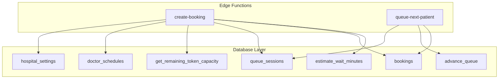
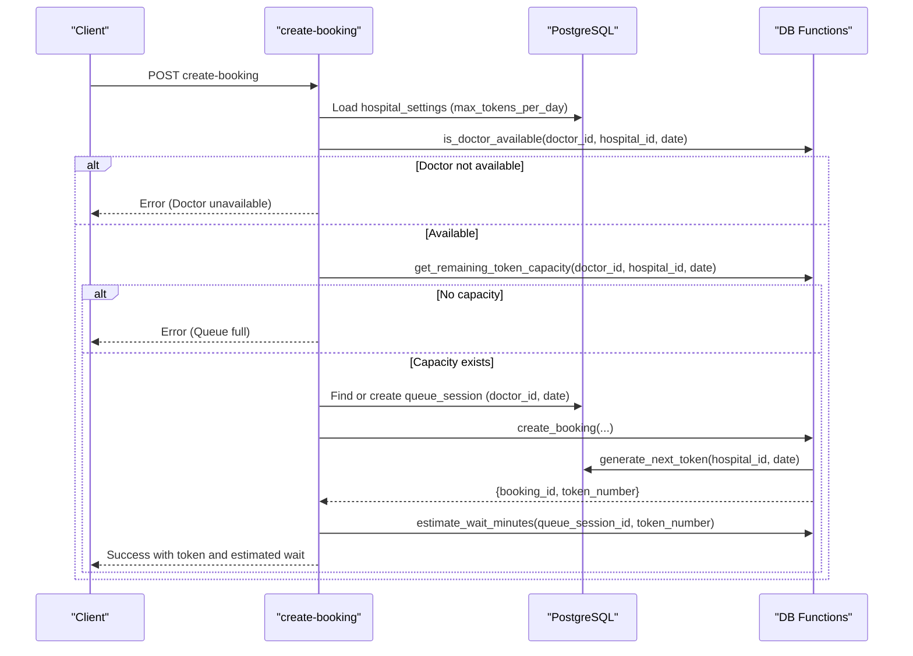
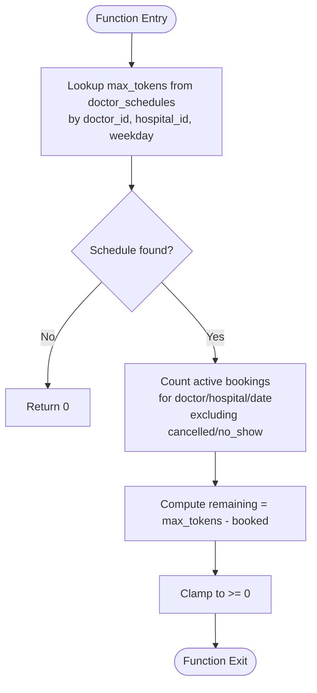
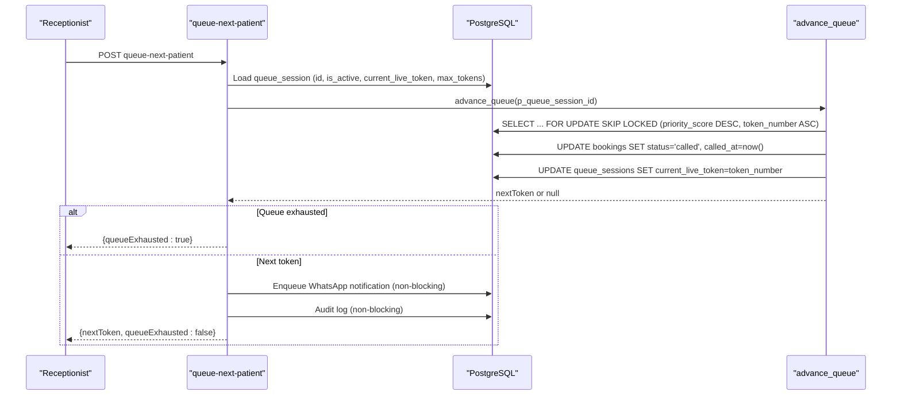
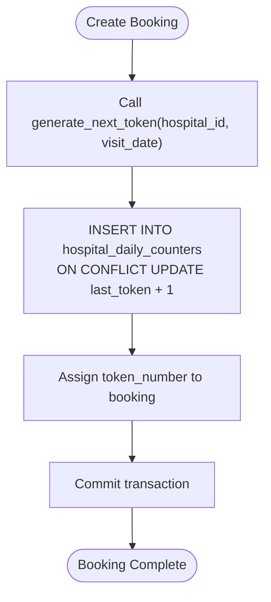
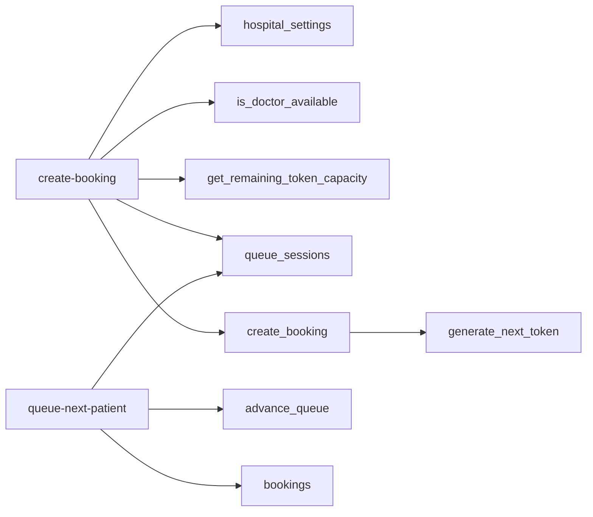
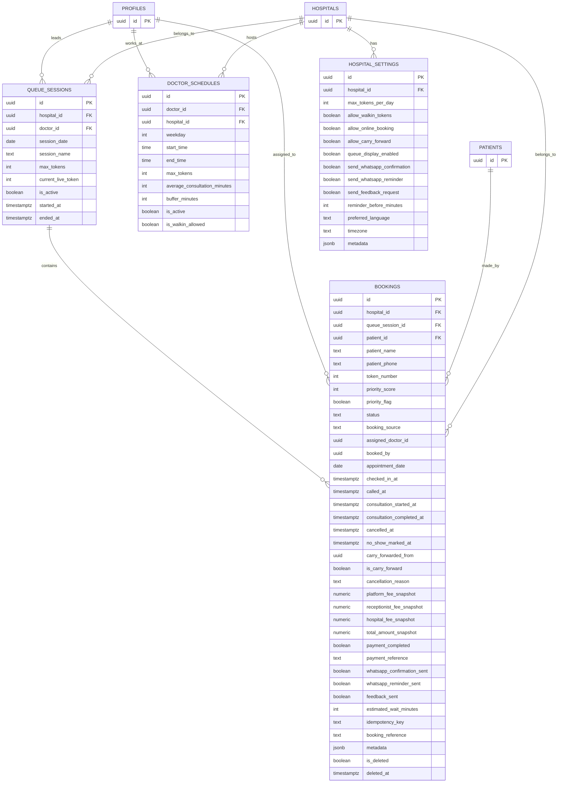

# Capacity Management

<cite>
**Referenced Files in This Document**
- [create-booking/index.ts](file://supabase/functions/create-booking/index.ts)
- [queue-next-patient/index.ts](file://supabase/functions/queue-next-patient/index.ts)
- [02_atomic_token_engine_&_bookings.sql](file://supabase/migrations/02_atomic_token_engine_&_bookings.sql)
- [03_doctorscheduling&slotengine.sql](file://supabase/migrations/03_doctorscheduling&slotengine.sql)
- [12_hospital_configuration_engine.sql](file://supabase/migrations/12_hospital_configuration_engine.sql)
</cite>

## Table of Contents

1. [Introduction](#introduction)
2. [Project Structure](#project-structure)
3. [Core Components](#core-components)
4. [Architecture Overview](#architecture-overview)
5. [Detailed Component Analysis](#detailed-component-analysis)
6. [Dependency Analysis](#dependency-analysis)
7. [Performance Considerations](#performance-considerations)
8. [Troubleshooting Guide](#troubleshooting-guide)
9. [Conclusion](#conclusion)
10. [Appendices](#appendices)

## Introduction

This document explains how the system manages doctor capacity, queue session
limits, and token allocation per day. It focuses on:

- How available slots are calculated using the get_remaining_token_capacity
  function based on doctor schedules and hospital policies
- How queue sessions are created automatically and managed with maximum tokens
  per day
- Real-time capacity updates when advancing the queue
- Examples of capacity checking workflows, overflow handling, and reporting
- Advanced scenarios such as partial capacity booking, waitlist management, and
  dynamic capacity adjustment based on real-time demand

## Project Structure

The capacity management logic spans database functions and edge functions:

- Database layer defines scheduling tables, queue sessions, bookings, atomic
  token generation, and capacity calculation functions
- Edge functions orchestrate booking creation, queue advancement, and
  notifications while enforcing hospital policies and concurrency safety

**Diagram sources**

- [create-booking/index.ts:251-319](file://supabase/functions/create-booking/index.ts#L251-L319)
- [queue-next-patient/index.ts:104-167](file://supabase/functions/queue-next-patient/index.ts#L104-L167)
- [03_doctorscheduling&slotengine.sql:447-497](file://supabase/migrations/03_doctorscheduling&slotengine.sql#L447-L497)
- [02_atomic_token_engine_&_bookings.sql:576-622](file://supabase/migrations/02_atomic_token_engine_&_bookings.sql#L576-L622)
- [12_hospital_configuration_engine.sql:115-170](file://supabase/migrations/12_hospital_configuration_engine.sql#L115-L170)

**Section sources**

- [create-booking/index.ts:251-319](file://supabase/functions/create-booking/index.ts#L251-L319)
- [queue-next-patient/index.ts:104-167](file://supabase/functions/queue-next-patient/index.ts#L104-L167)
- [03_doctorscheduling&slotengine.sql:447-497](file://supabase/migrations/03_doctorscheduling&slotengine.sql#L447-L497)
- [02_atomic_token_engine_&_bookings.sql:576-622](file://supabase/migrations/02_atomic_token_engine_&_bookings.sql#L576-L622)
- [12_hospital_configuration_engine.sql:115-170](file://supabase/migrations/12_hospital_configuration_engine.sql#L115-L170)

## Core Components

- Doctor schedule and availability:
  - doctor_schedules define weekday-based time windows and max_tokens per
    schedule
  - is_doctor_available checks leaves, overrides, holidays, and schedule
    existence for a given date
- Queue sessions:
  - queue_sessions represent daily sessions per doctor with max_tokens and
    current_live_token
  - Auto-created during booking if none exists for that doctor/date
- Bookings and tokens:
  - bookings store patient details, assigned doctor, appointment_date,
    token_number, and status
  - generate_next_token atomically increments daily counters to assign unique
    token numbers
- Capacity and wait estimation:
  - get_remaining_token_capacity computes remaining slots by subtracting active
    bookings from schedule max_tokens
  - estimate_wait_minutes estimates waiting time based on ahead-of-token count
    and average consultation minutes

**Section sources**

- [03_doctorscheduling&slotengine.sql:79-156](file://supabase/migrations/03_doctorscheduling&slotengine.sql#L79-L156)
- [03_doctorscheduling&slotengine.sql:377-438](file://supabase/migrations/03_doctorscheduling&slotengine.sql#L377-L438)
- [03_doctorscheduling&slotengine.sql:447-497](file://supabase/migrations/03_doctorscheduling&slotengine.sql#L447-L497)
- [02_atomic_token_engine_&_bookings.sql:12-25](file://supabase/migrations/02_atomic_token_engine_&_bookings.sql#L12-L25)
- [02_atomic_token_engine_&_bookings.sql:31-64](file://supabase/migrations/02_atomic_token_engine_&_bookings.sql#L31-L64)
- [02_atomic_token_engine_&_bookings.sql:81-116](file://supabase/migrations/02_atomic_token_engine_&_bookings.sql#L81-L116)
- [02_atomic_token_engine_&_bookings.sql:150-284](file://supabase/migrations/02_atomic_token_engine_&_bookings.sql#L150-L284)
- [02_atomic_token_engine_&_bookings.sql:576-622](file://supabase/migrations/02_atomic_token_engine_&_bookings.sql#L576-L622)
- [12_hospital_configuration_engine.sql:115-170](file://supabase/migrations/12_hospital_configuration_engine.sql#L115-L170)

## Architecture Overview

The capacity management architecture integrates scheduling, queue sessions, and
booking flows:

- Booking flow validates doctor availability and slot capacity before creating a
  booking
- Queue sessions are auto-created per doctor/date using hospital-configured
  max_tokens_per_day
- Queue advancement uses an atomic SQL function to safely pick the next patient
  and update live token
- Wait estimation provides real-time insights into expected wait times

**Diagram sources**

- [create-booking/index.ts:168-182](file://supabase/functions/create-booking/index.ts#L168-L182)
- [create-booking/index.ts:251-319](file://supabase/functions/create-booking/index.ts#L251-L319)
- [02_atomic_token_engine_&_bookings.sql:31-64](file://supabase/migrations/02_atomic_token_engine_&_bookings.sql#L31-L64)
- [02_atomic_token_engine_&_bookings.sql:446-562](file://supabase/migrations/02_atomic_token_engine_&_bookings.sql#L446-L562)
- [03_doctorscheduling&slotengine.sql:377-438](file://supabase/migrations/03_doctorscheduling&slotengine.sql#L377-L438)
- [03_doctorscheduling&slotengine.sql:447-497](file://supabase/migrations/03_doctorscheduling&slotengine.sql#L447-L497)

## Detailed Component Analysis

### get_remaining_token_capacity Function

Purpose:

- Computes available slots for a doctor on a specific date by comparing
  schedule-defined max_tokens against active bookings

Algorithm overview:

- Retrieve max_tokens from doctor_schedules for the matching weekday and active
  schedule
- Count active bookings for the same doctor/hospital/date excluding
  cancelled/no_show statuses
- Return GREATEST(max_tokens - booked, 0)

Complexity:

- Two primary queries: one lookup on doctor_schedules, one COUNT on bookings
  filtered by doctor/hospital/date/status
- Index usage on doctor_schedules(doctor_id, weekday) and
  bookings(assigned_doctor_id, appointment_date) improves performance

Error handling:

- If no schedule found, returns 0 capacity
- Negative results are clamped to zero via GREATEST

Usage in booking flow:

- Called after verifying doctor availability; if remaining capacity <= 0, throws
  a queue-full error

**Diagram sources**

- [03_doctorscheduling&slotengine.sql:447-497](file://supabase/migrations/03_doctorscheduling&slotengine.sql#L447-L497)

**Section sources**

- [03_doctorscheduling&slotengine.sql:447-497](file://supabase/migrations/03_doctorscheduling&slotengine.sql#L447-L497)
- [create-booking/index.ts:270-282](file://supabase/functions/create-booking/index.ts#L270-L282)

### Queue Session Management

Key behaviors:

- Auto-creation: During booking, if no active queue session exists for the
  doctor/date, one is created with max_tokens set from
  hospital_settings.max_tokens_per_day
- Uniqueness: Unique constraint ensures only one session per
  hospital/doctor/date
- Live tracking: current_live_token tracks the currently called token; updated
  atomically when advancing the queue

Real-time updates:

- advance_queue picks the next eligible booking using priority_score and
  token_number ordering, marks it as called, and updates
  queue_sessions.current_live_token
- Non-blocking side effects: WhatsApp notifications and audit logging are
  enqueued or logged without blocking queue progression

Overflow handling:

- When queue is exhausted, the function returns null; the edge function responds
  with queueExhausted flag and metrics increment
- No explicit waitlist table exists; overflow can be handled at application
  level by queuing requests or offering alternative doctors/dates

**Diagram sources**

- [queue-next-patient/index.ts:104-167](file://supabase/functions/queue-next-patient/index.ts#L104-L167)
- [queue-next-patient/index.ts:186-213](file://supabase/functions/queue-next-patient/index.ts#L186-L213)
- [02_atomic_token_engine_&_bookings.sql:576-622](file://supabase/migrations/02_atomic_token_engine_&_bookings.sql#L576-L622)

**Section sources**

- [create-booking/index.ts:285-319](file://supabase/functions/create-booking/index.ts#L285-L319)
- [queue-next-patient/index.ts:104-167](file://supabase/functions/queue-next-patient/index.ts#L104-L167)
- [queue-next-patient/index.ts:186-213](file://supabase/functions/queue-next-patient/index.ts#L186-L213)
- [02_atomic_token_engine_&_bookings.sql:81-116](file://supabase/migrations/02_atomic_token_engine_&_bookings.sql#L81-L116)
- [02_atomic_token_engine_&_bookings.sql:576-622](file://supabase/migrations/02_atomic_token_engine_&_bookings.sql#L576-L622)

### Token Allocation Per Day

Atomic token generation:

- generate_next_token uses INSERT ... ON CONFLICT DO UPDATE to atomically
  increment last_token per hospital/visit_date
- Ensures uniqueness and thread-safety under concurrent booking attempts

Booking integration:

- create_booking calls generate_next_token to assign token_number within a
  single transactional context
- Idempotency_key prevents duplicate bookings and ensures consistent responses

**Diagram sources**

- [02_atomic_token_engine_&_bookings.sql:31-64](file://supabase/migrations/02_atomic_token_engine_&_bookings.sql#L31-L64)
- [02_atomic_token_engine_&_bookings.sql:446-562](file://supabase/migrations/02_atomic_token_engine_&_bookings.sql#L446-L562)

**Section sources**

- [02_atomic_token_engine_&_bookings.sql:31-64](file://supabase/migrations/02_atomic_token_engine_&_bookings.sql#L31-L64)
- [02_atomic_token_engine_&_bookings.sql:446-562](file://supabase/migrations/02_atomic_token_engine_&_bookings.sql#L446-L562)

### Hospital Policies and Configuration

Configuration points:

- hospital_settings.max_tokens_per_day controls default daily capacity for
  auto-created queue sessions
- allow_online_booking and other flags control booking behavior
- reminder_before_minutes configures WhatsApp reminders timing

Integration:

- create-booking loads hospital_settings early and uses them for capacity
  defaults and feature toggles
- Queue session creation uses hs.max_tokens_per_day to set max_tokens

**Section sources**

- [12_hospital_configuration_engine.sql:115-170](file://supabase/migrations/12_hospital_configuration_engine.sql#L115-L170)
- [create-booking/index.ts:168-182](file://supabase/functions/create-booking/index.ts#L168-L182)
- [create-booking/index.ts:302-311](file://supabase/functions/create-booking/index.ts#L302-L311)

### Capacity Checking Workflows

Typical workflow:

- Validate hospital open hours and holidays
- Check doctor availability for the requested date
- Query get_remaining_token_capacity to ensure capacity > 0
- Resolve or create queue session
- Create booking atomically and estimate wait time

Overflow handling:

- If remaining capacity <= 0, throw QueueFullError
- Application can offer alternative doctors or dates, or implement a waitlist
  outside the core system

Capacity reporting:

- Use estimate_wait_minutes to report expected wait times to patients
- Monitor queue.exhausted metric to detect when queues run out

**Section sources**

- [create-booking/index.ts:220-282](file://supabase/functions/create-booking/index.ts#L220-L282)
- [create-booking/index.ts:507-518](file://supabase/functions/create-booking/index.ts#L507-L518)
- [queue-next-patient/index.ts:186-213](file://supabase/functions/queue-next-patient/index.ts#L186-L213)

### Advanced Scenarios

#### Partial Capacity Booking

- The system does not enforce per-slot time windows beyond schedule-level
  max_tokens; however, you can model partial capacity by:
  - Adjusting doctor_schedules.max_tokens to reflect available slots
  - Using queue session max_tokens to cap daily capacity
  - Applying business rules in create-booking to limit batch sizes or enforce
    minimum gaps between bookings

#### Waitlist Management

- No dedicated waitlist table exists; implement at application level:
  - Store pending requests with timestamps and preferences
  - On capacity release (e.g., cancellation), notify waitlisted patients
  - Reuse queue-next-patient flow to call next patient once capacity opens

#### Dynamic Capacity Adjustment Based on Real-Time Demand

- Strategies:
  - Periodically adjust doctor_schedules.max_tokens based on observed demand and
    utilization
  - Use queue session current_live_token and estimate_wait_minutes to trigger
    alerts or dynamic limits
  - Introduce feature flags or queue_configs to enable/disable advanced capacity
    controls per hospital or doctor

[No sources needed since this section provides conceptual guidance]

## Dependency Analysis

Core dependencies and relationships:

- create-booking depends on:
  - hospital_settings for policy and configuration
  - is_doctor_available and get_remaining_token_capacity for availability and
    capacity checks
  - queue_sessions for session resolution/creation
  - create_booking and generate_next_token for atomic token assignment
- queue-next-patient depends on:
  - advance_queue for safe queue progression
  - queue_sessions for state validation and updates
  - bookings for selecting next patient and updating status

Potential circular dependencies:

- None detected; functions are unidirectional and encapsulated

External integrations:

- WhatsApp messaging via enqueue_job (non-blocking)
- Realtime broadcasts for queue advances

**Diagram sources**

- [create-booking/index.ts:168-182](file://supabase/functions/create-booking/index.ts#L168-L182)
- [create-booking/index.ts:251-319](file://supabase/functions/create-booking/index.ts#L251-L319)
- [02_atomic_token_engine_&_bookings.sql:31-64](file://supabase/migrations/02_atomic_token_engine_&_bookings.sql#L31-L64)
- [02_atomic_token_engine_&_bookings.sql:446-562](file://supabase/migrations/02_atomic_token_engine_&_bookings.sql#L446-L562)
- [queue-next-patient/index.ts:104-167](file://supabase/functions/queue-next-patient/index.ts#L104-L167)
- [02_atomic_token_engine_&_bookings.sql:576-622](file://supabase/migrations/02_atomic_token_engine_&_bookings.sql#L576-L622)

**Section sources**

- [create-booking/index.ts:168-319](file://supabase/functions/create-booking/index.ts#L168-L319)
- [queue-next-patient/index.ts:104-167](file://supabase/functions/queue-next-patient/index.ts#L104-L167)
- [02_atomic_token_engine_&_bookings.sql:31-64](file://supabase/migrations/02_atomic_token_engine_&_bookings.sql#L31-L64)
- [02_atomic_token_engine_&_bookings.sql:446-562](file://supabase/migrations/02_atomic_token_engine_&_bookings.sql#L446-L562)
- [02_atomic_token_engine_&_bookings.sql:576-622](file://supabase/migrations/02_atomic_token_engine_&_bookings.sql#L576-L622)

## Performance Considerations

- Indexes:
  - doctor_schedules indexes on (doctor_id, weekday) and (hospital_id, weekday)
    optimize availability and capacity lookups
  - bookings indexes on (assigned_doctor_id, appointment_date), (status), and
    (queue_session_id, status, priority_score, token_number) improve counting
    and selection
- Concurrency:
  - generate_next_token uses upsert to avoid race conditions
  - advance_queue uses FOR UPDATE SKIP LOCKED to prevent lock contention
- Estimation:
  - estimate_wait_minutes joins queue_sessions with doctor_schedules to compute
    average consultation minutes; ensure these values are accurate for realistic
    estimates

[No sources needed since this section provides general guidance]

## Troubleshooting Guide

Common issues and resolutions:

- Doctor unavailable:
  - Verify doctor_schedules entry for the weekday and check doctor_leaves and
    doctor_availability_overrides
  - Ensure hospital_holidays do not block the date
- Queue full:
  - Check get_remaining_token_capacity result and doctor_schedules.max_tokens
  - Review active bookings count and status filtering
- Queue exhaustion:
  - Monitor queue.exhausted metric and handle gracefully in UI
  - Consider enabling carry-forward or offering alternative doctors
- Realtime and notifications:
  - Enqueue errors for WhatsApp messages are non-fatal; check logs and retry
    mechanisms
  - Audit logging failures should not block operations

**Section sources**

- [create-booking/index.ts:251-282](file://supabase/functions/create-booking/index.ts#L251-L282)
- [queue-next-patient/index.ts:186-213](file://supabase/functions/queue-next-patient/index.ts#L186-L213)
- [queue-next-patient/index.ts:274-320](file://supabase/functions/queue-next-patient/index.ts#L274-L320)

## Conclusion

The capacity management system combines robust scheduling, atomic token
allocation, and queue session management to ensure reliable and scalable booking
operations. Key strengths include:

- Accurate capacity calculation via get_remaining_token_capacity
- Automatic queue session creation aligned with hospital policies
- Concurrency-safe queue advancement with real-time updates
- Extensible configuration for dynamic adjustments and advanced scenarios

For further enhancements, consider implementing application-level waitlists and
dynamic capacity tuning based on real-time demand signals.

[No sources needed since this section summarizes without analyzing specific
files]

## Appendices

### Data Models Diagram

**Diagram sources**

- [03_doctorscheduling&slotengine.sql:79-156](file://supabase/migrations/03_doctorscheduling&slotengine.sql#L79-L156)
- [02_atomic_token_engine_&_bookings.sql:81-116](file://supabase/migrations/02_atomic_token_engine_&_bookings.sql#L81-L116)
- [02_atomic_token_engine_&_bookings.sql:150-284](file://supabase/migrations/02_atomic_token_engine_&_bookings.sql#L150-L284)
- [12_hospital_configuration_engine.sql:115-170](file://supabase/migrations/12_hospital_configuration_engine.sql#L115-L170)
