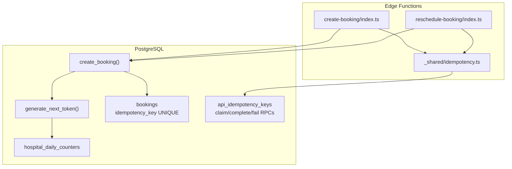
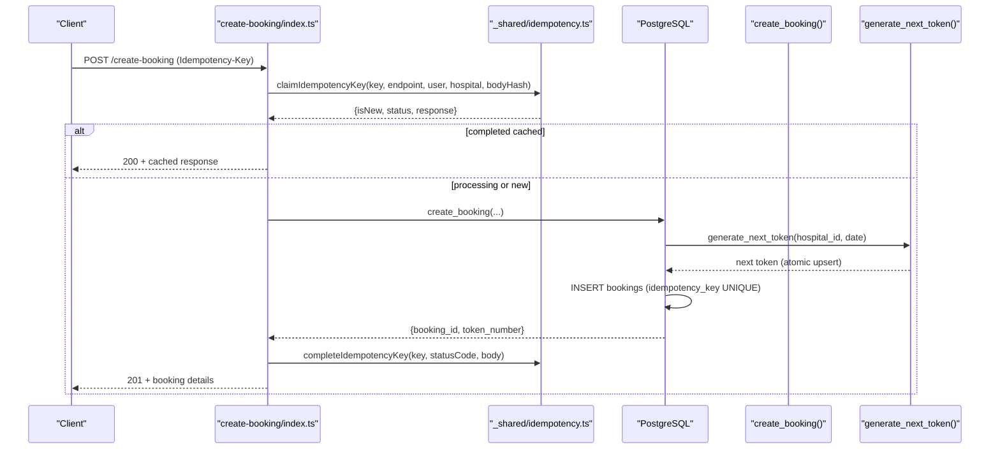
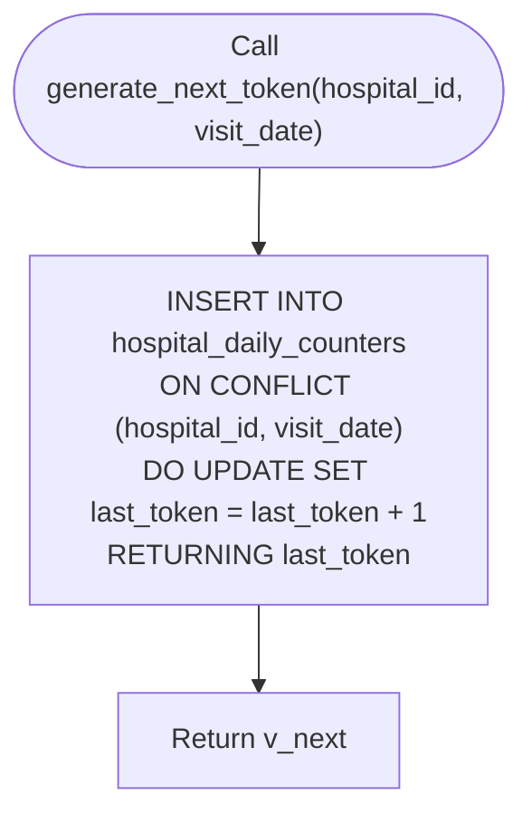
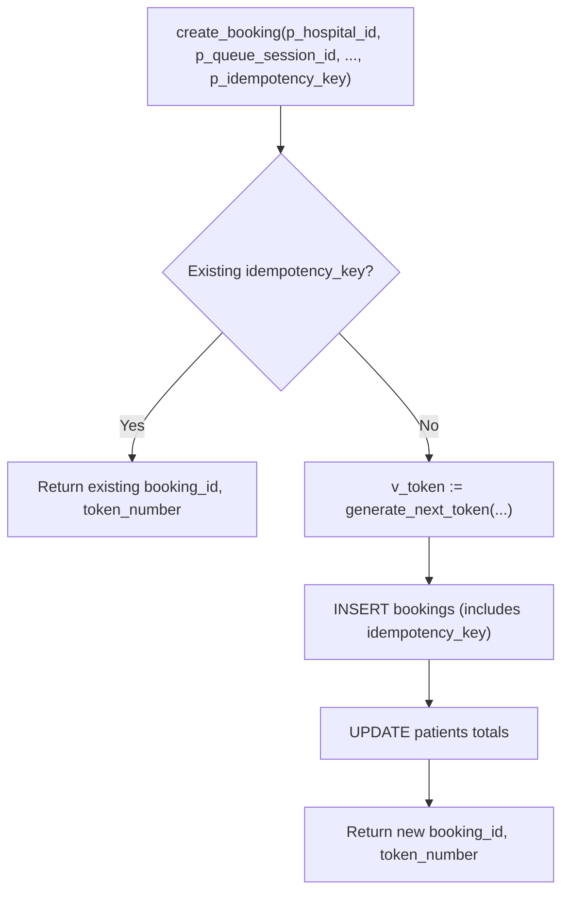
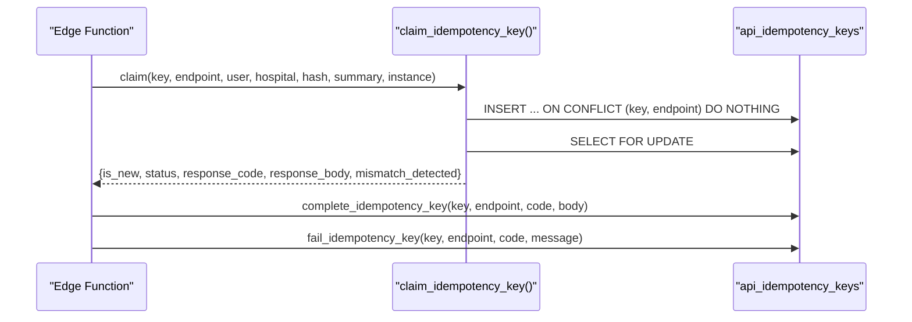
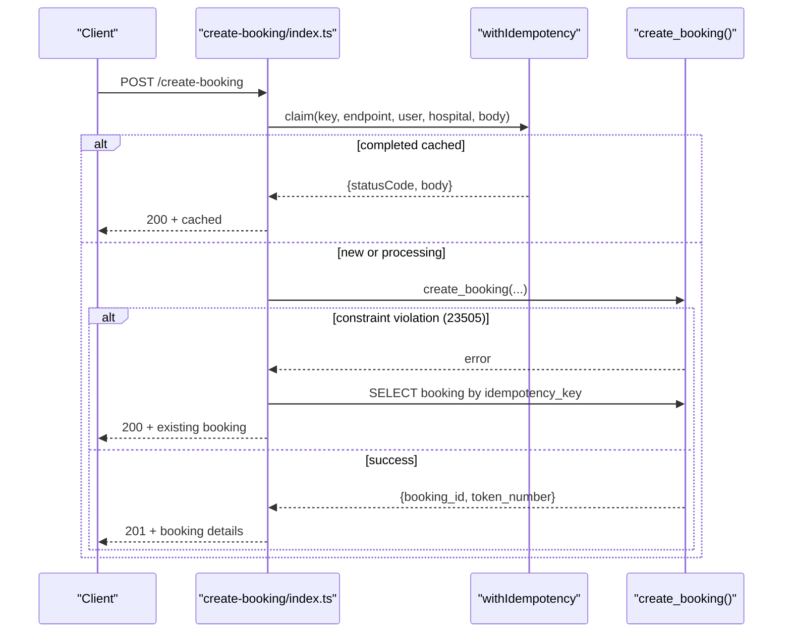
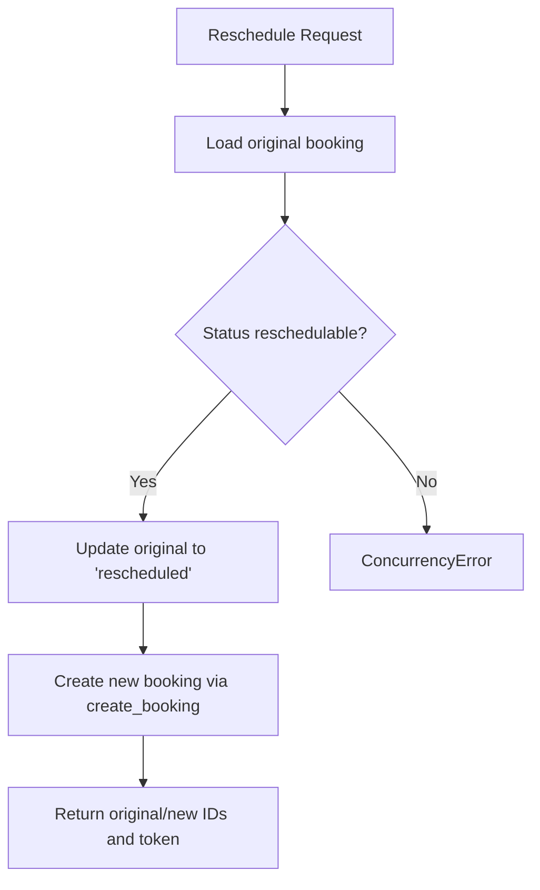
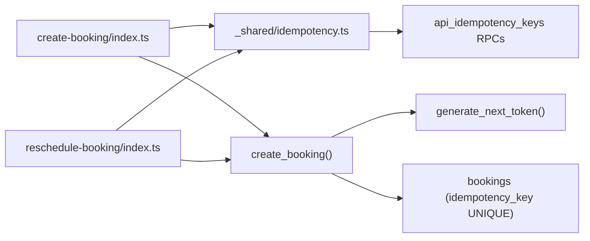

# Conflict Detection & Resolution

<cite>
**Referenced Files in This Document**
- [02_atomic_token_engine_&_bookings.sql](file://supabase/migrations/02_atomic_token_engine_&_bookings.sql)
- [16_idempotency_hardening.sql](file://supabase/migrations/16_idempotency_hardening.sql)
- [25_api_idempotency_registry.sql](file://supabase/migrations/25_api_idempotency_registry.sql)
- [create-booking/index.ts](file://supabase/functions/create-booking/index.ts)
- [reschedule-booking/index.ts](file://supabase/functions/reschedule-booking/index.ts)
- [_shared/idempotency.ts](file://supabase/functions/_shared/idempotency.ts)
- [_shared/errors.ts](file://supabase/functions/_shared/errors.ts)
</cite>

## Table of Contents

1. Introduction
2. Project Structure
3. Core Components
4. Architecture Overview
5. Detailed Component Analysis
6. Dependency Analysis
7. Performance Considerations
8. Troubleshooting Guide
9. Conclusion

## Introduction

This document explains how the booking engine prevents double bookings and
handles race conditions using atomic token allocation and idempotency
mechanisms. It covers:

- Atomic token generation via PostgreSQL’s INSERT ... ON CONFLICT DO UPDATE
  RETURNING pattern
- Idempotency key enforcement at both API and database layers
- Unique constraint enforcement on idempotency_key to prevent duplicate bookings
- Concurrency guarantees, transaction isolation considerations, and performance
  characteristics for high-volume scenarios
- Conflict scenarios, error responses, and recovery mechanisms

## Project Structure

The conflict detection and resolution system spans database migrations
(PostgreSQL functions, tables, constraints) and Edge Functions (request
handling, idempotency orchestration).

**Diagram sources**

- [create-booking/index.ts:142-153](file://supabase/functions/create-booking/index.ts#L142-L153)
- [reschedule-booking/index.ts:127-137](file://supabase/functions/reschedule-booking/index.ts#L127-L137)
- [_shared/idempotency.ts:79-129](file://supabase/functions/_shared/idempotency.ts#L79-L129)
- [02_atomic_token_engine_&_bookings.sql:31-64](file://supabase/migrations/02_atomic_token_engine_&_bookings.sql#L31-L64)
- [02_atomic_token_engine_&_bookings.sql:446-562](file://supabase/migrations/02_atomic_token_engine_&_bookings.sql#L446-L562)
- [02_atomic_token_engine_&_bookings.sql:150-284](file://supabase/migrations/02_atomic_token_engine_&_bookings.sql#L150-L284)
- [25_api_idempotency_registry.sql:137-226](file://supabase/migrations/25_api_idempotency_registry.sql#L137-L226)

**Section sources**

- [create-booking/index.ts:1-666](file://supabase/functions/create-booking/index.ts#L1-L666)
- [reschedule-booking/index.ts:1-612](file://supabase/functions/reschedule-booking/index.ts#L1-L612)
- [_shared/idempotency.ts:1-259](file://supabase/functions/_shared/idempotency.ts#L1-L259)
- [02_atomic_token_engine_&_bookings.sql:1-827](file://supabase/migrations/02_atomic_token_engine_&_bookings.sql#L1-L827)
- [16_idempotency_hardening.sql:1-780](file://supabase/migrations/16_idempotency_hardening.sql#L1-L780)
- [25_api_idempotency_registry.sql:1-649](file://supabase/migrations/25_api_idempotency_registry.sql#L1-L649)

## Core Components

- Atomic token generator: Ensures unique, sequential tokens per hospital/day
  using an upsert on a daily counter table.
- Booking creation function: Enforces idempotency by idempotency_key, allocates
  tokens atomically, and persists bookings with strong uniqueness constraints.
- API idempotency registry: Tracks request-level idempotency keys per
  endpoint/user/hospital, supports claim/complete/fail lifecycle, and caches
  successful responses.
- Edge Function handlers: Wrap business logic with idempotency guards, handle
  conflicts, and return consistent responses.

Key responsibilities:

- Prevent double bookings through database constraints and atomic operations
- Provide safe retries without side effects via idempotency keys
- Handle concurrent requests deterministically

**Section sources**

- [02_atomic_token_engine_&_bookings.sql:31-64](file://supabase/migrations/02_atomic_token_engine_&_bookings.sql#L31-L64)
- [02_atomic_token_engine_&_bookings.sql:150-284](file://supabase/migrations/02_atomic_token_engine_&_bookings.sql#L150-L284)
- [02_atomic_token_engine_&_bookings.sql:446-562](file://supabase/migrations/02_atomic_token_engine_&_bookings.sql#L446-L562)
- [25_api_idempotency_registry.sql:137-226](file://supabase/migrations/25_api_idempotency_registry.sql#L137-L226)
- [_shared/idempotency.ts:79-129](file://supabase/functions/_shared/idempotency.ts#L79-L129)

## Architecture Overview

The system uses layered idempotency and atomicity:

- API layer: Extracts and validates Idempotency-Key header; claims the key to
  ensure single execution per key per endpoint/user/hospital.
- Database layer: Uses a unique constraint on bookings.idempotency_key to
  prevent duplicate bookings; uses an atomic upsert to generate next token
  safely under concurrency.
- Edge Functions: Orchestrate validation, rate limiting, availability checks,
  and call into DB functions; handle constraint violations gracefully.

**Diagram sources**

- [create-booking/index.ts:142-153](file://supabase/functions/create-booking/index.ts#L142-L153)
- [create-booking/index.ts:421-446](file://supabase/functions/create-booking/index.ts#L421-L446)
- [02_atomic_token_engine_&_bookings.sql:446-562](file://supabase/migrations/02_atomic_token_engine_&_bookings.sql#L446-L562)
- [02_atomic_token_engine_&_bookings.sql:31-64](file://supabase/migrations/02_atomic_token_engine_&_bookings.sql#L31-L64)
- [_shared/idempotency.ts:79-129](file://supabase/functions/_shared/idempotency.ts#L79-L129)

## Detailed Component Analysis

### Atomic Token Allocation (INSERT ... ON CONFLICT DO UPDATE RETURNING)

- The daily counter table holds the last token per hospital/date.
- The token generator inserts a row with last_token=1 and updates it atomically
  on conflict, returning the incremented value.
- This ensures no two concurrent requests get the same token.

**Diagram sources**

- [02_atomic_token_engine_&_bookings.sql:31-64](file://supabase/migrations/02_atomic_token_engine_&_bookings.sql#L31-L64)

**Section sources**

- [02_atomic_token_engine_&_bookings.sql:31-64](file://supabase/migrations/02_atomic_token_engine_&_bookings.sql#L31-L64)

### Booking Creation Function and Idempotency Key Enforcement

- The create_booking function first checks if a booking already exists for the
  provided idempotency_key; if so, returns existing booking/token.
- Otherwise, it calls generate_next_token to allocate a unique token and inserts
  the booking with idempotency_key.
- The bookings table enforces a unique constraint on idempotency_key, preventing
  duplicates even under concurrent writes.

**Diagram sources**

- [02_atomic_token_engine_&_bookings.sql:446-562](file://supabase/migrations/02_atomic_token_engine_&_bookings.sql#L446-L562)
- [02_atomic_token_engine_&_bookings.sql:150-284](file://supabase/migrations/02_atomic_token_engine_&_bookings.sql#L150-L284)

**Section sources**

- [02_atomic_token_engine_&_bookings.sql:446-562](file://supabase/migrations/02_atomic_token_engine_&_bookings.sql#L446-L562)
- [02_atomic_token_engine_&_bookings.sql:150-284](file://supabase/migrations/02_atomic_token_engine_&_bookings.sql#L150-L284)

### API Idempotency Registry (Claim/Complete/Fail)

- The registry stores one row per (idempotency_key, api_endpoint), scoped by
  user and hospital.
- claim_idempotency_key performs an upsert-like operation to reserve the key and
  detect mismatches between repeated requests with different payloads.
- complete_idempotency_key marks the key as completed and caches the response;
  fail_idempotency_key marks failures for retryability.
- Stale processing keys can be reset by a maintenance routine.

**Diagram sources**

- [25_api_idempotency_registry.sql:137-226](file://supabase/migrations/25_api_idempotency_registry.sql#L137-L226)
- [25_api_idempotency_registry.sql:243-314](file://supabase/migrations/25_api_idempotency_registry.sql#L243-L314)
- [_shared/idempotency.ts:79-129](file://supabase/functions/_shared/idempotency.ts#L79-L129)

**Section sources**

- [25_api_idempotency_registry.sql:137-226](file://supabase/migrations/25_api_idempotency_registry.sql#L137-L226)
- [25_api_idempotency_registry.sql:243-314](file://supabase/migrations/25_api_idempotency_registry.sql#L243-L314)
- [_shared/idempotency.ts:79-129](file://supabase/functions/_shared/idempotency.ts#L79-L129)

### Edge Function Orchestration and Conflict Handling

- The create-booking handler extracts and validates the Idempotency-Key header,
  then wraps the core logic with withIdempotency.
- Inside the handler, it performs validations, resolves fees, finds or creates
  patient, and calls create_booking.
- On unique constraint violation (code 23505), it fetches the existing booking
  and returns it as a success, ensuring idempotent behavior.

**Diagram sources**

- [create-booking/index.ts:142-153](file://supabase/functions/create-booking/index.ts#L142-L153)
- [create-booking/index.ts:421-493](file://supabase/functions/create-booking/index.ts#L421-L493)
- [02_atomic_token_engine_&_bookings.sql:446-562](file://supabase/migrations/02_atomic_token_engine_&_bookings.sql#L446-L562)

**Section sources**

- [create-booking/index.ts:142-153](file://supabase/functions/create-booking/index.ts#L142-L153)
- [create-booking/index.ts:421-493](file://supabase/functions/create-booking/index.ts#L421-L493)

### Rescheduling Flow and Concurrency Safeguards

- Reschedule marks the original booking as rescheduled only if its status is
  still in a reschedulable state; otherwise, it detects concurrent modification.
- It then creates a new booking using create_booking with the same idempotency
  key strategy to avoid duplicates.

**Diagram sources**

- [reschedule-booking/index.ts:371-411](file://supabase/functions/reschedule-booking/index.ts#L371-L411)
- [reschedule-booking/index.ts:413-445](file://supabase/functions/reschedule-booking/index.ts#L413-L445)

**Section sources**

- [reschedule-booking/index.ts:371-411](file://supabase/functions/reschedule-booking/index.ts#L371-L411)
- [reschedule-booking/index.ts:413-445](file://supabase/functions/reschedule-booking/index.ts#L413-L445)

## Dependency Analysis

- Edge Functions depend on shared idempotency utilities and database RPCs.
- Database functions depend on constraints and indexes for correctness and
  performance.
- The idempotency registry depends on atomic claim/complete/fail operations to
  coordinate distributed instances.

**Diagram sources**

- [create-booking/index.ts:142-153](file://supabase/functions/create-booking/index.ts#L142-L153)
- [reschedule-booking/index.ts:127-137](file://supabase/functions/reschedule-booking/index.ts#L127-L137)
- [_shared/idempotency.ts:79-129](file://supabase/functions/_shared/idempotency.ts#L79-L129)
- [02_atomic_token_engine_&_bookings.sql:446-562](file://supabase/migrations/02_atomic_token_engine_&_bookings.sql#L446-L562)
- [02_atomic_token_engine_&_bookings.sql:31-64](file://supabase/migrations/02_atomic_token_engine_&_bookings.sql#L31-L64)
- [02_atomic_token_engine_&_bookings.sql:150-284](file://supabase/migrations/02_atomic_token_engine_&_bookings.sql#L150-L284)

**Section sources**

- [create-booking/index.ts:142-153](file://supabase/functions/create-booking/index.ts#L142-L153)
- [reschedule-booking/index.ts:127-137](file://supabase/functions/reschedule-booking/index.ts#L127-L137)
- [_shared/idempotency.ts:79-129](file://supabase/functions/_shared/idempotency.ts#L79-L129)
- [02_atomic_token_engine_&_bookings.sql:31-64](file://supabase/migrations/02_atomic_token_engine_&_bookings.sql#L31-L64)
- [02_atomic_token_engine_&_bookings.sql:150-284](file://supabase/migrations/02_atomic_token_engine_&_bookings.sql#L150-L284)
- [02_atomic_token_engine_&_bookings.sql:446-562](file://supabase/migrations/02_atomic_token_engine_&_bookings.sql#L446-L562)

## Performance Considerations

- Atomic token allocation:
  - Single-row upsert on hospital_daily_counters avoids locks beyond the
    conflicting row and scales well under contention due to primary key
    uniqueness.
  - Using RETURNING minimizes round trips and keeps token assignment within a
    single statement.
- Idempotency registry:
  - claim_idempotency_key uses an upsert-like pattern followed by SELECT FOR
    UPDATE to serialize access to the same key safely across instances.
  - Response caching reduces latency for retries and eliminates redundant work.
- Indexing:
  - Unique index on bookings.idempotency_key provides fast duplicate detection.
  - Additional indexes support efficient queries for queue advancement and
    lookups.
- Transaction isolation:
  - PostgreSQL default isolation (READ COMMITTED) combined with explicit locking
    (FOR UPDATE SKIP LOCKED in queue operations) ensures consistency without
    excessive blocking.
  - The create_booking function runs within the caller’s transaction context;
    ensure callers wrap multiple steps in transactions where necessary.
- High-volume patterns:
  - Batched operations and SKIP LOCKED in queue advancement reduce lock
    contention.
  - Idempotency keys allow safe retries without duplicating bookings or tokens.

[No sources needed since this section provides general guidance]

## Troubleshooting Guide

Common conflict scenarios and resolutions:

- Duplicate booking attempt:
  - Symptom: Unique constraint violation on bookings.idempotency_key (error code
    23505).
  - Resolution: The create-booking handler catches this, retrieves the existing
    booking, and returns it successfully. Clients should treat this as success
    and use the returned booking details.
- Concurrent reschedule:
  - Symptom: Update affects zero rows because another process changed the
    booking status concurrently.
  - Resolution: The reschedule handler raises a concurrency error; clients
    should retry with backoff after verifying current status.
- Idempotency key processing:
  - Symptom: Another instance is processing the same key; client receives a 202
    with retry guidance.
  - Resolution: Implement client-side retry with exponential backoff; do not
    generate a new idempotency key for the same logical request.
- Stale processing keys:
  - Symptom: Keys stuck in processing state due to timeouts.
  - Resolution: Use reset_stale_idempotency_keys to mark them failed; clients
    may retry with a new key.

Error types and responses:

- IdempotencyProcessingError: 202 with retryable flag; indicates ongoing
  processing for the same key.
- BookingDuplicateError: 409 when a duplicate is detected outside normal
  idempotency flow; typically handled by returning existing booking instead.
- QueueFullError/TOKEN_EXHAUSTED: Indicate capacity limits; clients should wait
  or adjust scheduling.
- ValidationError/HospitalClosedError: Business rule violations; fix inputs or
  timing.

Recovery mechanisms:

- Idempotency registry caches successful responses; subsequent identical
  requests return cached results immediately.
- Failed keys are marked for retry; clients can retry with the same key until
  completion or expiration.
- Maintenance routines clean expired keys and reset stale processing entries.

**Section sources**

- [create-booking/index.ts:448-493](file://supabase/functions/create-booking/index.ts#L448-L493)
- [reschedule-booking/index.ts:371-411](file://supabase/functions/reschedule-booking/index.ts#L371-L411)
- [_shared/idempotency.ts:234-237](file://supabase/functions/_shared/idempotency.ts#L234-L237)
- [_shared/errors.ts:247-270](file://supabase/functions/_shared/errors.ts#L247-L270)
- [_shared/errors.ts:166-217](file://supabase/functions/_shared/errors.ts#L166-L217)
- [25_api_idempotency_registry.sql:329-364](file://supabase/migrations/25_api_idempotency_registry.sql#L329-L364)

## Conclusion

The booking engine combines atomic token allocation and multi-layered
idempotency to prevent double bookings and handle race conditions reliably:

- PostgreSQL’s INSERT ... ON CONFLICT DO UPDATE RETURNING ensures unique token
  assignment under concurrency.
- Unique constraints on idempotency_key enforce database-level deduplication.
- The API idempotency registry coordinates distributed instances, caches
  responses, and supports safe retries.
- Edge Functions orchestrate validation, conflict detection, and graceful error
  handling.

Together, these mechanisms provide strong concurrency guarantees, predictable
behavior under retries, and scalable performance for high-volume booking
scenarios.

[No sources needed since this section summarizes without analyzing specific
files]
