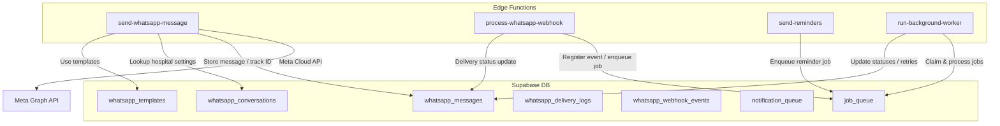
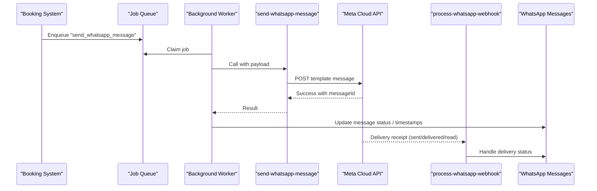
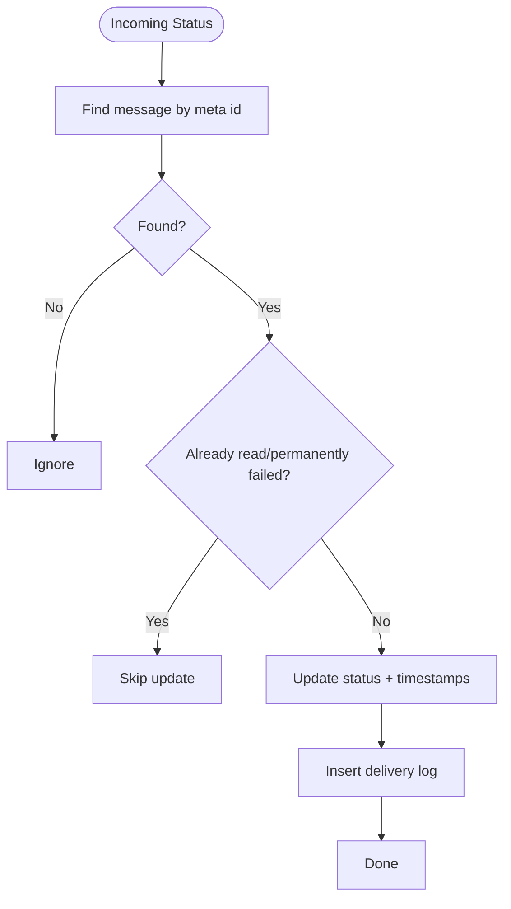
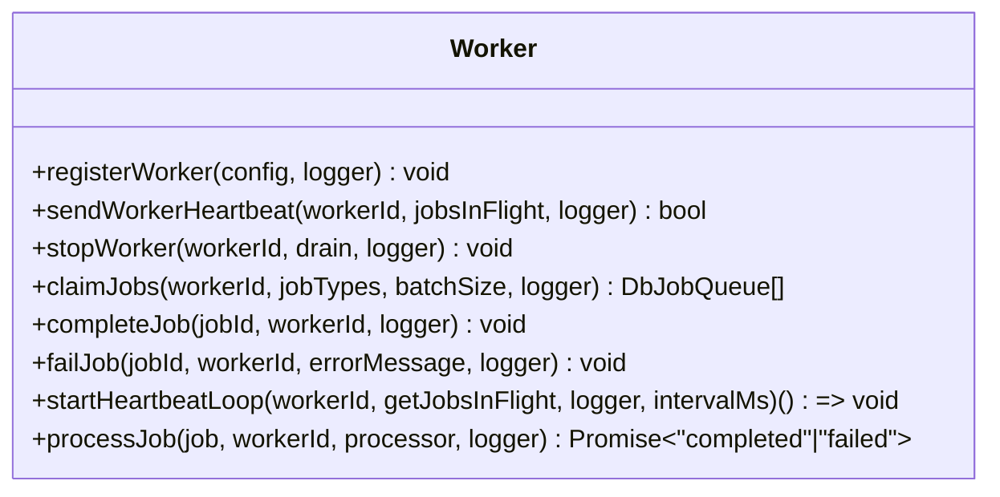
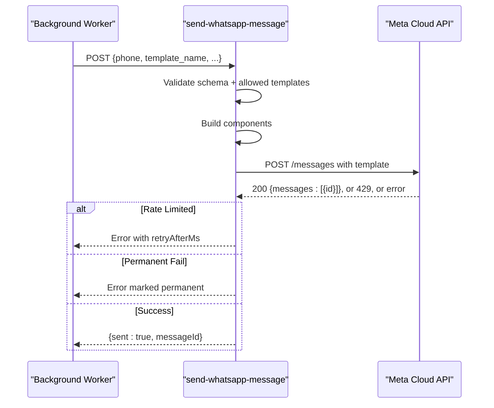
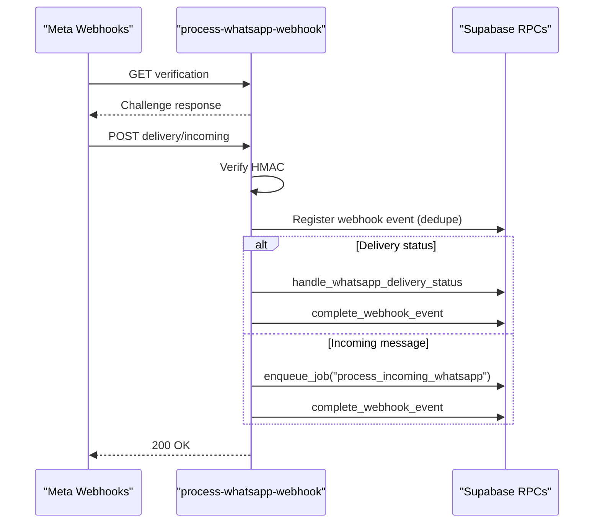
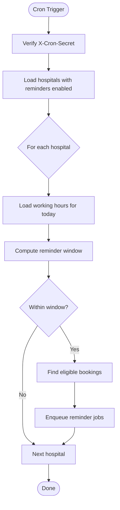
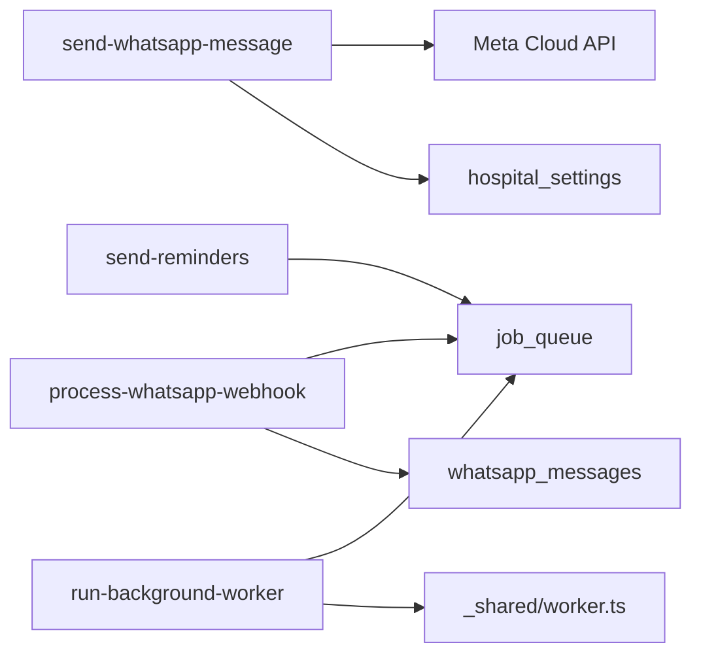

# Communication System

<cite>
**Referenced Files in This Document**
- [process-whatsapp-webhook/index.ts](file://supabase/functions/process-whatsapp-webhook/index.ts)
- [send-whatsapp-message/index.ts](file://supabase/functions/send-whatsapp-message/index.ts)
- [send-reminders/index.ts](file://supabase/functions/send-reminders/index.ts)
- [worker.ts](file://supabase/functions/_shared/worker.ts)
- [04_whatsapp_messaging_engine.sql](file://supabase/migrations/04_whatsapp_messaging_engine.sql)
- [05_notification_queue.sql](file://supabase/migrations/05_notification_queue.sql)
- [06_background_job_queue.sql](file://supabase/migrations/06_background_job_queue.sql)
- [run-background-worker/index.ts](file://supabase/functions/run-background-worker/index.ts)
- [create-booking/index.ts](file://supabase/functions/create-booking/index.ts)
- [update-booking-status/index.ts](file://supabase/functions/update-booking-status/index.ts)
- [reschedule-booking/index.ts](file://supabase/functions/reschedule-booking/index.ts)
</cite>

## Table of Contents

1. Introduction
2. Project Structure
3. Core Components
4. Architecture Overview
5. Detailed Component Analysis
6. Dependency Analysis
7. Performance Considerations
8. Troubleshooting Guide
9. Conclusion
10. Appendices

## Introduction

This document explains the Communication System that powers WhatsApp messaging
for patient engagement. It covers:

- WhatsApp Business API integration via Meta Cloud API
- Template management for booking confirmations, reminders, and notifications
- Message queuing and background processing
- Webhook processing for delivery confirmations and incoming messages
- Message lifecycle from creation to delivery and status updates
- Retry mechanisms, error handling, rate limiting, and integrations with booking
  and queue systems

The system is designed to be resilient, idempotent, and observable, with strong
separation between inbound webhooks, outbound message sending, and background
job processing.

## Project Structure

The communication system spans Edge Functions (Deno), Supabase SQL migrations,
and shared worker utilities:

- Outbound messaging: send-whatsapp-message function builds template payloads
  and calls Meta Cloud API
- Inbound webhooks: process-whatsapp-webhook verifies and routes events to
  queues or handlers
- Background workers: run-background-worker claims jobs and dispatches
  processors
- Shared worker utilities: worker.ts provides lease management, heartbeat, and
  safe job processing
- Data model: whatsapp_messaging_engine defines templates, conversations,
  messages, delivery logs, and webhook events
- Notification queue: notification_queue supports multi-channel notifications
  with retry and priority
- Background job queue: job_queue provides a robust, claimable, and retryable
  job store

**Diagram sources**

- [send-whatsapp-message/index.ts:198-324](file://supabase/functions/send-whatsapp-message/index.ts#L198-L324)
- [process-whatsapp-webhook/index.ts:222-614](file://supabase/functions/process-whatsapp-webhook/index.ts#L222-L614)
- [send-reminders/index.ts:322-388](file://supabase/functions/send-reminders/index.ts#L322-L388)
- [run-background-worker/index.ts:357-401](file://supabase/functions/run-background-worker/index.ts#L357-L401)
- [04_whatsapp_messaging_engine.sql:171-331](file://supabase/migrations/04_whatsapp_messaging_engine.sql#L171-L331)
- [05_notification_queue.sql:117-195](file://supabase/migrations/05_notification_queue.sql#L117-L195)
- [06_background_job_queue.sql:41-137](file://supabase/migrations/06_background_job_queue.sql#L41-L137)

**Section sources**

- [send-whatsapp-message/index.ts:1-583](file://supabase/functions/send-whatsapp-message/index.ts#L1-L583)
- [process-whatsapp-webhook/index.ts:1-657](file://supabase/functions/process-whatsapp-webhook/index.ts#L1-L657)
- [send-reminders/index.ts:1-445](file://supabase/functions/send-reminders/index.ts#L1-L445)
- [worker.ts:1-257](file://supabase/functions/_shared/worker.ts#L1-L257)
- [04_whatsapp_messaging_engine.sql:1-852](file://supabase/migrations/04_whatsapp_messaging_engine.sql#L1-L852)
- [05_notification_queue.sql:1-595](file://supabase/migrations/05_notification_queue.sql#L1-L595)
- [06_background_job_queue.sql:1-550](file://supabase/migrations/06_background_job_queue.sql#L1-L550)

## Core Components

- WhatsApp Messaging Engine: Defines enums, tables, and functions for templates,
  conversations, messages, delivery logs, and webhook deduplication. Includes
  retry scheduling and batch fetching for workers.
- Background Job Queue: Provides a general-purpose job queue with priorities,
  attempts, dead-lettering, and worker leases.
- Notification Queue: Multi-channel queue with priorities, scheduled delivery,
  and retry logic.
- Edge Functions:
  - send-whatsapp-message: Validates input, builds template components, calls
    Meta Cloud API, handles rate limits and permanent failures, and returns
    results.
  - process-whatsapp-webhook: Verifies HMAC, parses Meta webhooks, registers
    events, updates delivery statuses, and enqueues incoming message processing.
  - send-reminders: Cron-driven scheduler that finds due reminders and enqueues
    WhatsApp messages.
- Worker Utilities: Worker registration, heartbeat, job claiming,
  completion/failure, and safe processing wrapper.

**Section sources**

- [04_whatsapp_messaging_engine.sql:12-331](file://supabase/migrations/04_whatsapp_messaging_engine.sql#L12-L331)
- [06_background_job_queue.sql:12-137](file://supabase/migrations/06_background_job_queue.sql#L12-L137)
- [05_notification_queue.sql:12-195](file://supabase/migrations/05_notification_queue.sql#L12-L195)
- [send-whatsapp-message/index.ts:47-187](file://supabase/functions/send-whatsapp-message/index.ts#L47-L187)
- [process-whatsapp-webhook/index.ts:124-220](file://supabase/functions/process-whatsapp-webhook/index.ts#L124-L220)
- [send-reminders/index.ts:111-151](file://supabase/functions/send-reminders/index.ts#L111-L151)
- [worker.ts:28-178](file://supabase/functions/_shared/worker.ts#L28-L178)

## Architecture Overview

The system follows an event-driven architecture:

- Outbound: Booking and status changes enqueue jobs; background workers pick
  them up and call Meta Cloud API; responses are recorded and tracked.
- Inbound: Meta sends webhooks for delivery receipts and incoming messages;
  these are verified, deduplicated, and routed to queues or handlers.
- Scheduling: Cron triggers reminders; working hours and configured delays
  determine timing.
- Observability: Metrics, tracing, and logging are integrated across functions.

**Diagram sources**

- [create-booking/index.ts:520-585](file://supabase/functions/create-booking/index.ts#L520-L585)
- [run-background-worker/index.ts:357-401](file://supabase/functions/run-background-worker/index.ts#L357-L401)
- [send-whatsapp-message/index.ts:198-324](file://supabase/functions/send-whatsapp-message/index.ts#L198-L324)
- [process-whatsapp-webhook/index.ts:357-493](file://supabase/functions/process-whatsapp-webhook/index.ts#L357-L493)
- [04_whatsapp_messaging_engine.sql:512-589](file://supabase/migrations/04_whatsapp_messaging_engine.sql#L512-L589)

## Detailed Component Analysis

### WhatsApp Messaging Engine (Database Layer)

Key responsibilities:

- Define message statuses, directions, and template categories
- Store templates, conversations, messages, delivery logs, and webhook events
- Provide functions to queue messages, fetch pending batches, handle delivery
  statuses, schedule retries, and register webhook events

Important behaviors:

- Idempotency via unique keys on messages and webhook events
- Safe batch fetching using FOR UPDATE SKIP LOCKED
- Exponential backoff retry scheduling capped at a maximum interval
- Realtime publication for live dashboards

**Diagram sources**

- [04_whatsapp_messaging_engine.sql:512-589](file://supabase/migrations/04_whatsapp_messaging_engine.sql#L512-L589)

**Section sources**

- [04_whatsapp_messaging_engine.sql:12-331](file://supabase/migrations/04_whatsapp_messaging_engine.sql#L12-L331)
- [04_whatsapp_messaging_engine.sql:398-503](file://supabase/migrations/04_whatsapp_messaging_engine.sql#L398-L503)
- [04_whatsapp_messaging_engine.sql:598-661](file://supabase/migrations/04_whatsapp_messaging_engine.sql#L598-L661)

### Background Job Queue and Worker Utilities

Responsibilities:

- Provide a robust job queue with priorities, attempts, and dead-lettering
- Support worker registration, heartbeats, and safe job claiming
- Offer a processor wrapper that completes or fails jobs consistently

Operational highlights:

- claim_jobs_v2 uses per-job leases for crash recovery
- Heartbeat loop ensures workers renew leases periodically
- processJob standardizes success/failure paths

**Diagram sources**

- [worker.ts:28-178](file://supabase/functions/_shared/worker.ts#L28-L178)
- [worker.ts:191-257](file://supabase/functions/_shared/worker.ts#L191-L257)

**Section sources**

- [06_background_job_queue.sql:41-137](file://supabase/migrations/06_background_job_queue.sql#L41-L137)
- [worker.ts:1-257](file://supabase/functions/_shared/worker.ts#L1-L257)

### Outbound Messaging: send-whatsapp-message

Responsibilities:

- Validate inputs (phone, template_name, optional fields)
- Build template components based on template type
- Call Meta Cloud API with timeout and authorization
- Detect rate limiting and permanent failures
- Return structured results with metrics and tracing

Template support includes:

- booking_confirmation
- appointment_reminder
- booking_cancelled
- booking_rescheduled
- carry_forward_notice
- feedback_request
- consultation_started/completed
- patient_called/please_come_now

Rate limiting and retries:

- On HTTP 429, extracts Retry-After header and marks as rate limited
- Permanent failure codes are identified to avoid retries
- Errors propagate to caller for higher-level retry/scheduling decisions

**Diagram sources**

- [send-whatsapp-message/index.ts:47-187](file://supabase/functions/send-whatsapp-message/index.ts#L47-L187)
- [send-whatsapp-message/index.ts:198-324](file://supabase/functions/send-whatsapp-message/index.ts#L198-L324)
- [send-whatsapp-message/index.ts:326-583](file://supabase/functions/send-whatsapp-message/index.ts#L326-L583)

**Section sources**

- [send-whatsapp-message/index.ts:1-583](file://supabase/functions/send-whatsapp-message/index.ts#L1-L583)

### Inbound Webhooks: process-whatsapp-webhook

Responsibilities:

- Verify Meta challenge on GET
- Verify HMAC signature on POST
- Parse entries and iterate changes
- For delivery statuses: register event, map status, update message, log
  delivery
- For incoming messages: register event, enqueue job for processing
- Always return 200 to prevent endless retries from Meta

Deduplication:

- Uses provider event IDs and payload hashes to avoid duplicate processing
- Completes webhook events after successful handling

**Diagram sources**

- [process-whatsapp-webhook/index.ts:124-220](file://supabase/functions/process-whatsapp-webhook/index.ts#L124-L220)
- [process-whatsapp-webhook/index.ts:222-614](file://supabase/functions/process-whatsapp-webhook/index.ts#L222-L614)

**Section sources**

- [process-whatsapp-webhook/index.ts:1-657](file://supabase/functions/process-whatsapp-webhook/index.ts#L1-L657)

### Reminder Scheduler: send-reminders

Responsibilities:

- Authenticate via cron secret
- Load hospitals with reminders enabled
- Compute reminder window based on working hours and configured minutes before
  opening
- Find eligible bookings and enqueue reminder jobs with high priority

Integration points:

- Reads hospital settings and working hours
- Enqueues jobs with idempotency keys to prevent duplicates

**Diagram sources**

- [send-reminders/index.ts:61-95](file://supabase/functions/send-reminders/index.ts#L61-L95)
- [send-reminders/index.ts:111-266](file://supabase/functions/send-reminders/index.ts#L111-L266)
- [send-reminders/index.ts:268-388](file://supabase/functions/send-reminders/index.ts#L268-L388)

**Section sources**

- [send-reminders/index.ts:1-445](file://supabase/functions/send-reminders/index.ts#L1-L445)

### Integrations with Booking and Status Changes

- create-booking: Enqueues WhatsApp confirmation and schedules reminder if
  applicable
- update-booking-status: Enqueues notifications for state transitions (e.g.,
  called, completed)
- reschedule-booking: Enqueues reschedule notice

These integrations ensure consistent messaging aligned with business events.

**Section sources**

- [create-booking/index.ts:520-585](file://supabase/functions/create-booking/index.ts#L520-L585)
- [update-booking-status/index.ts:463-523](file://supabase/functions/update-booking-status/index.ts#L463-L523)
- [reschedule-booking/index.ts:496-532](file://supabase/functions/reschedule-booking/index.ts#L496-L532)

## Dependency Analysis

- send-whatsapp-message depends on:
  - Environment variables for Meta credentials and API version
  - Hospital settings to resolve phone number ID per hospital
  - Meta Cloud API for sending messages
- process-whatsapp-webhook depends on:
  - Supabase RPCs for webhook event registration and completion
  - Background job queue for incoming message processing
  - WhatsApp messaging engine functions for delivery status updates
- send-reminders depends on:
  - Hospital settings and working hours
  - Background job queue to enqueue reminder jobs
- Background worker depends on:
  - Job queue to claim work
  - Worker utilities for safe processing and lifecycle management

**Diagram sources**

- [send-whatsapp-message/index.ts:408-448](file://supabase/functions/send-whatsapp-message/index.ts#L408-L448)
- [process-whatsapp-webhook/index.ts:383-493](file://supabase/functions/process-whatsapp-webhook/index.ts#L383-L493)
- [send-reminders/index.ts:322-388](file://supabase/functions/send-reminders/index.ts#L322-L388)
- [run-background-worker/index.ts:357-401](file://supabase/functions/run-background-worker/index.ts#L357-L401)
- [worker.ts:98-178](file://supabase/functions/_shared/worker.ts#L98-L178)

**Section sources**

- [send-whatsapp-message/index.ts:408-448](file://supabase/functions/send-whatsapp-message/index.ts#L408-L448)
- [process-whatsapp-webhook/index.ts:383-493](file://supabase/functions/process-whatsapp-webhook/index.ts#L383-L493)
- [send-reminders/index.ts:322-388](file://supabase/functions/send-reminders/index.ts#L322-L388)
- [run-background-worker/index.ts:357-401](file://supabase/functions/run-background-worker/index.ts#L357-L401)
- [worker.ts:98-178](file://supabase/functions/_shared/worker.ts#L98-L178)

## Performance Considerations

- Batch processing: Workers claim jobs in batches to reduce overhead
- Skip locked: Database queries use FOR UPDATE SKIP LOCKED to avoid contention
- Timeouts: Meta API calls include timeouts to prevent hanging requests
- Rate limiting: 429 responses are handled with Retry-After backoff
- Deduplication: Webhook events and messages use unique keys to prevent
  duplicates
- Indexing: Tables are indexed for efficient lookups and worker scans

[No sources needed since this section provides general guidance]

## Troubleshooting Guide

Common issues and diagnostics:

- Webhook HMAC verification failures: Check app secret configuration and request
  body integrity
- Duplicate webhook events: Ensure provider event IDs and payload hashes are
  used for deduplication
- Rate limiting from Meta: Inspect Retry-After headers and adjust
  scheduling/backoff
- Permanent failures: Identify specific error codes to avoid futile retries
- Worker crashes: Rely on worker leases and heartbeat to reclaim jobs
- Missing hospital settings: Validate phone number ID and access token
  configuration

Actionable checks:

- Review metrics and logs for errors and timings
- Inspect job_queue and whatsapp_messages for stuck states
- Confirm webhook events are registered and completed
- Validate environment variables and secrets

**Section sources**

- [process-whatsapp-webhook/index.ts:222-256](file://supabase/functions/process-whatsapp-webhook/index.ts#L222-L256)
- [send-whatsapp-message/index.ts:248-307](file://supabase/functions/send-whatsapp-message/index.ts#L248-L307)
- [worker.ts:191-257](file://supabase/functions/_shared/worker.ts#L191-L257)

## Conclusion

The Communication System provides a robust, scalable foundation for WhatsApp
messaging in a healthcare context. It integrates tightly with booking workflows,
supports templated notifications, and ensures reliable delivery through
queueing, retries, and webhook processing. With strong observability and safety
mechanisms, it minimizes operational risk while enabling timely patient
communications.

[No sources needed since this section summarizes without analyzing specific
files]

## Appendices

### Examples

- Sending a message:
  - Use send-whatsapp-message with a valid phone, template_name, and required
    parameters
  - Reference:
    [send-whatsapp-message/index.ts:47-187](file://supabase/functions/send-whatsapp-message/index.ts#L47-L187)

- Handling webhooks:
  - Configure Meta webhook endpoint to process-whatsapp-webhook
  - Ensure HMAC verification and event registration
  - Reference:
    [process-whatsapp-webhook/index.ts:124-220](file://supabase/functions/process-whatsapp-webhook/index.ts#L124-L220),
    [process-whatsapp-webhook/index.ts:222-614](file://supabase/functions/process-whatsapp-webhook/index.ts#L222-L614)

- Managing templates:
  - Templates are defined in the database and mapped in the sender
  - Supported templates include booking confirmation, reminders, cancellations,
    reschedules, and feedback requests
  - Reference:
    [04_whatsapp_messaging_engine.sql:53-101](file://supabase/migrations/04_whatsapp_messaging_engine.sql#L53-L101),
    [send-whatsapp-message/index.ts:20-31](file://supabase/functions/send-whatsapp-message/index.ts#L20-L31)

- Tracking delivery:
  - Delivery statuses are updated via webhook processing and stored in delivery
    logs
  - Reference:
    [04_whatsapp_messaging_engine.sql:278-302](file://supabase/migrations/04_whatsapp_messaging_engine.sql#L278-L302),
    [process-whatsapp-webhook/index.ts:357-493](file://supabase/functions/process-whatsapp-webhook/index.ts#L357-L493)

- Retry mechanisms:
  - Exponential backoff with caps and max retries
  - Reference:
    [04_whatsapp_messaging_engine.sql:598-661](file://supabase/migrations/04_whatsapp_messaging_engine.sql#L598-L661),
    [05_notification_queue.sql:444-504](file://supabase/migrations/05_notification_queue.sql#L444-L504)

- Integration with booking:
  - Create booking enqueues confirmation and schedules reminders
  - Update status enqueues contextual notifications
  - Reschedule enqueues reschedule notices
  - References:
    [create-booking/index.ts:520-585](file://supabase/functions/create-booking/index.ts#L520-L585),
    [update-booking-status/index.ts:463-523](file://supabase/functions/update-booking-status/index.ts#L463-L523),
    [reschedule-booking/index.ts:496-532](file://supabase/functions/reschedule-booking/index.ts#L496-L532)
