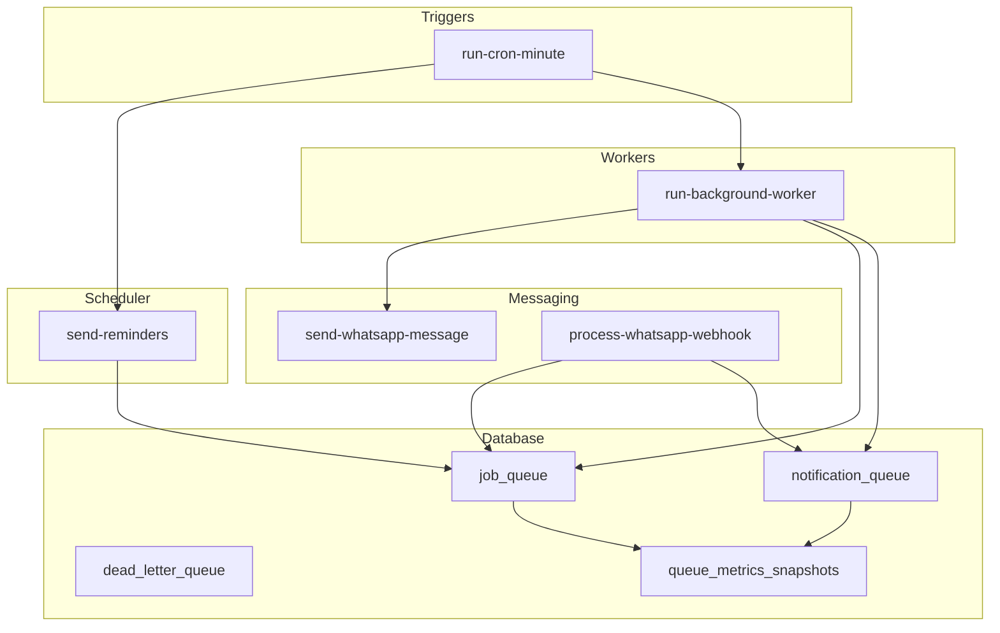
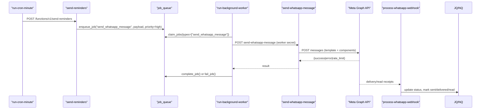
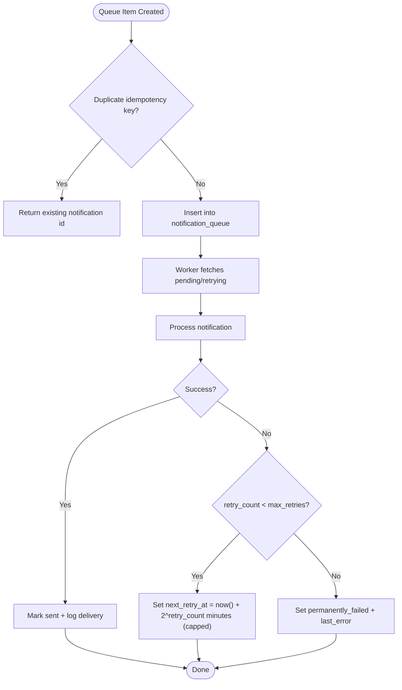
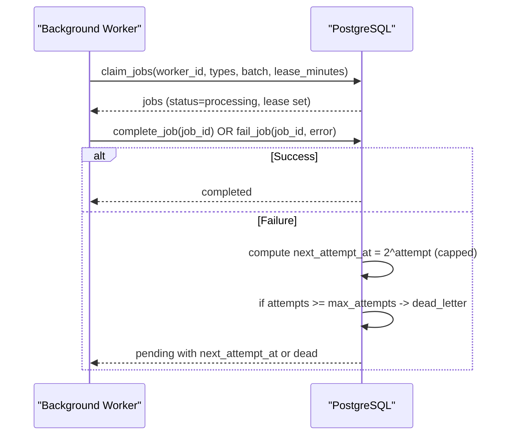
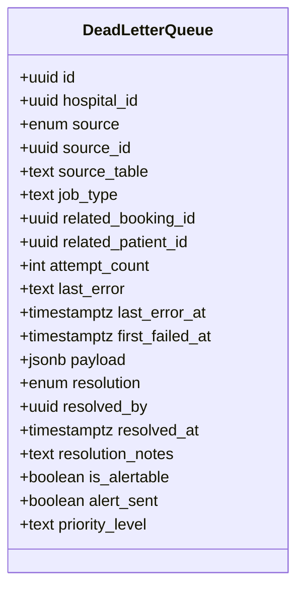
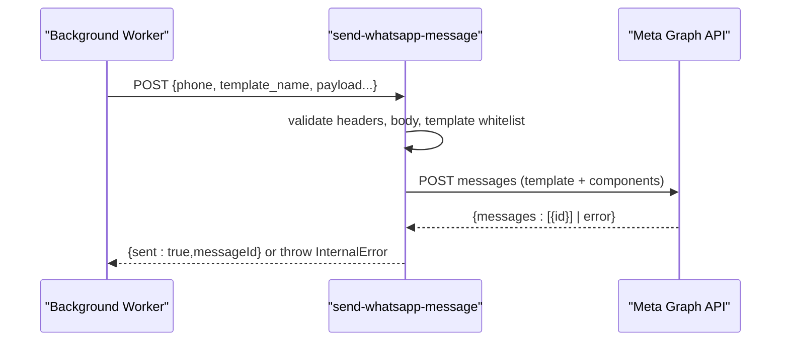
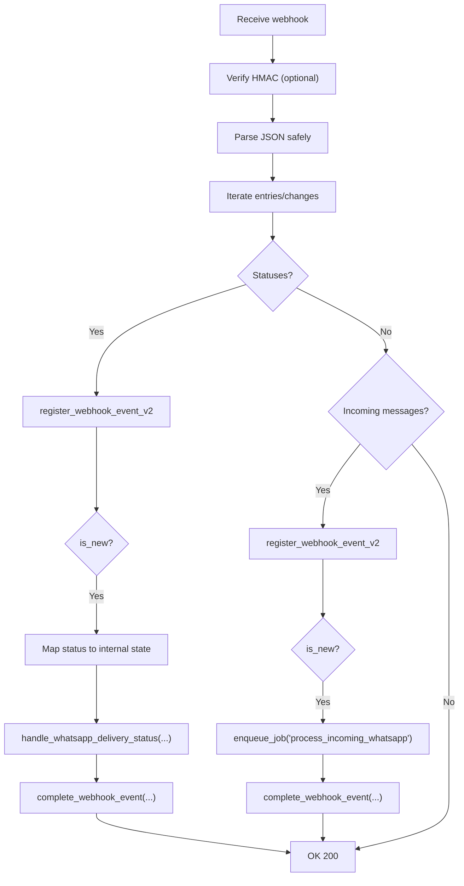
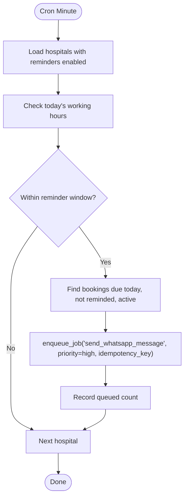
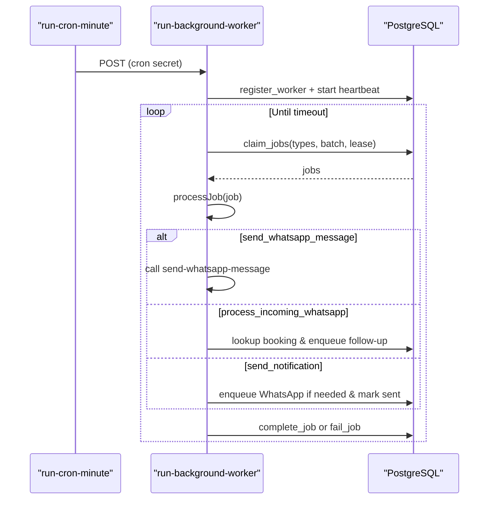
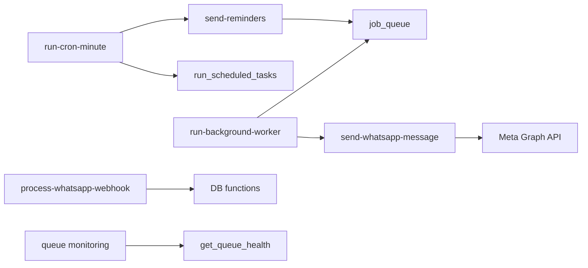

# Message Queue System

<cite>
**Referenced Files in This Document**
- [send-whatsapp-message/index.ts](file://supabase/functions/send-whatsapp-message/index.ts)
- [send-reminders/index.ts](file://supabase/functions/send-reminders/index.ts)
- [process-whatsapp-webhook/index.ts](file://supabase/functions/process-whatsapp-webhook/index.ts)
- [run-background-worker/index.ts](file://supabase/functions/run-background-worker/index.ts)
- [run-cron-minute/index.ts](file://supabase/functions/run-cron-minute/index.ts)
- [05_notification_queue.sql](file://supabase/migrations/05_notification_queue.sql)
- [06_background_job_queue.sql](file://supabase/migrations/06_background_job_queue.sql)
- [14_dead_letter_queue.sql](file://supabase/migrations/14_dead_letter_queue.sql)
- [17_queue_monitoring_engine.sql](file://supabase/migrations/17_queue_monitoring_engine.sql)
</cite>

## Table of Contents

1. Introduction
2. Project Structure
3. Core Components
4. Architecture Overview
5. Detailed Component Analysis
6. Dependency Analysis
7. Performance Considerations
8. Troubleshooting Guide
9. Conclusion

## Introduction

This document explains the notification queue system that manages WhatsApp
message delivery, reminder scheduling, and background job processing. It covers
asynchronous queue architecture, priority handling, retry mechanisms with
exponential backoff, dead letter handling, monitoring metrics, and integration
points with the booking engine and patient management components.

## Project Structure

The system is implemented as a set of Supabase Edge Functions backed by
PostgreSQL functions and tables:

- Messaging sender function for outbound WhatsApp messages
- Reminder scheduler to enqueue appointment reminders
- Webhook processor for delivery/read receipts and incoming messages
- Background worker that claims and processes jobs from the job queue
- Cron orchestrator that triggers periodic tasks (reminders, health snapshots,
  optional worker wakeups)
- Database schema for notification queue, job queue, dead letter queue, and
  monitoring snapshots

**Diagram sources**

- [run-cron-minute/index.ts:136-229](file://supabase/functions/run-cron-minute/index.ts#L136-L229)
- [send-reminders/index.ts:128-388](file://supabase/functions/send-reminders/index.ts#L128-L388)
- [process-whatsapp-webhook/index.ts:383-588](file://supabase/functions/process-whatsapp-webhook/index.ts#L383-L588)
- [run-background-worker/index.ts:36-167](file://supabase/functions/run-background-worker/index.ts#L36-L167)
- [06_background_job_queue.sql:194-317](file://supabase/migrations/06_background_job_queue.sql#L194-L317)
- [05_notification_queue.sql:258-392](file://supabase/migrations/05_notification_queue.sql#L258-L392)
- [17_queue_monitoring_engine.sql:124-277](file://supabase/migrations/17_queue_monitoring_engine.sql#L124-L277)

**Section sources**

- [run-cron-minute/index.ts:136-229](file://supabase/functions/run-cron-minute/index.ts#L136-L229)
- [06_background_job_queue.sql:194-317](file://supabase/migrations/06_background_job_queue.sql#L194-L317)
- [05_notification_queue.sql:258-392](file://supabase/migrations/05_notification_queue.sql#L258-L392)

## Core Components

- Notification Queue: Persistent queue for multi-channel notifications with
  priority, idempotency, retries, and delivery logs.
- Job Queue: Generic background job queue with leasing, priority, retries, and
  dead-letter support.
- Dead Letter Queue: Centralized store for failed items across systems with
  resolution workflows.
- Monitoring Engine: Health queries, backlog alerts, and metric snapshots for
  queues.
- WhatsApp Sender: Secure endpoint to send template-based WhatsApp messages via
  Meta API.
- Webhook Processor: Ingests Meta webhook events, deduplicates, and updates
  delivery status or enqueues incoming message processing.
- Reminder Scheduler: Identifies due reminders per hospital and enqueues them
  into the job queue.
- Background Worker: Claims jobs, dispatches handlers, and completes/fails them
  with backoff and dead-letter routing.

**Section sources**

- [05_notification_queue.sql:117-206](file://supabase/migrations/05_notification_queue.sql#L117-L206)
- [06_background_job_queue.sql:41-137](file://supabase/migrations/06_background_job_queue.sql#L41-L137)
- [14_dead_letter_queue.sql:39-162](file://supabase/migrations/14_dead_letter_queue.sql#L39-L162)
- [17_queue_monitoring_engine.sql:124-277](file://supabase/migrations/17_queue_monitoring_engine.sql#L124-L277)
- [send-whatsapp-message/index.ts:18-74](file://supabase/functions/send-whatsapp-message/index.ts#L18-L74)
- [process-whatsapp-webhook/index.ts:222-278](file://supabase/functions/process-whatsapp-webhook/index.ts#L222-L278)
- [send-reminders/index.ts:128-388](file://supabase/functions/send-reminders/index.ts#L128-L388)
- [run-background-worker/index.ts:27-34](file://supabase/functions/run-background-worker/index.ts#L27-L34)

## Architecture Overview

The system uses a dual-queue design:

- Notification Queue: For high-level notifications with rich metadata, delivery
  tracking, and channel abstraction.
- Job Queue: For operational background tasks such as sending WhatsApp messages
  and processing incoming messages.

Reminders are scheduled by a cron task, which enqueues jobs. The background
worker claims jobs, calls the WhatsApp sender, and handles success/failure with
retries and dead-letter routing. Delivery and read receipts flow back through
webhooks, updating message statuses and completing webhook events.

**Diagram sources**

- [run-cron-minute/index.ts:159-186](file://supabase/functions/run-cron-minute/index.ts#L159-L186)
- [send-reminders/index.ts:340-388](file://supabase/functions/send-reminders/index.ts#L340-L388)
- [06_background_job_queue.sql:264-317](file://supabase/migrations/06_background_job_queue.sql#L264-L317)
- [run-background-worker/index.ts:36-56](file://supabase/functions/run-background-worker/index.ts#L36-L56)
- [send-whatsapp-message/index.ts:198-324](file://supabase/functions/send-whatsapp-message/index.ts#L198-L324)
- [process-whatsapp-webhook/index.ts:383-493](file://supabase/functions/process-whatsapp-webhook/index.ts#L383-L493)

## Detailed Component Analysis

### Notification Queue

- Schema includes channels, priorities, statuses, idempotency keys, scheduling
  timestamps, retry counters, and delivery logs.
- Key functions:
  - Enqueue with idempotency protection
  - Fetch pending with priority ordering and SKIP LOCKED for concurrency safety
  - Mark sent and record delivery
  - Schedule retries with exponential backoff capped at one day

**Diagram sources**

- [05_notification_queue.sql:258-323](file://supabase/migrations/05_notification_queue.sql#L258-L323)
- [05_notification_queue.sql:346-392](file://supabase/migrations/05_notification_queue.sql#L346-L392)
- [05_notification_queue.sql:401-435](file://supabase/migrations/05_notification_queue.sql#L401-L392)
- [05_notification_queue.sql:444-504](file://supabase/migrations/05_notification_queue.sql#L444-L504)

**Section sources**

- [05_notification_queue.sql:117-206](file://supabase/migrations/05_notification_queue.sql#L117-L206)
- [05_notification_queue.sql:258-323](file://supabase/migrations/05_notification_queue.sql#L258-L323)
- [05_notification_queue.sql:346-392](file://supabase/migrations/05_notification_queue.sql#L346-L392)
- [05_notification_queue.sql:401-435](file://supabase/migrations/05_notification_queue.sql#L401-L435)
- [05_notification_queue.sql:444-504](file://supabase/migrations/05_notification_queue.sql#L444-L504)

### Job Queue

- Supports priority queuing, worker leases, attempt counting, and exponential
  backoff on failures.
- Key functions:
  - Enqueue with idempotency
  - Claim jobs with SKIP LOCKED and priority ordering
  - Complete or fail jobs; on failure, schedule next attempt with backoff or
    move to dead letter

**Diagram sources**

- [06_background_job_queue.sql:194-245](file://supabase/migrations/06_background_job_queue.sql#L194-L245)
- [06_background_job_queue.sql:264-317](file://supabase/migrations/06_background_job_queue.sql#L264-L317)
- [06_background_job_queue.sql:326-348](file://supabase/migrations/06_background_job_queue.sql#L326-L348)
- [06_background_job_queue.sql:357-445](file://supabase/migrations/06_background_job_queue.sql#L357-L445)

**Section sources**

- [06_background_job_queue.sql:41-137](file://supabase/migrations/06_background_job_queue.sql#L41-L137)
- [06_background_job_queue.sql:194-245](file://supabase/migrations/06_background_job_queue.sql#L194-L245)
- [06_background_job_queue.sql:264-317](file://supabase/migrations/06_background_job_queue.sql#L264-L317)
- [06_background_job_queue.sql:357-445](file://supabase/migrations/06_background_job_queue.sql#L357-L445)

### Dead Letter Queue

- Centralizes failed items from multiple sources (jobs, WhatsApp,
  notifications).
- Provides idempotent insertion and safe retry workflows per source type.
- Includes summary and views for operational visibility.

**Diagram sources**

- [14_dead_letter_queue.sql:39-123](file://supabase/migrations/14_dead_letter_queue.sql#L39-L123)

**Section sources**

- [14_dead_letter_queue.sql:39-162](file://supabase/migrations/14_dead_letter_queue.sql#L39-L162)
- [14_dead_letter_queue.sql:189-257](file://supabase/migrations/14_dead_letter_queue.sql#L189-L257)
- [14_dead_letter_queue.sql:279-357](file://supabase/migrations/14_dead_letter_queue.sql#L279-L357)
- [14_dead_letter_queue.sql:366-440](file://supabase/migrations/14_dead_letter_queue.sql#L366-L440)

### WhatsApp Sender

- Validates request, selects allowed templates, builds template components, and
  calls Meta Graph API.
- Handles rate limiting and permanent failures, emits metrics, and returns
  structured results.

**Diagram sources**

- [send-whatsapp-message/index.ts:18-74](file://supabase/functions/send-whatsapp-message/index.ts#L18-L74)
- [send-whatsapp-message/index.ts:94-187](file://supabase/functions/send-whatsapp-message/index.ts#L94-L187)
- [send-whatsapp-message/index.ts:198-324](file://supabase/functions/send-whatsapp-message/index.ts#L198-L324)
- [send-whatsapp-message/index.ts:326-583](file://supabase/functions/send-whatsapp-message/index.ts#L326-L583)

**Section sources**

- [send-whatsapp-message/index.ts:18-74](file://supabase/functions/send-whatsapp-message/index.ts#L18-L74)
- [send-whatsapp-message/index.ts:94-187](file://supabase/functions/send-whatsapp-message/index.ts#L94-L187)
- [send-whatsapp-message/index.ts:198-324](file://supabase/functions/send-whatsapp-message/index.ts#L198-L324)
- [send-whatsapp-message/index.ts:326-583](file://supabase/functions/send-whatsapp-message/index.ts#L326-L583)

### Webhook Processor

- Verifies Meta webhook challenge and HMAC signatures.
- Deduplicates events using provider event IDs and hashes.
- Updates delivery statuses and enqueues incoming message processing.

**Diagram sources**

- [process-whatsapp-webhook/index.ts:124-211](file://supabase/functions/process-whatsapp-webhook/index.ts#L124-L211)
- [process-whatsapp-webhook/index.ts:222-278](file://supabase/functions/process-whatsapp-webhook/index.ts#L222-L278)
- [process-whatsapp-webhook/index.ts:383-493](file://supabase/functions/process-whatsapp-webhook/index.ts#L383-L493)
- [process-whatsapp-webhook/index.ts:498-612](file://supabase/functions/process-whatsapp-webhook/index.ts#L498-L612)

**Section sources**

- [process-whatsapp-webhook/index.ts:124-211](file://supabase/functions/process-whatsapp-webhook/index.ts#L124-L211)
- [process-whatsapp-webhook/index.ts:222-278](file://supabase/functions/process-whatsapp-webhook/index.ts#L222-L278)
- [process-whatsapp-webhook/index.ts:383-493](file://supabase/functions/process-whatsapp-webhook/index.ts#L383-L493)
- [process-whatsapp-webhook/index.ts:498-612](file://supabase/functions/process-whatsapp-webhook/index.ts#L498-L612)

### Reminder Scheduler

- Runs every minute via cron, loads hospitals with reminders enabled, checks
  working hours and time windows, finds eligible bookings, and enqueues
  high-priority reminder jobs with idempotency keys.

**Diagram sources**

- [send-reminders/index.ts:128-388](file://supabase/functions/send-reminders/index.ts#L128-L388)

**Section sources**

- [send-reminders/index.ts:128-388](file://supabase/functions/send-reminders/index.ts#L128-L388)

### Background Worker

- Registers itself, starts heartbeat loop, polls for jobs, dispatches handlers
  per job type, and tracks metrics.
- Handlers include sending WhatsApp messages, processing incoming WhatsApp
  messages, refreshing analytics, computing SLA, and sending notifications.

**Diagram sources**

- [run-background-worker/index.ts:27-34](file://supabase/functions/run-background-worker/index.ts#L27-L34)
- [run-background-worker/index.ts:36-167](file://supabase/functions/run-background-worker/index.ts#L36-L167)
- [run-background-worker/index.ts:247-454](file://supabase/functions/run-background-worker/index.ts#L247-L454)

**Section sources**

- [run-background-worker/index.ts:27-34](file://supabase/functions/run-background-worker/index.ts#L27-L34)
- [run-background-worker/index.ts:36-167](file://supabase/functions/run-background-worker/index.ts#L36-L167)
- [run-background-worker/index.ts:247-454](file://supabase/functions/run-background-worker/index.ts#L247-L454)

### Cron Orchestrator

- Executes scheduled tasks including SQL scheduler, reminder enqueue, optional
  worker trigger, and health snapshot.

**Section sources**

- [run-cron-minute/index.ts:136-229](file://supabase/functions/run-cron-minute/index.ts#L136-L229)

## Dependency Analysis

- Cron orchestrator depends on reminder scheduler and SQL scheduler.
- Reminder scheduler depends on hospital settings and bookings to identify due
  reminders.
- Background worker depends on job queue functions and WhatsApp sender.
- Webhook processor depends on database functions for event registration and
  delivery status handling.
- Monitoring engine depends on health queries and writes snapshots periodically.

**Diagram sources**

- [run-cron-minute/index.ts:136-229](file://supabase/functions/run-cron-minute/index.ts#L136-L229)
- [send-reminders/index.ts:128-388](file://supabase/functions/send-reminders/index.ts#L128-L388)
- [run-background-worker/index.ts:36-167](file://supabase/functions/run-background-worker/index.ts#L36-L167)
- [send-whatsapp-message/index.ts:198-324](file://supabase/functions/send-whatsapp-message/index.ts#L198-L324)
- [process-whatsapp-webhook/index.ts:383-493](file://supabase/functions/process-whatsapp-webhook/index.ts#L383-L493)
- [17_queue_monitoring_engine.sql:124-277](file://supabase/migrations/17_queue_monitoring_engine.sql#L124-L277)

**Section sources**

- [run-cron-minute/index.ts:136-229](file://supabase/functions/run-cron-minute/index.ts#L136-L229)
- [send-reminders/index.ts:128-388](file://supabase/functions/send-reminders/index.ts#L128-L388)
- [run-background-worker/index.ts:36-167](file://supabase/functions/run-background-worker/index.ts#L36-L167)
- [send-whatsapp-message/index.ts:198-324](file://supabase/functions/send-whatsapp-message/index.ts#L198-L324)
- [process-whatsapp-webhook/index.ts:383-493](file://supabase/functions/process-whatsapp-webhook/index.ts#L383-L493)
- [17_queue_monitoring_engine.sql:124-277](file://supabase/migrations/17_queue_monitoring_engine.sql#L124-L277)

## Performance Considerations

- Priority Handling: Both queues order by priority (critical > high >
  medium/normal > low) when claiming or fetching items.
- Concurrency Safety: Uses SKIP LOCKED to avoid contention among workers.
- Idempotency: Idempotency keys prevent duplicate enqueues for reminders and
  jobs.
- Backoff Strategy: Exponential backoff with caps (e.g., up to one day) prevents
  thundering herds during outages.
- Batching: Workers claim batches to improve throughput while controlling load.
- Leases: Job leases protect against stuck jobs; stale jobs can be reclaimed.
- Monitoring: Health queries and metric snapshots provide visibility into
  pending, processing, failed, and dead counts, plus throughput and oldest
  pending age.

[No sources needed since this section provides general guidance]

## Troubleshooting Guide

Common issues and how to address them:

- Rate Limiting by Meta:
  - Symptom: 429 responses with Retry-After header.
  - Action: Respect retry-after; monitor whatsapp.rate_limited metric; consider
    scaling workers or throttling enqueue rates.
- Permanent Failures:
  - Symptom: Specific error codes or 400 responses marked as permanent.
  - Action: Inspect last_error; route to dead letter queue; review
    recipient/template configuration.
- Stuck Jobs:
  - Symptom: Jobs remain in processing beyond lease duration.
  - Action: Use reclaim_stale_jobs; check worker heartbeats; investigate
    long-running handlers.
- Backlog Alerts:
  - Symptom: High pending counts or oldest pending age exceeds thresholds.
  - Action: Scale workers; verify enqueue rates; check downstream dependencies
    like Meta API availability.
- Dead Letter Items:
  - Symptom: Unresolved items in dead letter queue.
  - Action: Review payloads and errors; use retry_dead_letter_item to re-enqueue
    or resolve manually.

**Section sources**

- [send-whatsapp-message/index.ts:248-308](file://supabase/functions/send-whatsapp-message/index.ts#L248-L308)
- [06_background_job_queue.sql:455-481](file://supabase/migrations/06_background_job_queue.sql#L455-L481)
- [17_queue_monitoring_engine.sql:348-401](file://supabase/migrations/17_queue_monitoring_engine.sql#L348-L401)
- [14_dead_letter_queue.sql:279-357](file://supabase/migrations/14_dead_letter_queue.sql#L279-L357)

## Conclusion

The notification queue system combines robust persistence, priority handling,
and resilient retry logic to ensure reliable WhatsApp messaging and reminder
delivery. The dual-queue design separates high-level notifications from
operational jobs, enabling clear ownership and scaling paths. Monitoring and
dead letter handling provide operational visibility and recovery mechanisms.
Integrations with the booking engine and patient management are achieved through
references to bookings and patients within queue payloads and via webhook-driven
updates.

[No sources needed since this section summarizes without analyzing specific
files]
