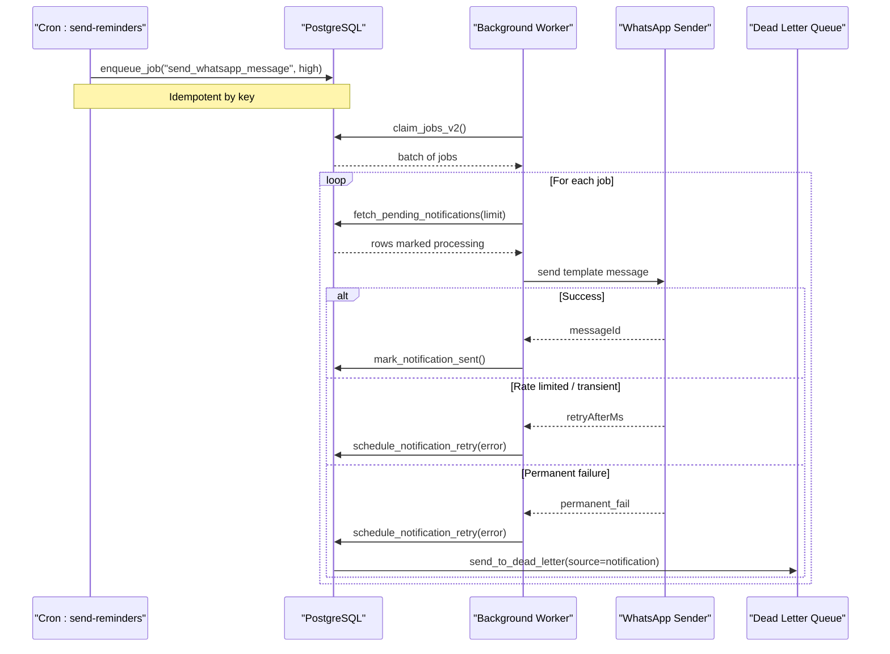
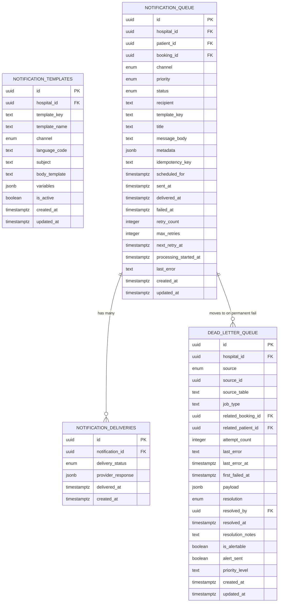
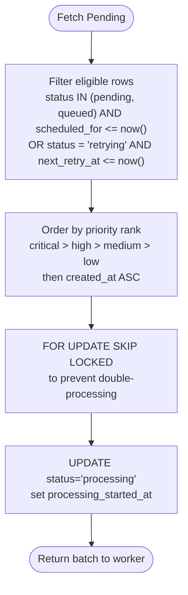
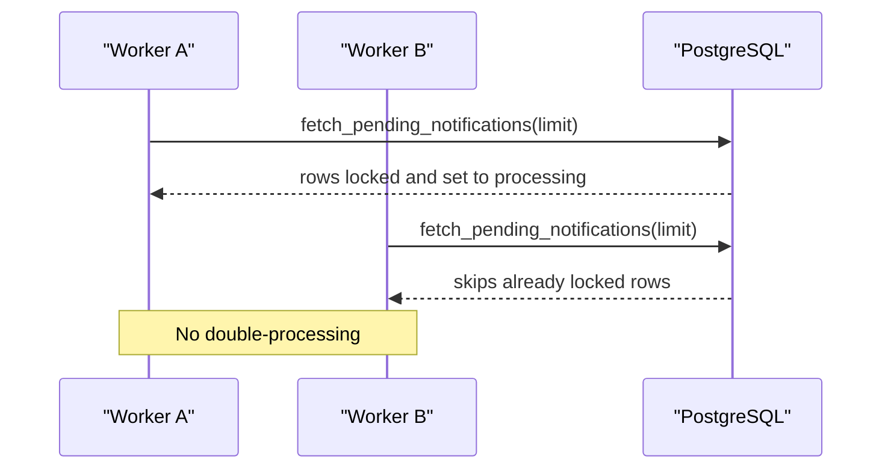
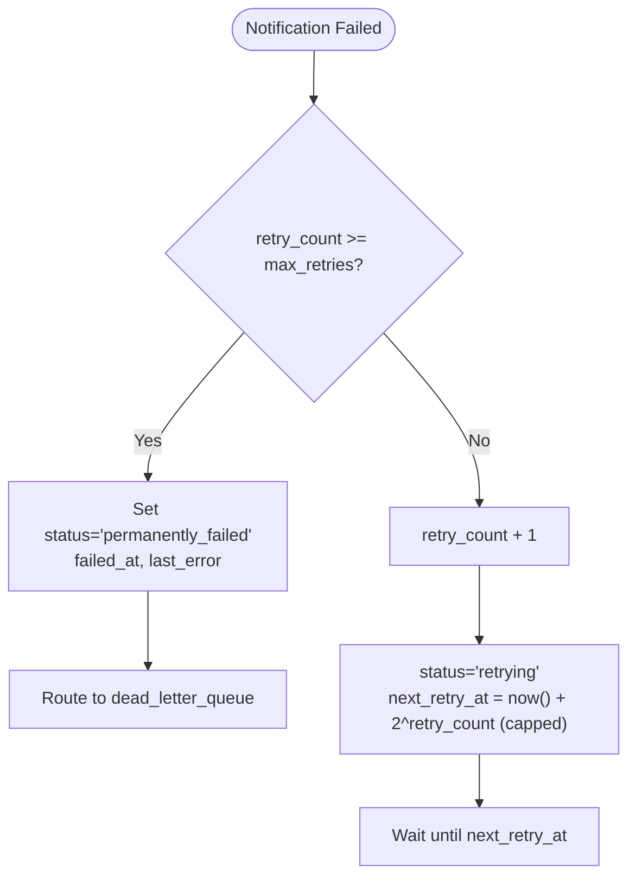
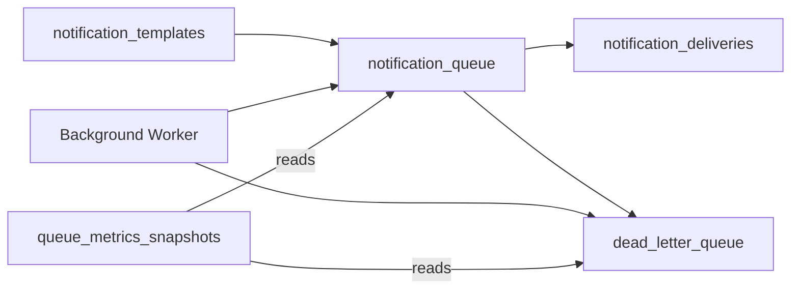

# Queue Architecture

<cite>
**Referenced Files in This Document**
- [05_notification_queue.sql](file://supabase/migrations/05_notification_queue.sql)
- [14_dead_letter_queue.sql](file://supabase/migrations/14_dead_letter_queue.sql)
- [17_queue_monitoring_engine.sql](file://supabase/migrations/17_queue_monitoring_engine.sql)
- [15_partitioning_strategy.sql](file://supabase/migrations/15_partitioning_strategy.sql)
- [worker.ts](file://supabase/functions/_shared/worker.ts)
- [run-background-worker/index.ts](file://supabase/functions/run-background-worker/index.ts)
- [send-reminders/index.ts](file://supabase/functions/send-reminders/index.ts)
- [send-whatsapp-message/index.ts](file://supabase/functions/send-whatsapp-message/index.ts)
</cite>

## Table of Contents

1. [Introduction](#introduction)
2. [Project Structure](#project-structure)
3. [Core Components](#core-components)
4. [Architecture Overview](#architecture-overview)
5. [Detailed Component Analysis](#detailed-component-analysis)
6. [Dependency Analysis](#dependency-analysis)
7. [Performance Considerations](#performance-considerations)
8. [Troubleshooting Guide](#troubleshooting-guide)
9. [Conclusion](#conclusion)

## Introduction

This document explains the notification queue architecture used to schedule,
process, and deliver notifications across channels with robust retry,
dead-letter handling, monitoring, and scalability patterns. It covers database
schema, priority ordering, concurrent worker-safe fetching, retry/backoff, dead
letter routing, and operational metrics.

## Project Structure

The notification queue spans migrations for schema and functions, background
workers, and channel-specific senders:

- Schema and functions: notification templates, queue, delivery logs, retry
  scheduling, and monitoring
- Workers: lease management, job claiming, heartbeat, completion/failure
  handling
- Triggers: cron-driven reminder queuing and background worker loops
- Channel sender: WhatsApp message delivery with rate-limit and permanent
  failure handling

```mermaid
graph TB
subgraph "Database"
T["notification_templates"]
Q["notification_queue"]
D["notification_deliveries"]
DLQ["dead_letter_queue"]
M["queue_metrics_snapshots"]
end
subgraph "Workers"
W["Background Worker (claim_jobs_v2)"]
H["Worker Heartbeat"]
end
subgraph "Triggers"
C["Cron: send-reminders"]
end
subgraph "Channels"
WA["WhatsApp Sender"]
end
C --> |"enqueue_job"| W
W --> |"fetch_pending_notifications"| Q
W --> |"mark_notification_sent / schedule_notification_retry"| Q
Q --> |"delivery log"| D
Q --> |"permanent fail"| DLQ
W --> |"enqueue send_whatsapp_message"| WA
M <-- "metrics snapshot" W
```

**Diagram sources**

- [05_notification_queue.sql:117-176](file://supabase/migrations/05_notification_queue.sql#L117-L176)
- [05_notification_queue.sql:228-252](file://supabase/migrations/05_notification_queue.sql#L228-L252)
- [14_dead_letter_queue.sql:39-123](file://supabase/migrations/14_dead_letter_queue.sql#L39-L123)
- [17_queue_monitoring_engine.sql:14-51](file://supabase/migrations/17_queue_monitoring_engine.sql#L14-L51)
- [run-background-worker/index.ts:134-167](file://supabase/functions/run-background-worker/index.ts#L134-L167)
- [send-reminders/index.ts:340-371](file://supabase/functions/send-reminders/index.ts#L340-L371)
- [send-whatsapp-message/index.ts:198-324](file://supabase/functions/send-whatsapp-message/index.ts#L198-L324)

**Section sources**

- [05_notification_queue.sql:117-176](file://supabase/migrations/05_notification_queue.sql#L117-L176)
- [14_dead_letter_queue.sql:39-123](file://supabase/migrations/14_dead_letter_queue.sql#L39-L123)
- [17_queue_monitoring_engine.sql:14-51](file://supabase/migrations/17_queue_monitoring_engine.sql#L14-L51)
- [15_partitioning_strategy.sql:35-76](file://supabase/migrations/15_partitioning_strategy.sql#L35-L76)
- [worker.ts:96-130](file://supabase/functions/_shared/worker.ts#L96-L130)
- [run-background-worker/index.ts:134-167](file://supabase/functions/run-background-worker/index.ts#L134-L167)
- [send-reminders/index.ts:340-371](file://supabase/functions/send-reminders/index.ts#L340-L371)
- [send-whatsapp-message/index.ts:198-324](file://supabase/functions/send-whatsapp-message/index.ts#L198-L324)

## Core Components

- Notification templates: reusable, per-hospital, per-channel, per-language
  templates with variables and activation flags.
- Notification queue: stores pending, queued, processing, sent, delivered,
  failed, retrying, cancelled, permanently_failed items with scheduling and
  retry metadata.
- Delivery logs: append-only records of provider responses per notification.
- Dead letter queue: centralized sink for permanently failed messages with
  resolution tracking.
- Monitoring engine: health queries, backlog alerts, metrics snapshots, and
  refresh logging.

Key responsibilities:

- Enqueue idempotently via a function that checks an idempotency key.
- Fetch pending items concurrently using FOR UPDATE SKIP LOCKED to avoid
  double-processing.
- Mark success or schedule retries with exponential backoff; move to
  permanently_failed when max retries exceeded.
- Route failures to dead letter queue for later inspection and reprocessing.
- Capture queue health metrics for dashboards and alerting.

**Section sources**

- [05_notification_queue.sql:59-103](file://supabase/migrations/05_notification_queue.sql#L59-L103)
- [05_notification_queue.sql:117-176](file://supabase/migrations/05_notification_queue.sql#L117-L176)
- [05_notification_queue.sql:228-252](file://supabase/migrations/05_notification_queue.sql#L228-L252)
- [14_dead_letter_queue.sql:39-123](file://supabase/migrations/14_dead_letter_queue.sql#L39-L123)
- [17_queue_monitoring_engine.sql:124-277](file://supabase/migrations/17_queue_monitoring_engine.sql#L124-L277)

## Architecture Overview

End-to-end flow from enqueue to delivery and error handling:



**Diagram sources**

- [send-reminders/index.ts:340-371](file://supabase/functions/send-reminders/index.ts#L340-L371)
- [worker.ts:96-130](file://supabase/functions/_shared/worker.ts#L96-L130)
- [05_notification_queue.sql:346-392](file://supabase/migrations/05_notification_queue.sql#L346-L392)
- [05_notification_queue.sql:401-435](file://supabase/migrations/05_notification_queue.sql#L401-L435)
- [05_notification_queue.sql:444-504](file://supabase/migrations/05_notification_queue.sql#L444-L504)
- [14_dead_letter_queue.sql:189-257](file://supabase/migrations/14_dead_letter_queue.sql#L189-L257)
- [send-whatsapp-message/index.ts:198-324](file://supabase/functions/send-whatsapp-message/index.ts#L198-L324)

## Detailed Component Analysis

### Database Schema for Queue Management

- notification_templates: keyed by hospital_id, channel, language_code; supports
  variables and activation status.
- notification_queue: core queue table with fields for channel, priority,
  status, recipient, template_key, message_body, metadata, idempotency_key,
  scheduled_for, timestamps, retry_count, max_retries, next_retry_at,
  processing_started_at, last_error.
- notification_deliveries: append-only log linking to notification_queue with
  delivery_status, provider_response JSONB, and delivered_at.

Indexes:

- Worker-friendly index on status, scheduled_for, priority, created_at filtered
  to pending/queued/retrying states.
- Retry index on next_retry_at for retrying items.
- Hospital-scoped and booking-scoped indexes for efficient lookups.



**Diagram sources**

- [05_notification_queue.sql:59-103](file://supabase/migrations/05_notification_queue.sql#L59-L103)
- [05_notification_queue.sql:117-176](file://supabase/migrations/05_notification_queue.sql#L117-L176)
- [05_notification_queue.sql:228-252](file://supabase/migrations/05_notification_queue.sql#L228-L252)
- [14_dead_letter_queue.sql:39-123](file://supabase/migrations/14_dead_letter_queue.sql#L39-L123)

**Section sources**

- [05_notification_queue.sql:59-103](file://supabase/migrations/05_notification_queue.sql#L59-L103)
- [05_notification_queue.sql:117-176](file://supabase/migrations/05_notification_queue.sql#L117-L176)
- [05_notification_queue.sql:228-252](file://supabase/migrations/05_notification_queue.sql#L228-L252)
- [14_dead_letter_queue.sql:39-123](file://supabase/migrations/14_dead_letter_queue.sql#L39-L123)

### Priority System and Processing Order

- Priority levels: low, medium, high, critical.
- Processing order uses a CASE expression mapping priorities to numeric ranks
  (critical first), then by created_at for FIFO within same priority.
- The worker-safe fetch selects only eligible statuses and times, then updates
  them to processing atomically.



**Diagram sources**

- [05_notification_queue.sql:346-392](file://supabase/migrations/05_notification_queue.sql#L346-L392)

**Section sources**

- [05_notification_queue.sql:346-392](file://supabase/migrations/05_notification_queue.sql#L346-L392)

### Concurrent Processing Patterns (FOR UPDATE SKIP LOCKED)

- Multiple workers call the same fetch function concurrently.
- PostgreSQL’s FOR UPDATE SKIP LOCKED ensures each row is claimed by at most one
  worker, avoiding duplicate processing.
- Workers also maintain heartbeats and leases for crash recovery in the broader
  job queue system.



**Diagram sources**

- [05_notification_queue.sql:346-392](file://supabase/migrations/05_notification_queue.sql#L346-L392)
- [worker.ts:96-130](file://supabase/functions/_shared/worker.ts#L96-L130)

**Section sources**

- [05_notification_queue.sql:346-392](file://supabase/migrations/05_notification_queue.sql#L346-L392)
- [worker.ts:96-130](file://supabase/functions/_shared/worker.ts#L96-L130)

### Queue Operations Examples

- Queuing notifications: use the idempotent enqueue function to insert into
  notification_queue with optional scheduling and idempotency key.
- Fetching pending items: call the worker-safe fetch function to atomically
  select and lock eligible rows.
- Updating status: mark sent on success; schedule retry on transient errors;
  move to permanently_failed after max retries.

Operational references:

- Enqueue: see the queue_notification function path.
- Fetch: see the fetch_pending_notifications function path.
- Mark sent: see the mark_notification_sent function path.
- Schedule retry: see the schedule_notification_retry function path.

**Section sources**

- [05_notification_queue.sql:258-323](file://supabase/migrations/05_notification_queue.sql#L258-L323)
- [05_notification_queue.sql:346-392](file://supabase/migrations/05_notification_queue.sql#L346-L392)
- [05_notification_queue.sql:401-435](file://supabase/migrations/05_notification_queue.sql#L401-L435)
- [05_notification_queue.sql:444-504](file://supabase/migrations/05_notification_queue.sql#L444-L504)

### Retry Mechanism with Exponential Backoff

- On failure, schedule_notification_retry increments retry_count, sets status to
  retrying, and computes next_retry_at using exponential backoff capped at a
  maximum interval.
- When retry_count reaches max_retries, status becomes permanently_failed and
  the item is routed to the dead letter queue.



**Diagram sources**

- [05_notification_queue.sql:444-504](file://supabase/migrations/05_notification_queue.sql#L444-L504)
- [14_dead_letter_queue.sql:189-257](file://supabase/migrations/14_dead_letter_queue.sql#L189-L257)

**Section sources**

- [05_notification_queue.sql:444-504](file://supabase/migrations/05_notification_queue.sql#L444-L504)
- [14_dead_letter_queue.sql:189-257](file://supabase/migrations/14_dead_letter_queue.sql#L189-L257)

### Dead Letter Handling

- Dead letter queue captures source type, original ID, error details, payload,
  and resolution state.
- Provides functions to send items to DLQ idempotently and to retry specific
  items back into their originating queues.
- Includes views and summaries to inspect unresolved items and prioritize
  critical issues.

**Section sources**

- [14_dead_letter_queue.sql:39-123](file://supabase/migrations/14_dead_letter_queue.sql#L39-L123)
- [14_dead_letter_queue.sql:189-257](file://supabase/migrations/14_dead_letter_queue.sql#L189-L257)
- [14_dead_letter_queue.sql:279-360](file://supabase/migrations/14_dead_letter_queue.sql#L279-L360)
- [14_dead_letter_queue.sql:366-440](file://supabase/migrations/14_dead_letter_queue.sql#L366-L440)

### Monitoring Metrics and Health

- Queue health function aggregates counts and throughput for multiple queues
  including notifications.
- Metrics snapshots are written periodically for historical analysis.
- Backlog alerts detect high pending counts or stale oldest items.

**Section sources**

- [17_queue_monitoring_engine.sql:124-277](file://supabase/migrations/17_queue_monitoring_engine.sql#L124-L277)
- [17_queue_monitoring_engine.sql:407-488](file://supabase/migrations/17_queue_monitoring_engine.sql#L407-L488)
- [17_queue_monitoring_engine.sql:348-401](file://supabase/migrations/17_queue_monitoring_engine.sql#L348-L401)

### Scalability Considerations

- Partitioning strategy: provides planning helpers, DDL generators, readiness
  checks, and maintenance advice for large tables. While not applied immediately
  to notification tables here, the framework supports future partitioning by
  time-based columns when thresholds are reached.
- Index optimization: targeted partial indexes for worker queries and retry
  schedules reduce scan overhead.
- Load balancing: multiple workers claim batches concurrently using SKIP LOCKED;
  heartbeat and lease mechanisms ensure safe scaling and crash recovery.

**Section sources**

- [15_partitioning_strategy.sql:35-76](file://supabase/migrations/15_partitioning_strategy.sql#L35-L76)
- [15_partitioning_strategy.sql:412-503](file://supabase/migrations/15_partitioning_strategy.sql#L412-L503)
- [05_notification_queue.sql:178-206](file://supabase/migrations/05_notification_queue.sql#L178-L206)
- [worker.ts:96-130](file://supabase/functions/_shared/worker.ts#L96-L130)

## Dependency Analysis

- Background worker orchestrates job claiming and dispatches channel-specific
  tasks.
- Notification queue depends on templates for content and on delivery logs for
  auditability.
- Dead letter queue depends on notification queue for permanent failures and
  provides re-entry points.
- Monitoring depends on queue health functions and writes snapshots for
  dashboards.



**Diagram sources**

- [05_notification_queue.sql:117-176](file://supabase/migrations/05_notification_queue.sql#L117-L176)
- [05_notification_queue.sql:228-252](file://supabase/migrations/05_notification_queue.sql#L228-L252)
- [14_dead_letter_queue.sql:39-123](file://supabase/migrations/14_dead_letter_queue.sql#L39-L123)
- [17_queue_monitoring_engine.sql:124-277](file://supabase/migrations/17_queue_monitoring_engine.sql#L124-L277)

**Section sources**

- [05_notification_queue.sql:117-176](file://supabase/migrations/05_notification_queue.sql#L117-L176)
- [14_dead_letter_queue.sql:39-123](file://supabase/migrations/14_dead_letter_queue.sql#L39-L123)
- [17_queue_monitoring_engine.sql:124-277](file://supabase/migrations/17_queue_monitoring_engine.sql#L124-L277)

## Performance Considerations

- Use partial indexes on status and time fields to speed up worker scans.
- Batch size tuning for fetch_pending_notifications to balance throughput and
  latency.
- Monitor queue health and backlog alerts to adjust worker concurrency and batch
  sizes.
- Consider partitioning notification_queue by time if volume grows
  significantly, following the provided partitioning strategy utilities.

[No sources needed since this section provides general guidance]

## Troubleshooting Guide

- Stuck items: check processing_started_at and status; use stuck job detection
  functions to identify long-running items.
- High backlog: review get_queue_health and backlog alerts; scale workers or
  tune batch sizes.
- Permanent failures: inspect dead_letter_queue entries and use retry functions
  to reprocess when appropriate.
- WhatsApp rate limits: handle retry-after headers and temporary failures; track
  metrics for rate limiting and permanent failures.

**Section sources**

- [17_queue_monitoring_engine.sql:283-343](file://supabase/migrations/17_queue_monitoring_engine.sql#L283-L343)
- [17_queue_monitoring_engine.sql:348-401](file://supabase/migrations/17_queue_monitoring_engine.sql#L348-L401)
- [14_dead_letter_queue.sql:366-440](file://supabase/migrations/14_dead_letter_queue.sql#L366-L440)
- [send-whatsapp-message/index.ts:248-324](file://supabase/functions/send-whatsapp-message/index.ts#L248-L324)

## Conclusion

The notification queue architecture combines a robust schema, worker-safe
concurrent processing, exponential backoff retries, dead letter handling, and
comprehensive monitoring. It scales horizontally across multiple workers and
provides clear operational visibility through metrics and alerts. With
partitioning utilities and targeted indexing, it can handle growing volumes
while maintaining reliability and performance.
