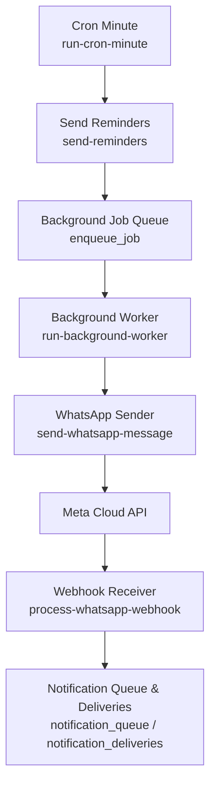
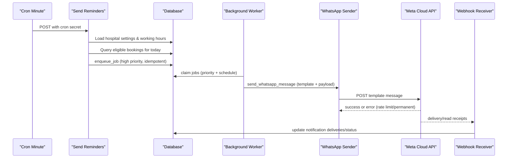
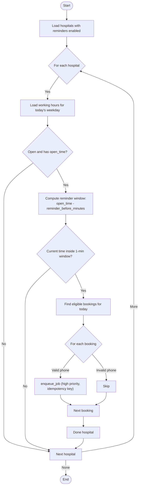
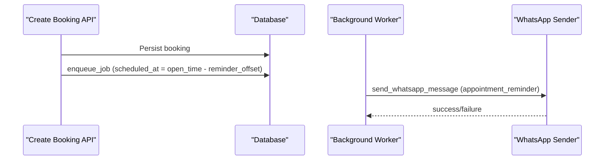
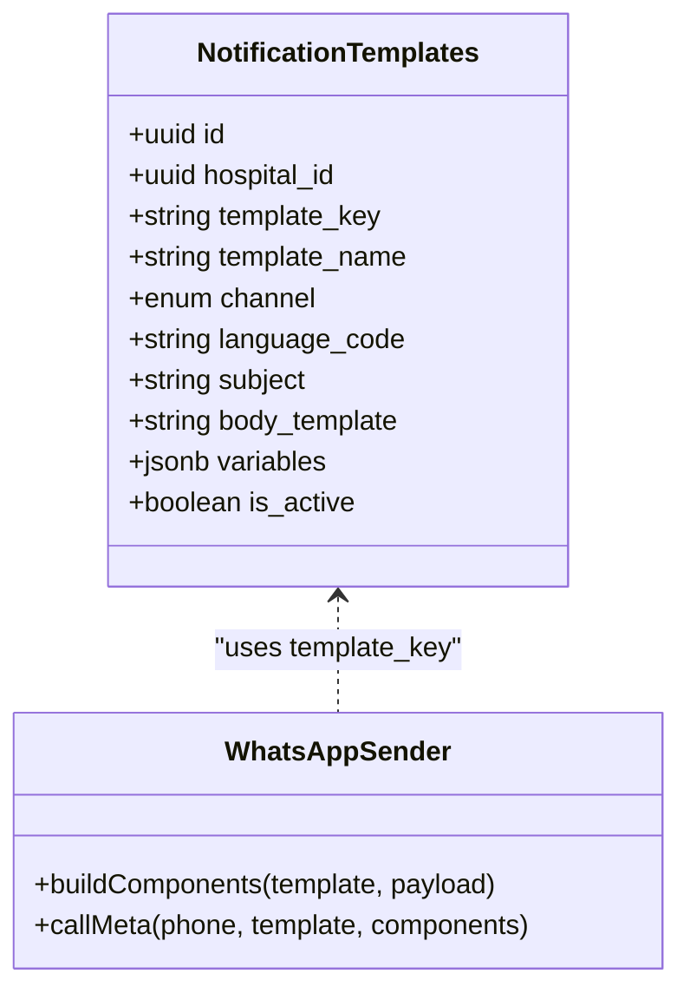
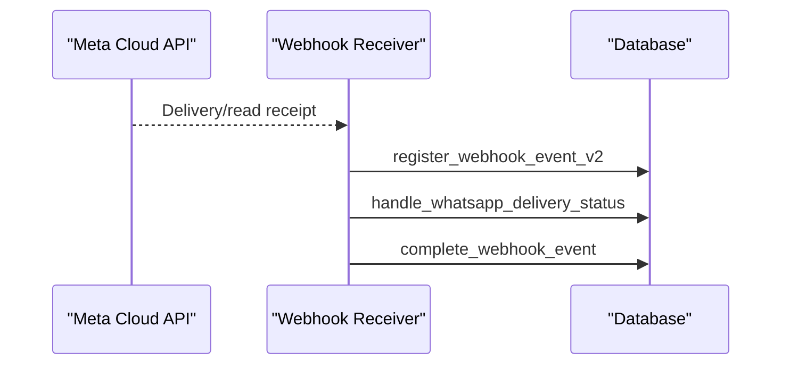
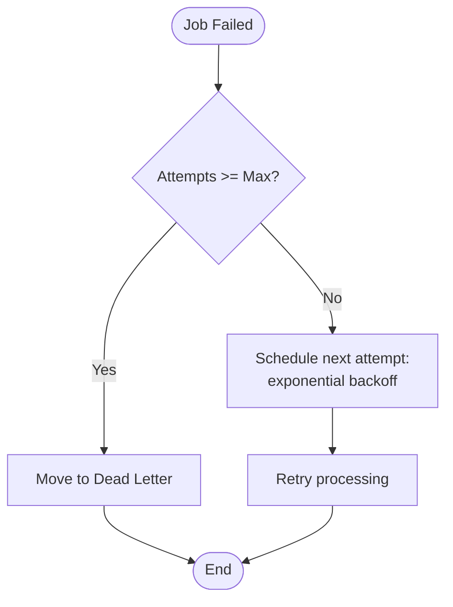
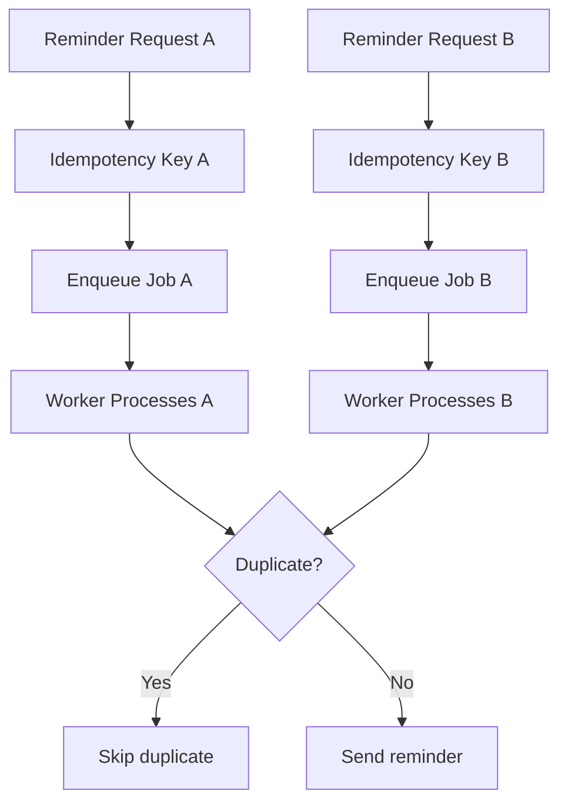
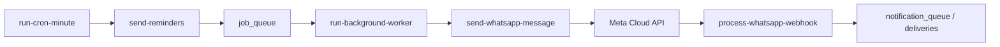

# Reminder Scheduling

<cite>
**Referenced Files in This Document**
- [send-reminders/index.ts](file://supabase/functions/send-reminders/index.ts)
- [run-cron-minute/index.ts](file://supabase/functions/run-cron-minute/index.ts)
- [run-background-worker/index.ts](file://supabase/functions/run-background-worker/index.ts)
- [send-whatsapp-message/index.ts](file://supabase/functions/send-whatsapp-message/index.ts)
- [process-whatsapp-webhook/index.ts](file://supabase/functions/process-whatsapp-webhook/index.ts)
- [05_notification_queue.sql](file://supabase/migrations/05_notification_queue.sql)
- [06_background_job_queue.sql](file://supabase/migrations/06_background_job_queue.sql)
- [create-booking/index.ts](file://supabase/functions/create-booking/index.ts)
- [_shared/worker.ts](file://supabase/functions/_shared/worker.ts)
</cite>

## Table of Contents

1. Introduction
2. Project Structure
3. Core Components
4. Architecture Overview
5. Detailed Component Analysis
6. Dependency Analysis
7. Performance Considerations
8. Troubleshooting Guide
9. Conclusion
10. Appendices

## Introduction

This document explains the automated reminder scheduling system that generates
and delivers appointment reminders to patients. It covers how reminders are
triggered based on appointment times, hospital business rules, and patient
preferences; how scheduling algorithms compute send times; how timezone
considerations are handled; and how conflicts are resolved when multiple
reminders overlap. It also documents API-based configuration for schedules,
template-driven content customization, delivery tracking via the notification
queue, retry and failure handling, and integration points with the booking
engine for automatic reminders and follow-up notifications.

## Project Structure

The reminder system spans several serverless functions and database migrations:

- Triggering: A minute-level cron orchestrator calls a dedicated reminder
  function.
- Scheduling: The reminder function computes eligible bookings and enqueues jobs
  for WhatsApp reminders.
- Delivery: A background worker processes queued jobs and sends messages via
  Meta Cloud API.
- Tracking: Webhooks update delivery status back into the system.
- Templates: Notification templates and queues are defined in SQL migrations.

**Diagram sources**

- [run-cron-minute/index.ts:156-186](file://supabase/functions/run-cron-minute/index.ts#L156-L186)
- [send-reminders/index.ts:128-388](file://supabase/functions/send-reminders/index.ts#L128-L388)
- [run-background-worker/index.ts:27-56](file://supabase/functions/run-background-worker/index.ts#L27-L56)
- [send-whatsapp-message/index.ts:198-324](file://supabase/functions/send-whatsapp-message/index.ts#L198-L324)
- [process-whatsapp-webhook/index.ts:357-493](file://supabase/functions/process-whatsapp-webhook/index.ts#L357-L493)
- [05_notification_queue.sql:117-246](file://supabase/migrations/05_notification_queue.sql#L117-L246)

**Section sources**

- [run-cron-minute/index.ts:1-347](file://supabase/functions/run-cron-minute/index.ts#L1-L347)
- [send-reminders/index.ts:1-445](file://supabase/functions/send-reminders/index.ts#L1-L445)
- [run-background-worker/index.ts:1-454](file://supabase/functions/run-background-worker/index.ts#L1-L454)
- [send-whatsapp-message/index.ts:1-583](file://supabase/functions/send-whatsapp-message/index.ts#L1-L583)
- [process-whatsapp-webhook/index.ts:1-657](file://supabase/functions/process-whatsapp-webhook/index.ts#L1-L657)
- [05_notification_queue.sql:1-595](file://supabase/migrations/05_notification_queue.sql#L1-L595)

## Core Components

- Reminder trigger: Determines which hospitals and bookings qualify for
  reminders based on settings and working hours.
- Scheduling algorithm: Computes the exact time window for sending reminders
  relative to hospital open time and configured minutes before.
- Job queue: Persists reminder tasks with idempotency keys, priorities, and
  scheduled execution times.
- Background worker: Claims and executes jobs, calling the WhatsApp sender.
- WhatsApp sender: Builds template components and calls Meta Cloud API with
  rate-limit and permanent-failure handling.
- Webhook receiver: Updates delivery statuses (sent, delivered, read, failed)
  and tracks provider responses.
- Notification templates: Centralized message templates per hospital, channel,
  and language.

**Section sources**

- [send-reminders/index.ts:128-388](file://supabase/functions/send-reminders/index.ts#L128-L388)
- [05_notification_queue.sql:59-246](file://supabase/migrations/05_notification_queue.sql#L59-L246)
- [run-background-worker/index.ts:27-167](file://supabase/functions/run-background-worker/index.ts#L27-L167)
- [send-whatsapp-message/index.ts:20-187](file://supabase/functions/send-whatsapp-message/index.ts#L20-L187)
- [process-whatsapp-webhook/index.ts:357-493](file://supabase/functions/process-whatsapp-webhook/index.ts#L357-L493)

## Architecture Overview

The system uses a decoupled pipeline:

- Cron triggers the reminder scheduler once per minute.
- The scheduler evaluates hospital settings and working hours to find eligible
  bookings for today.
- Eligible bookings enqueue high-priority jobs for WhatsApp reminders with
  idempotency keys.
- The background worker claims jobs and invokes the WhatsApp sender.
- Meta Cloud API responds with success or errors; webhooks update delivery
  states.

**Diagram sources**

- [run-cron-minute/index.ts:156-186](file://supabase/functions/run-cron-minute/index.ts#L156-L186)
- [send-reminders/index.ts:128-388](file://supabase/functions/send-reminders/index.ts#L128-L388)
- [run-background-worker/index.ts:27-56](file://supabase/functions/run-background-worker/index.ts#L27-L56)
- [send-whatsapp-message/index.ts:198-324](file://supabase/functions/send-whatsapp-message/index.ts#L198-L324)
- [process-whatsapp-webhook/index.ts:357-493](file://supabase/functions/process-whatsapp-webhook/index.ts#L357-L493)

## Detailed Component Analysis

### Reminder Trigger and Scheduling Algorithm

- Hospital enablement: Only hospitals with reminders enabled are processed.
- Working hours check: For the current weekday, the system loads open_time and
  ensures the hospital is open.
- Time window enforcement: Reminders are only queued within a one-minute window
  calculated as (open_time - reminder_before_minutes) to (open_time -
  reminder_before_minutes + 60s).
- Booking eligibility: Today’s appointments with specific statuses and not
  already sent reminders are selected, limited per run.
- Idempotency: Each reminder job uses an idempotency key to prevent duplicates.

**Diagram sources**

- [send-reminders/index.ts:128-388](file://supabase/functions/send-reminders/index.ts#L128-L388)

**Section sources**

- [send-reminders/index.ts:128-388](file://supabase/functions/send-reminders/index.ts#L128-L388)

### Integration with Booking Engine

- On booking creation, if reminders are enabled, the system calculates a future
  scheduled time based on the hospital’s open time and configured reminder
  offset, then enqueues a job at that time.
- Rescheduling logic creates a new booking and can re-trigger reminder
  scheduling accordingly.

**Diagram sources**

- [create-booking/index.ts:550-585](file://supabase/functions/create-booking/index.ts#L550-L585)
- [run-background-worker/index.ts:27-56](file://supabase/functions/run-background-worker/index.ts#L27-L56)
- [send-whatsapp-message/index.ts:133-145](file://supabase/functions/send-whatsapp-message/index.ts#L133-L145)

**Section sources**

- [create-booking/index.ts:550-585](file://supabase/functions/create-booking/index.ts#L550-L585)

### Template Customization and Content

- Templates are stored per hospital, channel, and language, enabling localized
  and customized messages.
- The WhatsApp sender maps template names to component parameters (e.g., patient
  name, token number, appointment date).
- Templates support variables and are validated before sending.

**Diagram sources**

- [05_notification_queue.sql:59-96](file://supabase/migrations/05_notification_queue.sql#L59-L96)
- [send-whatsapp-message/index.ts:94-187](file://supabase/functions/send-whatsapp-message/index.ts#L94-L187)

**Section sources**

- [05_notification_queue.sql:59-96](file://supabase/migrations/05_notification_queue.sql#L59-L96)
- [send-whatsapp-message/index.ts:94-187](file://supabase/functions/send-whatsapp-message/index.ts#L94-L187)

### Delivery Tracking and Webhooks

- Webhook receiver validates incoming events from Meta, registers them
  idempotently, and updates delivery statuses.
- Statuses include sent, delivered, read, and failed; provider responses are
  captured for diagnostics.
- Failed or problematic events are logged and metrics are recorded.

**Diagram sources**

- [process-whatsapp-webhook/index.ts:357-493](file://supabase/functions/process-whatsapp-webhook/index.ts#L357-L493)

**Section sources**

- [process-whatsapp-webhook/index.ts:357-493](file://supabase/functions/process-whatsapp-webhook/index.ts#L357-L493)

### Retry Mechanisms and Failure Handling

- Job queue supports exponential backoff retries up to a maximum attempt count;
  beyond that, jobs move to a dead-letter table.
- Notification queue includes retry scheduling with increasing delays and
  permanent failure marking after max retries.
- WhatsApp sender handles rate limiting by respecting Retry-After headers and
  marks permanent failures for invalid recipients or invalid template
  configurations.

**Diagram sources**

- [06_background_job_queue.sql:372-430](file://supabase/migrations/06_background_job_queue.sql#L372-L430)
- [05_notification_queue.sql:444-507](file://supabase/migrations/05_notification_queue.sql#L444-L507)
- [send-whatsapp-message/index.ts:248-307](file://supabase/functions/send-whatsapp-message/index.ts#L248-L307)

**Section sources**

- [06_background_job_queue.sql:372-430](file://supabase/migrations/06_background_job_queue.sql#L372-L430)
- [05_notification_queue.sql:444-507](file://supabase/migrations/05_notification_queue.sql#L444-L507)
- [send-whatsapp-message/index.ts:248-307](file://supabase/functions/send-whatsapp-message/index.ts#L248-L307)

### Conflict Resolution for Overlapping Reminders

- Idempotency keys ensure that duplicate reminder requests for the same booking
  do not create multiple jobs.
- One-minute execution windows reduce the chance of overlapping runs across
  instances.
- Priority ordering ensures critical reminders are processed first during
  contention.

**Diagram sources**

- [send-reminders/index.ts:340-371](file://supabase/functions/send-reminders/index.ts#L340-L371)
- [05_notification_queue.sql:258-323](file://supabase/migrations/05_notification_queue.sql#L258-L323)

**Section sources**

- [send-reminders/index.ts:340-371](file://supabase/functions/send-reminders/index.ts#L340-L371)
- [05_notification_queue.sql:258-323](file://supabase/migrations/05_notification_queue.sql#L258-L323)

### Timezone Handling

- The system uses UTC timestamps for scheduling and relies on hospital working
  hours configured per weekday.
- Reminder windows are computed using local hospital open times; ensure hospital
  settings reflect correct timezone offsets.
- When creating bookings, scheduled reminder times are derived from hospital
  open time minus configured offset.

[No sources needed since this section provides general guidance]

### Patient Preferences and Opt-in/Opt-out

- The reminder flow checks for valid patient phone numbers and respects flags
  indicating whether reminders have been sent.
- To implement opt-in/opt-out, extend the booking or patient profile with
  preference fields and gate reminder enqueueing accordingly.

[No sources needed since this section provides general guidance]

## Dependency Analysis

- Cron orchestrator depends on environment secrets and calls the reminder
  function.
- Reminder function depends on hospital settings, working hours, and booking
  data.
- Background worker depends on job queue and WhatsApp sender.
- WhatsApp sender depends on Meta credentials and API version.
- Webhook receiver depends on Meta verification tokens and HMAC secrets.

**Diagram sources**

- [run-cron-minute/index.ts:156-186](file://supabase/functions/run-cron-minute/index.ts#L156-L186)
- [send-reminders/index.ts:128-388](file://supabase/functions/send-reminders/index.ts#L128-L388)
- [run-background-worker/index.ts:27-56](file://supabase/functions/run-background-worker/index.ts#L27-L56)
- [send-whatsapp-message/index.ts:198-324](file://supabase/functions/send-whatsapp-message/index.ts#L198-L324)
- [process-whatsapp-webhook/index.ts:357-493](file://supabase/functions/process-whatsapp-webhook/index.ts#L357-L493)

**Section sources**

- [run-cron-minute/index.ts:1-347](file://supabase/functions/run-cron-minute/index.ts#L1-L347)
- [send-reminders/index.ts:1-445](file://supabase/functions/send-reminders/index.ts#L1-L445)
- [run-background-worker/index.ts:1-454](file://supabase/functions/run-background-worker/index.ts#L1-L454)
- [send-whatsapp-message/index.ts:1-583](file://supabase/functions/send-whatsapp-message/index.ts#L1-L583)
- [process-whatsapp-webhook/index.ts:1-657](file://supabase/functions/process-whatsapp-webhook/index.ts#L1-L657)

## Performance Considerations

- Batch limits: Reminder queries limit results per run to avoid large payloads.
- Priority ordering: Critical and high-priority reminders are processed first.
- Exponential backoff: Retries scale delays to reduce load on external APIs.
- Heartbeat monitoring: Workers report health to detect stalls.

[No sources needed since this section provides general guidance]

## Troubleshooting Guide

- Missing or incorrect cron secret: Ensure X-Cron-Secret matches expected value
  in environment.
- No reminders queued: Verify hospital settings enable reminders and working
  hours are configured for the current weekday.
- Duplicate reminders: Confirm idempotency keys are unique per booking and
  reminder event.
- Rate limiting: If Meta returns 429, respect Retry-After and adjust throughput
  or batch size.
- Permanent failures: Invalid recipient formats or template misconfiguration
  lead to permanent fails; validate inputs and templates.
- Webhook issues: Ensure HMAC verification and verification token are correctly
  set; check logs for invalid JSON or missing entries.

**Section sources**

- [send-reminders/index.ts:61-95](file://supabase/functions/send-reminders/index.ts#L61-L95)
- [send-whatsapp-message/index.ts:248-307](file://supabase/functions/send-whatsapp-message/index.ts#L248-L307)
- [process-whatsapp-webhook/index.ts:148-256](file://supabase/functions/process-whatsapp-webhook/index.ts#L148-L256)

## Conclusion

The reminder scheduling system combines configurable hospital rules, precise
time-window calculations, robust queuing, and resilient delivery mechanisms to
ensure timely and reliable appointment reminders. By leveraging idempotency,
priority-based processing, and comprehensive retry strategies, it maintains
consistency under load and external service variability. Integrating with the
booking engine enables end-to-end automation from booking creation to
post-consultation follow-ups.

[No sources needed since this section summarizes without analyzing specific
files]

## Appendices

### API Configuration Examples

- Configure hospital settings to enable reminders and set reminder offset:
  - Update hospital_settings with send_whatsapp_reminder and
    reminder_before_minutes.
- Create or update notification templates:
  - Insert rows into notification_templates with template_key, channel,
    language_code, and body_template.
- Schedule reminders via booking creation:
  - When creating a booking, enqueue a job with scheduled_at based on open_time
    minus reminder offset.

**Section sources**

- [send-reminders/index.ts:128-143](file://supabase/functions/send-reminders/index.ts#L128-L143)
- [05_notification_queue.sql:59-96](file://supabase/migrations/05_notification_queue.sql#L59-L96)
- [create-booking/index.ts:550-585](file://supabase/functions/create-booking/index.ts#L550-L585)

### Edge Cases

- Timezone changes: Ensure hospital working hours reflect current timezone;
  consider storing timezone-aware open times if multi-timezone support is
  required.
- Schedule modifications: If hospital open times change mid-day, the one-minute
  window may miss some reminders; consider additional catch-up logic or
  real-time recalculations.
- Patient opt-outs: Extend booking/patient profiles with preference flags and
  gate reminder enqueueing based on those preferences.

[No sources needed since this section provides general guidance]
