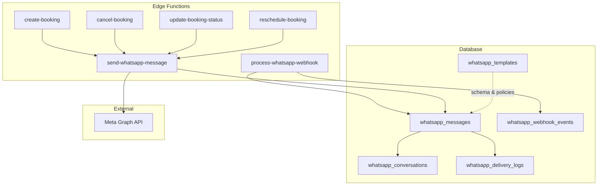
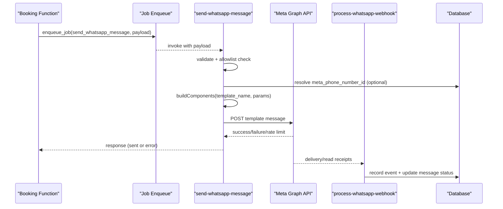
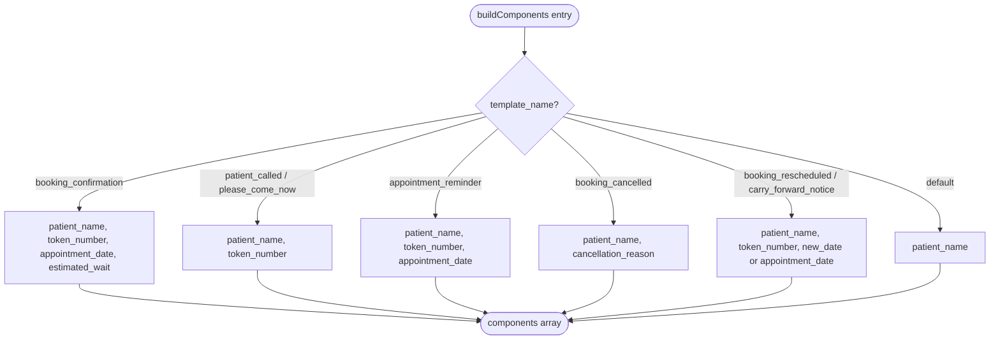
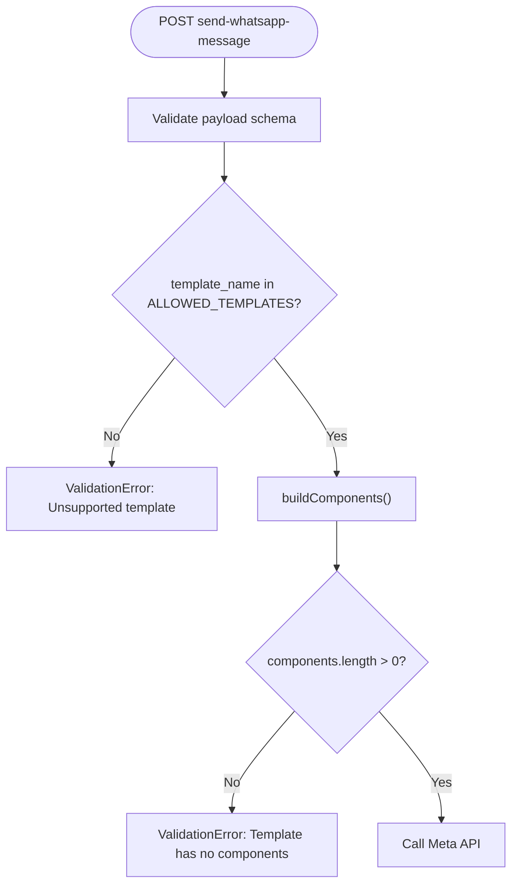
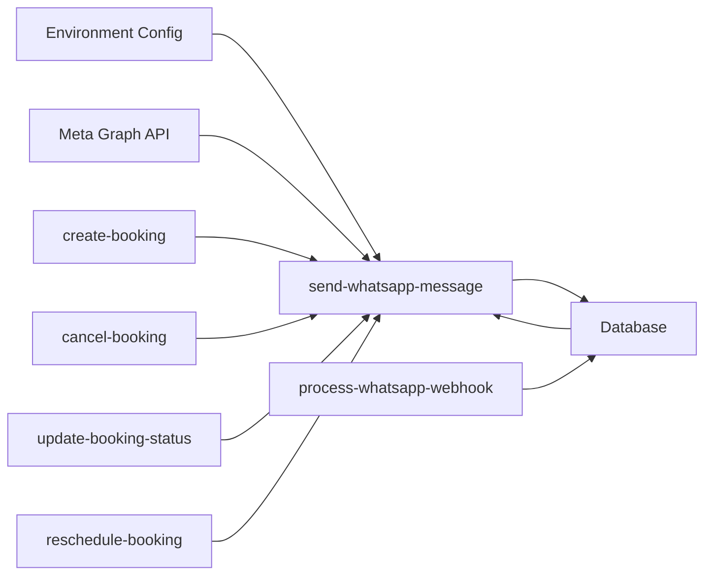

# Template Management

<cite>
**Referenced Files in This Document**
- [send-whatsapp-message/index.ts](file://supabase/functions/send-whatsapp-message/index.ts)
- [process-whatsapp-webhook/index.ts](file://supabase/functions/process-whatsapp-webhook/index.ts)
- [create-booking/index.ts](file://supabase/functions/create-booking/index.ts)
- [cancel-booking/index.ts](file://supabase/functions/cancel-booking/index.ts)
- [update-booking-status/index.ts](file://supabase/functions/update-booking-status/index.ts)
- [reschedule-booking/index.ts](file://supabase/functions/reschedule-booking/index.ts)
- [04_whatsapp_messaging_engine.sql](file://supabase/migrations/04_whatsapp_messaging_engine.sql)
</cite>

## Table of Contents

1. [Introduction](#introduction)
2. [Project Structure](#project-structure)
3. [Core Components](#core-components)
4. [Architecture Overview](#architecture-overview)
5. [Detailed Component Analysis](#detailed-component-analysis)
6. [Dependency Analysis](#dependency-analysis)
7. [Performance Considerations](#performance-considerations)
8. [Troubleshooting Guide](#troubleshooting-guide)
9. [Conclusion](#conclusion)
10. [Appendices](#appendices)

## Introduction

This document explains the WhatsApp template management system used to notify
patients about booking lifecycle events. It covers supported templates,
parameter mapping, component building logic, validation and registry
enforcement, error handling, localization behavior, versioning and approval
considerations, and fallback mechanisms for template changes.

## Project Structure

The WhatsApp messaging capability is implemented as a set of Supabase Edge
Functions and database migrations:

- Outbound message sending via a worker-only endpoint that validates inputs,
  builds template components, and calls Meta Cloud API.
- Webhook processing for delivery/read receipts and incoming messages.
- Booking-related functions enqueue WhatsApp notifications at key state
  transitions (creation, cancellation, rescheduling, status updates).
- Database schema defines templates, conversations, messages, delivery logs, and
  webhook events with policies and retry logic.

**Diagram sources**

- [send-whatsapp-message/index.ts:326-582](file://supabase/functions/send-whatsapp-message/index.ts#L326-L582)
- [process-whatsapp-webhook/index.ts:124-657](file://supabase/functions/process-whatsapp-webhook/index.ts#L124-L657)
- [create-booking/index.ts:520-587](file://supabase/functions/create-booking/index.ts#L520-L587)
- [cancel-booking/index.ts:340-387](file://supabase/functions/cancel-booking/index.ts#L340-L387)
- [update-booking-status/index.ts:450-547](file://supabase/functions/update-booking-status/index.ts#L450-L547)
- [reschedule-booking/index.ts:496-532](file://supabase/functions/reschedule-booking/index.ts#L496-L532)
- [04_whatsapp_messaging_engine.sql:53-87](file://supabase/migrations/04_whatsapp_messaging_engine.sql#L53-L87)

**Section sources**

- [send-whatsapp-message/index.ts:20-31](file://supabase/functions/send-whatsapp-message/index.ts#L20-L31)
- [04_whatsapp_messaging_engine.sql:53-87](file://supabase/migrations/04_whatsapp_messaging_engine.sql#L53-L87)

## Core Components

- Allowed template registry: A strict allowlist controls which template names
  can be sent. Any name not present triggers a validation error.
- Parameter schema: The outbound sender enforces a typed payload including
  phone, template_name, and optional fields like patient_name, token_number,
  appointment_date, new_date, estimated_wait, cancellation_reason, hospital_id,
  and tracking identifiers.
- Component builder: Maps each allowed template to a specific set of body
  parameters using a helper that converts values into text components expected
  by Meta templates.
- Meta integration: Sends a template message with language code “en” and
  constructs the request body with recipient, template name, language, and
  components.
- Webhook handler: Verifies HMAC signatures, deduplicates events, records
  delivery statuses, and enqueues incoming messages for processing.

**Section sources**

- [send-whatsapp-message/index.ts:47-74](file://supabase/functions/send-whatsapp-message/index.ts#L47-L74)
- [send-whatsapp-message/index.ts:94-187](file://supabase/functions/send-whatsapp-message/index.ts#L94-L187)
- [send-whatsapp-message/index.ts:198-324](file://supabase/functions/send-whatsapp-message/index.ts#L198-L324)
- [process-whatsapp-webhook/index.ts:31-76](file://supabase/functions/process-whatsapp-webhook/index.ts#L31-L76)
- [process-whatsapp-webhook/index.ts:222-256](file://supabase/functions/process-whatsapp-webhook/index.ts#L222-L256)

## Architecture Overview

The flow from business event to patient notification:

1. A booking action (create, cancel, reschedule, or status change) enqueues a
   job to send a WhatsApp message with a specific template name and parameters.
2. The worker endpoint validates the request, checks the template against the
   allowed registry, resolves per-hospital Meta credentials if provided, builds
   template components, and calls Meta.
3. Delivery and read receipts arrive via webhooks, are verified, deduplicated,
   and persisted; they update message statuses and log details.

**Diagram sources**

- [create-booking/index.ts:520-587](file://supabase/functions/create-booking/index.ts#L520-L587)
- [cancel-booking/index.ts:340-387](file://supabase/functions/cancel-booking/index.ts#L340-L387)
- [update-booking-status/index.ts:450-547](file://supabase/functions/update-booking-status/index.ts#L450-L547)
- [reschedule-booking/index.ts:496-532](file://supabase/functions/reschedule-booking/index.ts#L496-L532)
- [send-whatsapp-message/index.ts:326-582](file://supabase/functions/send-whatsapp-message/index.ts#L326-L582)
- [process-whatsapp-webhook/index.ts:222-657](file://supabase/functions/process-whatsapp-webhook/index.ts#L222-L657)

## Detailed Component Analysis

### Supported Templates and Parameters

The system supports the following templates, each mapped to specific parameters
by the component builder:

- booking_confirmation: patient_name, token_number, appointment_date,
  estimated_wait
- patient_called: patient_name, token_number
- please_come_now: patient_name, token_number
- appointment_reminder: patient_name, token_number, appointment_date
- booking_cancelled: patient_name, cancellation_reason
- booking_rescheduled: patient_name, token_number, new_date or appointment_date
- carry_forward_notice: patient_name, token_number, new_date or appointment_date
- feedback_request: minimal parameters (no body variables required by current
  builder)
- consultation_started: minimal parameters (no body variables required by
  current builder)
- consultation_completed: minimal parameters (no body variables required by
  current builder)

These mappings ensure that only the necessary dynamic content is passed to
Meta’s template engine.

**Section sources**

- [send-whatsapp-message/index.ts:20-31](file://supabase/functions/send-whatsapp-message/index.ts#L20-L31)
- [send-whatsapp-message/index.ts:94-187](file://supabase/functions/send-whatsapp-message/index.ts#L94-L187)

### Component Building Logic

The component builder centralizes how each template’s body parameters are
constructed. It uses a helper to convert raw values into text components and
applies defaults where appropriate (e.g., default patient name, formatted wait
time). Unknown templates fall through to a generic path that includes at least
the patient name.

**Diagram sources**

- [send-whatsapp-message/index.ts:94-187](file://supabase/functions/send-whatsapp-message/index.ts#L94-L187)

**Section sources**

- [send-whatsapp-message/index.ts:94-187](file://supabase/functions/send-whatsapp-message/index.ts#L94-L187)

### Template Validation and Registry Enforcement

- Input validation: The sender enforces a strict schema for the payload,
  ensuring phone number format and presence of template_name.
- Allowlist enforcement: Only templates present in the internal registry are
  accepted. Requests with unsupported template names raise a validation error.
- Component existence: If no components are produced for a template, a
  validation error is raised to prevent invalid sends.

**Diagram sources**

- [send-whatsapp-message/index.ts:47-74](file://supabase/functions/send-whatsapp-message/index.ts#L47-L74)
- [send-whatsapp-message/index.ts:388-406](file://supabase/functions/send-whatsapp-message/index.ts#L388-L406)
- [send-whatsapp-message/index.ts:459-475](file://supabase/functions/send-whatsapp-message/index.ts#L459-L475)

**Section sources**

- [send-whatsapp-message/index.ts:47-74](file://supabase/functions/send-whatsapp-message/index.ts#L47-L74)
- [send-whatsapp-message/index.ts:388-406](file://supabase/functions/send-whatsapp-message/index.ts#L388-L406)
- [send-whatsapp-message/index.ts:459-475](file://supabase/functions/send-whatsapp-message/index.ts#L459-L475)

### Meta Integration and Localization

- Language: Messages are sent with language code “en”.
- Phone resolution: Per-hospital Meta phone number ID can override the global
  setting when hospital_id is provided.
- Credentials: Requires configured Meta access token and phone number ID;
  missing credentials result in an internal error.

**Section sources**

- [send-whatsapp-message/index.ts:198-324](file://supabase/functions/send-whatsapp-message/index.ts#L198-L324)
- [send-whatsapp-message/index.ts:408-457](file://supabase/functions/send-whatsapp-message/index.ts#L408-L457)

### Webhook Processing and Delivery Tracking

- Verification: Supports Meta verification challenge and HMAC signature
  verification.
- Deduplication: Uses unique event IDs to avoid duplicate processing.
- Status updates: Maps Meta statuses to internal states and persists delivery
  logs.
- Incoming messages: Enqueues jobs for further processing.

**Section sources**

- [process-whatsapp-webhook/index.ts:148-211](file://supabase/functions/process-whatsapp-webhook/index.ts#L148-L211)
- [process-whatsapp-webhook/index.ts:222-256](file://supabase/functions/process-whatsapp-webhook/index.ts#L222-L256)
- [process-whatsapp-webhook/index.ts:357-493](file://supabase/functions/process-whatsapp-webhook/index.ts#L357-L493)
- [process-whatsapp-webhook/index.ts:495-613](file://supabase/functions/process-whatsapp-webhook/index.ts#L495-L613)

### Trigger Points Across Booking Lifecycle

- Creation: Enqueues booking_confirmation and optionally schedules
  appointment_reminder based on hospital settings.
- Cancellation: Enqueues booking_cancelled with reason.
- Rescheduling: Marks original booking as rescheduled, creates new booking, and
  enqueues booking_rescheduled.
- Status updates: On transitions such as called, in_consultation, completed,
  enqueues corresponding notifications (patient_called, consultation_started,
  consultation_completed) and schedules feedback_request after completion.

**Section sources**

- [create-booking/index.ts:520-587](file://supabase/functions/create-booking/index.ts#L520-L587)
- [cancel-booking/index.ts:340-387](file://supabase/functions/cancel-booking/index.ts#L340-L387)
- [reschedule-booking/index.ts:496-532](file://supabase/functions/reschedule-booking/index.ts#L496-L532)
- [update-booking-status/index.ts:450-547](file://supabase/functions/update-booking-status/index.ts#L450-L547)

## Dependency Analysis

- The sender depends on environment configuration (Meta credentials), database
  access (hospital settings), and external Meta API.
- Webhook processing depends on database RPCs for event registration and status
  handling.
- Booking functions depend on queue/job infrastructure to enqueue message jobs
  idempotently.

**Diagram sources**

- [send-whatsapp-message/index.ts:408-457](file://supabase/functions/send-whatsapp-message/index.ts#L408-L457)
- [process-whatsapp-webhook/index.ts:382-493](file://supabase/functions/process-whatsapp-webhook/index.ts#L382-L493)
- [create-booking/index.ts:520-587](file://supabase/functions/create-booking/index.ts#L520-L587)
- [cancel-booking/index.ts:340-387](file://supabase/functions/cancel-booking/index.ts#L340-L387)
- [update-booking-status/index.ts:450-547](file://supabase/functions/update-booking-status/index.ts#L450-L547)
- [reschedule-booking/index.ts:496-532](file://supabase/functions/reschedule-booking/index.ts#L496-L532)

**Section sources**

- [send-whatsapp-message/index.ts:408-457](file://supabase/functions/send-whatsapp-message/index.ts#L408-L457)
- [process-whatsapp-webhook/index.ts:382-493](file://supabase/functions/process-whatsapp-webhook/index.ts#L382-L493)

## Performance Considerations

- Idempotency: Jobs use idempotency keys to prevent duplicate sends across
  retries and concurrent requests.
- Rate limiting: Meta rate limits are detected and surfaced with retry-after
  guidance; metrics track rate-limited and permanent failures.
- Timeouts: Network calls to Meta have timeouts to avoid hanging requests.
- Batch processing: Webhook handler processes entries in loops and caps large
  batches with warnings.

[No sources needed since this section provides general guidance]

## Troubleshooting Guide

Common issues and their indicators:

- Unsupported template: Occurs when template_name is not in the allowlist;
  results in a validation error.
- Missing components: Occurs when buildComponents returns an empty array;
  results in a validation error.
- Meta credentials not configured: Occurs when phone number ID or access token
  are missing; results in an internal error.
- Network errors: Failures during fetch to Meta; returned as network error with
  failure flags.
- Rate limited: HTTP 429 responses; includes retry-after seconds for backoff.
- Permanent failures: Specific Meta error codes or 400 responses marked as
  permanent fails.
- Webhook HMAC mismatch: Invalid signature leads to forbidden response.
- Duplicate webhook events: Deduplicated by event ID; duplicates are ignored.

Operational tips:

- Ensure X-Worker-Secret header matches expected secret for worker-only
  endpoints.
- Verify hospital-specific meta_phone_number_id if multi-tenant usage is
  intended.
- Monitor metrics for whatsapp.error, whatsapp.rate_limited, and
  whatsapp.permanent_fail.

**Section sources**

- [send-whatsapp-message/index.ts:366-406](file://supabase/functions/send-whatsapp-message/index.ts#L366-L406)
- [send-whatsapp-message/index.ts:450-475](file://supabase/functions/send-whatsapp-message/index.ts#L450-L475)
- [send-whatsapp-message/index.ts:248-324](file://supabase/functions/send-whatsapp-message/index.ts#L248-L324)
- [process-whatsapp-webhook/index.ts:222-256](file://supabase/functions/process-whatsapp-webhook/index.ts#L222-L256)
- [process-whatsapp-webhook/index.ts:382-493](file://supabase/functions/process-whatsapp-webhook/index.ts#L382-L493)

## Conclusion

The WhatsApp template management system provides a robust, validated, and
auditable pipeline for sending patient notifications tied to booking lifecycle
events. It enforces a strict template registry, maps parameters reliably to Meta
templates, handles localization via fixed language code, and integrates with
webhooks for delivery tracking. While versioning and approval workflows are
primarily managed in Meta, the system supports per-hospital phone number
configuration and includes safeguards against unsupported templates and invalid
payloads.

[No sources needed since this section summarizes without analyzing specific
files]

## Appendices

### Template Usage Examples

- Booking confirmation: Enqueued with patient_name, token_number,
  appointment_date, and estimated_wait; used when creating a booking and
  hospital settings enable WhatsApp confirmations.
- Appointment reminder: Enqueued with patient_name, token_number, and
  appointment_date; scheduled before clinic open time based on hospital
  settings.
- Patient called / Please come now: Enqueued with patient_name and token_number;
  triggered when moving to called or similar statuses.
- Booking cancelled: Enqueued with patient_name and cancellation_reason;
  triggered on cancellation.
- Booking rescheduled / Carry forward notice: Enqueued with patient_name,
  token_number, and new_date or appointment_date; triggered on rescheduling.
- Feedback request: Enqueued after consultation completion with low priority and
  delayed scheduling.
- Consultation started / Completed: Enqueued on status transitions to
  in_consultation and completed.

**Section sources**

- [create-booking/index.ts:520-587](file://supabase/functions/create-booking/index.ts#L520-L587)
- [update-booking-status/index.ts:450-547](file://supabase/functions/update-booking-status/index.ts#L450-L547)
- [cancel-booking/index.ts:340-387](file://supabase/functions/cancel-booking/index.ts#L340-L387)
- [reschedule-booking/index.ts:496-532](file://supabase/functions/reschedule-booking/index.ts#L496-L532)

### Database Schema Highlights

- whatsapp_templates: Stores template metadata including category,
  language_code, body, and variables; scoped by hospital_id and
  meta_template_name.
- whatsapp_messages: Tracks outgoing/incoming messages with status, timestamps,
  retries, and idempotency keys.
- whatsapp_conversations: Maintains per-hospital conversation context per phone
  number.
- whatsapp_delivery_logs: Records delivery statuses and payloads.
- whatsapp_webhook_events: Deduplicates and stores webhook events for
  processing.

**Section sources**

- [04_whatsapp_messaging_engine.sql:53-87](file://supabase/migrations/04_whatsapp_messaging_engine.sql#L53-L87)
- [04_whatsapp_messaging_engine.sql:171-231](file://supabase/migrations/04_whatsapp_messaging_engine.sql#L171-L231)
- [04_whatsapp_messaging_engine.sql:107-157](file://supabase/migrations/04_whatsapp_messaging_engine.sql#L107-L157)
- [04_whatsapp_messaging_engine.sql:278-331](file://supabase/migrations/04_whatsapp_messaging_engine.sql#L278-L331)
