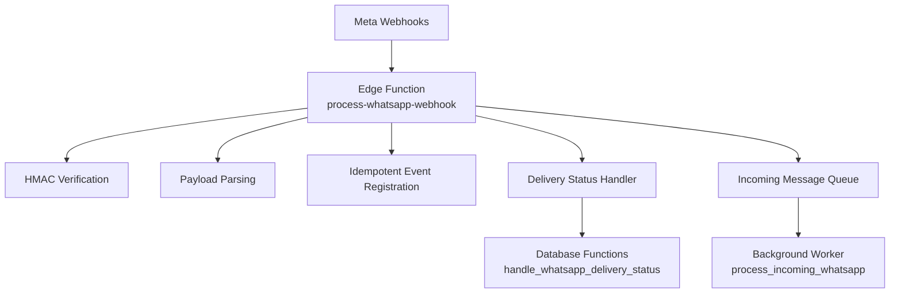
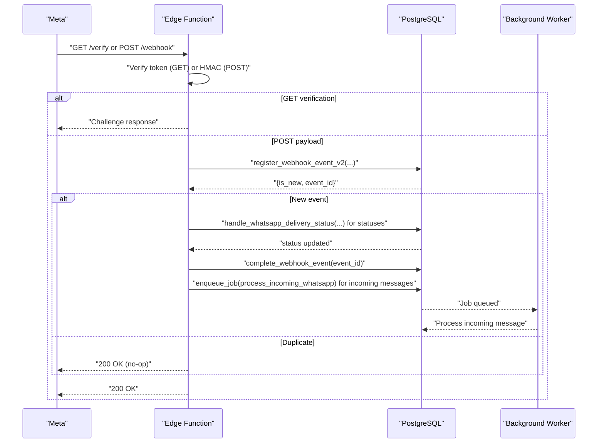
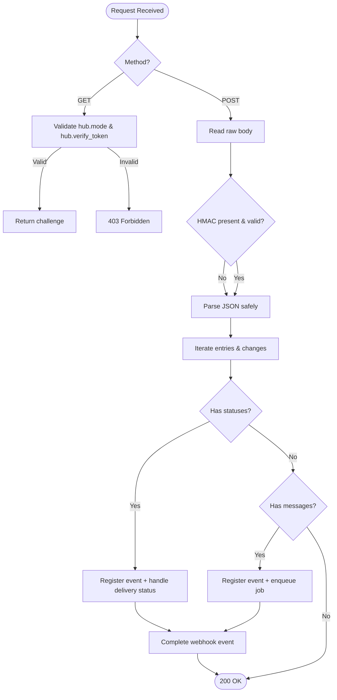
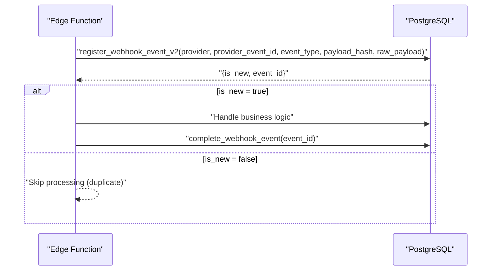
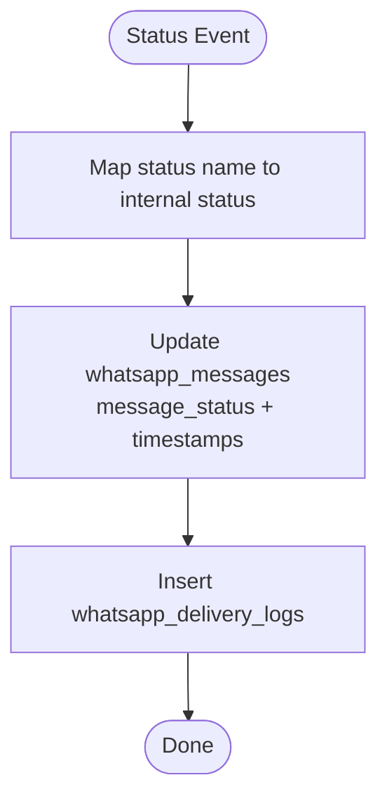
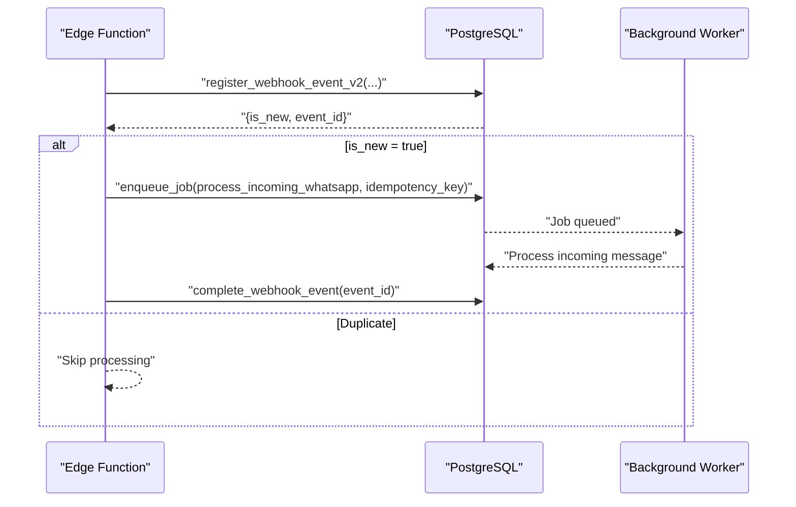
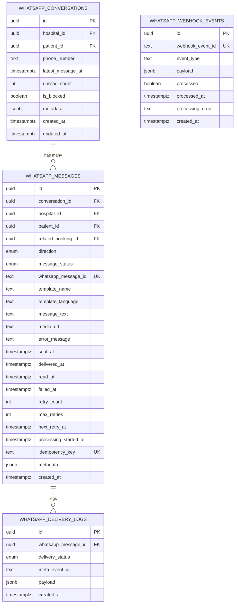
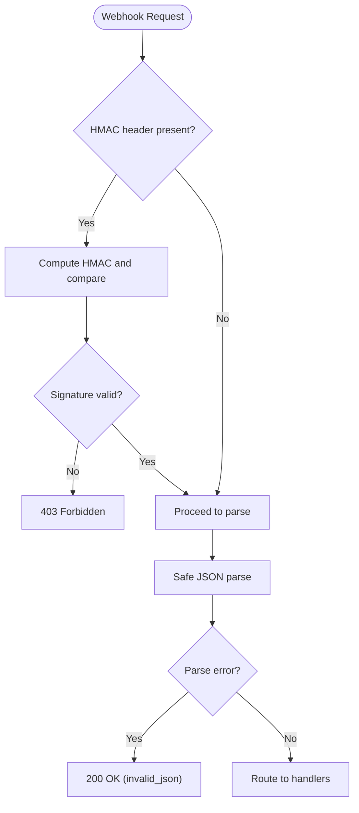
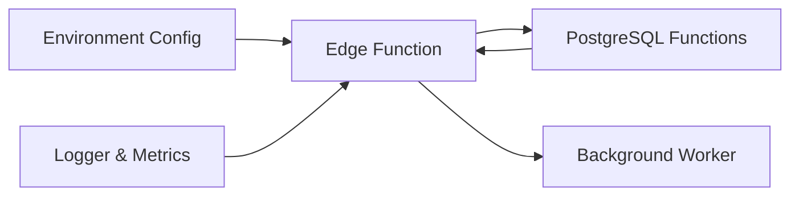

# Webhook Processing

<cite>
**Referenced Files in This Document**
- [process-whatsapp-webhook/index.ts](file://supabase/functions/process-whatsapp-webhook/index.ts)
- [04_whatsapp_messaging_engine.sql](file://supabase/migrations/04_whatsapp_messaging_engine.sql)
- [16_idempotency_hardening.sql](file://supabase/migrations/16_idempotency_hardening.sql)
- [env.ts](file://supabase/functions/_shared/env.ts)
- [logger.ts](file://supabase/functions/_shared/logger.ts)
- [rate_limit.ts](file://supabase/functions/_shared/rate_limit.ts)
- [validation.ts](file://supabase/functions/_shared/validation.ts)
</cite>

## Table of Contents

1. [Introduction](#introduction)
2. [Project Structure](#project-structure)
3. [Core Components](#core-components)
4. [Architecture Overview](#architecture-overview)
5. [Detailed Component Analysis](#detailed-component-analysis)
6. [Dependency Analysis](#dependency-analysis)
7. [Performance Considerations](#performance-considerations)
8. [Troubleshooting Guide](#troubleshooting-guide)
9. [Conclusion](#conclusion)

## Introduction

This document explains the WhatsApp webhook processing system that handles Meta
delivery status updates, message state transitions, and incoming message
notifications. It covers webhook signature verification, payload parsing, event
routing to handlers, message lifecycle tracking from sent to delivered to read,
database updates in whatsapp_messages, and failure handling. Security measures
include webhook verification and rate limiting protection. The relationship
between webhooks and message status updates in the whatsapp_messages table is
detailed with diagrams and step-by-step flows.

## Project Structure

The webhook endpoint is implemented as a Supabase Edge Function that:

- Accepts GET requests for Meta’s verification challenge
- Accepts POST requests for delivery/read receipts and incoming messages
- Verifies HMAC signatures when configured
- Parses payloads safely and routes events to handlers
- Persists idempotent webhook events and updates message statuses via database
  functions
- Logs structured metrics and errors

**Diagram sources**

- [process-whatsapp-webhook/index.ts:124-220](file://supabase/functions/process-whatsapp-webhook/index.ts#L124-L220)
- [process-whatsapp-webhook/index.ts:222-278](file://supabase/functions/process-whatsapp-webhook/index.ts#L222-L278)
- [process-whatsapp-webhook/index.ts:306-493](file://supabase/functions/process-whatsapp-webhook/index.ts#L306-L493)
- [process-whatsapp-webhook/index.ts:495-613](file://supabase/functions/process-whatsapp-webhook/index.ts#L495-L613)
- [04_whatsapp_messaging_engine.sql:512-589](file://supabase/migrations/04_whatsapp_messaging_engine.sql#L512-L589)
- [16_idempotency_hardening.sql:154-284](file://supabase/migrations/16_idempotency_hardening.sql#L154-L284)

**Section sources**

- [process-whatsapp-webhook/index.ts:1-220](file://supabase/functions/process-whatsapp-webhook/index.ts#L1-L220)
- [04_whatsapp_messaging_engine.sql:171-324](file://supabase/migrations/04_whatsapp_messaging_engine.sql#L171-L324)

## Core Components

- Webhook Endpoint: Handles GET verification and POST payloads, performs HMAC
  verification, parses JSON, and routes events.
- Idempotency Layer: Registers webhook events with payload hashing to prevent
  duplicate processing.
- Delivery Status Handler: Updates whatsapp_messages status
  (sent/delivered/read/failed) and timestamps based on Meta statuses.
- Incoming Message Router: Enqueues incoming messages for background processing
  with idempotency keys.
- Environment Configuration: Provides Meta secrets and feature flags used by the
  endpoint.
- Logging and Metrics: Structured logging and metrics collection for
  observability.
- Rate Limiting Utilities: Shared helpers for abuse protection and rate limiting
  (used across services).

**Section sources**

- [process-whatsapp-webhook/index.ts:124-657](file://supabase/functions/process-whatsapp-webhook/index.ts#L124-L657)
- [env.ts:118-127](file://supabase/functions/_shared/env.ts#L118-L127)
- [logger.ts:1-190](file://supabase/functions/_shared/logger.ts#L1-L190)
- [rate_limit.ts:1-124](file://supabase/functions/_shared/rate_limit.ts#L1-L124)
- [validation.ts:1-157](file://supabase/functions/_shared/validation.ts#L1-L157)

## Architecture Overview

The webhook flow ensures secure, idempotent, and observable processing of Meta
events.

**Diagram sources**

- [process-whatsapp-webhook/index.ts:152-211](file://supabase/functions/process-whatsapp-webhook/index.ts#L152-L211)
- [process-whatsapp-webhook/index.ts:222-278](file://supabase/functions/process-whatsapp-webhook/index.ts#L222-L278)
- [process-whatsapp-webhook/index.ts:306-493](file://supabase/functions/process-whatsapp-webhook/index.ts#L306-L493)
- [process-whatsapp-webhook/index.ts:495-613](file://supabase/functions/process-whatsapp-webhook/index.ts#L495-L613)
- [16_idempotency_hardening.sql:154-284](file://supabase/migrations/16_idempotency_hardening.sql#L154-L284)
- [04_whatsapp_messaging_engine.sql:512-589](file://supabase/migrations/04_whatsapp_messaging_engine.sql#L512-L589)

## Detailed Component Analysis

### Webhook Endpoint: Verification and Routing

- GET verification: Validates hub.mode and hub.verify_token against environment
  configuration; returns challenge on success.
- POST handling: Reads raw body, verifies HMAC using X-Hub-Signature-256 and
  META_APP_SECRET if present; safely parses JSON; iterates entries and changes;
  processes statuses and messages.
- Always responds with HTTP 200 to prevent endless retries from Meta even on
  internal failures.

**Diagram sources**

- [process-whatsapp-webhook/index.ts:152-211](file://supabase/functions/process-whatsapp-webhook/index.ts#L152-L211)
- [process-whatsapp-webhook/index.ts:222-278](file://supabase/functions/process-whatsapp-webhook/index.ts#L222-L278)
- [process-whatsapp-webhook/index.ts:306-493](file://supabase/functions/process-whatsapp-webhook/index.ts#L306-L493)
- [process-whatsapp-webhook/index.ts:495-613](file://supabase/functions/process-whatsapp-webhook/index.ts#L495-L613)

**Section sources**

- [process-whatsapp-webhook/index.ts:152-211](file://supabase/functions/process-whatsapp-webhook/index.ts#L152-L211)
- [process-whatsapp-webhook/index.ts:222-278](file://supabase/functions/process-whatsapp-webhook/index.ts#L222-L278)
- [process-whatsapp-webhook/index.ts:306-493](file://supabase/functions/process-whatsapp-webhook/index.ts#L306-L493)
- [process-whatsapp-webhook/index.ts:495-613](file://supabase/functions/process-whatsapp-webhook/index.ts#L495-L613)

### Idempotent Webhook Event Registration

- Uses register_webhook_event_v2 to store provider, provider_event_id,
  event_type, payload_hash, and raw_payload.
- Detects duplicates via payload hash and provider_event_id uniqueness; marks
  duplicates and increments processing attempts.
- Returns is_new flag to decide whether to process further.

**Diagram sources**

- [16_idempotency_hardening.sql:154-284](file://supabase/migrations/16_idempotency_hardening.sql#L154-L284)
- [process-whatsapp-webhook/index.ts:379-419](file://supabase/functions/process-whatsapp-webhook/index.ts#L379-L419)
- [process-whatsapp-webhook/index.ts:516-545](file://supabase/functions/process-whatsapp-webhook/index.ts#L516-L545)

**Section sources**

- [16_idempotency_hardening.sql:154-284](file://supabase/migrations/16_idempotency_hardening.sql#L154-L284)
- [process-whatsapp-webhook/index.ts:379-419](file://supabase/functions/process-whatsapp-webhook/index.ts#L379-L419)
- [process-whatsapp-webhook/index.ts:516-545](file://supabase/functions/process-whatsapp-webhook/index.ts#L516-L545)

### Delivery Status Handling and Message Lifecycle

- Maps Meta status names to internal statuses: delivered, read, sent, failed.
- Calls handle_whatsapp_delivery_status to update whatsapp_messages fields:
  - message_status
  - delivered_at, read_at, failed_at
  - Inserts into whatsapp_delivery_logs with meta_event_id and payload
- Skips updates if message already in terminal states (read,
  permanently_failed).

**Diagram sources**

- [process-whatsapp-webhook/index.ts:357-493](file://supabase/functions/process-whatsapp-webhook/index.ts#L357-L493)
- [04_whatsapp_messaging_engine.sql:512-589](file://supabase/migrations/04_whatsapp_messaging_engine.sql#L512-L589)

**Section sources**

- [process-whatsapp-webhook/index.ts:357-493](file://supabase/functions/process-whatsapp-webhook/index.ts#L357-L493)
- [04_whatsapp_messaging_engine.sql:512-589](file://supabase/migrations/04_whatsapp_messaging_engine.sql#L512-L589)

### Incoming Message Processing

- For each incoming message, registers an idempotent event and enqueues a
  background job with idempotency key incoming_<msgId>.
- Job type is process_incoming_whatsapp; payload includes message and metadata.
- Metrics track incoming webhook counts.

**Diagram sources**

- [process-whatsapp-webhook/index.ts:495-613](file://supabase/functions/process-whatsapp-webhook/index.ts#L495-L613)
- [16_idempotency_hardening.sql:154-284](file://supabase/migrations/16_idempotency_hardening.sql#L154-L284)

**Section sources**

- [process-whatsapp-webhook/index.ts:495-613](file://supabase/functions/process-whatsapp-webhook/index.ts#L495-L613)

### Database Schema: whatsapp_messages and Related Tables

- whatsapp_messages tracks direction, message_status, timestamps (sent_at,
  delivered_at, read_at, failed_at), retry_count, next_retry_at,
  idempotency_key, and metadata.
- whatsapp_delivery_logs records delivery events per message with payload and
  meta_event_id.
- whatsapp_conversations links phone numbers and patients to messages.
- whatsapp_webhook_events stores webhook events for auditing and idempotency.

**Diagram sources**

- [04_whatsapp_messaging_engine.sql:171-324](file://supabase/migrations/04_whatsapp_messaging_engine.sql#L171-L324)

**Section sources**

- [04_whatsapp_messaging_engine.sql:171-324](file://supabase/migrations/04_whatsapp_messaging_engine.sql#L171-L324)

### Security Measures

- Webhook Verification:
  - GET: Validates hub.verify_token against environment variable.
  - POST: Optional HMAC verification using X-Hub-Signature-256 and
    META_APP_SECRET; constant-time comparison to mitigate timing attacks.
- Payload Safety:
  - Safe JSON parse with fallback to 200 OK for invalid JSON to avoid retries.
- Environment Hardening:
  - Required and optional environment variables validated at startup; missing
    critical values cause early failures or safe defaults.
- Rate Limiting Protection:
  - Shared utilities implement sliding window rate limits using
    booking_attempt_logs; while not directly invoked in the webhook handler,
    they provide patterns for protecting endpoints from abuse.

**Diagram sources**

- [process-whatsapp-webhook/index.ts:222-278](file://supabase/functions/process-whatsapp-webhook/index.ts#L222-L278)
- [env.ts:118-127](file://supabase/functions/_shared/env.ts#L118-L127)
- [rate_limit.ts:27-111](file://supabase/functions/_shared/rate_limit.ts#L27-L111)

**Section sources**

- [process-whatsapp-webhook/index.ts:222-278](file://supabase/functions/process-whatsapp-webhook/index.ts#L222-L278)
- [env.ts:118-127](file://supabase/functions/_shared/env.ts#L118-L127)
- [rate_limit.ts:27-111](file://supabase/functions/_shared/rate_limit.ts#L27-L111)

### Error Handling and Observability

- Errors during delivery status processing are logged with messageId and error
  details; processing continues without failing the entire request.
- Webhook completion errors are logged but do not change the 200 OK response to
  Meta.
- Metrics increment webhook.success, webhook.processed, webhook.error, and
  timings for total request duration.
- Structured logs include correlation IDs and context for tracing.

**Section sources**

- [process-whatsapp-webhook/index.ts:442-493](file://supabase/functions/process-whatsapp-webhook/index.ts#L442-L493)
- [process-whatsapp-webhook/index.ts:577-613](file://supabase/functions/process-whatsapp-webhook/index.ts#L577-L613)
- [process-whatsapp-webhook/index.ts:616-657](file://supabase/functions/process-whatsapp-webhook/index.ts#L616-L657)
- [logger.ts:1-190](file://supabase/functions/_shared/logger.ts#L1-L190)

## Dependency Analysis

The webhook handler depends on:

- Environment configuration for Meta secrets and feature flags
- Database functions for idempotent event registration and delivery status
  updates
- Background worker jobs for incoming message processing
- Shared utilities for logging, metrics, and validation

**Diagram sources**

- [env.ts:118-127](file://supabase/functions/_shared/env.ts#L118-L127)
- [process-whatsapp-webhook/index.ts:124-220](file://supabase/functions/process-whatsapp-webhook/index.ts#L124-L220)
- [process-whatsapp-webhook/index.ts:379-493](file://supabase/functions/process-whatsapp-webhook/index.ts#L379-L493)
- [process-whatsapp-webhook/index.ts:495-613](file://supabase/functions/process-whatsapp-webhook/index.ts#L495-L613)

**Section sources**

- [env.ts:118-127](file://supabase/functions/_shared/env.ts#L118-L127)
- [process-whatsapp-webhook/index.ts:124-220](file://supabase/functions/process-whatsapp-webhook/index.ts#L124-L220)
- [process-whatsapp-webhook/index.ts:379-493](file://supabase/functions/process-whatsapp-webhook/index.ts#L379-L493)
- [process-whatsapp-webhook/index.ts:495-613](file://supabase/functions/process-whatsapp-webhook/index.ts#L495-L613)

## Performance Considerations

- Idempotency via payload hashing prevents redundant processing and reduces
  database writes.
- SKIP LOCKED and batch fetching in related functions ensure efficient
  concurrent access.
- Large webhook batches are warned but still processed; consider batching
  strategies if needed.
- Metrics and timing help identify slow paths and optimize hotspots.

[No sources needed since this section provides general guidance]

## Troubleshooting Guide

Common issues and resolutions:

- Invalid JSON payload: Handled gracefully with 200 OK; check logs for
  invalid_json warnings.
- HMAC verification failure: Ensure META_APP_SECRET matches Meta app secret;
  verify X-Hub-Signature-256 header presence.
- Duplicate events: Idempotency layer detects duplicates; review webhook_events
  for duplicate_detected flags.
- Delivery status not updating: Confirm whatsapp_message_id exists and is not in
  terminal state; check handle_whatsapp_delivery_status logs.
- Incoming message not processed: Verify enqueue_job succeeded and background
  worker is running; check job queue and idempotency keys.

**Section sources**

- [process-whatsapp-webhook/index.ts:266-278](file://supabase/functions/process-whatsapp-webhook/index.ts#L266-L278)
- [process-whatsapp-webhook/index.ts:234-256](file://supabase/functions/process-whatsapp-webhook/index.ts#L234-L256)
- [process-whatsapp-webhook/index.ts:408-419](file://supabase/functions/process-whatsapp-webhook/index.ts#L408-L419)
- [process-whatsapp-webhook/index.ts:541-545](file://supabase/functions/process-whatsapp-webhook/index.ts#L541-L545)
- [04_whatsapp_messaging_engine.sql:512-589](file://supabase/migrations/04_whatsapp_messaging_engine.sql#L512-L589)

## Conclusion

The WhatsApp webhook processing system provides secure, idempotent, and
observable handling of Meta delivery status updates and incoming messages. It
integrates tightly with PostgreSQL functions to maintain accurate message
lifecycles in whatsapp_messages and supports robust error handling and
monitoring. Security is enforced through webhook verification and rate limiting
utilities, ensuring resilience against abuse and duplication.

[No sources needed since this section summarizes without analyzing specific
files]
