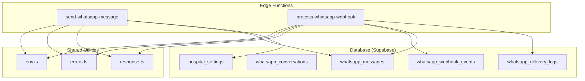
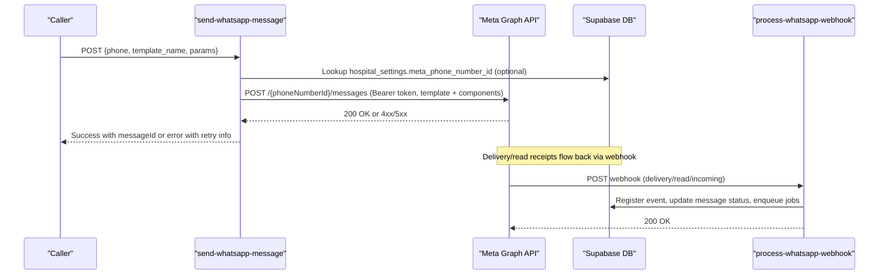
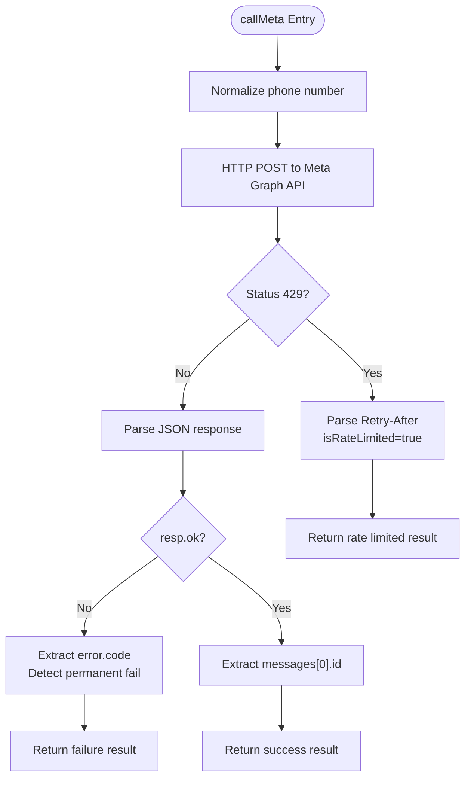
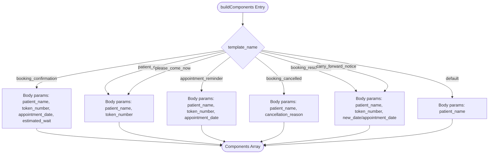
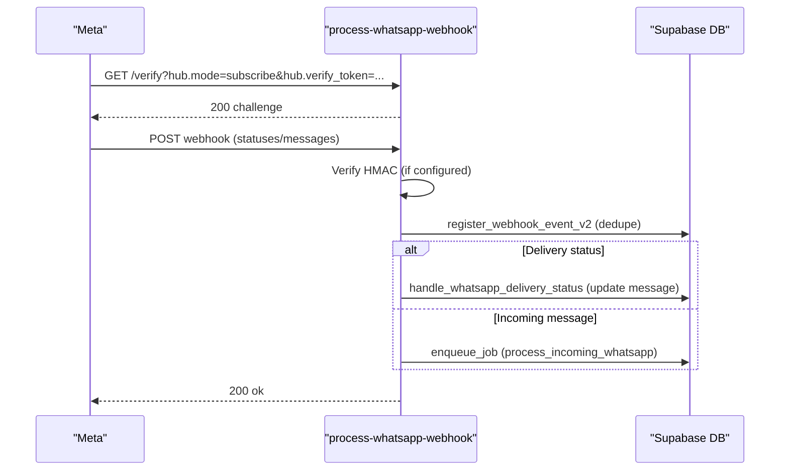
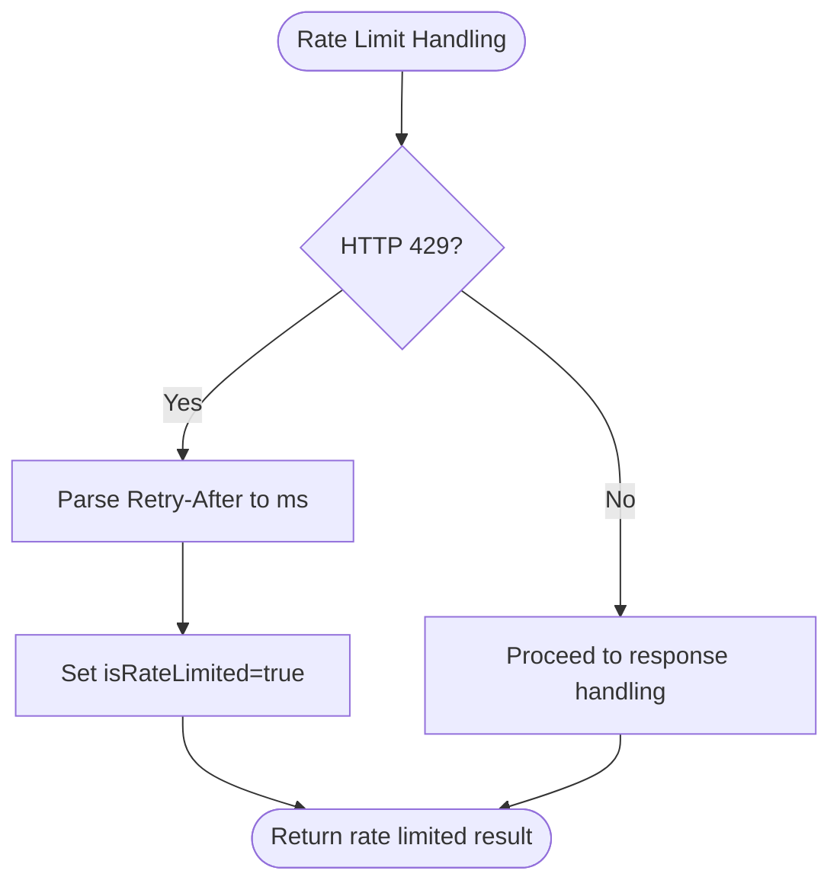
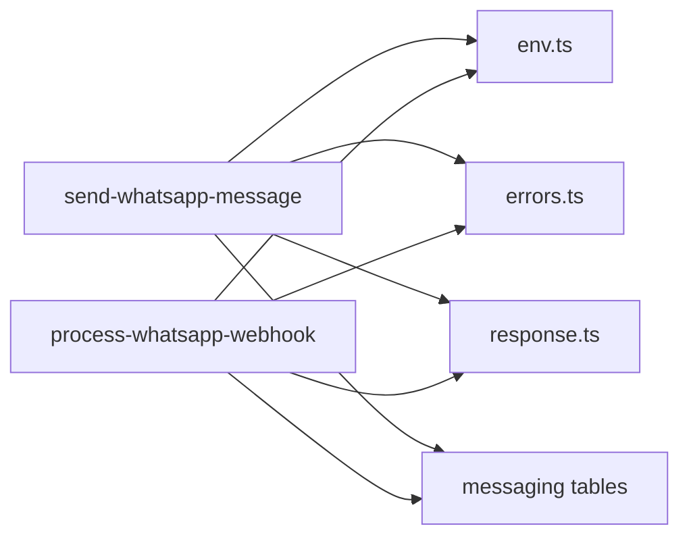

# WhatsApp Integration

<cite>
**Referenced Files in This Document**
- [send-whatsapp-message/index.ts](file://supabase/functions/send-whatsapp-message/index.ts)
- [process-whatsapp-webhook/index.ts](file://supabase/functions/process-whatsapp-webhook/index.ts)
- [env.ts](file://supabase/functions/_shared/env.ts)
- [errors.ts](file://supabase/functions/_shared/errors.ts)
- [response.ts](file://supabase/functions/_shared/response.ts)
- [04_whatsapp_messaging_engine.sql](file://supabase/migrations/04_whatsapp_messaging_engine.sql)
- [12_hospital_configuration_engine.sql](file://supabase/migrations/12_hospital_configuration_engine.sql)
</cite>

## Table of Contents

1. [Introduction](#introduction)
2. [Project Structure](#project-structure)
3. [Core Components](#core-components)
4. [Architecture Overview](#architecture-overview)
5. [Detailed Component Analysis](#detailed-component-analysis)
6. [Dependency Analysis](#dependency-analysis)
7. [Performance Considerations](#performance-considerations)
8. [Troubleshooting Guide](#troubleshooting-guide)
9. [Conclusion](#conclusion)
10. [Appendices](#appendices)

## Introduction

This document explains the WhatsApp Business API integration implemented as
Supabase Edge Functions. It covers:

- Meta Cloud API client implementation for sending template-based messages
- Authentication using access tokens and phone number IDs, with optional
  hospital-specific overrides
- Message sending workflows, including parameter substitution and component
  building
- Rate limiting handling with retry-after logic, permanent failure detection,
  and network timeout management
- Webhook processing for delivery/read receipts and incoming messages
- Security considerations including worker secret validation and credential
  management
- Hospital-specific configuration for per-hospital Meta phone number IDs

## Project Structure

The WhatsApp integration spans two primary functions and supporting shared
utilities:

- send-whatsapp-message: Outbound message sender to Meta Cloud API
- process-whatsapp-webhook: Inbound webhook handler for Meta events
- Shared utilities: environment validation, error types, standardized responses
- Database schema: messaging engine tables, templates, conversations, delivery
  logs, and retry scheduling

**Diagram sources**

- [send-whatsapp-message/index.ts:1-583](file://supabase/functions/send-whatsapp-message/index.ts#L1-L583)
- [process-whatsapp-webhook/index.ts:1-657](file://supabase/functions/process-whatsapp-webhook/index.ts#L1-L657)
- [env.ts:118-127](file://supabase/functions/_shared/env.ts#L118-L127)
- [04_whatsapp_messaging_engine.sql:171-231](file://supabase/migrations/04_whatsapp_messaging_engine.sql#L171-L231)
- [12_hospital_configuration_engine.sql:115-131](file://supabase/migrations/12_hospital_configuration_engine.sql#L115-L131)

**Section sources**

- [send-whatsapp-message/index.ts:1-583](file://supabase/functions/send-whatsapp-message/index.ts#L1-L583)
- [process-whatsapp-webhook/index.ts:1-657](file://supabase/functions/process-whatsapp-webhook/index.ts#L1-L657)
- [env.ts:118-127](file://supabase/functions/_shared/env.ts#L118-L127)
- [04_whatsapp_messaging_engine.sql:171-231](file://supabase/migrations/04_whatsapp_messaging_engine.sql#L171-L231)
- [12_hospital_configuration_engine.sql:115-131](file://supabase/migrations/12_hospital_configuration_engine.sql#L115-L131)

## Core Components

- Meta Cloud API client: Builds and sends HTTP POST requests to
  graph.facebook.com with Authorization header and JSON payload containing
  template name, language, and components. Uses a 15-second network timeout.
- Template builder: Maps supported template names to structured body parameters
  for text placeholders.
- Webhook processor: Validates Meta verification challenge, verifies HMAC
  signatures when configured, deduplicates events, and dispatches delivery
  status updates and incoming messages.
- Environment and security: Reads required Meta credentials from environment
  variables; validates worker secret via constant-time comparison to prevent
  timing attacks.
- Error handling: Centralized typed errors and response builders standardize
  success/error payloads and include correlation IDs and timestamps.

**Section sources**

- [send-whatsapp-message/index.ts:198-324](file://supabase/functions/send-whatsapp-message/index.ts#L198-L324)
- [send-whatsapp-message/index.ts:94-187](file://supabase/functions/send-whatsapp-message/index.ts#L94-L187)
- [process-whatsapp-webhook/index.ts:31-91](file://supabase/functions/process-whatsapp-webhook/index.ts#L31-L91)
- [process-whatsapp-webhook/index.ts:152-211](file://supabase/functions/process-whatsapp-webhook/index.ts#L152-L211)
- [env.ts:118-127](file://supabase/functions/_shared/env.ts#L118-L127)
- [errors.ts:70-104](file://supabase/functions/_shared/errors.ts#L70-L104)
- [response.ts:44-92](file://supabase/functions/_shared/response.ts#L44-L92)

## Architecture Overview

The system integrates outbound messaging and inbound webhooks with robust error
handling and database persistence.

**Diagram sources**

- [send-whatsapp-message/index.ts:198-324](file://supabase/functions/send-whatsapp-message/index.ts#L198-L324)
- [send-whatsapp-message/index.ts:408-448](file://supabase/functions/send-whatsapp-message/index.ts#L408-L448)
- [process-whatsapp-webhook/index.ts:357-493](file://supabase/functions/process-whatsapp-webhook/index.ts#L357-L493)
- [process-whatsapp-webhook/index.ts:495-612](file://supabase/functions/process-whatsapp-webhook/index.ts#L495-L612)

## Detailed Component Analysis

### Meta Cloud API Client and Sending Workflow

- Endpoint: POST to graph.facebook.com/{apiVersion}/{phoneNumberId}/messages
- Headers: Authorization Bearer token; Content-Type application/json
- Payload: messaging_product whatsapp, recipient_type individual, type template,
  template name, language code, and components array
- Timeout: AbortSignal.timeout(15_000) for network resilience
- Response handling:
  - 429 rate limit: parse Retry-After header into milliseconds; mark
    isRateLimited true
  - Non-ok responses: parse error object; detect permanent failures by specific
    Meta error codes or HTTP 400
  - Success: extract messages[0].id as messageId

**Diagram sources**

- [send-whatsapp-message/index.ts:198-324](file://supabase/functions/send-whatsapp-message/index.ts#L198-L324)

**Section sources**

- [send-whatsapp-message/index.ts:198-324](file://supabase/functions/send-whatsapp-message/index.ts#L198-L324)

### Template-Based Messaging System

- Supported templates: booking_confirmation, patient_called, please_come_now,
  appointment_reminder, booking_cancelled, booking_rescheduled,
  carry_forward_notice, feedback_request, consultation_started,
  consultation_completed
- Parameter substitution: Each template maps to a body component with an ordered
  list of text parameters derived from payload fields like patient_name,
  token_number, appointment_date, new_date, estimated_wait, cancellation_reason
- Default values: Missing fields are replaced with safe defaults (e.g.,
  "Patient", empty strings, "soon")
- Validation: Only allowed templates can be used; invalid templates raise a
  validation error

**Diagram sources**

- [send-whatsapp-message/index.ts:94-187](file://supabase/functions/send-whatsapp-message/index.ts#L94-L187)

**Section sources**

- [send-whatsapp-message/index.ts:20-31](file://supabase/functions/send-whatsapp-message/index.ts#L20-L31)
- [send-whatsapp-message/index.ts:94-187](file://supabase/functions/send-whatsapp-message/index.ts#L94-L187)

### Webhook Processing Flow

- GET verification: Responds with hub.challenge if hub.verify_token matches
  configured value
- POST processing:
  - HMAC verification: If META_APP_SECRET is set, verify X-Hub-Signature-256
    against raw body
  - Safe JSON parsing: Invalid JSON returns 200 ok to avoid retries
  - Deduplication: register_webhook_event_v2 ensures idempotent processing
  - Delivery statuses: Map Meta status names to internal states and update
    messages via handle_whatsapp_delivery_status
  - Incoming messages: Enqueue background job with idempotency key based on
    message ID
  - Always return 200 to Meta even on internal processing failures to prevent
    endless retries

**Diagram sources**

- [process-whatsapp-webhook/index.ts:152-211](file://supabase/functions/process-whatsapp-webhook/index.ts#L152-L211)
- [process-whatsapp-webhook/index.ts:222-256](file://supabase/functions/process-whatsapp-webhook/index.ts#L222-L256)
- [process-whatsapp-webhook/index.ts:357-493](file://supabase/functions/process-whatsapp-webhook/index.ts#L357-L493)
- [process-whatsapp-webhook/index.ts:495-612](file://supabase/functions/process-whatsapp-webhook/index.ts#L495-L612)

**Section sources**

- [process-whatsapp-webhook/index.ts:152-211](file://supabase/functions/process-whatsapp-webhook/index.ts#L152-L211)
- [process-whatsapp-webhook/index.ts:222-256](file://supabase/functions/process-whatsapp-webhook/index.ts#L222-L256)
- [process-whatsapp-webhook/index.ts:357-493](file://supabase/functions/process-whatsapp-webhook/index.ts#L357-L493)
- [process-whatsapp-webhook/index.ts:495-612](file://supabase/functions/process-whatsapp-webhook/index.ts#L495-L612)

### Rate Limiting and Retry Logic

- Network timeout: 15 seconds via AbortSignal.timeout to avoid hanging requests
- Rate limit detection: HTTP 429 triggers isRateLimited=true; Retry-After header
  parsed to milliseconds
- Permanent failure detection: Specific Meta error codes and HTTP 400 treated as
  permanent fails
- Retry scheduling: Database function schedule_whatsapp_retry implements
  exponential backoff capped at 1440 minutes; marks permanently_failed after max
  retries

**Diagram sources**

- [send-whatsapp-message/index.ts:248-263](file://supabase/functions/send-whatsapp-message/index.ts#L248-L263)
- [04_whatsapp_messaging_engine.sql:598-658](file://supabase/migrations/04_whatsapp_messaging_engine.sql#L598-L658)

**Section sources**

- [send-whatsapp-message/index.ts:248-263](file://supabase/functions/send-whatsapp-message/index.ts#L248-L263)
- [04_whatsapp_messaging_engine.sql:598-658](file://supabase/migrations/04_whatsapp_messaging_engine.sql#L598-L658)

### Hospital-Specific Configuration

- Per-hospital Meta phone number ID: Queried from
  hospital_settings.meta_phone_number_id when hospital_id is provided; falls
  back to global env variable if not present
- Feature flags and notification toggles: send_whatsapp_confirmation,
  send_whatsapp_reminder, send_feedback_request stored in hospital settings
- Defaults and constraints: Numeric checks and boolean defaults ensure
  consistent behavior across hospitals

**Section sources**

- [send-whatsapp-message/index.ts:408-448](file://supabase/functions/send-whatsapp-message/index.ts#L408-L448)
- [12_hospital_configuration_engine.sql:115-131](file://supabase/migrations/12_hospital_configuration_engine.sql#L115-L131)
- [12_hospital_configuration_engine.sql:166-174](file://supabase/migrations/12_hospital_configuration_engine.sql#L166-L174)

### Security Considerations

- Worker secret validation: Constant-time comparison prevents timing attacks;
  missing or mismatched secret returns 403 Forbidden
- Webhook HMAC verification: Optional but recommended; uses crypto.subtle to
  compute SHA-256 signature and compare safely
- Credential management: Meta access token, app secret, webhook verify token,
  and phone number ID loaded from environment variables; validated at module
  load time

**Section sources**

- [send-whatsapp-message/index.ts:76-92](file://supabase/functions/send-whatsapp-message/index.ts#L76-L92)
- [send-whatsapp-message/index.ts:366-386](file://supabase/functions/send-whatsapp-message/index.ts#L366-L386)
- [process-whatsapp-webhook/index.ts:31-91](file://supabase/functions/process-whatsapp-webhook/index.ts#L31-L91)
- [process-whatsapp-webhook/index.ts:222-256](file://supabase/functions/process-whatsapp-webhook/index.ts#L222-L256)
- [env.ts:118-127](file://supabase/functions/_shared/env.ts#L118-L127)

## Dependency Analysis

- send-whatsapp-message depends on:
  - Env for Meta credentials and API version
  - Errors and Response for standardized error handling
  - Database for hospital settings lookup and message tracking
- process-whatsapp-webhook depends on:
  - Env for webhook verification token and app secret
  - Database for event registration, message status updates, and job enqueuing
- Shared utilities provide consistent error types and response formatting across
  both functions

**Diagram sources**

- [send-whatsapp-message/index.ts:7-16](file://supabase/functions/send-whatsapp-message/index.ts#L7-L16)
- [process-whatsapp-webhook/index.ts:16-22](file://supabase/functions/process-whatsapp-webhook/index.ts#L16-L22)
- [env.ts:118-127](file://supabase/functions/_shared/env.ts#L118-L127)
- [04_whatsapp_messaging_engine.sql:171-231](file://supabase/migrations/04_whatsapp_messaging_engine.sql#L171-L231)

**Section sources**

- [send-whatsapp-message/index.ts:7-16](file://supabase/functions/send-whatsapp-message/index.ts#L7-L16)
- [process-whatsapp-webhook/index.ts:16-22](file://supabase/functions/process-whatsapp-webhook/index.ts#L16-L22)
- [env.ts:118-127](file://supabase/functions/_shared/env.ts#L118-L127)
- [04_whatsapp_messaging_engine.sql:171-231](file://supabase/migrations/04_whatsapp_messaging_engine.sql#L171-L231)

## Performance Considerations

- Network timeout: 15 seconds prevents long-running requests that could block
  workers
- Rate limiting: Immediate detection of 429 responses with Retry-After parsing
  avoids unnecessary retries
- Database indexing: Messages and delivery logs are indexed for efficient
  querying and worker fetching
- Exponential backoff: Retry scheduling uses power-of-two intervals capped at
  1440 minutes to reduce load during outages
- Webhook idempotency: Event registration prevents duplicate processing under
  high throughput

[No sources needed since this section provides general guidance]

## Troubleshooting Guide

Common issues and resolutions:

- Missing worker secret: Ensure X-Worker-Secret header matches configured
  WORKER_SECRET; otherwise endpoint returns 403
- Invalid template: Only allowed templates are accepted; unsupported templates
  raise validation errors
- Rate limiting: On 429, respect Retry-After header; implement client-side
  backoff
- Permanent failures: Certain Meta error codes indicate non-retryable issues;
  mark messages as permanently_failed and notify stakeholders
- Webhook HMAC failures: Configure META_APP_SECRET and ensure correct signature
  header; invalid signatures return 403
- Database errors: Use centralized error types to log context and determine
  retryability

**Section sources**

- [send-whatsapp-message/index.ts:366-386](file://supabase/functions/send-whatsapp-message/index.ts#L366-L386)
- [send-whatsapp-message/index.ts:393-406](file://supabase/functions/send-whatsapp-message/index.ts#L393-L406)
- [send-whatsapp-message/index.ts:248-307](file://supabase/functions/send-whatsapp-message/index.ts#L248-L307)
- [process-whatsapp-webhook/index.ts:222-256](file://supabase/functions/process-whatsapp-webhook/index.ts#L222-L256)
- [errors.ts:272-322](file://supabase/functions/_shared/errors.ts#L272-L322)

## Conclusion

The WhatsApp integration provides a robust, secure, and scalable solution for
hospital messaging through Meta’s Cloud API. It supports template-based
communication, handles rate limits and permanent failures gracefully, and
maintains comprehensive audit trails via webhooks and database records.
Hospital-specific configurations enable multi-tenant deployments with
per-hospital Meta phone number IDs and feature flags. Security is enforced
through worker secrets and optional HMAC verification, while performance is
optimized with timeouts, indexing, and exponential backoff.

[No sources needed since this section summarizes without analyzing specific
files]

## Appendices

### Example: Sending a Message

- Endpoint: POST to send-whatsapp-message
- Required headers: X-Worker-Secret
- Request body fields: phone, template_name, and template-specific parameters
  such as patient_name, token_number, appointment_date, new_date,
  estimated_wait, cancellation_reason
- Response: Success includes sent flag and messageId; errors include code,
  message, and retryable flag

**Section sources**

- [send-whatsapp-message/index.ts:47-74](file://supabase/functions/send-whatsapp-message/index.ts#L47-L74)
- [send-whatsapp-message/index.ts:481-559](file://supabase/functions/send-whatsapp-message/index.ts#L481-L559)

### Example: Handling Different Response Codes

- 200 OK: Message sent successfully; extract messageId
- 429 Too Many Requests: Parse Retry-After and implement backoff; mark as rate
  limited
- 400 Bad Request: Treat as permanent failure; log error details
- Network errors: Wrap in error response with retryable=false unless upstream
  indicates otherwise

**Section sources**

- [send-whatsapp-message/index.ts:248-324](file://supabase/functions/send-whatsapp-message/index.ts#L248-L324)

### Managing Hospital-Specific Configurations

- Set hospital_settings.meta_phone_number_id for per-hospital Meta phone number
  IDs
- Toggle notifications via send_whatsapp_confirmation, send_whatsapp_reminder,
  send_feedback_request
- Use hospital_id in request to override global Meta phone number ID

**Section sources**

- [12_hospital_configuration_engine.sql:115-131](file://supabase/migrations/12_hospital_configuration_engine.sql#L115-L131)
- [12_hospital_configuration_engine.sql:166-174](file://supabase/migrations/12_hospital_configuration_engine.sql#L166-L174)
- [send-whatsapp-message/index.ts:408-448](file://supabase/functions/send-whatsapp-message/index.ts#L408-L448)
