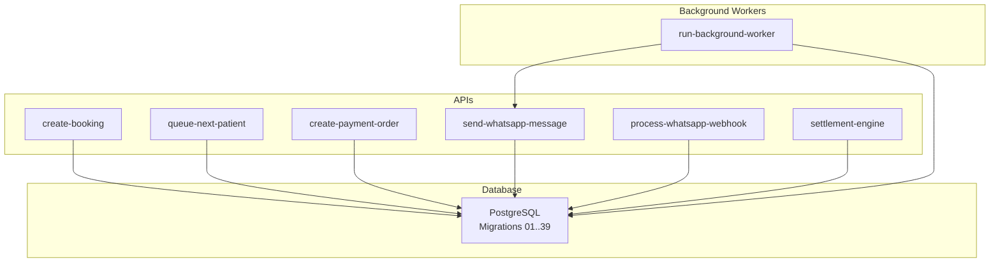
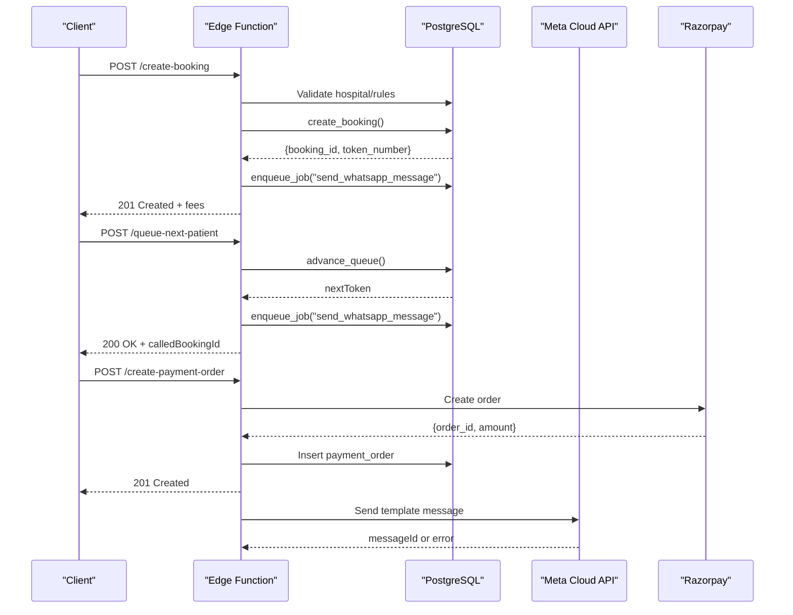
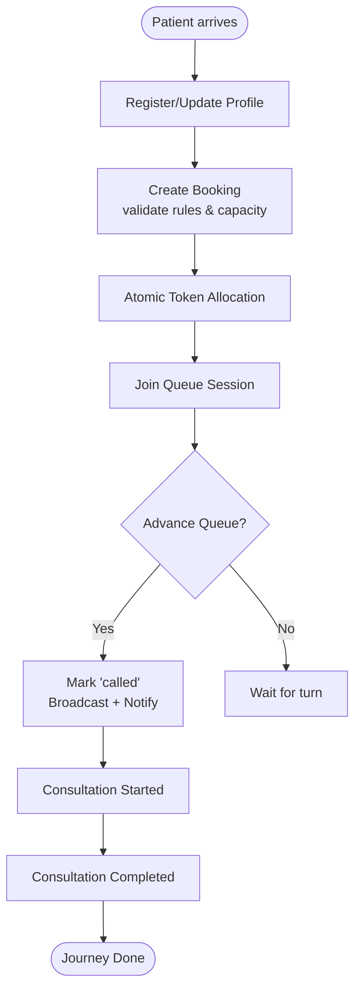
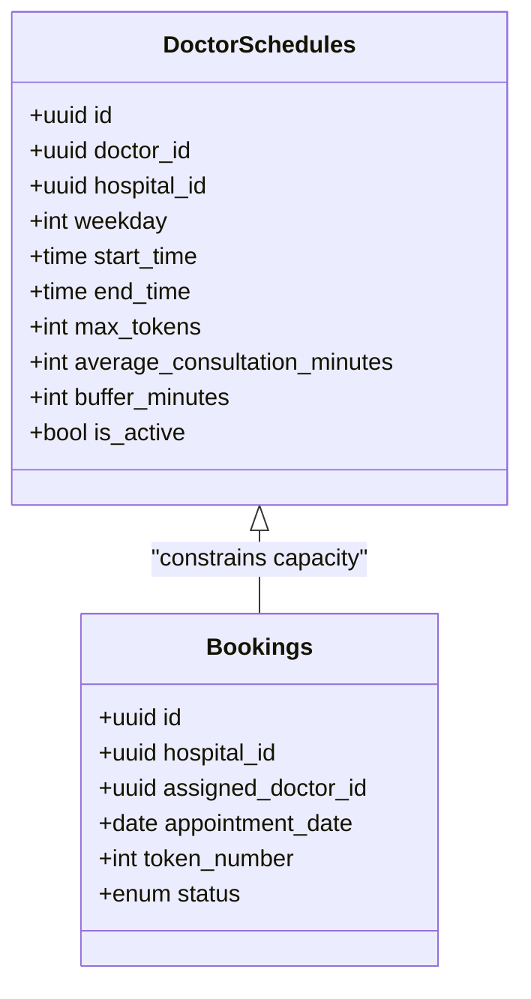
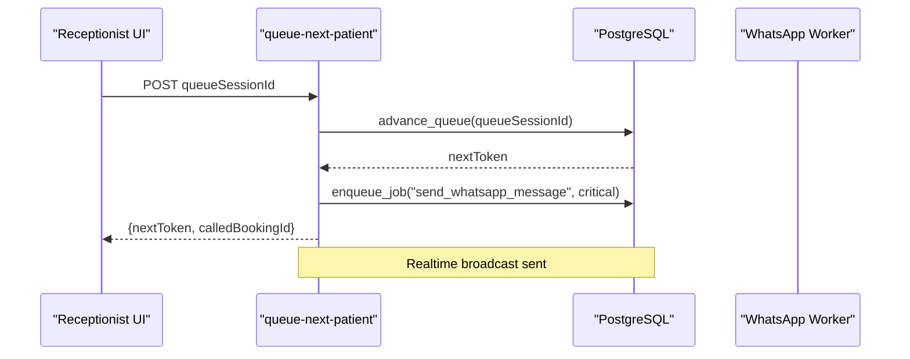
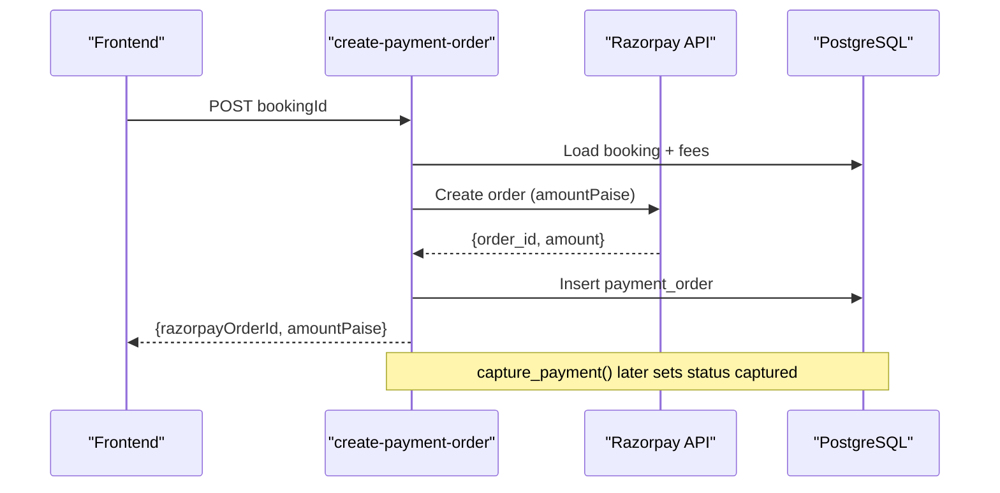
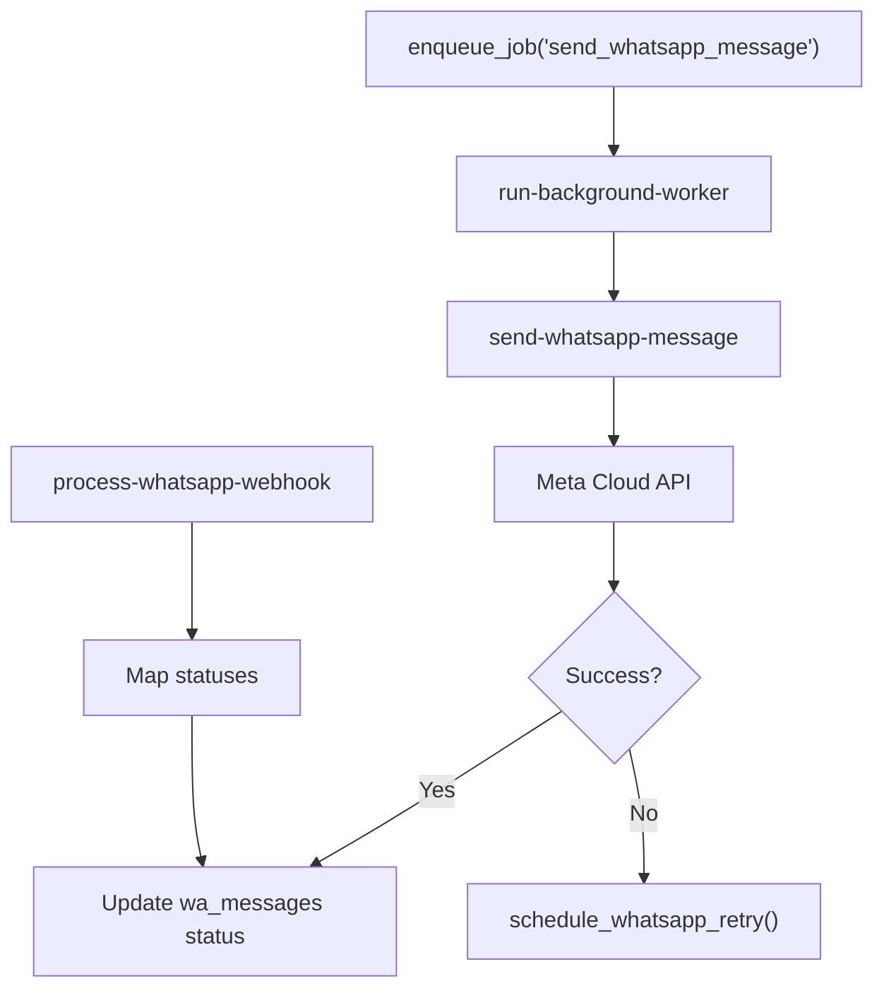
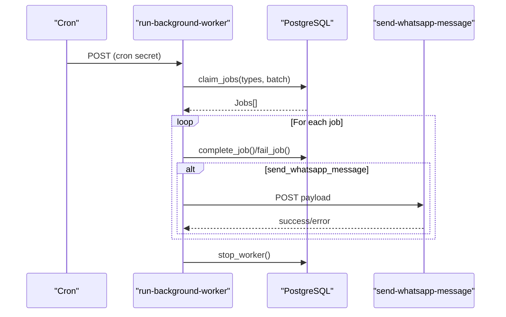
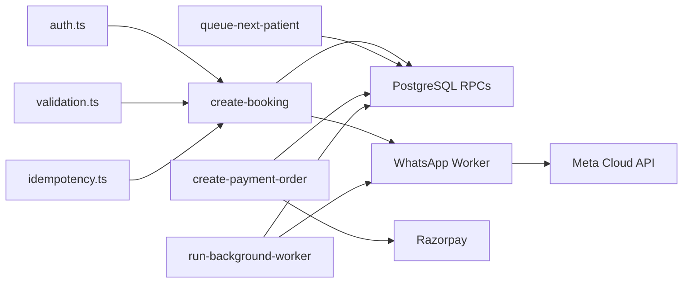

# Core Features

<cite>
**Referenced Files in This Document**
- [types.ts](file://supabase/functions/_shared/types.ts)
- [01_foundation.sql](file://supabase/migrations/01_foundation.sql)
- [02_atomic_token_engine_&_bookings.sql](file://supabase/migrations/02_atomic_token_engine_&_bookings.sql)
- [03_doctorscheduling&slotengine.sql](file://supabase/migrations/03_doctorscheduling&slotengine.sql)
- [04_whatsapp_messaging_engine.sql](file://supabase/migrations/04_whatsapp_messaging_engine.sql)
- [06_background_job_queue.sql](file://supabase/migrations/06_background_job_queue.sql)
- [13_payment_engine.sql](file://supabase/migrations/13_payment_engine.sql)
- [create-booking/index.ts](file://supabase/functions/create-booking/index.ts)
- [queue-next-patient/index.ts](file://supabase/functions/queue-next-patient/index.ts)
- [send-whatsapp-message/index.ts](file://supabase/functions/send-whatsapp-message/index.ts)
- [process-whatsapp-webhook/index.ts](file://supabase/functions/process-whatsapp-webhook/index.ts)
- [run-background-worker/index.ts](file://supabase/functions/run-background-worker/index.ts)
- [create-payment-order/index.ts](file://supabase/functions/create-payment-order/index.ts)
</cite>

## Table of Contents

1. [Introduction](#introduction)
2. [Project Structure](#project-structure)
3. [Core Components](#core-components)
4. [Architecture Overview](#architecture-overview)
5. [Detailed Component Analysis](#detailed-component-analysis)
6. [Dependency Analysis](#dependency-analysis)
7. [Performance Considerations](#performance-considerations)
8. [Troubleshooting Guide](#troubleshooting-guide)
9. [Conclusion](#conclusion)

## Introduction

This document explains the core features of the Setura Hospital OS, covering the
end-to-end patient journey from registration to consultation completion. It
details the booking engine (appointment scheduling, conflict detection, capacity
management), queue management (token allocation, real-time status updates,
priority processing), payment processing (fee calculation, Razorpay integration,
settlement engine), communication system (WhatsApp messaging, templates,
delivery tracking), and background processing (job queuing and workers). For
each feature, it provides implementation details, API endpoints, data models,
and integration points with other components, along with practical examples and
error handling scenarios.

## Project Structure

The system is organized around Supabase Edge Functions for APIs and background
workers, PostgreSQL migrations for schema and business logic, and shared
utilities for auth, validation, logging, metrics, tracing, and idempotency.

**Diagram sources**

- [create-booking/index.ts:1-666](file://supabase/functions/create-booking/index.ts#L1-L666)
- [queue-next-patient/index.ts:1-409](file://supabase/functions/queue-next-patient/index.ts#L1-L409)
- [create-payment-order/index.ts:1-407](file://supabase/functions/create-payment-order/index.ts#L1-L407)
- [send-whatsapp-message/index.ts:1-583](file://supabase/functions/send-whatsapp-message/index.ts#L1-L583)
- [process-whatsapp-webhook/index.ts:1-657](file://supabase/functions/process-whatsapp-webhook/index.ts#L1-L657)
- [run-background-worker/index.ts:1-454](file://supabase/functions/run-background-worker/index.ts#L1-L454)
- [01_foundation.sql:1-792](file://supabase/migrations/01_foundation.sql#L1-L792)
- [02_atomic_token_engine_&_bookings.sql:1-827](file://supabase/migrations/02_atomic_token_engine_&_bookings.sql#L1-L827)
- [03_doctorscheduling&slotengine.sql:1-795](file://supabase/migrations/03_doctorscheduling&slotengine.sql#L1-L795)
- [04_whatsapp_messaging_engine.sql:1-852](file://supabase/migrations/04_whatsapp_messaging_engine.sql#L1-L852)
- [06_background_job_queue.sql:1-550](file://supabase/migrations/06_background_job_queue.sql#L1-L550)
- [13_payment_engine.sql:1-962](file://supabase/migrations/13_payment_engine.sql#L1-L962)

**Section sources**

- [01_foundation.sql:1-792](file://supabase/migrations/01_foundation.sql#L1-L792)
- [02_atomic_token_engine_&_bookings.sql:1-827](file://supabase/migrations/02_atomic_token_engine_&_bookings.sql#L1-L827)
- [03_doctorscheduling&slotengine.sql:1-795](file://supabase/migrations/03_doctorscheduling&slotengine.sql#L1-L795)
- [04_whatsapp_messaging_engine.sql:1-852](file://supabase/migrations/04_whatsapp_messaging_engine.sql#L1-L852)
- [06_background_job_queue.sql:1-550](file://supabase/migrations/06_background_job_queue.sql#L1-L550)
- [13_payment_engine.sql:1-962](file://supabase/migrations/13_payment_engine.sql#L1-L962)

## Core Components

- Patient registration and profile management are enforced by foundation tables
  and policies.
- Booking engine creates atomic tokens, enforces hospital rules, doctor
  availability, and capacity limits.
- Queue management advances patients using priority and token ordering with
  real-time broadcasts.
- Payment engine integrates Razorpay, captures payments, records ledger entries,
  and supports refunds.
- Communication system sends WhatsApp messages via Meta Cloud API with template
  support and delivery tracking.
- Background worker processes jobs asynchronously with retries, dead-letter
  handling, and heartbeat monitoring.

**Section sources**

- [types.ts:1-329](file://supabase/functions/_shared/types.ts#L1-L329)
- [01_foundation.sql:1-792](file://supabase/migrations/01_foundation.sql#L1-L792)
- [02_atomic_token_engine_&_bookings.sql:1-827](file://supabase/migrations/02_atomic_token_engine_&_bookings.sql#L1-L827)
- [03_doctorscheduling&slotengine.sql:1-795](file://supabase/migrations/03_doctorscheduling&slotengine.sql#L1-L795)
- [13_payment_engine.sql:1-962](file://supabase/migrations/13_payment_engine.sql#L1-L962)
- [04_whatsapp_messaging_engine.sql:1-852](file://supabase/migrations/04_whatsapp_messaging_engine.sql#L1-L852)
- [06_background_job_queue.sql:1-550](file://supabase/migrations/06_background_job_queue.sql#L1-L550)

## Architecture Overview

The architecture uses Edge Functions as entry points that validate requests,
enforce roles, and call database RPCs or external services. Data integrity and
concurrency are handled in SQL functions and constraints. Background workers
process queued jobs and integrate with messaging and analytics.

**Diagram sources**

- [create-booking/index.ts:1-666](file://supabase/functions/create-booking/index.ts#L1-L666)
- [queue-next-patient/index.ts:1-409](file://supabase/functions/queue-next-patient/index.ts#L1-L409)
- [create-payment-order/index.ts:1-407](file://supabase/functions/create-payment-order/index.ts#L1-L407)
- [send-whatsapp-message/index.ts:1-583](file://supabase/functions/send-whatsapp-message/index.ts#L1-L583)
- [02_atomic_token_engine_&_bookings.sql:1-827](file://supabase/migrations/02_atomic_token_engine_&_bookings.sql#L1-L827)
- [13_payment_engine.sql:1-962](file://supabase/migrations/13_payment_engine.sql#L1-L962)

## Detailed Component Analysis

### Patient Journey: Registration to Consultation Completion

- Registration: Patients are created or updated by phone normalization and
  deduplication; profiles and roles are managed with RLS policies.
- Booking: The create-booking function validates hospital settings, holidays,
  working hours, doctor availability, and capacity; then atomically creates a
  booking and token.
- Queue: Receptionists advance the queue; the system selects the next eligible
  booking by priority and token number, marks it called, and broadcasts updates.
- Consultation: Status transitions are recorded with timestamps and events;
  estimated wait times are computed based on queue position and average
  consultation minutes.

**Diagram sources**

- [create-booking/index.ts:1-666](file://supabase/functions/create-booking/index.ts#L1-L666)
- [queue-next-patient/index.ts:1-409](file://supabase/functions/queue-next-patient/index.ts#L1-L409)
- [02_atomic_token_engine_&_bookings.sql:1-827](file://supabase/migrations/02_atomic_token_engine_&_bookings.sql#L1-L827)
- [03_doctorscheduling&slotengine.sql:1-795](file://supabase/migrations/03_doctorscheduling&slotengine.sql#L1-L795)

**Section sources**

- [01_foundation.sql:1-792](file://supabase/migrations/01_foundation.sql#L1-L792)
- [02_atomic_token_engine_&_bookings.sql:1-827](file://supabase/migrations/02_atomic_token_engine_&_bookings.sql#L1-L827)
- [03_doctorscheduling&slotengine.sql:1-795](file://supabase/migrations/03_doctorscheduling&slotengine.sql#L1-L795)

### Booking Engine: Appointment Scheduling, Conflict Detection, Capacity Management

- Scheduling: Doctor schedules define available time windows per weekday with
  max tokens and buffer minutes; exclusion constraints prevent overlapping
  schedules.
- Availability: A function checks leaves, overrides, and holidays before
  allowing bookings.
- Capacity: Remaining token capacity is calculated by subtracting active
  bookings from schedule limits; the create-booking endpoint enforces these
  rules.
- Atomicity: Token generation uses an upsert counter to ensure unique sequential
  tokens per day per hospital.

**Diagram sources**

- [03_doctorscheduling&slotengine.sql:1-795](file://supabase/migrations/03_doctorscheduling&slotengine.sql#L1-L795)
- [02_atomic_token_engine_&_bookings.sql:1-827](file://supabase/migrations/02_atomic_token_engine_&_bookings.sql#L1-L827)

**Section sources**

- [03_doctorscheduling&slotengine.sql:1-795](file://supabase/migrations/03_doctorscheduling&slotengine.sql#L1-L795)
- [create-booking/index.ts:1-666](file://supabase/functions/create-booking/index.ts#L1-L666)

### Queue Management: Token Allocation, Real-Time Updates, Priority Processing

- Token Allocation: The generate_next_token function increments a daily counter
  atomically; bookings store token_number and priority fields.
- Priority Processing: advance_queue selects the next eligible booking by
  priority_score DESC and token_number ASC, marking it called and updating
  current_live_token.
- Real-Time: Realtime publication includes bookings, queue_sessions, and related
  tables; broadcastQueueAdvance notifies clients when a new token is called.
- Notifications: On advance, a high-priority job enqueues a WhatsApp
  notification to inform the patient.

**Diagram sources**

- [queue-next-patient/index.ts:1-409](file://supabase/functions/queue-next-patient/index.ts#L1-L409)
- [02_atomic_token_engine_&_bookings.sql:1-827](file://supabase/migrations/02_atomic_token_engine_&_bookings.sql#L1-L827)

**Section sources**

- [02_atomic_token_engine_&_bookings.sql:1-827](file://supabase/migrations/02_atomic_token_engine_&_bookings.sql#L1-L827)
- [queue-next-patient/index.ts:1-409](file://supabase/functions/queue-next-patient/index.ts#L1-L409)

### Payment Processing: Fee Calculation, Razorpay Integration, Settlement Engine

- Fee Calculation: Fees are resolved from hospital settings and snapshots stored
  in bookings; total_amount_snapshot aggregates platform, receptionist, and
  hospital fees.
- Razorpay Integration: create-payment-order calls Razorpay Orders API, persists
  payment_orders, and returns order details to the client; capture_payment
  finalizes payment and updates ledger.
- Ledger and Refunds: Financial ledger entries are immutable; triggers write
  credits for fees; initiate_refund and confirm_refund_processed manage refund
  lifecycle.
- Settlement: settlement-engine creates settlements for date ranges, records
  payments against them, and exposes outstanding balances.

**Diagram sources**

- [create-payment-order/index.ts:1-407](file://supabase/functions/create-payment-order/index.ts#L1-L407)
- [13_payment_engine.sql:1-962](file://supabase/migrations/13_payment_engine.sql#L1-L962)

**Section sources**

- [13_payment_engine.sql:1-962](file://supabase/migrations/13_payment_engine.sql#L1-L962)
- [create-payment-order/index.ts:1-407](file://supabase/functions/create-payment-order/index.ts#L1-L407)
- [settlement-engine/index.ts:1-521](file://supabase/functions/settlement-engine/index.ts#L1-L521)

### Communication System: WhatsApp Messaging, Templates, Delivery Tracking

- Templates: whatsapp_templates stores approved templates with variables and
  categories; send-whatsapp-message builds components based on template_name.
- Outbound: Jobs enqueue messages; the worker calls Meta Cloud API with
  hospital-specific credentials; results update message statuses and logs.
- Inbound: Webhook handler verifies HMAC, registers events, maps statuses, and
  enqueues incoming message processing; delivery receipts update message states.
- Idempotency: Messages and webhook events use unique IDs to avoid duplicates;
  retry engine schedules exponential backoff and permanent failure after max
  retries.

**Diagram sources**

- [send-whatsapp-message/index.ts:1-583](file://supabase/functions/send-whatsapp-message/index.ts#L1-L583)
- [process-whatsapp-webhook/index.ts:1-657](file://supabase/functions/process-whatsapp-webhook/index.ts#L1-L657)
- [run-background-worker/index.ts:1-454](file://supabase/functions/run-background-worker/index.ts#L1-L454)
- [04_whatsapp_messaging_engine.sql:1-852](file://supabase/migrations/04_whatsapp_messaging_engine.sql#L1-L852)

**Section sources**

- [04_whatsapp_messaging_engine.sql:1-852](file://supabase/migrations/04_whatsapp_messaging_engine.sql#L1-L852)
- [send-whatsapp-message/index.ts:1-583](file://supabase/functions/send-whatsapp-message/index.ts#L1-L583)
- [process-whatsapp-webhook/index.ts:1-657](file://supabase/functions/process-whatsapp-webhook/index.ts#L1-L657)

### Background Processing: Asynchronous Operations and Job Queuing

- Job Queue: job_queue stores tasks with priorities, scheduling, attempts, and
  leases; claim_jobs uses SKIP LOCKED for safe concurrent claiming.
- Worker Lifecycle: run-background-worker registers itself, claims batches,
  processes jobs by type, heartbeats, and stops cleanly; fail_job moves to dead
  letter after max attempts.
- Supported Jobs: WhatsApp sending, incoming WhatsApp processing, analytics
  refresh, SLA computation, partition creation.

**Diagram sources**

- [run-background-worker/index.ts:1-454](file://supabase/functions/run-background-worker/index.ts#L1-L454)
- [06_background_job_queue.sql:1-550](file://supabase/migrations/06_background_job_queue.sql#L1-L550)

**Section sources**

- [06_background_job_queue.sql:1-550](file://supabase/migrations/06_background_job_queue.sql#L1-L550)
- [run-background-worker/index.ts:1-454](file://supabase/functions/run-background-worker/index.ts#L1-L454)

## Dependency Analysis

- Edge Functions depend on shared modules for auth, validation, logging,
  metrics, tracing, idempotency, and environment configuration.
- Database functions implement core business logic (token generation, queue
  advancement, fee calculations, payment capture, messaging queues).
- External integrations include Razorpay for payments and Meta Cloud API for
  WhatsApp messaging.
- Realtime subscriptions enable live updates for queue and messaging status.

**Diagram sources**

- [create-booking/index.ts:1-666](file://supabase/functions/create-booking/index.ts#L1-L666)
- [queue-next-patient/index.ts:1-409](file://supabase/functions/queue-next-patient/index.ts#L1-L409)
- [create-payment-order/index.ts:1-407](file://supabase/functions/create-payment-order/index.ts#L1-L407)
- [send-whatsapp-message/index.ts:1-583](file://supabase/functions/send-whatsapp-message/index.ts#L1-L583)
- [run-background-worker/index.ts:1-454](file://supabase/functions/run-background-worker/index.ts#L1-L454)

**Section sources**

- [create-booking/index.ts:1-666](file://supabase/functions/create-booking/index.ts#L1-L666)
- [queue-next-patient/index.ts:1-409](file://supabase/functions/queue-next-patient/index.ts#L1-L409)
- [create-payment-order/index.ts:1-407](file://supabase/functions/create-payment-order/index.ts#L1-L407)
- [send-whatsapp-message/index.ts:1-583](file://supabase/functions/send-whatsapp-message/index.ts#L1-L583)
- [run-background-worker/index.ts:1-454](file://supabase/functions/run-background-worker/index.ts#L1-L454)

## Performance Considerations

- Concurrency: Use SKIP LOCKED for queue advancement and job claiming to avoid
  contention; atomic counters for token generation.
- Indexing: Ensure indexes on frequently queried columns such as hospital_id,
  appointment_date, status, and queue_session_id.
- Batch Processing: Workers claim batches to reduce overhead; limit batch sizes
  to balance throughput and latency.
- Idempotency: Leverage idempotency keys at API and job levels to prevent
  duplicate work under retries or network issues.
- External Limits: Respect rate limits from Razorpay and Meta; implement
  exponential backoff and permanent failure thresholds.

[No sources needed since this section provides general guidance]

## Troubleshooting Guide

- Duplicate Bookings: Check idempotency_key conflicts and handle 23505 errors by
  returning existing booking details.
- Queue Exhaustion: If advance_queue returns null, respond with queueExhausted
  and notify users accordingly.
- Payment Failures: Verify Razorpay order amounts match snapshots; inspect
  gateway_response and failure_reason in payment_orders.
- WhatsApp Errors: Inspect retry counts and next_retry_at; handle rate limiting
  and permanent failures by moving to permanently_failed state.
- Stale Jobs: Reclaim stale jobs if workers crash; monitor dead_letter_jobs for
  manual intervention.

**Section sources**

- [create-booking/index.ts:1-666](file://supabase/functions/create-booking/index.ts#L1-L666)
- [queue-next-patient/index.ts:1-409](file://supabase/functions/queue-next-patient/index.ts#L1-L409)
- [create-payment-order/index.ts:1-407](file://supabase/functions/create-payment-order/index.ts#L1-L407)
- [send-whatsapp-message/index.ts:1-583](file://supabase/functions/send-whatsapp-message/index.ts#L1-L583)
- [06_background_job_queue.sql:1-550](file://supabase/migrations/06_background_job_queue.sql#L1-L550)

## Conclusion

Setura Hospital OS provides a robust, production-grade platform for managing
patient journeys through atomic booking, intelligent queue management, secure
payments, reliable communications, and resilient background processing. Its
design emphasizes concurrency safety, idempotency, auditability, and
observability, enabling scalable operations across multiple hospitals while
maintaining strict data integrity and user experience.

[No sources needed since this section summarizes without analyzing specific
files]
