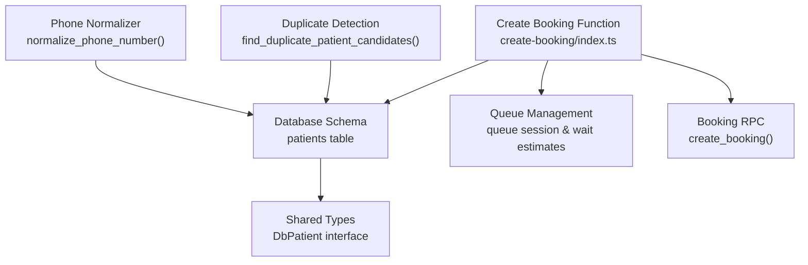
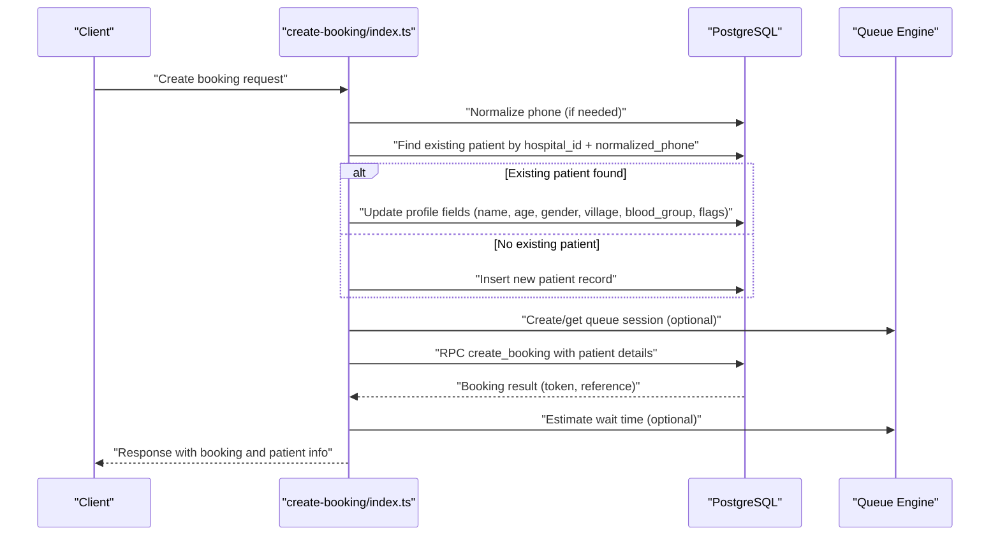
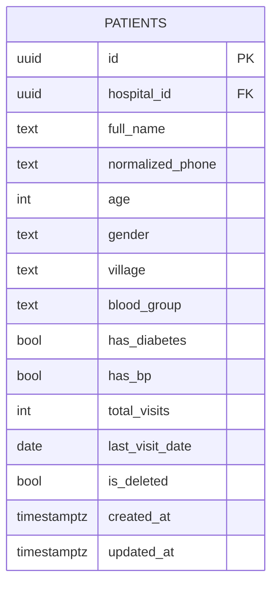
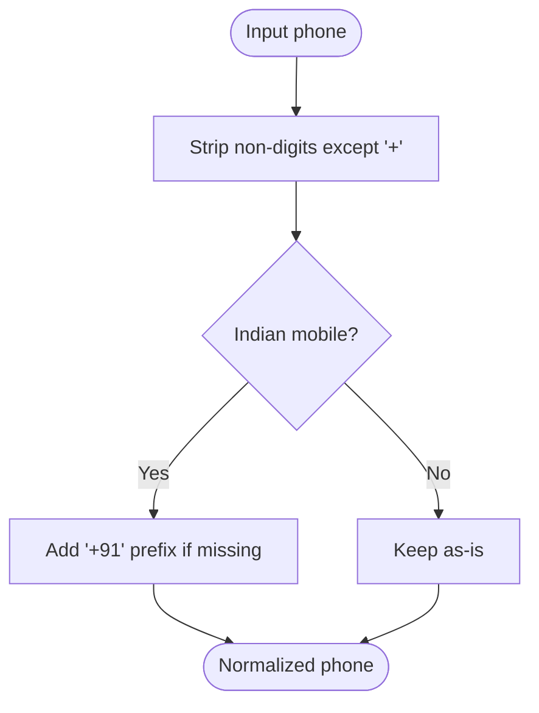
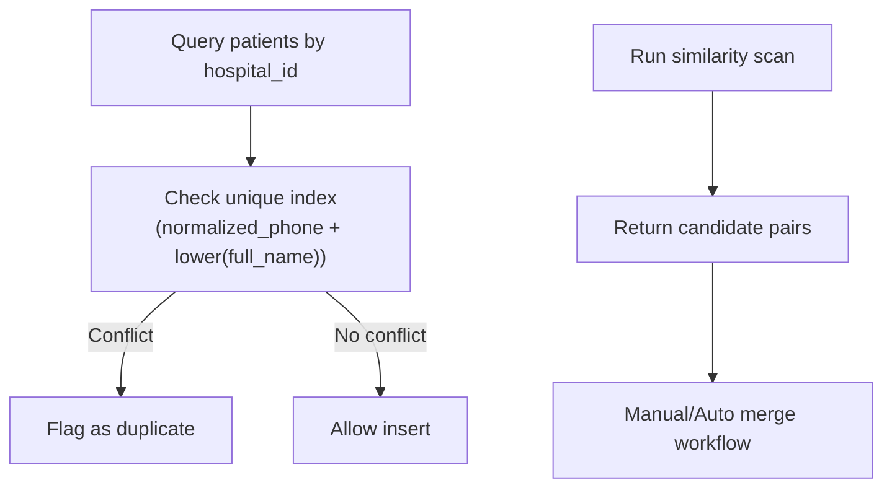
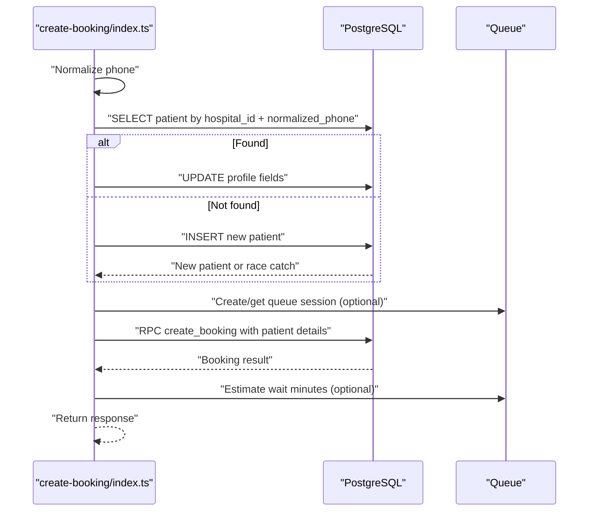
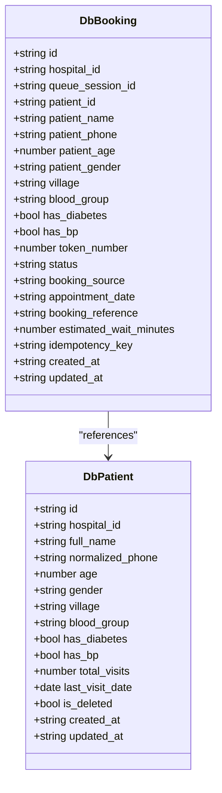
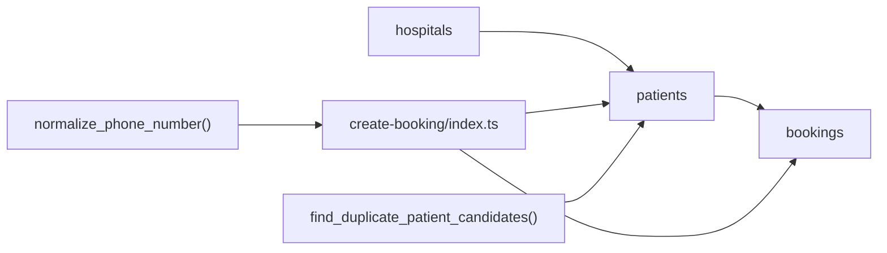

# Patient Management

<cite>
**Referenced Files in This Document**
- [01_foundation.sql](file://supabase/migrations/01_foundation.sql)
- [09_abuse_protection_&_rate_limiting.sql](file://supabase/migrations/09_abuse_protection_&_rate_limiting.sql)
- [11_realtime_presence_schedule_tasks.sql](file://supabase/migrations/11_realtime_presence_schedule_tasks.sql)
- [types.ts](file://supabase/functions/_shared/types.ts)
- [create-booking/index.ts](file://supabase/functions/create-booking/index.ts)
</cite>

## Table of Contents

1. [Introduction](#introduction)
2. [Project Structure](#project-structure)
3. [Core Components](#core-components)
4. [Architecture Overview](#architecture-overview)
5. [Detailed Component Analysis](#detailed-component-analysis)
6. [Dependency Analysis](#dependency-analysis)
7. [Performance Considerations](#performance-considerations)
8. [Troubleshooting Guide](#troubleshooting-guide)
9. [Conclusion](#conclusion)

## Introduction

This document explains the Patient Management system in Setura Hospital OS with
a focus on:

- Patient registration and profile enrichment during booking
- Search and deduplication logic based on normalized phone numbers and hospital
  isolation
- The patient data model and validation rules
- Integration points with booking and queue management
- Examples of patient data structures and operational flows

The goal is to make the system understandable for both technical and
non-technical readers while providing precise references to the codebase.

## Project Structure

Patient-related functionality spans database schema definitions, shared types,
and serverless functions that orchestrate booking workflows. Key areas include:

- Database schema and constraints for patients
- Phone normalization utilities
- Duplicate detection function
- Booking flow that discovers or creates patients and enriches profiles

**Diagram sources**

- [01_foundation.sql:382-454](file://supabase/migrations/01_foundation.sql#L382-L454)
- [09_abuse_protection_&_rate_limiting.sql:41-75](file://supabase/migrations/09_abuse_protection_&_rate_limiting.sql#L41-L75)
- [11_realtime_presence_schedule_tasks.sql:415-450](file://supabase/migrations/11_realtime_presence_schedule_tasks.sql#L415-L450)
- [types.ts:127-143](file://supabase/functions/_shared/types.ts#L127-L143)
- [create-booking/index.ts:321-446](file://supabase/functions/create-booking/index.ts#L321-L446)

**Section sources**

- [01_foundation.sql:382-454](file://supabase/migrations/01_foundation.sql#L382-L454)
- [09_abuse_protection_&_rate_limiting.sql:41-75](file://supabase/migrations/09_abuse_protection_&_rate_limiting.sql#L41-L75)
- [11_realtime_presence_schedule_tasks.sql:415-450](file://supabase/migrations/11_realtime_presence_schedule_tasks.sql#L415-L450)
- [types.ts:127-143](file://supabase/functions/_shared/types.ts#L127-L143)
- [create-booking/index.ts:321-446](file://supabase/functions/create-booking/index.ts#L321-L446)

## Core Components

- Patient data model: defines fields such as full_name, normalized_phone, age,
  gender, village, blood_group, has_diabetes, has_bp, plus visit tracking and
  soft delete.
- Phone normalization: ensures consistent phone formats (including Indian mobile
  normalization).
- Deduplication: unique constraint and similarity-based candidate discovery
  within a hospital context.
- Booking integration: automatic patient discovery/enrichment and creation
  during booking, with idempotency and queue integration.

**Section sources**

- [01_foundation.sql:382-454](file://supabase/migrations/01_foundation.sql#L382-L454)
- [09_abuse_protection_&_rate_limiting.sql:41-75](file://supabase/migrations/09_abuse_protection_&_rate_limiting.sql#L41-L75)
- [11_realtime_presence_schedule_tasks.sql:415-450](file://supabase/migrations/11_realtime_presence_schedule_tasks.sql#L415-L450)
- [create-booking/index.ts:321-446](file://supabase/functions/create-booking/index.ts#L321-L446)

## Architecture Overview

The patient management architecture integrates three layers:

- Data layer: patients table with constraints, indexes, triggers, and row-level
  security policies.
- Service layer: phone normalization and duplicate detection functions.
- Application layer: create-booking function orchestrates patient
  discovery/enrichment and booking creation, integrating with queue management.

**Diagram sources**

- [create-booking/index.ts:321-446](file://supabase/functions/create-booking/index.ts#L321-L446)
- [01_foundation.sql:382-454](file://supabase/migrations/01_foundation.sql#L382-L454)
- [09_abuse_protection_&_rate_limiting.sql:41-75](file://supabase/migrations/09_abuse_protection_&_rate_limiting.sql#L41-L75)

## Detailed Component Analysis

### Patient Data Model

The patient entity captures identity, contact, demographics, and medical flags,
along with visit history and lifecycle state.

Key fields and semantics:

- Identity and isolation:
  - id: primary key
  - hospital_id: isolates patients per hospital
  - normalized_phone: canonical phone number used for deduplication
  - full_name: display name
- Demographics and health:
  - age: integer with range validation
  - gender: optional text
  - village: optional location
  - blood_group: optional text
  - has_diabetes: boolean flag
  - has_bp: boolean flag
- Visit tracking:
  - total_visits: counter
  - last_visit_date: date of last visit
- Lifecycle:
  - is_deleted: soft delete flag
  - created_at / updated_at: timestamps

Validation and integrity:

- Age constrained to a reasonable range
- Unique index across hospital_id, normalized_phone, and lower(full_name) for
  active records to prevent duplicates
- Triggers enforce updated_at and prevent changing hospital_id after creation
- Row-level security policies restrict access by role and hospital

**Diagram sources**

- [01_foundation.sql:382-454](file://supabase/migrations/01_foundation.sql#L382-L454)

**Section sources**

- [01_foundation.sql:382-454](file://supabase/migrations/01_foundation.sql#L382-L454)
- [01_foundation.sql:672-728](file://supabase/migrations/01_foundation.sql#L672-L728)
- [types.ts:127-143](file://supabase/functions/_shared/types.ts#L127-L143)

### Phone Normalization

Phone normalization ensures consistent storage and matching across inputs:

- Strips non-digit characters except leading plus
- Applies Indian mobile normalization rules to standardize to international
  format
- Used consistently when logging attempts and during booking flows

**Diagram sources**

- [09_abuse_protection_&_rate_limiting.sql:41-75](file://supabase/migrations/09_abuse_protection_&_rate_limiting.sql#L41-L75)

**Section sources**

- [09_abuse_protection_&_rate_limiting.sql:41-75](file://supabase/migrations/09_abuse_protection_&_rate_limiting.sql#L41-L75)

### Patient Deduplication Logic

Deduplication operates at two levels:

- Database-level uniqueness:
  - Unique index on (hospital_id, normalized_phone, lower(full_name)) for active
    records prevents exact duplicates within a hospital
- Similarity-based candidate discovery:
  - A function returns potential duplicate pairs within a hospital using name
    similarity thresholds, enabling manual review or automated merging workflows

**Diagram sources**

- [01_foundation.sql:421-427](file://supabase/migrations/01_foundation.sql#L421-L427)
- [11_realtime_presence_schedule_tasks.sql:415-450](file://supabase/migrations/11_realtime_presence_schedule_tasks.sql#L415-L450)

**Section sources**

- [01_foundation.sql:421-427](file://supabase/migrations/01_foundation.sql#L421-L427)
- [11_realtime_presence_schedule_tasks.sql:415-450](file://supabase/migrations/11_realtime_presence_schedule_tasks.sql#L415-L450)

### Patient Registration and Profile Enrichment in Booking Flow

During booking, the system automatically discovers or creates patients and
enriches their profiles:

- Phone normalization applied before lookup
- Lookup by hospital_id and normalized_phone for active records
- If found, update profile fields (name, age, gender, village, blood_group,
  health flags)
- If not found, insert new patient with provided details
- Race condition handling retries fetch if another concurrent request created
  the same patient
- After patient resolution, proceed to fee resolution and atomic booking
  creation via RPC
- Optional queue session creation and wait time estimation are integrated

**Diagram sources**

- [create-booking/index.ts:321-446](file://supabase/functions/create-booking/index.ts#L321-L446)

**Section sources**

- [create-booking/index.ts:321-446](file://supabase/functions/create-booking/index.ts#L321-L446)

### Search Functionality

Search capabilities rely on:

- Exact match queries using normalized_phone and hospital_id for fast lookups
- Trigram index on full_name to support fuzzy searches within a hospital
- Row-level security policies ensure users only see patients from their
  authorized hospital(s)

Practical implications:

- Use normalized_phone for deterministic search results
- Use trigram search for name-based discovery when phone is unknown
- Always scope queries by hospital_id to maintain isolation

**Section sources**

- [01_foundation.sql:429-446](file://supabase/migrations/01_foundation.sql#L429-L446)
- [01_foundation.sql:672-728](file://supabase/migrations/01_foundation.sql#L672-L728)

### Validation Rules

- Age must be between 0 and 150
- Boolean flags default to false for has_diabetes and has_bp
- Soft delete via is_deleted enables archival without data loss
- Updated_at maintained by trigger
- Hospital_id is immutable after creation via trigger

These rules ensure data quality and consistency across the system.

**Section sources**

- [01_foundation.sql:382-454](file://supabase/migrations/01_foundation.sql#L382-L454)

### Integration with Booking and Queue Management

- Patient details are passed into the booking RPC alongside booking metadata
- Queue sessions may be created or reused; estimated wait times are computed
  post-booking
- Idempotency keys protect against duplicate bookings and enable safe retries

**Diagram sources**

- [types.ts:127-192](file://supabase/functions/_shared/types.ts#L127-L192)

**Section sources**

- [create-booking/index.ts:421-519](file://supabase/functions/create-booking/index.ts#L421-L519)
- [types.ts:127-192](file://supabase/functions/_shared/types.ts#L127-L192)

## Dependency Analysis

- Database dependencies:
  - patients table depends on hospitals table via foreign key
  - Unique index enforces deduplication within hospital context
  - Triggers manage timestamps and immutability
  - RLS policies gate access by roles and hospital association
- Functional dependencies:
  - create-booking function depends on phone normalization and patient table
    operations
  - Queue integration relies on queue session management and wait estimation
    RPCs
  - Duplicate detection function supports maintenance workflows

**Diagram sources**

- [01_foundation.sql:382-454](file://supabase/migrations/01_foundation.sql#L382-L454)
- [09_abuse_protection_&_rate_limiting.sql:41-75](file://supabase/migrations/09_abuse_protection_&_rate_limiting.sql#L41-L75)
- [11_realtime_presence_schedule_tasks.sql:415-450](file://supabase/migrations/11_realtime_presence_schedule_tasks.sql#L415-L450)
- [create-booking/index.ts:321-446](file://supabase/functions/create-booking/index.ts#L321-L446)

**Section sources**

- [01_foundation.sql:382-454](file://supabase/migrations/01_foundation.sql#L382-L454)
- [create-booking/index.ts:321-446](file://supabase/functions/create-booking/index.ts#L321-L446)

## Performance Considerations

- Index usage:
  - Unique index on (hospital_id, normalized_phone, lower(full_name))
    accelerates dedup checks
  - Index on (hospital_id, normalized_phone) optimizes lookup by phone within
    hospital
  - Trigram index on full_name supports fuzzy name searches
- Concurrency:
  - Race condition handling in patient creation avoids conflicts under high load
- Query scoping:
  - Always filter by hospital_id to leverage indexes and maintain isolation
- Metrics:
  - Timers around patient find/create and booking steps help identify
    bottlenecks

[No sources needed since this section provides general guidance]

## Troubleshooting Guide

Common issues and resolutions:

- Duplicate patient errors:
  - Occur due to unique constraint violations; verify phone normalization and
    name casing
  - Use duplicate candidate function to identify similar names for manual review
- Access denied:
  - Ensure user has appropriate hospital role; RLS policies restrict
    cross-hospital access
- Booking failures:
  - Check idempotency key conflicts; system returns existing booking if detected
  - Validate input fields (age range, required fields) before submission

Operational tips:

- Log and monitor metrics around patient operations and booking steps
- Use queue session IDs to correlate booking and wait time estimates
- Audit changes via updated_at and policy enforcement logs

**Section sources**

- [01_foundation.sql:421-427](file://supabase/migrations/01_foundation.sql#L421-L427)
- [01_foundation.sql:672-728](file://supabase/migrations/01_foundation.sql#L672-L728)
- [create-booking/index.ts:448-493](file://supabase/functions/create-booking/index.ts#L448-L493)

## Conclusion

The Patient Management system in Setura Hospital OS provides robust patient
registration, profile enrichment, and search capabilities grounded in strong
data modeling and validation. Deduplication is enforced through normalized phone
numbers and hospital isolation, complemented by similarity-based candidate
discovery for maintenance. The booking flow seamlessly integrates patient
discovery and creation with queue management, ensuring reliable and efficient
operations. By following the outlined patterns and leveraging the provided
indexes and policies, teams can build scalable and secure features atop this
foundation.

[No sources needed since this section summarizes without analyzing specific
files]
