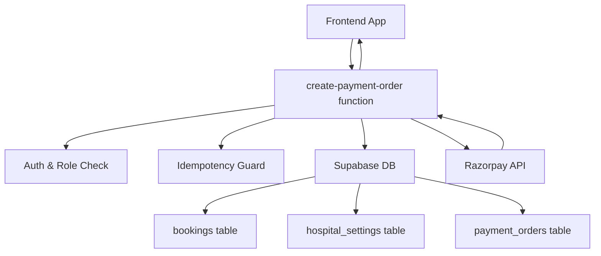
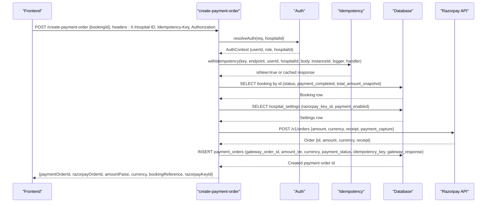
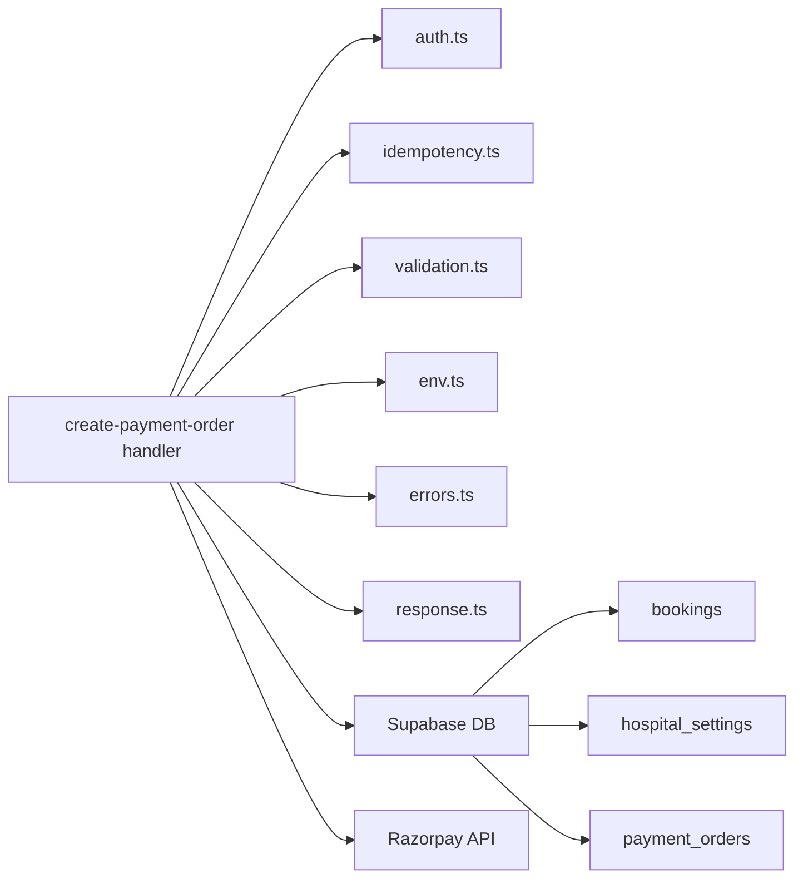

# Payment Order Creation

<cite>
**Referenced Files in This Document**
- [create-payment-order/index.ts](file://supabase/functions/create-payment-order/index.ts)
- [_shared/idempotency.ts](file://supabase/functions/_shared/idempotency.ts)
- [_shared/validation.ts](file://supabase/functions/_shared/validation.ts)
- [_shared/env.ts](file://supabase/functions/_shared/env.ts)
- [_shared/errors.ts](file://supabase/functions/_shared/errors.ts)
- [_shared/auth.ts](file://supabase/functions/_shared/auth.ts)
- [_shared/response.ts](file://supabase/functions/_shared/response.ts)
- [13_payment_engine.sql](file://supabase/migrations/13_payment_engine.sql)
- [12_hospital_configuration_engine.sql](file://supabase/migrations/12_hospital_configuration_engine.sql)
</cite>

## Table of Contents

1. [Introduction](#introduction)
2. [Project Structure](#project-structure)
3. [Core Components](#core-components)
4. [Architecture Overview](#architecture-overview)
5. [Detailed Component Analysis](#detailed-component-analysis)
6. [Dependency Analysis](#dependency-analysis)
7. [Performance Considerations](#performance-considerations)
8. [Troubleshooting Guide](#troubleshooting-guide)
9. [Conclusion](#conclusion)
10. [Appendices](#appendices)

## Introduction

This document explains the payment order creation system for bookings, focusing
on the create-payment-order endpoint. It covers how the endpoint validates
bookings, resolves fees from hospital settings, creates Razorpay orders, ensures
idempotency, and handles errors. It also documents security measures such as
server-side amount verification, credential management, and protection against
duplicate orders, along with request/response schemas and integration patterns
for frontend checkout flows.

## Project Structure

The payment order creation is implemented as a Supabase Edge Function that:

- Validates input and authentication
- Enforces idempotency
- Loads booking data and validates eligibility
- Resolves hospital configuration and credentials
- Creates a Razorpay order
- Persists a payment order record
- Returns order details to the frontend

**Diagram sources**

- [create-payment-order/index.ts:104-406](file://supabase/functions/create-payment-order/index.ts#L104-L406)
- [_shared/auth.ts:42-151](file://supabase/functions/_shared/auth.ts#L42-L151)
- [_shared/idempotency.ts:196-258](file://supabase/functions/_shared/idempotency.ts#L196-L258)
- [13_payment_engine.sql:65-139](file://supabase/migrations/13_payment_engine.sql#L65-L139)
- [12_hospital_configuration_engine.sql:115-210](file://supabase/migrations/12_hospital_configuration_engine.sql#L115-L210)

**Section sources**

- [create-payment-order/index.ts:1-406](file://supabase/functions/create-payment-order/index.ts#L1-406)
- [_shared/auth.ts:1-237](file://supabase/functions/_shared/auth.ts#L1-L237)
- [_shared/idempotency.ts:1-259](file://supabase/functions/_shared/idempotency.ts#L1-L259)
- [13_payment_engine.sql:1-962](file://supabase/migrations/13_payment_engine.sql#L1-L962)
- [12_hospital_configuration_engine.sql:1-692](file://supabase/migrations/12_hospital_configuration_engine.sql#L1-L692)

## Core Components

- Endpoint handler: Orchestrates validation, auth, idempotency, booking checks,
  fee resolution, Razorpay order creation, persistence, and response formatting.
- Idempotency guard: Ensures duplicate requests are handled safely using a
  key-scoped registry.
- Validation layer: Parses and validates request bodies using Zod schemas.
- Environment config: Provides typed access to environment variables including
  Razorpay keys.
- Error handling: Centralized error types and response builders.
- Database schema: Defines payment orders, attempts, events, and related tables
  with constraints and triggers.

Key responsibilities by component:

- Input validation: Ensure required fields like bookingId are present and
  well-formed.
- Authorization: Validate JWT, resolve user role, enforce hospital access.
- Business logic: Load booking, validate status and payment state, compute
  amount in paise, check existing pending orders.
- External integration: Create Razorpay order with auto-capture and receipt
  generation.
- Persistence: Store payment order with gateway details and idempotency key.
- Observability: Emit metrics and audit logs.

**Section sources**

- [create-payment-order/index.ts:49-51](file://supabase/functions/create-payment-order/index.ts#L49-L51)
- [create-payment-order/index.ts:117-130](file://supabase/functions/create-payment-order/index.ts#L117-L130)
- [create-payment-order/index.ts:141-211](file://supabase/functions/create-payment-order/index.ts#L141-L211)
- [create-payment-order/index.ts:213-308](file://supabase/functions/create-payment-order/index.ts#L213-L308)
- [create-payment-order/index.ts:332-382](file://supabase/functions/create-payment-order/index.ts#L332-L382)
- [_shared/idempotency.ts:39-59](file://supabase/functions/_shared/idempotency.ts#L39-L59)
- [_shared/idempotency.ts:196-258](file://supabase/functions/_shared/idempotency.ts#L196-L258)
- [_shared/validation.ts:99-134](file://supabase/functions/_shared/validation.ts#L99-L134)
- [_shared/env.ts:132-134](file://supabase/functions/_shared/env.ts#L132-L134)
- [_shared/errors.ts:154-162](file://supabase/functions/_shared/errors.ts#L154-L162)
- [_shared/response.ts:44-67](file://supabase/functions/_shared/response.ts#L44-L67)
- [13_payment_engine.sql:65-139](file://supabase/migrations/13_payment_engine.sql#L65-L139)
- [12_hospital_configuration_engine.sql:115-210](file://supabase/migrations/12_hospital_configuration_engine.sql#L115-L210)

## Architecture Overview

The flow begins with an authenticated request carrying a hospital context and a
unique idempotency key. The endpoint validates inputs, enforces roles, and then
proceeds through a guarded execution path that prevents duplicate order
creation. It loads the booking, verifies it is eligible for payment, computes
the amount in paise, checks for any existing pending order, and if none exists,
calls the Razorpay API to create an order. Finally, it persists the payment
order and returns the necessary details for the frontend to initiate checkout.

**Diagram sources**

- [create-payment-order/index.ts:104-406](file://supabase/functions/create-payment-order/index.ts#L104-L406)
- [_shared/auth.ts:42-151](file://supabase/functions/_shared/auth.ts#L42-L151)
- [_shared/idempotency.ts:196-258](file://supabase/functions/_shared/idempotency.ts#L196-L258)
- [13_payment_engine.sql:65-139](file://supabase/migrations/13_payment_engine.sql#L65-L139)

## Detailed Component Analysis

### Request Validation and Authentication

- The endpoint requires:
  - A valid Bearer token
  - An X-Hospital-ID header
  - An Idempotency-Key header (UUID v4)
  - A JSON body with a bookingId field
- Authentication resolves the user profile and role, enforcing hospital access
  and requiring one of the allowed roles for this endpoint.

Security notes:

- JWT validation uses Supabase’s auth client to handle signature and expiry.
- Role enforcement is database-backed to avoid stale claims.
- Hospital access is enforced before business logic runs.

**Section sources**

- [create-payment-order/index.ts:117-130](file://supabase/functions/create-payment-order/index.ts#L117-L130)
- [_shared/auth.ts:42-151](file://supabase/functions/_shared/auth.ts#L42-L151)
- [_shared/validation.ts:99-134](file://supabase/functions/_shared/validation.ts#L99-L134)

### Idempotency Protection

- The endpoint wraps its core logic with an idempotency guard that:
  - Extracts and validates the Idempotency-Key header
  - Claims the key atomically via a database RPC
  - Returns cached responses for completed requests
  - Rejects concurrent processing with a retryable signal
  - Records success or failure states for later replay

Protection guarantees:

- Keys are scoped per endpoint, user, and optionally hospital
- Body hash mismatch detection prevents misuse of same key with different
  payloads
- Keys expire after a configured TTL

**Section sources**

- [_shared/idempotency.ts:39-59](file://supabase/functions/_shared/idempotency.ts#L39-L59)
- [_shared/idempotency.ts:79-129](file://supabase/functions/_shared/idempotency.ts#L79-L129)
- [_shared/idempotency.ts:196-258](file://supabase/functions/_shared/idempotency.ts#L196-L258)

### Booking Validation and Eligibility

- Loads the booking by ID and ensures:
  - The booking belongs to the requesting hospital
  - The booking is not already paid
  - The booking is not cancelled or completed
- Computes the amount to charge from the booking’s snapshot amount, ensuring it
  is finite and positive; zero amounts are rejected.

Data integrity:

- Uses the booking’s stored amount snapshot to avoid trusting client-provided
  values.

**Section sources**

- [create-payment-order/index.ts:141-211](file://supabase/functions/create-payment-order/index.ts#L141-L211)

### Fee Resolution and Amount Calculation

- The endpoint reads hospital settings to verify payments are enabled and to
  obtain the Razorpay key identifier used in the public SDK.
- The amount is calculated server-side:
  - Reads total_amount_snapshot from the booking
  - Converts to integer paise by multiplying by 100 and rounding
  - Validates Razorpay order response amount matches expected value

Security measure:

- Server-side verification of the amount returned by Razorpay prevents
  tampering.

**Section sources**

- [create-payment-order/index.ts:213-308](file://supabase/functions/create-payment-order/index.ts#L213-L308)
- [12_hospital_configuration_engine.sql:115-210](file://supabase/migrations/12_hospital_configuration_engine.sql#L115-L210)

### Razorpay Integration

- Creates a Razorpay order with:
  - Amount in paise
  - Currency set to INR
  - Receipt generated from the booking reference
  - Auto-capture enabled
- Uses Basic authentication derived from environment-configured key ID and
  secret.
- Stores the full gateway response and order ID in the payment order record.

Error handling:

- Non-OK HTTP responses are parsed and wrapped into internal errors with
  contextual details.

**Section sources**

- [create-payment-order/index.ts:64-102](file://supabase/functions/create-payment-order/index.ts#L64-L102)
- [create-payment-order/index.ts:299-330](file://supabase/functions/create-payment-order/index.ts#L299-L330)
- [_shared/env.ts:132-134](file://supabase/functions/_shared/env.ts#L132-L134)

### Persistence and Audit

- Inserts a payment order row with:
  - Hospital and booking identifiers
  - Gateway type and order ID
  - Amount in INR and currency
  - Initial payment status
  - Idempotency key
  - Gateway response snapshot
- Emits an audit event capturing actor, entity, action, severity, and relevant
  new data.

Constraints and immutability:

- Unique constraints on gateway_order_id and idempotency_key prevent duplicates.
- Triggers protect sensitive fields and timestamps.

**Section sources**

- [create-payment-order/index.ts:332-382](file://supabase/functions/create-payment-order/index.ts#L332-L382)
- [13_payment_engine.sql:65-139](file://supabase/migrations/13_payment_engine.sql#L65-L139)

### Response Formatting and Metrics

- Success responses include correlation metadata and timestamp.
- Metrics track timing and counts for created vs reused orders.
- Errors are converted to standardized responses with codes, messages, and
  optional field errors.

**Section sources**

- [_shared/response.ts:44-67](file://supabase/functions/_shared/response.ts#L44-L67)
- [create-payment-order/index.ts:386-406](file://supabase/functions/create-payment-order/index.ts#L386-L406)

## Dependency Analysis

The endpoint depends on shared utilities for auth, validation, idempotency,
environment configuration, error handling, and response building. It interacts
with the database for bookings, hospital settings, and payment orders, and
integrates with Razorpay for order creation.

**Diagram sources**

- [create-payment-order/index.ts:25-45](file://supabase/functions/create-payment-order/index.ts#L25-L45)
- [create-payment-order/index.ts:104-406](file://supabase/functions/create-payment-order/index.ts#L104-L406)

**Section sources**

- [create-payment-order/index.ts:25-45](file://supabase/functions/create-payment-order/index.ts#L25-L45)
- [_shared/auth.ts:1-237](file://supabase/functions/_shared/auth.ts#L1-L237)
- [_shared/idempotency.ts:1-259](file://supabase/functions/_shared/idempotency.ts#L1-L259)
- [_shared/validation.ts:1-157](file://supabase/functions/_shared/validation.ts#L1-L157)
- [_shared/env.ts:1-279](file://supabase/functions/_shared/env.ts#L1-L279)
- [_shared/errors.ts:1-323](file://supabase/functions/_shared/errors.ts#L1-L323)
- [_shared/response.ts:1-206](file://supabase/functions/_shared/response.ts#L1-L206)

## Performance Considerations

- Use idempotency keys to avoid redundant Razorpay calls and database writes.
- Keep request bodies small; validation enforces size limits.
- Prefer reading only needed columns from the database to reduce payload sizes.
- Monitor external API latency; the Razorpay call includes a timeout to fail
  fast.
- Leverage metrics to identify slow paths and optimize accordingly.

[No sources needed since this section provides general guidance]

## Troubleshooting Guide

Common error scenarios and their causes:

- Missing or invalid Idempotency-Key: Must be a UUID v4; otherwise rejected
  early.
- Unauthorized or forbidden: Missing or invalid JWT, inactive user, insufficient
  role, or wrong hospital context.
- Booking not found or ineligible: Booking does not exist, belongs to another
  hospital, already paid, cancelled, or completed.
- Zero fee: No payment required; endpoint rejects zero-amount orders.
- Payment disabled: Hospital has payments turned off.
- Credentials missing: Razorpay key ID or secret not configured.
- Razorpay API failure: Network error or non-OK response; detailed error
  captured.
- Invalid Razorpay response: Mismatched order ID or amount; indicates
  server-side verification failure.
- Database write failure: Persisting payment order failed; check constraints and
  triggers.

Recommended actions:

- Ensure correct headers and body format.
- Verify user roles and hospital context.
- Confirm booking status and amount snapshot.
- Check hospital settings for payment enablement.
- Inspect environment variables for Razorpay credentials.
- Review logs and metrics for correlation IDs and error context.

**Section sources**

- [_shared/idempotency.ts:39-59](file://supabase/functions/_shared/idempotency.ts#L39-L59)
- [_shared/auth.ts:42-151](file://supabase/functions/_shared/auth.ts#L42-L151)
- [create-payment-order/index.ts:141-330](file://supabase/functions/create-payment-order/index.ts#L141-L330)
- [_shared/errors.ts:154-162](file://supabase/functions/_shared/errors.ts#L154-L162)
- [_shared/response.ts:196-206](file://supabase/functions/_shared/response.ts#L196-L206)

## Conclusion

The create-payment-order endpoint provides a secure, idempotent, and auditable
mechanism to create Razorpay orders for bookings. It enforces strict validation,
server-side amount verification, and robust error handling while integrating
with hospital configuration and external payment services. Frontend clients
should use the returned order details to initialize the Razorpay checkout flow
and rely on idempotency keys to ensure safe retries.

[No sources needed since this section summarizes without analyzing specific
files]

## Appendices

### Request and Response Schemas

- Request headers:
  - Authorization: Bearer <JWT>
  - X-Hospital-ID: <UUID>
  - Idempotency-Key: <UUID v4>
- Request body:
  - bookingId: string (UUID)
- Success response fields:
  - paymentOrderId: string (UUID)
  - razorpayOrderId: string
  - amountPaise: number (integer)
  - currency: string ("INR")
  - bookingId: string (UUID)
  - bookingReference: string
  - razorpayKeyId: string (public key)

Note: These fields reflect what the endpoint returns based on its
implementation.

**Section sources**

- [create-payment-order/index.ts:49-51](file://supabase/functions/create-payment-order/index.ts#L49-L51)
- [create-payment-order/index.ts:371-382](file://supabase/functions/create-payment-order/index.ts#L371-L382)

### Frontend Integration Pattern

- Generate a unique UUID v4 for each checkout attempt and send it as
  Idempotency-Key.
- Include Authorization and X-Hospital-ID headers.
- On success, use the returned razorpayOrderId, amountPaise, currency, and
  razorpayKeyId to initialize the Razorpay checkout.
- Handle retries by reusing the same Idempotency-Key; the backend will return
  the cached result if already processed.
- If receiving a processing signal, wait and retry according to the provided
  retry policy.

[No sources needed since this section provides general guidance]

### Security Measures Summary

- Server-side amount verification against Razorpay response
- Credential management via environment variables (key ID and secret)
- Idempotency protection with scoped keys and body hash mismatch detection
- Role-based access control and hospital scoping
- Immutable payment order records with unique constraints

**Section sources**

- [create-payment-order/index.ts:64-102](file://supabase/functions/create-payment-order/index.ts#L64-L102)
- [create-payment-order/index.ts:299-330](file://supabase/functions/create-payment-order/index.ts#L299-L330)
- [_shared/idempotency.ts:196-258](file://supabase/functions/_shared/idempotency.ts#L196-L258)
- [13_payment_engine.sql:65-139](file://supabase/migrations/13_payment_engine.sql#L65-L139)
