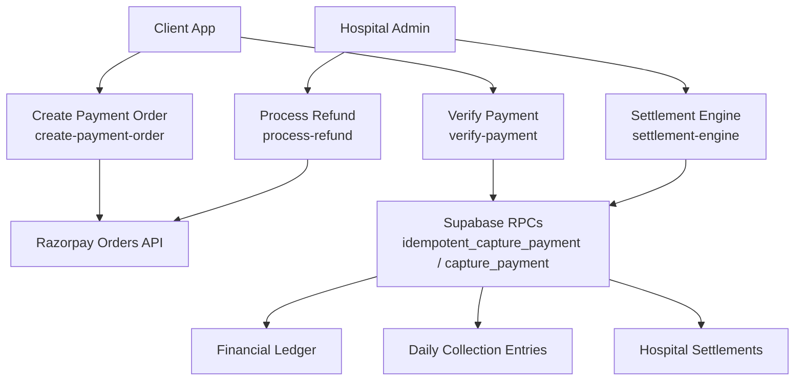
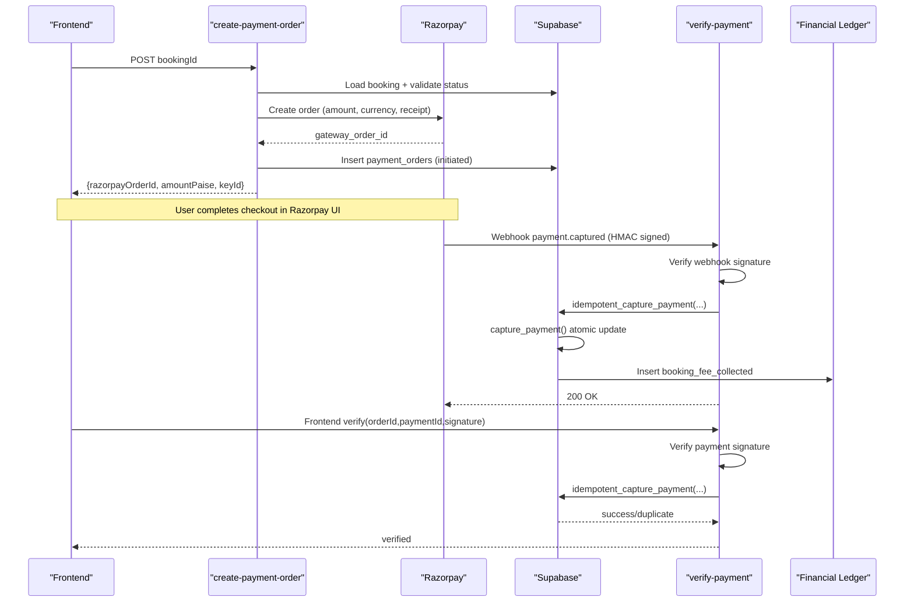
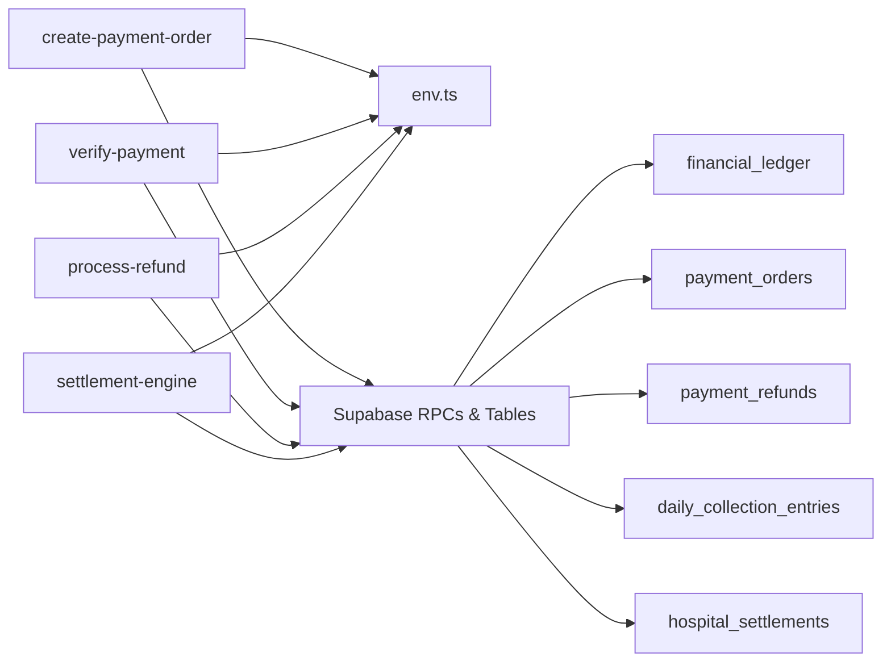
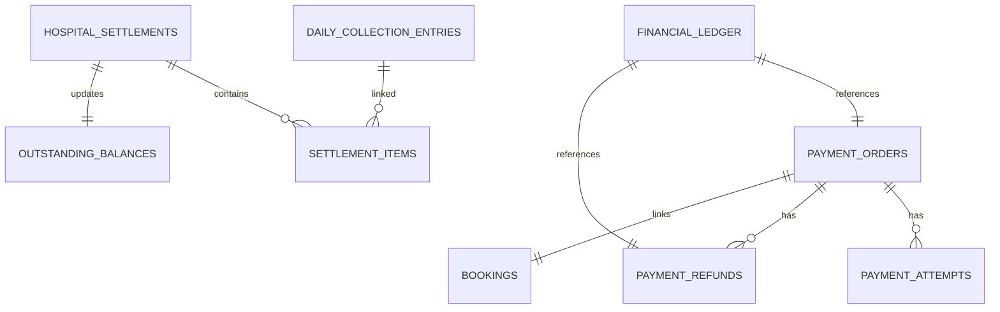

# Payment Processing

<cite>
**Referenced Files in This Document**
- [create-payment-order/index.ts](file://supabase/functions/create-payment-order/index.ts)
- [verify-payment/index.ts](file://supabase/functions/verify-payment/index.ts)
- [process-refund/index.ts](file://supabase/functions/process-refund/index.ts)
- [settlement-engine/index.ts](file://supabase/functions/settlement-engine/index.ts)
- [13_payment_engine.sql](file://supabase/migrations/13_payment_engine.sql)
- [07_settlement_engine.sql](file://supabase/migrations/07_settlement_engine.sql)
- [env.ts](file://supabase/functions/_shared/env.ts)
</cite>

## Table of Contents

1. [Introduction](#introduction)
2. [Project Structure](#project-structure)
3. [Core Components](#core-components)
4. [Architecture Overview](#architecture-overview)
5. [Detailed Component Analysis](#detailed-component-analysis)
6. [Dependency Analysis](#dependency-analysis)
7. [Performance Considerations](#performance-considerations)
8. [Troubleshooting Guide](#troubleshooting-guide)
9. [Conclusion](#conclusion)
10. [Appendices](#appendices)

## Introduction

This document explains the end-to-end Payment Processing system, including fee
resolution, Razorpay integration, payment verification and webhook handling,
refund processing, and settlement engine operations. It also documents the data
model for orders, transactions, refunds, and settlements, and provides guidance
on error handling, reconciliation, and financial reporting.

## Project Structure

The payment system is implemented as a set of Deno-based serverless functions
backed by Supabase Postgres migrations:

- Create payment order (Razorpay order creation)
- Verify payment (webhook and frontend callback)
- Process refund (initiate and confirm via Razorpay)
- Settlement engine (create settlements, record payments, view outstanding)

**Diagram sources**

- [create-payment-order/index.ts:64-102](file://supabase/functions/create-payment-order/index.ts#L64-L102)
- [verify-payment/index.ts:133-186](file://supabase/functions/verify-payment/index.ts#L133-L186)
- [process-refund/index.ts:48-107](file://supabase/functions/process-refund/index.ts#L48-L107)
- [settlement-engine/index.ts:291-435](file://supabase/functions/settlement-engine/index.ts#L291-L435)
- [13_payment_engine.sql:593-663](file://supabase/migrations/13_payment_engine.sql#L593-L663)
- [07_settlement_engine.sql:316-435](file://supabase/migrations/07_settlement_engine.sql#L316-L435)

**Section sources**

- [create-payment-order/index.ts:1-407](file://supabase/functions/create-payment-order/index.ts#L1-L407)
- [verify-payment/index.ts:1-480](file://supabase/functions/verify-payment/index.ts#L1-L480)
- [process-refund/index.ts:1-360](file://supabase/functions/process-refund/index.ts#L1-L360)
- [settlement-engine/index.ts:1-521](file://supabase/functions/settlement-engine/index.ts#L1-L521)
- [13_payment_engine.sql:1-962](file://supabase/migrations/13_payment_engine.sql#L1-L962)
- [07_settlement_engine.sql:1-670](file://supabase/migrations/07_settlement_engine.sql#L1-L670)

## Core Components

- Create Payment Order: Validates booking, resolves fees from booking snapshot,
  creates Razorpay order, persists payment_order, returns checkout details.
- Verify Payment: Handles Razorpay webhooks and frontend callbacks; verifies
  signatures; idempotently captures payment and updates ledger; enqueues
  post-payment tasks.
- Process Refund: Validates eligibility, initiates refund via Razorpay, records
  refund state, confirms processed refunds, writes ledger debits.
- Settlement Engine: Creates immutable settlement summaries for date ranges,
  records payments against settlements, exposes outstanding balances.

**Section sources**

- [create-payment-order/index.ts:104-407](file://supabase/functions/create-payment-order/index.ts#L104-L407)
- [verify-payment/index.ts:188-480](file://supabase/functions/verify-payment/index.ts#L188-L480)
- [process-refund/index.ts:109-360](file://supabase/functions/process-refund/index.ts#L109-L360)
- [settlement-engine/index.ts:55-521](file://supabase/functions/settlement-engine/index.ts#L55-L521)

## Architecture Overview

The system follows a clear separation between orchestration (functions) and
state transitions (SQL functions/triggers). Security is enforced via role
checks, HMAC signature verification, and row-level security policies.
Idempotency is provided at both function and database layers to handle retries
safely.

**Diagram sources**

- [create-payment-order/index.ts:64-102](file://supabase/functions/create-payment-order/index.ts#L64-L102)
- [create-payment-order/index.ts:141-383](file://supabase/functions/create-payment-order/index.ts#L141-L383)
- [verify-payment/index.ts:59-120](file://supabase/functions/verify-payment/index.ts#L59-L120)
- [verify-payment/index.ts:133-186](file://supabase/functions/verify-payment/index.ts#L133-L186)
- [verify-payment/index.ts:208-361](file://supabase/functions/verify-payment/index.ts#L208-L361)
- [13_payment_engine.sql:593-663](file://supabase/migrations/13_payment_engine.sql#L593-L663)

## Detailed Component Analysis

### Create Payment Order

- Validates JWT and hospital context, ensures booking exists and is eligible for
  payment.
- Resolves amount from booking snapshot; converts to paise for Razorpay.
- Checks for existing pending order to support idempotent reuse.
- Calls Razorpay Orders API with auto-capture enabled.
- Persists payment_order with gateway identifiers and response payload.
- Emits audit events and metrics.

Key behaviors:

- Amount validation and zero-fee handling.
- Reuse of existing pending order if present.
- Environment-driven Razorpay credentials.

**Section sources**

- [create-payment-order/index.ts:104-407](file://supabase/functions/create-payment-order/index.ts#L104-L407)
- [env.ts:128-135](file://supabase/functions/_shared/env.ts#L128-L135)

### Verify Payment (Webhook and Frontend Callback)

- Detects call source via header presence.
- Webhook path:
  - Verifies HMAC-SHA256 signature using configured secret.
  - Parses event type; processes payment.captured events.
  - Computes payload hash and calls idempotent_capture_payment RPC.
  - Logs audit and enqueues post-payment task.
- Frontend path:
  - Validates hospital context and roles.
  - Verifies Razorpay client-side signature over orderId|paymentId.
  - Calls idempotent_capture_payment RPC.
  - Returns verification result and deduplication flag.

Error handling:

- Rejects malformed payloads.
- Always returns 200 for webhooks to prevent retries.
- Throws structured errors for frontend flows.

**Section sources**

- [verify-payment/index.ts:1-480](file://supabase/functions/verify-payment/index.ts#L1-L480)
- [13_payment_engine.sql:593-663](file://supabase/migrations/13_payment_engine.sql#L593-L663)

### Process Refund

- Validates booking and ensures captured payment exists.
- Supports full or partial refund with minimum amount enforcement.
- Initiates refund record via SQL function before calling Razorpay.
- Calls Razorpay Refunds API; handles immediate processed status or sets
  processing for later confirmation.
- Confirms refund via webhook or direct call; writes refund_debit to ledger.
- Audits and marks booking cancelled during initiation.

Idempotency:

- Prevents duplicate refund initiation for same booking.

**Section sources**

- [process-refund/index.ts:109-360](file://supabase/functions/process-refund/index.ts#L109-L360)
- [13_payment_engine.sql:672-813](file://supabase/migrations/13_payment_engine.sql#L672-L813)

### Settlement Engine

- Actions: create, record_payment, get_outstanding.
- Create:
  - Validates date range and limits.
  - Uses atomic SQL to create settlement, aggregate totals, insert items, mark
    entries settled, refresh outstanding balance.
  - Enforces uniqueness per hospital and date range.
- Record Payment:
  - Records payment against settlement, updates remaining due and status.
  - Refreshes outstanding balance.
- Get Outstanding:
  - Reads outstanding_balances and unsettled daily_collection_entries.

Multi-party fee distribution:

- Aggregates platform_fee and receptionist_fee from daily_collection_entries
  into settlement totals and line items.

**Section sources**

- [settlement-engine/index.ts:55-521](file://supabase/functions/settlement-engine/index.ts#L55-L521)
- [07_settlement_engine.sql:316-516](file://supabase/migrations/07_settlement_engine.sql#L316-L516)

## Dependency Analysis

- Functions depend on shared utilities for auth, logging, tracing, metrics,
  validation, and environment configuration.
- Database interactions use service-role client to call RPCs and mutate tables
  under Row Level Security policies.
- External dependency: Razorpay APIs for order creation, refunds, and webhooks.
- Idempotency relies on database-level deduplication and advisory locks where
  applicable.

**Diagram sources**

- [env.ts:128-135](file://supabase/functions/_shared/env.ts#L128-L135)
- [13_payment_engine.sql:65-129](file://supabase/migrations/13_payment_engine.sql#L65-L129)
- [07_settlement_engine.sql:30-173](file://supabase/migrations/07_settlement_engine.sql#L30-L173)

**Section sources**

- [env.ts:1-279](file://supabase/functions/_shared/env.ts#L1-L279)
- [13_payment_engine.sql:65-129](file://supabase/migrations/13_payment_engine.sql#L65-L129)
- [07_settlement_engine.sql:30-173](file://supabase/migrations/07_settlement_engine.sql#L30-L173)

## Performance Considerations

- Use idempotent endpoints to safely retry requests without side effects.
- Prefer database-level atomic operations (capture_payment,
  create_hospital_settlement) to minimize contention.
- Avoid trusting client-provided amounts; always resolve from server-side
  snapshots.
- Keep webhook handlers fast and return 200 promptly to avoid provider retries.
- Index usage:
  - payment_orders indexed by booking_id, gateway_order_id, status.
  - daily_collection_entries indexed by hospital_id and collection_date.
  - financial_ledger indexed by hospital_id and created_at.

[No sources needed since this section provides general guidance]

## Troubleshooting Guide

Common issues and resolutions:

- Missing X-Hospital-ID header: Ensure all requests include the required
  hospital context header.
- Invalid Razorpay signature: Verify HMAC computation and ensure correct secret
  configuration.
- Duplicate payment capture: The idempotent capture flow will detect duplicates
  and return success without reprocessing.
- Refund amount exceeds captured amount: Validate refund amount against payment
  order total before initiating.
- Settlement creation conflicts: Date range must be valid and unique per
  hospital; check for existing settlements.

Operational checks:

- Confirm environment variables for Razorpay keys are set.
- Review audit logs for payment_order_created, payment_capture, payment_refund
  actions.
- Inspect metrics counters for payment.order.error, payment.verify.error,
  payment.refund.error, settlement.error.

**Section sources**

- [create-payment-order/index.ts:117-128](file://supabase/functions/create-payment-order/index.ts#L117-L128)
- [verify-payment/index.ts:208-224](file://supabase/functions/verify-payment/index.ts#L208-L224)
- [process-refund/index.ts:145-229](file://supabase/functions/process-refund/index.ts#L145-L229)
- [settlement-engine/index.ts:243-289](file://supabase/functions/settlement-engine/index.ts#L243-L289)

## Conclusion

The payment processing system provides a robust, secure, and auditable pipeline
for creating orders, verifying payments, handling refunds, and settling
multi-party fees. It leverages idempotency, atomic SQL operations, and
comprehensive logging and metrics to ensure reliability and traceability across
the entire lifecycle.

[No sources needed since this section summarizes without analyzing specific
files]

## Appendices

### Data Model Overview

- payment_orders: Tracks gateway order/payment IDs, amounts, statuses,
  timestamps, and responses.
- payment_attempts: Records individual attempts with method details and errors.
- payment_refunds: Captures refund requests, statuses, reasons, and gateway
  references.
- financial_ledger: Immutable ledger of credits and debits for collections,
  fees, refunds, and adjustments.
- daily_collection_entries: Immutable snapshots of fees per booking used for
  settlement aggregation.
- hospital_settlements: Summaries of collected fees for a period, with payment
  tracking and status.
- settlement_items: Line items linking settlement to underlying collection
  entries.
- outstanding_balances: Aggregated outstanding amounts per hospital.

**Diagram sources**

- [13_payment_engine.sql:65-129](file://supabase/migrations/13_payment_engine.sql#L65-L129)
- [13_payment_engine.sql:162-210](file://supabase/migrations/13_payment_engine.sql#L162-L210)
- [13_payment_engine.sql:221-267](file://supabase/migrations/13_payment_engine.sql#L221-L267)
- [13_payment_engine.sql:327-363](file://supabase/migrations/13_payment_engine.sql#L327-L363)
- [07_settlement_engine.sql:30-84](file://supabase/migrations/07_settlement_engine.sql#L30-L84)
- [07_settlement_engine.sql:113-173](file://supabase/migrations/07_settlement_engine.sql#L113-L173)
- [07_settlement_engine.sql:209-228](file://supabase/migrations/07_settlement_engine.sql#L209-L228)
- [07_settlement_engine.sql:244-256](file://supabase/migrations/07_settlement_engine.sql#L244-L256)

### API Endpoints Summary

- POST /create-payment-order
  - Purpose: Create Razorpay order for a booking.
  - Inputs: bookingId, hospital context.
  - Outputs: paymentOrderId, razorpayOrderId, amountPaise, currency,
    bookingReference, razorpayKeyId.
  - Errors: Validation errors for missing fields, invalid amounts, already
    paid/cancelled/completed bookings.

- POST /verify-payment
  - Purpose: Handle Razorpay webhook and frontend verification.
  - Inputs: For webhook, raw body with signature; for frontend, orderId,
    paymentId, signature, bookingId.
  - Outputs: Verification result and deduplication flag.
  - Errors: Signature verification failures, malformed payloads, internal
    errors.

- POST /process-refund
  - Purpose: Initiate refund for a captured payment.
  - Inputs: bookingId, reason, fullRefund flag, optional amountInr.
  - Outputs: refundId, gatewayRefundId, refundStatus, amountInr,
    alreadyInitiated flag.
  - Errors: No captured payment, invalid refund amount, gateway errors.

- POST /settlement-engine
  - Purpose: Create settlement, record payment, or get outstanding.
  - Inputs: action enum with required parameters per action.
  - Outputs: Settlement details, updated status, or outstanding summary.
  - Errors: Invalid date ranges, duplicate settlements, payment recording
    failures.

**Section sources**

- [create-payment-order/index.ts:104-407](file://supabase/functions/create-payment-order/index.ts#L104-L407)
- [verify-payment/index.ts:188-480](file://supabase/functions/verify-payment/index.ts#L188-L480)
- [process-refund/index.ts:109-360](file://supabase/functions/process-refund/index.ts#L109-L360)
- [settlement-engine/index.ts:55-521](file://supabase/functions/settlement-engine/index.ts#L55-L521)

### Reconciliation and Reporting

- Reconciliation summary aggregates collected fees, platform and receptionist
  fees, refunds, and settlements over a date range.
- Financial ledger entries provide an immutable audit trail for all monetary
  movements.
- Settlement engine aggregates daily collection entries into immutable
  settlement records with line-item detail.

**Section sources**

- [13_payment_engine.sql:492-584](file://supabase/migrations/13_payment_engine.sql#L492-L584)
- [07_settlement_engine.sql:316-435](file://supabase/migrations/07_settlement_engine.sql#L316-L435)
