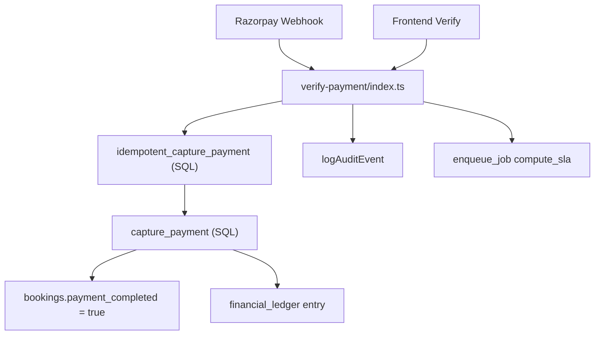
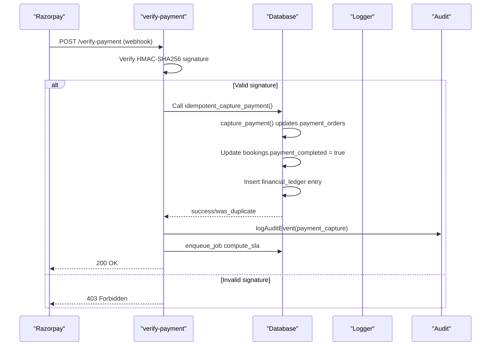
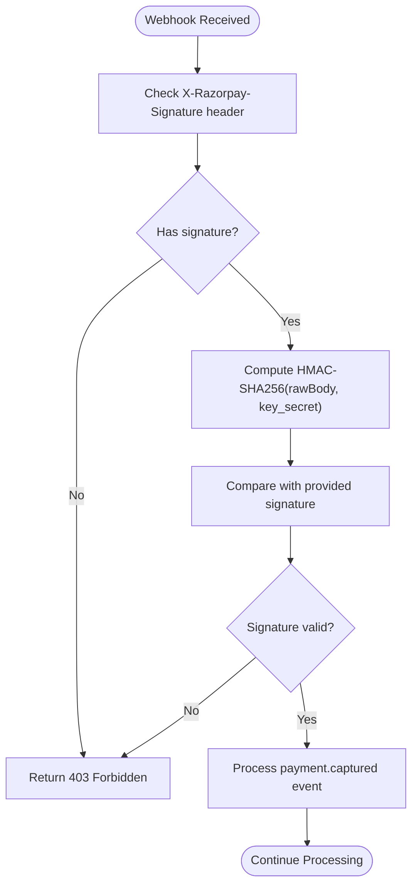
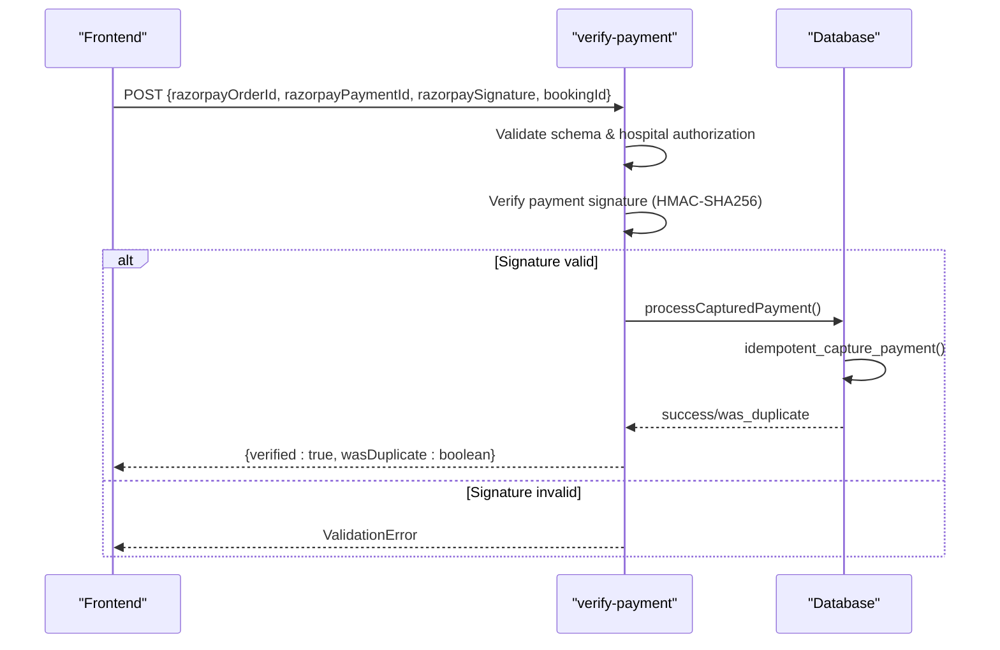
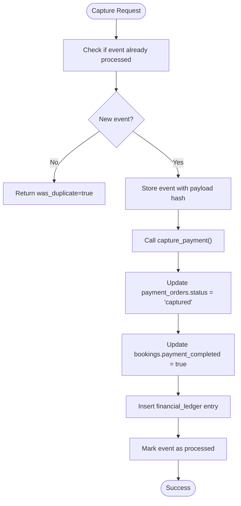
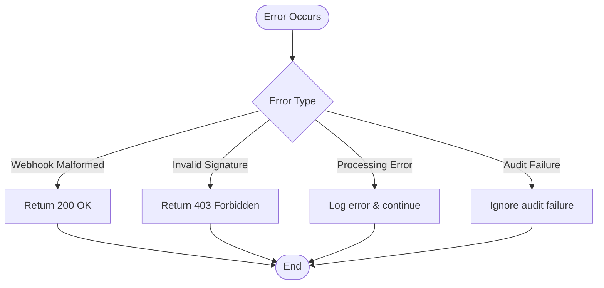
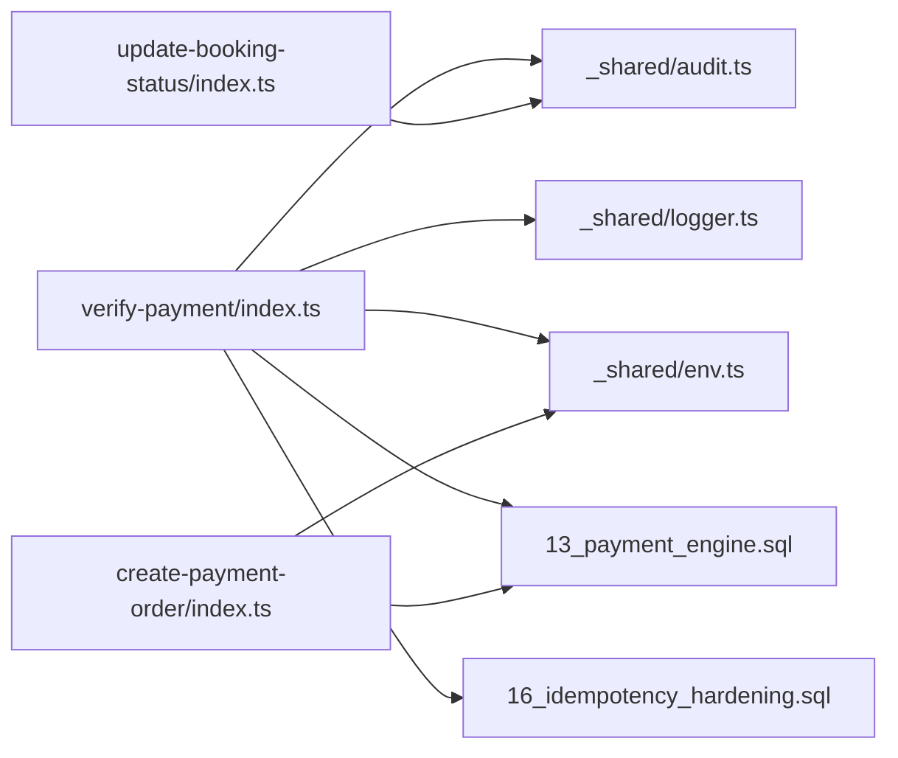

# Payment Verification

<cite>
**Referenced Files in This Document**
- [verify-payment/index.ts](file://supabase/functions/verify-payment/index.ts)
- [create-payment-order/index.ts](file://supabase/functions/create-payment-order/index.ts)
- [update-booking-status/index.ts](file://supabase/functions/update-booking-status/index.ts)
- [audit.ts](file://supabase/functions/_shared/audit.ts)
- [logger.ts](file://supabase/functions/_shared/logger.ts)
- [env.ts](file://supabase/functions/_shared/env.ts)
- [13_payment_engine.sql](file://supabase/migrations/13_payment_engine.sql)
- [16_idempotency_hardening.sql](file://supabase/migrations/16_idempotency_hardening.sql)
</cite>

## Table of Contents

1. [Introduction](#introduction)
2. [Project Structure](#project-structure)
3. [Core Components](#core-components)
4. [Architecture Overview](#architecture-overview)
5. [Detailed Component Analysis](#detailed-component-analysis)
6. [Dependency Analysis](#dependency-analysis)
7. [Performance Considerations](#performance-considerations)
8. [Troubleshooting Guide](#troubleshooting-guide)
9. [Conclusion](#conclusion)
10. [Appendices](#appendices)

## Introduction

This document explains the payment verification system that processes Razorpay
webhooks and frontend callbacks to verify payments, update booking status, and
maintain financial integrity. It covers:

- How the verify-payment endpoint handles two call patterns: Razorpay webhook
  events and frontend verification after checkout.
- Signature verification using HMAC-SHA256 for both webhook payloads and
  client-side payment signatures.
- Idempotent capture logic to prevent duplicate processing.
- State transitions from pending to completed payments via database functions.
- Error handling, retry behavior, audit logging, and integration with the
  booking system.

## Project Structure

The payment verification flow spans several Edge Functions and database
migrations:

- verify-payment: Entry point for Razorpay webhooks and frontend verification.
- create-payment-order: Creates Razorpay orders and persists payment order
  records.
- update-booking-status: Manages booking state machine (not directly invoked by
  payment flows but relevant for overall lifecycle).
- Shared utilities: Logging, environment configuration, and audit logging.
- Database schema and functions: Define payment tables, ledger entries, and
  idempotent capture logic.



**Diagram sources**

- [verify-payment/index.ts:207-304](file://supabase/functions/verify-payment/index.ts#L207-L304)
- [16_idempotency_hardening.sql:421-528](file://supabase/migrations/16_idempotency_hardening.sql#L421-L528)
- [13_payment_engine.sql:593-663](file://supabase/migrations/13_payment_engine.sql#L593-L663)

**Section sources**

- [verify-payment/index.ts:1-480](file://supabase/functions/verify-payment/index.ts#L1-L480)
- [create-payment-order/index.ts:1-407](file://supabase/functions/create-payment-order/index.ts#L1-L407)
- [13_payment_engine.sql:1-962](file://supabase/migrations/13_payment_engine.sql#L1-L962)
- [16_idempotency_hardening.sql:382-556](file://supabase/migrations/16_idempotency_hardening.sql#L382-L556)

## Core Components

- verify-payment handler: Accepts POST requests, determines if it is a Razorpay
  webhook or frontend callback, validates signatures, and processes captured
  payments.
- HMAC-SHA256 signature verification: Validates webhook signatures using
  X-Razorpay-Signature header and verifies frontend payment signatures using
  order_id|payment_id message.
- Idempotent capture: Uses SQL function idempotent_capture_payment to ensure
  only one successful capture per event, preventing duplicates.
- Audit logging: Records high-severity payment capture events for compliance and
  traceability.
- Background job enqueueing: Schedules SLA computation after successful payment
  capture.

**Section sources**

- [verify-payment/index.ts:39-120](file://supabase/functions/verify-payment/index.ts#L39-L120)
- [verify-payment/index.ts:133-186](file://supabase/functions/verify-payment/index.ts#L133-L186)
- [audit.ts:51-75](file://supabase/functions/_shared/audit.ts#L51-L75)

## Architecture Overview

The payment verification system follows a secure, idempotent flow:



**Diagram sources**

- [verify-payment/index.ts:207-304](file://supabase/functions/verify-payment/index.ts#L207-L304)
- [16_idempotency_hardening.sql:421-528](file://supabase/migrations/16_idempotency_hardening.sql#L421-L528)
- [13_payment_engine.sql:593-663](file://supabase/migrations/13_payment_engine.sql#L593-L663)

## Detailed Component Analysis

### Webhook Signature Verification

The verify-payment endpoint implements robust signature verification for
Razorpay webhooks:

1. **HMAC-SHA256 Implementation**: Uses Deno's crypto.subtle API to generate
   SHA-256 signatures
2. **Constant-time Comparison**: Prevents timing attacks by comparing signatures
   character-by-character
3. **Environment Validation**: Ensures RAZORPAY_KEY_SECRET is configured before
   processing



**Diagram sources**

- [verify-payment/index.ts:41-70](file://supabase/functions/verify-payment/index.ts#L41-L70)
- [verify-payment/index.ts:207-224](file://supabase/functions/verify-payment/index.ts#L207-L224)

**Section sources**

- [verify-payment/index.ts:39-70](file://supabase/functions/verify-payment/index.ts#L39-L70)
- [env.ts:129-135](file://supabase/functions/_shared/env.ts#L129-L135)

### Frontend Payment Verification

For frontend callbacks after Razorpay checkout, the system verifies payment
signatures:

1. **Schema Validation**: Validates razorpayOrderId, razorpayPaymentId,
   razorpaySignature, and bookingId
2. **Hospital Authorization**: Ensures booking belongs to the requesting
   hospital
3. **Signature Verification**: Verifies HMAC signature of "order_id|payment_id"
   message
4. **Idempotent Processing**: Calls processCapturedPayment to handle payment
   confirmation



**Diagram sources**

- [verify-payment/index.ts:122-130](file://supabase/functions/verify-payment/index.ts#L122-L130)
- [verify-payment/index.ts:362-467](file://supabase/functions/verify-payment/index.ts#L362-L467)

**Section sources**

- [verify-payment/index.ts:122-130](file://supabase/functions/verify-payment/index.ts#L122-L130)
- [verify-payment/index.ts:362-467](file://supabase/functions/verify-payment/index.ts#L362-L467)

### Idempotent Payment Capture

The system uses database-level idempotency to prevent duplicate payment
processing:

1. **Event Deduplication**: Stores raw payload hash to detect duplicate events
2. **Atomic Operations**: Uses transaction-like behavior in SQL functions
3. **State Management**: Updates payment_orders and bookings atomically
4. **Financial Ledger**: Records all financial transactions immutably



**Diagram sources**

- [16_idempotency_hardening.sql:421-528](file://supabase/migrations/16_idempotency_hardening.sql#L421-L528)
- [13_payment_engine.sql:593-663](file://supabase/migrations/13_payment_engine.sql#L593-L663)

**Section sources**

- [16_idempotency_hardening.sql:421-528](file://supabase/migrations/16_idempotency_hardening.sql#L421-L528)
- [13_payment_engine.sql:593-663](file://supabase/migrations/13_payment_engine.sql#L593-L663)

### Booking Status Integration

While payment verification doesn't directly change booking status, it sets the
payment_completed flag:

1. **Payment Completion Flag**: Sets bookings.payment_completed = true on
   successful capture
2. **Payment Reference**: Stores gateway_payment_id for tracking
3. **SLA Computation**: Enqueues background job to compute service level
   agreements
4. **Audit Trail**: Logs all payment captures for compliance

**Section sources**

- [13_payment_engine.sql:632-637](file://supabase/migrations/13_payment_engine.sql#L632-L637)
- [verify-payment/index.ts:281-304](file://supabase/functions/verify-payment/index.ts#L281-L304)

### Error Handling and Retry Mechanisms

The system implements comprehensive error handling:

1. **Webhook Errors**: Always returns 200 OK to prevent Razorpay retries for
   malformed requests
2. **Signature Failures**: Returns 403 Forbidden for invalid signatures
3. **Processing Errors**: Logs errors and continues processing other events
4. **Audit Failure Resilience**: Audit logging failures don't affect main flow



**Diagram sources**

- [verify-payment/index.ts:245-269](file://supabase/functions/verify-payment/index.ts#L245-L269)
- [verify-payment/index.ts:468-478](file://supabase/functions/verify-payment/index.ts#L468-L478)
- [audit.ts:51-75](file://supabase/functions/_shared/audit.ts#L51-L75)

**Section sources**

- [verify-payment/index.ts:245-269](file://supabase/functions/verify-payment/index.ts#L245-L269)
- [verify-payment/index.ts:468-478](file://supabase/functions/verify-payment/index.ts#L468-L478)
- [audit.ts:51-75](file://supabase/functions/_shared/audit.ts#L51-L75)

## Dependency Analysis

The payment verification system has clear dependency relationships:



**Diagram sources**

- [verify-payment/index.ts:23-35](file://supabase/functions/verify-payment/index.ts#L23-L35)
- [create-payment-order/index.ts:25-45](file://supabase/functions/create-payment-order/index.ts#L25-L45)
- [update-booking-status/index.ts:7-24](file://supabase/functions/update-booking-status/index.ts#L7-L24)

**Section sources**

- [verify-payment/index.ts:23-35](file://supabase/functions/verify-payment/index.ts#L23-L35)
- [create-payment-order/index.ts:25-45](file://supabase/functions/create-payment-order/index.ts#L25-L45)

## Performance Considerations

- **Idempotency**: Database-level deduplication prevents redundant processing
- **Atomic Operations**: SQL functions ensure data consistency under concurrent
  access
- **Efficient Queries**: Indexed lookups on payment_orders and bookings tables
- **Background Processing**: SLA computation runs asynchronously to avoid
  blocking
- **Logging Optimization**: Structured JSON logs with correlation IDs for
  efficient tracing

[No sources needed since this section provides general guidance]

## Troubleshooting Guide

Common issues and their resolution:

1. **Signature Verification Failures**:
   - Ensure RAZORPAY_KEY_SECRET is correctly configured
   - Verify webhook payload hasn't been modified
   - Check timestamp differences between server and Razorpay

2. **Duplicate Payment Processing**:
   - System automatically handles duplicates via idempotency
   - Check payment_events table for processed status
   - Review audit logs for duplicate detection

3. **Payment Not Marked as Completed**:
   - Verify capture_payment function executed successfully
   - Check financial_ledger for corresponding entries
   - Review database constraints and triggers

4. **Webhook Retry Issues**:
   - Always return 200 OK to prevent infinite retries
   - Log webhook processing status for monitoring
   - Check payment_events table for unprocessed events

**Section sources**

- [verify-payment/index.ts:213-224](file://supabase/functions/verify-payment/index.ts#L213-L224)
- [16_idempotency_hardening.sql:421-528](file://supabase/migrations/16_idempotency_hardening.sql#L421-L528)
- [audit.ts:51-75](file://supabase/functions/_shared/audit.ts#L51-L75)

## Conclusion

The payment verification system provides a secure, idempotent, and auditable
solution for processing Razorpay payments. Key strengths include:

- Robust HMAC-SHA256 signature verification for both webhooks and frontend
  callbacks
- Database-level idempotency preventing duplicate processing
- Comprehensive audit logging for compliance and debugging
- Atomic financial operations ensuring data consistency
- Graceful error handling with appropriate retry mechanisms

The system successfully integrates with the booking system by setting payment
completion flags while maintaining separation of concerns between payment
processing and booking management.

[No sources needed since this section summarizes without analyzing specific
files]

## Appendices

### Webhook Payload Examples

Razorpay sends various event types, with payment.captured being the most
critical:

```json
{
  "event": "payment.captured",
  "payload": {
    "payment": {
      "entity": {
        "id": "pay_xxxxxxxxxxxx",
        "order_id": "order_xxxxxxxxxxxx",
        "amount": 50000,
        "currency": "INR",
        "status": "captured"
      }
    }
  }
}
```

### Frontend Verification Payload

After Razorpay checkout completes, the frontend sends:

```json
{
  "razorpayOrderId": "order_xxxxxxxxxxxx",
  "razorpayPaymentId": "pay_xxxxxxxxxxxx",
  "razorpaySignature": "xxxxxxxxxxxxxxxxxxxxxxxx",
  "bookingId": "uuid-of-booking"
}
```

### Database Schema Relationships

Key tables involved in payment processing:

- payment_orders: Tracks payment lifecycle and gateway interactions
- bookings: Contains payment completion status and references
- financial_ledger: Immutable record of all financial transactions
- payment_events: Deduplication and processing status tracking

**Section sources**

- [13_payment_engine.sql:65-129](file://supabase/migrations/13_payment_engine.sql#L65-L129)
- [13_payment_engine.sql:295-317](file://supabase/migrations/13_payment_engine.sql#L295-L317)
- [13_payment_engine.sql:327-363](file://supabase/migrations/13_payment_engine.sql#L327-L363)
