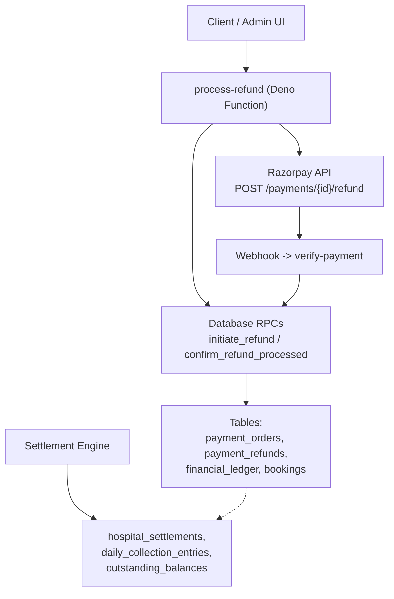
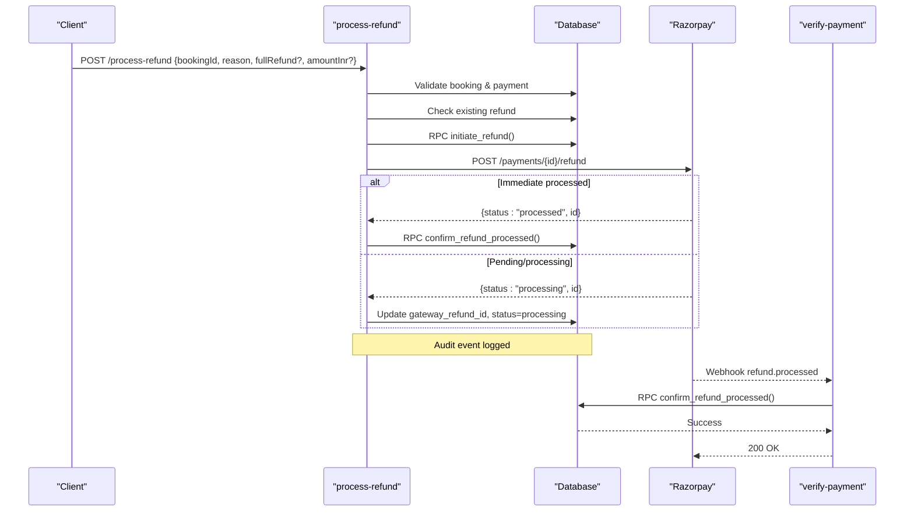
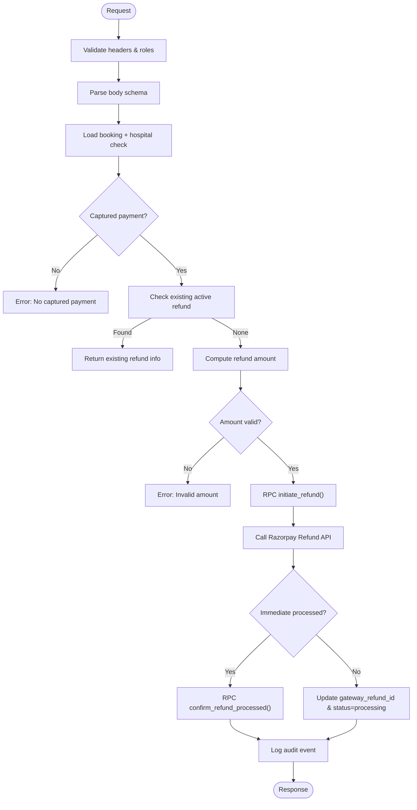
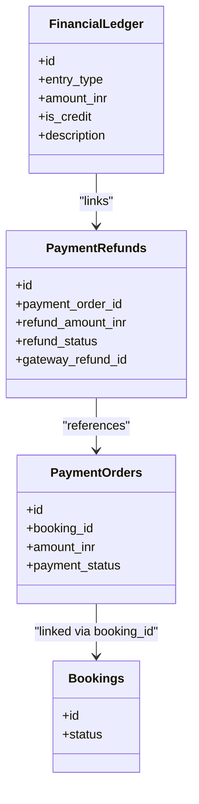
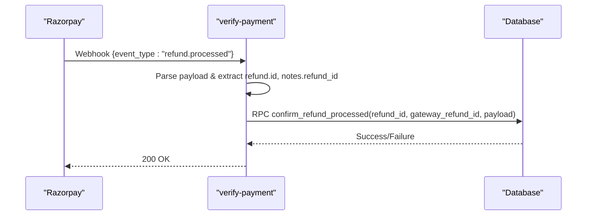
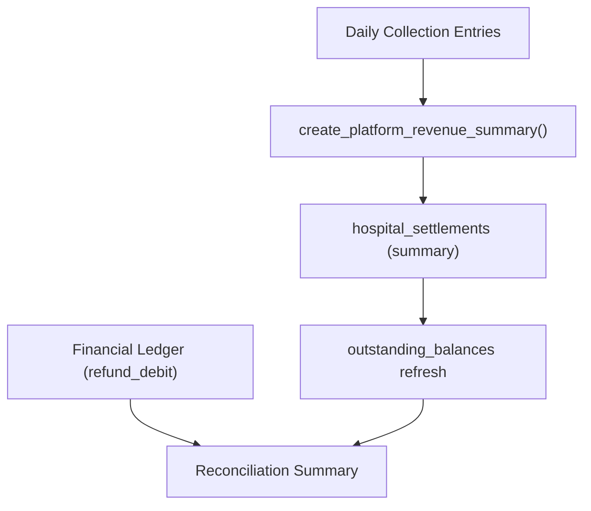
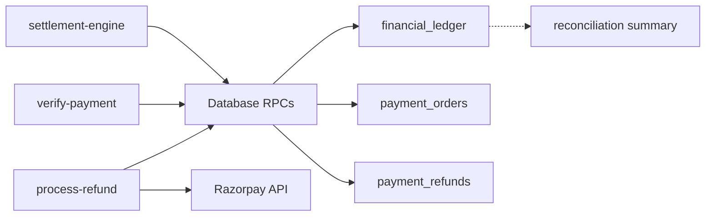

# Refund Processing

<cite>
**Referenced Files in This Document**
- [process-refund/index.ts](file://supabase/functions/process-refund/index.ts)
- [verify-payment/index.ts](file://supabase/functions/verify-payment/index.ts)
- [settlement-engine/index.ts](file://supabase/functions/settlement-engine/index.ts)
- [13_payment_engine.sql](file://supabase/migrations/13_payment_engine.sql)
- [07_settlement_engine.sql](file://supabase/migrations/07_settlement_engine.sql)
- [33_settlement_engine_refactor.sql](file://supabase/migrations/33_settlement_engine_refactor.sql)
</cite>

## Table of Contents

1. [Introduction](#introduction)
2. [Project Structure](#project-structure)
3. [Core Components](#core-components)
4. [Architecture Overview](#architecture-overview)
5. [Detailed Component Analysis](#detailed-component-analysis)
6. [Dependency Analysis](#dependency-analysis)
7. [Performance Considerations](#performance-considerations)
8. [Troubleshooting Guide](#troubleshooting-guide)
9. [Conclusion](#conclusion)
10. [Appendices](#appendices)

## Introduction

This document explains the refund processing system, focusing on how the
process-refund endpoint handles refund requests, validates eligibility,
processes refunds through Razorpay, updates financial records, and integrates
with the settlement engine. It covers partial vs full refunds, status tracking,
error handling, limits, audit requirements, and reconciliation between payment
records and refund transactions.

## Project Structure

The refund flow spans serverless functions and database migrations:

- process-refund function orchestrates validation, idempotency, Razorpay
  integration, and DB updates.
- verify-payment function consumes webhooks to finalize refund confirmations.
- Settlement engine manages revenue summaries and outstanding balances; it is
  not directly invoked by refunds but participates in reconciliation via
  financial ledger entries.
- Migrations define schemas for payments, refunds, financial ledger, and
  settlement tables and provide atomic SQL functions used by the functions.

**Diagram sources**

- [process-refund/index.ts:109-359](file://supabase/functions/process-refund/index.ts#L109-L359)
- [verify-payment/index.ts:310-355](file://supabase/functions/verify-payment/index.ts#L310-L355)
- [13_payment_engine.sql:672-813](file://supabase/migrations/13_payment_engine.sql#L672-L813)
- [07_settlement_engine.sql:316-433](file://supabase/migrations/07_settlement_engine.sql#L316-L433)
- [33_settlement_engine_refactor.sql:171-303](file://supabase/migrations/33_settlement_engine_refactor.sql#L171-L303)

**Section sources**

- [process-refund/index.ts:109-359](file://supabase/functions/process-refund/index.ts#L109-L359)
- [verify-payment/index.ts:310-355](file://supabase/functions/verify-payment/index.ts#L310-L355)
- [13_payment_engine.sql:672-813](file://supabase/migrations/13_payment_engine.sql#L672-L813)
- [07_settlement_engine.sql:316-433](file://supabase/migrations/07_settlement_engine.sql#L316-L433)
- [33_settlement_engine_refactor.sql:171-303](file://supabase/migrations/33_settlement_engine_refactor.sql#L171-L303)

## Core Components

- process-refund endpoint: Validates request, enforces idempotency, checks
  eligibility, initiates DB refund record, calls Razorpay, updates refund
  status, and logs audit events.
- Database functions: initiate_refund creates a refund row and marks booking
  cancelled; confirm_refund_processed finalizes refund, updates payment order
  status, and posts a debit entry to financial_ledger.
- Webhook handler (verify-payment): Consumes refund.processed webhook and
  confirms refund via confirm_refund_processed.
- Settlement engine: Produces platform revenue summaries and tracks outstanding
  balances; refunds affect reconciliation via financial ledger debits.

Key responsibilities and data models are defined in the payment and settlement
migrations.

**Section sources**

- [process-refund/index.ts:34-39](file://supabase/functions/process-refund/index.ts#L34-L39)
- [13_payment_engine.sql:672-813](file://supabase/migrations/13_payment_engine.sql#L672-L813)
- [verify-payment/index.ts:310-355](file://supabase/functions/verify-payment/index.ts#L310-L355)
- [07_settlement_engine.sql:316-433](file://supabase/migrations/07_settlement_engine.sql#L316-L433)
- [33_settlement_engine_refactor.sql:171-303](file://supabase/migrations/33_settlement_engine_refactor.sql#L171-L303)

## Architecture Overview

End-to-end refund lifecycle:

1. Client sends POST to process-refund with bookingId, reason, fullRefund flag,
   and optional amountInr.
2. The function validates inputs, ensures hospital context, and enforces
   idempotency.
3. Eligibility checks:
   - Booking exists and belongs to the hospital.
   - Payment captured for the booking.
   - No active/pending/processing refund already exists for the booking.
   - Refund amount does not exceed captured amount; minimum ₹1 enforced for
     partial refunds.
4. A refund record is created via initiate_refund; booking is marked cancelled.
5. Razorpay refund is initiated; if immediately processed,
   confirm_refund_processed is called; otherwise, status set to processing
   awaiting webhook.
6. verify-payment webhook receives refund.processed and calls
   confirm_refund_processed to finalize.
7. confirm_refund_processed updates payment_order status (refunded or
   partially_refunded), sets refund_status to processed, and inserts a
   refund_debit into financial_ledger.
8. Reconciliation uses financial_ledger and settlement summaries to reconcile
   collections, refunds, and settlements.

**Diagram sources**

- [process-refund/index.ts:109-359](file://supabase/functions/process-refund/index.ts#L109-L359)
- [verify-payment/index.ts:310-355](file://supabase/functions/verify-payment/index.ts#L310-L355)
- [13_payment_engine.sql:672-813](file://supabase/migrations/13_payment_engine.sql#L672-L813)

## Detailed Component Analysis

### process-refund Endpoint

- Input schema: bookingId (UUID), reason (string), fullRefund (boolean default
  true), amountInr (optional positive number).
- Authorization: Requires X-Hospital-ID header and role-based access
  (hospital_admin or global_admin).
- Idempotency: Uses an idempotency key to prevent duplicate refunds for the same
  intent.
- Eligibility checks:
  - Booking must exist, be non-deleted, and belong to the provided hospital.
  - Payment must be captured for the booking.
  - Existing active refund (pending/processing/processed) returns the existing
    refund details.
  - Partial refund requires amountInr ≥ ₹1; full refund uses
    total_amount_snapshot.
  - Refund amount cannot exceed captured amount.
- Processing:
  - Creates refund record via initiate_refund RPC; booking status set to
    cancelled.
  - Calls Razorpay Refunds API with amount in paise.
  - If Razorpay returns processed, immediately confirms via
    confirm_refund_processed; otherwise updates local status to processing and
    awaits webhook.
  - Logs high-severity audit event with bookingId, refund amount, gateway refund
    id, and reason.
- Response: Returns refundId, gatewayRefundId, refundStatus, amountInr, and
  alreadyInitiated flag.

**Diagram sources**

- [process-refund/index.ts:109-359](file://supabase/functions/process-refund/index.ts#L109-L359)

**Section sources**

- [process-refund/index.ts:34-39](file://supabase/functions/process-refund/index.ts#L34-L39)
- [process-refund/index.ts:122-133](file://supabase/functions/process-refund/index.ts#L122-L133)
- [process-refund/index.ts:145-229](file://supabase/functions/process-refund/index.ts#L145-L229)
- [process-refund/index.ts:231-298](file://supabase/functions/process-refund/index.ts#L231-L298)
- [process-refund/index.ts:300-324](file://supabase/functions/process-refund/index.ts#L300-L324)

### Database Functions for Refunds

- initiate_refund(p_booking_id, p_refund_amount_inr, p_refund_reason,
  p_initiated_by):
  - Locks and verifies a captured payment for the booking.
  - Ensures refund amount does not exceed payment amount.
  - Inserts a payment_refund row and sets booking status to cancelled.
- confirm_refund_processed(p_refund_id, p_gateway_refund_id,
  p_gateway_response):
  - Updates payment_refunds to processed with gateway response.
  - Sets payment_orders status to refunded (full) or partially_refunded
    (partial).
  - Inserts a refund_debit entry into financial_ledger.

**Diagram sources**

- [13_payment_engine.sql:672-813](file://supabase/migrations/13_payment_engine.sql#L672-L813)

**Section sources**

- [13_payment_engine.sql:672-734](file://supabase/migrations/13_payment_engine.sql#L672-L734)
- [13_payment_engine.sql:743-813](file://supabase/migrations/13_payment_engine.sql#L743-L813)

### Webhook Handling for Refunds

- verify-payment listens for refund.processed events from Razorpay.
- Extracts refund entity and notes.refund_id to locate the local refund record.
- Calls confirm_refund_processed to finalize the refund and update financial
  records.
- Always returns 200 to Razorpay to stop retries.

**Diagram sources**

- [verify-payment/index.ts:310-355](file://supabase/functions/verify-payment/index.ts#L310-L355)
- [13_payment_engine.sql:743-813](file://supabase/migrations/13_payment_engine.sql#L743-L813)

**Section sources**

- [verify-payment/index.ts:310-355](file://supabase/functions/verify-payment/index.ts#L310-L355)

### Settlement Engine Integration

- The settlement engine aggregates daily collection entries into platform
  revenue summaries and tracks outstanding balances.
- While refunds do not directly call settlement functions, they affect
  reconciliation via financial_ledger debit entries.
- The settlement engine’s create_platform_revenue_summary marks collection
  entries as settled and computes totals; refunds reduce net outstanding when
  reconciled against ledger entries.

**Diagram sources**

- [33_settlement_engine_refactor.sql:171-303](file://supabase/migrations/33_settlement_engine_refactor.sql#L171-L303)
- [07_settlement_engine.sql:316-433](file://supabase/migrations/07_settlement_engine.sql#L316-L433)
- [13_payment_engine.sql:492-584](file://supabase/migrations/13_payment_engine.sql#L492-L584)

**Section sources**

- [33_settlement_engine_refactor.sql:171-303](file://supabase/migrations/33_settlement_engine_refactor.sql#L171-L303)
- [07_settlement_engine.sql:316-433](file://supabase/migrations/07_settlement_engine.sql#L316-L433)
- [13_payment_engine.sql:492-584](file://supabase/migrations/13_payment_engine.sql#L492-L584)

## Dependency Analysis

- process-refund depends on:
  - Auth and authorization helpers.
  - Database client and RPCs (initiate_refund, confirm_refund_processed).
  - Razorpay API for initiating refunds.
  - Audit logging and metrics.
- verify-payment depends on:
  - Database RPC confirm_refund_processed.
  - Webhook parsing and signature verification (for other flows).
- Settlement engine depends on:
  - Database RPCs and triggers for creating summaries and refreshing balances.
  - Tables for daily collection entries, settlements, and outstanding balances.

**Diagram sources**

- [process-refund/index.ts:109-359](file://supabase/functions/process-refund/index.ts#L109-L359)
- [verify-payment/index.ts:310-355](file://supabase/functions/verify-payment/index.ts#L310-L355)
- [13_payment_engine.sql:492-584](file://supabase/migrations/13_payment_engine.sql#L492-L584)

**Section sources**

- [process-refund/index.ts:109-359](file://supabase/functions/process-refund/index.ts#L109-L359)
- [verify-payment/index.ts:310-355](file://supabase/functions/verify-payment/index.ts#L310-L355)
- [13_payment_engine.sql:492-584](file://supabase/migrations/13_payment_engine.sql#L492-L584)

## Performance Considerations

- Idempotency: process-refund uses idempotency keys to avoid duplicate refunds;
  verify-payment ensures webhook idempotent confirmation.
- Atomic operations: Database functions use row-level locking and advisory locks
  to prevent race conditions during refund initiation and settlement creation.
- Timeouts: Razorpay calls include timeouts to fail fast on network issues.
- Metrics and tracing: Request timing and counters help monitor performance and
  detect anomalies.

[No sources needed since this section provides general guidance]

## Troubleshooting Guide

Common errors and handling:

- Missing X-Hospital-ID header: Validation error returned.
- Booking not found or no captured payment: Validation error prevents refund
  initiation.
- Refund amount too small (< ₹1) or exceeds captured amount: Validation error
  with details.
- Razorpay credentials not configured: Internal error raised before calling
  gateway.
- Razorpay API failure: Internal error with description/status captured.
- Duplicate refund attempt: Returns existing refund details without
  reprocessing.
- Webhook missing refund_id in notes: Warning logged; confirmation skipped until
  resolved.

Audit and observability:

- High-severity audit events logged for refund initiation with relevant context.
- Metrics incremented for refund initiation, duplicates, and errors.
- Tracing correlation IDs included in logs for cross-service debugging.

**Section sources**

- [process-refund/index.ts:122-133](file://supabase/functions/process-refund/index.ts#L122-L133)
- [process-refund/index.ts:145-229](file://supabase/functions/process-refund/index.ts#L145-L229)
- [process-refund/index.ts:268-298](file://supabase/functions/process-refund/index.ts#L268-L298)
- [process-refund/index.ts:300-359](file://supabase/functions/process-refund/index.ts#L300-L359)
- [verify-payment/index.ts:310-355](file://supabase/functions/verify-payment/index.ts#L310-L355)

## Conclusion

The refund processing system provides a robust, auditable, and idempotent
workflow to handle full and partial refunds. It validates eligibility,
integrates with Razorpay, updates financial records atomically, and supports
reconciliation via financial ledger entries and settlement summaries. Webhooks
ensure eventual consistency when refunds are processed asynchronously. Proper
error handling, auditing, and metrics enable reliable operation and
troubleshooting.

[No sources needed since this section summarizes without analyzing specific
files]

## Appendices

### Refund Eligibility Criteria

- Booking must exist and belong to the requesting hospital.
- Payment must be captured for the booking.
- No active/pending/processing refund already exists for the booking.
- For partial refunds, amountInr must be at least ₹1 and not exceed captured
  amount.
- Full refund uses total_amount_snapshot from the booking.

**Section sources**

- [process-refund/index.ts:145-229](file://supabase/functions/process-refund/index.ts#L145-L229)

### Refund Status Transitions

- pending → processing (after Razorpay returns non-processed status)
- processing → processed (via immediate response or webhook)
- failed/cancelled states are supported by schema and may be reached via
  external failures or manual actions.

**Section sources**

- [13_payment_engine.sql:38-46](file://supabase/migrations/13_payment_engine.sql#L38-L46)
- [process-refund/index.ts:41-46](file://supabase/functions/process-refund/index.ts#L41-L46)

### Reconciliation Processes

- get_reconciliation_summary aggregates collected fees, refunds, and settlements
  for a date range.
- financial_ledger entries capture credits for collections and debits for
  refunds.
- Settlement summaries mark collection entries as settled and compute totals;
  outstanding balances reflect unsettled periods.

**Section sources**

- [13_payment_engine.sql:492-584](file://supabase/migrations/13_payment_engine.sql#L492-L584)
- [07_settlement_engine.sql:316-433](file://supabase/migrations/07_settlement_engine.sql#L316-L433)
- [33_settlement_engine_refactor.sql:171-303](file://supabase/migrations/33_settlement_engine_refactor.sql#L171-L303)
