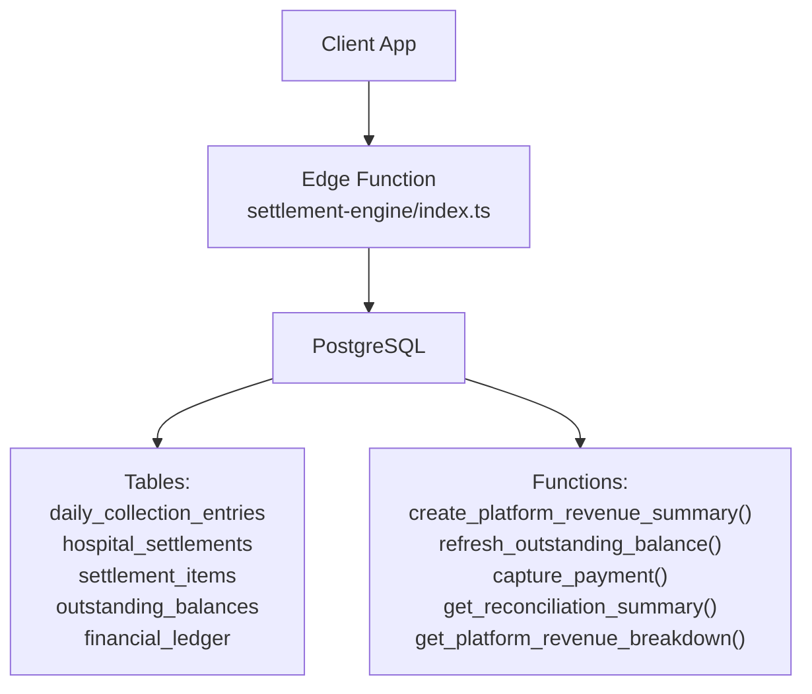
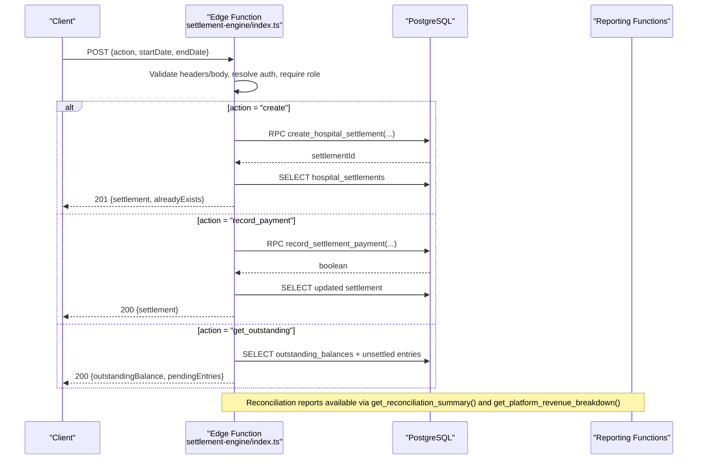
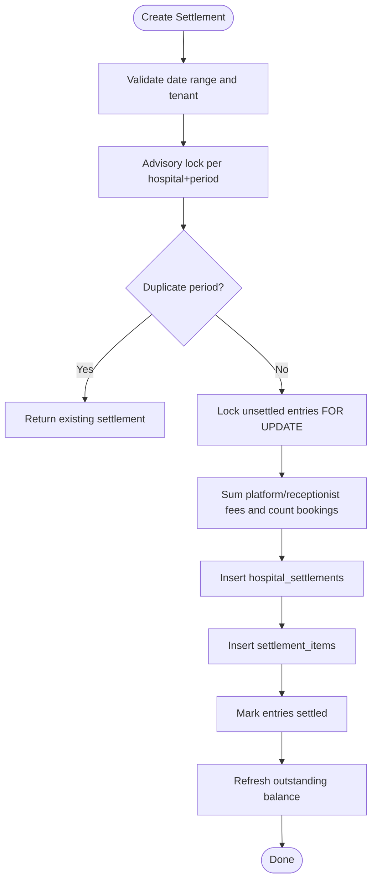
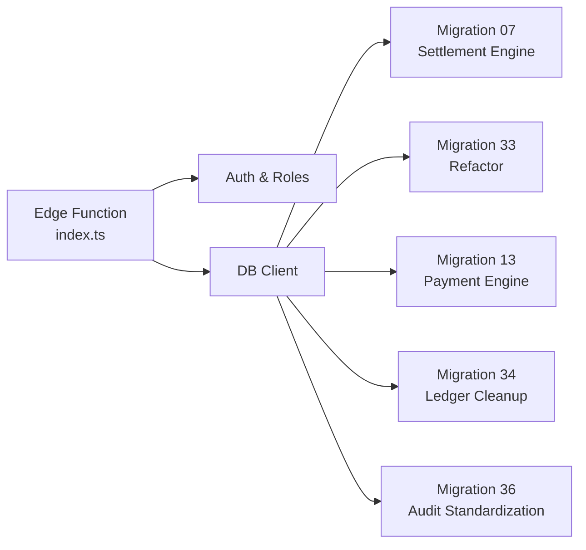

# Settlement Engine

<cite>
**Referenced Files in This Document**
- [index.ts](file://supabase/functions/settlement-engine/index.ts)
- [07_settlement_engine.sql](file://supabase/migrations/07_settlement_engine.sql)
- [33_settlement_engine_refactor.sql](file://supabase/migrations/33_settlement_engine_refactor.sql)
- [13_payment_engine.sql](file://supabase/migrations/13_payment_engine.sql)
- [34_payment_ledger_cleanup.sql](file://supabase/migrations/34_payment_ledger_cleanup.sql)
- [36_audit_standardization.sql](file://supabase/migrations/36_audit_standardization.sql)
</cite>

## Table of Contents

1. Introduction
2. Project Structure
3. Core Components
4. Architecture Overview
5. Detailed Component Analysis
6. Dependency Analysis
7. Performance Considerations
8. Troubleshooting Guide
9. Conclusion
10. Appendices

## Introduction

This document explains the settlement engine that handles multi-party fee
distribution and financial reconciliation for a hospital operations platform. It
covers how fees are calculated for doctors, hospitals, and platform commissions;
how settlements are processed; and how financial reports are generated. It also
documents the settlement lifecycle, batch processing patterns, integration with
accounting systems via the financial ledger, multi-tenant isolation, currency
handling (INR), compliance reporting (GST), and audit trails for financial
transactions.

The system uses an immutable daily collection model to snapshot each booking’s
financials at appointment time, then aggregates them into per-hospital
settlement summaries. The current business model captures platform revenue
directly at booking time via Razorpay, so settlements represent revenue
summaries rather than outstanding payments from hospitals.

## Project Structure

The settlement engine is implemented as:

- An Edge Function endpoint that validates requests, enforces idempotency, and
  calls database functions to create settlements or record payments.
- Database migrations that define tables, constraints, triggers, and stored
  procedures for collection entries, settlements, items, outstanding balances,
  payment capture, and reconciliation reports.
- Audit and security policies that enforce multi-tenant isolation and provide
  comprehensive logging.

**Diagram sources**

- [index.ts:55-113](file://supabase/functions/settlement-engine/index.ts#L55-L113)
- [07_settlement_engine.sql:30-107](file://supabase/migrations/07_settlement_engine.sql#L30-L107)
- [33_settlement_engine_refactor.sql:171-303](file://supabase/migrations/33_settlement_engine_refactor.sql#L171-L303)
- [13_payment_engine.sql:489-584](file://supabase/migrations/13_payment_engine.sql#L489-L584)
- [34_payment_ledger_cleanup.sql:117-243](file://supabase/migrations/34_payment_ledger_cleanup.sql#L117-L243)

**Section sources**

- [index.ts:55-113](file://supabase/functions/settlement-engine/index.ts#L55-L113)
- [07_settlement_engine.sql:30-107](file://supabase/migrations/07_settlement_engine.sql#L30-L107)
- [33_settlement_engine_refactor.sql:171-303](file://supabase/migrations/33_settlement_engine_refactor.sql#L171-L303)
- [13_payment_engine.sql:489-584](file://supabase/migrations/13_payment_engine.sql#L489-L584)
- [34_payment_ledger_cleanup.sql:117-243](file://supabase/migrations/34_payment_ledger_cleanup.sql#L117-L243)

## Core Components

- Daily Collection Entries: Immutable snapshots of each booking’s financials
  (platform fee, receptionist fee, hospital fee, total amount). A generated
  column computes SETURA revenue as platform fee plus receptionist fee.
- Hospital Settlements: Per-hospital summaries for a date range, capturing
  totals for platform and receptionist fees, number of bookings, and status.
- Settlement Items: Line-item linkage between a settlement and its underlying
  collection entries.
- Outstanding Balances: Aggregated view of unsettled amounts per hospital used
  by UI and reporting.
- Payment Capture and Ledger: Records actual money flows (booking fee collected,
  gateway fees, GST) and supports reconciliation.
- Reconciliation Reports: SQL functions to summarize collections, refunds, and
  net revenue for accounting and compliance.

Key responsibilities:

- Calculate fees per booking and persist immutable snapshots.
- Aggregate snapshots into settlement summaries for billing periods.
- Maintain accurate outstanding balances and settlement statuses.
- Provide audit trails and compliance reports.

**Section sources**

- [07_settlement_engine.sql:30-107](file://supabase/migrations/07_settlement_engine.sql#L30-L107)
- [07_settlement_engine.sql:113-186](file://supabase/migrations/07_settlement_engine.sql#L113-L186)
- [07_settlement_engine.sql:209-238](file://supabase/migrations/07_settlement_engine.sql#L209-L238)
- [07_settlement_engine.sql:244-256](file://supabase/migrations/07_settlement_engine.sql#L244-L256)
- [33_settlement_engine_refactor.sql:43-66](file://supabase/migrations/33_settlement_engine_refactor.sql#L43-L66)
- [13_payment_engine.sql:489-584](file://supabase/migrations/13_payment_engine.sql#L489-L584)
- [34_payment_ledger_cleanup.sql:117-243](file://supabase/migrations/34_payment_ledger_cleanup.sql#L117-L243)

## Architecture Overview

The settlement engine follows a clear separation of concerns:

- API layer (Edge Function): Validates input, enforces roles and tenant
  isolation, ensures idempotency, and delegates to database functions.
- Data layer (PostgreSQL): Enforces business rules via constraints, triggers,
  and stored procedures; maintains immutability of collection entries and
  atomicity of settlements.
- Reporting layer (SQL functions): Provides reconciliation and compliance
  reports for accounting systems.

**Diagram sources**

- [index.ts:55-113](file://supabase/functions/settlement-engine/index.ts#L55-L113)
- [index.ts:231-393](file://supabase/functions/settlement-engine/index.ts#L231-L393)
- [index.ts:395-480](file://supabase/functions/settlement-engine/index.ts#L395-L480)
- [07_settlement_engine.sql:316-434](file://supabase/migrations/07_settlement_engine.sql#L316-L434)
- [33_settlement_engine_refactor.sql:171-303](file://supabase/migrations/33_settlement_engine_refactor.sql#L171-L303)
- [13_payment_engine.sql:489-584](file://supabase/migrations/13_payment_engine.sql#L489-L584)
- [34_payment_ledger_cleanup.sql:279-351](file://supabase/migrations/34_payment_ledger_cleanup.sql#L279-L351)

## Detailed Component Analysis

### Settlement Calculation Algorithms and Fee Structures

- Fee components per booking:
  - Platform fee: Revenue retained by the platform.
  - Receptionist fee: Incentive or fee attributed to receptionists.
  - Hospital fee: Informational only; not collected by the platform under the
    current model.
- SETURA revenue per booking is computed as platform fee plus receptionist fee
  via a generated column.
- Settlement aggregation sums platform and receptionist fees across all
  unsettled collection entries within the specified date range and counts
  bookings.

Complexity considerations:

- Aggregation scans filtered indexes on hospital_id and collection_date; typical
  O(n) over unsettled entries in the window.
- Advisory locks prevent concurrent duplicate settlements per hospital+period.

Optimization opportunities:

- Ensure indexes on hospital_id and collection_date remain selective.
- Batch settlement creation for large windows to avoid long-running
  transactions.

**Section sources**

- [07_settlement_engine.sql:30-84](file://supabase/migrations/07_settlement_engine.sql#L30-L84)
- [33_settlement_engine_refactor.sql:43-66](file://supabase/migrations/33_settlement_engine_refactor.sql#L43-L66)
- [07_settlement_engine.sql:316-434](file://supabase/migrations/07_settlement_engine.sql#L316-L434)
- [33_settlement_engine_refactor.sql:171-303](file://supabase/migrations/33_settlement_engine_refactor.sql#L171-L303)

### Settlement Processing and Lifecycle Management

- Creation:
  - Idempotent by unique constraint on hospital_id + start/end dates (extended
    with settlement_type).
  - Uses advisory lock to serialize concurrent attempts.
  - Locks unsettled rows to prevent double settlement.
  - Inserts summary row and line items, marks entries settled, refreshes
    outstanding balance.
- Status transitions:
  - Legacy flow allowed partial payments; current online model sets status to
    paid immediately since revenue is captured at booking time.
- Deletion/Modification:
  - Collection entries are immutable; settlements link to them via
    settlement_items.
  - Row-level security restricts access to tenant data.

**Diagram sources**

- [07_settlement_engine.sql:316-434](file://supabase/migrations/07_settlement_engine.sql#L316-L434)
- [33_settlement_engine_refactor.sql:171-303](file://supabase/migrations/33_settlement_engine_refactor.sql#L171-L303)

**Section sources**

- [index.ts:231-393](file://supabase/functions/settlement-engine/index.ts#L231-L393)
- [07_settlement_engine.sql:316-434](file://supabase/migrations/07_settlement_engine.sql#L316-L434)
- [33_settlement_engine_refactor.sql:171-303](file://supabase/migrations/33_settlement_engine_refactor.sql#L171-L303)

### Payout Scheduling and Accounting Integration

- Current model: No direct payout from hospital to platform; platform revenue is
  captured at booking time via Razorpay.
- Accounting integration:
  - capture_payment writes ledger entries for booking fee collected, gateway
    fees, and GST liability.
  - Reconciliation functions aggregate ledger data for accounting systems.
- Payout scheduling:
  - Not applicable for platform-to-hospital payouts under the current model;
    settlements act as revenue summaries.
  - If future models require payouts, additional ledger types and workflows
    would be needed.

**Section sources**

- [34_payment_ledger_cleanup.sql:117-243](file://supabase/migrations/34_payment_ledger_cleanup.sql#L117-L243)
- [13_payment_engine.sql:489-584](file://supabase/migrations/13_payment_engine.sql#L489-L584)
- [33_settlement_engine_refactor.sql:146-163](file://supabase/migrations/33_settlement_engine_refactor.sql#L146-L163)

### Multi-Tenant Isolation, Currency Handling, and Compliance Reporting

- Multi-tenant isolation:
  - Every table includes hospital_id; Row Level Security policies restrict
    access based on user roles and hospital context.
  - Edge Function requires X-Hospital-ID header and validates roles.
- Currency handling:
  - All monetary fields use NUMERIC(12,2) or NUMERIC(14,2) representing INR.
  - Gateway fees and GST are tracked in INR.
- Compliance reporting:
  - GST enabled per hospital policy; capture_payment records gst_debit entries
    when enabled.
  - get_platform_revenue_breakdown provides net revenue after gateway fees and
    GST.
  - get_reconciliation_summary provides broader financial reconciliation
    metrics.

**Section sources**

- [07_settlement_engine.sql:578-647](file://supabase/migrations/07_settlement_engine.sql#L578-L647)
- [index.ts:68-92](file://supabase/functions/settlement-engine/index.ts#L68-L92)
- [34_payment_ledger_cleanup.sql:158-181](file://supabase/migrations/34_payment_ledger_cleanup.sql#L158-L181)
- [34_payment_ledger_cleanup.sql:279-351](file://supabase/migrations/34_payment_ledger_cleanup.sql#L279-L351)
- [13_payment_engine.sql:489-584](file://supabase/migrations/13_payment_engine.sql#L489-L584)

### Dispute Handling and Audit Trails

- Audit trail:
  - Edge Function logs audit events for settlement creation and payment
    recording.
  - Financial ledger entries are immutable (triggers prevent updates/deletes).
  - Audit standardization provides action type registry and coverage reporting.
- Dispute handling:
  - Settlement status enum includes disputed; however, no explicit dispute
    workflow is implemented in the referenced files.
  - Refunds are recorded via refund_debit ledger entries; settlement
    reconciliation accounts for refunds.

**Section sources**

- [index.ts:373-386](file://supabase/functions/settlement-engine/index.ts#L373-L386)
- [index.ts:458-469](file://supabase/functions/settlement-engine/index.ts#L458-L469)
- [13_payment_engine.sql:386-404](file://supabase/migrations/13_payment_engine.sql#L386-L404)
- [36_audit_standardization.sql:593-649](file://supabase/migrations/36_audit_standardization.sql#L593-L649)

## Dependency Analysis

The settlement engine depends on several core modules:

- Edge Function depends on shared utilities for CORS, auth, DB client, logging,
  tracing, metrics, idempotency, validation, and error handling.
- Database functions depend on tables and constraints defined in migrations.
- Reporting functions depend on financial ledger and booking data.

**Diagram sources**

- [index.ts:12-30](file://supabase/functions/settlement-engine/index.ts#L12-L30)
- [07_settlement_engine.sql:30-107](file://supabase/migrations/07_settlement_engine.sql#L30-L107)
- [33_settlement_engine_refactor.sql:171-303](file://supabase/migrations/33_settlement_engine_refactor.sql#L171-L303)
- [13_payment_engine.sql:489-584](file://supabase/migrations/13_payment_engine.sql#L489-L584)
- [34_payment_ledger_cleanup.sql:117-243](file://supabase/migrations/34_payment_ledger_cleanup.sql#L117-L243)
- [36_audit_standardization.sql:593-649](file://supabase/migrations/36_audit_standardization.sql#L593-L649)

**Section sources**

- [index.ts:12-30](file://supabase/functions/settlement-engine/index.ts#L12-L30)
- [07_settlement_engine.sql:30-107](file://supabase/migrations/07_settlement_engine.sql#L30-L107)
- [33_settlement_engine_refactor.sql:171-303](file://supabase/migrations/33_settlement_engine_refactor.sql#L171-L303)
- [13_payment_engine.sql:489-584](file://supabase/migrations/13_payment_engine.sql#L489-L584)
- [34_payment_ledger_cleanup.sql:117-243](file://supabase/migrations/34_payment_ledger_cleanup.sql#L117-L243)
- [36_audit_standardization.sql:593-649](file://supabase/migrations/36_audit_standardization.sql#L593-L649)

## Performance Considerations

- Indexing:
  - Ensure indexes on hospital_id and collection_date are maintained for
    efficient aggregation and filtering.
- Concurrency:
  - Advisory locks serialize settlement creation per hospital+period to prevent
    duplicates.
  - Row-level locking prevents concurrent modifications during settlement
    creation.
- Batch processing:
  - For large date ranges, consider batching settlement creation to reduce
    transaction duration and lock contention.
- Reporting:
  - Use read-only reconciliation functions for reporting to avoid write locks.

[No sources needed since this section provides general guidance]

## Troubleshooting Guide

Common issues and resolutions:

- Duplicate settlement errors:
  - Occur when attempting to create a settlement for an already-summarized
    period.
  - Resolution: Query existing settlement or adjust date range.
- Invalid date range:
  - Start date must be less than or equal to end date.
  - Resolution: Correct the date inputs.
- Missing tenant context:
  - Edge Function requires X-Hospital-ID header; missing header results in
    validation error.
  - Resolution: Include correct tenant header in requests.
- Payment recording no-op:
  - In the current model, record_settlement_payment is deprecated and returns
    false with a notice.
  - Resolution: Use settlement summaries; do not attempt to record payments
    against settlements.
- Reconciliation discrepancies:
  - Verify ledger entries for booking_fee_collected, gateway_fee_debit,
    gst_debit, and refund_debit.
  - Use get_reconciliation_summary and get_platform_revenue_breakdown to
    diagnose differences.

**Section sources**

- [index.ts:243-289](file://supabase/functions/settlement-engine/index.ts#L243-L289)
- [index.ts:395-480](file://supabase/functions/settlement-engine/index.ts#L395-L480)
- [07_settlement_engine.sql:316-434](file://supabase/migrations/07_settlement_engine.sql#L316-L434)
- [33_settlement_engine_refactor.sql:146-163](file://supabase/migrations/33_settlement_engine_refactor.sql#L146-L163)
- [13_payment_engine.sql:489-584](file://supabase/migrations/13_payment_engine.sql#L489-L584)
- [34_payment_ledger_cleanup.sql:279-351](file://supabase/migrations/34_payment_ledger_cleanup.sql#L279-L351)

## Conclusion

The settlement engine implements a robust, auditable, and compliant approach to
multi-party fee distribution and financial reconciliation. It leverages
immutable collection entries, atomic settlement creation, and comprehensive
reporting to ensure accuracy and transparency. The current model captures
platform revenue at booking time, making settlements revenue summaries rather
than outstanding payment obligations. Multi-tenant isolation, currency handling
in INR, and GST compliance are enforced through schema design, policies, and
ledger entries. Audit trails and reconciliation functions support operational
visibility and accounting integration.

[No sources needed since this section summarizes without analyzing specific
files]

## Appendices

### Example: Settlement Calculation

- Inputs: hospital_id, start_date, end_date.
- Process:
  - Sum platform_fee and receptionist_fee for unsettled entries in the date
    range.
  - Count bookings.
  - Create settlement summary and link line items.
  - Mark entries settled and refresh outstanding balance.
- Outputs: settlement_id, totals, status.

**Section sources**

- [07_settlement_engine.sql:316-434](file://supabase/migrations/07_settlement_engine.sql#L316-L434)
- [33_settlement_engine_refactor.sql:171-303](file://supabase/migrations/33_settlement_engine_refactor.sql#L171-L303)

### Example: Batch Processing

- Strategy:
  - Iterate over hospital tenants and date ranges.
  - Call create_platform_revenue_summary for each period.
  - Handle duplicates gracefully using idempotency keys and error checks.
- Monitoring:
  - Track metrics and audit events for each batch operation.

**Section sources**

- [index.ts:231-393](file://supabase/functions/settlement-engine/index.ts#L231-L393)
- [33_settlement_engine_refactor.sql:171-303](file://supabase/migrations/33_settlement_engine_refactor.sql#L171-L303)

### Example: Integration with Accounting Systems

- Use get_reconciliation_summary for broad financial metrics.
- Use get_platform_revenue_breakdown for detailed breakdown including gateway
  fees and GST.
- Export ledger entries for external accounting systems.

**Section sources**

- [13_payment_engine.sql:489-584](file://supabase/migrations/13_payment_engine.sql#L489-L584)
- [34_payment_ledger_cleanup.sql:279-351](file://supabase/migrations/34_payment_ledger_cleanup.sql#L279-L351)
