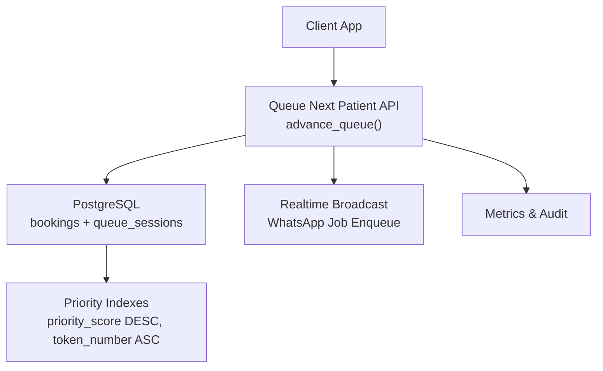
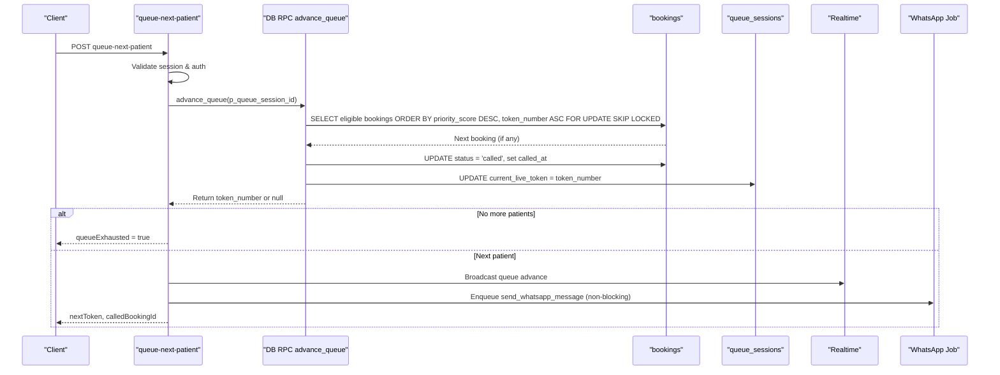
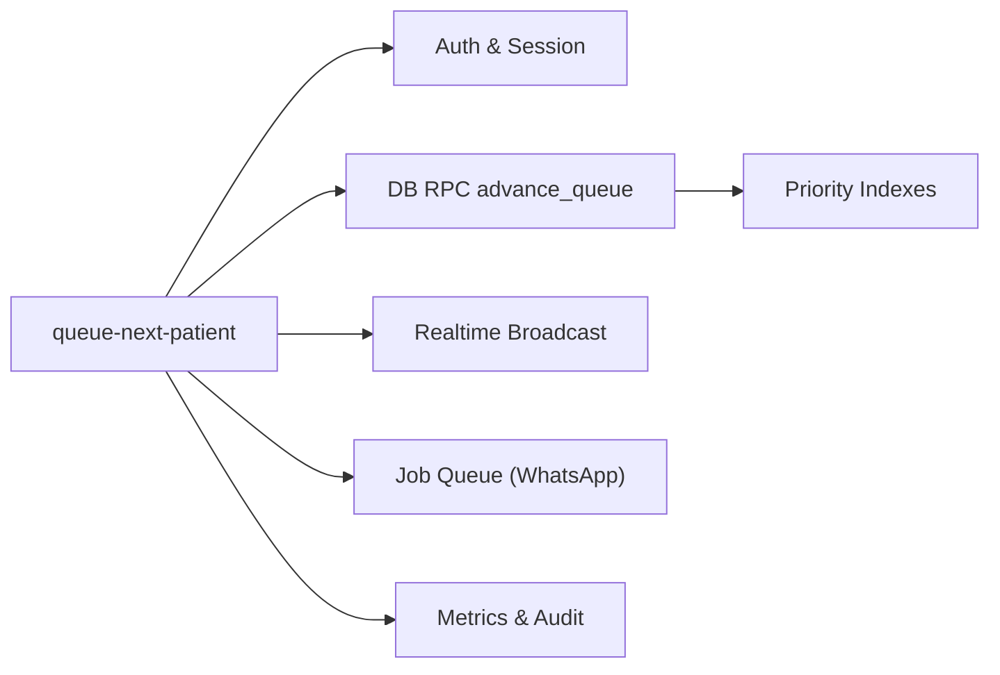

# Priority Processing Engine

<cite>
**Referenced Files in This Document**
- [queue-next-patient/index.ts](file://supabase/functions/queue-next-patient/index.ts)
- [02_atomic_token_engine_&_bookings.sql](file://supabase/migrations/02_atomic_token_engine_&_bookings.sql)
- [17_queue_monitoring_engine.sql](file://supabase/migrations/17_queue_monitoring_engine.sql)
- [create-booking/index.ts](file://supabase/functions/create-booking/index.ts)
- [_shared/types.ts](file://supabase/functions/_shared/types.ts)
- [update-booking-status/index.ts](file://supabase/functions/update-booking-status/index.ts)
</cite>

## Table of Contents

1. [Introduction](#introduction)
2. [Project Structure](#project-structure)
3. [Core Components](#core-components)
4. [Architecture Overview](#architecture-overview)
5. [Detailed Component Analysis](#detailed-component-analysis)
6. [Dependency Analysis](#dependency-analysis)
7. [Performance Considerations](#performance-considerations)
8. [Troubleshooting Guide](#troubleshooting-guide)
9. [Conclusion](#conclusion)

## Introduction

This document explains the priority processing engine that selects and advances
patients in the queue based on priority rules. It covers how priority levels are
represented, how token selection is performed, how priorities interact with
queue ordering, business rules for assignment and overrides, fairness
considerations, examples for setting priorities, handling conflicts, monitoring
performance, and edge cases such as escalation, de-prioritization, and no-shows.

## Project Structure

The priority processing engine spans a few key areas:

- Queue advancement API function that triggers priority-based selection
- Database schema defining bookings, queue sessions, and indexes that enforce
  priority ordering
- Monitoring and metrics infrastructure to observe queue health and performance
- Booking creation flow that integrates with queue sessions and can estimate
  wait times
- Status transition logic that supports no-show and other lifecycle events

**Diagram sources**

- [queue-next-patient/index.ts:156-184](file://supabase/functions/queue-next-patient/index.ts#L156-L184)
- [02_atomic_token_engine_&_bookings.sql:576-622](file://supabase/migrations/02_atomic_token_engine_&_bookings.sql#L576-L622)
- [02_atomic_token_engine_&_bookings.sql:302-320](file://supabase/migrations/02_atomic_token_engine_&_bookings.sql#L302-L320)

**Section sources**

- [queue-next-patient/index.ts:1-409](file://supabase/functions/queue-next-patient/index.ts#L1-L409)
- [02_atomic_token_engine_&_bookings.sql:1-827](file://supabase/migrations/02_atomic_token_engine_&_bookings.sql#L1-L827)
- [17_queue_monitoring_engine.sql:1-928](file://supabase/migrations/17_queue_monitoring_engine.sql#L1-L928)

## Core Components

- Queue advancement endpoint: Validates session, calls the database function to
  select the next patient by priority, updates state, broadcasts changes,
  enqueues notifications, and records metrics/audit.
- Priority-aware selection: The database function orders eligible bookings by
  priority_score descending, then token_number ascending, using SKIP LOCKED to
  avoid contention.
- Priority fields: Each booking carries a numeric priority_score and a boolean
  priority_flag used in ordering and indexing.
- Monitoring: Snapshotting and alerting functions capture queue health and
  backlog conditions.

Key behaviors:

- Only eligible statuses (booked, checked_in, waiting) are considered for
  selection.
- When selected, the booking status becomes called and the queue session’s
  current_live_token is updated.
- Non-blocking side effects: realtime broadcast and WhatsApp notification
  enqueue do not block queue progression.

**Section sources**

- [queue-next-patient/index.ts:101-184](file://supabase/functions/queue-next-patient/index.ts#L101-L184)
- [02_atomic_token_engine_&_bookings.sql:576-622](file://supabase/migrations/02_atomic_token_engine_&_bookings.sql#L576-L622)
- [02_atomic_token_engine_&_bookings.sql:302-320](file://supabase/migrations/02_atomic_token_engine_&_bookings.sql#L302-L320)

## Architecture Overview

The priority processing engine uses a two-layer approach:

- Application layer (Edge Function): Orchestrates validation, concurrency
  control via RPC, and non-blocking side effects.
- Data layer (PostgreSQL): Implements atomic, concurrent-safe selection with
  explicit priority ordering and indexes.

**Diagram sources**

- [queue-next-patient/index.ts:156-184](file://supabase/functions/queue-next-patient/index.ts#L156-L184)
- [queue-next-patient/index.ts:217-320](file://supabase/functions/queue-next-patient/index.ts#L217-L320)
- [02_atomic_token_engine_&_bookings.sql:576-622](file://supabase/migrations/02_atomic_token_engine_&_bookings.sql#L576-L622)

## Detailed Component Analysis

### Priority Levels and Representation

- Numeric priority_score: A per-booking integer used to rank patients. Higher
  values indicate higher priority.
- Boolean priority_flag: A flag that participates in indexing and can be used to
  quickly identify priority-marked bookings.
- Default values: Both fields have defaults in the schema; priority_score
  defaults to 0 and priority_flag to false.

Interpretation:

- Emergency/Urgent/Normal mapping is not enforced by a dedicated enum in the
  schema; instead, it is implemented by assigning appropriate priority_score
  values at creation time and optionally setting priority_flag. For example,
  emergency could map to a high score, urgent to medium, normal to low or zero.

Where this is defined:

- Bookings table includes priority_score and priority_flag columns.
- Indexes leverage these fields to optimize priority-based queries.

**Section sources**

- [02_atomic_token_engine_&_bookings.sql:187-189](file://supabase/migrations/02_atomic_token_engine_&_bookings.sql#L187-L189)
- [02_atomic_token_engine_&_bookings.sql:302-320](file://supabase/migrations/02_atomic_token_engine_&_bookings.sql#L302-L320)
- [_shared/types.ts:145-192](file://supabase/functions/_shared/types.ts#L145-L192)

### Priority-Based Token Selection Algorithm

The core selection algorithm is implemented in the database function:

- Eligibility filter: Only bookings with status in (booked, checked_in, waiting)
  and not deleted are considered.
- Ordering: primary sort by priority_score descending, secondary sort by
  token_number ascending.
- Concurrency safety: Uses FOR UPDATE SKIP LOCKED to prevent race conditions
  when multiple callers advance the queue concurrently.
- State update: Sets status to called and records called_at; updates queue
  session’s current_live_token to the selected token.

Complexity:

- With the dedicated index on (priority_flag, priority_score DESC, token_number
  ASC), selection is efficient even under load.

**Section sources**

- [02_atomic_token_engine_&_bookings.sql:576-622](file://supabase/migrations/02_atomic_token_engine_&_bookings.sql#L576-L622)
- [02_atomic_token_engine_&_bookings.sql:302-320](file://supabase/migrations/02_atomic_token_engine_&_bookings.sql#L302-L320)

### Interaction with Queue Ordering

- Token numbers provide FIFO ordering within the same priority level.
- The combination of priority_score DESC and token_number ASC ensures that among
  equal priorities, earlier tokens are served first.
- Queue session tracks current_live_token to reflect the last advanced token.

Practical effect:

- Emergency patients (higher priority_score) jump ahead of lower priority
  patients regardless of arrival order.
- Among emergency patients, the earliest token number is served first.

**Section sources**

- [02_atomic_token_engine_&_bookings.sql:576-622](file://supabase/migrations/02_atomic_token_engine_&_bookings.sql#L576-L622)
- [02_atomic_token_engine_&_bookings.sql:81-116](file://supabase/migrations/02_atomic_token_engine_&_bookings.sql#L81-L116)

### Business Rules for Priority Assignment

- Assignment occurs at booking creation time. While the create-booking function
  does not explicitly set priority_score/priority_flag in the code path shown,
  the schema provides these fields so that upstream processes or configuration
  can assign them during creation or subsequent updates.
- Typical mapping strategy:
  - Emergency: highest priority_score value
  - Urgent: medium-high priority_score
  - Normal: default or low priority_score
- The priority_flag can be used to mark bookings that should be prioritized,
  complementing the numeric score.

Note: If your system requires automatic scoring based on clinical flags (e.g.,
has_diabetes, has_bp), implement that logic in the booking creation or an update
routine before the booking enters the queue.

**Section sources**

- [02_atomic_token_engine_&_bookings.sql:187-189](file://supabase/migrations/02_atomic_token_engine_&_bookings.sql#L187-L189)
- [create-booking/index.ts:421-446](file://supabase/functions/create-booking/index.ts#L421-L446)

### Override Mechanisms

- Manual override: Update a booking’s priority_score and/or priority_flag to
  change its position in the queue. This is effective immediately for the next
  advance operation.
- Session-level controls: Queue sessions track capacity and live token; ensure
  that overrides respect max_tokens and active session constraints.

Operational guidance:

- Use role-based access policies to restrict who can update priorities
  (hospital_admin, receptionist, doctor per policies).
- Always audit priority changes to maintain accountability.

**Section sources**

- [02_atomic_token_engine_&_bookings.sql:776-807](file://supabase/migrations/02_atomic_token_engine_&_bookings.sql#L776-L807)
- [queue-next-patient/index.ts:322-355](file://supabase/functions/queue-next-patient/index.ts#L322-L355)

### Fairness Considerations

- Within the same priority level, FIFO is preserved via token_number ordering.
- SKIP LOCKED prevents starvation by ensuring each caller gets a distinct row
  without blocking others indefinitely.
- Avoid excessive priority inflation; consider caps or thresholds to prevent
  lower-priority patients from being starved.

Monitoring:

- Track queue exhaustion, next token distribution, and wait times to detect
  unfairness patterns.

**Section sources**

- [02_atomic_token_engine_&_bookings.sql:576-622](file://supabase/migrations/02_atomic_token_engine_&_bookings.sql#L576-L622)
- [queue-next-patient/index.ts:186-213](file://supabase/functions/queue-next-patient/index.ts#L186-L213)

### Examples: Setting Patient Priorities

- At booking creation: Assign priority_score and priority_flag according to
  policy (e.g., emergency = high score, urgent = medium, normal = low/zero).
- Post-creation adjustment: Update priority_score/priority_flag if a patient’s
  condition changes or if an administrative override is required.
- Ensure updates occur before the booking transitions into
  called/in_consultation states.

Implementation pointers:

- Use the booking update endpoint or direct DB updates with proper
  authorization.
- Log all priority changes via audit events.

**Section sources**

- [02_atomic_token_engine_&_bookings.sql:187-189](file://supabase/migrations/02_atomic_token_engine_&_bookings.sql#L187-L189)
- [update-booking-status/index.ts:329-402](file://supabase/functions/update-booking-status/index.ts#L329-L402)

### Handling Priority Conflicts

- Equal priority_score: Resolved by token_number ASC (earliest token first).
- Multiple callers advancing simultaneously: FOR UPDATE SKIP LOCKED ensures
  deterministic selection without deadlocks.
- If a selected patient is unavailable (e.g., no-show), the next call will pick
  the next eligible booking according to priority and token order.

**Section sources**

- [02_atomic_token_engine_&_bookings.sql:576-622](file://supabase/migrations/02_atomic_token_engine_&_bookings.sql#L576-L622)

### Monitoring Priority-Based Queue Performance

- Realtime broadcast: Notifies dashboards when the queue advances.
- Metrics: Increments for queue.advanced, queue.exhausted, and timing for
  request.total.
- Queue health snapshots: Functions capture pending, processing, failed, and
  throughput metrics periodically.

Operational tips:

- Watch queue.exhausted spikes to detect overflows.
- Monitor oldest_pending_age and throughput_per_minute to assess fairness and
  responsiveness.

**Section sources**

- [queue-next-patient/index.ts:257-320](file://supabase/functions/queue-next-patient/index.ts#L257-L320)
- [queue-next-patient/index.ts:357-374](file://supabase/functions/queue-next-patient/index.ts#L357-L374)
- [17_queue_monitoring_engine.sql:124-277](file://supabase/migrations/17_queue_monitoring_engine.sql#L124-L277)
- [17_queue_monitoring_engine.sql:407-488](file://supabase/migrations/17_queue_monitoring_engine.sql#L407-L488)

### Edge Cases

- Priority escalation: Increase priority_score for a patient whose condition
  worsens; they will move ahead on the next advance.
- De-prioritization: Decrease priority_score to defer treatment; ensure this
  aligns with clinical protocols.
- No-shows:
  - Marking a booking as no_show removes it from eligible statuses for
    selection.
  - Subsequent advances will skip to the next eligible booking.
  - Timestamps and events are recorded for audit and analytics.

Status transitions relevant to no-show:

- From waiting/called to no_show is supported by the status transition logic.

**Section sources**

- [02_atomic_token_engine_&_bookings.sql:385-440](file://supabase/migrations/02_atomic_token_engine_&_bookings.sql#L385-L440)
- [update-booking-status/index.ts:52-75](file://supabase/functions/update-booking-status/index.ts#L52-L75)
- [update-booking-status/index.ts:329-402](file://supabase/functions/update-booking-status/index.ts#L329-L402)

## Dependency Analysis

The priority engine depends on:

- Auth and session validation in the API function
- PostgreSQL functions and indexes for atomic, concurrent-safe selection
- Realtime and job queues for notifications
- Metrics and audit logging for observability

**Diagram sources**

- [queue-next-patient/index.ts:7-22](file://supabase/functions/queue-next-patient/index.ts#L7-L22)
- [queue-next-patient/index.ts:156-184](file://supabase/functions/queue-next-patient/index.ts#L156-L184)
- [02_atomic_token_engine_&_bookings.sql:302-320](file://supabase/migrations/02_atomic_token_engine_&_bookings.sql#L302-L320)

**Section sources**

- [queue-next-patient/index.ts:1-409](file://supabase/functions/queue-next-patient/index.ts#L1-L409)
- [02_atomic_token_engine_&_bookings.sql:302-320](file://supabase/migrations/02_atomic_token_engine_&_bookings.sql#L302-L320)

## Performance Considerations

- Index utilization: Ensure queries use the priority index to minimize scan
  costs.
- Concurrency: SKIP LOCKED avoids lock contention; monitor for increased retries
  or backpressure.
- Side effects: Keep realtime and WhatsApp enqueues non-blocking to preserve
  latency.
- Metrics: Use queue.exhausted and request.total timings to detect bottlenecks.

[No sources needed since this section provides general guidance]

## Troubleshooting Guide

Common issues and resolutions:

- Queue exhausted: Indicates no eligible bookings; verify statuses and filters.
- Advance failures: Check DB RPC errors and logs; ensure session is active and
  belongs to the correct hospital.
- Notification failures: WhatsApp enqueue errors are logged but do not block
  queue progression; investigate job queue health.
- Stuck jobs/backlog: Use queue health functions to detect stuck items and high
  backlogs.

Operational checks:

- Verify session validity and hospital scoping.
- Confirm eligibility filters (status in allowed set).
- Review metrics and audit logs for anomalies.

**Section sources**

- [queue-next-patient/index.ts:119-184](file://supabase/functions/queue-next-patient/index.ts#L119-L184)
- [queue-next-patient/index.ts:186-213](file://supabase/functions/queue-next-patient/index.ts#L186-L213)
- [queue-next-patient/index.ts:274-320](file://supabase/functions/queue-next-patient/index.ts#L274-L320)
- [17_queue_monitoring_engine.sql:283-401](file://supabase/migrations/17_queue_monitoring_engine.sql#L283-L401)

## Conclusion

The priority processing engine implements robust, concurrent-safe selection of
patients based on priority_score and token_number. It balances urgency with
fairness through strict ordering and FIFO within equal priorities. Operational
safeguards include session validation, non-blocking side effects, comprehensive
metrics, and monitoring tools. By assigning appropriate priority scores and
managing status transitions (including no-shows), healthcare teams can ensure
timely care for critical patients while maintaining equitable service for
others.
