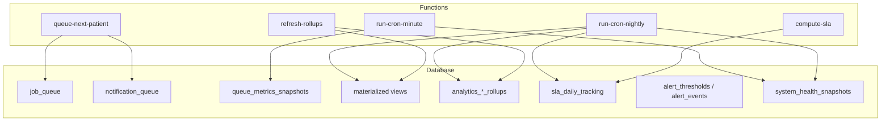
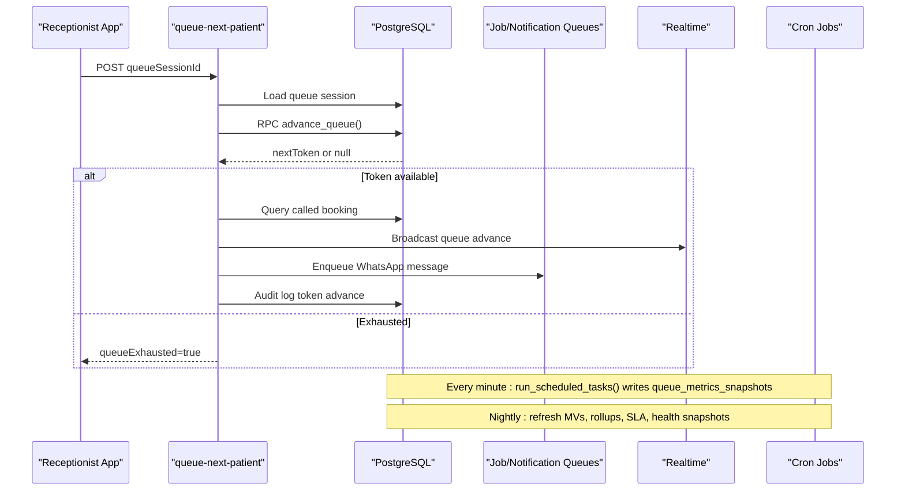
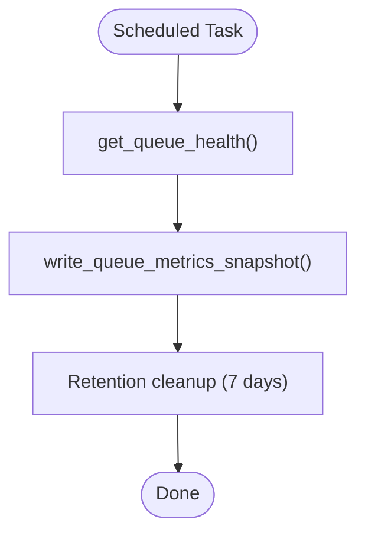
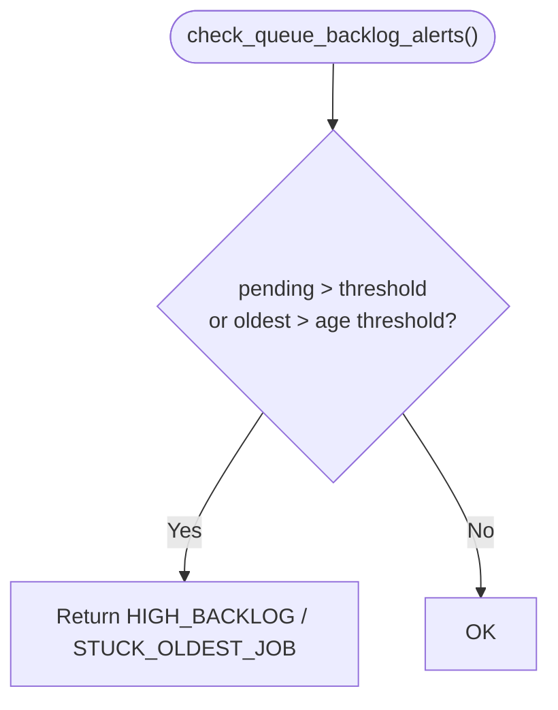
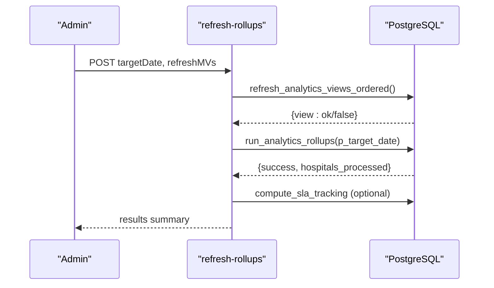
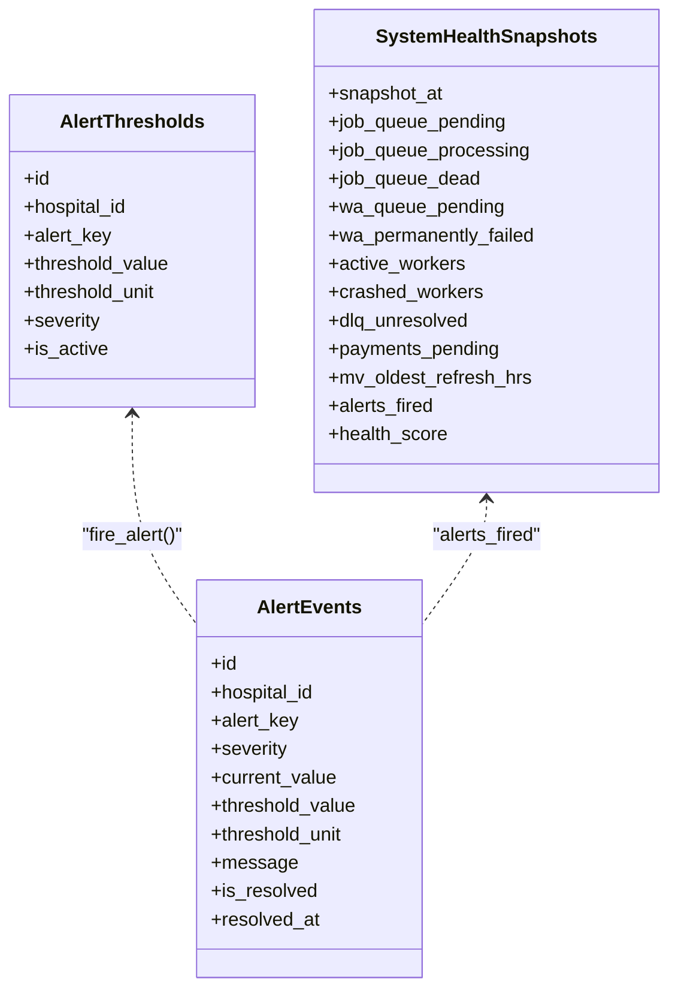
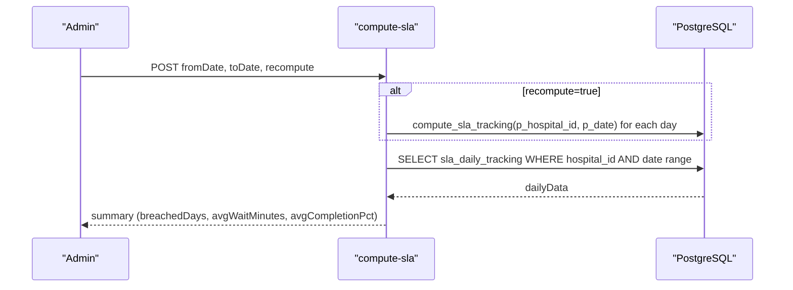
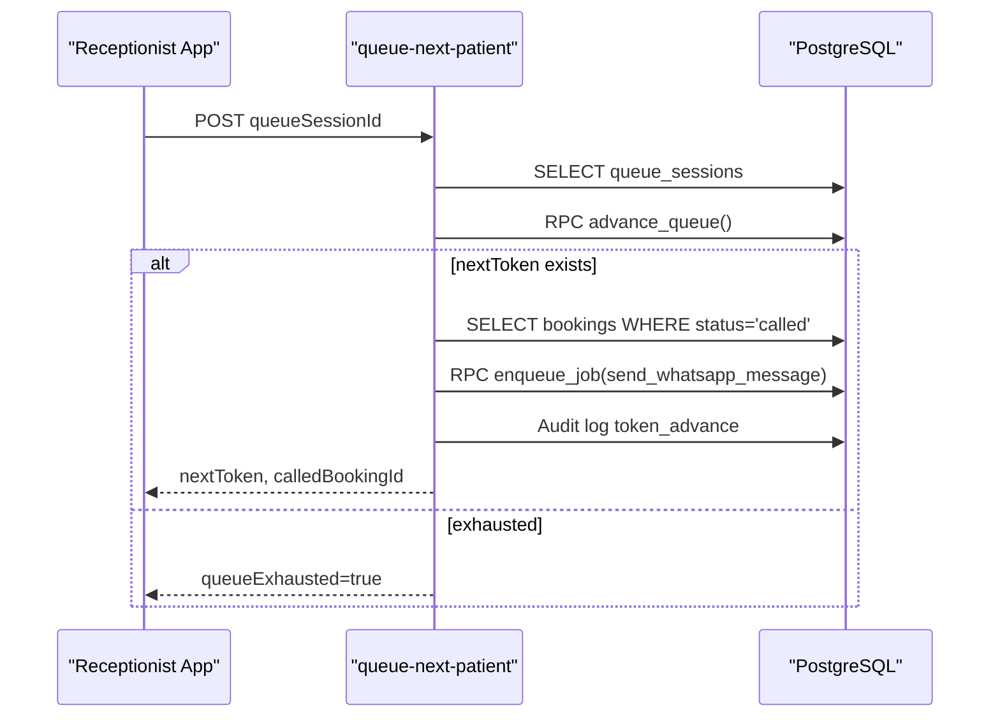
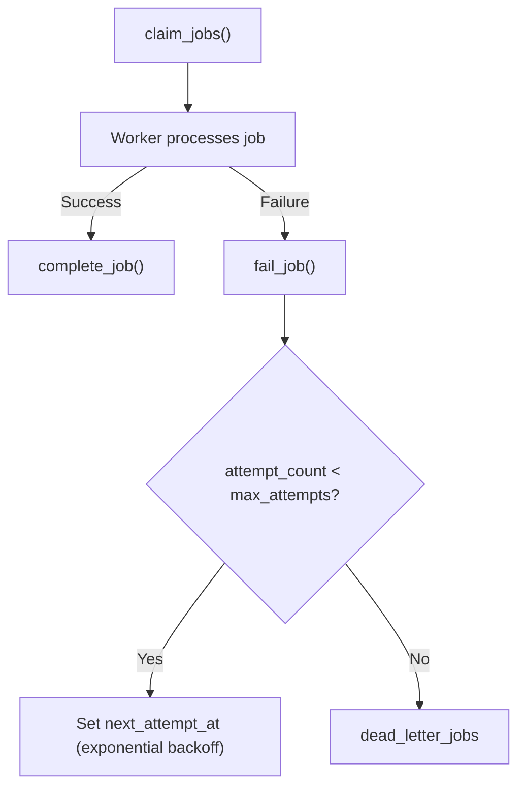
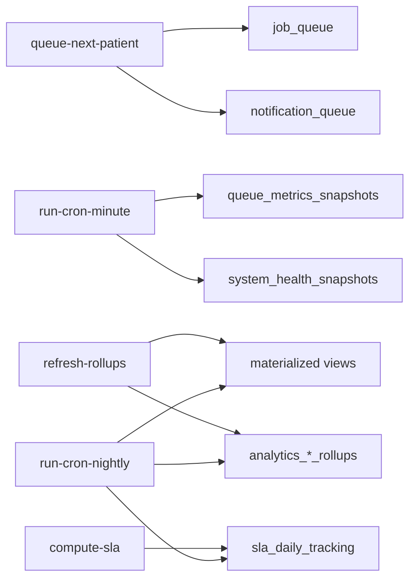

# Queue Analytics & Monitoring

<cite>
**Referenced Files in This Document**
- [17_queue_monitoring_engine.sql](file://supabase/migrations/17_queue_monitoring_engine.sql)
- [21_analytics_rollups.sql](file://supabase/migrations/21_analytics_rollups.sql)
- [24_operational-monitoring_engine.sql](file://supabase/migrations/24_operational-monitoring_engine.sql)
- [06_background_job_queue.sql](file://supabase/migrations/06_background_job_queue.sql)
- [05_notification_queue.sql](file://supabase/migrations/05_notification_queue.sql)
- [queue-next-patient/index.ts](file://supabase/functions/queue-next-patient/index.ts)
- [compute-sla/index.ts](file://supabase/functions/compute-sla/index.ts)
- [refresh-rollups/index.ts](file://supabase/functions/refresh-rollups/index.ts)
- [run-cron-minute/index.ts](file://supabase/functions/run-cron-minute/index.ts)
- [run-cron-nightly/index.ts](file://supabase/functions/run-cron-nightly/index.ts)
- [_shared/metrics.ts](file://supabase/functions/_shared/metrics.ts)
</cite>

## Table of Contents

1. Introduction
2. Project Structure
3. Core Components
4. Architecture Overview
5. Detailed Component Analysis
6. Dependency Analysis
7. Performance Considerations
8. Troubleshooting Guide
9. Conclusion
10. Appendices

## Introduction

This document explains the queue analytics and monitoring capabilities for the
hospital operations system. It covers how queue performance is measured (average
wait times, queue length statistics, patient flow rates, doctor utilization),
how queue sessions are tracked and analyzed, and how historical data is
materialized for reporting and dashboards. It also provides examples of queries
to generate reports on queue efficiency, identify bottlenecks, configure alert
thresholds, optimize performance, and troubleshoot slow queue operations.

## Project Structure

The queue analytics and monitoring system spans database migrations, serverless
functions, and scheduled jobs:

- Database layer: tables and functions for job queues, notification queues,
  metrics snapshots, rollups, SLA tracking, alerts, and health snapshots.
- Functions: endpoints to advance queue tokens, compute SLA, refresh rollups,
  and orchestrate periodic tasks.
- Cron jobs: minute-level and nightly orchestrators that collect metrics,
  refresh materialized views, run rollups, and compute SLA.

**Diagram sources**

- [17_queue_monitoring_engine.sql:14-74](file://supabase/migrations/17_queue_monitoring_engine.sql#L14-L74)
- [21_analytics_rollups.sql:34-160](file://supabase/migrations/21_analytics_rollups.sql#L34-L160)
- [24_operational-monitoring_engine.sql:37-185](file://supabase/migrations/24_operational-monitoring_engine.sql#L37-L185)
- [06_background_job_queue.sql:41-137](file://supabase/migrations/06_background_job_queue.sql#L41-L137)
- [05_notification_queue.sql:117-206](file://supabase/migrations/05_notification_queue.sql#L117-L206)
- [queue-next-patient/index.ts:101-167](file://supabase/functions/queue-next-patient/index.ts#L101-L167)
- [compute-sla/index.ts:125-135](file://supabase/functions/compute-sla/index.ts#L125-L135)
- [refresh-rollups/index.ts:154-206](file://supabase/functions/refresh-rollups/index.ts#L154-L206)
- [run-cron-minute/index.ts:136-153](file://supabase/functions/run-cron-minute/index.ts#L136-L153)
- [run-cron-nightly/index.ts:157-224](file://supabase/functions/run-cron-nightly/index.ts#L157-L224)

**Section sources**

- [17_queue_monitoring_engine.sql:14-74](file://supabase/migrations/17_queue_monitoring_engine.sql#L14-L74)
- [21_analytics_rollups.sql:34-160](file://supabase/migrations/21_analytics_rollups.sql#L34-L160)
- [24_operational-monitoring_engine.sql:37-185](file://supabase/migrations/24_operational-monitoring-engine.sql#L37-L185)
- [06_background_job_queue.sql:41-137](file://supabase/migrations/06_background_job_queue.sql#L41-L137)
- [05_notification_queue.sql:117-206](file://supabase/migrations/05_notification_queue.sql#L117-L206)
- [queue-next-patient/index.ts:101-167](file://supabase/functions/queue-next-patient/index.ts#L101-L167)
- [compute-sla/index.ts:125-135](file://supabase/functions/compute-sla/index.ts#L125-L135)
- [refresh-rollups/index.ts:154-206](file://supabase/functions/refresh-rollups/index.ts#L154-L206)
- [run-cron-minute/index.ts:136-153](file://supabase/functions/run-cron-minute/index.ts#L136-L153)
- [run-cron-nightly/index.ts:157-224](file://supabase/functions/run-cron-nightly/index.ts#L157-L224)

## Core Components

- Queue health and metrics snapshots:
  - A function aggregates live counts across job queue, WhatsApp messages, and
    notifications, then writes periodic snapshots with retention cleanup.
- Stuck job detection and backlog alerts:
  - Functions detect stuck processing jobs and evaluate backlog thresholds to
    raise alerts.
- Materialized view refresh and ordered analytics rollups:
  - Functions refresh multiple materialized views in dependency order and
    compute weekly/monthly/quarterly rollups plus global metrics.
- Operational monitoring:
  - Alert thresholds, alert events, health score computation, and system health
    snapshots provide real-time operational visibility.
- SLA tracking:
  - Daily SLA metrics are computed and exposed via an endpoint for reporting and
    breach analysis.
- Queue session advancement:
  - The queue-next-patient function advances tokens, broadcasts updates,
    enqueues WhatsApp notifications, and records audit events.

**Section sources**

- [17_queue_monitoring_engine.sql:124-488](file://supabase/migrations/17_queue_monitoring_engine.sql#L124-L488)
- [21_analytics_rollups.sql:222-529](file://supabase/migrations/21_analytics_rollups.sql#L222-L529)
- [24_operational-monitoring_engine.sql:194-447](file://supabase/migrations/24_operational-monitoring_engine.sql#L194-L447)
- [compute-sla/index.ts:94-198](file://supabase/functions/compute-sla/index.ts#L94-L198)
- [queue-next-patient/index.ts:157-388](file://supabase/functions/queue-next-patient/index.ts#L157-L388)

## Architecture Overview

The system uses a combination of real-time queue operations and scheduled
analytics:

- Real-time:
  - Receptionists or systems call queue-next-patient to advance patients; this
    triggers downstream notifications and audit logging.
  - Minute-level cron runs scheduled tasks including queue metrics snapshotting
    and health checks.
- Batch:
  - Nightly cron refreshes materialized views, computes analytics rollups,
    calculates SLA per hospital, performs retention cleanup, and schedules
    partitions.

**Diagram sources**

- [queue-next-patient/index.ts:101-388](file://supabase/functions/queue-next-patient/index.ts#L101-L388)
- [17_queue_monitoring_engine.sql:702-777](file://supabase/migrations/17_queue_monitoring_engine.sql#L702-L777)
- [run-cron-nightly/index.ts:157-224](file://supabase/functions/run-cron-nightly/index.ts#L157-L224)

## Detailed Component Analysis

### Queue Health and Metrics Snapshots

- Purpose: Capture live queue health across multiple queues and persist
  time-series snapshots for trend analysis.
- Key elements:
  - Aggregation function returns counts and oldest pending age for job queue,
    WhatsApp, and notifications.
  - Snapshot writer persists metrics with retention cleanup.
  - Backlog alert function evaluates thresholds and returns reasons.
  - Ordered refresh function manages materialized view refresh lifecycle.

**Diagram sources**

- [17_queue_monitoring_engine.sql:124-277](file://supabase/migrations/17_queue_monitoring_engine.sql#L124-L277)
- [17_queue_monitoring_engine.sql:407-488](file://supabase/migrations/17_queue_monitoring_engine.sql#L407-L488)

**Section sources**

- [17_queue_monitoring_engine.sql:124-488](file://supabase/migrations/17_queue_monitoring_engine.sql#L124-L488)

### Stuck Job Detection and Backlog Alerts

- Purpose: Identify long-running or stuck jobs and trigger alerts when backlogs
  exceed configured thresholds.
- Key elements:
  - Function lists processing jobs older than a threshold.
  - Alert function compares pending counts and oldest pending age against
    thresholds.

**Diagram sources**

- [17_queue_monitoring_engine.sql:283-401](file://supabase/migrations/17_queue_monitoring_engine.sql#L283-L401)

**Section sources**

- [17_queue_monitoring_engine.sql:283-401](file://supabase/migrations/17_queue_monitoring_engine.sql#L283-L401)

### Materialized Views and Analytics Rollups

- Purpose: Provide fast historical reporting for daily stats, doctor
  performance, peak hours, village analysis, revenue forecast, and aggregated
  weekly/monthly/quarterly metrics.
- Key elements:
  - Ordered refresh function iterates predefined views and logs results.
  - Rollup functions compute weekly/monthly/quarterly metrics and global metrics
    with idempotent upserts.
  - Refresh rollups endpoint allows manual triggers with optional MV refresh and
    SLA recomputation.

**Diagram sources**

- [refresh-rollups/index.ts:154-260](file://supabase/functions/refresh-rollups/index.ts#L154-L260)
- [17_queue_monitoring_engine.sql:597-647](file://supabase/migrations/17_queue_monitoring_engine.sql#L597-L647)
- [21_analytics_rollups.sql:485-529](file://supabase/migrations/21_analytics_rollups.sql#L485-L529)

**Section sources**

- [17_queue_monitoring_engine.sql:597-647](file://supabase/migrations/17_queue_monitoring_engine.sql#L597-L647)
- [21_analytics_rollups.sql:222-529](file://supabase/migrations/21_analytics_rollups.sql#L222-L529)
- [refresh-rollups/index.ts:154-260](file://supabase/functions/refresh-rollups/index.ts#L154-L260)

### Operational Monitoring and Alerts

- Purpose: Track system health, fire alerts based on configurable thresholds,
  and maintain a dashboard-ready view.
- Key elements:
  - Alert thresholds table defines keys, values, units, severity, and activation
    status.
  - Alert events capture fired alerts with resolution tracking.
  - Health score function computes a composite score from critical/warning
    alerts and crashed workers.
  - Health check function captures queue states and stores snapshots; a view
    exposes latest snapshot.

**Diagram sources**

- [24_operational-monitoring_engine.sql:37-185](file://supabase/migrations/24_operational-monitoring_engine.sql#L37-L185)
- [24_operational-monitoring_engine.sql:194-447](file://supabase/migrations/24_operational-monitoring_engine.sql#L194-L447)

**Section sources**

- [24_operational-monitoring_engine.sql:37-447](file://supabase/migrations/24_operational-monitoring_engine.sql#L37-L447)

### SLA Tracking and Reporting

- Purpose: Compute daily SLA metrics (wait times, completion rate,
  no-show/cancellation rates) and expose them for reporting and breach analysis.
- Key elements:
  - Endpoint validates date ranges, optionally recomputes SLA per day, loads
    daily tracking, and summarizes breaches and averages.
  - Nightly job computes SLA for all active hospitals for the previous day.

**Diagram sources**

- [compute-sla/index.ts:94-198](file://supabase/functions/compute-sla/index.ts#L94-L198)
- [run-cron-nightly/index.ts:180-224](file://supabase/functions/run-cron-nightly/index.ts#L180-L224)

**Section sources**

- [compute-sla/index.ts:94-198](file://supabase/functions/compute-sla/index.ts#L94-L198)
- [run-cron-nightly/index.ts:180-224](file://supabase/functions/run-cron-nightly/index.ts#L180-L224)

### Queue Session Advancement and Patient Flow

- Purpose: Advance the queue for a session, notify patients, and record metrics
  and audits.
- Key elements:
  - Validates session ownership and activity.
  - Calls SQL function to atomically advance queue using SKIP LOCKED semantics.
  - Loads called booking, broadcasts realtime update, enqueues WhatsApp message,
    logs audit event.
  - Records metrics such as queue advanced, next token value, and request
    timing.

**Diagram sources**

- [queue-next-patient/index.ts:101-388](file://supabase/functions/queue-next-patient/index.ts#L101-L388)

**Section sources**

- [queue-next-patient/index.ts:101-388](file://supabase/functions/queue-next-patient/index.ts#L101-L388)

### Background Job and Notification Queues

- Purpose: Provide robust queuing infrastructure for background tasks and
  notifications with retry, dead-letter handling, and worker-safe claim
  mechanisms.
- Key elements:
  - Job queue supports priorities, attempts, retries with exponential backoff,
    and dead-letter storage.
  - Notification queue supports channels, templates, delivery logs, and
    worker-safe fetching.

**Diagram sources**

- [06_background_job_queue.sql:264-446](file://supabase/migrations/06_background_job_queue.sql#L264-L446)

**Section sources**

- [06_background_job_queue.sql:41-446](file://supabase/migrations/06_background_job_queue.sql#L41-L446)
- [05_notification_queue.sql:117-507](file://supabase/migrations/05_notification_queue.sql#L117-L507)

## Dependency Analysis

- Queue advancement depends on:
  - Queue session state and SQL function for atomic advancement.
  - Notifications and audit subsystems for follow-up actions.
- Metrics and monitoring depend on:
  - Scheduled tasks writing snapshots and health checks.
  - Alert thresholds and events for operational visibility.
- Analytics depend on:
  - Materialized views refreshed in dependency order.
  - Rollup computations for weekly/monthly/quarterly metrics.
  - SLA tracking for compliance and performance reporting.

**Diagram sources**

- [queue-next-patient/index.ts:101-388](file://supabase/functions/queue-next-patient/index.ts#L101-L388)
- [run-cron-minute/index.ts:136-153](file://supabase/functions/run-cron-minute/index.ts#L136-L153)
- [run-cron-nightly/index.ts:157-224](file://supabase/functions/run-cron-nightly/index.ts#L157-L224)
- [compute-sla/index.ts:125-135](file://supabase/functions/compute-sla/index.ts#L125-L135)
- [refresh-rollups/index.ts:154-206](file://supabase/functions/refresh-rollups/index.ts#L154-L206)

**Section sources**

- [queue-next-patient/index.ts:101-388](file://supabase/functions/queue-next-patient/index.ts#L101-L388)
- [run-cron-minute/index.ts:136-153](file://supabase/functions/run-cron-minute/index.ts#L136-L153)
- [run-cron-nightly/index.ts:157-224](file://supabase/functions/run-cron-nightly/index.ts#L157-L224)
- [compute-sla/index.ts:125-135](file://supabase/functions/compute-sla/index.ts#L125-L135)
- [refresh-rollups/index.ts:154-206](file://supabase/functions/refresh-rollups/index.ts#L154-L206)

## Performance Considerations

- Use SKIP LOCKED-based claiming to avoid contention and ensure safe concurrent
  processing.
- Prefer materialized views for heavy analytical queries; refresh them in
  dependency order to minimize lock contention.
- Keep retention windows reasonable (e.g., 7-day metrics snapshots) to control
  storage growth.
- Limit date ranges for SLA computations to prevent excessive processing.
- Monitor health scores and alert thresholds to proactively address bottlenecks.

[No sources needed since this section provides general guidance]

## Troubleshooting Guide

Common issues and diagnostics:

- Slow queue operations:
  - Check stuck jobs using the stuck job detector function and investigate
    processing_started_at timestamps.
  - Review queue health function outputs for high pending counts or aging oldest
    pending items.
- Backlog alerts:
  - Inspect alert thresholds and recent alert events to understand triggered
    conditions.
- Materialized view staleness:
  - Use the MV refresh health function to see last refresh times and durations;
    trigger ordered refresh if needed.
- SLA breaches:
  - Use the compute-sla endpoint to retrieve daily data and identify days with
    breached wait or completion targets.
- Health score drops:
  - Investigate critical warnings and crashed workers captured in health
    snapshots.

**Section sources**

- [17_queue_monitoring_engine.sql:283-401](file://supabase/migrations/17_queue_monitoring_engine.sql#L283-L401)
- [24_operational-monitoring_engine.sql:194-447](file://supabase/migrations/24_operational-monitoring_engine.sql#L194-L447)
- [compute-sla/index.ts:94-198](file://supabase/functions/compute-sla/index.ts#L94-L198)

## Conclusion

The queue analytics and monitoring system combines real-time queue operations
with scheduled analytics to deliver comprehensive insights into queue
performance, patient flow, and doctor utilization. Through metrics snapshots,
materialized views, rollups, SLA tracking, and alerting, operators can monitor
health, generate reports, identify bottlenecks, and optimize performance
effectively.

[No sources needed since this section summarizes without analyzing specific
files]

## Appendices

### Example Queries and Reports

- Average wait times and queue length statistics:
  - Use queue health aggregation to get pending, processing, failed, and dead
    counts along with oldest pending age.
  - Persist snapshots via the snapshot writer for historical trend analysis.
- Patient flow rates:
  - Analyze completed counts in the last hour from queue health aggregation to
    estimate throughput.
- Doctor utilization metrics:
  - Use doctor performance materialized view to assess utilization patterns and
    peak hours.
- Queue efficiency reports:
  - Pull weekly/monthly rollups to compute completion rates, average wait
    minutes, and consultation duration.
- Bottleneck identification:
  - Combine stuck job detection with backlog alerts to pinpoint problematic
    queues or workers.

**Section sources**

- [17_queue_monitoring_engine.sql:124-277](file://supabase/migrations/17_queue_monitoring_engine.sql#L124-L277)
- [21_analytics_rollups.sql:222-389](file://supabase/migrations/21_analytics_rollups.sql#L222-L389)

### Alert Thresholds and Optimization Recommendations

- Configure alert thresholds for queue backlog, worker crashes, WhatsApp
  failures, DLQ backlog, and MV refresh lag.
- Optimize by:
  - Tuning batch sizes and lease durations for job claiming.
  - Adjusting retry policies and backoff strategies.
  - Ensuring timely MV refreshes and rollup computations.
  - Monitoring health scores and addressing critical alerts promptly.

**Section sources**

- [24_operational-monitoring_engine.sql:37-103](file://supabase/migrations/24_operational-monitoring_engine.sql#L37-L103)
- [06_background_job_queue.sql:264-446](file://supabase/migrations/06_background_job_queue.sql#L264-L446)
