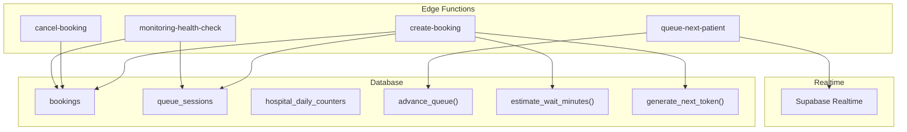
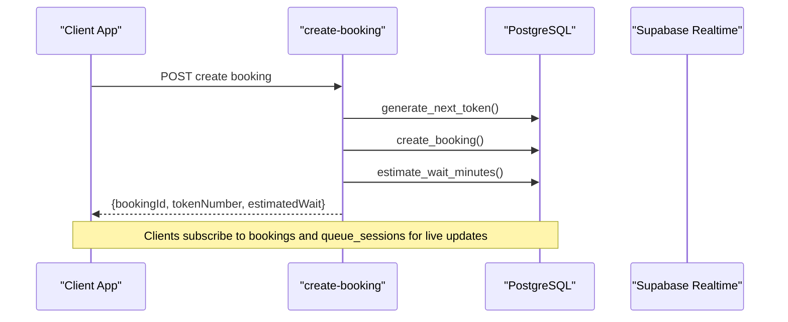
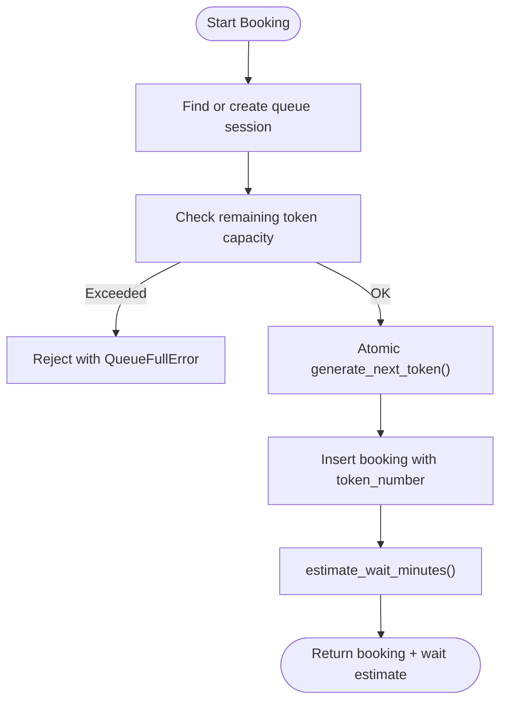
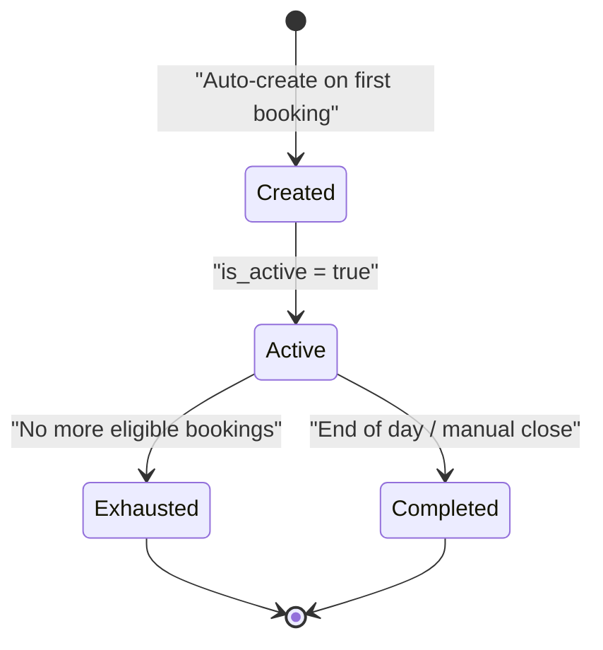
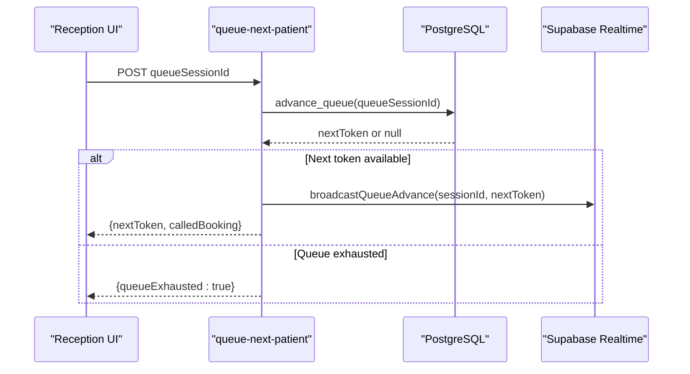
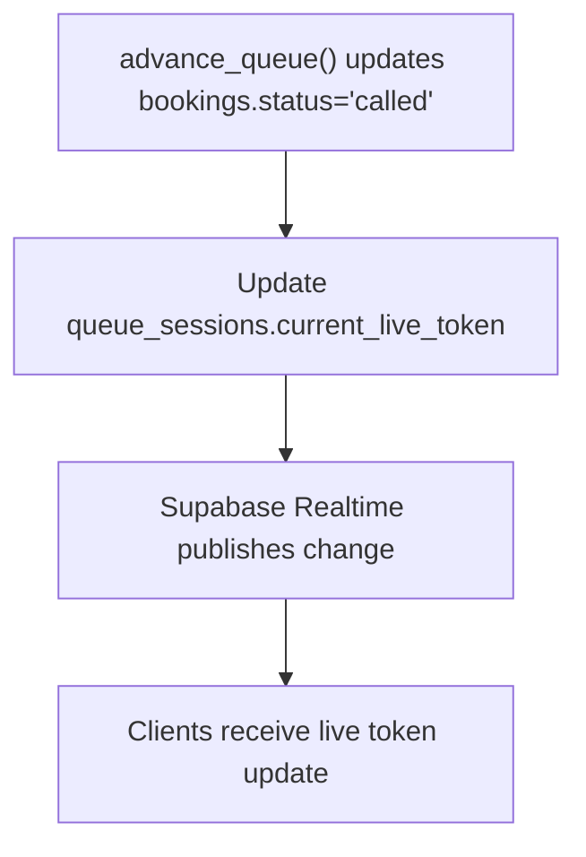
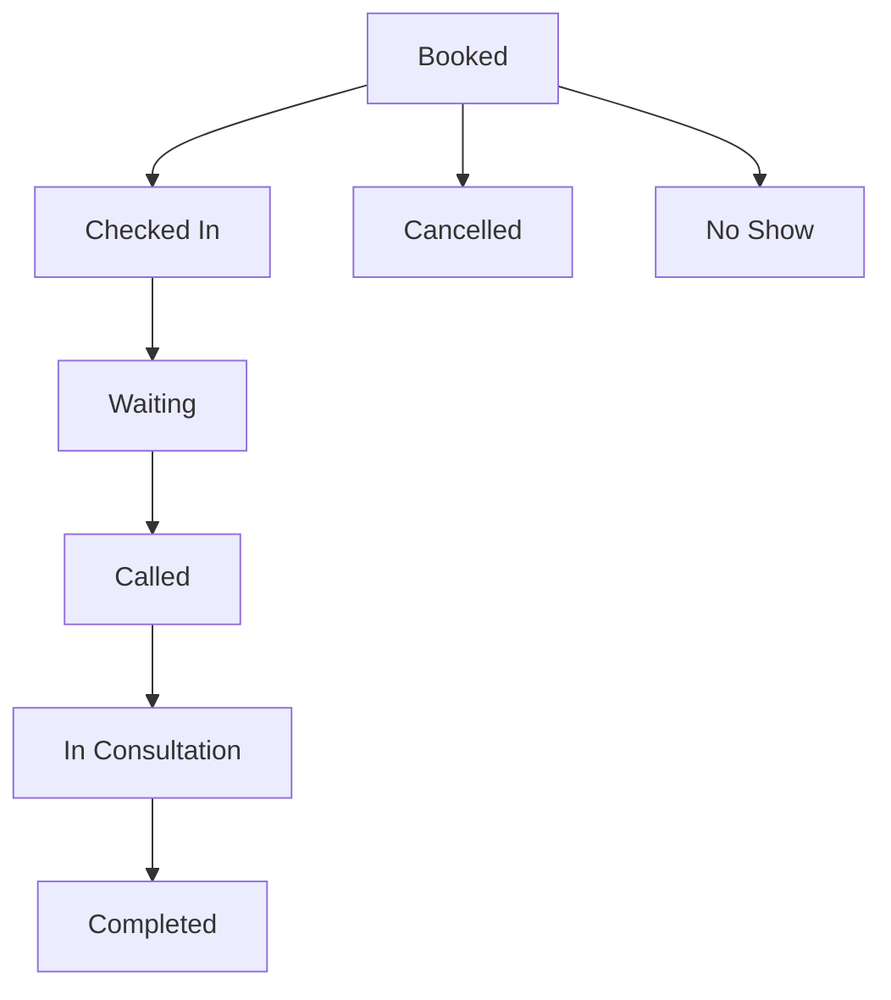
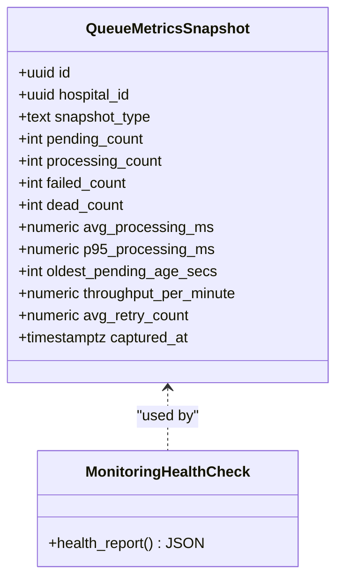
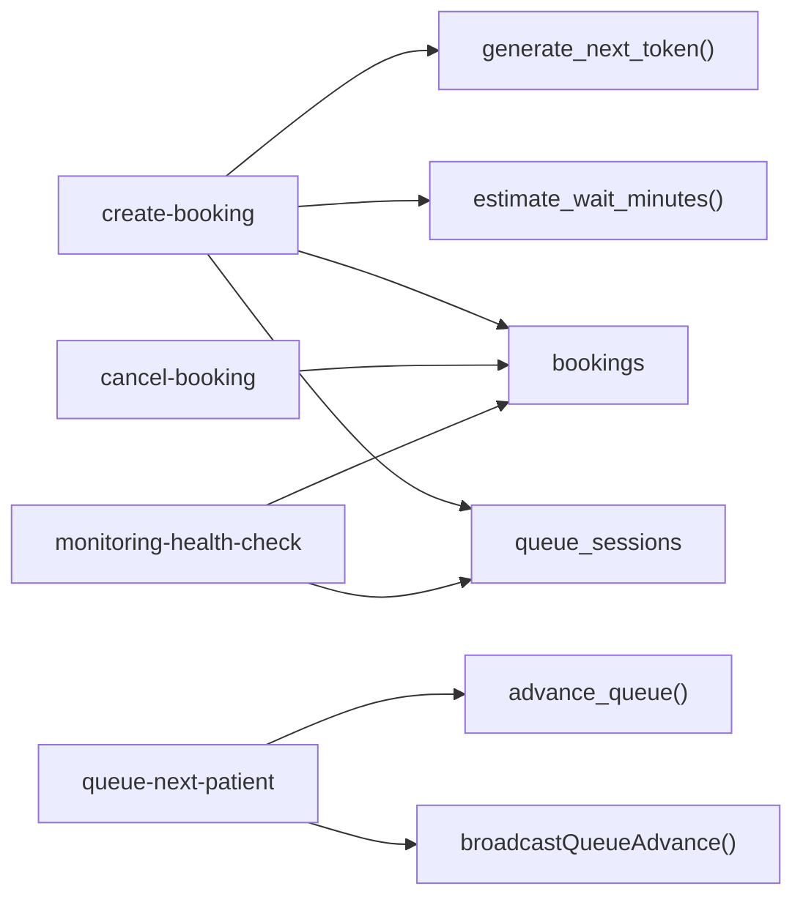

# Queue Management

<cite>
**Referenced Files in This Document**
- [02_atomic_token_engine_&_bookings.sql](file://supabase/migrations/02_atomic_token_engine_&_bookings.sql)
- [03_doctorscheduling&slotengine.sql](file://supabase/migrations/03_doctorscheduling&slotengine.sql)
- [17_queue_monitoring_engine.sql](file://supabase/migrations/17_queue_monitoring_engine.sql)
- [create-booking/index.ts](file://supabase/functions/create-booking/index.ts)
- [queue-next-patient/index.ts](file://supabase/functions/queue-next-patient/index.ts)
- [cancel-booking/index.ts](file://supabase/functions/cancel-booking/index.ts)
- [_shared/realtime.ts](file://supabase/functions/_shared/realtime.ts)
- [_shared/errors.ts](file://supabase/functions/_shared/errors.ts)
- [monitoring-health-check/index.ts](file://supabase/functions/monitoring-health-check/index.ts)
</cite>

## Table of Contents

1. [Introduction](#introduction)
2. [Project Structure](#project-structure)
3. [Core Components](#core-components)
4. [Architecture Overview](#architecture-overview)
5. [Detailed Component Analysis](#detailed-component-analysis)
6. [Dependency Analysis](#dependency-analysis)
7. [Performance Considerations](#performance-considerations)
8. [Troubleshooting Guide](#troubleshooting-guide)
9. [Conclusion](#conclusion)
10. [Appendices](#appendices)

## Introduction

This document explains the Queue Management system that powers token allocation,
real-time status updates, priority processing, and queue analytics across
hospital operations. It covers how queue sessions are created automatically
during booking, capacity management, and real-time synchronization from check-in
through consultation completion. It also documents queue monitoring, performance
metrics, and troubleshooting strategies for common issues.

## Project Structure

The queue system spans database migrations (schema and SQL functions), Edge
Functions (APIs and workflows), and shared utilities for real-time broadcasting
and error handling. Key areas:

- Token engine and queue session schema
- Booking creation with automatic session resolution and wait estimation
- Queue advancement API with concurrency-safe selection
- Real-time broadcasts via Supabase Realtime
- Monitoring and metrics snapshots

**Diagram sources**

- [02_atomic_token_engine_&_bookings.sql:31-67](file://supabase/migrations/02_atomic_token_engine_&_bookings.sql#L31-L67)
- [02_atomic_token_engine_&_bookings.sql:446-562](file://supabase/migrations/02_atomic_token_engine_&_bookings.sql#L446-L562)
- [02_atomic_token_engine_&_bookings.sql:576-625](file://supabase/migrations/02_atomic_token_engine_&_bookings.sql#L576-L625)
- [03_doctorscheduling&slotengine.sql:506-558](file://supabase/migrations/03_doctorscheduling&slotengine.sql#L506-L558)
- [create-booking/index.ts:285-319](file://supabase/functions/create-booking/index.ts#L285-L319)
- [create-booking/index.ts:507-518](file://supabase/functions/create-booking/index.ts#L507-L518)
- [queue-next-patient/index.ts:156-184](file://supabase/functions/queue-next-patient/index.ts#L156-L184)
- [_shared/realtime.ts:24-44](file://supabase/functions/_shared/realtime.ts#L24-L44)

**Section sources**

- [02_atomic_token_engine_&_bookings.sql:81-116](file://supabase/migrations/02_atomic_token_engine_&_bookings.sql#L81-L116)
- [02_atomic_token_engine_&_bookings.sql:150-284](file://supabase/migrations/02_atomic_token_engine_&_bookings.sql#L150-L284)
- [create-booking/index.ts:285-319](file://supabase/functions/create-booking/index.ts#L285-L319)
- [queue-next-patient/index.ts:104-184](file://supabase/functions/queue-next-patient/index.ts#L104-L184)

## Core Components

- Atomic token generator: Ensures unique, sequential tokens per hospital per day
  using an upsert on daily counters.
- Queue sessions: Represent a doctor’s active queue for a date, tracking max
  tokens and current live token.
- Bookings: Patient appointments linked to a queue session, with fields for
  priority, timestamps, and estimated wait.
- Advance queue function: Concurrency-safe selection and update of the next
  patient to call.
- Wait estimation: Computes expected wait based on ahead-of-token count and
  average consultation time.
- Real-time broadcast: Updates queue session live token to trigger client-side
  refreshes.
- Monitoring: Metrics snapshots and health checks for queues and backlogs.

**Section sources**

- [02_atomic_token_engine_&_bookings.sql:31-67](file://supabase/migrations/02_atomic_token_engine_&_bookings.sql#L31-L67)
- [02_atomic_token_engine_&_bookings.sql:81-116](file://supabase/migrations/02_atomic_token_engine_&_bookings.sql#L81-L116)
- [02_atomic_token_engine_&_bookings.sql:150-284](file://supabase/migrations/02_atomic_token_engine_&_bookings.sql#L150-L284)
- [02_atomic_token_engine_&_bookings.sql:576-625](file://supabase/migrations/02_atomic_token_engine_&_bookings.sql#L576-L625)
- [03_doctorscheduling&slotengine.sql:506-558](file://supabase/migrations/03_doctorscheduling&slotengine.sql#L506-L558)
- [_shared/realtime.ts:24-44](file://supabase/functions/_shared/realtime.ts#L24-L44)

## Architecture Overview

The queue architecture combines atomic SQL operations with Edge Function
orchestration and Supabase Realtime for live updates.

**Diagram sources**

- [create-booking/index.ts:421-518](file://supabase/functions/create-booking/index.ts#L421-L518)
- [02_atomic_token_engine_&_bookings.sql:31-67](file://supabase/migrations/02_atomic_token_engine_&_bookings.sql#L31-L67)
- [02_atomic_token_engine_&_bookings.sql:446-562](file://supabase/migrations/02_atomic_token_engine_&_bookings.sql#L446-L562)
- [03_doctorscheduling&slotengine.sql:506-558](file://supabase/migrations/03_doctorscheduling&slotengine.sql#L506-L558)

## Detailed Component Analysis

### Token Allocation and Capacity Management

- Token generation is atomic and concurrent-safe using an upsert on daily
  counters. Each successful insertion increments last_token and returns the new
  value.
- Capacity management integrates with doctor scheduling to compute remaining
  token capacity per slot/day, preventing overbooking beyond configured limits.
- During booking, if no queue session exists for the doctor/date, one is
  auto-created with configured max tokens.

**Diagram sources**

- [create-booking/index.ts:285-319](file://supabase/functions/create-booking/index.ts#L285-L319)
- [create-booking/index.ts:270-283](file://supabase/functions/create-booking/index.ts#L270-L283)
- [02_atomic_token_engine_&_bookings.sql:31-67](file://supabase/migrations/02_atomic_token_engine_&_bookings.sql#L31-L67)
- [02_atomic_token_engine_&_bookings.sql:446-562](file://supabase/migrations/02_atomic_token_engine_&_bookings.sql#L446-L562)
- [03_doctorscheduling&slotengine.sql:506-558](file://supabase/migrations/03_doctorscheduling&slotengine.sql#L506-L558)

**Section sources**

- [02_atomic_token_engine_&_bookings.sql:31-67](file://supabase/migrations/02_atomic_token_engine_&_bookings.sql#L31-L67)
- [create-booking/index.ts:270-319](file://supabase/functions/create-booking/index.ts#L270-L319)
- [03_doctorscheduling&slotengine.sql:506-558](file://supabase/migrations/03_doctorscheduling&slotengine.sql#L506-L558)

### Queue Session Lifecycle

- Sessions are identified by hospital_id, doctor_id, and session_date, ensuring
  uniqueness per doctor per day.
- Auto-creation occurs during booking when a session is missing; otherwise,
  existing active session is reused.
- Sessions track max_tokens and current_live_token, which advances as patients
  are called.

**Diagram sources**

- [02_atomic_token_engine_&_bookings.sql:81-116](file://supabase/migrations/02_atomic_token_engine_&_bookings.sql#L81-L116)
- [create-booking/index.ts:285-319](file://supabase/functions/create-booking/index.ts#L285-L319)

**Section sources**

- [02_atomic_token_engine_&_bookings.sql:81-116](file://supabase/migrations/02_atomic_token_engine_&_bookings.sql#L81-L116)
- [create-booking/index.ts:285-319](file://supabase/functions/create-booking/index.ts#L285-L319)

### Priority Processing and Queue Advancement

- The advance_queue function selects the next eligible booking using
  priority_score DESC and token_number ASC, then marks it as called and updates
  the session’s current_live_token.
- Concurrency safety is ensured via FOR UPDATE SKIP LOCKED to avoid race
  conditions under high load.

**Diagram sources**

- [queue-next-patient/index.ts:156-184](file://supabase/functions/queue-next-patient/index.ts#L156-L184)
- [queue-next-patient/index.ts:215-272](file://supabase/functions/queue-next-patient/index.ts#L215-L272)
- [02_atomic_token_engine_&_bookings.sql:576-625](file://supabase/migrations/02_atomic_token_engine_&_bookings.sql#L576-L625)
- [_shared/realtime.ts:24-44](file://supabase/functions/_shared/realtime.ts#L24-L44)

**Section sources**

- [02_atomic_token_engine_&_bookings.sql:576-625](file://supabase/migrations/02_atomic_token_engine_&_bookings.sql#L576-L625)
- [queue-next-patient/index.ts:104-184](file://supabase/functions/queue-next-patient/index.ts#L104-L184)
- [_shared/realtime.ts:24-44](file://supabase/functions/_shared/realtime.ts#L24-L44)

### Real-Time Status Updates

- Realtime events are triggered by mutating tables included in the Supabase
  realtime publication (bookings, queue_sessions).
- After advancing the queue, the system updates
  queue_sessions.current_live_token to push live token changes to subscribed
  clients.

**Diagram sources**

- [02_atomic_token_engine_&_bookings.sql:576-625](file://supabase/migrations/02_atomic_token_engine_&_bookings.sql#L576-L625)
- [_shared/realtime.ts:24-44](file://supabase/functions/_shared/realtime.ts#L24-L44)

**Section sources**

- [02_atomic_token_engine_&_bookings.sql:631-655](file://supabase/migrations/02_atomic_token_engine_&_bookings.sql#L631-L655)
- [_shared/realtime.ts:24-44](file://supabase/functions/_shared/realtime.ts#L24-L44)

### Patient Flow Management (Check-in to Consultation Completion)

- Bookings include timestamps for checked_in_at, called_at,
  consultation_started_at, and consultation_completed_at.
- A database trigger records status transitions and timestamps when statuses
  change, enabling accurate flow analytics.

**Diagram sources**

- [02_atomic_token_engine_&_bookings.sql:150-284](file://supabase/migrations/02_atomic_token_engine_&_bookings.sql#L150-L284)
- [02_atomic_token_engine_&_bookings.sql:385-440](file://supabase/migrations/02_atomic_token_engine_&_bookings.sql#L385-L440)

**Section sources**

- [02_atomic_token_engine_&_bookings.sql:150-284](file://supabase/migrations/02_atomic_token_engine_&_bookings.sql#L150-L284)
- [02_atomic_token_engine_&_bookings.sql:385-440](file://supabase/migrations/02_atomic_token_engine_&_bookings.sql#L385-L440)

### Queue Analytics and Monitoring

- Queue metrics snapshots capture pending, processing, failed, dead counts,
  oldest pending age, throughput, and retry stats.
- Health checks aggregate queue health, worker status, DLQ counts, materialized
  view freshness, and alerts for dashboards and uptime monitors.

**Diagram sources**

- [17_queue_monitoring_engine.sql:14-51](file://supabase/migrations/17_queue_monitoring_engine.sql#L14-L51)
- [monitoring-health-check/index.ts:187-210](file://supabase/functions/monitoring-health-check/index.ts#L187-L210)

**Section sources**

- [17_queue_monitoring_engine.sql:14-51](file://supabase/migrations/17_queue_monitoring_engine.sql#L14-L51)
- [17_queue_monitoring_engine.sql:407-488](file://supabase/migrations/17_queue_monitoring_engine.sql#L407-L488)
- [monitoring-health-check/index.ts:187-210](file://supabase/functions/monitoring-health-check/index.ts#L187-L210)

## Dependency Analysis

Key dependencies and relationships:

- create-booking depends on generate_next_token, estimate_wait_minutes, and
  inserts into bookings and queue_sessions.
- queue-next-patient depends on advance_queue and triggers realtime updates via
  queue_sessions mutations.
- cancel-booking updates bookings status and optionally recalculates queue
  position.
- Monitoring aggregates queue health and writes snapshots.

**Diagram sources**

- [create-booking/index.ts:421-518](file://supabase/functions/create-booking/index.ts#L421-L518)
- [queue-next-patient/index.ts:156-184](file://supabase/functions/queue-next-patient/index.ts#L156-L184)
- [cancel-booking/index.ts:308-338](file://supabase/functions/cancel-booking/index.ts#L308-L338)
- [monitoring-health-check/index.ts:187-210](file://supabase/functions/monitoring-health-check/index.ts#L187-L210)

**Section sources**

- [create-booking/index.ts:421-518](file://supabase/functions/create-booking/index.ts#L421-L518)
- [queue-next-patient/index.ts:156-184](file://supabase/functions/queue-next-patient/index.ts#L156-L184)
- [cancel-booking/index.ts:308-338](file://supabase/functions/cancel-booking/index.ts#L308-L338)
- [monitoring-health-check/index.ts:187-210](file://supabase/functions/monitoring-health-check/index.ts#L187-L210)

## Performance Considerations

- Use atomic token generation to prevent duplicates and ensure consistent
  ordering under concurrency.
- Leverage SKIP LOCKED in queue advancement to avoid contention and deadlocks.
- Keep realtime broadcasts non-blocking; failures should not halt queue
  progression.
- Monitor queue depth and throughput via metrics snapshots; set thresholds for
  backlog alerts.
- Optimize queries with indexes on queue_session_id, status, and priority_score
  to speed up selection and updates.

[No sources needed since this section provides general guidance]

## Troubleshooting Guide

Common issues and resolutions:

- Queue full: Occurs when remaining token capacity is zero; adjust max_tokens or
  doctor schedule capacity.
- Token exhausted: No more tokens available for the date; extend operating hours
  or increase capacity.
- Queue exhaustion on advance: No eligible bookings remain; handle gracefully in
  UI and notify staff.
- Realtime broadcast failure: Logs warnings; queue progression continues
  unaffected—check DB connectivity and permissions.
- Stuck jobs/backlog: Use monitoring endpoints to detect stuck processing and
  stale presence; run scheduled tasks to reclaim and clean up.

**Section sources**

- [_shared/errors.ts:192-217](file://supabase/functions/_shared/errors.ts#L192-L217)
- [queue-next-patient/index.ts:186-213](file://supabase/functions/queue-next-patient/index.ts#L186-L213)
- [_shared/realtime.ts:24-44](file://supabase/functions/_shared/realtime.ts#L24-L44)
- [17_queue_monitoring_engine.sql:283-401](file://supabase/migrations/17_queue_monitoring_engine.sql#L283-L401)

## Conclusion

The Queue Management system provides robust, concurrent-safe token allocation,
priority-driven patient flow, and real-time status synchronization. Automated
session creation, capacity checks, and wait estimations streamline booking
experiences, while comprehensive monitoring ensures operational visibility and
proactive issue resolution.

[No sources needed since this section summarizes without analyzing specific
files]

## Appendices

### Queue APIs and Real-Time Subscriptions

- Queue advancement: POST queue-next-patient with queueSessionId; returns next
  token or queueExhausted flag; triggers realtime updates.
- Booking creation: POST create-booking with required fields; returns bookingId,
  tokenNumber, estimatedWaitMinutes; may auto-create queue session.
- Cancellation: POST cancel-booking with bookingId and reason; updates status
  and recalculates queue position if applicable.
- Realtime subscriptions: Subscribe to bookings and queue_sessions tables to
  receive live updates on status changes and current live token.

**Section sources**

- [queue-next-patient/index.ts:26-28](file://supabase/functions/queue-next-patient/index.ts#L26-L28)
- [queue-next-patient/index.ts:156-184](file://supabase/functions/queue-next-patient/index.ts#L156-L184)
- [create-booking/index.ts:421-518](file://supabase/functions/create-booking/index.ts#L421-L518)
- [cancel-booking/index.ts:220-243](file://supabase/functions/cancel-booking/index.ts#L220-L243)
- [02_atomic_token_engine_&_bookings.sql:631-655](file://supabase/migrations/02_atomic_token_engine_&_bookings.sql#L631-L655)
