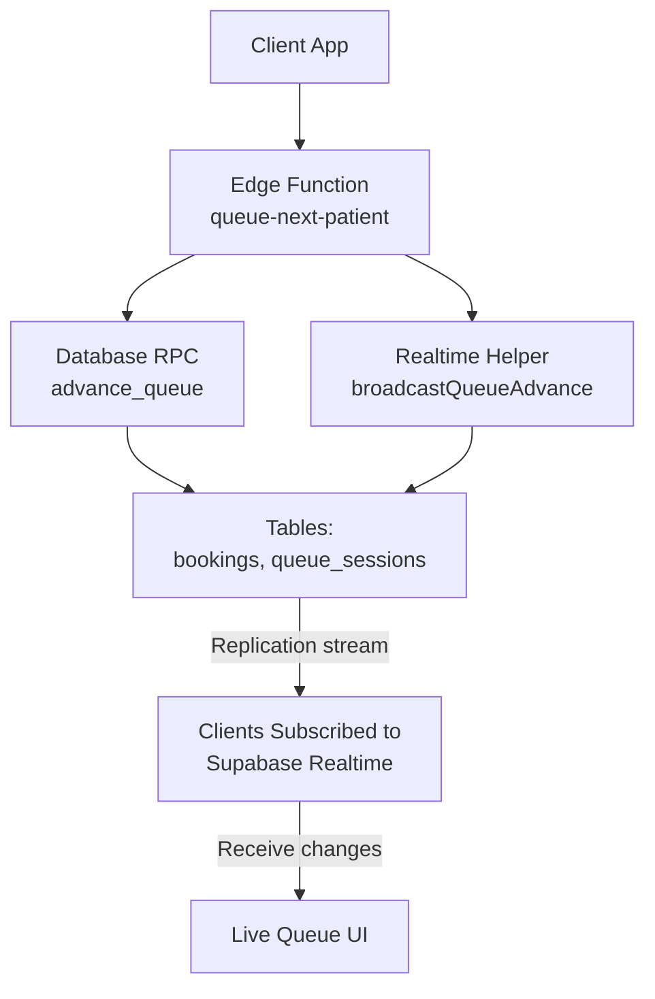
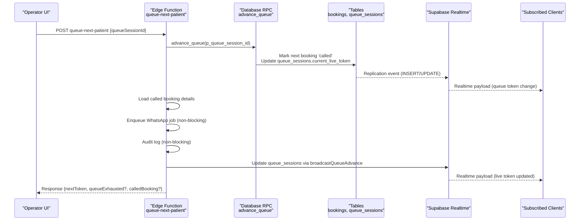
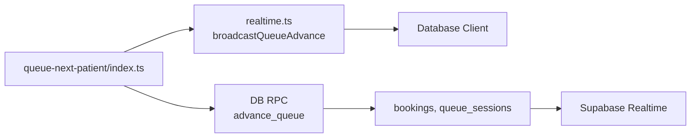
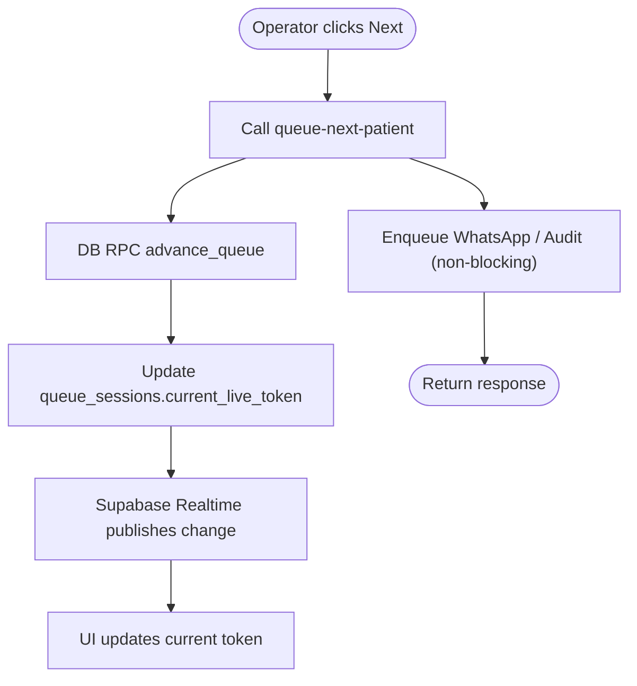
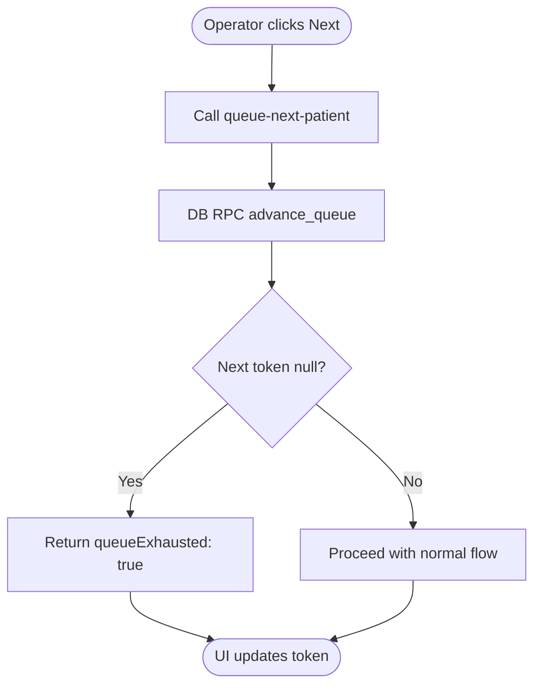

# Real-time Queue Status

<cite>
**Referenced Files in This Document**
- [realtime.ts](file://supabase/functions/_shared/realtime.ts)
- [queue-next-patient/index.ts](file://supabase/functions/queue-next-patient/index.ts)
- [02_atomic_token_engine_&_bookings.sql](file://supabase/migrations/02_atomic_token_engine_&_bookings.sql)
- [20_presence_engine.sql](file://supabase/migrations/20_presence_engine.sql)
</cite>

## Table of Contents

1. [Introduction](#introduction)
2. [Project Structure](#project-structure)
3. [Core Components](#core-components)
4. [Architecture Overview](#architecture-overview)
5. [Detailed Component Analysis](#detailed-component-analysis)
6. [Dependency Analysis](#dependency-analysis)
7. [Performance Considerations](#performance-considerations)
8. [Troubleshooting Guide](#troubleshooting-guide)
9. [Conclusion](#conclusion)
10. [Appendices](#appendices)

## Introduction

This document explains how queue status updates are broadcast to connected
clients in real time using Supabase Realtime. It covers token advances, patient
callouts, and queue exhaustion events. The system uses database mutations as the
source of truth; Supabase Realtime listens to those changes and pushes them to
clients subscribed to relevant tables. The key server-side function is
broadcastQueueAdvance, which updates the current live token for a queue session.
The queue-next-patient Edge Function orchestrates advancing the queue, handling
exhaustion, notifying patients via WhatsApp, auditing changes, and broadcasting
the new token.

## Project Structure

The real-time queue update flow spans:

- An Edge Function that advances the queue and triggers broadcasts
- A shared realtime helper that performs table updates to emit Realtime events
- Database migrations that enable Realtime publication for relevant tables
- Presence engine components that broadcast hospital online state

**Diagram sources**

- [queue-next-patient/index.ts:156-184](file://supabase/functions/queue-next-patient/index.ts#L156-L184)
- [queue-next-patient/index.ts:257-272](file://supabase/functions/queue-next-patient/index.ts#L257-L272)
- [realtime.ts:24-44](file://supabase/functions/_shared/realtime.ts#L24-L44)
- [02_atomic_token_engine_&_bookings.sql:609-655](file://supabase/migrations/02_atomic_token_engine_&_bookings.sql#L609-L655)

**Section sources**

- [queue-next-patient/index.ts:1-409](file://supabase/functions/queue-next-patient/index.ts#L1-L409)
- [realtime.ts:1-71](file://supabase/functions/_shared/realtime.ts#L1-L71)
- [02_atomic_token_engine_&_bookings.sql:600-655](file://supabase/migrations/02_atomic_token_engine_&_bookings.sql#L600-L655)

## Core Components

- broadcastQueueAdvance: Updates queue_sessions.current_live_token to trigger
  Realtime events for live token changes.
- queue-next-patient Edge Function: Validates input, advances the queue
  atomically, handles exhaustion, loads called booking info, enqueues WhatsApp
  notifications, audits changes, and calls broadcastQueueAdvance.
- Database functions and publications: advance_queue SQL function selects the
  next booking with SKIP LOCKED, marks it as called, updates queue_sessions, and
  enables Realtime publication for bookings and queue_sessions.
- Presence broadcasting: broadcastPresenceUpdate updates hospital_online_state
  to reflect presence and activity counts.

**Section sources**

- [realtime.ts:24-44](file://supabase/functions/_shared/realtime.ts#L24-L44)
- [queue-next-patient/index.ts:94-184](file://supabase/functions/queue-next-patient/index.ts#L94-L184)
- [queue-next-patient/index.ts:217-320](file://supabase/functions/queue-next-patient/index.ts#L217-L320)
- [02_atomic_token_engine_&_bookings.sql:600-655](file://supabase/migrations/02_atomic_token_engine_&_bookings.sql#L600-L655)
- [20_presence_engine.sql:135-186](file://supabase/migrations/20_presence_engine.sql#L135-L186)

## Architecture Overview

The architecture relies on database-driven Realtime:

- Clients subscribe to Supabase Realtime channels for queue display and
  presence.
- When an operator advances the queue, the Edge Function calls the database RPC
  to select and mark the next patient.
- The RPC updates both bookings (status to called) and queue_sessions
  (current_live_token).
- Supabase Realtime publishes these row changes to all subscribers.
- The Edge Function also attempts to broadcast additional signals (WhatsApp
  notification enqueue, audit logging), but never blocks queue progression if
  they fail.

**Diagram sources**

- [queue-next-patient/index.ts:156-184](file://supabase/functions/queue-next-patient/index.ts#L156-L184)
- [queue-next-patient/index.ts:217-320](file://supabase/functions/queue-next-patient/index.ts#L217-L320)
- [queue-next-patient/index.ts:257-272](file://supabase/functions/queue-next-patient/index.ts#L257-L272)
- [02_atomic_token_engine_&_bookings.sql:609-655](file://supabase/migrations/02_atomic_token_engine_&_bookings.sql#L609-L655)

## Detailed Component Analysis

### broadcastQueueAdvance

Purpose:

- Updates queue_sessions.current_live_token for a given queue session to signal
  the new live token to clients.
- Uses a service-level database client to perform the update.
- Logs errors without failing the caller’s request.

Key behaviors:

- Non-blocking from the caller’s perspective: errors are logged and do not
  throw.
- Triggers Supabase Realtime because queue_sessions is part of the realtime
  publication.

Error handling:

- Catches exceptions and logs structured error context including queueSessionId
  and newLiveToken.

**Section sources**

- [realtime.ts:24-44](file://supabase/functions/_shared/realtime.ts#L24-L44)

### queue-next-patient Edge Function

Responsibilities:

- Validate request headers and body, enforce role-based access.
- Load and validate the queue session.
- Advance the queue atomically via the database RPC.
- Handle queue exhaustion by returning a specific response.
- Load called booking details for notifications and UI.
- Enqueue WhatsApp message for the called patient (non-blocking).
- Emit audit events (non-blocking).
- Broadcast the new token via broadcastQueueAdvance (non-blocking).

Flow highlights:

- If no next token exists, returns queueExhausted: true.
- Always measures timing and emits metrics for observability.
- Ensures failures in secondary tasks (WhatsApp, audit, realtime broadcast) do
  not block core queue advancement.

Response shape:

- On success: nextToken, queueSessionId, queueExhausted: false, calledBookingId,
  calledPatientName.
- On exhaustion: queueExhausted: true, nextToken: null, message.

**Section sources**

- [queue-next-patient/index.ts:46-184](file://supabase/functions/queue-next-patient/index.ts#L46-L184)
- [queue-next-patient/index.ts:186-213](file://supabase/functions/queue-next-patient/index.ts#L186-L213)
- [queue-next-patient/index.ts:217-320](file://supabase/functions/queue-next-patient/index.ts#L217-L320)
- [queue-next-patient/index.ts:322-388](file://supabase/functions/queue-next-patient/index.ts#L322-L388)

### Database Realtime Publication

- The advance_queue function selects the next eligible booking using SKIP
  LOCKED, sets its status to called, and updates
  queue_sessions.current_live_token.
- Migrations add bookings, booking_events, and queue_sessions to the
  supabase_realtime publication so clients receive changes automatically.

Implications:

- Clients can subscribe to queue_sessions and bookings to get live updates
  without polling.
- Row-level security policies restrict read/write access based on roles and
  hospital context.

**Section sources**

- [02_atomic_token_engine_&_bookings.sql:600-655](file://supabase/migrations/02_atomic_token_engine_&_bookings.sql#L600-L655)
- [02_atomic_token_engine_&_bookings.sql:664-728](file://supabase/migrations/02_atomic_token_engine_&_bookings.sql#L664-L728)

### Presence Broadcasting

- broadcastPresenceUpdate updates hospital_online_state to reflect whether a
  hospital is online and how many active users exist.
- This supports presence indicators on dashboards and queue displays.

**Section sources**

- [realtime.ts:46-70](file://supabase/functions/_shared/realtime.ts#L46-L70)
- [20_presence_engine.sql:135-186](file://supabase/migrations/20_presence_engine.sql#L135-L186)

## Dependency Analysis

- queue-next-patient depends on:
  - Auth and validation helpers
  - Database client and RPC (advance_queue)
  - Realtime helper (broadcastQueueAdvance)
  - Metrics, tracing, audit, and response utilities
- broadcastQueueAdvance depends on:
  - Database client
  - Logger
- Database layer depends on:
  - PostgreSQL functions (advance_queue)
  - Realtime publication configuration

**Diagram sources**

- [queue-next-patient/index.ts:156-184](file://supabase/functions/queue-next-patient/index.ts#L156-L184)
- [queue-next-patient/index.ts:257-272](file://supabase/functions/queue-next-patient/index.ts#L257-L272)
- [realtime.ts:24-44](file://supabase/functions/_shared/realtime.ts#L24-L44)
- [02_atomic_token_engine_&_bookings.sql:609-655](file://supabase/migrations/02_atomic_token_engine_&_bookings.sql#L609-L655)

**Section sources**

- [queue-next-patient/index.ts:1-409](file://supabase/functions/queue-next-patient/index.ts#L1-L409)
- [realtime.ts:1-71](file://supabase/functions/_shared/realtime.ts#L1-L71)
- [02_atomic_token_engine_&_bookings.sql:600-655](file://supabase/migrations/02_atomic_token_engine_&_bookings.sql#L600-L655)

## Performance Considerations

- Atomic queue advancement: The database RPC uses SKIP LOCKED to avoid
  contention and ensure only one worker advances the queue at a time.
- Non-blocking side effects: WhatsApp enqueue, audit logging, and realtime
  broadcast are wrapped in try/catch to prevent blocking the main flow.
- Metrics and tracing: Timing and counters help identify bottlenecks and measure
  throughput.
- Realtime replication: Changes to queue_sessions and bookings are published
  immediately, minimizing client latency.

[No sources needed since this section provides general guidance]

## Troubleshooting Guide

Common issues and where to look:

- Queue advance fails: Check database RPC errors and internal error responses in
  the Edge Function.
- Realtime broadcast fails: Errors are logged in broadcastQueueAdvance; verify
  database connectivity and permissions.
- Queue exhaustion: When advance_queue returns null, the Edge Function responds
  with queueExhausted: true; ensure clients handle this state.
- Presence not updating: Verify broadcastPresenceUpdate is called after
  heartbeats and that hospital_online_state is included in realtime publication.

Operational checks:

- Ensure supabase_realtime publication includes queue_sessions and bookings.
- Confirm row-level security policies allow reads/writes for intended roles.
- Monitor metrics for queue.advanced, queue.exhausted, and queue.advance.error.

**Section sources**

- [queue-next-patient/index.ts:169-184](file://supabase/functions/queue-next-patient/index.ts#L169-L184)
- [queue-next-patient/index.ts:186-213](file://supabase/functions/queue-next-patient/index.ts#L186-L213)
- [queue-next-patient/index.ts:257-272](file://supabase/functions/queue-next-patient/index.ts#L257-L272)
- [realtime.ts:24-44](file://supabase/functions/_shared/realtime.ts#L24-L44)
- [02_atomic_token_engine_&_bookings.sql:631-655](file://supabase/migrations/02_atomic_token_engine_&_bookings.sql#L631-L655)

## Conclusion

The real-time queue system leverages database-driven Supabase Realtime to keep
clients synchronized with queue state. Token advances are atomic and robust,
while side effects like notifications and audits are non-blocking to preserve
responsiveness. Clients should subscribe to queue_sessions and bookings to
receive live updates and implement responsive UIs that reflect the current
token, called patient, and exhaustion state.

[No sources needed since this section summarizes without analyzing specific
files]

## Appendices

### Event Types and Client Subscription Patterns

- Subscribe to queue_sessions to receive updates when current_live_token
  changes.
- Subscribe to bookings to receive updates when a booking transitions to called
  or other statuses.
- Subscribe to hospital_online_state for presence indicators and active user
  counts.

Handling patterns:

- On receiving a queue_sessions update, refresh the displayed current token and
  any derived metrics (e.g., wait estimates).
- On receiving a bookings update with status called, highlight the newly called
  patient and optionally trigger audio/visual cues.
- On queue exhaustion, show appropriate messaging and disable further “next”
  actions until new tokens are available.

[No sources needed since this section provides conceptual guidance]

### Example Flows

#### Token Advance Flow

**Diagram sources**

- [queue-next-patient/index.ts:156-184](file://supabase/functions/queue-next-patient/index.ts#L156-L184)
- [queue-next-patient/index.ts:257-272](file://supabase/functions/queue-next-patient/index.ts#L257-L272)
- [02_atomic_token_engine_&_bookings.sql:609-655](file://supabase/migrations/02_atomic_token_engine_&_bookings.sql#L609-L655)

#### Queue Exhaustion Flow

**Diagram sources**

- [queue-next-patient/index.ts:186-213](file://supabase/functions/queue-next-patient/index.ts#L186-L213)
