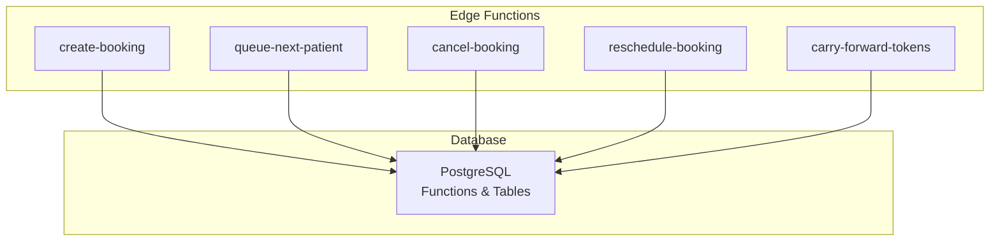
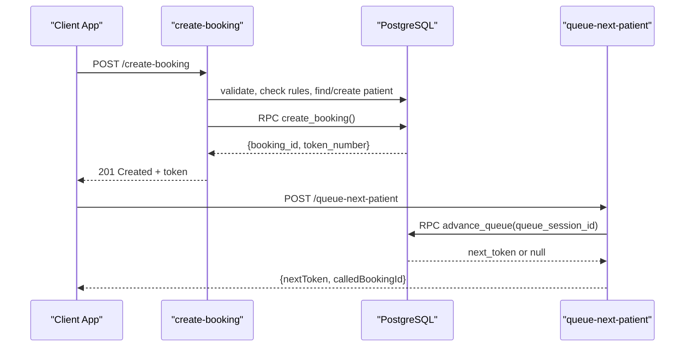
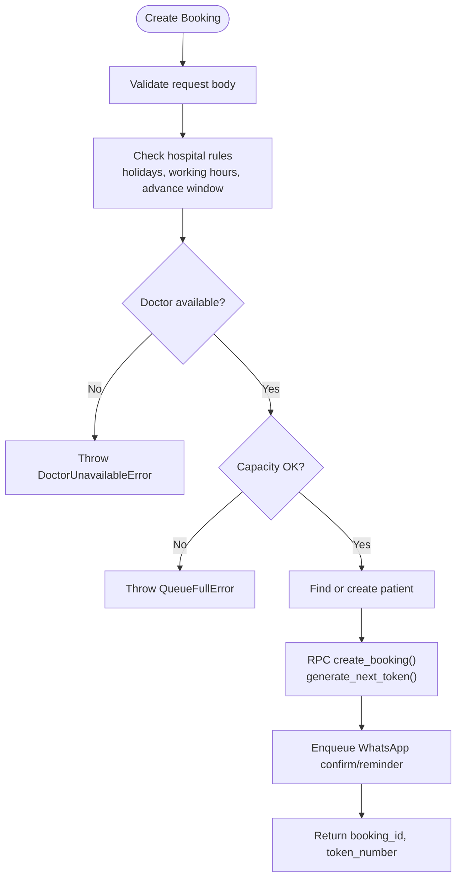
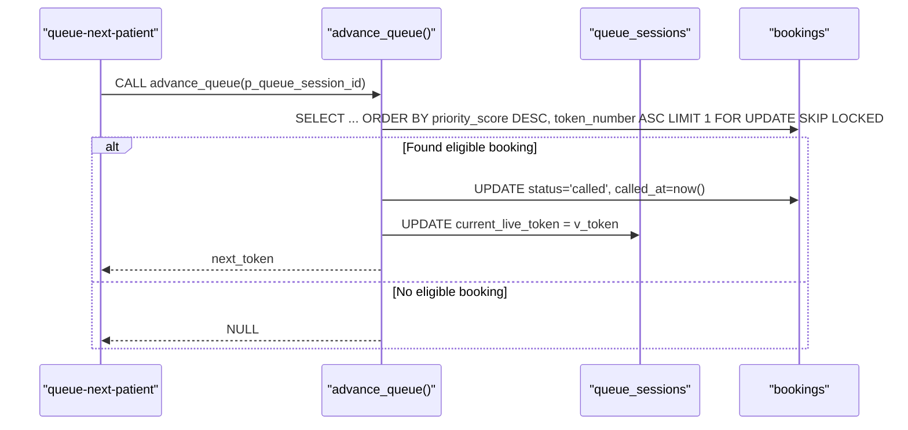
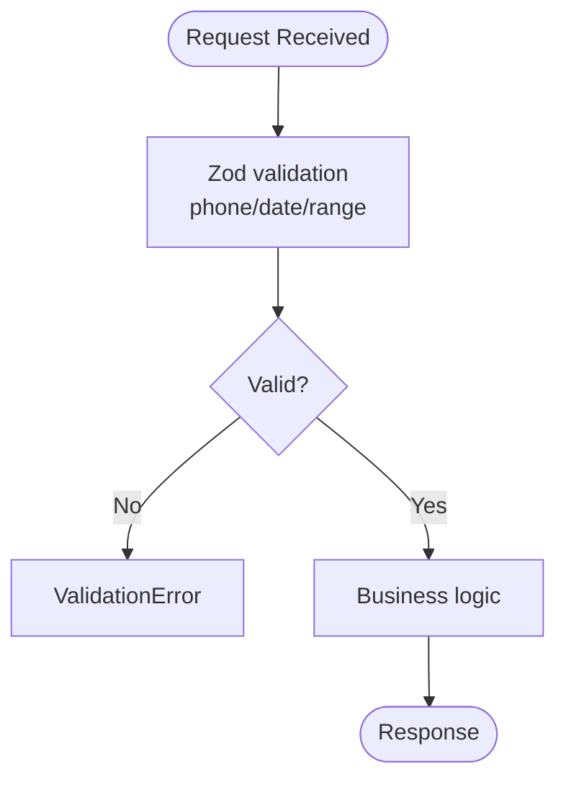
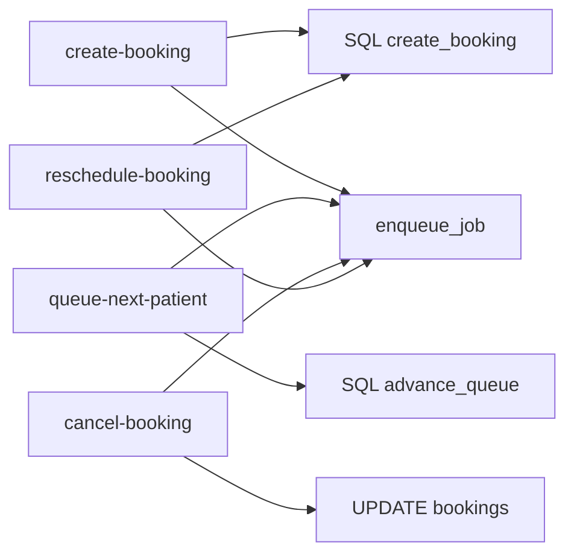

# Token Allocation System

<cite>
**Referenced Files in This Document**
- [02_atomic_token_engine_&_bookings.sql](file://supabase/migrations/02_atomic_token_engine_&_bookings.sql)
- [queue-next-patient/index.ts](file://supabase/functions/queue-next-patient/index.ts)
- [create-booking/index.ts](file://supabase/functions/create-booking/index.ts)
- [cancel-booking/index.ts](file://supabase/functions/cancel-booking/index.ts)
- [reschedule-booking/index.ts](file://supabase/functions/reschedule-booking/index.ts)
- [carry-forward-tokens/index.ts](file://supabase/functions/carry-forward-tokens/index.ts)
- [validation.ts](file://supabase/functions/_shared/validation.ts)
- [errors.ts](file://supabase/functions/_shared/errors.ts)
</cite>

## Table of Contents

1. Introduction
2. Project Structure
3. Core Components
4. Architecture Overview
5. Detailed Component Analysis
6. Dependency Analysis
7. Performance Considerations
8. Troubleshooting Guide
9. Conclusion

## Introduction

This document explains the token allocation system that manages patient queue
progression across hospital sessions. It covers how tokens are generated and
assigned during booking, how they advance through the queue using a
concurrency-safe RPC function, and how the system handles priority, capacity,
conflicts, validation, expiration, and recovery. It also documents queue session
management and integrations with booking and notification systems.

## Project Structure

The token system spans database schema, serverless functions (Edge Functions),
and shared utilities:

- Database layer defines atomic token generation, queue sessions, bookings, and
  status change triggers.
- Edge Functions implement API endpoints for creating bookings, advancing the
  queue, canceling/rescheduling, and carrying forward tokens.
- Shared modules provide validation, error handling, metrics, tracing, and audit
  logging.

**Diagram sources**

- [create-booking/index.ts:1-666](file://supabase/functions/create-booking/index.ts#L1-L666)
- [queue-next-patient/index.ts:1-409](file://supabase/functions/queue-next-patient/index.ts#L1-L409)
- [cancel-booking/index.ts:1-482](file://supabase/functions/cancel-booking/index.ts#L1-L482)
- [reschedule-booking/index.ts:1-612](file://supabase/functions/reschedule-booking/index.ts#L1-L612)
- [carry-forward-tokens/index.ts:1-427](file://supabase/functions/carry-forward-tokens/index.ts#L1-L427)
- [02_atomic_token_engine_&_bookings.sql:1-827](file://supabase/migrations/02_atomic_token_engine_&_bookings.sql#L1-L827)

**Section sources**

- [create-booking/index.ts:1-666](file://supabase/functions/create-booking/index.ts#L1-L666)
- [queue-next-patient/index.ts:1-409](file://supabase/functions/queue-next-patient/index.ts#L1-L409)
- [02_atomic_token_engine_&_bookings.sql:1-827](file://supabase/migrations/02_atomic_token_engine_&_bookings.sql#L1-L827)

## Core Components

- Atomic token generator: Ensures unique, sequential token numbers per hospital
  per day via an upsert on daily counters.
- Queue sessions: Represent a doctor’s consultation session with capacity limits
  and a live token pointer.
- Bookings: Store patient details, token number, priority, and lifecycle
  timestamps; indexed for fast queue operations.
- Status change trigger: Automatically records timestamps and events when
  booking status transitions occur.
- Advance queue RPC: Atomically selects the next eligible patient using priority
  and token order with SKIP LOCKED to avoid contention.
- Edge APIs: Create booking, advance queue, cancel/reschedule, and carry-forward
  pending tokens.

**Section sources**

- [02_atomic_token_engine_&_bookings.sql:31-64](file://supabase/migrations/02_atomic_token_engine_&_bookings.sql#L31-L64)
- [02_atomic_token_engine_&_bookings.sql:81-128](file://supabase/migrations/02_atomic_token_engine_&_bookings.sql#L81-L128)
- [02_atomic_token_engine_&_bookings.sql:150-323](file://supabase/migrations/02_atomic_token_engine_&_bookings.sql#L150-L323)
- [02_atomic_token_engine_&_bookings.sql:385-440](file://supabase/migrations/02_atomic_token_engine_&_bookings.sql#L385-L440)
- [02_atomic_token_engine_&_bookings.sql:576-622](file://supabase/migrations/02_atomic_token_engine_&_bookings.sql#L576-L622)

## Architecture Overview

The system uses a combination of PostgreSQL functions and Deno Edge Functions to
ensure correctness under concurrency.

**Diagram sources**

- [create-booking/index.ts:421-498](file://supabase/functions/create-booking/index.ts#L421-L498)
- [02_atomic_token_engine_&_bookings.sql:446-562](file://supabase/migrations/02_atomic_token_engine_&_bookings.sql#L446-L562)
- [queue-next-patient/index.ts:159-184](file://supabase/functions/queue-next-patient/index.ts#L159-L184)
- [02_atomic_token_engine_&_bookings.sql:576-622](file://supabase/migrations/02_atomic_token_engine_&_bookings.sql#L576-L622)

## Detailed Component Analysis

### Token Generation and Assignment

- Daily counter table tracks last token per hospital per date.
- generate_next_token atomically increments the counter using INSERT ... ON
  CONFLICT DO UPDATE RETURNING to guarantee uniqueness and ordering.
- create_booking calls generate_next_token internally and inserts a new booking
  with the token number, idempotency key, and fee snapshots.

Key behaviors:

- Idempotent creation: duplicate idempotency_key returns existing booking.
- Patient deduplication by normalized phone within hospital.
- Capacity checks via doctor availability and remaining token capacity before
  booking.

**Diagram sources**

- [create-booking/index.ts:121-283](file://supabase/functions/create-booking/index.ts#L121-L283)
- [create-booking/index.ts:321-397](file://supabase/functions/create-booking/index.ts#L321-L397)
- [create-booking/index.ts:421-498](file://supabase/functions/create-booking/index.ts#L421-L498)
- [02_atomic_token_engine_&_bookings.sql:446-562](file://supabase/migrations/02_atomic_token_engine_&_bookings.sql#L446-L562)
- [02_atomic_token_engine_&_bookings.sql:31-64](file://supabase/migrations/02_atomic_token_engine_&_bookings.sql#L31-L64)

**Section sources**

- [02_atomic_token_engine_&_bookings.sql:31-64](file://supabase/migrations/02_atomic_token_engine_&_bookings.sql#L31-L64)
- [02_atomic_token_engine_&_bookings.sql:446-562](file://supabase/migrations/02_atomic_token_engine_&_bookings.sql#L446-L562)
- [create-booking/index.ts:121-283](file://supabase/functions/create-booking/index.ts#L121-L283)
- [create-booking/index.ts:321-397](file://supabase/functions/create-booking/index.ts#L321-L397)
- [create-booking/index.ts:421-498](file://supabase/functions/create-booking/index.ts#L421-L498)

### Queue Session Management

- Queue sessions represent a doctor’s active session with max_tokens and
  current_live_token.
- Sessions can be auto-created when needed during booking if not provided.
- Policies restrict access to authorized roles.

Operational notes:

- The create-booking endpoint resolves or creates a session for the doctor/date
  if missing.
- The queue-next-patient endpoint validates session existence, hospital
  ownership, and activity before advancing.

**Section sources**

- [02_atomic_token_engine_&_bookings.sql:81-128](file://supabase/migrations/02_atomic_token_engine_&_bookings.sql#L81-L128)
- [create-booking/index.ts:285-319](file://supabase/functions/create-booking/index.ts#L285-L319)
- [queue-next-patient/index.ts:101-154](file://supabase/functions/queue-next-patient/index.ts#L101-L154)

### Advancing the Queue with SKIP LOCKED

- advance_queue selects the next eligible booking by priority_score DESC,
  token_number ASC among statuses booked/checked_in/waiting, using FOR UPDATE
  SKIP LOCKED to prevent concurrent selection of the same row.
- On success, it sets status to called, updates called_at, and advances
  current_live_token in the session.
- If no eligible booking exists, it returns null indicating queue exhaustion.

**Diagram sources**

- [02_atomic_token_engine_&_bookings.sql:576-622](file://supabase/migrations/02_atomic_token_engine_&_bookings.sql#L576-L622)
- [queue-next-patient/index.ts:159-184](file://supabase/functions/queue-next-patient/index.ts#L159-L184)

**Section sources**

- [02_atomic_token_engine_&_bookings.sql:576-622](file://supabase/migrations/02_atomic_token_engine_&_bookings.sql#L576-L622)
- [queue-next-patient/index.ts:159-184](file://supabase/functions/queue-next-patient/index.ts#L159-L184)

### Priority Handling and Capacity Management

- Priority is encoded in bookings.priority_score and priority_flag; queries
  order by priority_score DESC then token_number ASC to honor high-priority
  patients first.
- Capacity is enforced via doctor availability and remaining token capacity
  checks prior to booking.
- Queue sessions track max_tokens and current_live_token to reflect progress.

**Section sources**

- [02_atomic_token_engine_&_bookings.sql:150-323](file://supabase/migrations/02_atomic_token_engine_&_bookings.sql#L150-L323)
- [create-booking/index.ts:251-283](file://supabase/functions/create-booking/index.ts#L251-L283)

### Conflict Resolution and Idempotency

- Duplicate booking prevention: idempotency_key UNIQUE constraint on bookings;
  create-booking handles 23505 errors by returning the existing booking.
- Double-click protection: edge-level idempotency wrapper ensures handlers run
  exactly once per key.
- Concurrency safety: FOR UPDATE SKIP LOCKED in advance_queue prevents race
  conditions when multiple receptionists call the queue simultaneously.

**Section sources**

- [create-booking/index.ts:142-153](file://supabase/functions/create-booking/index.ts#L142-L153)
- [create-booking/index.ts:448-493](file://supabase/functions/create-booking/index.ts#L448-L493)
- [02_atomic_token_engine_&_bookings.sql:576-622](file://supabase/migrations/02_atomic_token_engine_&_bookings.sql#L576-L622)

### Token Validation, Expiration Handling, and Recovery

- Validation: All inbound requests validated via Zod schemas; phone
  normalization and date constraints enforced.
- Expiration: Device sessions have staleness checks and nightly cleanup; while
  not directly tied to tokens, this pattern applies to session lifecycles.
- Recovery:
  - Stale idempotency keys reset by a maintenance function to unblock stuck
    operations.
  - Carry-forward mechanism moves pending tokens across dates for continuity.

**Diagram sources**

- [validation.ts:71-88](file://supabase/functions/_shared/validation.ts#L71-L88)
- [validation.ts:99-134](file://supabase/functions/_shared/validation.ts#L99-L134)

**Section sources**

- [validation.ts:71-88](file://supabase/functions/_shared/validation.ts#L71-L88)
- [validation.ts:99-134](file://supabase/functions/_shared/validation.ts#L99-L134)
- [carry-forward-tokens/index.ts:150-183](file://supabase/functions/carry-forward-tokens/index.ts#L150-L183)

### Integration with Booking Systems and Notifications

- create-booking integrates with hospital settings, holidays, working hours, and
  doctor availability.
- After successful booking, it enqueues WhatsApp confirmation and optional
  reminders.
- queue-next-patient broadcasts real-time updates and enqueues WhatsApp “patient
  called” notifications.
- cancel-booking and reschedule-booking integrate with refund initiation and
  queue recalculation where applicable.

**Section sources**

- [create-booking/index.ts:168-283](file://supabase/functions/create-booking/index.ts#L168-L283)
- [create-booking/index.ts:520-585](file://supabase/functions/create-booking/index.ts#L520-L585)
- [queue-next-patient/index.ts:257-320](file://supabase/functions/queue-next-patient/index.ts#L257-L320)
- [cancel-booking/index.ts:263-338](file://supabase/functions/cancel-booking/index.ts#L263-L338)
- [reschedule-booking/index.ts:496-532](file://supabase/functions/reschedule-booking/index.ts#L496-L532)

## Dependency Analysis

- create-booking depends on:
  - Hospital settings, holidays, working hours tables
  - Doctor availability RPCs
  - create_booking SQL function
  - Notification enqueue RPC
- queue-next-patient depends on:
  - advance_queue SQL function
  - Realtime broadcast utility
  - Notification enqueue RPC
- cancel-booking and reschedule-booking depend on:
  - Booking updates and status transitions
  - Optional refund and queue recalculation RPCs

**Diagram sources**

- [create-booking/index.ts:421-498](file://supabase/functions/create-booking/index.ts#L421-L498)
- [queue-next-patient/index.ts:159-184](file://supabase/functions/queue-next-patient/index.ts#L159-L184)
- [cancel-booking/index.ts:220-243](file://supabase/functions/cancel-booking/index.ts#L220-L243)
- [reschedule-booking/index.ts:413-445](file://supabase/functions/reschedule-booking/index.ts#L413-L445)

**Section sources**

- [create-booking/index.ts:421-498](file://supabase/functions/create-booking/index.ts#L421-L498)
- [queue-next-patient/index.ts:159-184](file://supabase/functions/queue-next-patient/index.ts#L159-L184)
- [cancel-booking/index.ts:220-243](file://supabase/functions/cancel-booking/index.ts#L220-L243)
- [reschedule-booking/index.ts:413-445](file://supabase/functions/reschedule-booking/index.ts#L413-L445)

## Performance Considerations

- Use SKIP LOCKED to minimize lock contention during queue advancement.
- Leverage indexes on bookings for priority and queue lookup to optimize SELECT
  performance.
- Keep non-critical side effects (realtime broadcast, WhatsApp enqueue, audit
  logs) fire-and-forget to avoid blocking core flows.
- Batch or limit reads/writes where possible; prefer server-side SQL functions
  for atomicity.

[No sources needed since this section provides general guidance]

## Troubleshooting Guide

Common issues and resolutions:

- Missing X-Hospital-ID header: Ensure all requests include the required header;
  handled by ValidationError.
- Queue session not found or inactive: Validate session existence and activity
  before calling advance_queue.
- Queue exhausted: advance_queue returns null; clients should handle gracefully
  and inform users.
- Duplicate booking attempts: Idempotency key prevents double processing; client
  should reuse the same key.
- Concurrent modification: Cancel/reschedule enforce optimistic locking via
  status checks; retry on conflict.
- Notification failures: Non-fatal; logged and do not block primary operations.

**Section sources**

- [queue-next-patient/index.ts:70-80](file://supabase/functions/queue-next-patient/index.ts#L70-L80)
- [queue-next-patient/index.ts:128-154](file://supabase/functions/queue-next-patient/index.ts#L128-L154)
- [queue-next-patient/index.ts:186-213](file://supabase/functions/queue-next-patient/index.ts#L186-L213)
- [create-booking/index.ts:448-493](file://supabase/functions/create-booking/index.ts#L448-L493)
- [cancel-booking/index.ts:254-261](file://supabase/functions/cancel-booking/index.ts#L254-L261)
- [reschedule-booking/index.ts:401-411](file://supabase/functions/reschedule-booking/index.ts#L401-L411)

## Conclusion

The token allocation system combines atomic SQL functions with robust Edge
Function orchestration to deliver a reliable, scalable queue management
solution. It ensures correct token assignment, priority-based progression,
capacity enforcement, and safe concurrency control. Through idempotency,
validation, and resilient side effects, it supports high-throughput environments
typical of hospital operations.

[No sources needed since this section summarizes without analyzing specific
files]
