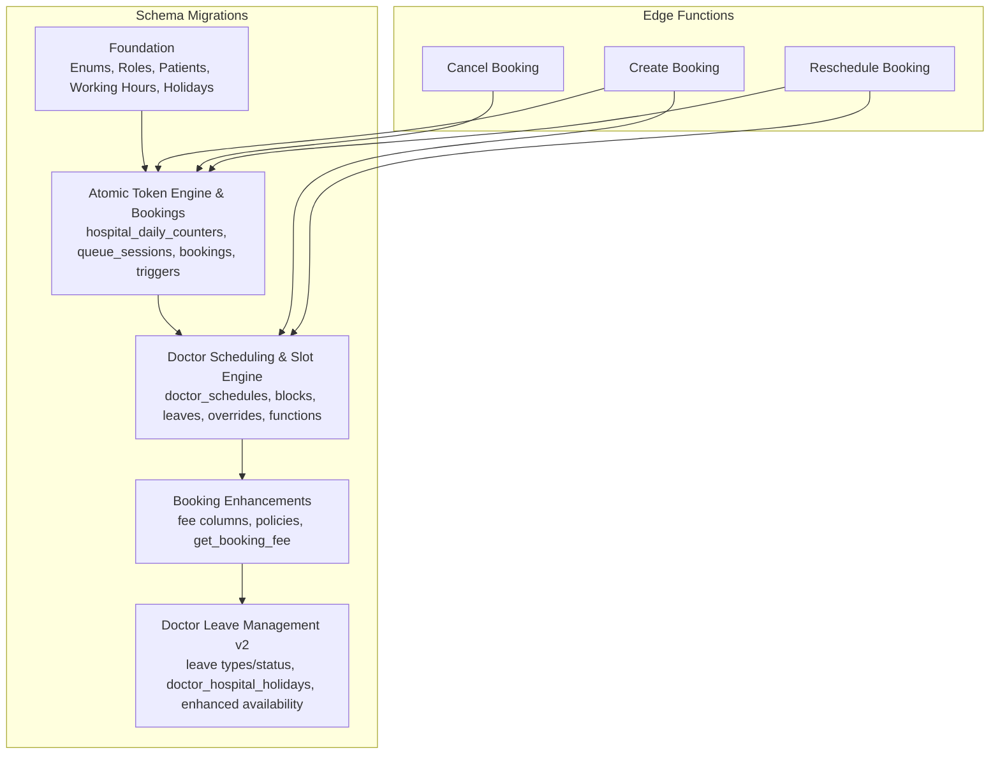
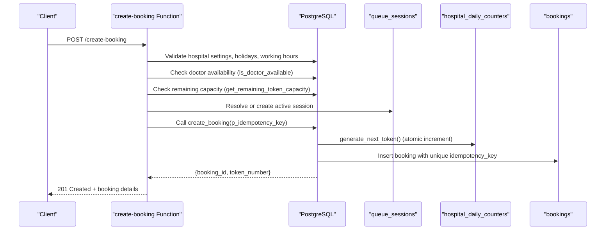
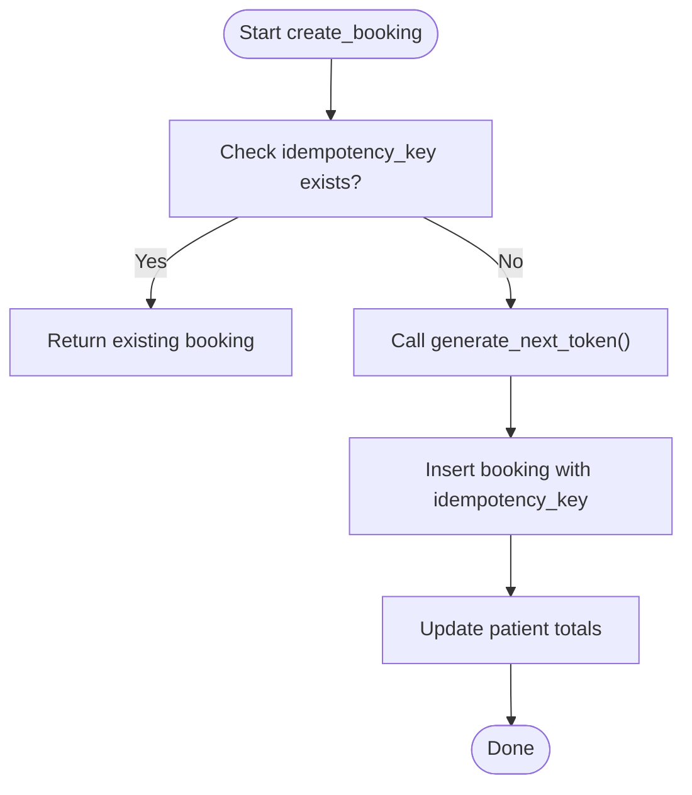
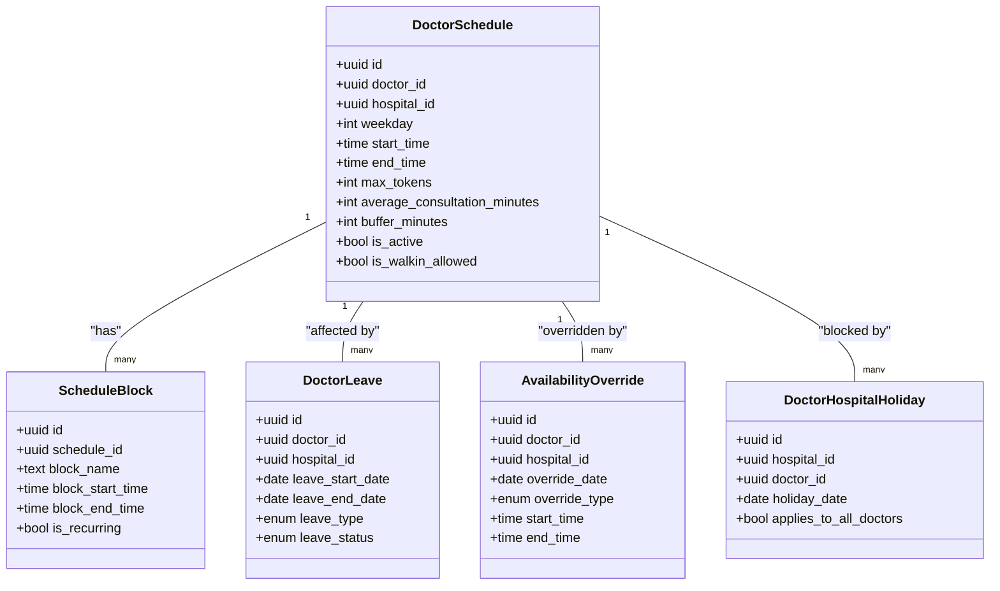
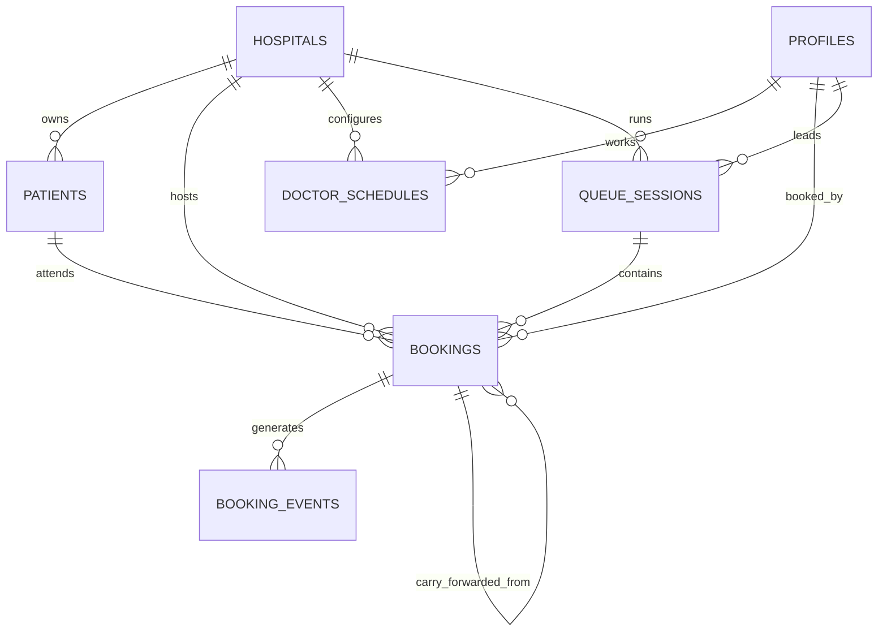
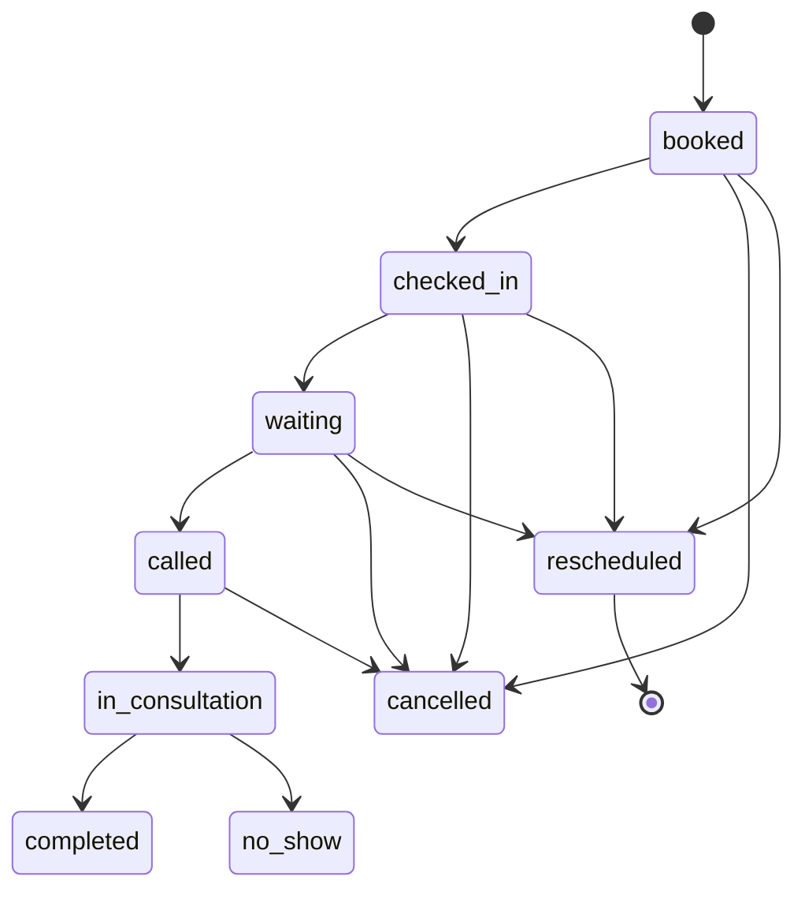
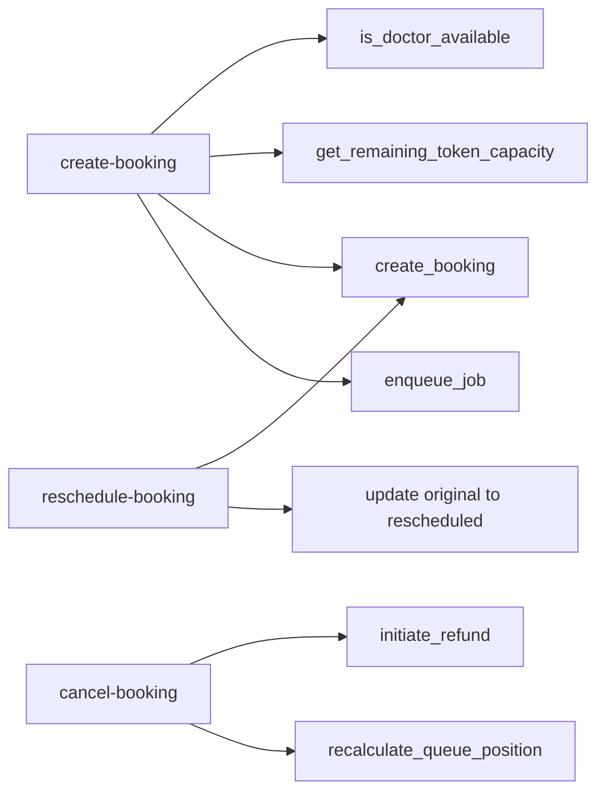

# Booking & Scheduling

<cite>
**Referenced Files in This Document**
- [01_foundation.sql](file://supabase/migrations/01_foundation.sql)
- [02_atomic_token_engine_&_bookings.sql](file://supabase/migrations/02_atomic_token_engine_&_bookings.sql)
- [03_doctorscheduling&slotengine.sql](file://supabase/migrations/03_doctorscheduling&slotengine.sql)
- [28_booking_enhancements.sql](file://supabase/migrations/28_booking_enhancements.sql)
- [31_doctor_leave_management.sql](file://supabase/migrations/31_doctor_leave_management.sql)
- [create-booking/index.ts](file://supabase/functions/create-booking/index.ts)
- [cancel-booking/index.ts](file://supabase/functions/cancel-booking/index.ts)
- [reschedule-booking/index.ts](file://supabase/functions/reschedule-booking/index.ts)
</cite>

## Table of Contents

1. [Introduction](#introduction)
2. [Project Structure](#project-structure)
3. [Core Components](#core-components)
4. [Architecture Overview](#architecture-overview)
5. [Detailed Component Analysis](#detailed-component-analysis)
6. [Dependency Analysis](#dependency-analysis)
7. [Performance Considerations](#performance-considerations)
8. [Troubleshooting Guide](#troubleshooting-guide)
9. [Conclusion](#conclusion)

## Introduction

This document provides a comprehensive data model and operational guide for the
booking and scheduling system in Setura Hospital OS. It covers:

- The bookings table schema, including status and source fields and temporal
  constraints
- Doctor slot management, availability windows, and conflict detection
- The atomic token engine that prevents double-booking and ensures consistency
  under concurrency
- Entity relationships among patients, doctors, time slots, and bookings
- Database triggers and stored procedures enforcing business rules (capacity
  limits, working hours, holidays)
- Indexing strategies for high-performance queries on lookups and conflicts
- Data lifecycle from initial booking through completion or cancellation

## Project Structure

The booking and scheduling domain spans foundational schema, atomic token and
bookings, doctor scheduling and slot engine, and enhancements for leave
management and fee policies. Edge functions implement request flows for
creating, canceling, and rescheduling bookings with idempotency and
auditability.

**Diagram sources**

- [01_foundation.sql:1-150](file://supabase/migrations/01_foundation.sql#L1-L150)
- [02_atomic_token_engine_&_bookings.sql:1-120](file://supabase/migrations/02_atomic_token_engine_&_bookings.sql#L1-L120)
- [03_doctorscheduling&slotengine.sql:1-120](file://supabase/migrations/03_doctorscheduling&slotengine.sql#L1-L120)
- [28_booking_enhancements.sql:1-120](file://supabase/migrations/28_booking_enhancements.sql#L1-L120)
- [31_doctor_leave_management.sql:1-120](file://supabase/migrations/31_doctor_leave_management.sql#L1-L120)
- [create-booking/index.ts:1-120](file://supabase/functions/create-booking/index.ts#L1-L120)
- [cancel-booking/index.ts:1-120](file://supabase/functions/cancel-booking/index.ts#L1-L120)
- [reschedule-booking/index.ts:1-120](file://supabase/functions/reschedule-booking/index.ts#L1-L120)

**Section sources**

- [01_foundation.sql:1-150](file://supabase/migrations/01_foundation.sql#L1-L150)
- [02_atomic_token_engine_&_bookings.sql:1-120](file://supabase/migrations/02_atomic_token_engine_&_bookings.sql#L1-L120)
- [03_doctorscheduling&slotengine.sql:1-120](file://supabase/migrations/03_doctorscheduling&slotengine.sql#L1-L120)
- [28_booking_enhancements.sql:1-120](file://supabase/migrations/28_booking_enhancements.sql#L1-L120)
- [31_doctor_leave_management.sql:1-120](file://supabase/migrations/31_doctor_leave_management.sql#L1-L120)
- [create-booking/index.ts:1-120](file://supabase/functions/create-booking/index.ts#L1-L120)
- [cancel-booking/index.ts:1-120](file://supabase/functions/cancel-booking/index.ts#L1-L120)
- [reschedule-booking/index.ts:1-120](file://supabase/functions/reschedule-booking/index.ts#L1-L120)

## Core Components

- Entities: hospitals, profiles (users), patients, doctor_specializations,
  doctor_schedules, doctor_schedule_blocks, doctor_leaves,
  doctor_availability_overrides, doctor_hospital_holidays, queue_sessions,
  hospital_daily_counters, bookings, booking_events, booking_fee_policies.
- Enums: user_role_type, booking_status, booking_source, override_type,
  doctor_leave_type, doctor_leave_status.
- Key functions: generate_next_token, create_booking, advance_queue,
  is_doctor_available, get_remaining_token_capacity, estimate_wait_minutes,
  get_booking_fee, get_doctor_availability_reason, get_doctor_unavailable_dates.
- Triggers: updated_at setters, hospital_id immutability guard, booking status
  change handler, auto-create booking fee policy.

**Section sources**

- [01_foundation.sql:17-60](file://supabase/migrations/01_foundation.sql#L17-L60)
- [02_atomic_token_engine_&_bookings.sql:12-120](file://supabase/migrations/02_atomic_token_engine_&_bookings.sql#L12-L120)
- [03_doctorscheduling&slotengine.sql:18-120](file://supabase/migrations/03_doctorscheduling&slotengine.sql#L18-L120)
- [28_booking_enhancements.sql:101-153](file://supabase/migrations/28_booking_enhancements.sql#L101-L153)
- [31_doctor_leave_management.sql:48-105](file://supabase/migrations/31_doctor_leave_management.sql#L48-L105)

## Architecture Overview

The booking flow validates hospital rules (working hours, holidays, advance
window), checks doctor availability and capacity, resolves or creates a queue
session, then atomically allocates a token and persists the booking. Status
transitions are enforced by database triggers and edge function state machines.

**Diagram sources**

- [create-booking/index.ts:120-450](file://supabase/functions/create-booking/index.ts#L120-L450)
- [02_atomic_token_engine_&_bookings.sql:31-64](file://supabase/migrations/02_atomic_token_engine_&_bookings.sql#L31-L64)
- [02_atomic_token_engine_&_bookings.sql:446-562](file://supabase/migrations/02_atomic_token_engine_&_bookings.sql#L446-L562)
- [03_doctorscheduling&slotengine.sql:377-497](file://supabase/migrations/03_doctorscheduling&slotengine.sql#L377-L497)

## Detailed Component Analysis

### Bookings Table and Temporal Constraints

- Primary key: id (UUID)
- Tenant isolation: hospital_id (FK to hospitals)
- Queue linkage: queue_session_id (FK to queue_sessions)
- Patient linkage: patient_id (FK to patients); also stores snapshot fields like
  patient_name, patient_phone, age, gender, village, blood_group, has_diabetes,
  has_bp
- Tokenization: token_number (positive integer), unique per queue_session_id
- Priority: priority_score, priority_flag
- Status: booking_status enum; defaults to booked
- Source: booking_source enum (online, manual_free, manual_whatsapp, walkin)
- Assignment: assigned_doctor_id (FK to profiles), booked_by (FK to profiles)
- Appointment date: appointment_date
- Temporal markers: checked_in_at, called_at, consultation_started_at,
  consultation_completed_at, cancelled_at, no_show_marked_at
- Carry-forward tracking: carry_forwarded_from (self-FK), is_carry_forward flag
- Cancellation: cancellation_reason
- Fee snapshots: platform_fee_snapshot, receptionist_fee_snapshot,
  hospital_fee_snapshot, total_amount_snapshot
- Payment: payment_completed, payment_reference
- Notifications: whatsapp_confirmation_sent, whatsapp_reminder_sent,
  feedback_sent
- Estimates: estimated_wait_minutes
- Idempotency: idempotency_key (unique)
- Reference: booking_reference (unique)
- Metadata: metadata JSONB
- Soft delete: is_deleted, deleted_at
- Timestamps: created_at, updated_at

Constraints and indexes:

- Unique constraint on (queue_session_id, token_number)
- Partial indexes for performance:
  - idx_bookings_hospital_date(hospital_id, appointment_date)
  - idx_bookings_status(status WHERE is_deleted=false)
  - idx_bookings_doctor(assigned_doctor_id, appointment_date)
  - idx_bookings_priority(priority_flag, priority_score DESC, token_number ASC
    WHERE is_deleted=false)
  - idx_bookings_patient(patient_id)
  - idx_bookings_queue_lookup(queue_session_id, status, priority_score DESC,
    token_number ASC WHERE is_deleted=false)
  - idx_bookings_idempotency(idempotency_key)

Triggers:

- trg_bookings_updated_at sets updated_at
- trg_bookings_hospital_immutable prevents changing hospital_id
- trg_booking_status_change records old/new status and timestamps when status
  changes

**Section sources**

- [02_atomic_token_engine_&_bookings.sql:150-340](file://supabase/migrations/02_atomic_token_engine_&_bookings.sql#L150-L340)
- [02_atomic_token_engine_&_bookings.sql:345-440](file://supabase/migrations/02_atomic_token_engine_&_bookings.sql#L345-L440)

### Atomic Token Engine

- hospital_daily_counters tracks last_token per (hospital_id, visit_date)
- generate_next_token uses upsert to atomically increment and return next token
- create_booking calls generate_next_token within a single transactional RPC,
  ensuring uniqueness via idempotency_key and unique (queue_session_id,
  token_number)
- advance_queue selects next eligible booking using FOR UPDATE SKIP LOCKED to
  avoid race conditions

**Diagram sources**

- [02_atomic_token_engine_&_bookings.sql:31-64](file://supabase/migrations/02_atomic_token_engine_&_bookings.sql#L31-L64)
- [02_atomic_token_engine_&_bookings.sql:446-562](file://supabase/migrations/02_atomic_token_engine_&_bookings.sql#L446-L562)

**Section sources**

- [02_atomic_token_engine_&_bookings.sql:12-64](file://supabase/migrations/02_atomic_token_engine_&_bookings.sql#L12-L64)
- [02_atomic_token_engine_&_bookings.sql:446-562](file://supabase/migrations/02_atomic_token_engine_&_bookings.sql#L446-L562)
- [02_atomic_token_engine_&_bookings.sql:576-622](file://supabase/migrations/02_atomic_token_engine_&_bookings.sql#L576-L622)

### Doctor Scheduling and Slot Management

- doctor_schedules: weekly schedule per doctor/hospital with start_time,
  end_time, max_tokens, average_consultation_minutes, buffer_minutes, is_active,
  is_walkin_allowed
- Overlap prevention: GIST exclusion constraint on (doctor_id, hospital_id,
  weekday, int4range(start..end))
- doctor_schedule_blocks: time blocks within schedules with overlap prevention
  via GIST exclusion
- doctor_leaves: date ranges with exclusion constraint on overlapping intervals
  per doctor/hospital
- doctor_availability_overrides: per-day overrides
  (available/unavailable/emergency_leave/extended_hours) with optional time
  windows
- doctor_hospital_holidays: per-doctor or global holidays at hospital level

Availability and capacity:

- is_doctor_available(doctor_id, hospital_id, date): checks approved leaves,
  unavailable overrides, hospital holidays, doctor-specific holidays, and active
  schedule
- get_remaining_token_capacity(doctor_id, hospital_id, date): computes
  max_tokens minus non-cancelled/non-no-show bookings
- estimate_wait_minutes(queue_session_id, token_number): estimates wait based on
  ahead-of-token count and average consultation minutes

**Diagram sources**

- [03_doctorscheduling&slotengine.sql:79-179](file://supabase/migrations/03_doctorscheduling&slotengine.sql#L79-L179)
- [03_doctorscheduling&slotengine.sql:185-232](file://supabase/migrations/03_doctorscheduling&slotengine.sql#L185-L232)
- [03_doctorscheduling&slotengine.sql:237-296](file://supabase/migrations/03_doctorscheduling&slotengine.sql#L237-L296)
- [03_doctorscheduling&slotengine.sql:317-372](file://supabase/migrations/03_doctorscheduling&slotengine.sql#L317-L372)
- [31_doctor_leave_management.sql:157-191](file://supabase/migrations/31_doctor_leave_management.sql#L157-L191)

**Section sources**

- [03_doctorscheduling&slotengine.sql:79-179](file://supabase/migrations/03_doctorscheduling&slotengine.sql#L79-L179)
- [03_doctorscheduling&slotengine.sql:185-232](file://supabase/migrations/03_doctorscheduling&slotengine.sql#L185-L232)
- [03_doctorscheduling&slotengine.sql:237-296](file://supabase/migrations/03_doctorscheduling&slotengine.sql#L237-L296)
- [03_doctorscheduling&slotengine.sql:317-372](file://supabase/migrations/03_doctorscheduling&slotengine.sql#L317-L372)
- [03_doctorscheduling&slotengine.sql:377-497](file://supabase/migrations/03_doctorscheduling&slotengine.sql#L377-L497)
- [31_doctor_leave_management.sql:157-191](file://supabase/migrations/31_doctor_leave_management.sql#L157-L191)
- [31_doctor_leave_management.sql:201-269](file://supabase/migrations/31_doctor_leave_management.sql#L201-L269)

### Entity Relationships

**Diagram sources**

- [01_foundation.sql:100-189](file://supabase/migrations/01_foundation.sql#L100-L189)
- [01_foundation.sql:382-463](file://supabase/migrations/01_foundation.sql#L382-L463)
- [02_atomic_token_engine_&_bookings.sql:81-120](file://supabase/migrations/02_atomic_token_engine_&_bookings.sql#L81-L120)
- [02_atomic_token_engine_&_bookings.sql:150-284](file://supabase/migrations/02_atomic_token_engine_&_bookings.sql#L150-L284)
- [03_doctorscheduling&slotengine.sql:79-120](file://supabase/migrations/03_doctorscheduling&slotengine.sql#L79-L120)

### Business Rules Enforcement via Triggers and Procedures

- Updated-at triggers ensure consistent timestamps across tables
- Hospital ID immutability guard prevents cross-tenant migration
- Booking status change trigger records events and timestamps for
  in_consultation, completed, cancelled, no_show
- Auto-create booking fee policy on hospital insert ensures per-hospital fee
  configuration exists
- Capacity and availability enforced by functions:
  - get_remaining_token_capacity enforces daily slot caps
  - is_doctor_available enforces leave, overrides, holidays, and schedule
    presence
  - estimate_wait_minutes supports UI wait-time display

**Section sources**

- [01_foundation.sql:66-94](file://supabase/migrations/01_foundation.sql#L66-L94)
- [02_atomic_token_engine_&_bookings.sql:385-440](file://supabase/migrations/02_atomic_token_engine_&_bookings.sql#L385-L440)
- [28_booking_enhancements.sql:158-176](file://supabase/migrations/28_booking_enhancements.sql#L158-L176)
- [03_doctorscheduling&slotengine.sql:377-497](file://supabase/migrations/03_doctorscheduling&slotengine.sql#L377-L497)

### Indexing Strategy

- Fast lookups:
  - bookings by hospital/date, status, doctor/date, patient
  - queue sessions by hospital/date and doctor/date
  - doctor schedules by doctor/weekday and hospital/weekday
  - doctor leaves and overrides by doctor/hospital/date
- Priority queue ordering:
  - bookings index on (priority_flag, priority_score DESC, token_number ASC)
    filtered to active rows
- Conflict detection:
  - GIST exclusion constraints on schedules, blocks, leaves prevent overlaps at
    DB level
- Idempotency:
  - bookings.idempotency_key indexed for duplicate detection

**Section sources**

- [02_atomic_token_engine_&_bookings.sql:286-324](file://supabase/migrations/02_atomic_token_engine_&_bookings.sql#L286-L324)
- [03_doctorscheduling&slotengine.sql:151-163](file://supabase/migrations/03_doctorscheduling&slotengine.sql#L151-L163)
- [03_doctorscheduling&slotengine.sql:230-232](file://supabase/migrations/03_doctorscheduling&slotengine.sql#L230-L232)
- [03_doctorscheduling&slotengine.sql:281-287](file://supabase/migrations/03_doctorscheduling&slotengine.sql#L281-L287)
- [03_doctorscheduling&slotengine.sql:358-363](file://supabase/migrations/03_doctorscheduling&slotengine.sql#L358-L363)

### Data Lifecycle Management

- Creation:
  - create-booking validates hospital rules, doctor availability, capacity,
    deduplicates patients, calls create_booking RPC, enqueues WhatsApp
    confirmations/reminders, logs audit
- Advancement:
  - advance_queue picks next waiting booking using priority and token order,
    marks as called, updates current_live_token
- Cancellation:
  - cancel-booking enforces terminal states, updates status to cancelled with
    timestamp and reason, optionally initiates refund, recalculates queue
    position, sends WhatsApp notification
- Rescheduling:
  - reschedule-booking marks original as rescheduled, creates new booking with
    same patient and fees, links carry-forward, notifies patient
- Completion:
  - status transitions recorded by trigger; consultation_started_at and
    consultation_completed_at set automatically when statuses change

**Diagram sources**

- [01_foundation.sql:34-48](file://supabase/migrations/01_foundation.sql#L34-L48)
- [02_atomic_token_engine_&_bookings.sql:385-440](file://supabase/migrations/02_atomic_token_engine_&_bookings.sql#L385-L440)
- [cancel-booking/index.ts:188-252](file://supabase/functions/cancel-booking/index.ts#L188-L252)
- [reschedule-booking/index.ts:371-483](file://supabase/functions/reschedule-booking/index.ts#L371-L483)

**Section sources**

- [create-booking/index.ts:120-635](file://supabase/functions/create-booking/index.ts#L120-L635)
- [02_atomic_token_engine_&_bookings.sql:576-622](file://supabase/migrations/02_atomic_token_engine_&_bookings.sql#L576-L622)
- [cancel-booking/index.ts:188-482](file://supabase/functions/cancel-booking/index.ts#L188-L482)
- [reschedule-booking/index.ts:371-612](file://supabase/functions/reschedule-booking/index.ts#L371-L612)

## Dependency Analysis

- Edge functions depend on PostgreSQL functions and tables defined in migrations
- create-booking depends on:
  - is_doctor_available and get_remaining_token_capacity for validation
  - create_booking RPC for atomic token allocation and insertion
  - enqueue_job for notifications
- cancel-booking depends on:
  - initiate_refund RPC (optional)
  - recalculate_queue_position RPC
- reschedule-booking depends on:
  - create_booking RPC to issue new token
  - update to mark original as rescheduled

**Diagram sources**

- [create-booking/index.ts:251-450](file://supabase/functions/create-booking/index.ts#L251-L450)
- [cancel-booking/index.ts:265-338](file://supabase/functions/cancel-booking/index.ts#L265-L338)
- [reschedule-booking/index.ts:371-483](file://supabase/functions/reschedule-booking/index.ts#L371-L483)

**Section sources**

- [create-booking/index.ts:251-450](file://supabase/functions/create-booking/index.ts#L251-L450)
- [cancel-booking/index.ts:265-338](file://supabase/functions/cancel-booking/index.ts#L265-L338)
- [reschedule-booking/index.ts:371-483](file://supabase/functions/reschedule-booking/index.ts#L371-L483)

## Performance Considerations

- Use partial indexes to reduce scan size for active bookings and schedules
- Leverage GIST exclusion constraints to enforce overlap rules at the DB level,
  avoiding application-level checks
- Utilize FOR UPDATE SKIP LOCKED in queue advancement to handle concurrent
  access safely
- Keep idempotency keys short and indexed to minimize duplicate handling
  overhead
- Estimate wait times using precomputed averages and counts to avoid heavy
  real-time calculations

[No sources needed since this section provides general guidance]

## Troubleshooting Guide

- Double-booking prevention:
  - Ensure idempotency_key is provided and unique; duplicates return existing
    booking
  - Verify unique constraint on (queue_session_id, token_number) is enforced
- Capacity exceeded:
  - Check get_remaining_token_capacity returns > 0 before booking
  - Review doctor_schedules.max_tokens and current bookings count
- Doctor unavailable:
  - Inspect doctor_leaves (approved), doctor_availability_overrides
    (unavailable/emergency_leave), hospital_holidays, doctor_hospital_holidays,
    and doctor_schedules
- Working hours and holidays:
  - Validate hospital_working_hours.is_open for the weekday
  - Confirm no entry in hospital_holidays for the appointment date
- Status transition errors:
  - Ensure transitions follow allowed paths; use update-booking-status function
    to validate
- Queue anomalies:
  - Use advance_queue to pick next eligible booking; verify current_live_token
    matches expected

**Section sources**

- [02_atomic_token_engine_&_bookings.sql:446-562](file://supabase/migrations/02_atomic_token_engine_&_bookings.sql#L446-L562)
- [03_doctorscheduling&slotengine.sql:377-497](file://supabase/migrations/03_doctorscheduling&slotengine.sql#L377-L497)
- [01_foundation.sql:468-522](file://supabase/migrations/01_foundation.sql#L468-L522)
- [cancel-booking/index.ts:188-252](file://supabase/functions/cancel-booking/index.ts#L188-L252)
- [reschedule-booking/index.ts:371-483](file://supabase/functions/reschedule-booking/index.ts#L371-L483)

## Conclusion

Setura’s booking and scheduling system combines robust database constraints,
atomic token allocation, and well-defined edge function workflows to ensure
correctness under concurrency. The model supports flexible doctor scheduling,
strict capacity enforcement, and comprehensive lifecycle management from booking
creation through completion or cancellation. Indexing and triggers optimize
performance while preserving data integrity and auditability.

[No sources needed since this section summarizes without analyzing specific
files]
