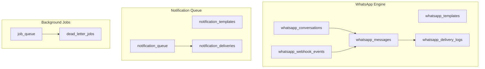
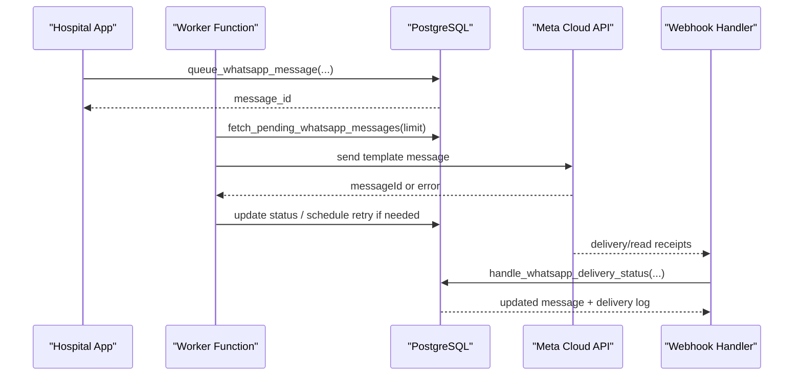
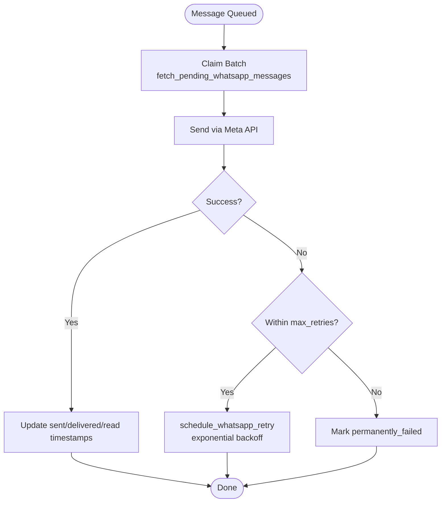
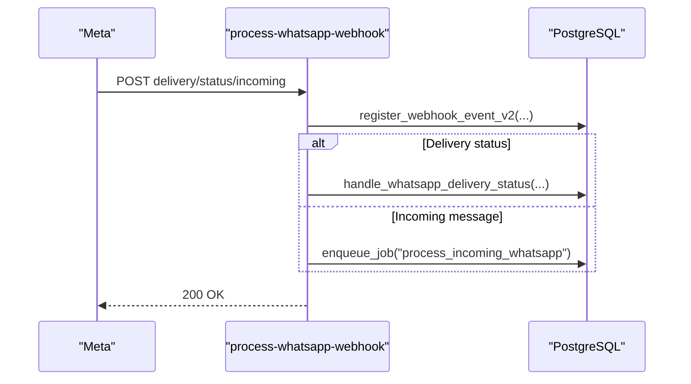
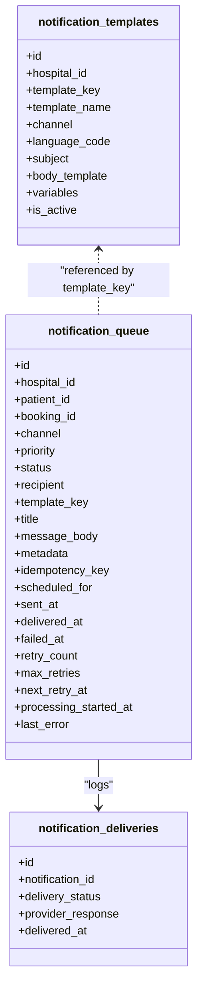
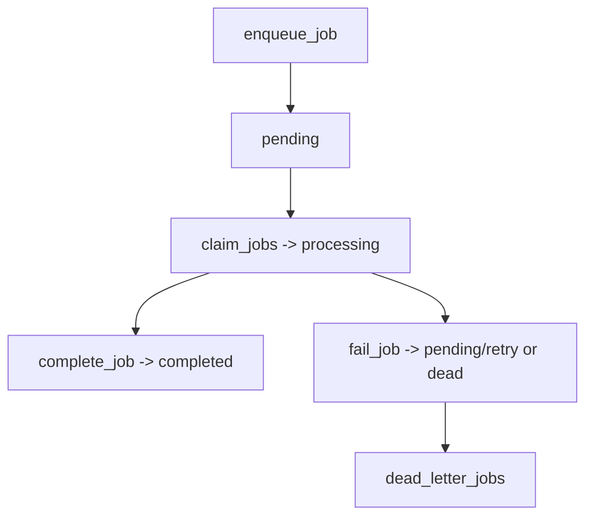
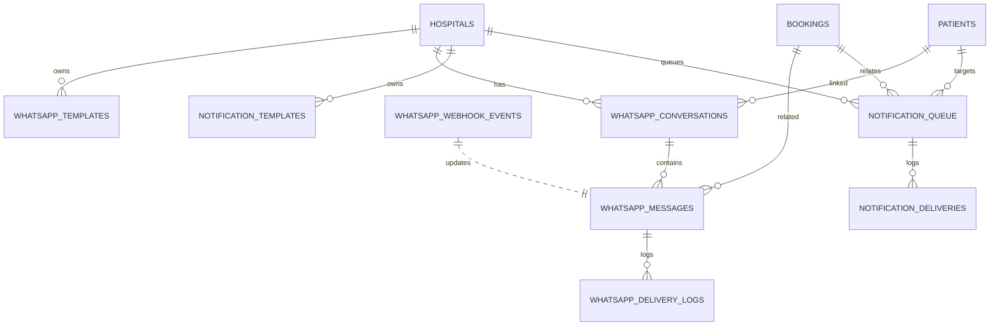
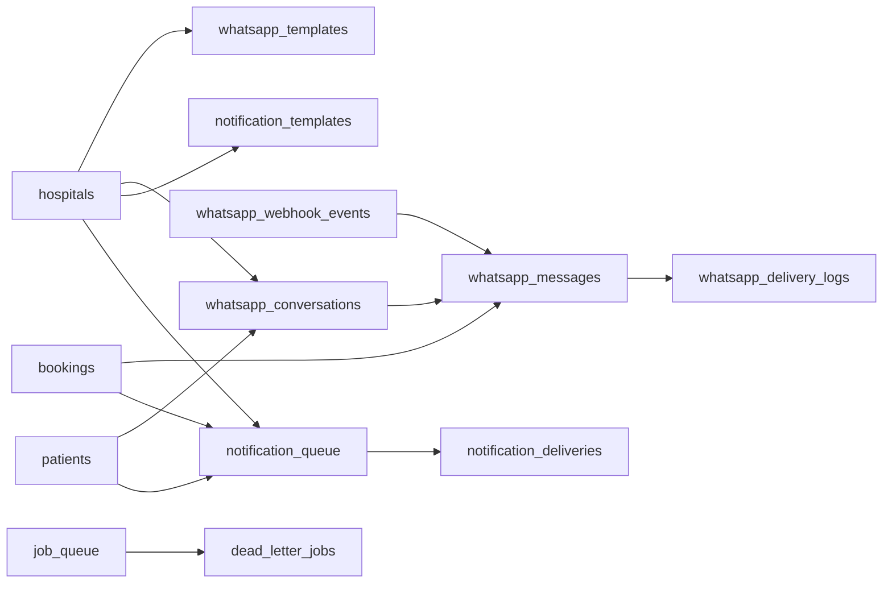

# Communication & Messaging

<cite>
**Referenced Files in This Document**
- [04_whatsapp_messaging_engine.sql](file://supabase/migrations/04_whatsapp_messaging_engine.sql)
- [05_notification_queue.sql](file://supabase/migrations/05_notification_queue.sql)
- [06_background_job_queue.sql](file://supabase/migrations/06_background_job_queue.sql)
- [23_retention_&_cleanup_engine.sql](file://supabase/migrations/23_retention_&_cleanup_engine.sql)
- [process-whatsapp-webhook/index.ts](file://supabase/functions/process-whatsapp-webhook/index.ts)
- [send-whatsapp-message/index.ts](file://supabase/functions/send-whatsapp-message/index.ts)
- [send-reminders/index.ts](file://supabase/functions/send-reminders/index.ts)
</cite>

## Table of Contents

1. Introduction
2. Project Structure
3. Core Components
4. Architecture Overview
5. Detailed Component Analysis
6. Dependency Analysis
7. Performance Considerations
8. Troubleshooting Guide
9. Conclusion
10. Appendices

## Introduction

This document describes the communication and messaging system in Setura
Hospital OS with a focus on WhatsApp messaging, notification queuing, template
storage with localization, entity relationships, database functions for status
updates and retries, performance considerations for high-volume messaging and
real-time updates, and data retention policies for message history and logs.

## Project Structure

The messaging subsystem spans three primary areas:

- WhatsApp messaging engine: tables, enums, triggers, RLS policies, and PL/pgSQL
  functions for conversation tracking, message lifecycle, delivery logs, webhook
  event deduplication, and retry scheduling.
- Notification queue: generic multi-channel queue (WhatsApp, SMS, push, email,
  internal) with templates, prioritization, scheduling, and retry logic.
- Background job queue: worker-safe job claiming, completion, failure handling,
  dead-lettering, and stale lease reclamation.

**Diagram sources**

- [04_whatsapp_messaging_engine.sql:53-331](file://supabase/migrations/04_whatsapp_messaging_engine.sql#L53-L331)
- [05_notification_queue.sql:59-252](file://supabase/migrations/05_notification_queue.sql#L59-L252)
- [06_background_job_queue.sql:41-188](file://supabase/migrations/06_background_job_queue.sql#L41-L188)

**Section sources**

- [04_whatsapp_messaging_engine.sql:1-852](file://supabase/migrations/04_whatsapp_messaging_engine.sql#L1-L852)
- [05_notification_queue.sql:1-595](file://supabase/migrations/05_notification_queue.sql#L1-L595)
- [06_background_job_queue.sql:1-550](file://supabase/migrations/06_background_job_queue.sql#L1-L550)

## Core Components

- WhatsApp templates: per-hospital, per-language, categorized, active/inactive
  flags, unique by hospital + meta name + language.
- Conversations: one per hospital + phone number; tracks latest message time and
  unread count; links to patient when known.
- Messages: outgoing/incoming direction; status progression; timestamps for
  sent/delivered/read/failed; retry counters and next retry schedule;
  idempotency key; metadata; optional link to booking.
- Delivery logs: per-message delivery events with payload capture.
- Webhook events: deduplicated incoming webhook records with processing state.
- Notification templates: per-hospital, per-channel, per-language, with
  variables array.
- Notification queue: priority-based, scheduled sending, retry with exponential
  backoff, delivery logs.
- Background job queue: worker-safe claim/completion/fail, dead-letter queue,
  lease management.

Key PL/pgSQL functions:

- find_or_create_whatsapp_conversation
- queue_whatsapp_message
- fetch_pending_whatsapp_messages
- handle_whatsapp_delivery_status
- schedule_whatsapp_retry
- register_webhook_event
- queue_notification
- fetch_pending_notifications
- mark_notification_sent
- schedule_notification_retry
- enqueue_job / claim_jobs / complete_job / fail_job / reclaim_stale_jobs

**Section sources**

- [04_whatsapp_messaging_engine.sql:53-331](file://supabase/migrations/04_whatsapp_messaging_engine.sql#L53-L331)
- [04_whatsapp_messaging_engine.sql:337-702](file://supabase/migrations/04_whatsapp_messaging_engine.sql#L337-L702)
- [05_notification_queue.sql:59-507](file://supabase/migrations/05_notification_queue.sql#L59-L507)
- [06_background_job_queue.sql:41-484](file://supabase/migrations/06_background_job_queue.sql#L41-L484)

## Architecture Overview

End-to-end flows for outbound WhatsApp messages and inbound webhooks:

**Diagram sources**

- [04_whatsapp_messaging_engine.sql:398-506](file://supabase/migrations/04_whatsapp_messaging_engine.sql#L398-L506)
- [04_whatsapp_messaging_engine.sql:512-592](file://supabase/migrations/04_whatsapp_messaging_engine.sql#L512-L592)
- [process-whatsapp-webhook/index.ts:358-493](file://supabase/functions/process-whatsapp-webhook/index.ts#L358-L493)
- [send-whatsapp-message/index.ts:198-324](file://supabase/functions/send-whatsapp-message/index.ts#L198-L324)

## Detailed Component Analysis

### WhatsApp Templates and Localization

- Storage: per hospital, per meta template name, per language code; supports
  variable definitions as JSONB arrays; active flag controls availability.
- Indexes: optimized lookup by hospital and active status.
- Policies: read access controlled via global admin or hospital-scoped roles.

Use cases:

- Appointment reminders, booking confirmations, cancellation notices, feedback
  requests, consultation start/end notifications.

**Section sources**

- [04_whatsapp_messaging_engine.sql:53-101](file://supabase/migrations/04_whatsapp_messaging_engine.sql#L53-L101)
- [04_whatsapp_messaging_engine.sql:765-777](file://supabase/migrations/04_whatsapp_messaging_engine.sql#L765-L777)

### Conversations and Message History

- One conversation per hospital + phone number; tracks latest message timestamp
  and unread count; can be linked to a patient.
- Messages store direction, status, timestamps, retry info, idempotency key, and
  optional booking linkage.
- Delivery logs record each provider status change with payload snapshot.

Relationships:

- conversations -> messages (one-to-many)
- messages -> delivery_logs (one-to-many)
- messages -> bookings (optional)
- conversations -> patients (optional)

**Section sources**

- [04_whatsapp_messaging_engine.sql:107-231](file://supabase/migrations/04_whatsapp_messaging_engine.sql#L107-L231)
- [04_whatsapp_messaging_engine.sql:278-302](file://supabase/migrations/04_whatsapp_messaging_engine.sql#L278-L302)

### Outbound Message Lifecycle and Retry Logic

- Enqueue: queue_whatsapp_message ensures idempotency and creates/finds
  conversation before inserting message.
- Fetch: fetch_pending_whatsapp_messages atomically claims up to N queued or
  retrying messages using SKIP LOCKED.
- Send: worker calls Meta Cloud API; handles rate limits and permanent failures.
- Status updates: handle_whatsapp_delivery_status updates message status and
  timestamps; inserts delivery log.
- Retry: schedule_whatsapp_retry increments retry_count, sets status to
  retrying, schedules next_retry_at with exponential backoff capped at 1 day;
  marks permanently_failed after max_retries.

**Diagram sources**

- [04_whatsapp_messaging_engine.sql:398-506](file://supabase/migrations/04_whatsapp_messaging_engine.sql#L398-L506)
- [04_whatsapp_messaging_engine.sql:512-661](file://supabase/migrations/04_whatsapp_messaging_engine.sql#L512-L661)
- [send-whatsapp-message/index.ts:198-324](file://supabase/functions/send-whatsapp-message/index.ts#L198-L324)

**Section sources**

- [04_whatsapp_messaging_engine.sql:398-661](file://supabase/migrations/04_whatsapp_messaging_engine.sql#L398-L661)
- [send-whatsapp-message/index.ts:198-324](file://supabase/functions/send-whatsapp-message/index.ts#L198-L324)

### Inbound Webhooks and Incoming Messages

- HMAC verification and challenge response for Meta webhook setup.
- Deduplication via register_webhook_event_v2 (provider-level dedupe table).
- Delivery statuses mapped to WhatsApp statuses and applied via
  handle_whatsapp_delivery_status.
- Incoming messages enqueued as jobs for further processing.

**Diagram sources**

- [process-whatsapp-webhook/index.ts:152-256](file://supabase/functions/process-whatsapp-webhook/index.ts#L152-L256)
- [process-whatsapp-webhook/index.ts:358-493](file://supabase/functions/process-whatsapp-webhook/index.ts#L358-L493)
- [process-whatsapp-webhook/index.ts:495-612](file://supabase/functions/process-whatsapp-webhook/index.ts#L495-L612)

**Section sources**

- [process-whatsapp-webhook/index.ts:152-612](file://supabase/functions/process-whatsapp-webhook/index.ts#L152-L612)

### Notification Queue System

- Templates: per hospital, channel, language; variables defined as JSONB arrays.
- Queue entries: recipient, template_key, title, body, priority, scheduling
  time, idempotency key, retry counters and backoff.
- Worker-safe fetching: fetch_pending_notifications orders by priority then
  created_at, uses SKIP LOCKED.
- Delivery logging: mark_notification_sent records provider responses and
  timestamps.
- Retry: schedule_notification_retry implements exponential backoff and
  permanent failure after max_retries.

**Diagram sources**

- [05_notification_queue.sql:59-252](file://supabase/migrations/05_notification_queue.sql#L59-L252)

**Section sources**

- [05_notification_queue.sql:59-507](file://supabase/migrations/05_notification_queue.sql#L59-L507)

### Background Job Queue Integration

- enqueue_job: idempotent insertion with priority and scheduling.
- claim_jobs: worker-safe batch claim with lease expiration and attempt
  counting.
- complete_job / fail_job: lifecycle transitions; fail_job moves to dead letter
  after max attempts.
- reclaim_stale_jobs: recovers stuck processing jobs.

**Diagram sources**

- [06_background_job_queue.sql:194-484](file://supabase/migrations/06_background_job_queue.sql#L194-L484)

**Section sources**

- [06_background_job_queue.sql:41-484](file://supabase/migrations/06_background_job_queue.sql#L41-L484)

### Entity Relationships

**Diagram sources**

- [04_whatsapp_messaging_engine.sql:53-331](file://supabase/migrations/04_whatsapp_messaging_engine.sql#L53-L331)
- [05_notification_queue.sql:59-252](file://supabase/migrations/05_notification_queue.sql#L59-L252)

**Section sources**

- [04_whatsapp_messaging_engine.sql:53-331](file://supabase/migrations/04_whatsapp_messaging_engine.sql#L53-L331)
- [05_notification_queue.sql:59-252](file://supabase/migrations/05_notification_queue.sql#L59-L252)

## Dependency Analysis

- WhatsApp engine depends on hospitals and patients for scoping and context;
  optionally on bookings for correlation.
- Notification queue is decoupled from specific channels via template_key and
  channel enum; can target multiple recipients and channels.
- Background job queue provides reusable primitives used by webhook handler to
  process incoming messages and by reminder cron to enqueue outbound messages.

**Diagram sources**

- [04_whatsapp_messaging_engine.sql:53-331](file://supabase/migrations/04_whatsapp_messaging_engine.sql#L53-L331)
- [05_notification_queue.sql:59-252](file://supabase/migrations/05_notification_queue.sql#L59-L252)
- [06_background_job_queue.sql:41-188](file://supabase/migrations/06_background_job_queue.sql#L41-L188)

**Section sources**

- [04_whatsapp_messaging_engine.sql:53-331](file://supabase/migrations/04_whatsapp_messaging_engine.sql#L53-L331)
- [05_notification_queue.sql:59-252](file://supabase/migrations/05_notification_queue.sql#L59-L252)
- [06_background_job_queue.sql:41-188](file://supabase/migrations/06_background_job_queue.sql#L41-L188)

## Performance Considerations

- Worker-safe batching: fetch functions use FOR UPDATE SKIP LOCKED to avoid
  contention and enable parallel workers.
- Indexes: targeted indexes on status, timestamps, and foreign keys optimize
  claim queries and lookups.
- Idempotency: idempotency keys prevent duplicate sends and queue entries.
- Rate limiting: outbound sender detects 429 responses and applies retry-after
  backoff; retry logic caps delays to prevent excessive waits.
- Realtime: realtime publication enabled for whatsapp_messages and
  whatsapp_conversations to support live dashboards.
- Scheduling: notification_queue supports scheduled_for to stagger load;
  priority ordering ensures critical items are processed first.
- Monitoring: operational monitoring captures queue depths and health scores to
  detect bottlenecks.

[No sources needed since this section provides general guidance]

## Troubleshooting Guide

Common issues and diagnostics:

- Duplicate webhooks: handled via provider-level deduplication; check webhook
  event registration and completion.
- Stuck messages: inspect message_status and next_retry_at; ensure workers call
  fetch_pending_whatsapp_messages regularly.
- Permanent failures: review error_message and failed_at; verify template
  configuration and Meta credentials.
- Retries exhausted: schedule_whatsapp_retry and schedule_notification_retry
  move items to permanently_failed; investigate last_error.
- Stale jobs: reclaim_stale_jobs recovers jobs with expired leases; monitor
  dead_letter_jobs for persistent failures.
- Health metrics: use operational monitoring functions to snapshot queue depths
  and compute health score.

**Section sources**

- [04_whatsapp_messaging_engine.sql:512-661](file://supabase/migrations/04_whatsapp_messaging_engine.sql#L512-L661)
- [05_notification_queue.sql:401-507](file://supabase/migrations/05_notification_queue.sql#L401-L507)
- [06_background_job_queue.sql:326-484](file://supabase/migrations/06_background_job_queue.sql#L326-L484)

## Conclusion

Setura’s messaging system combines robust WhatsApp integration with a flexible,
multi-channel notification queue and a resilient background job engine. It
emphasizes idempotency, worker-safe concurrency, comprehensive auditability
through delivery logs, and scalable retry strategies. Realtime publications and
operational monitoring enable responsive operations and proactive maintenance.
Data retention policies ensure compliance and efficient storage over time.

## Appendices

### Data Retention Policies

- WhatsApp messages retained for 365 days; delivery logs for 180 days with hard
  delete after 180 days.
- Notification queue and deliveries retained for 90 days with hard delete after
  90 days.
- Webhook events retained for 90 days with hard delete after 90 days.
- Conversation history retained for 730 days.
- Completed jobs retained for 30 days with hard delete after 30 days; dead
  letter jobs for 90 days.

Operational functions:

- soft_delete_aged_messages: archives old messages by marking metadata.
- run_retention_cleanup: orchestrates cleanup tasks and returns results.
- get_retention_report: lists active retention policies.

**Section sources**

- [23_retention_&_cleanup_engine.sql:129-184](file://supabase/migrations/23_retention_&_cleanup_engine.sql#L129-L184)
- [23_retention_&_cleanup_engine.sql:222-321](file://supabase/migrations/23_retention_&_cleanup_engine.sql#L222-L321)

### Cron-Driven Reminders

- send-reminders runs periodically to identify due appointments based on
  hospital settings and working hours.
- Enqueues high-priority jobs to send WhatsApp appointment reminders with
  idempotency keys to avoid duplicates.

**Section sources**

- [send-reminders/index.ts:111-388](file://supabase/functions/send-reminders/index.ts#L111-L388)
